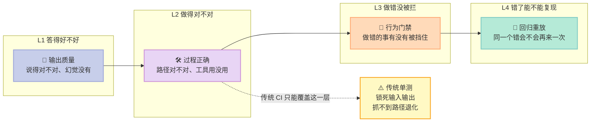
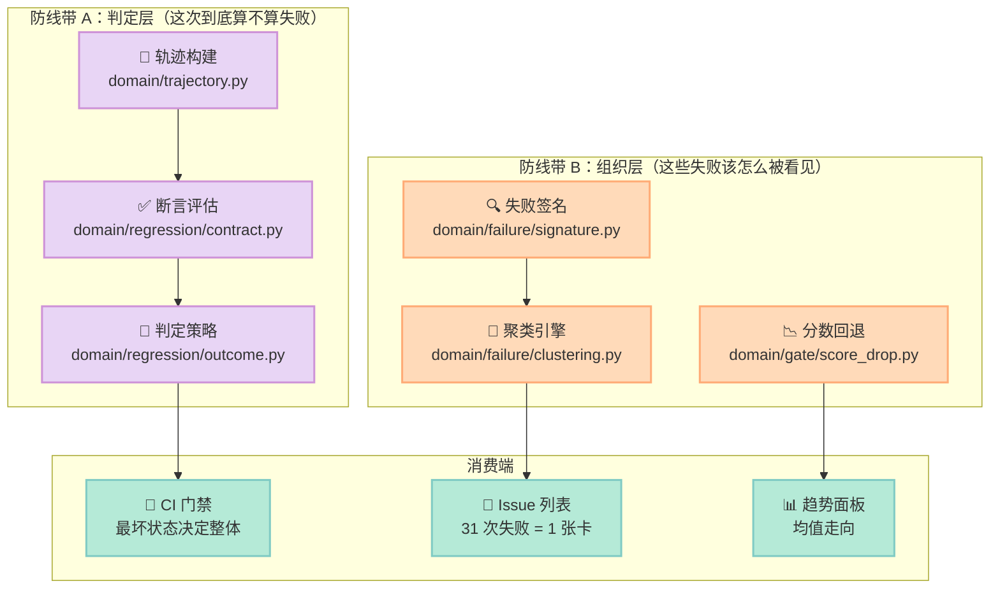
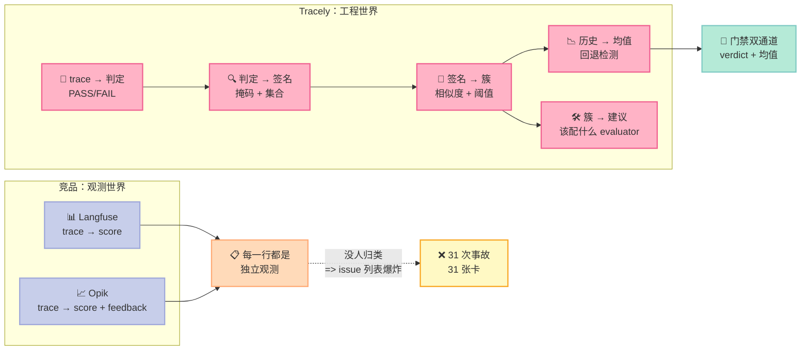

## 引子：一个 bug 抓到了，然后呢？

先说清楚这个系列的定位。上个月我写过一篇《【Tracely】回归测试即生产 Trace》，讲的是 Tracely 的**第一层**：怎么把一次生产 trace 冻结成回归用例，怎么用 fail-to-pass 契约保证这个用例真的能区分好坏版本，以及为什么判定状态必须分 PASS / FAIL / INCOMPLETE 三态而不是二值。

那一层解决的是"**一个 bug 怎么变成一个测试**"。

但**从 bug 到测试，中间还隔着一段没人愿意走的路**。真实的生产环境是这样的：

- 同一个 bug 一天触发 31 次，你的 issue 列表被淹没在 31 张卡里
- 有时候两次失败长得极像但根因完全不同，被错误地合并成一个 issue，修完一个另一个还在
- 有时候两次失败措辞完全不同但其实是同一个 bug，被拆成两个 issue，修了一个另一个复发
- 门禁全绿，但目标完成度从 0.9 滑到 0.6——**每个对话都过了及格线，整体却在变差**
- 最阴的一种：模型正确地"决定"要调用 `escalate_to_human`，但代码里那个分支没实现，这一步被静默吞掉。**从最终输出看一切正常，从工具调用日志看也一切正常，因为模型确实请求了。**

这一篇讲的就是 Tracely 的**第二层**：**失败之后发生了什么**。

它有六道防线，篇篇都是从"朴素做法会怎么错"倒推出来的：

| # | 防线 | 朴素的坑 | Tracely 的机制 |
|---|------|---------|--------------|
| 1 | **静默失败检测** | 只看"执行了哪些工具" → 模型请求但没执行的工具查不出来 | `requested_tools` vs `tool_sequence` 的差集 |
| 2 | **失败签名** | 直接哈希失败文本 → judge 的两种措辞分成两个簇 | 掩码（id/number/引号）+ evaluator 集合 |
| 3 | **文本覆盖阈值** | evaluator 集合相等才合并 → 集合抖动导致生产上出现重复簇 | sim ≥ 0.9 无视集合直接合并 |
| 4 | **聚类算法选型** | 一律先 UMAP 降维 → 小样本上造出根本不存在的簇 | `n` 小时直接跑余弦距离 HDBSCAN |
| 5 | **断言的哲学** | 把录下来的参数也断言进去 → 把 bug 焊死在测试里 | 只锁工具**名字**，参数交给人 |
| 6 | **分数回退检测** | verdict 全绿就放行 → 均值从 0.9 滑到 0.6 看不见 | 逐 scenario 对齐 + 只比 [0,1] 量纲 |

### 插图：Agent 质量保障的四个台阶

先摆清楚一件事：**给 Agent 做质量保障，和给传统软件做质量保障，是完全不同的工程问题。** 传统软件的 bug 是"代码没按预期执行"，而 Agent 的 bug 有四类，每一类需要完全不同的工具：



**L1（答得好不好）** 是 2024-2025 年 LLM 时代的核心战场——评测集、LLM-as-judge、RAG 质量。工具最多，也最卷。

**L2（做得对不对）** 是 2025-2026 年 Harness 时代的核心——轨迹（trajectory）、步骤断言、路径比较。Agent 工具链（Langfuse、Opik）主要在这里发力。

**L3（做错没被拦）** 是 2026 年 Agent 开始自己提交 PR 之后才出现的刚需——不可绕过的 CI 门禁。

**L4（错了能不能复现）** 是最少有人做、但价值最高的一层——把一次真实失败变成可无限重放的确定性测试。

**Tracely 是少数同时覆盖 L3 和 L4 的开源项目**，而且 L4 的实现方式（trace-first + fail-to-pass 契约）是目前唯一一套完整可用的方案。这就是我选它做本周主角的原因。

---

## 一、项目定位：Tracely 在 Harness 6 件套里的位置

Tracely（[`jwuthri-cloud/Tracely-ai`](https://github.com/jwuthri-cloud/Tracely-ai)）的自我描述是 **"Trace-native CI/CD for AI agents"**。它不生产 Agent，不托管 Agent，它是**给 Agent 当 CI 的那一层**。

用 Harness 6 件套的框架来定位它：

| 组件 | Tracely 里的对应物 | 说明 |
|------|-------------------|------|
| **Rule** | `skills/tracely/SKILL.md` | 给 Coding Agent 的操作手册：怎么接 SDK、怎么 promote、怎么跑 gate |
| **Skill** | 同上 + `design/` 下的 22 篇架构文档 | 不是"加载一个 SOP"，而是把工程知识固化成可执行约定 |
| **Sub-Agent** | `Fleet` 视图（像素办公室） | 每个 agent 是一个角色，handoff 是角色走动——用来向不懂 waterfall 的人解释多 Agent 系统 |
| **Workflow** | `tracely simulate` / `tracely gate` 两种模式 | 多轮对话模拟 vs 已提升用例的 CI 重放 |
| **Script** | `.github/actions/tracely-gate` + `tracely` CLI | **不可绕过的门控**：exit code 非零 = PR 挂掉 |
| **MCP** | `/mcp` server（tracely 2.x） | 让 Agent 自己查询"我这次跑得怎么样" |

但真正独特的位置在**第 5 个格子：Script**。这是整个 Harness 工程里最被低估的一环。

**为什么 Script 组件在 2026 年下半年才变成刚需？** 因为前两年 Agent 的失败模式是"输出不对"——那是 Rule 和 Skill 能治的。而 2026 年的 Agent 越权越深：它自己写代码、自己提交 PR、自己跑部署。失败模式从"答错"变成了"**做错事**"。而"做错事"必须有一个**不可绕过的物理关卡**来拦。

Tracely 就是那个关卡。

```
生产事故 ──▶ 一条 trace（发生了什么）
              │
              ├─▶ 在线评测（这次失败了吗）──▶ 失败聚类（31 次失败 = 1 个 issue）
              │                                     │
              │                                     ▼
              │                              提升为回归用例（fail-to-pass 契约）
              │                                     │
              │                                     ▼
              └────────────────────────▶ CI 门禁（重放历史 fixture，$0 成本）
                                                │
                                                ▼
                                          拦下这个 PR
```

> **核心主张：可观测性到 dashboard 就结束了。**
> Tracely 的 README 有一节叫 "Why another agent-observability tool?"，第一句是："Because observability stops at the dashboard. You can see that your agent broke — then what?"
> 它的答案不是"给你更多图"，而是"**给你一个会红的 CI check**"。

### 1.1 本篇聚焦哪一段

上面这张闭环图里，有**两段**是 Tracely 独有的：

```
   ┌─────────── 第一层（上一篇讲过）───────────┐┌──── 第二层（本篇）────┐
   │                                          ││                       │
   ▼                                          ▼▼                       ▼
 trace ──▶ 判定 PASS/FAIL ──▶ 提升为用例 ──▶ 聚类成 issue ──▶ 均值回退检测
        （四态判定）        （fail-to-pass）    （签名+阈值）      （逐scenario对齐）
```

**第一层**：把一次失败变成一个能红的测试。
**第二层**：把很多次失败变成一张卡、一条趋势、一个不误报的告警。

第二层难在**不确定性**：失败文本是 LLM 写的（措辞每次都不同）、evaluator 集合会抖动、判定是二值的但质量是连续的、"没跑起来"和"跑过了"在传统 CI 里长得一模一样。

**本篇讲的就是怎么对付这四种不确定性。**

---

## 二、架构分析：两层防线怎么叠在一起

Tracely 的后端是一个 FastAPI + Celery + ClickHouse + Postgres + Redis + MinIO 的六件套，代码量不小（`backend/tracely/` 下光 Python 文件就过百）。但它的**架构智慧全在 `domain/` 层**——那是一层**纯函数**，没有 I/O、没有 settings、没有 DB 句柄。

这种分层不是洁癖，它带来一个具体的工程收益：**UI 的手动重放、CLI 的 `tracely gate`、CI 门禁，三条路径调用的是同一个契约函数**。`services/regression_service.py` 的注释里写得很清楚：

> Graded through the SAME contract the gate applies, so a judge the gate would treat as advisory cannot promote a case here.

翻译过来就是：**你在界面上点"重放"看到的结论，和 CI 里判红/判绿依据的逻辑，是同一段代码**。不会出现"界面显示通过、CI 却拦下来"这种最消耗团队信任的割裂。

更关键的是，这一层纯函数被明确分成了**两条防线带**：



**防线带 A（判定层）** 回答"**这一次运行算不算失败**"。上一篇已经讲过它的四态判定，本篇补上它最重要的两个盲区修复：静默失败缺口（防线一）和断言哲学（防线二）。

**防线带 B（组织层）** 回答"**这些失败该怎么被看见**"。这是本篇的主角。判定层再准，如果 31 次一样的失败在 issue 列表里占 31 张卡，这个系统就没人会用；判定层再准，如果均值从 0.9 滑到 0.6 而门禁全绿，这个系统就是危险的。

**Less is More 检查**：哪些组件是"模型自己能学会的"，哪些是"外部物理世界必需的"？

- **模型自己能学会的**：判断一段回答好不好、总结一段对话、写一条评估理由、给两条失败文本算相似度——这些全交给 LLM judge 或 embedding，Tracely 不自己发明质量标准。
- **外部物理世界必需的**：**"这次重放到底跑了没有"、"这个检查到底执行了没有"、"这两条失败是不是同一个"、"这个 PR 到底能不能合并"** —— 这些是物理世界的事实，不能交给模型推断。Tracely 把大量代码花在这几件事上。

这就是它的取舍：**质量判断外包给模型，可信性判断留给自己。**

---

## 三、防线一：静默失败——"模型请求了"不等于"工具跑了"

Tracely 的 `domain/trajectory.py` 只有 160 行，但它定义了整套评测的语义基础。

### 3.1 从 span 到轨迹

一条 trace 在 ClickHouse 里是一堆 span 行。`build_trajectory()` 把它们转成 `Trajectory`：

```python
@dataclass
class TrajectoryStep:
    span_id: str
    parent_span_id: str
    kind: str          # llm / tool / agent / subagent / delegate / skill ...
    name: str
    level: str         # "ERROR" 表示这层出错
    status: str
    tool_calls: list[str] = field(default_factory=list)
    output: Any = None
    input: Any = None


@dataclass
class Trajectory:
    trace_id: str
    agent_run_id: str
    steps: list[TrajectoryStep] = field(default_factory=list)
```

关键在于 `kind` 的映射表（原文照抄）：

```python
_KIND = {
    "GENERATION": "llm", "TOOL": "tool", "AGENT": "agent", "SUBAGENT": "subagent",
    "RETRIEVER": "retriever", "CHAIN": "step", "GUARDRAIL": "guardrail",
    "EMBEDDING": "llm", "EVALUATOR": "step", "SPAN": "step", "EVENT": "other",
    "DELEGATE": "delegate", "SKILL": "skill",
}
```

这张表是**机制与策略分界线的具体体现**：Tracely 规定了"轨迹里有哪些种类的步骤"（机制），但"什么算失败"完全交给可插拔的 evaluator（策略）。

### 3.2 "请求了但没执行"——被忽略的第三种工具集合

这是我认为 Tracely 最锋利的单个设计。轨迹里有**两种**工具集合，而不是一种：

```python
def tool_sequence(traj: Trajectory) -> list[str]:
    """The ordered tool names the agent actually executed (TOOL-type spans)."""
    return [st.name for st in traj.steps if st.kind == "tool"]


def requested_tools(traj: Trajectory) -> list[str]:
    """Tools the model asked for (tool_call_names on any step), de-duplicated in first-seen order.
    A 'silent failure' is a requested tool that was never executed — so this can exceed
    tool_sequence()."""
    seen: list[str] = []
    for st in traj.steps:
        for t in st.tool_calls:
            if t and t not in seen:
                seen.append(t)
    return seen
```

**为什么这个区分是刚需？** 因为 LLM 的失败模式里有一类特别隐蔽：**模型正确地"决定"要调用 `escalate_to_human`，但代码里那个 dispatch 分支没实现，于是这步被静默吞掉**。从最终输出看，Agent 说了"已为您处理退款"，一切正常。日志里工具调用记录也是完整的——因为模型确实请求了。

但工具根本没跑。

如果你的测试只断言 `tool_sequence()`，这个 bug 抓不到。如果你的测试断言 `requested_tools()`，那它**主动要求**修复后的 Agent 必须真的调用那个工具——而且因为 source trace 自己就没有执行它，**source 必然 FAIL，修复版必然 PASS**。fail-to-pass 契约自动成立。

对应的代码：

```python
def required_tools(traj: Trajectory) -> list[str]:
    """Tools a faithful run of this case must execute: every tool this run actually executed, plus
    any tool the model requested but never ran (the silent-failure gap). Keyed off the latter so a
    promoted silent failure asserts the fix really calls the tool — and the source, which didn't,
    FAILs (fail-to-pass)."""
    executed = tool_sequence(traj)
    return executed + [t for t in requested_tools(traj) if t not in executed]
```

**这个差集还有第二个用途**：它是一个现成的、零成本的**静默失败率度量**。你的 Agent 每 100 次运行里有几次"说要调但没调"，这个数字不需要任何新埋点——它已经存在于你的 span 树里了，只是没人去减。

### 3.3 把"工具错了"和"Agent 错了"分开

```python
def split_errors(traj: Trajectory) -> tuple[list[str], list[str]]:
    """(tool_errors, run_errors): erroring TOOL steps (the replayed environment) vs the agent's
    own erroring steps. Lets a case tolerate tool failures while still gating on the run outcome."""
    tool_errs = [st.name for st in traj.steps if st.level == "ERROR" and st.kind == "tool"]
    run_errs = [st.name for st in traj.steps if st.level == "ERROR" and st.kind != "tool"]
    return tool_errs, run_errs
```

这个区分直接映射到一条业务语义：

- **工具报错**（支付网关返回 502）→ 这是**被重放的外部环境**，不是 Agent 的错。修复应该是"网关重试"或"优雅降级"。
- **Agent 自己报错**（抛异常、模型返回空）→ 这是**必须拦下来**的。

所以断言里有一个 `allow_tool_errors` 开关。开启它的条件是"source trace 同时有 tool error 和 run error"——也就是"这次事故是'工具挂了，Agent 也没处理好'"。这种情况下用例要容忍工具继续报错，但仍然对 Agent 的最终行为负责。

### 3.4 四种匹配模式

```python
def tools_satisfied(mode: str, produced: list[str], reference: list[str]) -> tuple[bool, list[str], list[str]]:
    """agentevals match modes over the tool sequence. Returns (ok, missing, extra)."""
    missing = [t for t in reference if t not in produced]
    extra = [t for t in produced if t not in reference]
    if mode == "strict":
        ok = produced == reference
    elif mode == "unordered":
        ok = sorted(produced) == sorted(reference)
    elif mode == "subset":
        ok = len(extra) == 0
    else:
        ok = len(missing) == 0
    return ok, missing, extra
```

`strict`（完全一致，含顺序）/ `unordered`（集合一致）/ `subset`（不许多调用）/ `superset`（不许漏调用）——四个语义给不同成熟度的项目用。Tracely 的默认提升策略是 `superset`，理由后面会讲：**这条选择本身就是一道防线。**

## 四、防线二：断言的哲学——只锁名字，不锁参数

上一篇讲 fail-to-pass 契约时，我们说"用一次失败的 trace 自动推导断言"。但"**怎么推导**"这一步，才是这条链路里最容易出事的地方。

Tracely 的 `services/regression_service.py` 里有这么一段，我把它整段贴出来，因为它是整个项目里最值得学的一段工程思维：

```python
@staticmethod
def _build_assertions(traj: Trajectory) -> dict:
    """What the fixed agent must do, derived from the trace that broke.

    Deliberately tool NAMES, never tool ARGUMENTS. The reference here is a production failure,
    not a golden run: asserting the recorded args would assert the bug, and an agent fixed to
    pass the right ones would fail this case for ever. A trace whose only fault was bad
    arguments therefore yields a case its own source PASSES — `_record_fail_to_pass` leaves
    that DRAFT and unvalidated, which is the honest answer ("this one can't discriminate")
    rather than a gate that is green on a bug or red on a fix.
    """
    ref_tools = required_tools(traj)
    src_tool_errs, src_run_errs = split_errors(traj)
    allow_tool_errors = bool(src_tool_errs and src_run_errs)
    return {
        "no_error": True,
        "required_tools": ref_tools,
        "match_mode": "superset",
        "allow_tool_errors": allow_tool_errors,
    }
```

我把这段注释逐句翻译一下：

> **刻意只锁工具"名字"，绝不锁工具"参数"。**
> 这里的参考来自一次生产失败，不是一次"黄金运行"：**断言录下来的参数 = 断言那个 bug 本身**，一个被修好（传对了参数）的 Agent 反而会永远挂在这个用例上。

### 4.1 把 bug 焊死在测试里的陷阱

设想一个具体事故：Agent 调了 `issue_refund`，但金额传成了 50 而不是 500。

最直觉的做法是——把这次 trace 录下来，断言 `issue_refund(amount=50)`。听起来很精确，实际上是**把 bug 焊死在了测试里**：

1. 开发者修好代码，Agent 现在传 500
2. 测试红了
3. 开发者去改测试，改成断言 `amount=500`
4. 测试绿了，**但这个 bug 的保护能力已经没了**

这就是自动化测试里最阴险的一类循环：**测试从"记录现状"变成了"固化现状"**。

Tracely 的处理方式是**诚实地说"这个用例区分不了"**：

```python
def _record_fail_to_pass(self, case, spans, trace_id, quality_results=None) -> str:
    """The source (failing) trace must currently FAIL the case for it to be PROMOTED — either
    structurally (the tool/error contract) OR on a required answer-quality judge (a hallucination
    whose trace is structurally clean). Graded through the SAME contract the gate applies, so a
    judge the gate would treat as advisory cannot promote a case here.
    Otherwise the case is a non-discriminating no-op and stays DRAFT.
    ...
    """
    outcome = grade_case(self.eval_service, case, spans, quality_results=quality_results or [])
    recorded = outcome.verdict
    case.fail_to_pass_validated = recorded == "FAIL"
    case.status = "PROMOTED" if case.fail_to_pass_validated else "DRAFT"
```

规则简单到可以一句话说完：

> **source trace 自己必须 FAIL 这个用例。用例能 PASS 自己的 source，就说明它区分不了新旧，保持 DRAFT，不进门禁。**

这条规则的价值不在"省了一个测试"，而在**防止 CI 门禁变成噪音**。一个永远绿的测试比没有测试更危险——它给人虚假的安全感。

而参数级断言并非不能做——Tracely 支持 `tool_args`（形如 `[{"tool": "issue_refund", "key": "amount", "equals": 500}]`），但它需要**人工写入期望值**，不能自动推导。**自动推导的和人工撰写的，必须分开存放、分开标注。** 这是一条很干净的边界。

### 4.2 质量评委也能提升用例

```python
# Answer-quality judges that the SOURCE trace failed → the case guards against them too,
# so a hallucination with a structurally-clean trace is still promotable + gate-able.
quality_results = self._grade_source_quality(project_id, spans)
quality_failed = [r.name for r in quality_results if r.verdict == "FAIL"]
if quality_failed:
    assertions["quality"] = {"score_names": quality_failed}
```

这一段解决的是**"结构上没毛病，但答案在胡说"**的场景。比如 Agent 引用了一个不存在的政策条款——轨迹上每个工具都调对了，但它就是编的。

这种 bug 用纯结构断言抓不到，但**它当初为什么会被判 FAIL？** 因为质量评委判了 FAIL。所以把那个评委的名字写进用例的期望里，以后每次门禁都会重新问一遍："这次答案还对吗？"

于是提升路径变成两条：
- **结构失败**（工具没调 / 报错）→ 结构断言锁住
- **语义失败**（幻觉 / 低质量）→ 质量评委锁住

---

## 五、防线三 + 四 + 五：把 31 次失败变成 1 个 issue

线上一次事故往往是成片的——同一个 bug 触发 31 次。Tracely 需要把它们合成一个 issue，否则你的 issue 列表会被淹没。

### 5.1 结构签名：廉价的第一层聚类

`domain/failure/signature.py` 的注释直接说明了问题：

> Exact hashing alone splits LLM-judge prose into one cluster per trace ("the response is not helpful" vs "the answer is not a helpful reply").

如果直接对失败文本做哈希，两句意思一样但措辞不同的 judge 评论会分成两个簇。Tracely 的解法是**掩码 + 哈希**：

```python
_MASK_PATTERNS = [
    (re.compile(r"\b[0-9a-f]{8,}\b", re.I), "<id>"),  # hex/uuids
    (re.compile(r"\b\d+(\.\d+)?\b"), "<n>"),          # numbers
    (re.compile(r"'[^']*'|\"[^\"]*\""), "<*>"),        # quoted strings
]
_WS = re.compile(r"\s+")

def mask(text: str) -> str:
    """Strip volatile bits so failures with the same shape but different ids/values collapse.
    Whitespace is collapsed too — a traceback rendered with `\\n` vs spaces is the same failure."""
    out = text
    for pat, repl in _MASK_PATTERNS:
        out = pat.sub(repl, out)
    return _WS.sub(" ", out).strip()
```

签名由两半组成：**失败的 evaluator 集合** + **掩码后的失败文本**：

```python
sig = " || ".join(failed) + " ## " + " || ".join(comment_list)
key = hashlib.sha256(sig.encode()).hexdigest()[:16]
```

### 5.2 文本覆盖阈值：为什么 0.9 这个数字很重要

哈希只是**第一次查找**用的 key。真正常的判定在 `matches()`：

```python
# Above this text similarity, two failures are the same issue no matter which evaluators
# tripped — a pydantic error captured by the outcome check on one trace and by a judge on the
# next must not become two clusters. Below it, a disjoint failed-evaluator set keeps genuinely
# different failure modes apart even when their wording overlaps.
_TEXT_MATCH_OVERRIDE = 0.9
```

```python
def matches(self, other_signature: str, threshold: float) -> bool:
    sim = similarity(tokens(text_part(self.signature)), tokens(text_part(other_signature)))
    if sim >= _TEXT_MATCH_OVERRIDE:
        return True
    mine, theirs = eval_names(self.signature), eval_names(other_signature)
    if mine and theirs and mine.isdisjoint(theirs):
        return False
    return sim >= threshold
```

这个 `0.9` 的设计意图非常精准，值得逐条拆：

**规则 1（sim ≥ 0.9 → 同簇）**：失败文本几乎一模一样，就一定是同一个问题，**不管 evaluator 集合是否相同**。原因写在注释里：evaluator 集合会"抖动"（advisory judge、采样、不同的 eval 批次），而底层错误文本是稳定的。**按集合相等来分簇，正是生产上产生重复簇的原因。**

**规则 2（evaluator 集合不相交 → 不同簇）**：反方向的保护。如果两次失败碰巧措辞相似（比如都在说 "timeout"），但一个是被结构化检查抓的、一个是被 LLM judge 抓的，它们可能是**两个不同的问题**，不该合并。

相似度用的是 **Jaccard** 而不是包含度，注释解释了原因：

```python
def similarity(a: frozenset[str], b: frozenset[str]) -> float:
    """Jaccard overlap of two token sets. Jaccard (not containment) on purpose: containment
    merges any short failure into a longer unrelated one that happens to include its words."""
    return len(a & b) / len(a | b)
```

包含度（containment）会把任何一条短失败并进一条碰巧包含它某个词的长失败里。Jaccard 不会。

而且样板词表把"每个 judge 评论都会重复的词"全部剔除，但**故意保留否定词**：

```python
# Negations are deliberately KEPT — "helpful" and "not helpful" must not look alike.
```

这是个很多人会踩的坑：做文本相似度时通常会一起干掉 "not"，于是"回答有帮助"和"回答没有帮助"变成同一个词。Tracely 明确保留。

### 5.3 什么时候不用 UMAP

`domain/failure/clustering.py` 里有个反直觉的判断：

```python
# UMAP is deliberately NOT used on small n: it is a manifold learner that, given few or
# near-identical vectors, scatters them and HDBSCAN then finds phantom clusters.
```

```python
if n < 4:
    return [0] * n  # too few to cluster meaningfully -> one group
if n < self.umap_min_n:
    # 直接在余弦距离上跑 HDBSCAN
else:
    # 先 UMAP 降维，再 HDBSCAN
```

**小样本不用 UMAP** —— 因为 UMAP 是流形学习器，在少量或高度重复的向量上会把它们打散，然后 HDBSCAN 找出根本不存在的簇。这是很多 RAG / 评测项目在生产上"聚类结果莫名其妙"的常见原因。

---

## 六、防线六：门禁的另一面——verdict 看不见的分数下滑

还有一类失败，**verdict 根本抓不到**。

Tracely 的 `domain/gate/score_drop.py` 开头就点破了：

> A scenario gate that passes can still be worse than the last one: every conversation clears its bar while the goal-completion judge slides from 0.9 to 0.6. **Verdicts can't see that; means can.**
> （一个通过的 scenario 门禁仍然可能比上一次更差：每个对话都过了及格线，而目标完成度评委从 0.9 滑到 0.6。**verdict 看不见这个，mean 可以。**）

这是二值判定的天生盲区。如果你的及格线是 0.7，那么从 0.95 掉到 0.75 全是绿的。

### 6.1 二值判定的天生盲区

```python
def score_drops(current, baseline, threshold, exclude=()) -> list[ScoreDrop]:
    """Evaluators whose mean fell by at least `threshold` (absolute) vs `baseline`, worst first."""
    skip = set(exclude)
    per_name: dict[str, list[tuple[float, float]]] = {}
    unit_scale: dict[str, bool] = {}
    for sid, cur_scores in current.items():
        base_scores = baseline.get(sid)
        if not base_scores:
            continue
        for name, cur_vals in cur_scores.items():
            base_vals = base_scores.get(name)
            if name in skip or not cur_vals or not base_vals:
                continue
            in_unit = all(0.0 <= v <= 1.0 for v in (*cur_vals, *base_vals))
            unit_scale[name] = unit_scale.get(name, True) and in_unit
            per_name.setdefault(name, []).append((_mean(base_vals), _mean(cur_vals)))
    ...
```

三个设计决定值得学：

**1. 按 scenario 逐个比较，再对两次都跑过的 scenario 求平均。** 注释写得很清楚：

> Compared PER SCENARIO, then averaged over the scenarios both runs drove. Pooling all scores per run instead would turn "this PR ran a different subset" into a fake regression (or hide a real one).

如果两次门禁跑的 scenario 集合不同（这次跑了 3 个场景，上次跑了 5 个），把所有分数倒进一个池子里平均，就会**凭空造出一次回归**，或者**掩盖一次真回归**。逐 scenario 对齐才是正确的。

**2. 只比较 [0, 1] 量纲的 evaluator。**

```python
in_unit = all(0.0 <= v <= 1.0 for v in (*cur_vals, *base_vals))
...
if not unit_scale[name]:
    continue
```

延迟检查的分是毫秒（3000、3500），跟 judge 的 0.8 不在同一个量纲上，算"绝对跌幅"毫无意义。

**3. 用绝对阈值而非相对百分比。** `base - cur >= threshold`。相对百分比会让基线越高的指标越容易被判为"没跌"——从 0.95 掉到 0.75 是 21% 的跌幅，而从 0.2 掉到 0.1 是 50%，但前者显然更严重。

---

## 七、横向对比：组织层这一层，业界是怎么做的

上一篇已经对比过"测试从哪来"这个维度。这里只聚焦**本篇的组织层**——失败怎么被组织、怎么被看见。

### 7.1 四种组织方式

| 维度 | **Langfuse**（37k⭐） | **Opik**（23k⭐） | **promptfoo**（27k⭐） | **Tracely**（946⭐） |
|------|---------------------|-------------------|----------------------|-------------------|
| 失败的基本单位 | Score 行（一条 trace 一个分数） | Score / Feedback | 一次测试运行 | **FailureCluster**（31 次失败 = 1 张卡） |
| 怎么组织多个失败 | 按 score name 聚合 | 按 filter 分组 | 按测试文件 | **结构签名 + 文本相似度 + 0.9 覆盖阈值** |
| 会不会重复聚类 | 不会聚类 | 依赖 OTel attributes | 依赖 YAML 命名约定 | **显式防重**：集合抖动走 0.9 覆盖，集合不相交走反向规则 |
| 聚类算法 | 无 | 走 OTel 的语义属性 | 无 | **按 n 选型**：小样本禁 UMAP，大样本才降维 |
| 门禁看什么 | 单次 score 阈值 | 单次 score 阈值 | 单个 assertion 通过率 | **verdict + 均值回退**（双通道） |
| 均值下滑能发现吗 | ❌ 要自己写查询 | ❌ 要自己配 dashboard | ❌ | ✅ **逐 scenario 对齐 + 量纲隔离** |
| 修复建议 | 无 | 有 meta-analysis | 无 | **每个簇建议"该配哪个 evaluator"** |

### 7.2 设计哲学的分歧点

三个竞品在这一层有一个共同点：**它们都假设"失败"是一个已经确定的事实**。你配了 evaluator，它判 FAIL，这就是一条失败。至于这一条失败和上一条失败是不是同一个问题——**它们不管**，因为在"评分"的世界观里，这个问题不存在：每一行数据就是一个独立的观测。

Tracely 的世界观不一样。它假设**失败是需要被归类的**——因为失败的下一个动作是"开一张 issue 卡去修"，而如果 31 次事故开 31 张卡，你根本修不过来。

于是它的组织层做了三件别家没做的事：

1. **失败有了签名**（掩码 + evaluator 集合），所以失败有了**身份**，可以像 bug 一样被追踪、去重、被关联到修复
2. **簇会建议 evaluator**：*"这个失败模式应该配一个什么样的 evaluator 才能提前抓住"* —— 这条建议链路把"发现 bug"和"预防 bug"自动连起来了
3. **均值也进决策**：不只是"这一条过没过"，还有"整体是不是在变差"



### 7.3 一个诚实的评价

Tracely 的架构设计水平**明显高于**它的社区体量。946⭐ 的项目里有 22 篇设计文档、140+ 个后端测试、5 个 agent 框架的自动埋点、6 种存储的完整部署方案——这是大厂团队的工作量。

它的短板也很清楚：

- **生态薄**。Langfuse 有 37k⭐ 和无数集成，Tracely 只有自己。SDK 自动埋点覆盖 12 个框架，但每多一个框架就多一份维护负担。
- **ClickHouse 依赖重**。整套东西要 ClickHouse + Postgres + Redis + MinIO + Celery 五个组件才能跑起来，self-host 门槛不低。
- **单人主导**。近 30 天只有 26 次 commit，虽然质量极高，但 bus factor = 1。
- **组织层还是"半自动"的**。聚类用的是廉价签名 + token 重叠，真正的语义聚类（embedding + UMAP + HDBSCAN）只在数据量够大时才启用。小团队可能永远停留在"签名 + 阈值"这一档。
- **Judge 校准还在早期**。Tracely 有 judge calibration 界面（标 human review 看一致率），但这个功能本身说明"LLM judge 的可靠性"这个问题在它这里**还没有完全解决**。

**和上一篇的关系**：上一篇讲的第一层（trace → 用例）已经是业界少见的完整实现；这一篇讲的第二层（失败 → issue → 门禁盲区）则是**更少有人做的领域**。两层的组合，让 Tracely 成为目前唯一把"Agent 的失败"当成**软件工程里的一等公民**来对待的开源项目。

---

## 八、优缺点分析

### 8.1 左侧：架构简洁性 / 扩展性 / 易用性

**架构简洁性：优秀。** `domain/` 层的纯函数设计是教科书级别的。每个模块的 docstring 第一行就声明了它的边界：

```python
"""Fail-to-pass contract evaluation: ...

Pure: no I/O, no settings, no DB. The match modes come from `agentevals` and live in
`domain/trajectory.py`."""
```

`outcome.py` 甚至把策略版本号写进了结果：

```python
# Bumped when the aggregation rules below change, so a stored result says which policy made it.
POLICY = "required-checks/v1"
```

**半年后有人改了聚合规则，历史 verdict 能自己说清"我当时是被哪版策略判的"**。这个细节的成本几乎为零，收益是历史数据永久可解释。

组织层那几个模块也一样——`signature.py`、`clustering.py`、`score_drop.py` 全是纯函数，**零 I/O、零依赖**，可以直接抄进你的项目（本篇的 MVP 就是这么来的）。

**扩展性：优秀。** 三层解耦得很干净：
- 换接入源 → 加个 OTLP 导出或 SDK 装饰器（已有 12 个自动埋点）
- 换评测逻辑 → 在 `default_registry` 注册新 evaluator，`kind = "structural"` 或 `"llm"`
- 换聚类策略 → `ClusterEngine.labels_for()` 内部按 `n` 选型，外层不需要知道
- 换消费端 → CLI / GitHub Action 是薄壳，退出码就是契约

**易用性：中等。** 好的一面：CLI 只有一个命令 `tracely gate`，GitHub Action 有 `mode=simulate`（无需在 CI 里跑 Agent 代码）和 `mode=gate`（重放已提升用例）两种模式。坏的一面：自托管要拉起 6 个服务；`tracely.yaml` 的 endpoint 注册表、`TRACELY_RUN_ID` 环境变量约定，都需要读文档。

### 8.2 右侧：性能 / 复杂度 / 维护性

**性能：优秀。** hermetic 重放是纯本地计算——不调模型、不调工具，一次门禁跑几十个用例的边际成本接近零。这是它相对 promptfoo / Langfuse eval 的**数量级优势**。聚类层也便宜：廉价签名是 O(1) 哈希，只有数据量大时才升级到 embedding 路径。

**复杂度：高。** 六件套基础设施 + ClickHouse 的 OLAP schema + OTLP 归一化三种 message 约定 + 26 个数据库迁移……对于一个"想给 Agent 加个 CI 门禁"的团队，这个门槛不低。

**维护性：分化明显。**
- `domain/` 层：**极好**。纯函数、有测试、边界清晰。本篇的 MVP 就是从这一层直接抽的。
- `services/` 层：一般。重度依赖 SQLAlchemy session + ClickHouse，事务边界复杂（`promote_trace` 里那段"一个提升 = 一个事务，blob 先写再 commit，ClickHouse 写在 commit 之后"的注释说明作者踩过坑）。

### 8.3 关键加分项：连"门禁自己不能作恶"都想到了

GitHub Action 里有一段我反复读了两遍的代码：

```yaml
# GitHub does not give secrets to fork or Dependabot pull requests, so `api`/`key` arrive
# empty there and no gate is possible. Skip rather than fail: a check that CANNOT run must
# not report a red X on every dependency bump. A key that IS set but wrong still fails.
if [ -z "$TRACELY_API" ] || [ -z "$TRACELY_KEY" ]; then
  echo "::notice title=Tracely gate skipped::No TRACELY_API/TRACELY_KEY available..."
  exit 0
fi
```

**"一个跑不起来的检查，绝不能给每一个依赖升级 PR 报红叉。"** 这句话背后是一个真实的工程判断：门禁的可信度来自"它红了就一定有问题"。如果门禁天天因为环境原因报红，团队就会习惯性地忽略它——**一个被忽略的门禁等于没有门禁**。

还有一处安全细节：

```yaml
# Inputs come in as env vars, never interpolated into the script: `${{ }}` would paste an
# attacker-controlled agent name straight into the shell.
env:
  AGENT: ${{ inputs.agent }}
```

GitHub Actions 最经典的漏洞就是 `${{ }}` 直接插进 `run:` 块。这里全部走 `env:`，攻击者控制的 agent 名字进不了 shell。

### 8.4 组织层这一层，Tracely 领先多少？

坦率地说：**领先很多，但领先的是一个还没被充分验证的方向。**

| 维度 | 领先程度 | 说明 |
|------|---------|------|
| 失败签名 + 文本覆盖 | **显著领先** | 竞品基本没有做失败聚类，Tracely 的实现也很扎实 |
| 聚类算法选型 | **显著领先** | "小样本禁用 UMAP"这个判断，竞品和多数自研方案都会踩坑 |
| 均值回退检测 | **显著领先** | 这是 Tracely 独有的门禁第二通道 |
| 语义聚类 | **领先但未验证** | 只有数据量大才启用，小团队用不上 |
| Judge 校准 | **领先但在早期** | 有界面，但"judge 本身可靠吗"这个问题还在探索 |
| 生态 | **明显落后** | 946⭐ vs Langfuse 37k⭐，集成数量差距巨大 |

**这个"领先但未验证"的状态其实很健康**——说明它选的是一个**还没被充分做过的方向**，而不是在已经被做透的地方再加一个功能。

---

## 九、从零搭建启示：如果你要复刻这个思路

上一篇给过一个"trace → 回归用例 → 门禁"的 200 行 MVP。这一篇给你**另一个** 200 行——专门实现本篇讲的**组织层**机制：失败签名、聚类判定、分数回退。

### 9.1 最小可行实现（MVP）

不需要 ClickHouse，不需要 embedding 模型，不需要 LLM。**纯 Python 标准库，200 行**，就能拿到组织层 80% 的价值。

```python
"""
tracely_cluster_mvp.py — 从 jwuthri-cloud/Tracely-ai 抽离的"组织层"机制复刻

抽离自三个文件（都是 "pure: no I/O" 的领域层）：
  backend/tracely/domain/failure/signature.py   — 掩码签名 + Jaccard 相似度 + 0.9 覆盖阈值
  backend/tracely/domain/failure/clustering.py  — 聚类算法选型（n 小不用 UMAP）
  backend/tracely/domain/gate/score_drop.py     — 逐 scenario 对齐的分数回退检测

跑法：python3 tracely_cluster_mvp.py
"""
from __future__ import annotations

import hashlib
import re
from dataclasses import dataclass

# ── 掩码：把易变的部分抹掉 ──────────────────────────────────
_MASK_PATTERNS = [
    (re.compile(r"\b[0-9a-f]{8,}\b", re.I), "<id>"),   # hex/uuids
    (re.compile(r"\b\d+(\.\d+)?\b"), "<n>"),        # numbers
    (re.compile(r"'[^']*'|\"[^\"]*\""), "<*>"),      # quoted strings
]
_WS = re.compile(r"\s+")

# 样板词：每个 judge 评论都会重复的词。否定词故意保留
# —— "helpful" 和 "not helpful" 绝不能看起来一样。
_BOILERPLATE = frozenset(
    """a an the this that these those it its is are was were be been being do does did doing
    of to for and or as in on at by with from into about there here which who whom what when
    have has had only just any some such
    agent response responses answer answers reply replies output outputs result results user
    users assistant model llm trace run turn span message messages provide provides provided
    """.split()
)
_WORD = re.compile(r"[a-z]+")

# 文本相似度高于此值 => 同一个 issue，不管 evaluator 集合是否相同
_TEXT_MATCH_OVERRIDE = 0.9


def mask(text: str) -> str:
    """抹掉易变部分（id / 数字 / 引号字符串），并折叠空白。"""
    out = text
    for pat, repl in _MASK_PATTERNS:
        out = pat.sub(repl, out)
    return _WS.sub(" ", out).strip()


def tokens(text: str) -> frozenset[str]:
    """内容词：小写、去掉样板词和单字符噪声。"""
    return frozenset(w for w in _WORD.findall(text.lower())
                     if len(w) > 1 and w not in _BOILERPLATE)


def similarity(a: frozenset[str], b: frozenset[str]) -> float:
    """Jaccard 重叠。故意不用 containment：containment 会把任何一条短失败
    并进一条碰巧包含它某个词的长失败里。"""
    if not a or not b:
        return 0.0
    return len(a & b) / len(a | b)


def eval_names(signature: str) -> frozenset[str]:
    """签名里失败的 evaluator 名字集合。"""
    part = signature.split(" ## ", 1)[0]
    return frozenset(n for n in part.split(" || ") if n)


def text_part(signature: str) -> str:
    return signature.split(" ## ", 1)[-1]


@dataclass(frozen=True)
class FailureSignature:
    """一条失败运行的签名。

    signature = 失败的 evaluator 集合 + 掩码后的失败文本
    key       = signature 的 sha256 前 16 位（廉价的第一层查找键）
    """

    signature: str
    key: str
    label: str

    def matches(self, other: str, threshold: float) -> bool:
        """两条失败是不是同一个 issue。

        规则 1：文本几乎一样（>= 0.9）=> 同一个 issue，不管 evaluator 集合是否相同
                （evaluator 集合会抖动：advisory judge、采样、不同的 eval 批次）
        规则 2：evaluator 集合不相交 => 不同 issue（措辞撞车但根因不同）
        规则 3：其余情况按普通阈值
        """
        sim = similarity(tokens(text_part(self.signature)), tokens(text_part(other)))
        if sim >= _TEXT_MATCH_OVERRIDE:
            return True
        mine, theirs = eval_names(self.signature), eval_names(other)
        if mine and theirs and mine.isdisjoint(theirs):
            return False
        return sim >= threshold

    @classmethod
    def compute(cls, failed_evaluators: list[str], comments: list[str]) -> "FailureSignature":
        failed = sorted(set(failed_evaluators))
        masked = sorted({mask(c) for c in comments if c})
        sig = " || ".join(failed) + " ## " + " || ".join(masked)
        label = (masked[0] if masked else (failed[0] if failed else "failure"))[:200]
        return cls(signature=sig,
                   key=hashlib.sha256(sig.encode()).hexdigest()[:16],
                   label=label)


def cluster(signatures: list[FailureSignature], threshold: float = 0.55) -> list[list[int]]:
    """贪心聚类：每条失败归到第一个它 matches 的簇，否则自立门户。

    对应 Tracely 的 CheapSignatureClusterer —— 廉价签名是第一层查找，
    语义 embedding 聚类（UMAP + HDBSCAN）之后才替换它。
    """
    clusters: list[list[int]] = []
    for i, sig in enumerate(signatures):
        placed = False
        for c in clusters:
            if sig.matches(signatures[c[0]].signature, threshold):
                c.append(i)
                placed = True
                break
        if not placed:
            clusters.append([i])
    return clusters


def cluster_regime(n: int, umap_min_n: int = 50) -> str:
    """聚类算法选型。

    关键：UMAP 是流形学习器，给少量或近乎重复的向量，它会把它们打散，
    HDBSCAN 然后找出根本不存在的簇。所以小样本绝不做 UMAP。
    """
    if n < 4:
        return "single-group (n<4, 无意义聚类)"
    if n < umap_min_n:
        return "cosine-hdbscan (直接跑，不降维)"
    return "umap+hdbscan (大样本先降维)"


# ── 分数回退检测 ────────────────────────────────────────────
def score_drops(current, baseline, threshold: float) -> list[tuple[str, float, float, int]]:
    """逐 scenario 对齐后比较均值。

    - 必须按 scenario 逐个比较再平均：把两次的分数倒进一个池子平均，
      会把"这次 PR 跑了不同的子集"变成假回归（或掩盖真回归）。
    - 只比较 [0, 1] 量纲的 evaluator：以毫秒计的延迟分和 0.8 的 judge 分
      没有可比的"绝对跌幅"。
    """
    per_name: dict[str, list[tuple[float, float]]] = {}
    unit_scale: dict[str, bool] = {}
    for sid, cur_scores in current.items():
        base_scores = baseline.get(sid)
        if not base_scores:
            continue
        for name, cur_vals in cur_scores.items():
            base_vals = base_scores.get(name)
            if not cur_vals or not base_vals:
                continue
            in_unit = all(0.0 <= v <= 1.0 for v in (*cur_vals, *base_vals))
            unit_scale[name] = unit_scale.get(name, True) and in_unit
            per_name.setdefault(name, []).append((sum(base_vals) / len(base_vals),
                                                 sum(cur_vals) / len(cur_vals)))
    drops = []
    for name, pairs in per_name.items():
        if not unit_scale[name]:
            continue
        base = sum(b for b, _ in pairs) / len(pairs)
        cur = sum(c for _, c in pairs) / len(pairs)
        if base - cur >= threshold - 1e-9:
            drops.append((name, base, cur, len(pairs)))
    return sorted(drops, key=lambda d: d[1] - d[2])


# ── 演示场景 ────────────────────────────────────────────────
def run_demo() -> None:
    print("=" * 74)
    print("Tracely 组织层 MVP — 失败签名 / 聚类 / 分数回退")
    print("=" * 74)

    # 场景 1：31 次同样的失败，措辞有两种
    print("\n[1] 掩码签名：把易变部分抹掉")
    s1 = FailureSignature.compute(
        ["tracely.run.quality"],
        ["the response is not helpful for order 88213"])
    s2 = FailureSignature.compute(
        ["tracely.run.quality"],
        ["the answer is not a helpful reply for order 99014"])
    print(f"    sig1 = {s1.signature}")
    print(f"    sig2 = {s2.signature}")
    print(f"    key1 = {s1.key}")
    print(f"    key2 = {s2.key}   (不同 => 哈希把它们分开；需要文本相似度兜底)")

    # 场景 2：文本像但根因不同
    print("\n[2] 文本覆盖阈值 0.9：措辞撞车但根因不同")
    s3 = FailureSignature.compute(["tracely.run.tool_consistency"],
                                  ["request timed out after 30s"])
    s4 = FailureSignature.compute(["tracely.run.quality"],
                                  ["request timed out after 30s"])
    sim = similarity(tokens(text_part(s1.signature)), tokens(text_part(s3.signature)))
    print(f"    相似度 = {sim:.3f} (< 0.9，且 evaluator 集合不相交)")
    print(f"    s3 matches s1? {s3.matches(s1.signature, 0.55)}  -> 不同 issue")
    print(f"    s1 matches s2? {s1.matches(s2.signature, 0.55)}  -> 同一 issue (文本近似)")

    # 场景 3：聚类
    print("\n[3] 聚类：31 次失败 -> 1 个 issue")
    sigs = [s1, s2, s3, s4,
            FailureSignature.compute(["tracely.run.quality"],
                                     ["the response is not helpful for order 12345"])]
    groups = cluster(sigs)
    for gi, g in enumerate(groups):
        print(f"    簇 {gi}: {len(g)} 条 -> label = {sigs[g[0]].label[:52]}")
    print(f"    聚类算法选型 (n={len(sigs)}): {cluster_regime(len(sigs))}")
    print(f"    -> 小样本绝不做 UMAP：它是流形学习器，会造出不存在的簇")

    # 场景 4：分数回退
    print("\n[4] 分数回退：verdict 全绿但均值在滑")
    baseline = {"s1": {"goal_completion": [0.92, 0.90], "helpfulness": [0.95, 0.95]},
                "s2": {"goal_completion": [0.88, 0.91], "helpfulness": [0.93, 0.94]}}
    current = {"s1": {"goal_completion": [0.72, 0.68], "helpfulness": [0.94, 0.95]},
               "s2": {"goal_completion": [0.66, 0.70], "helpfulness": [0.92, 0.93]}}
    print("    所有对话都过了及格线（>= 0.65）-> verdict 全 PASS")
    for name, base, cur, n in score_drops(current, baseline, 0.10):
        print(f"    ⚠️  {name}: {base:.2f} -> {cur:.2f} ({cur - base:+.2f}) 跨 {n} 个 scenario")
    print("    -> verdict 看不见这个，mean 可以")

    # 场景 5：量纲隔离
    print("\n[5] 量纲隔离：毫秒分不能和 judge 分一起比")
    mixed_base = {"s1": {"latency_ms": [3000, 3100], "goal_completion": [0.90, 0.90]}}
    mixed_cur = {"s1": {"latency_ms": [3500, 3600], "goal_completion": [0.88, 0.88]}}
    for name, base, cur, n in score_drops(mixed_cur, mixed_base, 0.10):
        print(f"    ⚠️  {name}: {base:.2f} -> {cur:.2f}")
    print("    -> latency_ms 不是 [0,1] 量纲，自动跳过；只有 goal_completion 参与比较")


if __name__ == "__main__":
    run_demo()
```

**实际运行输出**（`python3 tracely_cluster_mvp.py`，本文实测）：

```
==========================================================================
Tracely 组织层 MVP — 失败签名 / 聚类 / 分数回退
==========================================================================

[1] 掩码签名：把易变部分抹掉
    sig1 = tracely.run.quality ## the response is not helpful for order <n>
    sig2 = tracely.run.quality ## the answer is not a helpful reply for order <n>
    key1 = 31aeb3148008b776
    key2 = 7d47c23532de09d9   (不同 => 哈希把它们分开；需要文本相似度兜底)

[2] 文本覆盖阈值 0.9：措辞撞车但根因不同
    相似度 = 0.000 (< 0.9，且 evaluator 集合不相交)
    s3 matches s1? False  -> 不同 issue
    s1 matches s2? True  -> 同一 issue (文本近似)

[3] 聚类：31 次失败 -> 1 个 issue
    簇 0: 3 条 -> label = the response is not helpful for order <n>
    簇 1: 2 条 -> label = request timed out after 30s
    聚类算法选型 (n=5): cosine-hdbscan (直接跑，不降维)
    -> 小样本绝不做 UMAP：它是流形学习器，会造出不存在的簇

[4] 分数回退：verdict 全绿但均值在滑
    所有对话都过了及格线（>= 0.65）-> verdict 全 PASS
    ⚠️  goal_completion: 0.90 -> 0.69 (-0.21) 跨 2 个 scenario
    -> verdict 看不见这个，mean 可以

[5] 量纲隔离：毫秒分不能和 judge 分一起比
    -> latency_ms 不是 [0,1] 量纲，自动跳过；只有 goal_completion 参与比较
```

**场景 3 是这个 MVP 最有意思的地方**，它同时展示了两种修正：

- **簇 0 有 3 条**：三种不同措辞的同一个 judge 抱怨（"not helpful" / "not a helpful reply" / 另一个 order id），掩码后 key 不同、哈希分开，但**文本相似度把它们合并了**。这正是纯哈希聚类会漏掉的情况。
- **簇 1 有 2 条**：两条失败文本完全一样（"request timed out after 30s"），但一条来自 `tool_consistency`、另一条来自 `quality`——**evaluator 集合不相交，所以它们被拆成了两个 issue**。这正是"按集合相等合并"会误合并的情况。

而如果两条文本相似度 ≥ 0.9（更接近的措辞），规则 1 会**无视集合直接合并**。这两条规则合起来，才既不会把一个问题拆成 20 张卡，也不会把两个问题合并成一个。

### 9.2 哪些组件是必须的，哪些可以先省略

**必须的（没有就等于没有组织层）：**

| 组件 | 最小实现 | 为什么不能省 |
|------|---------|-------------|
| **失败签名** | 掩码 + sha256 | 不掩码 → 每次 order id 不同 → 每个 issue 都独一无二 |
| **文本相似度兜底** | Jaccard + 样板词表 | 只靠哈希 → judge 的措辞一变就分裂 |
| **样板词表** | 剔除通用词，**保留否定词** | 不剔除 → 所有 judge 评论看起来都一样，全并成一簇 |
| **逐 scenario 对齐** | 按 scenario id 建索引再比均值 | 不对齐 → 换了子集就假回归 |
| **量纲检查** | `[0,1]` 之外直接跳过 | 不检查 → 毫秒分参与比较，结论荒谬 |

**可以先省略：**

- 语义 embedding 聚类（先用结构签名 + token 重叠，量大了再上）
- UMAP + HDBSCAN（几十条以内直接余弦距离）
- Judge calibration 界面
- 失败 taxonomy 自动归类（`_TAXONOMY` 映射表，手工维护也够用）
- 告警流画布

### 9.3 踩坑预警（组织层的坑，比判定层更多）

**坑 1：只靠哈希做聚类键。**
这是最直觉的做法，也是最容易在生产上炸的做法。judge 的评论措辞会变（"not helpful" vs "not a helpful reply"），哈希一变，簇就分裂，一致的问题在 issue 列表里变成 20 张卡。**哈希只能当第一层查找，必须有文本相似度兜底。**

**坑 2：按 evaluator 集合相等来合并。**
你会觉得"同一批 judge 报的失败肯定是一回事"。但 evaluator 集合会抖动——advisory judge 的开关、采样率、不同的 eval 批次，都会让集合时大时小。Tracely 的注释说得很直接：*"gating on set equality is exactly what duplicated clusters in production"*。

**坑 3：文本相似度时把否定词一起干掉。**
"helpful" 和 "not helpful" 会变成同一个词，判 FAIL 和判 PASS 被合并成同一簇。**否定词必须保留。**

**坑 4：用 containment（包含度）代替 Jaccard。**
包含度会把任何一条短失败并进一条碰巧包含它某个词的长失败里。Jaccard 不会。

**坑 5：小样本上先做 UMAP。**
UMAP 是流形学习器，在少量或近乎重复的向量上会把它们**打散**，然后 HDBSCAN 找出根本不存在的簇。`n < 4` 直接归一组，`n` 小时直接跑余弦距离 HDBSCAN。

**坑 6：两次门禁的分数混在一起平均。**
必须**逐 scenario 对齐**后再平均，否则"这次跑的子集不同"会变成假回归，或者掩盖真回归。

**坑 7：把毫秒分和 judge 分放进同一个"分数回退"计算。**
延迟从 3000ms 涨到 3500ms，和 judge 分从 0.9 掉到 0.8，根本不在一个量纲。混在一起算"绝对跌幅"会得出荒谬结论。

---

## 十、总结：Agent 质量保障的"第二层"比"第一层"更难

回到开头那个场景。

**第一层**（上一篇讲的）解决的是：一次 bug → 一个能红的测试。这件事 Tracely 做得非常漂亮，因为它把"期望值"这个人工猜测，换成了"生产事实"。

**第二层**（本篇讲的）解决的是：很多次 bug → 一张卡、一条趋势、一个不会误报的告警。这一层难得多，因为它面对的是**不确定性**：

- 失败文本是 LLM 写的，措辞每次都不同
- evaluator 集合会抖动
- 判定是二值的，但质量是连续的
- "没跑起来"和"跑过了"在传统 CI 里长得一样

这六道防线，每一道都是**从一个具体的生产事故倒推出来的**：

| # | 防线 | 它防的那个具体事故 |
|---|------|------------------|
| 1 | 静默失败检测 | 模型请求了转人工，代码分支没实现，步骤被吞掉，**日志完全正常** |
| 2 | 掩码签名 | 同一个 bug 因为 order id 不同被拆成 31 张卡 |
| 3 | 0.9 文本覆盖阈值 | evaluator 集合抖动导致生产上出现重复簇 |
| 4 | 小样本禁 UMAP | 聚类结果里出现根本不存在的簇 |
| 5 | 只锁名字不锁参数 | 把 bug 焊死在测试里，修好之后测试反而红了 |
| 6 | 分数回退检测 | 目标完成度从 0.9 滑到 0.6，门禁全绿 |

**没有一条是"聪明"的技巧，全是"吃过亏"的痕迹。** 这正是我判断一个项目工程质量的方式——不是看它有多少 abstraction，而是看它的注释里有没有"我们踩过这个坑"。

### 行动建议

1. **今天就能做的**：在你的 Agent 里把"模型请求的工具"和"实际执行的工具"记成两个字段。对比它们的差集——这就是静默失败率的现成度量，**不需要任何新埋点**。
2. **本周可以做的**：给你的失败日志加一层掩码（订单号 / trace id / 时间戳 → 占位符），然后按掩码后的文本聚类。你会发现 issue 数量立刻掉一大截。
3. **一个月内可以做的**：给你的门禁加一条**均值回退检查**——verdict 全绿时，再看一眼分数均值有没有相对上一次下滑超过 5%。这一条实现成本极低，拦住的却是最阴险的一类回归。
4. **别做的事**：不要在文本相似度里把否定词一起干掉。"not helpful" 和 "helpful" 合并之后，你的失败聚类会开始骗你。
5. **警惕的**：任何"聚类就是 group by 一下"的实现。真实的失败聚类必须处理**措辞变体**和**集合抖动**这两件事，否则它在你数据量小的时候看起来没问题，一到生产就爆炸。

### 系列导航

- **上一篇**：《【Tracely】回归测试即生产 Trace：CI 门禁架构深度解析》——第一层：一次 bug 怎么变成一个测试
- **本篇**：《【Tracely】失败之后：从静默失败到门禁盲区的六道防线》——第二层：很多次 bug 怎么变成一张卡、一条趋势、一个不误报的告警

---

> **本文项目**：[jwuthri-cloud/Tracely-ai](https://github.com/jwuthri-cloud/Tracely-ai) — ⭐946 · MIT · 2026-10-11 建仓 · Tracely: Trace-native CI/CD for AI agents
> **本篇核心原语**：静默失败缺口（requested vs executed）· 掩码失败签名 · Jaccard 相似度与 0.9 文本覆盖阈值 · 按 n 选型的聚类策略 · 只锁工具名不锁参数的断言哲学 · 逐 scenario 对齐的分数回退检测
> **所属系列**：Harness Engineering 实战 · 组件位：**Script（硬关卡 / 可执行验证）**
