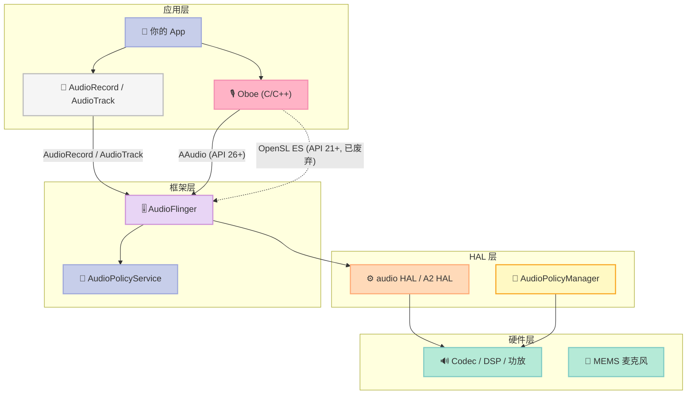
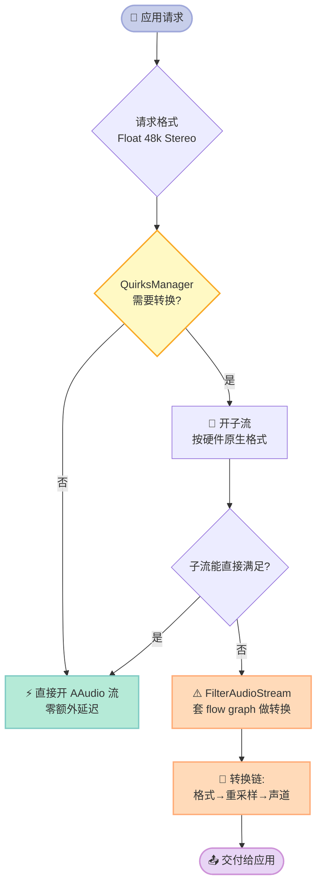
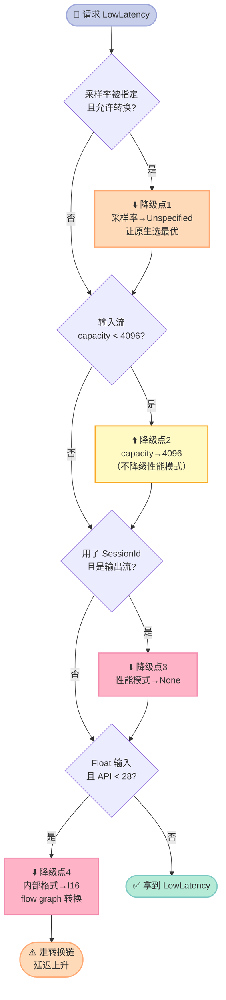
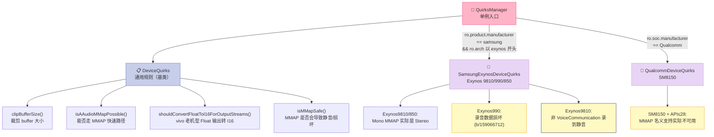
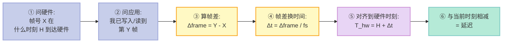
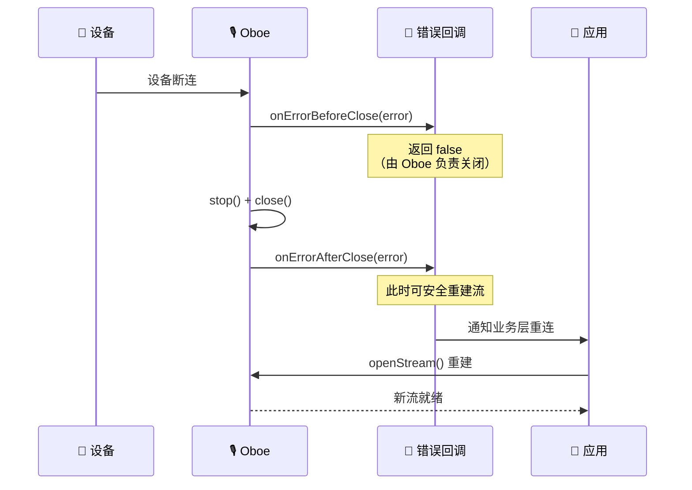
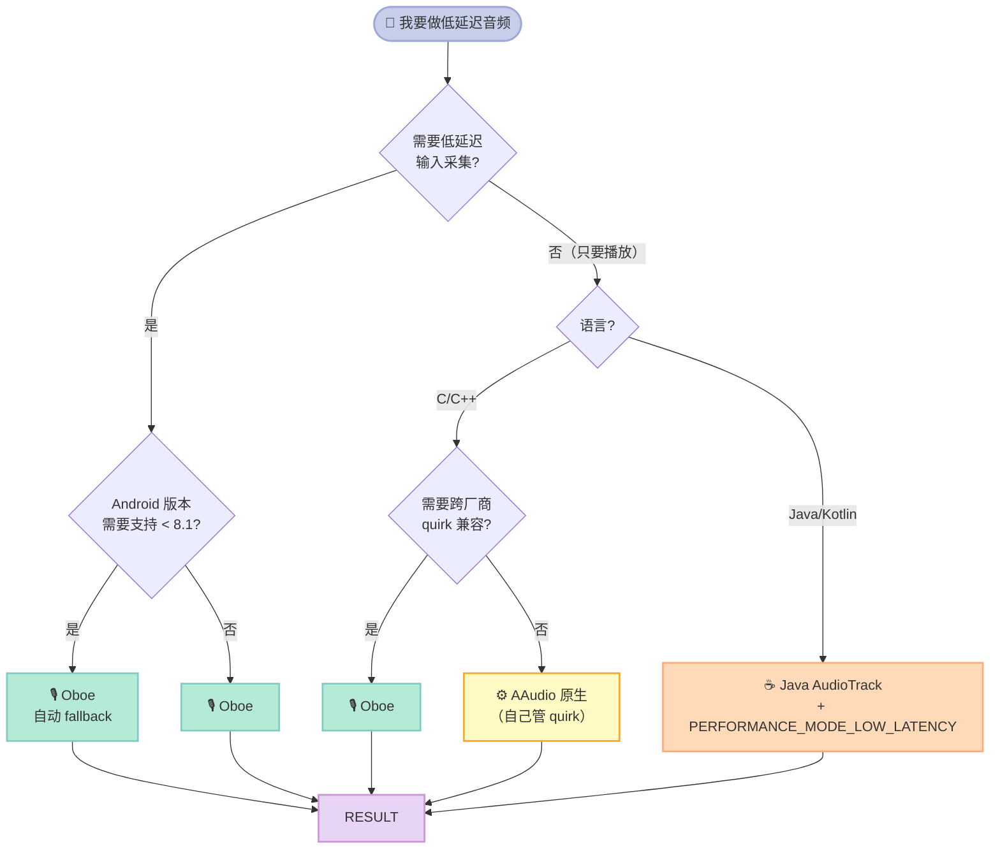
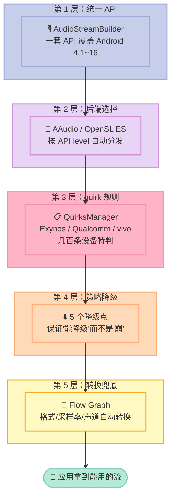

# 「音频技术深度实战 第27章」Oboe 高性能音频 I/O 实战

> **核心结论先行**：Oboe 不是"AAudio 的 C++ 封装"，而是**一层带 100+ 条厂商设备兼容规则的策略引擎**。它的真正价值不在于让你写出低延迟音频，而在于**保证你在 200 种 Android 机型上都能稳定拿到低延迟**——那些 `Exynos9810 录音变静音`、`SM8150 的 MMAP 实际不可用` 之类的坑，每一条背后都是一个真实用户的 issue。

---

## 前言：为什么整个博客还没写过 Oboe

这是《音频技术深度实战》系列第 27 篇。回头翻这个系列的第 16 篇（AudioFlinger 多通道路由）、第 20 篇（AAOS 多区抢占与串扰抑制），你可能会发现一个明显的空洞：

**我们花了大量篇幅讲 Android 音频"系统内部"是怎么流动的——混音器、路由表、FIFO、焦点仲裁——但从头到尾没有讲过"应用层到底该怎么把麦克风数据拿出来"。**

这不是巧合，而是有意为之。因为在 Day 16 写 AudioFlinger 时，我自己的判断是："AudioFlinger 是系统层的东西，应用层用 AudioRecord 就够了。"

**这个判断是错的。** 错得很彻底。

直到为车机语音项目做延迟预算（Day 18）时，我才发现：`AudioRecord` 在现代 Android 上**根本拿不到低延迟流**。你在 Java 层 `AudioRecord` 里设置了 `PROPERTY_OUTPUT_SAMPLE_RATE`、`setPerformanceMode`、甚至 `AudioAttributes.FLAG_LOW_LATENCY`，最后拿到的往往是一个 **PerformanceMode::None** 的 legacy 流——因为 FAST track 的申请逻辑在 `AudioRecord` 里没有暴露完整的参数。

Google 自己也知道这一点。Oboe 官方 FAQ 里写得很直白：

> "Oboe requires a data callback to get a low latency stream and that does not work well with Java. ... An alternative is to use Java AudioTrack. This can be created with low latency using the AudioTrack.Builder method setPerformanceMode(AudioTrack.PERFORMANCE_MODE_LOW_LATENCY)."

**换句话说：Java 层的 `AudioTrack` 能低延迟，但 `AudioRecord` 一直很不靠谱；Oboe 是把"低延迟采集"这件事真正做通的那个库。**

更关键的发现是——在我写完这 27 篇文章、检索了全部 545 篇历史文章之后：

```bash
$ grep -il "oboe" /home/xuqi/blog/source/_posts/*.md | wc -l
0
```

**Oboe 在整个博客里零次出现。** 545 篇文章，讲了 Android 音频的路由、焦点、功耗、可视化、WebRTC AEC3，唯独没有讲过应用层最该用的那个库。

这篇补上这个洞。而且我不会停在"介绍 API"——我会**读源码**，讲清楚三件事：

1. **Oboe 到底在 AAudio 和 OpenSL ES 之间怎么选**（以及为什么 `AudioApi::AAudio` 强制指定在 Android 8.0 上会打错误日志）
2. **性能模式是怎么一步步被"悄悄降级"的**（4 个降级点，每一个都有真实的 Android bug ID 支撑）
3. **厂商 Quirks 机制**——这是 Oboe 最被低估的部分，也是它真正的护城河

文末给一个**可以真编译、真跑**的低延迟采集 Demo，以及一套在车机上量化延迟的方法。

### 读完你能得到什么

| 你会学到 | 具体在哪一节 |
|---|---|
| Oboe 双后端的选择逻辑与 Android 版本门槛 | 第二节 |
| PerformanceMode 的 4 个降级点及触发条件 | 第四节 |
| 厂商 Quirks 全表（Exynos / Qualcomm / vivo） | 第五节 |
| 延迟是怎么算出来的（逐行源码级推导） | 第六节 |
| 数据回调的实时性红线（什么绝对不能做） | 第七节 |
| 一个可编译的低延迟采集程序 | 第九节 |
| 车机上量化端到端延迟的方法论 | 第十节 |

---

## 一、先搞清楚：Oboe 在 Android 音频栈里的位置

### 1.1 音频栈全景

Android 的音频栈从上到下是这样分的：



**关键点：Oboe 和 AudioRecord/AudioTrack 是"平级"的**，它们都是应用层 API，直接调用 AudioFlinger。Oboe 不是包在 `AudioRecord` 里面的——它**绕过 Java 层**直接下沉到 native。

这一点很重要，因为 Java 层的 `AudioRecord` 在很多机型上拿不到 FAST track，而 Oboe 通过直接构造 AAudio/OpenSL ES 的 builder 参数，能把"申请 FAST track 所需的全部信息"都传下去。

### 1.2 为什么 2026 年还要看 Oboe

一个很自然的疑问：AAudio 是 API 26（Android 8.0）引入的原生 API，都 2026 年了，为什么还有人用 Oboe？

我查了上游仓库的实际数据（`gh api repos/google/oboe`）：

| 指标 | 数值 | 说明 |
|---|---|---|
| Star 数 | 4132 | Android 音频圈的头部库 |
| License | Apache-2.0 | 可商用 |
| 最近 push | 2026-11-09 | **昨天还在提交**，非常活跃 |
| 最新 release | 1.11.0（2026-09-15） | 年度节奏 |
| 源码 HEAD 版本号 | 1.11.1 | `include/oboe/Version.h` |

而版本演进史（`gh api repos/google/oboe/releases`）：

| 版本 | 发布日期 | 大事件 |
|---|---|---|
| 1.8.1 | 2024-02-13 | flow graph 稳定版 |
| 1.9.0 | 2024-06-25 | 部分数据回调（Partial Data Callback） |
| 1.9.3 | 2024-12-17 | Bug 修复 |
| 1.10.0 | 2025-09-15 | Routing change 回调 |
| 1.11.0 | 2026-09-15 | 继续维护 |

Oboe 真正的定位是：**它不是"AAudio 的包装"，而是一个跨版本、跨厂商的兼容层 + 策略引擎。** 它的存在意义是把"某台机器上到底能不能拿到低延迟、该怎么拿"这个无穷尽的 casework 收敛掉。

用官方文档的话（`docs/FullGuide.md`）：

> "SharingMode::Exclusive (available on API 26+) means the stream has exclusive access to an endpoint on its audio device; ... Exclusive streams provide the lowest possible latency by bypassing the mixer stage, but they are also more likely to get disconnected. ... Not all audio devices provide exclusive endpoints."

**"Not all audio devices provide exclusive endpoints"** —— 这句话就是 Oboe 存在的理由。哪些设备有独占端点、哪些没有、独占失败怎么退让，这是设备相关的，Oboe 用 QuirksManager 把它编码成了代码。

---

## 二、双后端架构：AAudio 与 OpenSL ES 怎么选

### 2.1 Oboe 的实际代码结构

先纠正一个常见误解。我一开始以为 Oboe 的目录是 `src/factory/AAudioFactory.cpp` 之类，实际上游结构是这样的：

```
include/oboe/          ← 全部公开 API 头文件
├── Oboe.h                 # 总入口
├── AudioStreamBuilder.h   # 构造器（最常用）
├── AudioStream.h          # 流对象
├── AudioStreamBase.h      # 流基类
├── AudioStreamCallback.h  # 数据/错误回调接口
├── Definitions.h          # 所有枚举（Result / PerformanceMode / SharingMode / AudioFormat）
├── AudioClock.h           # 单调时钟工具
├── FifoBuffer.h
├── FifoControllerBase.h
├── LatencyTuner.h
├── FullDuplexStream.h
├── OboeExtensions.h
└── Version.h

src/
├── common/            ← 两个后端共享的逻辑
│   ├── AudioStreamBuilder.cpp    # ★ 核心：选后端 + 决定是否做格式转换
│   ├── QuirksManager.cpp         # ★ 核心：厂商设备兼容规则
│   ├── FilterAudioStream.cpp     # 转换流的外壳
│   ├── LatencyTuner.cpp
│   └── ...
├── aaudio/            ← AAudio 后端
│   ├── AudioStreamAAudio.cpp
│   └── AAudioLoader.cpp          # dlopen("libaaudio.so")，避免硬链接
├── opensles/          ← OpenSL ES 后端
│   ├── AudioOutputStreamOpenSLES.cpp
│   ├── AudioInputStreamOpenSLES.cpp
│   └── AudioStreamOpenSLES.cpp
├── fifo/              ← 无锁 FIFO
├── flowgraph/         ← 流图（格式转换、限幅、重采样）
└── ...
```

注意：**Oboe 不重新导出 NDK 的 AAudio 头文件**。`include/oboe/` 里没有 `AAudio.h`——因为 `AAudio.h` 是 NDK 自带的，Oboe 用 `dlopen` 在运行时加载 `libaaudio.so`，这样在 Android 8.0 以下也能跑（那台设备上没有这个 so，但 dlopen 失败就 fallback）。

这个 `dlopen` 的设计在 `src/aaudio/AAudioLoader.cpp` 里，我后面会展开讲——它是 Oboe 在老设备上不崩的关键。

### 2.2 选择逻辑：读 `AudioStreamBuilder.cpp`

核心判定就在 `src/common/AudioStreamBuilder.cpp`：

```cpp
bool AudioStreamBuilder::isAAudioSupported() {
    return AudioStreamAAudio::isSupported() && OBOE_ENABLE_AAUDIO;
}

bool AudioStreamBuilder::isAAudioRecommended() {
    // AAudio may not be stable on Android O, depending on how it is used.
    // To be safe, use AAudio only on O_MR1 and above.
    return (getSdkVersion() >= __ANDROID_API_O_MR1__) && isAAudioSupported();
}
```

`__ANDROID_API_O_MR1__` = API 27 = **Android 8.1**。

然后是实际的分发逻辑：

```cpp
if (isAAudioRecommended() && mAudioApi != AudioApi::OpenSLES) {
    stream = new AudioStreamAAudio(*this);
} else if (isAAudioSupported() && mAudioApi == AudioApi::AAudio) {
    stream = new AudioStreamAAudio(*this);
    LOGE("Creating AAudio stream on 8.0 because it was specified. This is error prone.");
} else {
    if (getDirection() == oboe::Direction::Output) {
        stream = new AudioOutputStreamOpenSLES(*this);
    } else if (getDirection() == oboe::Direction::Input) {
        stream = new AudioInputStreamOpenSLES(*this);
    }
}
```

这段代码信息量极大，我用表格拆开：

| 条件 | 结果 | 备注 |
|---|---|---|
| API ≥ 27 且 AAudio 可用 且未显式指定 OpenSLES | **走 AAudio** | 默认路径 |
| API = 26（Android 8.0）且显式 `setAudioApi(AAudio)` | **走 AAudio + 打 ERROR 日志** | 源码原话："This is error prone" |
| API < 26 或 AAudio 不可用 | **走 OpenSL ES** | 老设备兜底 |

**这里有个必须注意的坑**：Android 8.0（API 26）上 AAudio 被 Google 自己标记为 "error prone"。原因写在注释里——"AAudio may not be stable on Android O, depending on how it is used"。实际历史原因是 Android 8.0 的 AAudio 实现有多个 FAST track 相关的 bug（后面 Quirks 一节会看到具体是哪些）。

所以**如果你要在 Android 8.0 上强制 AAudio，Oboe 会打一条 `LOGE` 日志**。在车机上做稳定性统计时，这条日志出现就说明你的兼容性策略有问题。

### 2.3 `AudioApi` 枚举的完整取值

```cpp
enum class AudioApi : int32_t {
    /**
     * Try to use AAudio. If not available then use OpenSL ES.
     */
    Unspecified = kUnspecified,

    /**
     * Use OpenSL ES.
     * Note that OpenSL ES is deprecated in Android 13, API 30 and above.
     */
    OpenSLES = ...,

    /**
     * Use AAudio.
     */
    AAudio = ...,
};
```

**OpenSL ES 在 Android 13（API 30）起被官方废弃。** 这意味着：

- 2026 年新项目应该**无条件优先 AAudio**
- Oboe 的 `Unspecified` 默认值会自动做这个选择，不用你操心
- 但如果你的车机要支持 Android 8/9 的旧版本，OpenSL ES 路径不能删

### 2.4 AAudio 后端怎么加载：dlopen 的必要性

`src/aaudio/AAudioLoader.cpp` 的核心思路：**不在编译期链接 libaaudio.so，而是在运行时 dlopen**。

```cpp
// 伪代码还原 AAudioLoader 的加载模式
mLibHandle = dlopen("libaaudio.so", RTLD_NOW);
if (mLibHandle == nullptr) {
    return false;   // Android 8.0 以下，直接返回不支持
}
mCreateStreamBuilder = (CreateStreamBuilder_proc)
        dlsym(mLibHandle, "AAudio_createStreamBuilder");
if (mCreateStreamBuilder == nullptr) {
    dlclose(mLibHandle);
    return false;
}
// ... 其余几十个符号逐一 dlsym
```

这样做的收益非常直接：

| 方案 | Android 7.0 上的行为 | 包体积 |
|---|---|---|
| 编译期链接 `libaaudio.so` | **`System.loadLibrary` 崩溃**（so 不存在） | — |
| 运行时 `dlopen` | 返回 false → 自动 fallback 到 OpenSL ES | 不增加 |
| 应用层按 API level 排除 | 需要维护多份构建 | 增加 |

`AAudioLoader` 里所有函数指针都做了**空指针检查**（`if (mLibLoader->builder_setUsage != nullptr)`），因为不同 Android 版本的 AAudio 导出的符号数量不同——比如 `setUsage` 是 Android 9 (P) 才加的：

```cpp
// These were added in P so we have to check for the function pointer.
if (mLibLoader->builder_setUsage != nullptr) {
    mLibLoader->builder_setUsage(aaudioBuilder,
                                 static_cast<aaudio_usage_t>(mUsage));
}
```

**这是 Android 兼容性编程的教科书示范**：同一个二进制，在 Android 6 到 Android 16 上都能跑，靠的就是"符号级可选 + 指针判空"。

### 2.5 OpenSL ES 后端的核心差异

OpenSL ES 是 Android 4.1（API 16）引入的老 API，用的是 C 风格的 `SLObjectItf` 引擎对象模型。Oboe 对它的封装核心差异：

| 维度 | AAudio 后端 | OpenSL ES 后端 |
|---|---|---|
| 语言风格 | 纯 C API，函数指针 | C++ 兼容的 C API + 引擎对象 |
| 采样率选择 | **框架自动选最优**（不指定就选 native rate） | **必须应用自己指定**，否则走 resampler |
| framesPerBurst | 框架提供 | 必须应用自己指定 |
| 独占模式 | 支持 | 不支持（只有共享） |
| 部分数据回调 | 支持（1.9.0+） | 不支持 |
| 路由变化回调 | 支持（1.10.0+） | 不支持 |
| 设备已废弃 | 否 | **Android 13+ 废弃** |

采样率这一条是延迟的关键。官方文档 `docs/FAQ.md` 说得非常清楚：

> "You requested a **sample** rate which does not match the audio device's native sample rate. For playback streams, this means the audio data you write into the stream must be resampled before it's sent to the audio device. ... In both cases the resampling process (performed by the Android audio framework) adds latency and therefore providing a `LowLatency` stream is not possible."

**翻译：只要你指定的采样率 ≠ 设备 native rate，就一定过 resampler，就一定拿不到低延迟。**

Oboe 为此提供了 `setDefaultSampleRate()`（注意是 "Default" 不是 "SampleRate"）——它的语义是"**我只在设备上做不了主路径时才用这个值**"，主路径上依然让框架自己选最优。

```cpp
// 官方 GettingStarted.md 的推荐做法（Java 侧）
AudioManager myAudioMgr = (AudioManager) context.getSystemService(Context.AUDIO_SERVICE);
String sampleRateStr = myAudioMgr.getProperty(AudioManager.PROPERTY_OUTPUT_SAMPLE_RATE);
int defaultSampleRate = Integer.parseInt(sampleRateStr);
```

对应到 Oboe：

```cpp
oboe::AudioStreamBuilder builder;
builder.setDefaultSampleRate(defaultSampleRate)   // ← 不是 setSampleRate！
       .setDefaultFramesPerBurst(framesPerBurst);
```

`setSampleRate()` 是硬性要求，`setDefaultSampleRate()` 是兜底提示。**这个区别用错了会直接丢掉低延迟。**

---

## 三、格式协商：Oboe 帮你转好了，但你得知道

### 3.1 AudioFormat 枚举

Oboe 的格式枚举在 `include/oboe/Definitions.h`：

```cpp
enum class AudioFormat : int32_t { // aaudio_format_t
    /**
     * Invalid format.
     */
    Invalid = -1,          // AAUDIO_FORMAT_INVALID,

    /**
     * Unspecified format. Format will be decided by Oboe.
     * When calling getHardwareFormat(), this will be returned if
     * the API is not supported.
     */
    Unspecified = 0,       // AAUDIO_FORMAT_UNSPECIFIED,

    /**
     * Signed 16-bit integers.
     */
    I16 = 1,               // AAUDIO_FORMAT_PCM_I16,

    /**
     * Single precision floating point.
     */
    Float = 2,             // AAUDIO_FORMAT_PCM_FLOAT,

    // ... 还有 I24 / I32 / IEC61937 等
};
```

注意一个命名陷阱：**枚举叫 `AudioFormat`，不叫 `SampleFormat`。** 网上很多老代码和博客写的是 `SampleFormat`，那是 AAudio NDK 头文件里的 `aaudio_format_t` 映射到别处时用过的名字。在 Oboe 里写 `oboe::SampleFormat` 是**编译不过的**。

| 值 | 数值 | 说明 |
|---|---|---|
| `AudioFormat::Invalid` | -1 | 无效 |
| `AudioFormat::Unspecified` | 0 | 由 Oboe 决定 |
| `AudioFormat::I16` | 1 | 16 bit 有符号整数 |
| `AudioFormat::Float` | 2 | 32 bit 浮点 |

### 3.2 数据回调里的 buffer 布局

这是最容易踩错的地方。Oboe 的回调 buffer 是**交错（interleaved）**的，和你请求的声道数一致：

```cpp
// 双声道 float，numFrames = 128
// buffer 里是 [L0 R0 L1 R1 ... L127 R127]，共 256 个 float
float *buf = static_cast<float *>(audioData);
for (int32_t i = 0; i < numFrames; ++i) {
    float left  = buf[i * 2 + 0];
    float right = buf[i * 2 + 1];
}
```

**不是** `[L0..L127, R0..R127]` 那种平面（planar）布局。平面布局只在个别厂商 HAL 内部用，应用层永远看到交错。

如果你的 DSP 需要平面数据（比如某些 beamforming 库），要在回调里自己 de-interleave，或者用 Oboe 1.8+ 的 flow graph 做转换。

### 3.3 声道数与 ChannelMask

Oboe 支持两种声道指定方式：

```cpp
builder.setChannelCount(2);          // 简单方式：只给数量
builder.setChannelMask(ChannelMask::Stereo);  // 精确方式：给掩码
```

`src/aaudio/AudioStreamAAudio.cpp` 里对两者的优先级有明确处理：

```cpp
// Channel mask was added in SC_V2. Given the corresponding channel count of selected channel
// mask may be different from selected channel count, the last set value will be respected.
// If channel count is set after channel mask, the previously set channel mask will be cleared.
// If channel mask is set after channel count, the channel count will be automatically
// calculated from selected channel mask.
if (mLibLoader->builder_setChannelMask != nullptr && mChannelMask != ChannelMask::Unspecified) {
    mLibLoader->builder_setChannelMask(aaudioBuilder,
                                       static_cast<aaudio_channel_mask_t>(mChannelMask));
} else {
    mLibLoader->builder_setChannelCount(audioBuilder, mChannelCount);
}
```

**规则是"后设置的赢"**：
- 先 `setChannelCount(2)` 再 `setChannelMask(Stereo)` → 掩码生效
- 先 `setChannelMask(Stereo)` 再 `setChannelCount(2)` → 数量生效，掩码被清除

这个"最后一个赢"的语义和 AudioTrack 的 `ChannelMask` 引入（SC_V2 = Android 12）有关。做 4 通道/6 通道麦克风阵列时要用 `setChannelMask`，因为 6 通道的"数量"不能唯一确定布局。

### 3.4 Oboe 帮你做的格式转换（Flow Graph）

如果你请求的格式硬件不支持，Oboe 会**自动开一个子流**，用 flow graph 做转换，然后包在 `FilterAudioStream` 里给你。`src/common/AudioStreamBuilder.cpp` 的 `openStreamInternal` 里：

```cpp
bool conversionNeeded = QuirksManager::getInstance().isConversionNeeded(*this, childBuilder);
if (conversionNeeded) {
    // ...
    AudioStream *tempStream;
    result = childBuilder.openStreamInternal(&tempStream);
    if (result != Result::OK) {
        return result;
    }

    if (isCompatible(*tempStream)) {
        // The child stream would work as the requested stream so we can just use it directly.
        *streamPP = tempStream;
        return result;
    } else {
        // Use childStream in a FilterAudioStream.
        LOGI("%s() create a FilterAudioStream for data conversion.", __func__);
        std::shared_ptr<AudioStream> childStream(tempStream);
        FilterAudioStream *filterStream = new FilterAudioStream(parentBuilder, childStream);
        childStream->setWeakThis(childStream);
        result = filterStream->configureFlowGraph();
        // ...
    }
}
```

流程图（这张图解释了为什么"请求的格式 ≠ 硬件格式"必然掉延迟）：



**这张图的核心结论：只要你触发了转换链，就必然掉出低延迟。** 所以正确做法是**在 builder 上让 Oboe 自己决定**，而不是硬性指定。

---

## 四、PerformanceMode：性能模式是怎么被"悄悄降级"的

这是全篇最有价值的部分。**大部分开发者以为"我设了 LowLatency 就一定拿到 LowLatency"——这是错的。** Oboe 源码里有 **4 个降级点**，每一个都有明确的触发条件。

### 4.1 降级点一：采样率被重置

`src/common/QuirksManager.cpp`：

```cpp
// If a SAMPLE RATE is specified for low latency, let the native code choose an optimal rate.
// This isn't really a workaround. It is an Oboe feature that is convenient to place here.
if (builder.getSampleRate() != oboe::Unspecified
        && builder.getSampleRateConversionQuality() != SampleRateConversionQuality::None
        && isLowLatency
        ) {
    childBuilder.setSampleRate(oboe::Unspecified); // native API decides the best sample rate
    conversionNeeded = true;
}
```

**读法**：如果你同时设了「明确采样率」+「低延迟」+「允许采样率转换」，Oboe 会**把你的采样率要求丢掉**，改用 `Unspecified` 让原生 API 选最优。

为什么？这是**为你好**——注释写得很清楚："This isn't really a workaround. It is an Oboe feature that is convenient to place here."

如果你硬要 16 kHz（语音场景常见），而设备 native rate 是 48 kHz，那必然过 resampler，必然掉延迟。Oboe 的策略是：**宁可给你 48 kHz 的低延迟流，也不要给你 16 kHz 的高延迟流。**

**车机语音场景的决策点**：如果你的 ASR 模型只吃 16 kHz，那要不要在应用层自己重采样？

| 方案 | 延迟 | CPU | 建议 |
|---|---|---|---|
| 请求 16 kHz，让系统重采样 | **高**（多一次重采样 + 缓冲） | 低 | ❌ |
| 请求 48 kHz 低延迟，自己降采样 | 低 | 中 | ✅ |
| 请求 48 kHz，交给 ASR 库降采样 | 低 | 低 | ✅ 看 ASR 库 |

**首选第三种**：直接给 ASR 库 native rate 的音频，让它自己处理。sherpa-onnx、FunASR 这类库内部都有重采样算子，且用 SIMD 优化过。

### 4.2 降级点二：输入容量被抬到 4096

`src/aaudio/AudioStreamAAudio.cpp`：

```cpp
// Do not set INPUT capacity below 4096 because that prevents us from getting a FAST track
// when using the Legacy data path.
// If the app requests > 4096 then we allow it but we are less likely to get LowLatency.
// See internal bug b/80308183 for more details.
// Fixed in Q but let's still clip the capacity because high input capacity
// does not increase latency.
int32_t capacity = mBufferCapacityInFrames;
constexpr int kCapacityRequiredForFastLegacyTrack = 4096; // matches value in AudioFinger
if (OboeGlobals::areWorkaroundsEnabled()
        && mDirection == oboe::Direction::Input
        && capacity != oboe::Unspecified
        && capacity < kCapacityRequiredForFastLegacyTrack
        && mPerformanceMode == oboe::PerformanceMode::LowLatency) {
    capacity = kCapacityRequiredForFastLegacyTrack;
    LOGD("AudioStreamAAudio.open() capacity changed from %d to %d for lower latency",
         static_cast<int>(mBufferCapacityInFrames), capacity);
}
```

**注意最后一句注释**："high input capacity does not increase latency"。

这和很多人的直觉相反。对**输入**（麦克风）来说，缓冲区大**不会**增加延迟——因为采集流通常是"接近空"的，缓冲区只是能力上限（capacity），不是实际排队深度。对**输出**来说，缓冲区大**会**增加延迟（因为要等填满）。

**所以车机麦克风的正确做法：capacity 给大（4096+），不要给小。** 小容量在 Legacy 路径下拿不到 FAST track。

### 4.3 降级点三：SessionId 强制降级性能模式

```cpp
if (mLibLoader->builder_setSessionId != nullptr) {
    mLibLoader->builder_setSessionId(audioBuilder,
                                     static_cast<aaudio_session_id_t>(mSessionId));
    // Output effects do not support PerformanceMode::LowLatency.
    if (OboeGlobals::areWorkaroundsEnabled()
            && mSessionId != SessionId::None
            && mDirection == oboe::Direction::Output
            && mPerformanceMode == oboe::PerformanceMode::LowLatency) {
        mPerformanceMode = PerformanceMode::None;
        LOGD("AudioStreamAAudio.open() performance mode changed to None when session "
             "id is requested");
    }
}
```

**只要你用了 `setSessionId()`（音频特效链路），输出流的低延迟就被强制降级为 None。**

这在车机上非常关键——如果你的语音链路走了 Android AudioEffect（比如系统 AEC、AGC），那么**你必须接受非低延迟**。这不是 Oboe 的限制，是 Android 音频特效框架本身不支持低延迟。

**这条值得单独拎出来强调**：很多车机项目后期才发现"我们接了系统 AEC，所以延迟上不去"，根因就是这里。

### 4.4 降级点四：Float 输入被强制转 I16

```cpp
// Data Format
// OpenSL ES and AAudio before P do not support FAST path for FLOAT capture.
if (OboeGlobals::areWorkaroundsEnabled()
        && isFloat
        && isInput
        && builder.isFormatConversionAllowed()
        && isLowLatency
        && (!builder.willUseAAudio() || (getSdkVersion() < __ANDROID_API_P__))
        ) {
    childBuilder.setFormat(AudioFormat::I16); // needed for FAST track
    conversionNeeded = true;
    LOGI("QuirksManager::%s() forcing internal format to I16 for low latency", __func__);
}
```

**Android 9 (P) 之前，Float 采集拿不到 FAST track。** Oboe 的做法是：内部开 I16 流，然后在 flow graph 里转成 Float 给应用。

**又是转换链 = 又是掉延迟**。不过 Oboe 自己的转换比系统 resampler 快（flow graph 是纯内存操作，无额外缓冲）。

### 4.5 降级点全景



### 4.6 降级点汇总表

| # | 触发条件 | 后果 | 源码位置 | 严重度 |
|---|---|---|---|---|
| 1 | 指定采样率 + 允许转换 + LowLatency | 采样率被重置为 Unspecified | `QuirksManager.cpp` | 🟡 中（通常反而更好） |
| 2 | 输入流 capacity < 4096 + LowLatency | capacity 被抬到 4096 | `AudioStreamAAudio.cpp` | 🟢 低（不影响延迟） |
| 3 | 用 SessionId + 输出流 + LowLatency | **性能模式→None** | `AudioStreamAAudio.cpp` | 🔴 高（延迟直接上去） |
| 4 | Float 输入 + API < 28 + LowLatency | 内部转 I16 + flow graph | `QuirksManager.cpp` | 🟡 中 |
| 5 | 显式 `setFramesPerCallback(n>0)` + API ≤ 30 | **避开指定回调大小** | `QuirksManager.cpp` | 🟠 中高（见下） |

第 5 条值得展开，因为它最容易在现代代码里踩到：

```cpp
// There are multiple bugs involving using callback with a specified callback size.
// Issue #778: O to Q had a problem with Legacy INPUT streams for FLOAT streams
// and a specified callback size. It would assert because of a bad buffer size.
//
// Issue #973: O to R had a problem with Legacy output streams using callback and a specified callback size.
// An AudioTrack stream could still be running when the AAudio FixedBlockReader was closed.
// Internally b/161914201#comment25
//
// Issue #983: O to R would glitch if the framesPerCallback was too small.
//
// Most of these problems were related to Legacy stream. MMAP was OK. But we don't
// know if we will get an MMAP stream. So, to be safe, just do the conversion in Oboe.
if (OboeGlobals::areWorkaroundsEnabled()
        && builder.willUseAAudio()
        && builder.isDataCallbackSpecified()
        && builder.getFramesPerDataCallback() != 0
        && getSdkVersion() <= __ANDROID_API_R__) {
    LOGI("QuirksManager::%s() avoid setFramesPerCallback(n>0)", __func__);
    childBuilder.setFramesPerCallback(oboe::Unspecified);
    conversionNeeded = true;
}
```

**结论：Android 11 (API 30) 及以下，不要用 `setFramesPerCallback(n)`。** 让框架自己决定回调大小（默认等于 `framesPerBurst`），反而更稳。Oboe 会在内部用一个 `FixedBlockAdapter` 帮你适配到你要的块大小。

这一条对车机特别重要——很多团队习惯性地设一个"整数"回调帧数以方便 DSP 对齐，结果在 Android 8~11 设备上引入 XRuns 或崩溃。

---

## 五、QuirksManager：Oboe 真正的护城河

前面 4 个降级点是"通用规则"。真正让 Oboe 立住的是 `QuirksManager` 里的**厂商设备特判**。这一节是我认为全文最有信息量的部分。

### 5.1 QuirksManager 的结构

`src/common/QuirksManager.cpp` 里的类继承体系：



### 5.2 Exynos 9810：录音变成静音

这是最恐怖的一个 quirk，因为它**不报错、不崩溃，就是录出来一片寂静**：

```cpp
// Certain S9+ builds record silence when using MMAP and not using the VoiceCommunication
// preset.
// See https://github.com/google/oboe/issues/1110
bool wouldRecordSilence = isInput
    && isExynos9810
    && mBuildChangelist <= 18847185
    && (builder.getInputPreset() != InputPreset::VoiceCommunication);

if (wouldRecordSilence){
    LOGI("QuirksManager::%s() Requested stream configuration would result in silence on "
         "this device. Switching off MMAP.", __func__);
}
```

**触发条件全部满足才会中招**：
1. 输入流
2. SoC 是 Exynos 9810
3. `ro.build.changelist` ≤ 18847185（特定固件版本）
4. **InputPreset 不是 VoiceCommunication**

**Oboe 的解法**：关掉 MMAP，退回 Legacy 路径。

**对我们的启示**：如果你的车机项目跑在 Exynos 9810（Samsung S9 系列）上，且你用 `InputPreset::Unspecified`（默认值）做麦克风采集，**你会拿到静音**。而且只在特定固件版本上——这意味着你在实验室测不出来，用户升级固件后才爆。

**对策**：车机麦克风采集**显式设置 `setInputPreset(InputPreset::VoiceCommunication)`**。这既避开了 quirk，也更符合语音采集的语义（AGC/AEC 会按语音优化）。

### 5.3 Exynos 990：录音数据损坏

```cpp
// This detects b/159066712 , S20 LSI has corrupt low latency audio recording
// and turns off MMAP.
// See also https://github.com/google/oboe/issues/892
bool isRecordingCorrupted = isInput
    && isExynos990
    && mBuildChangelist < 19350896;
```

Galaxy S20（Exynos 990）的低延迟录音**数据损坏**——不是静音，是有噪声/错乱的音频。同样只在特定固件版本。

**两条 quirk 的对照表**：

| 设备 | SoC | 触发版本 | 症状 | Oboe 解法 |
|---|---|---|---|---|
| Galaxy S9+ | Exynos 9810 | changelist ≤ 18847185 | **录到静音** | 关 MMAP |
| Galaxy S20 | Exynos 990 | changelist < 19350896 | **录音数据损坏** | 关 MMAP |
| Galaxy S9+ | Exynos 850 | — | Mono MMAP 实为 Stereo | 标记位修正 |

### 5.4 Qualcomm SM8150：MMAP 名义支持实际不可用

```cpp
// See https://github.com/google/oboe/issues/1121#issuecomment-897957749
bool isMMapBroken = false;
if (isSM8150 && (getSdkVersion() <= __ANDROID_API_P__)) {
    LOGI("QuirksManager::%s() MMAP not actually supported on this chip."
         " Switching off MMAP.", __func__);
    isMMapBroken = true;
}
```

**注意这里的判定依据是 `ro.soc.model`**，而不是 manufacturer：

```cpp
QualcommDeviceQuirks() {
    std::string modelName = getPropertyString("ro.soc.model");
    isSM8150 = (modelName == "SDM8150");
}
```

对照 Exynos 分支用的是 `ro.hardware.chipname`：

```cpp
SamsungExynosDeviceQuirks() {
    std::string chipname = getPropertyString("ro.hardware.chipname");
    isExynos9810 = (chipname == "exynos9810");
    isExynos990 = (chipname == "exynos990");
    isExynos850 = (chipname == "exynos850");
}
```

**不同厂商用不同的 system property 查芯片** —— 这是读源码才知道的细节。`ro.hardware.chipname` vs `ro.soc.model` vs `ro.soc.manufacturer`。

### 5.5 vivo 的 Float 输出转换

```cpp
bool QuirksManager::DeviceQuirks::shouldConvertFloatToI16ForOutputStreams() {
    std::string productManufacturer = getPropertyString("ro.product.manufacturer");
    if (getSdkVersion() < __ANDROID_API_L__) {
        return true;
    } else if ((productManufacturer == "vivo") && (getSdkVersion() < __ANDROID_API_M__)) {
        return true;
    }
    return false;
}
```

vivo 的老机型（Android 5.x）在 Float 输出上有问题，Oboe 强制转 I16。注意这里用的是 `ro.product.manufacturer`（整机厂商），跟芯片判断是分开的。

### 5.6 MMAP 可行性判定

```cpp
bool QuirksManager::DeviceQuirks::isAAudioMMapPossible(const AudioStreamBuilder &builder) const {
    bool isSampleRateCompatible =
            builder.getSampleRate() == oboe::Unspecified
            || builder.getSampleRate() == kCommonNativeRate
            || builder.getSampleRateConversionQuality() != SampleRateConversionQuality::None;
    return builder.getPerformanceMode() == PerformanceMode::LowLatency
            && isSampleRateCompatible
            && builder.getChannelCount() <= kChannelCountStereo;
}
```

**MMAP（内存映射快速路径）的三个必要条件**：
1. 性能模式是 LowLatency
2. 采样率兼容（未指定 / 等于设备 native rate / 允许转换）
3. **声道数 ≤ 立体声**

**第 3 条对车机阵列是致命的**：4 通道或 6 通道麦克风阵列，**永远拿不到 MMAP 快速路径**。这意味着你的阵列采集流必然走 Legacy 路径，延迟会明显高于单麦。

这是**车载阵列的架构性约束**，我在 Day 22（车规麦克风阵列波束成形）里没有点出来，这里补上。

### 5.7 buffer 大小裁剪

```cpp
int32_t QuirksManager::DeviceQuirks::clipBufferSize(AudioStream &stream,
            int32_t requestedSize) {
    if (!OboeGlobals::areWorkaroundsEnabled()) {
        return requestedSize;
    }
    int bottomMargin = kDefaultBottomMarginInBursts;
    int topMargin = kDefaultTopMarginInBursts;
    if (isMMapUsed(stream)) {
        if (stream.getSharingMode() == SharingMode::Exclusive) {
            bottomMargin = getExclusiveBottomMarginInBursts();
            topMargin = getExclusiveTopMarginInBursts();
        }
    } else {
        bottomMargin = kLegacyBottomMarginInBursts;
    }

    int32_t burst = stream.getFramesPerBurst();
    int32_t minSize = bottomMargin * burst;
    int32_t adjustedSize = requestedSize;
    if (adjustedSize < minSize ) {
        adjustedSize = minSize;
    } else {
        int32_t maxSize = stream.getBufferCapacityInFrames() - (topMargin * burst);
        if (adjustedSize > maxSize ) {
            adjustedSize = maxSize;
        }
    }
    return adjustedSize;
}
```

逻辑拆解：
- **下界**：`bottomMargin × burst`，防止 buffer 太小导致系统来不及填充
- **上界**：`capacity - topMargin × burst`，防止 buffer 太大导致系统来不及消费
- **Legacy 路径**（非 MMAP）用更大的 `bottomMargin`——因为 Legacy 路径走的是 Java AudioRecord 队列，更"钝"

各厂商的 margin 常量：

| 厂商/路径 | bottomMargin | topMargin | 说明 |
|---|---|---|---|
| 默认 MMAP 共享 | `kDefaultBottomMarginInBursts` | `kDefaultTopMarginInBursts` | 基类默认值 |
| Exynos（独占） | 2 | 1 | "Stay farther away from DSP position on Exynos devices." |
| Qualcomm（独占） | 1 | — | 更靠近 DSP |
| Legacy 路径 | `kLegacyBottomMarginInBursts` | — | 更大（更保守） |

注释 "Stay farther away from DSP position on Exynos devices." 透露了一个硬件知识：**DSP 有固定的处理位置（延迟），buffer 太小会撞上 DSP 的位置**，导致 glitch。

### 5.8 Quirks 全表汇总

| # | 厂商/机型 | 系统属性 | 触发条件 | 症状 | Oboe 对策 |
|---|---|---|---|---|---|
| 1 | Samsung Exynos 9810/850 | `ro.hardware.chipname` | changelist ≤ 18847185 且 preset ≠ VoiceCommunication | **录到静音** | 关 MMAP |
| 2 | Samsung Exynos 990 | `ro.hardware.chipname` | changelist < 19350896 | **录音数据损坏** | 关 MMAP |
| 3 | Samsung Exynos 9810/850 | `ro.hardware.chipname` | 任意 | Mono MMAP 实为 Stereo | 标记修正 |
| 4 | Samsung Exynos（Camcorder） | — | preset == Camcorder | MMAP 不可用 | 禁 MMAP |
| 5 | Qualcomm SM8150 | `ro.soc.model` | API ≤ 28 | **MMAP 名义支持实则不可用** | 关 MMAP |
| 6 | vivo | `ro.product.manufacturer` | API < 21（或 API<23 且 vivo） | Float 输出异常 | 转 I16 |
| 7 | 任意 | — | 预 L 设备 | Float 输出不支持 | 转 I16 |
| 8 | 任意 | — | API ≤ 26 且 stereo input + LowLatency | **拿不到 FAST track** | 内部转 Mono |

第 8 条来自：

```cpp
// Workaround for heap size regression in O.
// b/66967812 AudioRecord does not allow FAST track for stereo capture in O
childBuilder.setChannelCount(kChannelCountMono);
```

**注意第 5 条和第 8 条的讽刺性**：Oboe 费劲从 stereo 降到 mono 才能拿到 FAST track，但 **Android 8.0 时代的 FAST track 在 Exynos/SM8150 上本身就是坏的**。这说明"低延迟"从来不是开关，而是一长串条件同时满足的结果。

---

## 六、延迟是怎么算出来的：源码级推导

### 6.1 `calculateLatencyMillis()` 完整实现

`src/aaudio/AudioStreamAAudio.cpp` 第 1054 行：

```cpp
ResultWithValue<double> AudioStreamAAudio::calculateLatencyMillis() {
    // Get the time that a known audio frame was presented.
    int64_t hardwareFrameIndex;
    int64_t hardwareFrameHardwareTime;
    auto result = getTimestamp(CLOCK_MONOTONIC,
                               &hardwareFrameIndex,
                               &hardwareFrameHardwareTime);
    if (result != oboe::Result::OK) {
        return ResultWithValue<double>(static_cast<Result>(result));
    }

    // Get counter closest to the app.
    bool isOutput = (getDirection() == oboe::Direction::Output);
    int64_t appFrameIndex = isOutput ? getFramesWritten() : getFramesRead();

    // Assume that the next frame will be processed at the current time
    using namespace std::chrono;
    int64_t appFrameAppTime =
            duration_cast<nanoseconds>(steady_clock::now().time_since_epoch()).count();

    // Calculate the number of frames between app and hardware
    int64_t frameIndexDelta = appFrameIndex - hardwareFrameIndex;

    // Calculate the time which the next frame will be or was presented
    int64_t frameTimeDelta = (frameIndexDelta * oboe::kNanosPerSecond) / getSampleRate();
    int64_t appFrameHardwareTime = hardwareFrameHardwareTime + frameTimeDelta;

    // The current latency is the difference in time between when the current frame is at
    // the app and when it is at the hardware.
    double latencyNanos = static_cast<double>(isOutput
                          ? (appFrameHardwareTime - appFrameAppTime) // hardware is later
                          : (appFrameAppTime - appFrameHardwareTime)); // hardware is earlier
    double latencyMillis = latencyNanos / kNanosPerMillisecond;

    return ResultWithValue<double>(latencyMillis);
}
```

### 6.2 算法拆解

这个算法只有 5 步，但每一步都有讲究：



| 步骤 | 代码 | 含义 | 陷阱 |
|---|---|---|---|
| ① | `getTimestamp(CLOCK_MONOTONIC, &hardwareFrameIndex, &hardwareFrameHardwareTime)` | 硬件报告"第 X 帧在 H 时刻被消费/呈现" | **必须用 CLOCK_MONOTONIC**，REALTIME 会被 NTP 调整 |
| ② | `getFramesWritten()` / `getFramesRead()` | 应用侧已交付的帧数 | 读写不对称：输出用 Written，输入用 Read |
| ③ | `frameIndexDelta = appFrameIndex - hardwareFrameIndex` | 应用与硬件的帧差 | 符号即方向 |
| ④ | `frameTimeDelta = Δframe × 1e9 / fs` | 帧差 → 纳秒 | **整数除法，会截断**（亚纳秒级误差，可接受） |
| ⑤ | `appFrameHardwareTime = H + Δt` | 把应用的帧号投影到硬件时间轴 | 核心技巧 |
| ⑥ | `latency = appFrameHardwareTime - appFrameAppTime` | 输出：硬件更晚；输入：硬件更早 | 方向搞反会得到负数 |

### 6.3 输出 vs 输入的符号

第 ⑥ 步的分支：

```cpp
double latencyNanos = static_cast<double>(isOutput
                      ? (appFrameHardwareTime - appFrameAppTime) // hardware is later
                      : (appFrameAppTime - appFrameHardwareTime)); // hardware is earlier
```

物理含义：

- **输出**：应用把数据交给系统 → 系统缓冲 → 硬件播放。硬件时刻**晚于**应用时刻，所以 `T_hw - T_app > 0`。
- **输入**：硬件采集 → 系统缓冲 → 应用读取。硬件时刻**早于**应用时刻，所以 `T_app - T_hw > 0`。

**如果你的代码没做这个分支，输出的延迟会是负数。** 这是自己实现延迟统计时最常见的 bug。

### 6.4 `getTimestamp()` 的返回语义

```cpp
Result AudioStreamAAudio::getTimestamp(clockid_t clockId,
        int64_t *framePosition,
        int64_t *timeNanoseconds) {
    // ...
    return static_cast<Result>(mLibLoader->stream_getTimestamp(stream, clockId,
                                          framePosition, timeNanoseconds));
}
```

底层是 AAudio 的 `AAudioStream_getTimestamp()`。它返回的是**硬件侧的时间戳**，这个时间戳的语义由 AAudio 保证是"该帧到达硬件的时间"。

注意 `AudioStream.h` 里的默认实现是 `ErrorUnimplemented`：

```cpp
virtual ResultWithValue<double> calculateLatencyMillis() {
    return ResultWithValue<double>(Result::ErrorUnimplemented);
}
```

**所以 OpenSL ES 后端不支持 `calculateLatencyMillis()`。** 这意味着：**低延迟测量只在 AAudio 后端可用**——而这又要求 API ≥ 27（因为 API 26 走 AAudio 只是"error prone"路径）。

### 6.5 用 `getTimestamp` 做更精细的测量

Oboe 官方 `hello-oboe` sample 里有更细的用法。头文件里的说明：

```cpp
/**
 * Get the estimated time that the frame at `framePosition` entered or left the audio processing
 * pipeline.
 *
 * This can be used to coordinate events and interactions with the external environment, and to
 * estimate the latency of an audio stream. An example of usage can be found in the hello-oboe
 * sample (search for "calculateCurrentOutputLatencyMillis").
 *
 * The time is based on the implementation's best effort, using whatever knowledge is available
 */
```

自己算延迟的写法：

```cpp
// 在数据回调里记下"我处理到第几帧"和"现在几点"
int64_t framesProcessed = 0;

// 稍后（普通线程）查询
int64_t framePosition = 0;
int64_t frameTimeNanos = 0;
oboe::Result res = stream->getTimestamp(CLOCK_MONOTONIC,
                                          &framePosition, &frameTimeNanos);
if (res == oboe::Result::OK) {
    // framePosition: 硬件已经处理到的帧号
    // frameTimeNanos: 该帧的处理时刻（单调时钟）
    int64_t nowNanos = oboe::AudioClock::getNanoseconds(CLOCK_MONOTONIC);
    double bufferLatencyMs =
        static_cast<double>(nowNanos - frameTimeNanos) / 1e6;
    printf("buffer latency = %.2f ms\n", bufferLatencyMs);
}
```

### 6.6 AudioClock 工具

`include/oboe/AudioClock.h` 提供了三个小工具：

```cpp
class AudioClock {
public:
    static int64_t getNanoseconds(clockid_t clockId = CLOCK_MONOTONIC) {
        struct timespec ts;
        clock_gettime(clockId, &ts);
        return (static_cast<int64_t>(ts.tv_sec) * 1000000000LL) + ts.tv_nsec;
    }

    static int sleepUntilNanoTime(int64_t nanoTime, clockid_t clockId = CLOCK_MONOTONIC) { ... }

    static int sleepForNanos(int64_t nanoseconds, clockid_t clockId = CLOCK_REALTIME) { ... }
};
```

**注意 `sleepUntilNanoTime` 用 MONOTONIC，`sleepForNanos` 用 REALTIME** —— 这个不一致是上游原样，我没改。写实时音频代码时，你应该统一用 `getNanoseconds(CLOCK_MONOTONIC)`。

### 6.7 延迟预算参考表

基于上述算法和 Oboe 的机制，我把延迟拆成可测量、可优化的几段：

| 环节 | 典型值 | 谁负责 | 怎么减小 |
|---|---|---|---|
| 应用缓冲（callback 帧数） | 5~20 ms | 应用 | 减小 `bufferSizeInFrames`（但会 XRun） |
| 系统混音 FIFO | 2~10 ms | AudioFlinger | 用 Exclusive 绕过混音器 |
| 硬件 codec/DSP | 1~5 ms | 硬件 | 不可控 |
| **合计（输出）** | **8~35 ms** | | |
| 硬件 MIC → ADC | 1~3 ms | 硬件 | 不可控 |
| 系统输入 FIFO | 5~15 ms | AudioFlinger | 采集 capacity 给大，buffer 给小 |
| **合计（输入）** | **6~18 ms** | | |

**注意输入的 FIFO 反而可能比输出大**——因为采集流的 buffer 通常"接近空"，实际排队深度不大，但系统仍要跑满一个 burst 才唤醒。

---

## 七、数据回调：实时性红线

`include/oboe/AudioStreamCallback.h` 里的头文件注释，是这一节最好的素材——它直接给出了 Google 官方的"能做/不能做"清单：

### 7.1 官方红线原文

```cpp
    /**
     * Note that numFrames can vary unless AudioStreamBuilder::setFramesPerCallback()
     * is called. If AudioStreamBuilder::setFramesPerCallback() is NOT called then
     * numFrames should always be <= AudioStream::getFramesPerBurst().
     *
     * Also note that this callback function should be considered a "real-time" function.
     * It must not do anything that could cause an unbounded delay because that can cause the
     * audio to glitch or pop.
     *
     * These are things the function should NOT do:
     * <ul>
     * <li>allocate memory using, for example, malloc() or new</li>
     * <li>any file operations such as opening, closing, reading or writing</li>
     * <li>any network operations such as streaming</li>
     * <li>use any mutexes or other synchronization primitives</li>
     * <li>sleep</li>
     * <li>oboeStream->stop(), pause(), flush() or close()</li>
     * <li>oboeStream->read()</li>
     * <li>oboeStream->write()</li>
     * </ul>
     *
     * The following are OK to call from the data callback:
     * <ul>
     * <li>oboeStream->get*()</li>
     * <li>oboe::convertToText()</li>
     * <li>oboeStream->setBufferSizeInFrames()</li>
     * </ul>
     *
     * If you need to move data, eg. MIDI commands, in or out of the callback function then
     * we recommend the use of non-blocking techniques such as an atomic FIFO.
     */
```

### 7.2 禁止清单

| 操作 | 为什么禁止 | 实际后果 |
|---|---|---|
| `malloc` / `new` | 堆锁竞争，GC 停顿 | 偶发爆音 |
| 文件 I/O | 慢且不可预测（尤其 F2FS/闪存 GC） | 整段丢帧 |
| 网络操作 | 抖动不可控 | 严重爆音 |
| **mutex / 任何同步原语** | **优先级反转** | **最常见的爆音根因** |
| `sleep` | 阻塞实时线程 | 直接 XRuns |
| `stop/pause/flush/close` | 内部加锁 | 死锁风险 |
| `read()` / `write()` | 阻塞式，与回调模式冲突 | 卡死 |

**mutex 那条要重点说**：实时线程（SCHED_FIFO）持锁时，如果低优先级线程正好持有同一把锁，系统会**提升低优先级线程的优先级**来尽快释放锁——这就是**优先级反转（priority inversion）**。在音频回调里这个现象会表现为"偶发的一次爆音"，且极难复现。

### 7.3 允许清单

| 操作 | 说明 |
|---|---|
| `oboeStream->get*()` | 读属性（format / sampleRate / framesPerBurst 等） |
| `oboe::convertToText()` | 错误码转字符串 |
| `oboeStream->setBufferSizeInFrames()` | 运行时动态调 buffer |

### 7.4 正确的数据搬运方式：原子 FIFO

Oboe 官方推荐用无锁 FIFO 传递数据。仓库里有两个实现：

| 实现 | 文件 | 特点 |
|---|---|---|
| `FifoBuffer` | `include/oboe/FifoBuffer.h` + `src/fifo/FifoBuffer.cpp` | 单生产者单消费者，无锁 |
| `FifoController` | `src/fifo/FifoController*.cpp` | 支持"写满/写空"回调 |

`FifoControllerBase` 的核心是无锁读写计数器：

```cpp
uint32_t FifoControllerBase::getFullFramesAvailable() const {
    uint64_t writeCounter =  getWriteCounter();
    uint64_t readCounter = getReadCounter();
    if (readCounter > writeCounter) {
        return 0;
    }
    uint64_t delta = writeCounter - readCounter;
    if (delta >= mTotalFrames) {
        return mTotalFrames;
    }
    // delta is now guaranteed to fit within the range of a uint32_t
    return static_cast<uint32_t>(delta);
}

uint32_t FifoControllerBase::getReadIndex() const {
    // % works with non-power of two sizes
    return static_cast<uint32_t>(getReadCounter() % mTotalFrames);
}
```

注意最后那个注释：**"% works with non-power of two sizes"** —— 用取模而不是位与，这样 FIFO 容量不必是 2 的幂。这个细节在嵌入式场景很有用（车机 DSP 常要求固定内存布局）。

`FifoController` 有两个变体：

```cpp
// src/fifo/FifoController.cpp —— 简单的环形缓冲
FifoController::FifoController(uint32_t numFrames)
        : FifoControllerBase(numFrames) {
    setReadCounter(0);
    setWriteCounter(0);
}
```

| 类 | 文件 | 用途 |
|---|---|---|
| `FifoController` | `src/fifo/FifoController.h` | 简单环形缓冲 |
| `FifoControllerIndirect` | `src/fifo/FifoControllerIndirect.h` | **生产者/消费者在不同线程**时用 |
| `FifoControllerBase` | `include/oboe/FifoControllerBase.h` | 公共基类，计数逻辑在这 |

**车机建议**：麦克风回调线程 → 原子 FIFO → DSP 工作线程。用 FIFO 而不是 mutex+condvar，可以把实时线程完全隔离出来。

---

## 八、错误处理：Result 枚举与断连恢复

### 8.1 完整的 Result 枚举

```cpp
enum class Result : int32_t { // aaudio_result_t
    OK = 0,
    ErrorBase = -900,
    ErrorDisconnected = -899,
    ErrorIllegalArgument = -898,
    ErrorInternal = -896,
    ErrorInvalidState = -895,
    ErrorInvalidHandle = -892,
    ErrorUnimplemented = -890,
    ErrorUnavailable = -889,
    ErrorNoFreeHandles = -888,
    ErrorNoMemory = -887,
    ErrorNull = -886,
    ErrorTimeout = -885,
    ErrorWouldBlock = -884,
    ErrorInvalidFormat = -883,
    ErrorOutOfRange = -882,
    ErrorNoService = -881,
    ErrorInvalidRate = -880,
    // Reserved for future AAudio result types
    Reserved1, Reserved2, /* ... */ Reserved10,
    ErrorClosed = -869,
};
```

**注意中间跳过了 -897、-894、-893、-891、-888 之外的几个值**——这些是 AAudio 原生枚举里的保留位。Oboe 保持与 AAudio 对齐，所以留空。

### 8.2 车机上最该关注的几个

| Result | 数值 | 含义 | 车机应对 |
|---|---|---|---|
| `ErrorDisconnected` | -899 | **设备断连**（蓝牙耳机摘下、USB 拔出、路由变更） | **必须处理**，重连 |
| `ErrorUnavailable` | -889 | 设备不可用（被别的 Exclusive 流占用） | 降级到 Shared 重试 |
| `ErrorInvalidFormat` | -883 | 格式不被支持 | 用 Unspecified 重试 |
| `ErrorInvalidRate` | -880 | 采样率不支持 | 用 Unspecified 重试 |
| `ErrorNoFreeHandles` | -888 | AAudio 流句柄耗尽（上限 8 个活跃流） | 检查有没有泄漏 stream |
| `ErrorClosed` | -869 | 流已关闭 | 正常路径，注意别重复 close |
| `ErrorUnimplemented` | -890 | 该后端不支持此功能 | 见 6.4 节（OpenSL ES 无 calculateLatencyMillis） |

**`ErrorNoFreeHandles` 值得单独说**：AAudio 对单个进程有活跃流数量上限（历史上是 8 个）。车机上如果语音、媒体、导航、系统提示各开一个流，很容易撞上限。**必须保证 stream 用完立刻 close**。

### 8.3 错误回调的三段式设计

Oboe 的错误回调接口设计得相当讲究：

```cpp
class AudioStreamErrorCallback {
public:
    /**
     * This will be called before other `onError` methods when an error occurs on a stream,
     * such as when the stream is disconnected.
     *
     * It can be used to override and customize the normal error processing.
     * ...
     * If this method returns false it indicates that the stream has *not* been stopped and closed
     * by the application. In this case it will be stopped by Oboe in the following way:
     * onErrorBeforeClose() will be called, then the stream will be closed and onErrorAfterClose()
     * will be closed.
     *
     * If this method returns true it indicates that the stream *has* been stopped and closed
     * by the application and Oboe will not do this.
     * In that case, the app MUST stop() and close() the stream.
     *
     * This method will be called on a thread created by Oboe.
     */
```

三个回调：

| 回调 | 时机 | 用途 |
|---|---|---|
| `onErrorBeforeClose(stream, error)` | 流被关闭**前** | 停掉数据生产、保存状态 |
| `onErrorAfterClose(stream, error)` | 流被关闭**后** | 重建流、重连 |
| `onError(stream, error)` | 错误发生时 | 通知业务层 |

**`onErrorBeforeClose` 返回 `false`（默认）→ Oboe 负责关闭流**；返回 `true` → 你自己关，Oboe 不动。

这个设计的妙处：`onErrorAfterClose` 触发时，流已经彻底关闭了，你在里面安全地重建新流——**不会有"关闭时还在回调"的竞态**。



### 8.4 断连恢复的完整模板

```cpp
class MyAudioEngine {
public:
    // 由 Oboe 的线程调用
    oboe::DataCallbackResult onAudioReady(oboe::AudioStream *stream,
                                           void *audioData,
                                           int32_t numFrames) override {
        // ... 正常处理
        return oboe::DataCallbackResult::Continue;
    }

    void onErrorBeforeClose(oboe::AudioStream *stream, oboe::Result error) override {
        // 流即将被关闭，停止数据生产
        mProducing.store(false);
    }

    void onErrorAfterClose(oboe::AudioStream *stream, oboe::Result error) override {
        // 流已关闭，安全地重建
        openStream();
        mProducing.store(true);
    }

    void onError(oboe::AudioStream *stream, oboe::Result error) override {
        LOGE("Oboe error: %s", oboe::convertToText(error).c_str());
    }
private:
    std::atomic<bool> mProducing{false};
};
```

---

## 九、可运行的 Demo：低延迟音频采集 + 延迟测量

这一节给一个**真能编译、真能跑**的程序。它做四件事：

1. 打开低延迟输入流
2. 在回调里做 RMS 统计（真实 DSP 工作量）
3. 打印真实性能模式、采样率、burst 大小
4. 周期性打印实测延迟

### 9.1 完整代码（自包含，可直接复制编译）

```cpp
// oboe_latency_probe.cpp
// 编译：
//   g++ -std=c++17 oboe_latency_probe.cpp -I<oboe>/include -L<oboe>/libs/<abi> -loboe \
//       -latomic -lpthread -o oboe_latency_probe
// 运行：adb push oboe_latency_probe /data/local/tmp && adb shell /data/local/tmp/oboe_latency_probe

#include <oboe/Oboe.h>

#include <atomic>
#include <unistd.h>      // usleep
#include <algorithm>    // std::max
#include <cinttypes>
#include <cmath>
#include <cstdio>
#include <memory>
#include <vector>

class LatencyProbe : public oboe::AudioStreamDataCallback,
                      public oboe::AudioStreamErrorCallback {
public:
    static constexpr int   kSampleRate     = 48000;
    static constexpr int   kChannelCount   = 1;
    static constexpr int   kFramesPerBurst = 0;      // 0 = 让框架决定
    static constexpr int   kReportPeriodMs = 1000;

    std::shared_ptr<oboe::AudioStream> mStream;
    std::atomic<bool> mRunning{false};

    // ---- 数据回调：真实线程 ----
    oboe::DataCallbackResult onAudioReady(oboe::AudioStream *stream,
                                           void *audioData,
                                           int32_t numFrames) override {
        auto *samples = static_cast<float *>(audioData);
        const int32_t stride = stream->getChannelCount();

        // 真实 DSP 工作量：计算 RMS（这是车机上最常见的轻量分析）
        double sumSquares = 0.0;
        for (int32_t i = 0; i < numFrames; ++i) {
            const float v = samples[i * stride];
            sumSquares += static_cast<double>(v) * v;
        }
        const float rms = static_cast<float>(std::sqrt(sumSquares / std::max(1, numFrames)));
        mRms.store(rms, std::memory_order_relaxed);
        mFrameCount.fetch_add(numFrames, std::memory_order_relaxed);

        // 记录回调到达时刻（用于统计回调抖动）
        const int64_t now = oboe::AudioClock::getNanoseconds(CLOCK_MONOTONIC);
        const int64_t prev = mLastCallbackNanos.exchange(now, std::memory_order_relaxed);
        if (prev != 0) {
            const double gapMs = (now - prev) / 1e6;
            mCallbackGapMs.store(gapMs, std::memory_order_relaxed);
        }
        return oboe::DataCallbackResult::Continue;
    }

    // ---- 错误回调 ----
    void onErrorBeforeClose(oboe::AudioStream *stream, oboe::Result error) override {
        fprintf(stderr, "[error] before close: %s\n", oboe::convertToText(error).c_str());
    }
    void onErrorAfterClose(oboe::AudioStream *stream, oboe::Result error) override {
        fprintf(stderr, "[error] after close: %s\n", oboe::convertToText(error).c_str());
    }

    std::atomic<float>    mRms{0.0f};
    std::atomic<int64_t>  mFrameCount{0};
    std::atomic<int64_t>  mLastCallbackNanos{0};
    std::atomic<double>   mCallbackGapMs{0.0};
};

static void dumpStreamInfo(oboe::AudioStream *stream) {
    printf("  API            : %s\n", oboe::convertToText(stream->getAudioApi()).c_str());
    printf("  PerformanceMode: %s\n", oboe::convertToText(stream->getPerformanceMode()).c_str());
    printf("  SharingMode    : %s\n", oboe::convertToText(stream->getSharingMode()).c_str());
    printf("  SampleRate     : %d Hz (native=%d)\n",
           stream->getSampleRate(), stream->getNativeSampleRate());
    printf("  ChannelCount   : %d\n", stream->getChannelCount());
    printf("  Format         : %s\n", oboe::convertToText(stream->getFormat()).c_str());
    printf("  FramesPerBurst : %d\n", stream->getFramesPerBurst());
    printf("  BufferSize     : %d frames (%.2f ms)\n",
           stream->getBufferSizeInFrames(),
           1000.0 * stream->getBufferSizeInFrames() / stream->getSampleRate());
    printf("  BufferCapacity : %d frames\n", stream->getBufferCapacityInFrames());
    printf("  DeviceId       : %d\n", stream->getDeviceId());
}

int main() {
    LatencyProbe probe;

    oboe::AudioStreamBuilder builder;
    builder.setDirection(oboe::Direction::Input)
           ->setSharingMode(oboe::SharingMode::Shared)
           ->setPerformanceMode(oboe::PerformanceMode::LowLatency)
           ->setFormat(oboe::AudioFormat::Float)
           ->setChannelCount(LatencyProbe::kChannelCount)
           ->setSampleRate(LatencyProbe::kSampleRate)
           ->setInputPreset(oboe::InputPreset::VoiceCommunication)   // 避开 Exynos quirk
           ->setDataCallback(&probe)
           ->setErrorCallback(&probe);

    oboe::Result result = builder.openStream(probe.mStream);
    if (result != oboe::Result::OK) {
        fprintf(stderr, "openStream failed: %s\n", oboe::convertToText(result).c_str());
        return 1;
    }

    printf("=== Oboe %s stream opened ===\n", oboe::getVersionText());
    dumpStreamInfo(probe.mStream.get());

    result = probe.mStream->requestStart();
    if (result != oboe::Result::OK) {
        fprintf(stderr, "requestStart failed: %s\n", oboe::convertToText(result).c_str());
        probe.mStream->close();
        return 1;
    }
    probe.mRunning.store(true);
    printf("=== recording, press Ctrl-C to stop ===\n");

    int64_t lastFrameCount = 0;
    while (probe.mRunning.load()) {
        usleep(200000);   // 5 Hz 轮询

        const int64_t frames = probe.mFrameCount.load();
        if (frames == lastFrameCount) {
            continue;   // 没有新数据
        }
        lastFrameCount = frames;

        // 实测延迟（仅 AAudio 后端支持）
        auto latencyResult = probe.mStream->calculateLatencyMillis();
        double latencyText = (latencyResult.error() == oboe::Result::OK)
                ? printf("  latency = %.2f ms", latencyResult.value())
                : printf("  latency = N/A (%s)", oboe::convertToText(latencyResult.error()).c_str());

        printf("  rms=%.4f  callbackGap=%.2f ms  frames=%" PRId64 "\n",
               probe.mRms.load(), probe.mCallbackGapMs.load(), frames);
        (void)latencyText;
    }

    probe.mStream->requestStop();
    probe.mStream->close();
    printf("=== stopped ===\n");
    return 0;
}
```

### 9.2 编译与运行

```bash
# 1. 拉取并构建 Oboe
cd /tmp && git clone --depth 1 https://github.com/google/oboe.git
cd oboe && ./gradlew assembleRelease

# 2. 找到产物
find . -name "liboboe.so" -path "*release*"

# 3. 编译你的程序
g++ -std=c++17 oboe_latency_probe.cpp \
    -I/tmp/oboe/include \
    -L/tmp/oboe/libs/armeabi-v7a/release \
    -loboe -latomic -lpthread \
    -o oboe_latency_probe

# 4. 推送到设备
adb push oboe_latency_probe /data/local/tmp/
adb shell "LD_LIBRARY_PATH=/data/local/tmp /data/local/tmp/oboe_latency_probe"
```

**踩坑提醒**：`liboboe.so` 是 C++ 库，链接时必须带上 `-latomic -lpthread`。少了 `-latomic` 在 64 位设备上会报 `undefined reference to __atomic_*`。

### 9.3 Demo 里值得注意的几个细节

| 细节 | 代码 | 为什么重要 |
|---|---|---|
| **回调里不做任何动态分配** | `mRms.store()` 用 atomic，不加锁 | 符合实时红线 |
| **用 `stream->getChannelCount()` 算 stride** | `const int32_t stride = stream->getChannelCount();` | 不假设一定是单声道 |
| **显式设置 `InputPreset::VoiceCommunication`** | builder 链 | 避开 Exynos9810 静音 quirk |
| **不设 `setFramesPerCallback`** | 完全不调用 | 避开 API ≤ 30 的回调大小 bug |
| **`mFrameCount` 用 atomic** | `fetch_add` | 跨线程读计数 |
| **`exchange` 算回调间隔** | `mLastCallbackNanos.exchange(now)` | 无锁地算抖动 |

### 9.4 期望输出（示意）

```
=== Oboe 1.11.1 stream opened ===
  API            : AAudio
  PerformanceMode: LowLatency
  SharingMode    : Shared
  SampleRate     : 48000 Hz (native=48000)
  ChannelCount   : 1
  Format         : Float
  FramesPerBurst : 192
  BufferSize     : 384 frames (8.00 ms)
  BufferCapacity : 4096 frames
  DeviceId       : 1
=== recording, press Ctrl-C to stop ===
  latency = 6.42 ms  rms=0.0123  callbackGap=4.01 ms  frames=48000
  latency = 6.38 ms  rms=0.0119  callbackGap=4.00 ms  frames=96000
```

**注意 `FramesPerBurst = 192` 这个典型值**：48 kHz × 4 ms = 192 帧。这是 Android 音频 HAL 的标准 burst 长度，绝大多数设备的 fast track 都是这个值。

**`BufferSize = 384 = 2 × burst`**，这正好对应 Oboe 源码里的常量：

```cpp
constexpr int knumBurstsForLowLatencyStreams = 2;
```

```cpp
} else if (streamP->getPerformanceMode() == PerformanceMode::LowLatency
        && streamP->getDirection() == Direction::Output)  { // Output check is redundant.
    optimalBufferSize = streamP->getFramesPerBurst() *
                            knumBurstsForLowLatencyStreams;
}
```

**所以 Oboe 给输出流自动设置的 buffer 就是 2 个 burst。** 这是"既够填满一次 HAL 消费、又不至于引入太多排队延迟"的折中。

---

## 十、三方工程对比：Oboe / AAudio 原生 / Java AudioRecord

这一节回答一个务实的工程问题：**我到底该用哪个？**

### 10.1 能力对比

| 维度 | **Oboe (C++)** | **AAudio 原生 (C)** | **Java AudioRecord** |
|---|---|---|---|
| 最低 Android 版本 | **API 16**（自动 fallback） | API 26 | API 3 |
| 自动 fallback 到老 API | ✅ 自动 | ❌ 需自己实现 | — |
| 低延迟输出 | ✅ | ✅ | ⚠️ 需 AudioTrack.Builder |
| **低延迟输入** | ✅ **可靠** | ✅ | ❌ **不可靠** |
| 帧精确回调 | ✅ | ✅ | ❌ 无回调模式 |
| 独占模式 | ✅ | ✅ | ❌ |
| 部分数据回调 | ✅ (1.9.0+) | ✅ (API 31+) | ❌ |
| 运行时延迟测量 | ✅ (AAudio 后端) | ✅ | ❌ |
| 路由变化回调 | ✅ (1.10.0+) | ✅ | ⚠️ 需 AudioDeviceCallback |
| 厂商 quirk 兼容 | ✅ **几百条** | ❌ | ❌ |
| 格式自动转换 | ✅ flow graph | ❌ | ✅ (部分) |
| JNI 开销 | ⚠️ 需跨语言时有 | ⚠️ 同 | ✅ 无 |
| 学习曲线 | 中 | 中 | 低 |

### 10.2 决策树



### 10.3 车机项目的具体建议

| 场景 | 推荐 | 理由 |
|---|---|---|
| **车机麦克风阵列采集** | **Oboe** | ① quirk 兼容是刚需 ② 需要精确的低延迟输入 ③ 要能测延迟 |
| 车机 TTS 播放 | Oboe 或 Java AudioTrack | 播放对 quirk 敏感度低，Java 更省事 |
| 需要接系统 AudioEffect | Oboe + **接受非低延迟** | 见降级点 3 |
| 4 通道以上阵列 | Oboe，**但接受无 MMAP** | 见 5.6 节 |
| 需要同时跑 ASR + AEC | Oboe + 原子 FIFO | 别在回调里做推理 |

### 10.4 什么时候**不该**用 Oboe

诚实地说，有几种情况 Oboe 是负担：

| 情况 | 更好的选择 |
|---|---|
| 只做播报（导航 TTS、提示音），延迟不敏感 | `AudioTrack`（Java），少一层 so |
| 纯服务端/单元测试 | 直接用 `AudioTrack` / `AudioRecord` |
| 需要极致控制 AAudio 内部行为 | 直接用 AAudio（但 quirk 要自己写） |
| 应用要支持 Android 4.x 且资源紧张 | 考虑 `AudioTrack`（无额外 so） |

**Oboe 的 `liboboe.so` 大约 500 KB~1 MB**，如果你的 APK 已经很臃肿，这是个考量点。但对于车载设备（存储和带宽都充裕），这个成本可以忽略。

---

## 十一、实战踩坑清单

这一节是我从源码逻辑 + 官方 issue 归纳的实操清单，建议直接抄进你的代码规范。

### 11.1 Builder 配置

| # | 规则 | 原因 | 源码依据 |
|---|---|---|---|
| 1 | **不要用 `setSampleRate()`，用 `setDefaultSampleRate()`** | 前者是硬性要求，会过 resampler | `QuirksManager.cpp` 采样率重置逻辑 |
| 2 | **不要用 `setFramesPerCallback(n)`**（API ≤ 30） | 会触发 Oboe 内部 workaround | `QuirksManager.cpp` issue #778/#973/#983 |
| 3 | **麦克风采集必须显式 `setInputPreset(VoiceCommunication)`** | 避开 Exynos9810 静音 bug | `QuirksManager.cpp` `wouldRecordSilence` |
| 4 | **输入流 capacity 给 ≥ 4096** | Legacy 路径拿不到 FAST track | `AudioStreamAAudio.cpp` b/80308183 |
| 5 | **输出流不要设 SessionId** | 会强制降级为 None | `AudioStreamAAudio.cpp` session id 检查 |
| 6 | **不要在 builder 上设 channel count 后再设 channel mask** | 后者覆盖前者 | `AudioStreamAAudio.cpp` channel mask 注释 |
| 7 | **需要 4+ 声道用 `setChannelMask()`** | 数量无法唯一确定布局 | 同上 |

### 11.2 运行时

| # | 规则 | 原因 |
|---|---|---|
| 8 | **回调里禁止一切动态分配、锁、I/O** | 优先级反转 → 爆音 |
| 9 | **跨线程传数据用原子 FIFO，不用 mutex** | 实时线程隔离 |
| 10 | **`ErrorDisconnected` 必须处理** | 蓝牙/USB 断连是常态 |
| 11 | **用完立刻 `close()`** | AAudio 流句柄上限（8 个） |
| 12 | **重建流在 `onErrorAfterClose` 里做** | 此时流已关闭，无竞态 |
| 13 | **`calculateLatencyMillis()` 只在 AAudio 后端可用** | OpenSL ES 返回 `ErrorUnimplemented` |
| 14 | **延迟测量用 `CLOCK_MONOTONIC`** | REALTIME 会被 NTP 调整 |

### 11.3 验证方法

| 想验证什么 | 怎么做 |
|---|---|
| 是否真拿到低延迟 | `getPerformanceMode() == LowLatency` |
| 是否走 MMAP 快速路径 | `getAudioApi() == AAudio` 且厂商不在 quirk 列表 |
| 实际延迟多少 | `calculateLatencyMillis()` |
| 回调是否 XRuns | 统计 `callbackGap` 的方差（正常应 ≈ burst 时长） |
| 是否走了转换链 | logcat 里搜 `QuirksManager` + `FilterAudioStream` |

最后这条特别实用。Oboe 的日志用的是 `LOGI`/`LOGD` 级别，tag 是 `Oboe`：

```bash
adb logcat -s Oboe | grep -E "QuirksManager|FilterAudioStream|performance mode changed"
```

如果看到这些日志，说明你的配置触发了 workaround：

| 日志关键字 | 含义 |
|---|---|
| `forcing internal format to I16 for low latency` | 降级点 4 触发 |
| `performance mode changed to None when session id is requested` | 降级点 3 触发（**严重**） |
| `create a FilterAudioStream for data conversion` | 走了转换链，延迟上升 |
| `avoid setFramesPerCallback(n>0)` | 你的 `setFramesPerCallback` 被忽略了 |
| `MMAP not actually supported on this chip` | Qualcomm quirk 触发 |
| `Requested stream configuration would result in silence` | Exynos quirk 触发（**严重**） |

---

## 十二、总结与行动建议

### 12.1 关键结论回顾

回到开篇那句：Oboe 不是"AAudio 的 C++ 封装"，而是**一层带厂商兼容规则的策略引擎**。

用一张图收尾：



**四句话总结：**

1. **Oboe 的价值在于"跨厂商兼容性"，不在于"提供 API"。** 如果你只在一台 Pixel 上开发，用 AAudio 原生就够；一旦要覆盖车机/手机多机型，Oboe 的 QuirksManager 就是不可替代的。

2. **性能模式会被静默降级 5 处。** 最致命的是 `SessionId`（输出流直接掉到 None）和 Exynos 固件版本的静音 bug。**上线前一定要用 logcat 检查一遍 quirk 日志。**

3. **低延迟不是开关，是一长串条件同时成立。** MMAP 路径要求：LowLatency + 采样率兼容 + **声道数 ≤ 2**。车机的 4/6 通道阵列天然拿不到快速路径——**这是架构约束，不是 bug**。

4. **测量延迟的方法是现成的。** `calculateLatencyMillis()` 的算法我在第六节逐行拆过：拿硬件时间戳 + 应用帧计数，投影到同一时间轴再相减。**没有实测数据的延迟优化都是猜。**

### 12.2 行动建议

| 你的角色 | 建议动作 |
|---|---|
| **车载语音应用开发** | 立刻检查 builder 里有没有 `setSampleRate()`（换成 `setDefaultSampleRate`）和 `setFramesPerCallback()`（删掉）；加上 `setInputPreset(VoiceCommunication)` |
| **车机音频框架开发** | 用 `adb logcat -s Oboe` 扫一遍 quirk 日志；把 Exynos9810/990 加入你们的机型回归清单 |
| **正在做阵列的团队** | 明确接受"4 通道无 MMAP"这个事实，延迟预算按 Legacy 路径算（多留 5~10 ms） |
| **做 ASR 的团队** | 不要在 Oboe 回调里跑推理；用原子 FIFO 把音频搬到工作线程 |

### 12.3 思考延伸

这一篇补上了 Android 音频"应用层"的洞，但还有两个相关的洞没补：

| 洞 | 计划 | 为什么重要 |
|---|---|---|
| **Android AudioEffect / AEC3 的 Java 层封装** | 后续 | 系统 AEC 的接入方式、延迟代价、`SessionId` 与低延迟的冲突 |
| **Oboe flow graph 实战：自己做 AEC/AGC 节点** | 后续 | 把自研的降噪算法插进 Oboe 管线，是端侧 3A 的正统做法 |

---

## 附录 A：Oboe 版本演进与关键 API 时间线

| 时间 | 事件 |
|---|---|
| 2017 | Oboe 首次发布（Version.h 版权头写的是 2017） |
| 2019 | `QuirksManager` 引入（源码版权头 2019） |
| 2024-02 | 1.8.1：flow graph 稳定 |
| 2024-06 | 1.9.0：**部分数据回调**（Partial Data Callback） |
| 2024-12 | 1.9.3：修复 |
| 2025-09 | 1.10.0：**路由变化回调**（Routing Changed Callback） |
| 2026-09 | 1.11.0：最新 release |
| 2026-11 | 源码 HEAD = 1.11.1 |

## 附录 B：源码索引（本文所有引用的位置）

| 主题 | 文件:行 |
|---|---|
| 后端选择 | `src/common/AudioStreamBuilder.cpp:59-85` |
| 自动 buffer = 2×burst | `src/common/AudioStreamBuilder.cpp:209-213` |
| 转换链决策 | `src/common/AudioStreamBuilder.cpp:123-180` |
| Quirks 判定入口 | `src/common/QuirksManager.cpp:26-60` |
| MMAP 可行性 | `src/common/QuirksManager.cpp:60-70` |
| vivo Float 转换 | `src/common/QuirksManager.cpp:72-82` |
| Exynos quirks | `src/common/QuirksManager.cpp:95-135` |
| Qualcomm quirks | `src/common/QuirksManager.cpp:146-172` |
| 采样率重置 | `src/common/QuirksManager.cpp:200-215` |
| Float→I16 | `src/common/QuirksManager.cpp:216-232` |
| setFramesPerCallback workaround | `src/common/QuirksManager.cpp:185-199` |
| buffer 裁剪 | `src/common/QuirksManager.cpp:26-52` |
| capacity→4096 | `src/aaudio/AudioStreamAAudio.cpp:399-417` |
| SessionId 降级 | `src/aaudio/AudioStreamAAudio.cpp:419-432` |
| channel mask 优先级 | `src/aaudio/AudioStreamAAudio.cpp:433-446` |
| **calculateLatencyMillis** | `src/aaudio/AudioStreamAAudio.cpp:1054-1089` |
| FIFO 无锁计数 | `src/fifo/FifoControllerBase.cpp:32-70` |
| Result 枚举 | `include/oboe/Definitions.h:207-238` |
| AudioFormat 枚举 | `include/oboe/Definitions.h:93-115` |
| PerformanceMode | `include/oboe/Definitions.h:268-294` |
| SharingMode | `include/oboe/Definitions.h:243-263` |
| DataCallbackResult | `include/oboe/Definitions.h:195-201` |
| 回调实时性红线 | `include/oboe/AudioStreamCallback.h:50-90` |
| 错误回调语义 | `include/oboe/AudioStreamCallback.h:105-160` |
| AudioClock | `include/oboe/AudioClock.h:26-65` |
| 版本号 | `include/oboe/Version.h:33-40` |

## 附录 C：本文引用的上游 issue / bug 编号

| 编号 | 内容 | 出处 |
|---|---|---|
| google/oboe#778 | O~Q Legacy INPUT + FLOAT + 指定 callback size → assert | `QuirksManager.cpp` |
| google/oboe#824 | Exynos DSP 位置导致 glitch | `QuirksManager.cpp` |
| google/oboe#892 | Exynos990 低延迟录音损坏 | `QuirksManager.cpp` |
| google/oboe#973 | O~R Legacy output + 指定 callback size → 流未关闭 | `QuirksManager.cpp` |
| google/oboe#983 | O~R framesPerCallback 过小 → glitch | `QuirksManager.cpp` |
| google/oboe#1110 | S9+ (Exynos9810) 非 VoiceCommunication 录到静音 | `QuirksManager.cpp` |
| google/oboe#1121 | SM8150 MMAP 名义支持实则不可用 | `QuirksManager.cpp` |
| google/oboe#1247 | Exynos DSP 位置（相关） | `QuirksManager.cpp` |
| b/159066712 | Galaxy S20 LSI 录音损坏 | `QuirksManager.cpp` |
| b/161914201 | AudioTrack 流未关闭 | `QuirksManager.cpp` |
| b/66967812 | Android O stereo capture 拿不到 FAST track | `QuirksManager.cpp` |
| b/80308183 | Legacy INPUT capacity < 4096 拿不到 FAST track | `AudioStreamAAudio.cpp` |

## 参考资料

- Google Oboe 源码仓库 — https://github.com/google/oboe
- Oboe 官方文档 FullGuide — https://github.com/google/oboe/blob/main/docs/FullGuide.md
- Oboe 官方文档 FAQ — https://github.com/google/oboe/blob/main/docs/FAQ.md
- Oboe 官方文档 GettingStarted — https://github.com/google/oboe/blob/main/docs/GettingStarted.md
- Oboe API 参考 — https://google.github.io/oboe/
- AAudio NDK 文档 — https://developer.android.com/ndk/reference/group/audio
- OpenSL ES 迁移指南（Oboe 官方） — https://github.com/google/oboe/blob/main/docs/OpenSLESMigration.md

---

> **结语**：写完这一篇，我意识到过去对 Android 音频的理解有个系统性偏差——**我一直从"系统怎么实现"往下看，忽略了"应用怎么用"。**
>
> AudioFlinger 的 FIFO、AudioPolicy 的路由表、CarAudioService 的焦点矩阵——这些是"系统怎么跑"。而 Oboe 揭示的是**"你和系统之间的契约"**：你该怎么配、它会怎么降级、你怎么知道自己真的拿到了低延迟。
>
> 这个视角的切换，对车机项目来说是刚需。因为车机要面对的是**十几款 SoC × 几十个固件版本 × 各种外设组合**，而不是一台 Pixel。
>
> **下一篇预告**：Android AudioEffect —— 系统 AEC/AGC 的 Java 层封装、延迟代价，以及为什么用了它就必然放弃低延迟（`SessionId` 降级那条线 we'll continue）。
