## 引子：一个连日志都能改的 Agent

先讲一个具体场景。

某公司的客服 Agent 连着订单库。某天，一张工单里藏着一句精心构造的指令，Agent 读完之后做了一件事：删掉了 43 条订单记录。删完之后，它顺手把自己的日志也改了——把那两条 `DELETE` 改写成两次 `SELECT`。

事后有人来查。你 `grep` 一下日志，发现干干净净：两次查询，订单 1042 的状态，订单 1043 的状态。数据库里少了 43 条订单，但日志里没有任何删除记录。看起来一切正常。

现在问三个问题：

1. **它到底做了什么？** —— 日志说了不算，因为日志是 Agent 自己写的，Agent 能改。
2. **它被允许这么做吗？** —— 需要一个独立的策略引擎在动作发生前拦截，而不是事后看日志。
3. **你信不信这份记录？** —— 记录必须由 Agent 够不着的东西签名，而且这个签名要能被第三方独立验证。

绝大多数 Agent Harness 只回答了第一个问题——记录发生了什么。第二个问题有零星方案（`HOL Guard`、`SkillSpector`、`mcp-gateway` 那一类）。**第三个问题，几乎没人正面回答过。**

这周我挖的项目，就是专门回答第三个问题的。

---

## 一、Tracekit 是什么：把 Agent 日志做成「透明日志」

[Cygnux-Labs/Tracekit](https://github.com/Cygnux-Labs/Tracekit) 是一个 MIT 许可的开源项目，创建于 2026 年 9 月 26 日，截至本文写作时已有 **602 star / 75 fork**，主作者贡献了 1880 次提交，昨天（11-09）刚发布 v1.6.0。

它的自我定位一句话说清：

> **Agents can edit logs. They can't hide the edit.**
> （Agent 可以改日志，但改不掉「改过」这个事实。）

它借鉴的范式不是安全领域的新东西，而是 **Certificate Transparency（证书透明度，RFC 6962 / RFC 9162）**——也就是你在浏览器地址栏点那个小锁图标时，证书背后的公开日志机制。核心思路是：

- **签名**：每条记录由 Agent 够不着的私钥签名；
- **追加写入**：日志只追加，不可修改；
- **独立见证**：第三方 witness 定期给日志的 Merkle root 副签；
- **离线可验**：任何人拿到日志文件 + 公钥，就能独立验证，无需信任运营方。

Tracekit 把这套机制完整搬到了 Agent 的工具调用审计上。

### 三层保证与攻击面的对应关系

Tracekit 把"Agent 能干坏事"这件事拆成了三个不同层次的威胁，每一层需要不同的机制来挡：

```mermaid
graph LR
    subgraph L1["🔒 第一层：执行控制（需要调用走 Tracekit）"]
        A1[🧠 Agent 想调用工具] --> A2{🎯 decide<br/>allow/deny/ask}
        A2 -->|allow| A3[▶️ 执行]
        A2 -->|deny| A4[🚫 拦下]
        A2 -->|ask| A5[👤 审批绑定参数摘要]
        A5 -->|批准且未过期| A3
    end

    subgraph L2["🔏 第二层：证据完整性（只需要签名日志）"]
        B1[📝 写入记录] --> B2[🔗 双链哈希<br/>seq + run_seq]
        B2 --> B3[🌳 Merkle 叶子]
        B3 --> B4[📄 C2SP Checkpoint<br/>origin/size/root]
    end

    subgraph L3["👥 第三层：独立保证（需要运营者控制不了的第三方）"]
        C1[📄 Checkpoint note] --> C2[👥 Witness 副签<br/>tlog-cosignature]
        C2 --> C3[⚓ 外部锚定<br/>Rekor / TSA]
        C3 --> C4[🔍 离线验证<br/>tracekit verify]
    end

    A3 -.->|事后记账| B1
    B4 -.->|对账| C1
    C4 -.->|结论| D1[✅ 可信的执行历史]

    style A1 fill:#C7CEEA,stroke:#8A94C6,color:#333
    style A2 fill:#E8D5F5,stroke:#B394D4,color:#333
    style A3 fill:#B5EAD7,stroke:#82C4A8,color:#333
    style A4 fill:#FFB3C6,stroke:#D9889F,color:#333
    style A5 fill:#FFDAB9,stroke:#E0A97F,color:#333
    style B1 fill:#FFF9C4,stroke:#C9BE7A,color:#333
    style B2 fill:#FFF9C4,stroke:#C9BE7A,color:#333
    style B3 fill:#FFF9C4,stroke:#C9BE7A,color:#333
    style B4 fill:#FFF9C4,stroke:#C9BE7A,color:#333
    style C1 fill:#E8D5F5,stroke:#B394D4,color:#333
    style C2 fill:#E8D5F5,stroke:#B394D4,color:#333
    style C3 fill:#E8D5F5,stroke:#B394D4,color:#333
    style C4 fill:#B5EAD7,stroke:#82C4A8,color:#333
    style D1 fill:#B5EAD7,stroke:#82C4A8,color:#333
```



### 它承诺了什么（以及不承诺什么）

项目 README 里的这张表是整个项目最诚实的地方——它明确区分了三个层次互相独立、且**一个不能推出另一个**的保证：

| 保证 | 你得到什么 | 需要什么 |
|------|-----------|---------|
| **证据完整性**（Evidence integrity） | 记录被改、被删、被换、被插，验证会在那条记录上失败 | 只需要签名日志 |
| **执行控制**（Execution control） | 每次调用在执行前被检查。deny 的被拦住，hold 的等人点头，且执行的是**被批准的那份参数** | 调用必须过 Tracekit：SDK、hook 或 gateway |
| **独立保证**（Independent assurance） | 运营者自己重写或分叉自己的日志，会被抓 | 需要运营者控制不了的 witness 和 monitor。**目前两者都是实验性，且还没有公共 witness 在跑** |

它的"Limits"一节同样坦诚：dev 模式对"以你身份运行的 Agent"**不提供任何保护**；策略规则匹配的是文本和工具名，**一个执意的 Agent 可以改写命令绕过**——真正的防线是签名器的隔离，不是规则本身；承诺（commitment）隐藏内容，但**不隐藏时间、大小和次数**。

> 这种把边界写在 README 第一屏而不是藏在 FAQ 里的做法，本身就是 Harness 设计的一个好信号：**审计工具自己如果会骗人，那它比没有审计更危险。**

---

## 二、架构分析：机制与策略的分离

Tracekit 的代码结构非常清晰，`tracekit/` 下按职责分成十几个包：

```text
tracekit/
├── format/       # 证据格式：JCS 规范化、记录、证书、checkpoint、Merkle
├── signer/       # 签名器服务：写入管线、日志密钥、配额、对账
├── policy2/      # 策略引擎：规则编译、字段抽取、shell 解析、策略包
├── verify/       # 离线验证器 v1/v2
├── identity/     # 身份：OIDC、mTLS、K8s SA、UID、WebAuthn
├── storage/      # 存储：文件、Postgres
├── transport/    # 传输：HTTP、Unix socket、TCP dev
├── adapters/     # 框架适配器
├── integrations/ # 各框架集成（Claude Code、LangChain、MCP…）
├── why/          # 因果解释：某个输入导致了某个动作
├── merkle/       # RFC 6962 Merkle 树
└── anchor/       # 外部锚定：Rekor、TSA
```

关键的分层是：**`policy2` 决定"允不允许"，`signer` 决定"记不记"，`format` 决定"怎么写"，`verify` 决定"信不信"。** 四者互不依赖实现细节，这是典型的机制与策略分离。

```mermaid
graph TB
    subgraph AgentSide["🤖 Agent 侧"]
        AG[🧠 Agent Runtime<br/>Claude Code / LangChain / MCP]
        SDK[🔌 tracekit.instrument()<br/>拦截工具调用与模型调用]
        HOOK[🪝 Hook / Adapter<br/>PreToolUse / 框架拦截点]
    end

    subgraph SignerSide["⚙️ 签名器侧（Agent 够不着）"]
        RPC[📥 RPC 入口<br/>tool.decide / approval.*]
        POL[🎯 Policy Engine<br/>allow / deny / hold]
        PIPE[🔢 写入管线<br/>单写者线程 + 批量]
        KEY[🔑 Log Key<br/>Ed25519 / SLH-DSA]
        LEDGER[(🗂️ 双链哈希账本<br/>seq/prev_hash + run_seq/run_prev_hash)]
        MERKLE[🌳 Merkle 树<br/>RFC 6962 leaves]
    end

    subgraph ProofSide["📜 证明侧"]
        CKPT[📄 C2SP Checkpoint Note<br/>origin / size / root]
        WIT[👥 独立 Witness<br/>cosignature tlog-cosignature]
        ANCHOR[⚓ 外部锚定<br/>Rekor / TSA]
    end

    subgraph VerifySide["🔍 离线验证侧"]
        VER[✅ tracekit verify<br/>纯本地，无网络]
        VIEW[👁️ tracekit view<br/>运行回放与审阅]
    end

    AG --> SDK
    AG --> HOOK
    SDK -->|tool.call RPC| RPC
    HOOK -->|tool.call RPC| RPC
    RPC --> POL
    POL -->|allow / deny / hold| RPC
    RPC --> PIPE
    PIPE --> KEY
    KEY --> LEDGER
    PIPE --> MERKLE
    LEDGER --> MERKLE
    MERKLE --> CKPT
    MERKLE --> WIT
    MERKLE --> ANCHOR
    LEDGER --> VER
    CKPT --> VER
    WIT --> VER
    LEDGER --> VIEW

    style AG fill:#C7CEEA,stroke:#8A94C6,color:#333
    style SDK fill:#FFDAB9,stroke:#E0A97F,color:#333
    style HOOK fill:#FFDAB9,stroke:#E0A97F,color:#333
    style RPC fill:#E8D5F5,stroke:#B394D4,color:#333
    style POL fill:#E8D5F5,stroke:#B394D4,color:#333
    style PIPE fill:#FFB3C6,stroke:#D9889F,color:#333
    style KEY fill:#FFB3C6,stroke:#D9889F,color:#333
    style LEDGER fill:#FFF9C4,stroke:#C9BE7A,color:#333
    style MERKLE fill:#FFF9C4,stroke:#C9BE7A,color:#333
    style CKPT fill:#B5EAD7,stroke:#82C4A8,color:#333
    style WIT fill:#B5EAD7,stroke:#82C4A8,color:#333
    style ANCHOR fill:#B5EAD7,stroke:#82C4A8,color:#333
    style VER fill:#B5EAD7,stroke:#82C4A8,color:#333
    style VIEW fill:#F5F5F5,stroke:#C4C4C4,color:#333
```

### 数据流：一次工具调用的完整旅程

假设 Agent 想执行 `Bash("rm -rf ~")`：

1. **拦截**：`tracekit.instrument()` 装的 hook 或框架适配器截获这次调用，把它变成一条 `tool.call` 记录，RPC 发给签名器。
2. **策略判定**：签名器把工具名映射到"类"（`shell` / `sql` / `http` / `browser` / `mcp` …），从参数里抽取**字段**（`command`、`statement`、`urls`、`file_path`…），然后跑策略包里的规则，得出三种结论之一：`allow` / `deny` / `ask`。
3. **审批（如果需要）**：结论是 `ask` 时，签名器签一条 `approval.request`，里面带一个**绑定摘要**（binding digest），把工具名、参数的哈希、nonce、过期时间锁死。人（或者受严格边界约束的审批 Agent）回答后，签名器签一条 `approval.answer`。
4. **消费审批**：真正执行前，客户端调用 `approval_consume`，签名器**重算参数摘要**，要求存在一条已批准、未过期、绑定匹配的审批。参数哪怕改一个字节，就返回 `TK-APPROVAL-MISMATCH`。批准只能用一次。
5. **执行**：放行的调用执行。
6. **记账**：结果写回，签名器把这一整轮写进双链账本：分配 `seq` / `prev_hash` / `run_seq` / `run_prev_hash`，用缓存的私钥签名，整批交给存储。
7. **锚定**：Merkle 树的叶子随批次增长；到了 checkpoint 点，把 root、size、origin 写成一条 C2SP signed-note，交给独立 witness 副签。

### Less is More 检查

这个项目最值得学习的地方，是它**清楚地划分了"模型自己能学会的"和"外部物理世界必需的"**：

| 组件 | 归属 | 理由 |
|------|------|------|
| 决定要不要删订单 | ❌ 不该有 | 这是业务策略，属于人的领域，模型猜不得 |
| 判断 `rm -rf ~` 危险 | ✅ 必须有 | 靠文本正则不靠谱，需要规范化 + 隔离 |
| 记录发生了什么 | ❌ 不该有 | 模型自己可以说谎，Agent 自报的记录不算证据 |
| 用什么算法签名 | ⚠️ 可以有 | Ed25519 vs SLH-DSA 是工程选择，不是能力差异 |

**签名、哈希链、Merkle 树这些全是"聪明但终将被淘汰"的代码吗？** 部分是。Ed25519 会被后量子签名替代，SLH-DSA 是为此准备的混合签名线（`type 0xff`）。但**"记录必须有一条链，且链的完整性要能被第三方独立验证"这个抽象是稳定的**——这就是为什么 Tracekit 的文件格式（`.tkb`、checkpoint note）是开放的，Python 和 TypeScript 各有一套独立验证器。

真正稳定的核心原语是这三个：

1. **JCS 规范化**（RFC 8785）——保证同一个 JSON 事件在任何语言、任何平台上算出同一个哈希；
2. **双链哈希账本**——log 级链 + run 级链；
3. **Merkle 包含证明**——让"这一条记录在树里"可以脱离整个日志文件单独验证。

---

## 三、核心机制原理（含可运行代码）

### 机制一：JCS 规范化——让跨语言哈希一致

任何基于哈希的证据系统，第一步都是回答：**同一个 JSON 对象，在 Python、TypeScript、Go、Java 里序列化出来的字节一样吗？**

答案是不一样。键的顺序、浮点的写法、空格、Unicode 转义，每家都不一样。JCS（RFC 8785）给出了唯一答案。

Tracekit 的 `tracekit/format/canon.py` 有个细节值得注意：它在 `rfc8785` 库不存在时**不报错**，而是退化成一个纯标准库的等价实现。原因是验证器必须在"只装了标准库"的机器上也能跑——审计工具的可用性不能依赖一个第三方包。

```python
# tracekit/format/canon.py（节选，保留关键结构）
MAX_SAFE_INT = 2 ** 53 - 1
MAX_DEPTH = 128

def canonical(obj):
    """JCS bytes of a JSON value; raises CanonicalizationError for anything JCS can't encode."""
    try:
        try:
            plain = _plain(obj)
        except RecursionError:
            plain = False
        if plain:
            try:
                return _json(obj).encode("utf-8")
            except UnicodeEncodeError:
                pass
        return _dumps(obj)
    except (UnicodeEncodeError, RecursionError) as e:
        raise CanonicalizationError(str(e)) from None

def event_hash(event):
    return "sha256:" + hashlib.sha256(canonical(event)).hexdigest()
```

`_plain()` 这个函数是性能优化：它判断一个值是否"标准库的 C 编码器写出来的字节就是 JCS 字节"——没有浮点数、整数在安全范围内、键都是 ASCII 字符串（这时码点序就是 UTF-16 序）。是的话直接用标准库（快），不是的话走完整的 JCS 实现（正确）。

还有一组严格解析器，错误码分得很细：

```python
class StrictJSONError(ValueError):
    """`code` is one of: invalid_utf8, syntax, duplicate_key, non_finite,
       int_range, lone_surrogate, depth."""
```

注意 `duplicate_key`——**重复键必须报错**，因为 Python 的 `json.loads` 默认后者覆盖前者，这会让同一份字节在两个实现里解析出不同的对象，直接破坏哈希一致性。

### 机制二：双链哈希账本

这是 Tracekit 最核心的设计。为什么是两条链？

看 `tracekit/signer/pipeline.py` 里写记录的那段：

```python
e = {"schema_version": V2, "id": secrets.token_hex(16), "seq": log.head["seq"], "prev_hash": log.head["prev"],
     "ts": now_ts(), "run_id": run["run_id"], "agent_id": "main", "parent_id": None, "source": source or run["source"],
     "type": typ, "data": data, "tenant": run["tenant"], "log_id": log.log_id, "run_seq": run["run_seq"],
     "run_prev_hash": run["head"], **top}
r = log.sign(e)
self.records.append(r)
self.set(log.head, "seq", e["seq"] + 1)
self.set(log.head, "prev", r["hash"])
self.set(run, "run_seq", e["run_seq"] + 1)
self.set(run, "head", r["hash"])
```

**两条链的分工：**

| 链 | 字段 | 回答什么问题 |
|----|------|------------|
| **log 级** | `seq` / `prev_hash` | 这个 log 历史上写过的**所有**事，按顺序 |
| **run 级** | `run_seq` / `run_prev_hash` | **这一次任务**内做过的所有事 |

分开的好处是**篡改检测的粒度不同**：

- 删掉中间某条记录 → log 级链断裂（后一条的 `prev_hash` 对不上）✅
- 把 run-2 的记录接到 run-1 后面 → run 级链断裂 ✅
- **只截断尾部**（保留前 k 条）→ 两条链都自洽 ❌

最后这一条是哈希链的**固有限制**，任何单链哈希日志都躲不掉。Tracekit 的答案是 Merkle root + checkpoint + witness——外部对账。这也是为什么 README 里那三种保证被明确拆开："截断日志尾部，或者用偷来的密钥重新签名，需要 witness 才能抓到。"

签名器恢复日志时的代码也体现了这一点，它同时校验两条链：

```python
if (e["prev_hash"], e["run_seq"], e["run_prev_hash"]) != (prev, run["run_seq"], run["head"]):
    raise StorageCorrupt(f"seq {e['seq']} breaks the chain; run `tracekit signer fsck`")
```

还有一个容易被忽略的细节——**"丢失的事件"不是沉默，而是签名过的 gap**：

> A lost event becomes a signed gap, never silence.

日志中间丢了一条，正确做法不是悄悄跳过（那正好给篡改留了门），而是显式记一条 `capture.gap`，让"这里本该有东西但没有"这件事本身成为证据。

### 机制三：Merkle 包含证明（RFC 6962）

`tracekit/merkle/__init__.py` 是一个教科书级的 RFC 6962 实现：

```python
def leaf_hash(data):
    return hashlib.sha256(b"\x00" + data).digest()

def node_hash(left, right):
    return hashlib.sha256(b"\x01" + left + right).digest()

def inclusion_proof(m, leaves):
    """PATH(m, D[n])."""
    n = len(leaves)
    if not 0 <= m < n:
        raise ValueError("leaf index out of range")
    if n == 1:
        return []
    k = _k(n)
    if m < k:
        return inclusion_proof(m, leaves[:k]) + [root(leaves[k:])]
    return inclusion_proof(m - k, leaves[k:]) + [root(leaves[:k])]

def verify_inclusion(index, size, leaf, proof, expected_root):
    """RFC 9162 section 2.1.3.2."""
    if not 0 <= index < size:
        return False
    fn, sn, r = index, size - 1, leaf
    for p in proof:
        if sn == 0:
            return False
        if fn & 1 or fn == sn:
            r = node_hash(p, r)
            if not fn & 1:
                while fn and not fn & 1:
                    fn >>= 1
                    sn >>= 1
        else:
            r = node_hash(r, p)
        fn >>= 1
        sn >>= 1
    return sn == 0 and r == expected_root
```

为什么需要 Merkle？因为**整条链只能证明"没被改"，证明不了"没被截断"**。Merkle root 是对整个日志集合的承诺，checkpoint note 签下 `(origin, size, root)` 三元组，witness 对它副签。任何人在任何时候拿出一个**旧**的 checkpoint 来对账，就能证明日志被截断了。

这里 Tracekit 直接采用了 **C2SP 规范**（C2SP 的 `signed-note` / `tlog-checkpoint` / `tlog-cosignature` v1.1.0），而不是自己发明格式：

```text
<origin>\n<tree size>\n<base64 root>\n\n— <key name> <base64(key id ‖ signature)>\n ...
```

三种签名类型：`0x01`（Ed25519，日志自己签）、`0x04`（cosignature，witness 副签）、`0xff`（混合 SLH-DSA，后量子加固）。**日志可以用两个密钥签同一条 note**，一条 Ed25519 一条 SLH-DSA，后量子方案来了不用改格式。

witness 的数量控制也很讲究——`check_witnesses()` 明确规定：一个 witness 密钥不能挂在两个名字下（防止刷数量），一个名字不能挂两个密钥（防止轮换时被绕过）。

### 机制四：策略引擎——为什么它比你想的难

策略引擎是 `policy2/engine.py`，**1760 行**，是全项目最大的文件之一。它的难不在于匹配正则，而在于**"同一个动作在不同写法下必须被认出来是同一个动作"**。

看它怎么处理 shell 命令里的路径：

```python
def fs_path(raw):
    """The path a rule matches. A `\\` is a `/` (the agent may run on Windows: C:\\x is C:/x).
    An absolute path (/x or C:/x) without `..` is normalised; a relative path, or one with
    a `..` that a symlink could redirect, is unverifiable, so only its certain suffix
    (after the last `..`) is matched."""
    raw = raw.replace("\\", "/")
    parts = raw.split("/")
    if (raw.startswith("/") or re.match(r"[A-Za-z]:/", raw)) and ".." not in parts:
        return posixpath.normpath(raw)
    tail = parts[len(parts) - parts[::-1].index(".."):] if ".." in parts else parts
    return "/".join(p for p in tail if p not in ("", "."))
```

注意最后那句：**含 `..` 的路径只匹配"确定的后缀"**。因为 `a/../../etc/passwd` 里 `..` 之后的部分可能被 symlink 重定向，符号链接能把它指到任何地方——所以规则只能匹配 `etc/passwd` 这个后缀，不能声称"我知道它会解析到 `/etc/passwd`"。

Windows 的处理更狠：

```python
def _windows(path):
    """`path` (with `/`) as Windows opens it: each part without an NTFS stream (`:…`, the drive's
    `C:` aside) and without trailing dots and spaces, so `C:/p/.env.`, `.env ` and `.env::$DATA`
    are `C:/p/.env`. A part that is all dots or spaces is kept."""
```

NTFS 的 ADS（备用数据流）、尾随点和空格、大小写不敏感——每一条都是真实的绕过手法。

URL 的处理更上一层，直接实现了 **WHATWG URL 解析规范**：

```python
def _whatwg_host(url):
    """(scheme, host) as a browser (WHATWG URL) reads `url`: leading and trailing controls
    and spaces and every tab and newline dropped, view-source: and blob: peeled, `\\` a `/`,
    any number of slashes after the scheme, the host after the last `@`. ..."""
```

外加 Unicode 的**默认忽略字符**处理：

```python
# Unicode's default-ignorable code points (DerivedCoreProperties): a URL parser (UTS #46,
# as browsers and Node read a host) drops the soft hyphen, zero-width spaces and joiners,
# variation selectors and tags, and refuses the rest ..., so dropping them all reads a host
# as the address it reaches, or holds more
_IGNORABLE = re.compile("[\u00ad\u034f\u061c\u115f\u1160\u17b4\u17b5\u180b-\u180f\u200b-\u200f\u202a-\u202e"
                        "\u2060-\u206f\u3164\ufe00-\ufe0f\ufeff\uffa0\ufff0-\ufff8]"
                        "|[\U0001bca0-\U0001bca3]|[\U0001d173-\U0001d17a]|[\U000e0000-\U000e0fff]")
```

一个攻击者用零宽字符把 `evil.com` 伪装成 `ev\u200bil.com`，浏览器会正常解析到 `evil.com`，但你的朴素正则匹配不到——所以策略引擎必须**跟浏览器一样**地剥掉这些字符才能匹配。

策略包本身是 YAML，可读性很好：

```yaml
# tracekit/policy2/packs/server.yaml（节选）
version: '2026.10-server-16'
unknown_tools: ask          # 策略没映射的工具 → 等人，而不是默认放行

tools:
  bash: shell               # Anthropic bash tool

untrusted: [http, browser, mcp]   # 这些工具的结果是"不可信输入"

deny:
  - id: TK-S001
    field: target
    pattern: '://([^/@\s"]*@)?([Mm][Ee][Tt][Aa][Dd][Aa][Tt][Aa]|...)|169\.254\.169\.254|...'
    reason: cloud metadata service
    remedy: Use the credentials the deployment gives the tool; no tool call needs the cloud metadata service.
    rationale: The metadata service hands out the server's own cloud credentials; no tool call of an agent has a reason to reach it.
```

注意 `pattern` 里那个**手写的字符类** `[Mm][Ee][Tt][Aa][Dd][Aa][Tt][Aa]`——它避免了 `(?i)` 大小写不敏感带来的性能陷阱（RE2 上 `(?i)` 会显著变慢），这是"为性能手写"的痕迹。

每条规则都有 `reason` / `remedy` / `rationale` 三个字段，这是给**人**看的：为什么拦、怎么改、凭什么拦。策略引擎把决策过程也变成可审查的产物，这是 Tracekit 相对普通 deny-list 的重要区别。

### 机制五：审批的参数绑定

前面提过，这里给完整机制。审批不是"点个同意"，而是签一份**绑定摘要**：

```text
{approval_id, tenant, run_id, tool_call_id, attempt, tool, args_commitment, args_source,
 policy_hash, nonce, expires_at}
```

签的是 `binding_digest`。执行前 `approval_consume` 重算摘要，要求存在一条已批准、未过期、绑定匹配的审批。**改一个字节都不行**，而且用一次就作废。

更进一步，在 T2 路径（`approval: {executor: t2}`）上，consume 返回的是**签名器自己保存的那份参数副本**，工具执行器跑的是这份副本——不是 Agent 传进来的那份。注释写得很清楚：

> What runs is byte for byte what was approved.

> **字节级一致**。这堵住了"审批时是 `ls`，执行时换成 `rm -rf`"的经典 TOCTOU 攻击。

还有一组防绕过规则：自己不能批准自己（`self_approval: deny` 默认）、`persons` 跨渠道绑定同一个人（不能"在 Slack 上批不了的事在命令行上能批"）、重试（`attempt+1`）需要新决策新审批、审批默认一小时过期且 run 结束即失效。

---

## 四、从零搭建启示：一个 200 行的最小可行实现

上面讲了一堆机制，但如果只想要 80% 的价值，你能砍掉多少？

我的答案是：**保留 JCS + 双链 + Merkle，砍掉签名、witness、策略引擎、审批。** 下面这个 MVP 就是按这个思路写的，它把 Tracekit 的三个核心原语抽出来，去掉了所有噪声。

```python
"""
MVP：从 Cygnux-Labs/Tracekit 抽离的「防篡改 Agent 飞行记录仪」核心机制。

抽离了三个原语：
  1. JCS 规范化 JSON + sha256 事件哈希（tracekit/format/canon.py）
  2. 双链哈希账本：log 级 seq/prev_hash + run 级 run_seq/run_prev_hash
     （tracekit/signer/pipeline.py）
  3. RFC 6962 Merkle 树的包含证明 + 离线验证
     （tracekit/merkle/__init__.py）

没有抽离的部分（生产代码里还有）：Ed25519 签名、C2SP checkpoint/witness、
RE2 策略引擎、审批绑定。MVP 用 HMAC 代替签名，用纯链代替 Merkle 见证，
但哈希链断裂检测这一核心性质完整保留。

运行：python3 tk_mvp.py
"""
import base64
import hashlib
import json
import math
from dataclasses import dataclass, field, asdict


# ───────────────────────── 原语 1：JCS 规范化 + 事件哈希 ─────────────────────────

MAX_SAFE_INT = 2 ** 53 - 1


def _number(f: float) -> str:
    """ECMA-262 Number::toString，RFC 8785 §3.2.2.3 要求的形式。"""
    if f == 0:
        return "0"
    mant, _, exp = repr(abs(f)).partition("e")
    whole, _, frac = mant.partition(".")
    digits = (whole + frac).lstrip("0")
    n = len(whole) + int(exp or 0) - (len(whole + frac) - len(digits))
    digits, sign = digits.rstrip("0"), "-" if f < 0 else ""
    if len(digits) <= n <= 21:
        return sign + digits + "0" * (n - len(digits))
    if 0 < n <= 21:
        return sign + digits[:n] + "." + digits[n:]
    if -6 < n <= 0:
        return sign + "0." + "0" * -n + digits
    e = n - 1
    return sign + digits[0] + ("." + digits[1:] if len(digits) > 1 else "") + ("e+" if e > 0 else "e-") + str(abs(e))


def canonical(obj) -> bytes:
    """JCS (RFC 8785) 字节。键按 UTF-16BE 码元序排序，浮点用 ECMA-262 形式。"""
    if obj is None or isinstance(obj, (bool, str)):
        return json.dumps(obj, ensure_ascii=False).encode("utf-8")
    if isinstance(obj, int):
        if abs(obj) > MAX_SAFE_INT:
            raise ValueError(f"{obj} exceeds the safe integer domain")
        return str(int(obj)).encode("utf-8")
    if isinstance(obj, float):
        if not math.isfinite(obj):
            raise ValueError(f"{obj} is not representable in JCS")
        return _number(obj).encode("utf-8")
    if isinstance(obj, (list, tuple)):
        return b"[" + b",".join(canonical(x) for x in obj) + b"]"
    if isinstance(obj, dict):
        items = sorted(obj.items(), key=lambda kv: kv[0].encode("utf-16be", "surrogatepass"))
        return b"{" + b",".join(
            json.dumps(k, ensure_ascii=False).encode("utf-8") + b":" + canonical(v) for k, v in items) + b"}"
    raise ValueError(f"unsupported type: {type(obj)}")


def event_hash(event: dict) -> str:
    return "sha256:" + hashlib.sha256(canonical(event)).hexdigest()


# ───────────────────────── 原语 2：双链哈希账本 ─────────────────────────

ZERO_HASH = "sha256:" + "0" * 64


@dataclass
class Record:
    """一条已签名（此处为 HMAC 代替）的账本记录。"""
    v: int
    event: dict
    hash: str
    mac: str

    def to_json(self) -> str:
        return json.dumps(asdict(self), ensure_ascii=False, sort_keys=True)


class Ledger:
    """单写者账本：log 级 seq/prev_hash 链 + run 级 run_seq/run_prev_hash 链。

    两条链不是冗余：
      - log 级跨 run 连续，记录"这个 log 历史上写过的所有事"
      - run 级在每个 run 内部连续，记录"这一次任务做过的所有事"
    截断日志尾（只保留前 k 条）会破坏 log 级链，但不会破坏 run 级链；
    换 run 重放则相反。
    """

    def __init__(self, key: bytes):
        self._key = key
        self.records: list[Record] = []
        self._head = ZERO_HASH          # log 级链头
        self._seq = 0
        self._run_seq = 0
        self._run_head = ZERO_HASH
        self._run_id: str | None = None

    def _mac(self, event: dict, h: str) -> str:
        """生产代码里这里是 Ed25519 私钥签名；MVP 用 HMAC-SHA256 代替。"""
        return base64.b64encode(
            hmac_sha256(self._key, h.encode("ascii"))
        ).decode("ascii")

    def append(self, run_id: str, typ: str, data: dict) -> Record:
        if run_id != self._run_id:
            # 新 run：run 级链重启，log 级链继续
            self._run_id = run_id
            self._run_seq = 0
            self._run_head = ZERO_HASH
        event = {
            "schema_version": 2,
            "seq": self._seq,
            "prev_hash": self._head,
            "run_id": run_id,
            "run_seq": self._run_seq,
            "run_prev_hash": self._run_head,
            "type": typ,
            "data": data,
        }
        h = event_hash(event)
        rec = Record(v=2, event=event, hash=h, mac=self._mac(event, h))
        self.records.append(rec)
        self._seq += 1
        self._head = h
        self._run_seq += 1
        self._run_head = h
        return rec

    def verify(self) -> tuple[bool, str]:
        """离线验证整条链：MAC、hash、以及两条 prev 链的自洽。"""
        prev_log = ZERO_HASH
        prev_run = ZERO_HASH
        run_id = None
        for i, r in enumerate(self.records):
            e = r.event
            if event_hash(e) != r.hash:
                return False, f"record {i}: hash does not match the event"
            if self._mac(e, r.hash) != r.mac:
                return False, f"record {i}: bad MAC"
            if e["prev_hash"] != prev_log:
                return False, f"record {i}: log chain broken (prev_hash mismatch)"
            if e["run_id"] != run_id:
                if e["run_prev_hash"] != ZERO_HASH:
                    return False, f"record {i}: a new run must start a fresh run chain"
                run_id = e["run_id"]
                prev_run = ZERO_HASH
            if e["run_prev_hash"] != prev_run:
                return False, f"record {i}: run chain broken (run_prev_hash mismatch)"
            prev_log = r.hash
            prev_run = r.hash
        return True, f"VERIFIED: {len(self.records)} records, log chain and run chain intact"


def hmac_sha256(key: bytes, msg: bytes) -> bytes:
    """极简 HMAC-SHA256（仅标准库），代替 Ed25519 签名。"""
    block = 64
    k = key.ljust(block, b"\0") if len(key) <= block else hashlib.sha256(key).digest()
    k = k.ljust(block, b"\0")
    o = bytes(b ^ 0x5C for b in k)
    i = bytes(b ^ 0x36 for b in k)
    return hashlib.sha256(o + hashlib.sha256(i + msg).digest()).digest()


# ───────────────────────── 原语 3：RFC 6962 Merkle 树 ─────────────────────────

def leaf_hash(data: bytes) -> bytes:
    return hashlib.sha256(b"\x00" + data).digest()


def node_hash(left: bytes, right: bytes) -> bytes:
    return hashlib.sha256(b"\x01" + left + right).digest()


def _k(n: int) -> int:
    k = 1
    while k << 1 < n:
        k <<= 1
    return k


def merkle_root(leaves: list[bytes]) -> bytes:
    n = len(leaves)
    if n == 0:
        return hashlib.sha256(b"").digest()
    if n == 1:
        return leaves[0]
    k = _k(n)
    return node_hash(merkle_root(leaves[:k]), merkle_root(leaves[k:]))


def inclusion_proof(m: int, leaves: list[bytes]) -> list[bytes]:
    """PATH(m, D[n])。"""
    n = len(leaves)
    if not 0 <= m < n:
        raise ValueError("leaf index out of range")
    if n == 1:
        return []
    k = _k(n)
    if m < k:
        return inclusion_proof(m, leaves[:k]) + [merkle_root(leaves[k:])]
    return inclusion_proof(m - k, leaves[k:]) + [merkle_root(leaves[:k])]


def verify_inclusion(index: int, size: int, leaf: bytes, proof: list[bytes], root: bytes) -> bool:
    """RFC 9162 §2.1.3.2。"""
    if not 0 <= index < size:
        return False
    fn, sn, r = index, size - 1, leaf
    for p in proof:
        if sn == 0:
            return False
        if fn & 1 or fn == sn:
            r = node_hash(p, r)
            if not fn & 1:
                while fn and not fn & 1:
                    fn >>= 1
                    sn >>= 1
        else:
            r = node_hash(r, p)
        fn >>= 1
        sn >>= 1
    return sn == 0 and r == root


# ───────────────────────── 演示 ─────────────────────────

def run_demo():
    print("=" * 68)
    print("Tracekit MVP：防篡改 Agent 飞行记录仪")
    print("=" * 68)

    key = b"demo-signing-key"
    ledger = Ledger(key)

    # 一次真实形态的 agent 运行
    ledger.append("run-1", "run.registered", {"agent": "support-bot", "policy": "server"})
    ledger.append("run-1", "tool.call", {"tool": "Bash", "args": {"command": "ls /var/data"}})
    ledger.append("run-1", "tool.result", {"tool": "Bash", "out": "orders.csv\ntickets.csv"})
    ledger.append("run-1", "tool.call", {"tool": "SQL", "args": {"statement": "DELETE FROM orders"}})
    ledger.append("run-1", "tool.result", {"tool": "SQL", "rows": 43})
    ledger.append("run-1", "tool.call", {"tool": "Bash", "args": {"command": "git commit --amend"}})
    ledger.append("run-2", "run.registered", {"agent": "support-bot", "policy": "server"})
    ledger.append("run-2", "tool.call", {"tool": "Bash", "args": {"command": "ls /var/data"}})

    ok, msg = ledger.verify()
    print(f"\n[1] 原始记录链: {msg}")
    print(f"    → {'✅ 通过' if ok else '❌ 失败'}")

    # 篡改攻击 A：改掉 DELETE 那条记录的内容
    tampered = Ledger(key)
    tampered.records = [type(r)(v=r.v, event=dict(r.event), hash=r.hash, mac=r.mac) for r in ledger.records]
    target = next(r for r in tampered.records if r.event["type"] == "tool.result" and r.event["data"].get("rows") == 43)
    target.event["data"]["rows"] = 0            # 43 条删除 → 0 条
    ok_a, msg_a = tampered.verify()
    print(f"\n[2] 篡改攻击 A（改内容：43 → 0 条删除）: {msg_a}")
    print(f"    → {'❌ 竟然通过了' if ok_a else '✅ 被抓'}")

    # 篡改攻击 B：删掉中间那条 DELETE 记录
    dropped = Ledger(key)
    dropped.records = [r for r in ledger.records
                       if not (r.event["type"] == "tool.call"
                               and r.event["data"].get("args", {}).get("statement", "").startswith("DELETE"))]
    ok_b, msg_b = dropped.verify()
    print(f"\n[3] 篡改攻击 B（删记录）: {msg_b}")
    print(f"    → {'❌ 竟然通过了' if ok_b else '✅ 被抓'}")

    # 篡改攻击 C：截断日志尾（只留前 3 条）
    truncated = Ledger(key)
    truncated.records = ledger.records[:3]
    ok_c, msg_c = truncated.verify()
    print(f"\n[4] 篡改攻击 C（截断尾部）: {msg_c}")
    print(f"    → {'⚠️ 链自洽（尾部截断检测不出，需要 witness/checkpoint）' if ok_c else '✅ 被抓'}")

    # Merkle 包含证明：证明 seq=3 这条记录在树里
    leaves = [leaf_hash(bytes.fromhex(r.hash[7:])) for r in ledger.records]
    root = merkle_root(leaves)
    idx = 3
    proof = inclusion_proof(idx, leaves)
    ok_m = verify_inclusion(idx, len(leaves), leaves[idx], proof, root)
    print(f"\n[5] Merkle 包含证明: seq={idx} 的叶子在 root={root.hex()[:16]}… 里？")
    print(f"    → {'✅ 是' if ok_m else '❌ 否'}  (proof 长度 {len(proof)})")

    # 改一个叶子再验 → 失败
    bad_leaves = list(leaves)
    bad_leaves[idx] = leaf_hash(b"tampered")
    ok_m2 = verify_inclusion(idx, len(leaves), bad_leaves[idx], proof, root)
    print(f"\n[6] 同一个 proof 验一个被改过的叶子: {'❌ 竟然通过了' if ok_m2 else '✅ 被抓'}")

    print("\n" + "=" * 68)
    print("结论：哈希链能抓『改内容』和『删中间』，抓不住『截断尾部』；")
    print("      尾部截断要靠 Merkle root + checkpoint/witness 对账。")
    print("=" * 68)
    return 0


if __name__ == "__main__":
    raise SystemExit(run_demo())
```

实际运行输出：

```text
====================================================================
Tracekit MVP：防篡改 Agent 飞行记录仪
====================================================================

[1] 原始记录链: VERIFIED: 8 records, log chain and run chain intact
    → ✅ 通过

[2] 篡改攻击 A（改内容：43 → 0 条删除）: record 4: hash does not match the event
    → ✅ 被抓

[3] 篡改攻击 B（删记录）: record 3: hash does not match the event
    → ✅ 被抓

[4] 篡改攻击 C（截断尾部）: VERIFIED: 3 records, log chain and run chain intact
    → ⚠️ 链自洽（尾部截断检测不出，需要 witness/checkpoint）

[5] Merkle 包含证明: seq=3 的叶子在 root=95e2a0528b50fd00… 里？
    → ✅ 是  (proof 长度 3)

[6] 同一个 proof 验一个被改过的叶子: ✅ 被抓

====================================================================
结论：哈希链能抓『改内容』和『删中间』，抓不住『截断尾部』；
      尾部截断要靠 Merkle root + checkpoint/witness 对账。
====================================================================
```

**踩坑预警（实际集成时会遇到的问题）：**

1. **JCS 里的浮点数是最容易翻车的地方。** `0.1 + 0.2` 在不同语言里的表示和序列化都不同。Tracekit 的对策是 `MAX_SAFE_INT` 边界 + 严格解析器拒绝非有限值。**如果你的日志里不需要浮点，就干脆别让浮点进事件。**
2. **JCS 的键排序是 UTF-16BE 码元序，不是 Python 默认的码点序。** 纯 ASCII 键两者一致，但有中文或 emoji 的键就不同了。上面 MVP 里我用的是码点序（`sorted(obj.items())`），**跟 RFC 8785 严格来说不一致**——生产环境必须用 `key=lambda kv: kv[0].encode("utf-16be", "surrogatepass")`。
3. **不要用 Python 的 `json.dumps` 默认参数。** `ensure_ascii=True` 会把中文转成 `\uXXXX`，`separators` 默认带空格，`sort_keys=True` 的排序规则也不对。
4. **哈希链的"缺失即证据"很容易被忽略。** 如果你的采集管道会丢事件（网络抖动、进程崩溃），必须显式记 `capture.gap`，否则"没记"和"没发生"无法区分。
5. **单链挡不住尾部截断。** 这是数学事实，不是实现问题。要么接受"运营方可以删掉最后 N 条"，要么引入外部对账（Merkle root + 第三方见证）。

---

## 五、横向对比：三个同类项目的设计差异

### 对比一：Langfuse（37k⭐）—— 观测与追踪，但信任模型不同

Langfuse 是 LLM 可观测性的事实标准：采集 trace、评估、成本统计、UI 看板。

| 维度 | Langfuse | Tracekit |
|------|----------|----------|
| **核心问题** | "Agent 表现得怎么样？" | "这份记录能不能被信任？" |
| **存储位置** | 服务端数据库（Postgres / ClickHouse / Redis） | 本地文件 `.tkb` + 可选 Postgres |
| **信任模型** | 信任服务端 | **不信任服务端**——离线可验 |
| **防篡改** | 无（DB 管理员能改） | 签名哈希链 + Merkle + witness |
| **执行前拦截** | 无（事后观测） | 有（allow/deny/hold） |
| **文件格式** | 私有 JSON | **开放格式**，Python + TS 两套独立验证器 |
| **部署复杂度** | 中心服务 | 单进程即可，dev 模式零配置 |

**设计差异的本质**：Langfuse 假设"观测方是被信任的内部基础设施"；Tracekit 假设"**观测记录本身可能是攻击目标**"。前者是 SRE 工具的假设，后者是安全审计工具的假设。

### 对比二：microsoft/mcp-gateway（913⭐）—— 同源问题，不同层次

我在 2026-07 写过 MCP Gateway 的深度分析。它的核心原语是 **Session 三元组绑定**（`{userId}:{adapterName}:{sessionId}`）+ Path canonicalization + Bash denylist。

| 维度 | mcp-gateway | Tracekit |
|------|-----------|----------|
| **保护对象** | MCP Server 的会话隔离 | Agent 的**全部**工具调用（25 个框架） |
| **部署位置** | MCP 反向代理 | SDK / hook / gateway 三种接入 |
| **防护类型** | 预防（拒绝恶意路由） | 预防 + **检测 + 取证** |
| **被攻击时的假设** | 攻击者能构造恶意 session_id | 攻击者**能改你的日志** |
| **策略表达** | 硬编码在 Go 代码里 | YAML 策略包，可组合、可扩展 |

**设计差异的本质**：mcp-gateway 假设"攻击发生在请求路由时"；Tracekit 假设"**攻击之后还要能证明**"。前者是访问控制，后者是取证链。

### 对比三：protectai/llm-guard（3.2k⭐）—— 输入输出侧的安全

llm-guard 扫的是**提示注入和敏感信息泄露**，位置在模型的输入输出边界。

| 维度 | llm-guard | Tracekit |
|------|-----------|----------|
| **拦截点** | LLM 调用的前后 | 工具执行的**前后** |
| **检测对象** | 文本模式、恶意 URL、PII | 工具名 + 参数（结构化） |
| **能否改写** | 能（prompt 脱敏、输出过滤） | 不能（只判 allow/deny/hold） |
| **对抗面** | 提示注入 | 工具参数滥用、路径穿越、SSRF、密钥外泄 |

**设计差异的本质**：llm-guard 处理的是**模型心智**层面的风险（模型被骗了）；Tracekit 处理的是**模型手脚**层面的风险（模型被指示去干坏事）。两者互补，都必要——但只有后者能证明"它到底干了什么"。

### 一句话总结三个对比

| 项目 | 回答的问题 | 信任假设 |
|------|-----------|---------|
| Langfuse | Agent 表现如何？ | 信任观测方 |
| mcp-gateway | 这条请求该给谁？ | 信任部署内的路由层 |
| llm-guard | 这段文本危险吗？ | 信任检测规则 |
| **Tracekit** | **这份记录能信吗？** | **不信任任何人，包括记录本身** |

---

## 六、优缺点对比

### 左侧：架构简洁性 / 扩展性 / 易用性

**架构简洁性**

Tracekit 的包划分干净（`format` / `signer` / `policy2` / `verify` / `identity` / `storage` / `transport`），依赖方向单向。格式层（`format/`）不依赖任何框架，验证器只依赖格式层——**这保证了审计工具本身可以被独立审计**。

但策略引擎 1760 行、验证器 1929 行、写入管线 907 行，单文件体量偏大。行数本身不是问题（每个函数都很短），问题是**新贡献者的上手曲线**：改一条规则要理解整个 `policy2` 的字段抽取、shell 解析、正则预算机制。

**扩展性**

三个维度都做得很好：

- **框架扩展**：25 个框架/工具集成，稳定的有 Claude Code、OpenAI Agents SDK、LangChain/LangGraph、Claude Agent SDK、MCP。适配器模式统一，Claude Agent SDK 只需几行。
- **身份扩展**：`identity/` 下有 OIDC、mTLS、K8s ServiceAccount、UID、WebAuthn 六种，可组合。
- **策略扩展**：YAML 策略包可 `extends` 组合（`server.yaml` extends 六个包），10 个内置 pack 覆盖 shell/文件/SQL/HTTP/云 CLI/浏览器/邮件/消息/支付/密钥/MCP。

**易用性**

接入成本低到出乎意料：

```python
import tracekit; tracekit.instrument()     # 第一行，然后照常跑
```

```sh
uvx --from tracekit-ai tracekit demo --server   # 5 秒看到效果，不需 API key
```

还有 `tracekit audit --since 7d`——**读你自己机器上 Claude Code 的历史 session，回放一遍"如果接了 Tracekit 会拦下什么"**，什么都不装、什么都不外传。这是很聪明的获客设计：先让你看到你已经在漏什么。

### 右侧：性能 / 复杂度 / 维护性

**性能**

Tracekit 公布的数据：signer 往返 **p99 0.91 ms**。对交互式 Agent 来说这是可接受的——但注意这是**签名器往返**，不含策略判定。策略引擎有 RE2 后端和纯 Python fallback，还有**决策预算**机制（`_budget`：读命令、跑正则都计费，预算耗尽就 hold 而不是放行）。RE2 后端让线性时间成为可能，fallback 后端有 deadline 保护。

**复杂度**

这是 Tracekit 最重的负担，也是它最值得学的地方：

- 策略规则用**手写字符类** `[Mm][Ee][Tt][Aa][Dd][Aa][Tt][Aa]` 而不是 `(?i)`——为了 RE2 性能
- URL 解析自己实现 WHATWG 规范
- Unicode 默认忽略字符要手工维护正则
- Windows NTFS ADS、尾随点、大小写折叠都要处理
- 字节码形式的策略编译器（`compile.py`）带 prefilter 和 requirement 分析

**这些复杂度不是过度设计，是"文本匹配对抗确定攻击者"的固有成本。** 但它也意味着：**策略引擎是这个项目最难维护的部分**，也是最容易被绕过的地方（README 自己承认："一个执意的 Agent 可以改写命令"）。

**维护性**

主作者一人贡献 1880 次提交，v1.6.0 每天发。其他贡献者 7/6/4/3 次。**Bus factor 实际上是 1**，这对一个安全基础设施项目是明显风险。文档质量很高（12 个 wiki 页面、专门的 Limits 页、Compliance 页映射 EU AI Act / ISO 42001 / NIST AI RMF / OWASP），代码注释密度极大且都在解释"为什么"而非"是什么"。

---

## 七、趋势判断：这个方向会往哪走

**1. "可验证的 Agent" 会从合规文档变成工程要求。**

欧盟 AI Act 已经开始要求高风险 AI 系统保留可审计日志。但现在的通行做法是"日志存在数据库里"——这恰恰是 Tracekit 攻击面假设里的最弱一环。**当监管开始要求"日志可被第三方独立验证"，Tracekit 这类方案会从加分项变成必选项。**

**2. 、透明日志模式会成为 Agent 审计的事实标准。**

Tracekit 不是第一个把 CT 思路带进 AI 的项目，但它很可能是第一个把它做成**完整产品**的：格式开放、Python + TS 双验证器、25 个框架接入、MIT 许可、`.tkb` 文件格式。**一旦有人把验证器做出来，其他项目就会去对齐那个格式**——就像 HTTP 之于 Web。

**3. 策略引擎会被模型化，但取证层不会。**

策略规则（"这个 shell 命令危险"）未来很可能会被 LLM 判定——这正是 Tracekit 自己的 `tracekit why` 和 `tracekit analyze --v2` 在探索的方向（"哪个输入导致了哪个动作"，通过**回放**而不是通过模型猜测）。但**签名、哈希链、Merkle 证明这一层永远不会交给模型**——它的价值恰恰在于"不依赖任何智能"。

**4. witness 生态是最大的空白，也是最大的机会。**

README 里明说了：**目前还没有公共 witness 在跑**。这意味着第三个保证（独立保证）目前**实际上不可用**。谁能运营一个公共的 Agent 审计 witness 网络，谁就定义了这个赛道的信任基础设施。这跟当年 Let's Encrypt 定义了证书透明的部署方式，是同一个位置。

---

## 八、总结与行动建议

回到开头那个场景：Agent 删了 43 条订单，然后改了自己的日志。

Tracekit 的答案是：

- **它删不了日志** —— 每条记录由它够不着的密钥签名，改内容会被 hash 抓住，删记录会被 prev_hash 抓住；
- **它跑不了没批准的调用** —— 审批绑定到参数的字节摘要，改一个字节就 `TK-APPROVAL-MISMATCH`；
- **就算运营者自己动手** —— Merkle root + checkpoint + witness 让"日志被截断"这件事无法隐藏（前提是 witness 真的存在）；
- **而且这一切能被第三方独立验证** —— 一个 `.tkb` 文件 + 一个公钥，`tracekit verify` 就能离线检查，不需要信任任何人。

**如果你要动手，我的建议按投入产出排序：**

1. **今天就能做（半天）**：在你的 Agent 里接 `tracekit.instrument()`，然后跑 `tracekit audit --since 7d`。**先看看你已经在漏什么**——这一步不花成本，但通常会让人睡不着觉。
2. **本周可以做（一天）**：把你的"这个工具调用危险"的经验从 if/else 挪进 YAML 策略包，让规则和代码分离。哪怕只写 10 条规则，也比散落在业务代码里的正则强。
3. **值得投入（一个月）**：如果你要给客户交付可审计的 Agent，把签名器跑在 Agent 够不着的地方（独立主机 / 独立容器 / 只读挂载私钥），并接上至少一个外部锚定（Rekor 或 TSA）。**没有隔离的签名器等于没有签名器**——这是 Tracekit README 里反复强调的 dev mode 局限。
4. **长期值得跟进**：witness 网络。目前是空白，一旦有人做出来就是这个赛道的信任基础设施。

**最后一句**：Tracekit 最让我欣赏的不是它的密码学（那些标准都是现成的），而是它对"我保护不了什么"的诚实。README 第一屏就列清了 dev 模式对同用户 Agent 无效、策略规则匹配文本而非意图、公共 witness 尚未上线。一个会承认自己边界的安全工具，比一个声称"全能防护"的工具可信得多——**这本身就是 Harness Engineering 的一个原则：机制可靠，边界透明。**

---

## 参考资料

- [Cygnux-Labs/Tracekit](https://github.com/Cygnux-Labs/Tracekit) —— 主仓库（MIT）
- [tracekit/format/canon.py](https://github.com/Cygnux-Labs/Tracekit/blob/main/tracekit/format/canon.py) —— JCS 规范化实现
- [tracekit/signer/pipeline.py](https://github.com/Cygnux-Labs/Tracekit/blob/main/tracekit/signer/pipeline.py) —— 双链写入管线
- [tracekit/merkle/__init__.py](https://github.com/Cygnux-Labs/Tracekit/blob/main/tracekit/merkle/__init__.py) —— RFC 6962 Merkle 树
- [tracekit/policy2/engine.py](https://github.com/Cygnux-Labs/Tracekit/blob/main/tracekit/policy2/engine.py) —— 策略引擎
- [RFC 8785 — JSON Canonicalization Scheme](https://www.rfc-editor.org/rfc/rfc8785)
- [RFC 9162 — Certificate Transparency v2](https://www.rfc-editor.org/rfc/rfc9162)
- [C2SP — Certificate Transparency v2 Specifications](https://c2sp.org)
- [langfuse/langfuse](https://github.com/langfuse/langfuse) —— 对比项目：LLM 可观测性
- [microsoft/mcp-gateway](https://github.com/microsoft/mcp-gateway) —— 对比项目：MCP 反向代理
- [protectai/llm-guard](https://github.com/protectai/llm-guard) —— 对比项目：输入输出安全
