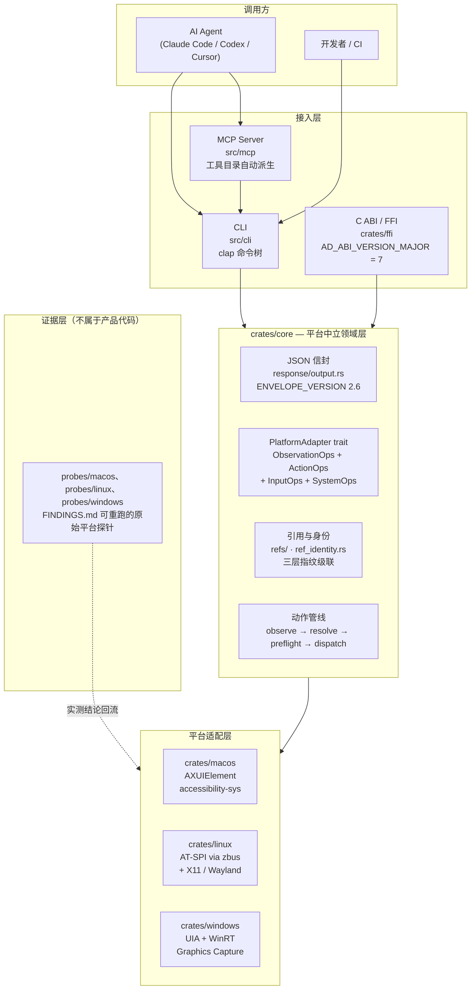
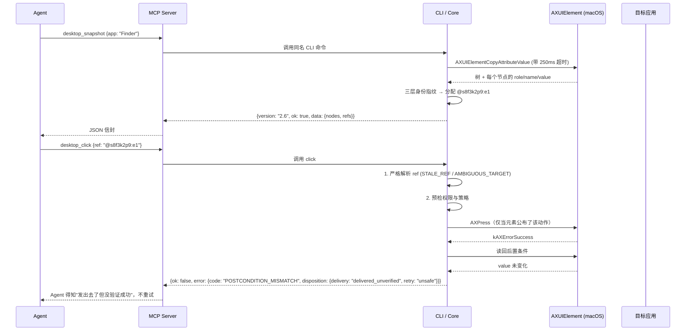

## 引子：一句"成功"，值多少钱？

如果你给一个 AI Agent 装上"控制电脑"的能力，会立刻遇到一个非常朴素的难题：

> Agent 调了个 API，说"好了"，**你凭什么信？**

大多数 Computer-Use 框架的回答是"相信返回值"。Agent 点一下按钮，工具返回 `{"ok": true}`，Agent 就认为按钮被点了，然后继续往下走。可真实世界里，**点击可能被安全策略拦下、可能被遮挡、可能落在错误的元素上、可能被应用静默丢弃**。

这就是 2026 年 Computer-Use 赛道最要命的问题：**控制平面把"我发出去了"和"它成了"混为一谈。**

`vercel-labs/agent-desktop`（⭐21,404，Rust，Apache-2.0，2026-02-19 创建，9 个月冲到 21k ⭐）是这个赛道里少见的、**把"诚实"当成第一性设计目标**的项目。它的 README 第一句是：

> **The first complete connectivity solution for Agentic AI.**

但真正让这个项目值得细读的，不是这句话，而是它的 `docs/solutions/runtime-errors/` 目录——里面用 9 篇独立文档记录了"我们踩过哪些坑"，其中包括：

> `an-atspi-write-that-returns-success-has-not-changed-anything.md`
> （一个返回成功的 AT-SPI 写入，其实什么都没改）

以及

> `a-test-that-cannot-fail-is-not-coverage.md`
> （一个不可能失败的测试，不算覆盖率）

这还没完。源码里**一个 `TODO` / `FIXME` / `HACK` 都没有**（2,784 个 `.rs` 文件，clippy 的 `todo = "warn"` 是开着的）——所有技术债都以散文形式写在注释和文档里，共 **102 条编号限制（F1–F102）**。

本文就来看看：一个项目要怎样把"诚实的失败"变成一门工程学。

---

## 一、项目定位与核心价值

### 一句话定义

**agent-desktop 是一个给 AI Agent 用的"原生桌面控制 CLI"**——它读取操作系统的**无障碍（Accessibility）原生控件树**，而不是截图，然后像人一样点击、输入、滚动、拖拽、读值。

关键在于：**它是一个 CLI，也是一个 MCP Server，同时还是一个可以被 C/Python/Go 直接 FFI 调用的原生库。**

### 仓库统计（2026-11-11 实测）

| 项 | 值 |
|---|---|
| Stars | ⭐ **21,404** |
| Forks | 1,593 |
| 主语言 | **Rust**（edition 2024 / rustc 1.89） |
| License | Apache-2.0 |
| 创建时间 | 2026-02-19 |
| 最近推送 | 2026-11-11 |
| 仓库体积 | 71.6 MB |
| 文件树 | 4,083 个节点，其中 `.rs` 约 2,784 个 |
| Workspace 成员 | `crates/core`、`crates/macos`、`crates/linux`、`crates/windows`、`crates/ffi`、`src` |
| 附加目录 | `probes/{macos,linux,windows}`、`skills/`、`docs/solutions/` |

### 能力矩阵

| 能力 | 说明 |
|---|---|
| **观察** | 读取原生无障碍树 → 稳定的 `ref` 句柄（形如 `@s8f3k2p9:e1`） |
| **动作** | click / type / set-value / clear / check / uncheck / toggle / expand / collapse / select / scroll / drag / press |
| **输入** | 键盘组合键、鼠标点击/拖拽、剪贴板 |
| **系统** | 应用枚举与切换、窗口查找、焦点、显示器、截图、通知 |
| **JSON 信封** | 版本化的结构化输出（`ENVELOPE_VERSION = "2.6"`） |
| **MCP Server** | 从 CLI 的 clap 命令树**自动派生**工具目录 |
| **C ABI / FFI** | `AD_ABI_VERSION_MAJOR = 7`，~40 个 `#[repr(C)]` 结构体，四层尺寸钉死 |
| **跨平台** | macOS（AXUIElement）/ Linux（AT-SPI + X11/Wayland）/ Windows（UIA + WinRT Graphics Capture） |

### 关键设计哲学

从 `docs/` 和源码注释里能提炼出三条：

1. **交付语义（delivery）是一等公民**，不是一个布尔值。
2. **身份（identity）必须是对象，不是位置。**
3. **"没测过"要说出来**，而不是猜一个。

### 60 个命令，56 个可用

README 里对这个边界说得很清楚：

> "agent-desktop has 60 command names, 56 operational commands. The other four (`key-down`, `key-up`, `mouse-down`, `mouse-up`) refuse to run until a daemon can release a held key or button."

（agent-desktop 有 60 个命令名，其中 56 个是可用的。另外四个——`key-down`、`key-up`、`mouse-down`、`mouse-up`——在有 daemon 能释放被持有的按键或按钮之前拒绝运行。）

命令按能力分组：

| 分组 | 命令 |
|---|---|
| 观察 | `snapshot`、`find`、`get`、`is`、`screenshot`、`list-surfaces` |
| 作用于 ref | `click`、`double-click`、`triple-click`、`right-click`、`type`、`set-value`、`clear`、`focus`、`select`、`toggle`、`check`、`uncheck`、`expand`、`collapse`、`scroll`、`scroll-to` |
| 键鼠 | `press`、`hover`、`drag`、`mouse-move`、`mouse-click`、`mouse-wheel`、`key-down`、`key-up`、`mouse-down`、`mouse-up` |
| 应用与窗口 | `launch`、`close-app`、`list-apps`、`list-windows`、`list-displays`、`focus-window`、`resize-window`、`move-window`、`minimize`、`maximize`、`restore`、`open-system-surface` |
| 通知 | `list-notifications`、`dismiss-notification`、`dismiss-all-notifications`、`notification-action` |
| 剪贴板 | `clipboard-get`、`clipboard-set`、`clipboard-clear` |
| 等待 | `wait` |
| 会话 | `session`、`trace`、`cursor-overlay` |
| 系统 | `status`、`permissions`、`version`、`batch`、`skills` |

### 一条重要的自我定位

`AGENTS.md` 开头这段，把边界划得非常干净：

> "agent-desktop is a tool that AI agents invoke, not an agent. It is a Rust CLI and C library that reads native accessibility trees and returns structured JSON with ref-based element ids. **The observe-act loop lives in the calling agent.** It never embeds an LLM and has no GUI or interactive prompt. It does not automate web pages (use agent-browser). It cannot see UIs that expose no accessibility tree."

（agent-desktop 是 AI Agent 调用的工具，**不是 Agent 本身**。它是一个 Rust CLI 和 C 库，读取原生无障碍树并返回带 ref 元素 ID 的结构化 JSON。**observe-act 循环存在于调用方 Agent 之中。** 它从不内嵌 LLM，也没有 GUI 或交互式提示。它不自动化网页（请用 agent-browser）。**它看不见不暴露无障碍树的 UI。**）

最后一句是本文档系列里反复出现的"能力边界诚实声明"的典范——**它明确告诉你它看不见什么。**

README 还有一条隐私提醒：

> "Snapshots, clipboard reads, screenshots, command output, and debug artifacts can contain private desktop content. Keep them out of public logs and uploads."

（快照、剪贴板读取、截图、命令输出和调试产物都可能包含私有桌面内容。请勿把它们放进公开日志或上传。）

---

## 二、整体架构

### 顶层视图



### 分层职责

| 层 | 职责 | 关键约束 |
|---|---|---|
| `crates/core` | 信封、错误码、引用身份、动作管线、会话、追踪 | **不得**依赖任何平台 crate（CI 用 `cargo tree -p agent-desktop-core` 强制） |
| `crates/macos` / `linux` / `windows` | 把原生无障碍 API 包成 core trait | 只实现自己支持的；其余返回 `not_supported` |
| `crates/ffi` | C ABI 兼容层 | `panic = "unwind"` 强制；结构体尺寸四层钉死 |
| `src/cli` | clap 命令树 + 全局参数 | 全局 flag 在服务端启动时固定，MCP 调用时不可逐次传 |
| `src/mcp` | MCP 工具目录 | **从 clap 树派生**，不重复定义命令 |

### 依赖倒置是被 CI 强制的

```text
crates/core/src/adapter/mod.rs
```

```rust
pub trait PlatformAdapter:
    ObservationOps + ActionOps + InputOps + SystemOps {}
```

每个方法都带默认实现：

```rust
    pub fn not_supported(method: &str) -> Self {
        Self::new(
            ErrorCode::PlatformNotSupported,
            format!("{method} is not supported on this platform"),
        )
        .with_suggestion(
            "Use a platform/build that advertises this capability or choose a supported command",
        )
        .with_disposition(DeliverySemantics::not_delivered())
    }
```

> **来自 `crates/core/src/response/adapter_error.rs`**

注意 `not_supported` **不是 panic，不是静默 no-op**，而是一个带 `not_delivered` 交付语义的正经错误码。这是整个设计的基调：**"我做不了"必须是一个可被程序消费的事实。**

平台选择发生在**编译期**：

```text
crates/core/src/adapter/mod.rs → build_adapter()
```

用 `#[cfg(target_os)]` 分派，而不是运行期探测。这样"哪个平台支持什么"是编译期常量，不会在生产环境里漂移。

---

## 三、核心引擎一：JSON 信封契约

这是整个项目最重要的对外接口。所有 CLI 调用、MCP 工具调用、FFI 调用，**返回的都是同一个信封**。

### 信封结构

```text
crates/core/src/response/output.rs
```

```rust
pub const ENVELOPE_VERSION: &str = "2.6";

/// Structured output envelope used by the CLI and future programmatic transports.
#[derive(Debug, Serialize)]
pub struct Response {
    pub version: &'static str,
    pub ok: bool,
    pub command: String,
    #[serde(skip_serializing_if = "Option::is_none")]
    pub data: Option<Value>,
    #[serde(skip_serializing_if = "Option::is_none")]
    pub error: Option<ErrorPayload>,
}

#[derive(Debug, Serialize)]
pub struct ErrorPayload {
    pub code: String,
    pub message: String,
    #[serde(skip_serializing_if = "Option::is_none")]
    pub suggestion: Option<String>,
    #[serde(skip_serializing_if = "Option::is_none")]
    pub recovery: Option<RecoveryHint>,
    ...
}
```

### 为什么信封要"版本化"

`docs/json-output.md` 里有段话说得非常到位：

> "Keep `ENVELOPE_VERSION` in `crates/core/src/response/output.rs` as the single source of truth. The envelope is how clients pick a parser branch. If it stays the same while top-level fields or error semantics change, pinned clients cannot tell an old response from a new one."

（把 `ENVELOPE_VERSION` 留在 `crates/core/src/response/output.rs` 作为唯一真相来源。信封是客户端选择解析分支的依据。如果顶层字段或错误语义变了而版本号没变，被钉住版本的客户端就无法区分新旧响应。）

更狠的是，这个项目**知道自己的版本号会被手抄而漂移**，并为此写了专门的检测：

> "`src/cli/doc_literal_drift_tests.rs` fails when a version literal in those files disagrees with `ENVELOPE_VERSION`. It does not check the prose around the literal, so a person still has to. A surface bumped to the new number while it still explains the old one is the failure this checklist exists to catch."

（`src/cli/doc_literal_drift_tests.rs` 会在那些文件里的版本字面量与 `ENVELOPE_VERSION` 不一致时失败。但它不检查字面量周围的散文描述，所以还得靠人。被改成新数字却仍在解释旧语义——这个检查清单存在的意义就是抓这种失败。）

### 信封迁移史（节选）

| 版本 | 变更 |
|---|---|
| 2.1 | 用结构化 `error.recovery` 对象取代 2.0 的 `error.retry_command` 字符串，并新增 `error.disposition`。**被移除的 `retry_command` 字段没有兼容别名。** |
| 2.2 | 预算耗尽的快照从 `TIMEOUT` 错误改成 `ok:true` + `complete:false` |
| 2.4 | 有状态 ref 动作（`set-value`/`type`/`clear`/`check`/`uncheck`/`toggle`/`expand`/`collapse`）在一次投递后**会拒绝观测到的后置条件矛盾** |
| 2.5 | **移除了每一个无条件的成功标志**（`clicked`、`moved`、`scrolled`…），且不提供兼容别名 |

2.5 那一条尤其值得注意。旧版本的 `clicked: true` 是"我发出了点击"，新版本把它拿掉了，逼调用方去看 `disposition`。

---

## 四、核心引擎二：交付语义五态（项目最精彩的设计）

### 五种交付状态

`docs/json-output.md` 的原文：

> "Every error carries `disposition`, and commands that act on a target may also carry it on their result. `delivery` is one of `unknown`, `not_delivered`, `delivery_uncertain`, `delivered_unverified` or `delivered_verified`. `retry` is one of `unknown`, `safe` or `unsafe`, and it follows from `delivery`: `not_delivered` is `safe`, and every other non-`unknown` value is `unsafe`."

（每个错误都带 `disposition`，作用于目标的动作命令其结果也可能带。`delivery` 取 `unknown` / `not_delivered` / `delivery_uncertain` / `delivered_unverified` / `delivered_verified` 之一。`retry` 取 `unknown` / `safe` / `unsafe`，且**由 `delivery` 推导**：`not_delivered` 是 `safe`，其他任何非 `unknown` 值都是 `unsafe`。）

### 五态语义表

| delivery | 含义 | retry | Agent 该怎么办 |
|---|---|---|---|
| `unknown` | 命令**什么都没能说明** | `unknown` | **不要自动重试**，读 `error.code` 自行判断 |
| `not_delivered` | 确实**没发出去** | `safe` | 可以安全重试 |
| `delivery_uncertain` | 可能发出去了，也可能没有 | `unsafe` | 重试可能重复执行 |
| `delivered_unverified` | 发出去了，但**没验证过效果** | `unsafe` | 需要读回校验 |
| `delivered_verified` | 发出去了，**且读回确认了** | `unsafe` | 可以相信 |

文档对 `unknown` 的告诫尤其清醒：

> "`unknown` means the command established nothing about delivery. ... Treat `unknown` as not safe to retry automatically: read `error.code` and the message, and choose a recovery strategy only when `disposition.retry` is `safe`."

### 为什么"只有 not_delivered 可重试"

skill 文档给出的操作建议非常具体：

> "- Retry or substitute an action only when `disposition.retry` is `safe`. Only `not_delivered` is safe.
> - Any other delivery value means the action may have landed. A repeat can click, type or submit twice, and `toggle` can undo itself."

（只在 `disposition.retry` 是 `safe` 时才重试或替换动作，**只有 `not_delivered` 是安全的**。其他任何交付值都意味着动作可能已经落地了。重复执行可能点两次、打两次字、提交两次，而 `toggle` 甚至会把自己撤销掉。）

**`toggle` 能自我撤销**这个例子太典型了——一个"重试"的语义错误，直接导致状态反转。所以"能重试"不是布尔判断，而是必须由投递状态推导出来的。

### 错误码与投递状态的绑定

16 个错误码，每个都绑定了确定的投递语义：

| 错误码 | 含义 | 投递状态 |
|---|---|---|
| `APP_NOT_FOUND` | 没找到匹配的应用进程，**查找在发送任何东西之前就失败了** | `not_delivered` |
| `STALE_REF` | ref 在实时 UI 里无法被重新识别 | `not_delivered` |
| `AMBIGUOUS_TARGET` | ref 恢复时匹配到多个可能的目标 | `not_delivered` |
| `POLICY_DENIED` | 物理/headed 路径被策略拦截 | `not_delivered` |
| `WINDOW_NOT_FOUND` | 请求的窗口不存在 | `not_delivered` |
| `TIMEOUT` | 超时 | `delivery_uncertain` |
| `APP_UNRESPONSIVE` | 应用无响应 | `delivery_uncertain` |

还有一个非常微妙的版本迁移：

> "A surface kind the OS does not have now returns `INVALID_ARGS` instead of `PLATFORM_NOT_SUPPORTED`, with the disposition `not_delivered` and `retry: `"safe"`."

（操作系统不存在的 surface 类型，现在返回 `INVALID_ARGS` 而不是 `PLATFORM_NOT_SUPPORTED`，交付状态是 `not_delivered`、重试 `safe`。）

这个改动看似是"换个错误码"，实际上是**语义修正**：以前 `PLATFORM_NOT_SUPPORTED` 暗含"换个平台也许行"，但实际上你**此刻在这个平台上重试也不会成功**——所以应该是 `INVALID_ARGS` + `not_delivered` + `safe`。

---

## 五、核心引擎三：三层身份指纹（"身份是对象，不是位置"）

Agent 做桌面自动化最怕的一件事：**点了 A  application's 按钮，结果点在 B 上。**

原因是 GUI 元素的位置会变。列表里删掉一行，后面所有行都往上挪了——如果你用"第 3 行第 2 个"当身份，那就全乱了。

### 三层级联

```text
crates/core/src/refs/ref_identity.rs
```

```rust
const ELEMENT_TOKEN_PREFIX: &str = "axtok1:";

/// The retained object that is a genuine element token. A platform that keeps
/// only a positional path or a runtime id retains a location, not a handle, so
/// core never treats that value as identity evidence.
pub fn element_token(entry: &RefEntry) -> Option<&str> {
```

> **来自 `crates/core/src/refs/ref_identity.rs`**

这个注释是整个身份模型的题眼：**一个平台如果只能保存位置路径或运行时 ID，它保存的是"位置"而不是"句柄"，所以 core 绝不把它当身份证据。**

匹配是一个严格级联——先 token，再 native id，再稳定文本：

```rust
pub fn identity_match(
    entry: &RefEntry,
    actual_name: &LocatorField<String>,
    actual_value: &LocatorField<String>,
    actual_description: &LocatorField<String>,
    actual_identifiers: &IdentifierEvidence,
) -> IdentityMatch {
    if let Some(expected) = element_token(entry) {
        return match (
            crate::tree::accname::non_blank(Some(expected)),
            actual_identifiers.retained_object(),
        ) {
            (Some(expected), Some(actual)) => equality_match(expected, actual),
            _ => IdentityMatch::Unknown,
        };
    }
    if entry.identity.native_id.is_some() {
        return native_id_match(entry, actual_identifiers);
    }

    stable_text_match(entry, actual_name, actual_value, actual_description)
}
```

> **来自 `crates/core/src/refs/ref_identity.rs`**

### Layer 1：macOS 私有 API 的元素令牌

macOS 上最强的身份不是 PID、不是位置，而是 **AXUIElement 自己的 remote token**。而这个 API 是**私有的**，所以要用 `dlsym` 在运行时查：

```text
crates/macos/src/tree/resolve/retained.rs
```

```rust
const TOKEN_PREFIX: &str = "axtok1:";
```

```rust
type TokenCreate = unsafe extern "C" fn(accessibility_sys::AXUIElementRef) -> CFDataRef;
type TokenResolve = unsafe extern "C" fn(CFDataRef) -> accessibility_sys::AXUIElementRef;
```

```rust
fn lookup_symbols(handle: *mut c_void) -> Option<Symbols> {
    let create = symbol(handle, c"_AXUIElementRemoteTokenCreate")?;
    let resolve = symbol(handle, c"_AXUIElementCreateWithRemoteToken")?;
    ...
}
```

> **来自 `crates/macos/src/tree/resolve/retained.rs`**

令牌存活性是个四态枚举：

```rust
pub(crate) enum TokenLookup {
    NotAToken,
    Unavailable,
    Dead,
    Live(AXElement),
}
```

### 探针实测：令牌的三条性质

`probes/macos/FINDINGS.md` 是一份**可重跑的原始平台探针记录**，行格式是 `id | probe | scope | observed | conclusion`。几条关键结论：

| id | 探针 | 实测观察 | 结论 |
|---|---|---|---|
| M1-1 | `dlsym` 符号查找 | `_AXUIElementRemoteTokenCreate` 与 `_AXUIElementCreateWithRemoteToken` 在 ApplicationServices 中可解析；`_AXUIElementCopyRemoteToken` 与 `AXUIElementCreateWithRemoteToken` **不存在** | 私有符号对在 macOS 26.4 上存在。这是私有 API：**运行时查找，缺失时回退** |
| M1-3 | 过滤掉 Alpha 行，解析两个已保存令牌 | Alpha 令牌：`kAXErrorInvalidUIElement` (-25202)；Beta 令牌仍是 Beta | 被移除元素的令牌会死。它**不会**落到顶上来的那一行——那正是属性匹配无法排除的错行场景 |
| M1-4 | 恢复行（新建一个一模一样的 Alpha），比较令牌 | 新 Alpha 令牌 `…44…` 与旧的 `…35…` 不同；旧令牌仍以 -25202 失败 | 令牌不会在"完全相同的替换物"上被复用，所以死令牌绝不会复活到替身上 |
| M1-5 | 重启应用，解析已保存令牌 | -25204（无法完成） | 令牌随进程消亡；进程代次检查作为第二道守卫 |
| M1-9 | Finder 里把 `golf.txt` 重命名为 `golf2.txt` | 重命名后那行的令牌仍解析到显示 `golf2.txt` 的同一元素 | **令牌跟随元素穿越文本变更；身份是对象，不是它的标签** |
| M1-10 | `bench.c` 在 Finder 里遍历到 `hotel.txt`，然后解析其令牌 50 次 | 遍历 206 个元素耗时 53.2 ms；令牌重建加一次 role 读取：最小 0.024 ms，平均 0.028 ms | 从令牌重建元素远比遍历树便宜 |

M1-4 那条尤其重要：**令牌不会被复用**，所以"旧令牌死掉"是一个**安全的失败**——它只会返回 `STALE_REF`，绝不会错误地落到一个长得一样的元素上。

探针文档的末尾甚至列了一张**诚实的"还没测过"清单**：

> "Not yet measured: non-reuse across providers other than the fixture and Chrome web content, Electron apps, apps that rebuild their accessibility tree on every refresh, and behavior across macOS major versions. A token that dies more often only makes a ref return `STALE_REF`; it never resolves to another element."

（尚未测量：除 fixture 与 Chrome web content 之外的其他 provider 上的不复用性、Electron 应用、每次刷新都重建无障碍树的应用，以及跨 macOS 大版本的行为。令牌死得更频繁只会让 ref 返回 `STALE_REF`；它绝不会解析到另一个元素上。）

### 三层级的严格性

| 层 | 机制 | 能区分"同名的两个 Delete 按钮"吗 |
|---|---|---|
| 1 | 元素自身令牌（macOS） | ✅ 完全能——每个按钮有自己的地址 |
| 2 | 原生 ID | ✅ 通常能 |
| 3 | 稳定文本 + role 谓词 | ❌ 不能——只能报 `AMBIGUOUS_TARGET` |

`skills/agent-desktop-macos/SKILL.md` 里的说法：

> "**Refs use native addresses when available.** A ref turns back into the exact element it was captured from, so identical twins, such as several identical `Delete` buttons, each act on their own row. If the element was removed or the app restarted, the ref is `STALE_REF`, `details.kind: retained_object_stale`, and it never falls back to a search for a look-alike."

### 可变值永远不是身份

```rust
    if is_mutable_value_role(entry.identity.role.as_str()) {
        return IdentityMatch::Unknown;
    }
```

> **来自 `crates/core/src/refs/ref_identity.rs`**

输入框里的文本会变，所以它不能当身份。

### 歧义如何被拒绝

`docs/json-output.md` 给出的原因码表：

| `details.reason` | 错误码 | 语义 |
|---|---|---|
| `retained_object_stale` | `STALE_REF` | macOS：元素记录地址已死，或其进程、role、记录的标识不再匹配。**不跑任何搜索**，所以 ref 不会落到一个长得像的元素上 |
| `saved_ref_absent` | `STALE_REF` | 完整证据下没有任何实时元素匹配该 role 与稳定字段，元素已消失 |
| `saved_ref_ambiguous` | `AMBIGUOUS_TARGET` | 出现了一个与捕获时完全相同的元素，两个以上实时元素匹配。**新的快照会拒绝这俩双胞胎** |
| `identity_not_unique` | `AMBIGUOUS_TARGET` | 捕获时**没被证明**是该 role + 稳定字段的唯一匹配，所以什么都不搜索 |

还有第五种结果 `resolution_identity_unknown`，携带 `TIMEOUT`：

> "The fifth outcome is `resolution_identity_unknown`, which carries `TIMEOUT`: a live field could not be read, so the identity count stayed unproven. It is retryable."

注意 `identity_not_unique` 那条的后半句：

> "A twin is refused by every snapshot; only an explicit coordinate click (`--headed mouse-click --xy`) can pick one, it takes the foreground, and it is unavailable on a Linux Wayland session."

（双胞胎会被每个快照拒绝；只有显式坐标点击才能选中其一，它会夺取前台，而且在 Linux Wayland 会话上不可用。）

**这里有一个非常克制的产品决策**：系统宁可不执行，也不猜。因为在 GUI 里猜错的代价（删掉错误的文件、点下错误的"确认"）远大于不执行。

---

## 六、核心引擎四：动作管线与预检

### observe → resolve → preflight → dispatch

所有作用于目标的动作都走同一条四段式管线。

**preflight** 把"权限被拒"转成一个带平台建议的 `PERM_DENIED`：

```text
crates/core/src/.../preflight_context
```

```rust
pub(crate) fn preflight_context(
```

> **来自 `crates/core/src/commands/` 下的预检模块**

`preflight` 的作用是**在真正发送之前**把已知会失败的情况识别出来，让投递语义可以诚实地标成 `not_delivered`。

### 只在"明确拒绝"时回退

```text
crates/macos/src/actions/chain/
```

> "The adapter falls back to the semantic action only when the physical attempt returns `ACTION_NOT_SUPPORTED` or a geometry refusal (`check: geometry`) with `not_delivered`; `details.physical_fallback` records the skipped `physical_input` step and refusal. Focus, policy, timeout, uncertain and partial-delivery refusals never fall back."

（适配器只在物理尝试返回 `ACTION_NOT_SUPPORTED`、或几何拒绝（`check: geometry`）且 `not_delivered` 时才回退到语义动作；`details.physical_fallback` 记录被跳过的 `physical_input` 步骤与拒绝原因。**焦点、策略、超时、不确定和部分投递的拒绝永远不回退。**）

这条规则是"诚实"的具体体现：**只有"确定没做"才能换一种方式做，"不确定"绝不能换路**——否则就变成了"我以为失败了所以再试一次"的经典 bug。

### 只执行"被公布过的"动作

```text
crates/macos/src/actions/ax_perform.rs
```

```rust
    /// Unadvertised actions are never performed, because a responder can answer
    /// `kAXErrorSuccess` to an action it never published and never ran. Only an
```

> **来自 `crates/macos/src/actions/ax_perform.rs`**

（**未被公布的动作永远不会被执行**，因为一个响应者可以对一个它从未公布、从未运行过的动作回答 `kAXErrorSuccess`。）

这段注释背后的洞察非常深刻：**macOS 的 AX API 在某些情况下会对一个"根本没做"的动作返回成功**。所以"能不能做"必须靠"这个元素公布了这个动作吗"来判断，而不是靠返回值。

### IPC 预算：不让一个卡死的应用吃掉全部期限

```text
crates/macos/src/tree/query/traversal.rs
```

> "Every AX call is preceded by `AXUIElementSetMessagingTimeout`, so a hung app cannot eat the whole deadline."

> **来自 `crates/macos/src/` 的 AX 调用层**

> "mutation has no such loop. Cutting one short cannot undo what the application already started."

（变更类操作没有这个循环。**砍掉一个短操作无法撤销应用已经开始的事情。**）

于是预算被分成两半：读操作用一个时间片，变更操作用剩余的一半。

### 遍历也有预算和环检测

```text
crates/macos/src/tree/query/traversal.rs
```

- **环检测**：维护祖先指针集合
- **节点/边/文本上限**
- **web-wrapper 深度跳过**：Chromium 容器消耗"原始深度"但不消耗"逻辑深度"

---

## 七、核心引擎五：MCP 工具目录从 CLI 派生

这是一个非常聪明的去重设计：**命令只定义一次**。

```text
src/mcp/catalog.rs
```

- 工具命名：CLI 命令 `snapshot` → MCP 工具 `desktop_snapshot`；`click` → `desktop_click`；还有 `desktop_session_start`
- Schema：`{"name", "description", "inputSchema"}`，其中 `inputSchema` 是 `{"type":"object","properties":{...},"additionalProperties":false}`，当 clap 参数 `is_required_set()` 时加 `"required"`
- `description()` = `"agent-desktop {path}: {about}"`
- 参数过滤：跳过全局参数、隐藏参数、`stdin`、help/version 动作；`MAX_COUNT: u64 = 16` 限制 count 类参数

MCP 协议的版本协商：

```text
src/mcp/catalog.rs
```

```rust
const MODERN_VERSION: &str = "2026-07-28";
```

MCP server 的 instructions 原文：

> "agent-desktop reads native accessibility trees and operates desktop apps. Each tool runs the agent-desktop CLI command of the same name and returns its JSON envelope: ok with data, or ok false with error; a call rejected before the command runs returns plain text. Read desktop_skills_get with name \"desktop\" first for the observe-act loop, and with name \"platform\" for what differs on this OS. The skills use CLI syntax: `agent-desktop snapshot --app Finder` is desktop_snapshot with {\"app\": \"Finder\"}, and the input schema replaces --help. Global flags (--session, --agent-id, --headed, --wait-for, --trace) are fixed by how this server was started and cannot be passed per call. Refs such as @s8f3k2p9:e1 come from desktop_snapshot and go stale when the UI changes: on STALE_REF or AMBIGUOUS_TARGET, snapshot again. Repeat an action only when its disposition.retry is \"safe\"."

这段 instructions 等于**给 LLM 写的操作手册**，而且是项目自己生成的——它明确告诉 Agent：ref 会过期、什么情况下要重新快照、什么情况下才能重试。

### 硬性限制

| 限制 | 值 |
|---|---|
| 并发调用 | 8 |
| 单条消息 | 4 MiB |
| 协议版本 | `2026-07-28` + 4 个 legacy 版本 |

---

## 八、核心引擎六：skills/ —— 把"平台知识"做成可拉取的资产

```text
skills/agent-desktop-macos/SKILL.md
skills/agent-desktop-macos/references/troubleshooting.md
skills/agent-desktop-linux/SKILL.md
skills/agent-desktop-linux/references/bus-and-permissions.md
skills/agent-desktop-linux/references/capture-and-clipboard.md
skills/agent-desktop-linux/references/display-servers-and-input.md
skills/agent-desktop-linux/references/shell-tray-and-notifications.md
skills/agent-desktop-linux/references/windows-and-lifecycle.md
skills/agent-desktop-linux/references/troubleshooting.md
skills/agent-desktop-windows/SKILL.md
skills/agent-desktop-windows/references/chromium-and-electron.md
skills/agent-desktop-windows/references/permissions-and-elevation.md
skills/agent-desktop-ffi/SKILL.md
skills/agent-desktop-ffi/references/build-and-link.md
skills/agent-desktop-ffi/references/error-handling.md
skills/agent-desktop-ffi/references/ownership.md
skills/agent-desktop-ffi/references/threading.md
```

这是一个**分层知识加载**机制：Agent 先拉通用的 `desktop` skill（observe-act 循环），再按需拉 `platform` skill（这个 OS 上有什么不同）。

这解决了 Computer-Use 一个长期的痛点：**Linux 上的 AT-SPI 和 macOS 上的 AX 是两套完全不同的语义**，把它们塞进一个巨大的 system prompt 会浪费 token 且互相污染。按平台分开、按需加载是对的。

---

## 九、核心引擎七：FFI 的四层尺寸钉死

`crates/ffi` 提供 C ABI。Rust 的 `#[repr(C)]` 结构体一旦被 C 侧看到，**字段顺序或对齐一变就是 ABI 破坏**——而且这种破坏在编译期完全看不出来。

这个项目的解法是**四层钉死**：

```text
docs/solutions/best-practices/ffi-repr-c-struct-size-pinning.md
```

> 1. **Rust.** A `pub const` size, a `const _` assert on `size_of`, and an `extern "C"` size getter.
> 2. **C header.** The size macro is emitted from the Rust const. The `_Static_assert` lines come from the `trailer` in `crates/ffi/cbindgen.toml`.
> 3. **Integration test.**
> 4. **ctypes smoke test.**

Rust 侧的写法：

```text
crates/ffi/src/types/action.rs
```

```rust
#[repr(C)]
```

```rust
const _: () = assert!(std::mem::size_of::<AdAction>() == AD_ACTION_SIZE);
```

```rust
    std::mem::size_of::<AdAction>()
```

这个 `const _: () = assert!(...)` 模式在 `crates/ffi/src/types/` 下约 **40 个文件**中重复出现（`action.rs`、`node.rs`、`ref_entry.rs`、`find_filter.rs`、`wait_args.rs`、`delivery_semantics.rs`、`exact_window_info.rs`、`optional_u64.rs`…）。

C 头文件里则是这样的断言：

```c
_Static_assert(offsetof(AdActionResult, disposition) == 48, "AdActionResult.disposition offset changed");
```

（trailer 里有约 100 行 `_Static_assert`，覆盖约 45 个结构体的 `sizeof`、`_Alignof` 和 `offsetof`。）

### 但第四层是漏的——而且项目自己承认

> "The trailer is the one layer with no generator behind it. Adding a pinned struct without its `_Static_assert` lines in the trailer is silent. `cbindgen --verify` regenerates from the same trailer (`.github/workflows/ci.yml:739-742`), so CI stays green and the C-side pin does not exist."

（**trailer 是唯一没有生成器背后的一层。** 加上一个被钉住的结构体却没在 trailer 里加它的 `_Static_assert` 行，是**静默的**。`cbindgen --verify` 从同一个 trailer 重新生成（`.github/workflows/ci.yml:739-742`），所以 **CI 一直是绿的，而 C 侧的钉子根本不存在**。）

这句话是整个项目里"诚实"浓度最高的一句：**它指出了自己防御体系的一个真实缺口，并且精确说明了为什么 CI 抓不到**。

### panic 策略也是 ABI 的一部分

```text
crates/ffi/src/
```

```rust
compile_error!(
    "agent-desktop-ffi requires panic=unwind; build with --profile release-ffi, not --release"
);
```

Rust 默认 `panic = "abort"`，一旦在 FFI 边界上 panic，宿主进程直接被 abort——对 Python/Node 宿主来说是灾难。所以这里用 `compile_error!` 在**编译期**强制 `panic = "unwind"`。

### 双失败模式

> "**Argument / infrastructure failure** (null adapter, invalid UTF-8, bad discriminant, context error): `*out` is set to null, no allocation is made, and the last-error slot is the only failure indication. **Command-level failure** (app not found, STALE_REF, TIMEOUT, etc.): `*out` is set to a heap-allocated JSON string with `\"ok\":false` and an `\"error\"` payload. The caller **must still free** it with `ad_free_string(*out)`."

C 侧的错误码是 ABI 稳定的：

> "Numeric values are ABI-stable. New codes are appended, and existing values are never renumbered. Handle values outside this list, because a later release may add codes."

（`AD_RESULT_OK` 0、`AD_RESULT_ERR_PERM_DENIED` -1 … `AD_RESULT_ERR_APP_UNRESPONSIVE` -16。）

---

## 十、端到端数据流



这条流水线的关键在最后三步：**解析 → 预检 → 投递 → 读回**。读回失败不会把结果粉饰成成功，而是落成 `delivered_unverified` + `retry: unsafe`。

---

## 十一、⭐ 必须诚实指出的源码自陈缺陷

这是本系列最有价值的部分。这个项目的缺陷不是"藏起来"的，而是**编号、归档、并写进文档**的。

### 11.1 跨平台的"持有输入"一律拒绝

```text
crates/core/src/commands/input_hold_policy.rs
```

```rust
pub(crate) fn reject(command: &str, replacement: &str) -> AppError {
    AdapterError::new(
        ErrorCode::ActionNotSupported,
        format!("{command} is unavailable in stateless mode"),
    )
    .with_suggestion(format!(
        "Use the atomic {replacement} command; held input requires a daemon-owned transaction that can guarantee release"
    ))
    .into()
}
```

> **来自 `crates/core/src/commands/input_hold_policy.rs`**

`key-down`、`key-up`、`mouse-down`、`mouse-up` 在**所有平台**都被 core 拒绝（不是适配器拒绝）。理由很硬：

> "held input requires a daemon-owned transaction that can guarantee release"

（持有输入需要一个能保证释放的、daemon 拥有的事务。）

而 CLI 的描述直接写进 `--help`：

```rust
    #[command(about = "Hold a key or modifier down (fails closed in stateless mode; use press)")]
    KeyDown(KeyComboArgs),
```

测试文件把这件事钉成了跨平台契约：

```rust
/// Commands the Windows skill documents as unavailable that no adapter method
/// backs: core refuses them on every platform before dispatch reaches an
/// adapter, so the behavioural pin cannot cover them and must not pretend to.
/// They are listed rather than ignored so the closure assertion below stays
/// exhaustive.
const REFUSED_BY_CORE_ON_EVERY_PLATFORM: &[&str] =
    &["key-down", "key-up", "mouse-down", "mouse-up"];
```

> **来自 `src/cli/windows_capability_claims_tests.rs`**

最后那句 "must not pretend to"（不得假装）——**测试自己声明它覆盖不了这件事，于是把它列出来而不是忽略掉。**

### 11.2 Linux 的致命短板：Wayland

Linux skill 里写明：

> "Windows skill L35: `right-click` and `type` need `--headed` and return `POLICY_DENIED` headless"

而 Wayland 更是彻底：

> Wayland 的 total lack of pointer/window-control paths

在 Wayland 会话下，连坐标点击都不可用（前面 `identity_not_unique` 那条也提到了这点）。

### 11.3 Ubuntu 22.04 的 AT-SPI 桥直接 abort

> Ubuntu 22.04's AT-SPI bridge abort

Linux 探针还发现了一条**与项目自身设计相矛盾**的事实：

> | L1-5 | Presence check on the cold bus (failing direction for a name-owner check) | dbus | api-contract | §3.1 AT-SPI2 Bus Detection: "Check for `org.a11y.Bus` presence on the D-Bus session bus" | `pre_name_has_owner: false` while `pre_listed_activatable: true` | **CONTRADICTS** | 3.1: detect with an auto-starting `org.a11y.Bus.GetAddress` call, never with `NameHasOwner` or a no-auto-start call; those report a healthy cold session as missing |

探针结论词有四种：`CONFIRMS`（确认）、`CONTRADICTS`（矛盾）、`NEW-EDGE`（新边界）、`DEFERRED`（暂缓）。

**`CONTRADICTS` 是最有价值的一种**——它意味着"我们原来假设的写法，实测是错的"。

还有一条：

> | L1-13 | GTK4 app starting before the bus, bus started after | dbus | app | none | `a11y_bus_present_when_app_ready: false`, `late_bus_name_has_owner: true` (started in about 11 ms), `app_registration_from_registry_poll.registered: false` after 12 s | NEW-EDGE | 3.1 / 3.2: an app that started with no bus never registers on a bus that appears later, so a snapshot cannot see it until the app restarts |

（一个在没有 bus 时启动的应用，**永远不会注册到后来出现的 bus 上**，所以快照在应用重启前看不到它。）

### 11.4 AT-SPI 的两个经典陷阱

探针实测结论：

> `an-atspi-error-name-is-not-proof-an-object-is-gone.md`
> （一个 AT-SPI 错误名不能证明对象已经消失）

> `an-atspi-write-that-returns-success-has-not-changed-anything.md`
> （一个返回成功的 AT-SPI 写入，其实什么都没改）

以及：

> | L4-13 | InsertText `length` parameter | dbus | api-contract | P3-O10: "`EditableText.InsertText(position, text, length)`" | `length` counts UTF-8 bytes, not characters | NEW-EDGE | 3.7: pass the UTF-8 byte length; never a code-point count or a value cutting a sequence; `true` is returned even when nothing was inserted, so read back |

（`length` 数的是 **UTF-8 字节**而不是字符。**即使什么都没插入也会返回 `true`，所以必须读回。**）

### 11.5 GNOME Shell 与 Chromium

> `a-gnome-shell-surface-can-pass-every-adapter-test-and-still-get-no-ref.md`
> （一个 GNOME Shell surface 能通过所有适配器测试，却仍然拿不到 ref）

> `chromium-readable-tree-with-inactive-ax-actions.md`
> （Chromium 的可读树里带着不生效的 AX 动作）

Chromium 这条在 skill 里被总结成一句：

> "Check enhanced mode even when web content is already readable. **A readable tree is not proof that its actions work.**"

（即使 web 内容已经可读，也要检查 enhanced mode。**可读的树不能证明它的动作能用。**）

### 11.6 Windows 的 WPF 与 Smart App Control

> WPF's permanent wrong-provider binding

以及 Windows Smart App Control 导致的签名/安装问题。

### 11.7 macOS 的私有 API 风险

整套 Layer 1 身份机制建立在**私有 API** 上（M1-1 明确写了 "It is private API"）。项目用"运行时 dlsym 查找 + 缺失时回退"来对冲，但本质上是赌 Apple 不移除它。

### 11.8 其他值得注意的

- **同一用户的 overlay pipe 没有保护**（unprotected same-user overlay pipe）
- **npm 12 阻止 postinstall**，导致安装耗时 +125 ms
- **窗口与控件的枚举**在某些桌面环境返回不完整
- **Chrome/Electron/CEF 的渲染进程检测是 best-effort**："detection failure never fails the launch itself"（检测失败永远不会让启动本身失败）
- **Windows 的 `SendInput` 返回值从不被当作投递证据**：

  > "`SendInput`'s return value is never treated as delivery evidence (A9-3: ...)"

### 11.9 「写进去了但读回来不一样」会误报失败

这条特别值得单独讲，因为它直接挑战了"读回校验"这个方法本身的可靠性：

> "**A `set-value` that the application reshapes reads as failed.** If the app trims whitespace, reformats a date or normalizes a number, the readback differs from what you wrote, and the envelope says `ACTION_FAILED` although the write landed. The `SetValue` check captures no before-state, so it cannot tell 'nothing happened' from 'accepted and reshaped'. ... a `textfield` that stores `42.0` after you wrote `42` fails this way."

（**一次被应用重新整形过的 `set-value` 会读成失败。** 如果应用裁剪了空白、重排了日期格式或归一化了数字，读回的东西和你写的不一样，信封就说 `ACTION_FAILED`，**尽管写入其实成功了**。`SetValue` 检查没有捕获 before-state，所以它分不清"什么都没发生"和"接受了但被整形了"。……一个你写了 `42` 却存成 `42.0` 的文本框就会这样失败。）

这是"诚实"的一个边界：**当验证手段本身有歧义时，项目选择报失败（保守方向），而不是报成功。** 代价是偶尔会误报，好处是绝不会谎报成功。

### 11.10 Linux 的两个诡异行为

**GTK4 的双击塌缩：**

> "Two `click` calls on one GTK4 button less than about 250 ms apart act once. Both answer `ok: true` with `delivered_unverified`."

（对同一个 GTK4 按钮、相隔不到约 250 ms 的两次 `click` **只生效一次**。两个都回答 `ok: true` 且 `delivered_unverified`。）

**GTK4 密码框会漏明文：**

> "**A GTK4 secret field can show its text.** Only a password role is withheld. Treat a GTK4 entry with hidden characters as readable by every observation command."

（**一个 GTK4 密文框可能显示其文本。** 只有 password role 被遮蔽。把隐藏字符的 GTK4 输入框当作每个观察命令都能读取。）

后者是个**安全相关的诚实披露**——它明确告诉使用者"这里的掩码是假的"。

### 11.11 Windows 的 WPF 永久性错误绑定

> "A UIA client that reads a WPF window before its automation peer exists binds the generic HWND provider **permanently**. The window then reports `ClassName HwndWrapper[...]` with zero children, and **no in-process retry recovers it**."

（一个在 WPF 窗口的 automation peer 存在之前就读取它的 UIA 客户端，会**永久地**绑定到通用的 HWND provider。此后该窗口报告 `ClassName HwndWrapper[...]` 且子节点数为零，**任何进程内重试都无法恢复**。）

这是"读早了"的典型代价——**一个不可逆的状态污染**。

### 11.12 Chromium 的 2 秒 AX 去抖

> "Chromium starts in a limited accessibility mode when an AX role is read. Its `AXEnhancedUserInterface` setter requests complete mode after a two-second debounce. Reading the flag back as true does not mean the debounce has finished, so usable state can arrive about two seconds after the write."
>
> "The setter returns `kAXErrorNotImplemented` after it applies the flag. Chromium handles the attribute before it forwards the setter to its superclass. The readback is therefore the only reliable sign that the change applied."

（Chromium 在读取 AX role 时以受限的无障碍模式启动。它的 `AXEnhancedUserInterface` setter 在**两秒去抖之后**才请求完整模式。**读回该标志为 true 并不代表去抖已经结束**，所以可用状态可能在写入约两秒后才到达。）

而且 setter **在应用了标志之后还会返回 `kAXErrorNotImplemented`** ——所以读回是唯一可靠的确认手段。

### 11.13 有一个"测试陷阱"被写成了独立文档

> `a-test-that-cannot-fail-is-not-coverage.md`

以及一份 "八个不可失败的测试形态" 的清单。这个主题看起来偏软，但恰恰是**自动化 Agent 最容易骗自己的地方**：一个断言写得太松的测试，会给 Agent 一个虚假的绿灯。

---

## 十二、与同类项目对比

| 维度 | agent-desktop | Playwright / Browser Use | CUA / OpenCUA | Computer-Use (Simular) |
|---|---|---|---|---|
| **感知方式** | **原生无障碍树（AX / AT-SPI / UIA）** | DOM + CDP | 截图 + VLM | 截图 / 混合 |
| **运行位置** | 宿主机（真实桌面） | 浏览器进程 | 隔离桌面 | 隔离桌面 |
| **元素身份** | **对象令牌 / 原生 ID / 稳定文本三级指纹** | CSS/XPath 选择器 | 坐标 | 坐标 |
| **失败语义** | **五态交付语义 + 可推导的重试安全性** | 异常 / 超时 | 成功 / 失败 | 成功 / 失败 |
| **跨平台** | macOS / Linux / Windows | 跨浏览器 | 主要是 Linux | Linux |
| **输出契约** | **版本化 JSON 信封（2.6）** | 无版本化契约 | 无 | 无 |
| **原生集成** | ⭐⭐⭐ 无障碍原生控件（含 SwiftUI/自绘 UI） | ⭐ 浏览器内 | ⭐ 无 | ⭐ 无 |
| **代价** | **只在本机桌面可用** | 需要浏览器 | 需要显示器 + 渲染开销 | 需要显示器 + 渲染开销 |

### 设计差异的三个要点

**1. "感知"决定了天花板**

用截图的方案（比如 CUA、OpenCUA）能操作**任何**东西——包括游戏 canvas、远程桌面、任何没有无障碍树的程序。但它**看不到语义**：一个按钮叫"删除"还是"确认"，截图方案只能靠 VLM 猜。

用无障碍树的方案能拿到**控件语义、角色、可编程名称、值、动作列表**，而且 macOS/Windows 上连自绘控件都通常有 AX 桥。但它**操作不了没有无障碍实现的区域**。

**2. "身份"决定了正确性**

坐标是位置的代名词。位置会变。agent-desktop 的三级指纹把身份锚定在**对象**上，代价是它必须处理"对象死了"（`STALE_REF`）和"对象不唯一"（`AMBIGUOUS_TARGET`）两种情况——**而多数方案根本没有"歧义"这个概念，因为坐标永远"唯一"。**

**3. "失败语义"决定了 Agent 的行为质量**

这是最容易被忽略但影响最大的一层。截图方案返回 `ok/false`，Agent 只能二选一：信了，或者不信。agent-desktop 返回五态，Agent 可以在"确定没发出去"时放心重试，在"发出去了但没验证"时选择读回校验而不是重试。

**这个差别在长任务里会放大成完全不同的可靠性。**

---

## 十三、优缺点分析

### 架构简洁性 / 扩展性 / 易用性（左侧优势）

| 优势 | 说明 |
|---|---|
| **✅ 平台中立 core + 薄适配层** | 严格依赖倒置，CI 强制。新增平台只需实现 trait，不动 core |
| **✅ CLI 是唯一命令定义** | MCP 工具目录从 clap 树派生，不存在"CLI 和 MCP 行为不一致"的可能 |
| **✅ 编译期平台分派** | `#[cfg(target_os)]`，生产环境不会能力漂移 |
| **✅ 分层 skill 加载** | 通用循环 + 平台差异分开，token 效率高 |
| **✅ FFI 可嵌入** | 宿主程序直接调，不必 fork CLI 进程 |
| **⚠️ 需要本机桌面会话** | 无头服务器、容器里跑不了大部分能力 |

### 性能 / 复杂度 / 维护性（右侧代价）

| 代价 | 说明 |
|---|---|
| **⚠️ 复杂度高** | 5 crate + 5 层结构 + 四层 ABI 钉死 + 9 篇运行时错误文档，学习曲线陡 |
| **⚠️ macOS 私有 API 依赖** | `AXUIElementRemoteTokenCreate` 是私有符号，Apple 移除即失效（有回退，但降级后身份能力下降） |
| **⚠️ Linux 支持最弱** | Wayland 缺指针/窗口控制路径；AT-SPI 桥在 Ubuntu 22.04 上 abort |
| **⚠️ 私有 API + 无障碍树在不同应用上表现参差** | Chromium 2 秒 AX 去抖、GNOME Shell 虚拟节点、WPF provider 绑定错误——这些都不是 core 能修的 |
| **✅ 性能优秀** | 令牌重建平均 **0.028 ms**，vs 遍历 206 元素 53.2 ms——**差 1900 倍** |
| **✅ 可维护性好** | 102 条限制编号归档、`probes/` 证据库可重跑、CI 强制依赖方向 |

### 那 1900 倍值得单独说

M1-10 那条实测数据是这个项目最有说服力的工程决策依据：

> "tree walk 53.2 ms over 206 elements; token reconstruction plus one role read: min 0.024 ms, avg 0.028 ms"

如果 Agent 每一步都要遍历树找元素，一个 10 步的操作就是 530 ms 的纯等待；用令牌直接重建元素，10 步不到 1 ms。

**这解释了为什么这个项目愿意为 macOS 私有 API 承担风险**——因为省下的不只是几十毫秒，而是**每次 Agent 决策的延迟预算**。在需要连续观察-行动的循环里，这个差别是数量级的。

---

## 十四、实践 / 部署

### 安装与最小可用循环

agent-desktop 以 npm 包形式分发，并打包了 macOS / Windows / Linux（x64 与 ARM64）的原生可执行文件与平台 helper。

```bash
# npm（需要 Node 18+）
npm install -g agent-desktop
agent-desktop version

# 或 macOS / Linux 用 Homebrew
brew install agent-desktop
```

> **来自 `docs/install.md`**

有一个 npm 12 相关的坑，项目在安装文档里就写明了：

> "The npm package's `postinstall` script replaces the Node launcher with a link to the native binary. Some package managers block install scripts, and npm 12 does by default. Then every call runs through the Node launcher, which adds about 125 ms."

（npm 包的 `postinstall` 脚本会把 Node 启动器替换成指向原生二进制的链接。有些包管理器会阻止安装脚本，**npm 12 默认阻止**。那样每次调用都会走 Node 启动器，**多出约 125 ms**。）

修复方式是显式允许该脚本：

```bash
npm install -g agent-desktop --allow-scripts=agent-desktop
```

典型的 observe-act 循环是：

```bash
# 1. 观察：读取原生无障碍树，拿到稳定 ref
agent-desktop snapshot --app Finder

# 2. 行动：用 ref 操作
agent-desktop click --ref @s8f3k2p9:e1

# 3. 需要时再快照
```

### 直接调用 CLI 并解析信封

```bash
#!/usr/bin/env bash
# 观察 → 行动 → 读回校验 的最小闭环
set -euo pipefail

# 1. 快照，拿到 refs
SNAP=$(agent-desktop snapshot --app "Safari")
echo "$SNAP" | jq '.version, .ok, (.data.nodes | length)'

# 2. 从快照里取第一个可点击元素的 ref
REF=$(echo "$SNAP" | jq -r '.data.nodes[] | select(.actions | index("AXPress")) | .ref' | head -1)
echo "resolved ref: $REF"

# 3. 行动
RESULT=$(agent-desktop click --ref "$REF" || true)

# 4. 只在 disposition 明确为 safe 时才重试
DELIVERY=$(echo "$RESULT" | jq -r '.error.disposition.delivery // .data.disposition.delivery // "unknown"')
RETRY=$(echo "$RESULT" | jq -r '.error.disposition.retry // .data.disposition.retry // "unknown"')
echo "delivery=$DELIVERY retry=$RETRY"

if [ "$RETRY" = "safe" ]; then
  echo "确定没送达 → 可以安全重试"
  agent-desktop click --ref "$REF"
elif [ "$DELIVERY" = "delivered_unverified" ]; then
  echo "已送达但未验证 → 读回校验，绝不重试"
  agent-desktop snapshot --app "Safari" | jq '.data.nodes[] | select(.ref == "'"$REF"'")'
else
  echo "状态不确定 → 读错误码，走 recovery 提示"
  echo "$RESULT" | jq '.error.code, .error.suggestion, .error.recovery'
fi
```

### 通过 MCP 接入 Agent

```json
{
  "mcpServers": {
    "agent-desktop": {
      "command": "agent-desktop",
      "args": ["mcp"]
    }
  }
}
```

README 原文：

> "`agent-desktop mcp` serves every command as an MCP tool over stdio. A tool is named after its command (`desktop_snapshot`, `desktop_click`, `desktop_session_start`), takes that command's arguments, and returns its JSON envelope"

并且：

> "Global flags given to `mcp`, such as `--session`, `--headed` or `--trace`, apply to every call."

（传给 `mcp` 的全局参数——如 `--session`、`--headed`、`--trace`——**对每次调用都生效**。）

这正是为什么 MCP instructions 里说"全局 flag 在服务端启动时固定，无法逐次调用时传入"。

MCP 暴露的工具包括 `desktop_snapshot`、`desktop_click`、`desktop_session_start` 等；`desktop_skills_get` 用于按需拉取 `desktop`（通用 observe-act 循环）与 `platform`（当前 OS 的差异）两个 skill。

### 宿主程序通过 FFI 嵌入

```c
#include "agent_desktop.h"

/* 命令级失败：*out 是堆上的 JSON 字符串，调用方必须 ad_free_string 释放 */
int rc = ad_snapshot(handle, app_utf8, &out);
if (rc != AD_RESULT_OK) {
    /* out 仍可能是一个 ok:false 的 JSON 信封，必须释放 */
    ad_free_string(out);
}
```

**注意**：即使 `rc != AD_RESULT_OK`，`*out` 也可能持有一个 `{"ok":false, ...}` 的 JSON 信封——这正是"参数/基础设施失败"与"命令级失败"的双模式设计。忘记 `ad_free_string` 就是内存泄漏。

---

## 十五、趋势判断与总结

### 五个值得关注的趋势

**1. "诚实的失败"正在成为 Agent 基础设施的竞争维度**

过去两年 Agent 框架比的是"能力多不多"：支持多少模型、多少工具、多少集成。2026 年下半年开始，比的是**"出错了能不能说清楚"**。agent-desktop 的五态交付语义、版本化信封、编号限制清单，代表了这条新战线。

**2. 原生无障碍 API 会成为 Computer-Use 的第二条主线**

截图方案永远存在（泛化性强），但原生语义方案在"知道自己在操作什么"这件事上有碾压优势。两者不是替代关系，而是**分工**：截图做探索，无障碍做精确操作。

**3. "证据库"（probes/）是新工程范式**

`probes/macos/FINDINGS.md`、`probes/linux/FINDINGS.md` 这样的目录——**可重跑的原始平台探针 + 结构化结论（CONFIRMS / CONTRADICTS / NEW-EDGE / DEFERRED）**——把"我们以为 macOS AX 是这样的"变成"我们实测 macOS AX 是这样的"。

`CONTRADICTS` 这个结论词尤其关键：**它让项目能诚实地推翻自己。**

**4. 契约版本化 + 漂移检测会成为标配**

`ENVELOPE_VERSION` + `doc_literal_drift_tests.rs` 的组合，解决的是 Agent 生态里一个真实痛点：**Agent 提示词里硬编码了协议假设，而协议在升级**。

**5. 私有 API + 优雅降级，会成为"能跑就行"与"能跑对"之间的分水岭**

agent-desktop 用 macOS 私有 API 换来 1900 倍的元素定位速度，同时用 `dlsym` + 回退对冲风险。这是一个**明确的赌注**，而且赌注被完整记录在 `probes/` 里。

### 最可移植的五条工程经验

| # | 经验 | 出处 |
|---|---|---|
| 1 | **"我发出去了"和"它成了"是两个字段**，不要合成一个 `ok` | 五态交付语义 |
| 2 | **"只有确定没做才换路重试"**——不确定、超时、部分投递都**绝不能**回退 | 物理→语义回退规则 |
| 3 | **身份是对象不是位置**；宁可报"歧义"也不猜 | 三层指纹 + `AMBIGUOUS_TARGET` |
| 4 | **契约版本号要有漂移检测**，否则手抄的版本号会悄悄过期 | `doc_literal_drift_tests.rs` |
| 5 | **防御体系的每一层都要有人守**；写清楚哪一层没守，比假装守住了强 | FFI trailer 那段自陈 |

### 最后

`vercel-labs/agent-desktop` 最有价值的地方，不是它能点 macOS 的按钮——那是 `cliclick` 和 AppleScript 早就能做的事。

它有价值的地方在于，它把一个被整个行业含糊处理的问题——**"Agent 说自己做完了，到底有几分可信？"**——拆成了可测量、可测试、可归档的工程问题：

- 用**五态交付语义**代替布尔值；
- 用**三级身份指纹**代替坐标；
- 用**可重跑的探针库**代替"我觉得 macOS 是这样的"；
- 用 **102 条编号限制**代替"已知问题"。

**一个敢说"我这条路径没守"的系统，比一个宣称"我什么都能干"的系统，更适合放进任何需要可靠性的生产链路。**

---

## 附录：关键资源

| 资源 | 地址 |
|---|---|
| 仓库 | https://github.com/vercel-labs/agent-desktop |
| 文档站 | 仓库内 `docs/`（`docs/install.md`、`docs/json-output.md`、`docs/faq.md`） |
| MCP Server | 仓库内 `src/mcp/` |
| 技能包 | 仓库内 `skills/agent-desktop-{macos,linux,windows,ffi}/` |
| 探针库 | 仓库内 `probes/{macos,linux,windows}/FINDINGS.md` |
| 运行时错误文档 | 仓库内 `docs/solutions/runtime-errors/`（9 篇） |
| 最佳实践文档 | 仓库内 `docs/solutions/best-practices/`（6 篇） |
| JSON 契约 | `docs/json-output.md` + `crates/core/src/response/output.rs` |
| FFI 头文件 | `crates/ffi/include/agent_desktop.h`（由 cbindgen 生成） |
| ABI 版本 | `AD_ABI_VERSION_MAJOR = 7` |
| License | Apache-2.0 |
