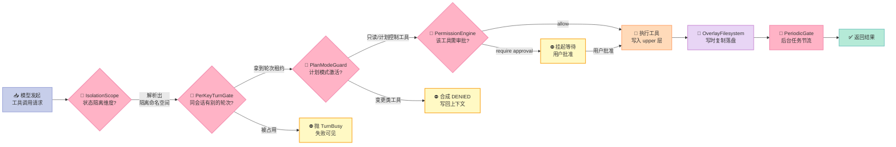

> **一句话核心结论**：AgentScope Java 2.0 最有价值的不是它的 ReAct 循环，而是 `agentscope-harness` 模块里那 **5 道闸门**——它们不改变模型能力，只改变模型"能不能碰到真实世界"，而这恰恰是 demo 和生产系统之间那道最贵的鸿沟。

---

## 前言：一个只在测试环境成立的问题

先讲一个几乎每个 Agent 团队都遇到过的场景。

你的 Agent 跑通了：给它一个仓库，它能读代码、改文件、跑测试、提交 PR。Demo 效果惊艳，团队欢呼。

然后上了生产，当晚就出事：

- **用户 A 的定制配置，出现在用户 B 的会话里。** 因为某个状态键用错了隔离维度。
- **同一个会话里两条消息并发进来，Agent 的修改互相覆盖。** 因为没人给会话加互斥。
- **用户写坏了一个共享 Skill，全公司所有人一起受影响。** 因为共享资源没有写时复制。
- **Agent 说不小心把生产的配置文件改了。** 因为"只读模式"只是提示词里的一句话。
- **三个副本同时跑记忆刷新任务，数据库被写爆。** 因为没人做节流。

这五个问题有一个共同点：**它们都不是模型能力问题。**模型再聪明，也管不住自己并发写坏共享文件。

而绝大多数 Agent 框架，只解决前半个问题——把 LLM 变成 Agent（会调工具、会循环、会记忆）。后半个问题——把 Agent 变成**可上生产**的系统——通常留给应用开发者自己用 if-else 补。

AgentScope Java 2.0 是我近期读过的、把后半个问题当成一等公民来做的开源项目。

> **与 2026-06 那篇《【AgentScope 2.0】事件驱动的生产级 Agent 框架》的关系**：
>
> 那篇讲的是 **Python 版** `agentscope-ai/agentscope`（26.8k⭐），聚焦**事件流驱动的 ReAct 循环**、
> 统一 MCP 客户端、FastAPI 多租户服务。
>
> 本文讲的是**另一个仓库** —— **Java 版** `agentscope-ai/agentscope-java`（6.3k⭐，Apache-2.0），
> 聚焦**运行时闸门**：5 道物理约束如何把"能跑的 Agent"变成"敢上生产的 Agent"。
>
> 语言不同、仓库不同、切入角度不同（事件流 vs 闸门）、深度也不同（2,700 字 vs 7,900 字）。
> 两篇都值得读，但没有任何内容重复。**想了解 AgentScope 的整体设计语言，读 6 月那篇；
> 想抄一套能上生产的并发/隔离/审批原语，读本篇。**

> **本文定位**：不讲 ReAct 循环怎么跑（那是所有框架都有的东西），只讲**闸门**。
>
> **读完你能得到**：5 个可以直接照抄进自己项目的原语，每个都附带可运行的 Python 复刻。

---

## 一、项目定位：AgentScope Java 2.0 是什么

### 1.1 基本盘

| 维度 | 数据 |
|------|------|
| 仓库 | `agentscope-ai/agentscope-java`（⚠️ 与 6 月那篇的 Python 仓库 `agentscope-ai/agentscope` 是**两个不同的项目**） |
| Star | 6,320 |
| Fork | 1,594 |
| License | Apache-2.0 |
| 主语言 | Java（3,269 个 .java 文件）+ TypeScript + Go |
| 贡献者 | ~217 |
| 创建 | 2025-09-23 |
| 最近提交 | 2026-11-10（活跃） |
| 测试文件 | 1,422 个 |
| CI workflow | 8 个 |

它出自阿里 AgentScope 团队的 Java 版本，定位是**分布式、企业级、长跑型 Agent 框架**。

模块划分上，它分成了几个 Maven 子模块：

| 模块 | 职责 |
|------|------|
| `agentscope-core` | 内核：消息、事件、ReAct 循环、工具抽象 |
| `agentscope-harness` | ⭐ **本文主角**：294 个 Java 文件，全是"外壳" |
| `agentscope-extensions` | 扩展点 |
| `agentscope-service` | Agent 控制面 + Dashboard |
| `agentscope-distribution` | 打包分发 |

### 1.2 它的 7 个核心能力（官方 README）

```
- Event System          32 种类型化事件，统一事件流，实时前端渲染 + HITL
- Permission System     工具调用门控：allow / 需用户批准 / deny
- Middleware            AOP 风格钩子拦截，扩展推理-行动循环
- Workspace & Sandbox   隔离环境跑工具：本地 / Docker / K8s / 云沙箱
- Multi-Agent           agent_spawn / agent_send + 实时事件转发
- Distributed Deploy    Redis / MySQL / PG / OSS / COS，跨副本会话恢复
- Agent Evolution       可观测、审计、评估、资产管理
```

注意其中三个词的组合：**"Middleware（AOP 式钩子）+ Permission System（门控）+ Workspace & Sandbox（隔离环境）"**。

这就是 AgentScope Java 和其他框架的分水岭。别的框架给你"Loop"，它给你的是"Loop + 门禁系统"。

### 1.3 在 Harness 6 件套矩阵里的位置

| 组件 | AgentScope Java 2.0 的对应实现 | 位置 |
|------|-------------------------------|------|
| **Rule** | `PermissionEngine`（构造时快照权限模式） | ✅ 核心 |
| **Skill** | `agent/skill/` + `skill/curator/`（技能策展与晋升审批） | ✅ 核心 |
| **Sub-Agent** | `agent/subagent/` + `agent/gateway/InMemorySubagentRegistry` | ✅ 核心 |
| **Workflow** | `agentscope-service` 控制面 | ⚠️ 有 |
| **Script** | `PlanModeTools` / `MemorySaveTool` 等工具化 SOP | ⚠️ 弱 |
| **MCP** | 通过工具层间接支持 | ❌ 非重点 |

**它最独特的位置是 Rule + Sub-Agent + Skill 三者的交叉地带**——而这恰恰是"多用户、多副本、长跑"场景下最容易出事的地方。

---

## 二、整体架构：一层内核 + 一层闸门

### 2.1 五层结构

```mermaid
graph TB
    subgraph L5["🖥️ 应用接入层"]
        APP["📱 业务应用<br/>Web / IM / 控制台"]
    end
    subgraph L4["🧠 Harness 闸门层 —— 本文主角"]
        G1["🚪 PlanModeGuard<br/>计划模式只读"]
        G2["🚪 PermissionEngine<br/>allow/approve/deny"]
        G3["🚪 PerKeyTurnGate<br/>会话轮次互斥"]
        G4["🚪 PeriodicGate<br/>后台任务节流"]
        G5["🚪 IsolationScope<br/>状态隔离维度"]
    end
    subgraph L3["🧩 能力层"]
        FS["📁 OverlayFilesystem<br/>写时复制双层"]
        CTX["📊 ContextPolicy<br/>上下文预算"]
        MEM["🧠 Memory + Compaction"]
        SUB["🤝 SubAgent + MessageBus"]
    end
    subgraph L2["⚙️ 内核层 agentscope-core"]
        REACT["🔄 ReAct 推理-行动循环"]
        EVT["📡 32 种类型化事件"]
        TOOL["🔧 Tool 抽象"]
    end
    subgraph L1["🌐 模型与基础设施层"]
        LLM["🤖 LLM Provider"]
        SANDBOX["📦 本地/Docker/K8s/云沙箱"]
        STORE["🗄️ Redis/MySQL/PG/OSS"]
    end

    APP --> L4
    L4 --> L3
    L3 --> L2
    L2 --> L1
    L4 -.->|"闸门可跳过吗？"| L2

    style APP fill:#C7CEEA,stroke:#9FA8DA,stroke-width:2px,color:#333
    style G1 fill:#FFB3C6,stroke:#F48FB1,stroke-width:2px,color:#333
    style G2 fill:#FFB3C6,stroke:#F48FB1,stroke-width:2px,color:#333
    style G3 fill:#FFB3C6,stroke:#F48FB1,stroke-width:2px,color:#333
    style G4 fill:#FFB3C6,stroke:#F48FB1,stroke-width:2px,color:#333
    style G5 fill:#FFB3C6,stroke:#F48FB1,stroke-width:2px,color:#333
    style FS fill:#FFDAB9,stroke:#FFAB76,stroke-width:2px,color:#333
    style CTX fill:#FFDAB9,stroke:#FFAB76,stroke-width:2px,color:#333
    style MEM fill:#FFDAB9,stroke:#FFAB76,stroke-width:2px,color:#333
    style SUB fill:#FFDAB9,stroke:#FFAB76,stroke-width:2px,color:#333
    style REACT fill:#E8D5F5,stroke:#CE93D8,stroke-width:2px,color:#333
    style EVT fill:#E8D5F5,stroke:#CE93D8,stroke-width:2px,color:#333
    style TOOL fill:#E8D5F5,stroke:#CE93D8,stroke-width:2px,color:#333
    style LLM fill:#B5EAD7,stroke:#80CBC4,stroke-width:2px,color:#333
    style SANDBOX fill:#B5EAD7,stroke:#80CBC4,stroke-width:2px,color:#333
    style STORE fill:#B5EAD7,stroke:#80CBC4,stroke-width:2px,color:#333
    style L5 fill:#F5F5F5,stroke:#BBBBBB,color:#333
    style L4 fill:#F5F5F5,stroke:#BBBBBB,color:#333
    style L3 fill:#F5F5F5,stroke:#BBBBBB,color:#333
    style L2 fill:#F5F5F5,stroke:#BBBBBB,color:#333
    style L1 fill:#F5F5F5,stroke:#BBBBBB,color:#333
```



**关键设计取向**：闸门层（`agentscope-harness/agent/`）与内核层（`agentscope-core`）是**两个独立 Maven 模块**。

这不是目录洁癖，而是**架构契约**——闸门层可以整体替换（你的公司有自己的权限体系），而内核的 ReAct 循环不用动。

### 2.2 机制 vs 策略：谁是机制，谁是策略

这是 Harness 设计里最容易糊弄的一层。AgentScope Java 的分法相当清晰：

| 机制（不可变内核） | 策略（可插拔实现） |
|-------------------|-------------------|
| `SessionTurnGate` 接口 | `LocalSessionTurnGate`（本地）/ 控制面托管锁（跨节点） |
| `PeriodicGate` 接口 | `LocalPeriodicGate`（JVM）/ `StoreBackedPeriodicGate`（Redis） |
| `AbstractFilesystem` 接口 | `LocalFilesystem` / `RemoteFilesystem` / `OverlayFilesystem` / `RoutedSandboxFilesystem` |
| `SkillPromotionGate` 接口 | `LocalApprovalGate`（单副本） |
| `SubagentRegistry` 接口 | `InMemorySubagentRegistry` / 分布式实现 |
| `ContextPolicy`（record） | `ContextTokenEstimator` / `observer` |

**判断标准很简单**：接口在 harness 模块，策略实现也可能在 harness 模块，但**接口签名永远不含业务语义**。

`SessionTurnGate` 的接口只有两个方法：

```java
public interface SessionTurnGate {
    TurnLease acquire(String key) throws InterruptedException, TurnBusyException;
    boolean isRunning(String key);
}
```

它不知道 key 是会话、用户还是任务——那是调用方通过 `MsgContext#canonicalKey()` 传进来的。**机制不解释 key，策略不解释语义。**这是干净的边界。

### 2.3 Less is More 检查：哪些是模型能学的，哪些是物理必需的

这是 Harness Engineering 里最该被反复问的问题。AgentScope Java 的 5 道闸门，逐条过一遍：

| 闸门 | 模型能自己学会吗？ | 判定 |
|------|-------------------|------|
| **PlanModeGuard** | ❌ 不能 | 模型说"我现在只读"是一句**可以被后续任何一句话覆盖的话**。写文件是物理动作，必须由外部进程拦截 |
| **PerKeyTurnGate** | ❌ 不能 | 模型看不见"另一个副本正在写同一个 session" |
| **PeriodicGate** | ❌ 不能 | 模型无法知道 3 个副本的存在 |
| **IsolationScope** | ❌ 不能 | 模型不知道"这个文件是共享的还是我私有的" |
| **OverlayFilesystem** | ❌ 不能 | 模型无法凭空实现写时复制语义 |
| 上下文压缩策略 | ⚠️ 部分 | "哪些内容重要"模型能判断，但"压缩到多少 token"是资源问题 |
| Skill 内容本身 | ✅ 能 | Skill 文档是给模型读的**提示工程**，不是物理约束 |

**结论非常清晰**：5 道闸门全部是**外部物理世界必需的**。这是好设计的判据——如果一个"闸门"能靠提示词实现，它就不该是闸门。

### 2.4 一次工具调用的完整闸门链路

理解这 5 道闸门最有效的方式，是跟着**一次工具调用**走一遍。



**这张图的读法**：粉色的 5 个节点是闸门，黄色的是"被拦下"的三条路径，绿色是唯一能到达的终点。

注意**三条被拦下的路径各自写回了不同的东西**：

| 拦截点 | 返回给调用方的信号 | 设计意图 |
|--------|------------------|---------|
| `PerKeyTurnGate` | 抛 `TurnBusyException` | 失败要**显式**，不能静默等待到超时 |
| `PlanModeGuard` | 合成 DENIED 工具结果 | 让模型**读懂并自己改正** |
| `PermissionEngine` | 挂起等待人工批准 | 把决定权**交还给人** |

**三道闸门，三种失败哲学。**这个差异不是随意的：`TurnBusy` 是基础设施问题，调用方重试即可；`DENIED` 是模型行为问题，需要模型自我修正；审批是业务问题，必须有人签字。**闸门返回什么，取决于调用方能做什么。**


---

## 三、核心机制深挖：5 道闸门逐个拆

### 3.1 闸门一：PlanModeGuard —— 拒绝复用现成方案的工程师

#### 3.1.1 问题

"让 Agent 先规划再动手"是个老需求。Claude Code 有 Plan Mode，Cursor 有，Codex 也有。那 AgentScope 为什么要自己写一个？

答案藏在 `PlanModeMiddleware` 的 Javadoc 里，这是全文最值钱的一段设计论证：

```java
/**
 * Enforces plan mode: while {@code AgentState.planModeContext.planActive} is {@code true},
 * mutating tool calls are denied so the agent can only read / investigate and draft a plan.
 *
 * <p>Enforcement is deterministic and happens in {@link #onActing}: each tool call is allowed iff
 * it is read-only or one of the plan-control tools ... everything else gets a synthetic
 * {@code DENIED} tool result (written to context and streamed as events) without being executed.
 * This intentionally does <em>not</em> reuse {@code PermissionMode.EXPLORE}: that mode is
 * snapshotted immutably by the {@code PermissionEngine} at construction and cannot be toggled at
 * runtime, whereas plan mode must switch dynamically.
 */
```

翻译成人话：

> **它故意不复用 `PermissionMode.EXPLORE`。**因为 EXPLORE 模式被 `PermissionEngine` 在**构造时不可变快照**了，运行时没法切换；而计划模式必须能动态进出。

这是一个**用"为什么不用现成方案"来定义设计**的典型范例。很多框架的做法是：有个权限系统了，计划模式就复用权限系统的一个枚举值。结果权限系统一改，计划模式跟着一起坏。

AgentScope 的选择是：**另起一套闸门，因为两者的生命周期约束不同。**

- `PermissionMode`：构造期决定，进程生命周期内不变
- `PlanMode`：运行期动态进出，甚至能在一次 agent call 内切换

#### 3.1.2 拦截逻辑：确定性优先于提示词

```java
private static final Set<String> ALWAYS_ALLOWED =
        Set.of(
                PlanModeTools.PLAN_ENTER,
                PlanModeTools.PLAN_WRITE,
                PlanModeTools.PLAN_EXIT,
                "todo_write",
                "agent_spawn",
                "agent_send",
                "agent_list",
                "task_output",
                "task_list");

@Override
public Flux<AgentEvent> onActing(
        Agent agent,
        RuntimeContext ctx,
        ActingInput input,
        Function<ActingInput, Flux<AgentEvent>> next) {
    AgentState state = RuntimeContext.resolveAgentState(ctx, agent);
    if (!manager.isPlanActive(state) || input.toolCalls() == null) {
        return next.apply(input);
    }

    List<ToolUseBlock> allowed = new ArrayList<>();
    List<ToolUseBlock> denied = new ArrayList<>();
    for (ToolUseBlock call : input.toolCalls()) {
        if (isPermitted(call.getName())) {
            allowed.add(call);
        } else {
            denied.add(call);
        }
    }
    ...
}
```

这里有三个值得学的细节：

**① 允许名单是"白名单 + 只读判定"，不是"危险工具黑名单"。**

`ALWAYS_ALLOWED` 里除计划控制工具，还包括 `agent_spawn` / `agent_send` / `task_list` ——**计划模式下允许派生子 Agent**。这个设计很聪明：规划阶段往往需要并行调研多个方向，禁止 spawn 会让规划能力大幅下降。

**② 被拒的工具不是"跳过"，而是"生成合成结果写回上下文"。**

```java
private static final String DENY_MESSAGE =
        "Blocked: you are in PLAN mode (read-only). You may investigate and run read-only"
        + " tools, record your plan with plan_write, and call plan_exit when ready to"
        + " execute. Do not modify files or run mutating commands until the plan is"
        + " approved.";
```

合成 DENIED 结果有两个作用：
- **模型能读到反馈**，下一轮自己改（"哦，我还在计划模式，得先写计划"）
- **事件流里能看到拦截发生过**，前端可以给用户显示"Agent 想改文件被拦住了"

如果只是静默丢弃这次调用，模型会反复尝试同一个操作，陷入死循环。

**③ 提示词里有一句反直觉的强调：**

```java
private static final String PLAN_BANNER_TEMPLATE = """
        ...
        ACT, do not just narrate: when you decide to record or finish the plan, call plan_write
        (or plan_exit) in the SAME step — never say you "will write the plan" without actually
        calling the tool ...
        """;
```

**"不要只是叙述，要真的调用工具"** ——这是对 LLM 一个非常具体的失败模式的补丁：模型会在回复里说"我接下来会写好计划"，但根本没调用工具，然后等用户批准一个不存在的计划。

这类"针对具体模型失败模式写的提示词"，是 Harness 里**唯一真正属于"聪明代码"的部分**。它短期有效，但也终将被更强的模型淘汰——见第五节的 Bitter Lesson 分析。

#### 3.1.3 计划文件是跨压缩的锚点

```java
private static final String BUILD_MODE_PLAN_HINT =
        "\n\nYou have switched from PLAN to BUILD mode; the read-only"
        + " restriction is lifted. A plan reference exists at %s — this path alone is"
        + " not proof of approval. Read it for the"
        + " details, then EXECUTE it step by step until the task is complete. ...";
```

切换到 BUILD 模式时，它把**计划文件的路径**塞回上下文。原因是：上下文可能被压缩过，模型已经忘了自己写过计划。**计划文件是压缩后唯一可靠的"外部记忆锚点"。**

另外 "this path alone is not proof of approval" 这句话很讲究——防止模型把"看到计划文件"误当成"用户已经批准"。

---

### 3.2 闸门二：PerKeyTurnGate —— 一个关于 `getQueueLength()` 的坑

#### 3.2.1 场景

多副本部署时，同一个 session 的两条消息可能同时到达不同副本。如果都放行，Agent 会并发修改同一份状态。

AgentScope Java 的解法是 `SessionTurnGate` 接口 + `LocalSessionTurnGate` 实现。

#### 3.2.2 实现：引用计数式回收

```java
public final class LocalSessionTurnGate implements SessionTurnGate {

    private final ConcurrentHashMap<String, Gate> gates = new ConcurrentHashMap<>();

    @Override
    public TurnLease acquire(String key) throws InterruptedException {
        Gate gate =
                gates.compute(
                        key,
                        (k, existing) -> {
                            Gate target = existing != null ? existing : new Gate();
                            target.leases++;
                            return target;
                        });
        try {
            gate.semaphore.acquire();
        } catch (InterruptedException e) {
            retire(key, gate);
            throw e;
        }
        AtomicBoolean released = new AtomicBoolean();
        return () -> {
            if (released.compareAndSet(false, true)) {
                gate.semaphore.release();
                retire(key, gate);
            }
        };
    }

    /**
     * Drops one lease from {@code gate} and evicts the key once no thread holds or waits for it.
     *
     * <p>The decrement and the removal run inside {@link ConcurrentHashMap#compute}, so they are
     * atomic with respect to a concurrent {@link #acquire(String)} on the same key: an acquirer
     * either joins the existing gate or, once it is gone, builds a fresh one. It can never obtain
     * a second semaphore for a key that still has a holder. The eviction is therefore driven by
     * the lease count rather than by {@link Semaphore#getQueueLength()}, which cannot see a thread
     * that took a just-released permit without ever entering the queue.
     */
    private void retire(String key, Gate gate) {
        gates.compute(
                key,
                (k, existing) -> {
                    if (existing != gate) {
                        return existing;
                    }
                    return --existing.leases == 0 ? null : existing;
                });
    }
}
```

**这段注释就是本文最有价值的部分之一。**它解释了一个真实存在的 bug 类别：

> **为什么不能用 `Semaphore.getQueueLength()` 判断"没人用了，可以删 key"？**

因为 `getQueueLength()` 只统计**正在排队等待**的线程。而存在这样的时序：

```
T1: acquire() → 拿到 permit（队列长度 = 0）
T1: 释放 permit（队列长度 = 0，但刚刚有人用过）
T2: acquire() → 立刻拿到 permit（从未进过队列）
```

在 T1 释放和 T2 获取之间，如果用 `getQueueLength() == 0` 作为删除条件，**会在 T2 持有 permit 期间把 key 从 map 里删掉**。接下来 T3 来 acquire，会创建**第二把新的 semaphore**——同一个 key 上出现两把锁，互斥彻底失效。

AgentScope 的解法是**引用计数**：`leases` 字段同时记录"持有者 + 等待者"，只有在 `leases == 0` 时才删 key。而且整个 decrement + remove 在 `ConcurrentHashMap.compute` 里完成，与并发的 `acquire` 原子互斥。

**这里还有一个更细的点**：`retire` 里先判断 `existing != gate` 就直接返回。这是防 ABA 的经典写法——如果 key 已经被别人删了又建了新的，我们不能把新 gate 的计数减掉。

#### 3.2.3 公平性

```java
private static final class Gate {
    /** One fair semaphore plus the number of leases currently holding or waiting on it. */
    private final Semaphore semaphore = new Semaphore(1, true);
    /** Holders plus waiters; mutated only while holding the map's bin lock. */
    private int leases;
}
```

`new Semaphore(1, true)` 的 `true` 是**公平模式**——FIFO 排队，先来先到，不允许后来的请求插队。

在 Agent 场景里这很重要：如果一个用户连发了 5 条消息，非公平模式下后来的短消息可能插到长任务前面，用户体验会很怪。

#### 3.2.4 分布式版本的契约

```java
/**
 * ...
 * <p>When using a distributed turn gate, {@link io.agentscope.core.ReActAgent}
 * {@code conflictPolicy} should be set to {@code FAIL} so concurrent state writes surface as
 * errors rather than silent overwrites.
 */
```

**跨节点锁不能无限等待**（副本可能已经挂了），所以分布式实现会抛 `TurnBusyException`。而此时 `conflictPolicy` 必须设为 `FAIL`——**宁可报错，也不要静默覆盖**。

这是一个贯穿全项目的哲学：**失败要可见**。

---

### 3.3 闸门三：PeriodicGate —— 为什么这个 map 必须是 static

#### 3.3.1 实现

```java
public final class LocalPeriodicGate implements PeriodicGate {

    private static final Instant EPOCH = Instant.EPOCH;

    static final ConcurrentHashMap<String, AtomicReference<Instant>> SHARED_LAST_CLAIM_AT =
            new ConcurrentHashMap<>();

    @Override
    public boolean tryClaim(String name, Duration minGap) {
        if (name == null || name.isBlank() || minGap == null) {
            return false;
        }
        Instant now = Instant.now();
        AtomicReference<Instant> ref =
                SHARED_LAST_CLAIM_AT.computeIfAbsent(name, k -> new AtomicReference<>(EPOCH));
        Instant last = ref.get();
        if (Duration.between(last, now).compareTo(minGap) < 0) {
            return false;
        }
        return ref.compareAndSet(last, now);
    }
}
```

`tryClaim` 是典型的 **check-then-CAS**，最后的 `compareAndSet` 保证并发下只有一个赢家。

#### 3.3.2 那个 `static` 关键词背后的故事

Javadoc 里这段解释，是 Harness 工程里"生命周期约束"的一个经典案例：

> The map is static so the throttle window survives across {@code HarnessAgent.Builder.build()} calls — each rebuild creates new middleware instances, and an instance-level map would reset to {@link Instant#EPOCH} on every request.

翻译：**这个 map 必须是 static 的，节流窗口才能跨 `Builder.build()` 存活。**

因为每次 `build()` 都会创建新的 middleware 实例。如果 map 是实例级的，那么：

```
请求 1 → 新实例 → map 空 → 首次 claim → 成功
请求 2 → 新实例 → map 空 → 首次 claim → 成功   ← 节流失效！
```

**节流变成了"每个请求都执行一次"。**在 3 副本部署下，实际执行频率是预期的 3 倍。

这是一个非常隐蔽的 bug：因为单实例测试完全测不出来（每次都是新实例，每次都"首次成功"，看起来符合预期），只有在多副本/长跑场景才会暴露。

**这就是 Harness 的"生命周期约束"问题**：中间件实例的生命周期 ≠ 业务状态的生命周期。凡是需要跨请求存活的状态，都不能挂在实例字段上。

#### 3.3.3 内存回收

```java
/**
 * Removes entries whose last claim is older than {@code maxAge}. Bounds map size in
 * long-running services with high key churn.
 */
public void cleanupStaleEntries(Duration maxAge) {
    if (maxAge == null) {
        return;
    }
    Instant cutoff = Instant.now().minus(maxAge);
    SHARED_LAST_CLAIM_AT.entrySet().removeIf(e -> e.getValue().get().isBefore(cutoff));
}
```

长跑服务里 key 会不断新增（每个用户、每个会话、每个技能组合都是一个 key）。不回收就是内存泄漏。这个方法用了 `removeIf` + 惰性删除。

#### 3.3.4 用在哪

看 `PeriodicGate` 的 Javadoc，槽位命名很有信息量：

```java
 * @param name logical slot identifier (e.g. {@code "memory-flush:USER:alice"} or
 *     {@code "skill-curator"})
```

- `memory-flush:USER:alice` —— 记忆刷新，**按用户**隔离，谁的记忆谁刷
- `skill-curator` —— 技能策展，全局只有一个

**同一个机制，两种粒度。**这就是接口抽象的价值。

---

### 3.4 闸门四：IsolationScope —— 4 级隔离，一套命名空间

#### 3.4.1 定义

```java
public enum IsolationScope {

    SESSION,  // 每个 session 独立
    USER,     // 同一 userId 的所有 session 共享（默认）
    AGENT,    // 同一 agent 名的所有 user/session 共享
    GLOBAL;   // 同一 workspace/store 实例内全局共享
}
```

#### 3.4.2 一个枚举，两个语义

这是我觉得设计上最漂亮的一处。同一个 `IsolationScope` 同时控制两件事：

**① 沙箱语义**——决定持久化/加载 `_sandbox.json` 时用哪个 key：

> Calls that resolve to the *same* scope key will sequentially reuse the same sandbox (each call resumes the persisted state from the previous one).

**② Store 命名空间语义**——决定 `RemoteFilesystem` 路由文件时用哪个命名空间前缀：

> The scope determines the namespace prefix used by {@link RemoteFilesystem} when routing files to the shared key-value store.

**一个枚举，统一了"沙箱状态"和"KV 存储"两套隔离机制。**如果分成两个概念，迟早会出现"沙箱按 user 隔离但存储按 session 隔离"这种配错的情况。

#### 3.4.3 降级规则不能少

```java
/**
 * <li>{@link #USER} – shared across all sessions of the same user; the default. When
 *     {@code userId} is absent, falls back to {@link #SESSION}.
 */
```

以及：

```java
public NamespaceFactory toNamespaceFactory() {
    return switch (this) {
        case USER ->
                rc -> {
                    if (rc == null) {
                        return List.of();
                    }
                    ...
```

**`userId` 缺失时必须降级到 SESSION，而不是降级到 GLOBAL 或抛异常。**

为什么？如果降级到 GLOBAL，一个没带 userId 的请求就能看到所有人的数据——这是安全事故。降级到 SESSION 最多是"隔离过度"（用户自己的两个 session 不共享），损失可控。

**降级方向的选择原则：往更严格的方向降。**这个规则值得写进任何 Harness 的 checklist。

#### 3.4.4 一个必须说清的语义边界

源码注释里有一段容易被忽略但极其重要的说明：

> **Concurrency note:** for sandbox mode this is sequential-reuse sharing, not live-instance sharing. Concurrent calls at the same scope each get their own running container; they converge on the last persisted snapshot at the end of the call.

翻译：**"共享"不等于"同时共享一个实例"。**

两个同 scope 的并发调用，各自拿到独立的容器实例并行跑，**最后都往同一个持久化槽位写**，收敛到"最后一次写入的快照"。

也就是说——**AgentScope Java 的 scope 共享是"顺序复用"，不是"活实例共享"。**这解释了为什么它**还需要** `PerKeyTurnGate`：scope 决定"写到哪里"，turn gate 决定"什么时候写"。

**两者是互补的，不是冗余的。**这是理解这套设计的关键。

---

### 3.5 闸门五：OverlayFilesystem —— 写时复制，用户改不坏共享层

#### 3.5.1 合并语义

```java
/**
 * A layered filesystem that overlays a user-specific "upper" layer on top of a shared "lower"
 * layer, providing copy-on-write semantics.
 *
 * <p>Read operations check the upper layer first and fall back to the lower layer. Write
 * operations always target the upper layer. This enables per-user customization of shared
 * content (e.g. skills, subagents) without modifying the shared originals.
 *
 * <p>Merge semantics:
 * <ul>
 *   <li>{@code ls} — union of both layers; upper entries take precedence on path collision</li>
 *   <li>{@code read} — upper first, then lower</li>
 *   <li>{@code write}/{@code edit} — always to upper (copy-on-write)</li>
 *   <li>{@code delete} — removes from upper only; shared-layer files cannot be deleted</li>
 *   <li>{@code grep}/{@code glob} — searches both layers; upper results override lower on path collision</li>
 *   <li>{@code exists} — true if present in either layer</li>
 * </ul>
 */
```

这段 Javadoc 值得逐条看，因为**每一条合并语义都对应一类真实事故**：

| 语义 | 防的是什么事故 |
|------|--------------|
| `delete` 只删 upper | 用户删掉全局共享的 Skill，全公司受影响 |
| `write` 永远写 upper | 用户改 Skill 直接污染共享层 |
| `grep` 两层都搜 | 只搜上层会漏掉共享层的依赖文件 |
| `ls` 取并集 | 只列上层会让 Agent 看不到可用的共享工具 |

#### 3.5.2 和 Docker 镜像层的同构

OverlayFilesystem 的语义和 **Docker 镜像层 / overlayfs** 几乎一模一样：

- Docker：容器可写层叠加只读镜像层
- AgentScope：用户可写层叠加共享只读层

这个同构不是巧合。Docker 解决的是"容器里的改动怎么不影响镜像"，这里解决的是"用户的 Skill 定制怎么不影响平台共享 Skill"。

**工程上已经验证过的抽象，换个场景直接用，是省时间的好事。**

#### 3.5.3 为什么不是 git worktree

一个自然的问题是：为什么不用 git worktree 给每个用户一份？

因为 worktree 解决的是"代码版本隔离"，而这里要隔离的是 **Skill / SubAgent 定义 / 配置**这类**平台级共享资产**。而且 worktree 的成本是完整的磁盘副本，对配置文件来说太重。

Overlay 方案的成本是**零**：用户没改过的文件，读的时候直接穿透到共享层，一份都不复制。

---

## 四、从零搭建启示：最小可行实现

### 4.1 我自己复刻的话，最小骨架是什么

如果我今天要给自己的项目加这 5 道闸门，我会按这个顺序做：

| 优先级 | 闸门 | 实现成本 | 事故概率 | 建议 |
|-------|------|---------|---------|------|
| **P0** | IsolationScope（4 级 + 降级） | 半天 | 高 | **必做**，隔离维度错了就是安全事故 |
| **P0** | OverlayFilesystem（COW） | 1 天 | 高 | **必做**，共享资产必须不可被用户改坏 |
| **P1** | PlanModeGuard | 1 天 | 中 | 强烈建议，尤其对写代码类 Agent |
| **P1** | PerKeyTurnGate | 半天 | 中 | 多副本部署必做 |
| **P2** | PeriodicGate | 2 小时 | 中 | 后台任务一多就需要 |

**总共 3~4 天**，可以覆盖本文 80% 的价值。

### 4.2 必须的 vs 可以省略的

**必须的（不可省）**：
1. **隔离维度枚举 + 降级规则** —— 哪怕只有 SESSION 和 USER 两级
2. **写时复制语义** —— 哪怕只做 read/write/delete 三个操作
3. **闸门在工具执行前拦截** —— 拦截点必须在 `onActing`，不能在工具内部

**可以先省略的**：
- 分布式实现（先上本地版，接口留好）
- 事件流（HITL 体验优化，不影响正确性）
- `AdditionalAllowed` 逃生舱（先不要这个口子）
- `cleanupStaleEntries`（低 key churn 时不需要）

### 4.3 踩坑预警：这 5 个坑我都想跳过去

| # | 坑 | 症状 | 对策 |
|---|-----|------|------|
| 1 | **状态挂在 middleware 实例上** | 单测全过，上了多副本节流失效 | 节流/门控状态放 static 或外部存储 |
| 2 | **用 `getQueueLength()` 判空闲** | 偶发互斥失效，极难复现 | 引用计数 + `compute` 原子操作 |
| 3 | **降级方向搞反** | 无 userId 的请求看到全部数据 | 降级往更严格方向（USER → SESSION） |
| 4 | **只做黑名单** | 换个工具名就绕过 | 白名单 + 只读判定 |
| 5 | **静默丢弃被拒调用** | 模型死循环反复尝试 | 合成 DENIED 结果写回上下文 |

第 2 个坑值得再强调一次：它的症状是**偶发的、无法稳定复现的**。如果你的 Agent 在压测时偶尔出现"两个请求同时改了同一个 session"，先查这段逻辑。

### 4.4 MVP：5 道闸门的可运行复刻

下面这段 Python 把 5 个原语的核心语义抽离出来，**可以直接跑**。

```python
"""
MVP：从 AgentScope Java 2.0 (agentscope-harness) 抽离的 5 大核心原语复刻
====================================================================
来源文件：
  1. agent/gateway/LocalSessionTurnGate.java   -> PerKeyTurnGate      (会话轮次互斥)
  2. agent/coordination/LocalPeriodicGate.java -> PeriodicGate       (最小间隔节流)
  3. agent/IsolationScope.java                 -> IsolationScope     (4 级隔离作用域)
  4. agent/filesystem/OverlayFilesystem.java   -> OverlayFilesystem  (写时复制叠加)
  5. agent/middleware/PlanModeMiddleware.java  -> PlanModeGuard      (计划模式只读闸门)

这不是玩具 demo：这 5 个原语是 AgentScope Java 把"能跑的 Agent"变成
"敢上生产的 Agent"的关键。它们分别解决了 5 类真实事故：
  - 并发写入互相覆盖        -> PerKeyTurnGate
  - 多个副本重复跑后台任务   -> PeriodicGate
  - 用户之间状态串味        -> IsolationScope
  - 用户改坏了共享 Skill     -> OverlayFilesystem (COW)
  - Agent 没审批就动手改文件 -> PlanModeGuard
"""

import os
import shutil
import tempfile
import threading
import time
from dataclasses import dataclass, field
from enum import Enum
from typing import Callable, Dict, List, Optional


# ============================================================================
# 原语 1：IsolationScope —— 4 级隔离作用域
# ============================================================================
class IsolationScope(Enum):
    """AgentScope Java 的 canonical isolation scope 定义。

    - SESSION: 每个 session 独立
    - USER:    同一 userId 的所有 session 共享（默认；无 userId 时降级到 SESSION）
    - AGENT:   同一 agent 名的所有 user/session 共享
    - GLOBAL:  同一 workspace/store 实例内全局共享
    """

    SESSION = "session"
    USER = "user"
    AGENT = "agent"
    GLOBAL = "global"


@dataclass(frozen=True)
class RuntimeContext:
    """简化版的 RuntimeContext：只保留 scope 解析需要的字段。"""

    user_id: Optional[str] = None
    session_id: Optional[str] = None
    agent_name: Optional[str] = None

    def namespace_prefix(self, scope: IsolationScope) -> str:
        """AgentScope 的 toNamespaceFactory() 的等价实现。"""
        if scope is IsolationScope.USER:
            # userId 缺失时降级到 sessionId —— 源码里明确写死的规则
            key = self.user_id or self.session_id
            return f"user:{key}" if key else "user:anonymous"
        if scope is IsolationScope.SESSION:
            return f"session:{self.session_id or 'anonymous'}"
        if scope is IsolationScope.AGENT:
            return f"agent:{self.agent_name or 'anonymous'}"
        return "global"


# ============================================================================
# 原语 2：OverlayFilesystem —— 写时复制（Copy-on-Write）双层文件系统
# ============================================================================
class OverlayFilesystem:
    """upper 层（用户私有，可写）叠加 lower 层（共享，只读）。

    AgentScope 的合并语义：
      - ls        : 两层并集，upper 优先
      - read      : 先 upper 再 lower
      - write/edit: 永远写 upper（COW）
      - delete    : 只删 upper，共享层文件删不掉
      - grep/glob : 搜两层，upper 覆盖 lower
    """

    def __init__(self, upper: str, lower: str):
        self.upper = os.path.abspath(upper)
        self.lower = os.path.abspath(lower)
        os.makedirs(self.upper, exist_ok=True)
        os.makedirs(self.lower, exist_ok=True)

    # ---- 内部：解析路径在各层的实际位置 --------------------------------
    def _upper_path(self, rel: str) -> str:
        return os.path.join(self.upper, rel.lstrip("/"))

    def _lower_path(self, rel: str) -> str:
        return os.path.join(self.lower, rel.lstrip("/"))

    def exists(self, rel: str) -> bool:
        return os.path.exists(self._upper_path(rel)) or os.path.exists(self._lower_path(rel))

    def read(self, rel: str) -> str:
        """先读 upper，读不到再回落 lower。"""
        up = self._upper_path(rel)
        if os.path.exists(up):
            with open(up, "r", encoding="utf-8") as f:
                return f.read()
        lp = self._lower_path(rel)
        if os.path.exists(lp):
            with open(lp, "r", encoding="utf-8") as f:
                return f.read()
        raise FileNotFoundError(rel)

    def write(self, rel: str, content: str) -> str:
        """写入永远落在 upper 层 —— 共享层永不被污染。"""
        up = self._upper_path(rel)
        os.makedirs(os.path.dirname(up), exist_ok=True)
        with open(up, "w", encoding="utf-8") as f:
            f.write(content)
        return "upper"

    def delete(self, rel: str) -> bool:
        """只删 upper。共享层的文件无法被用户删除。"""
        up = self._upper_path(rel)
        if os.path.exists(up):
            os.remove(up)
            return True
        return False  # 共享层文件拒绝删除

    def ls(self) -> List[str]:
        """两层并集，upper 覆盖 lower。"""
        names = set()
        for base in (self.lower, self.upper):
            if os.path.isdir(base):
                for root, _dirs, files in os.walk(base):
                    for name in files:
                        full = os.path.join(root, name)
                        names.add(os.path.relpath(full, base))
        return sorted(names)

    def grep(self, pattern: str) -> List[str]:
        """搜两层，upper 命中覆盖 lower 同名文件。"""
        hits: Dict[str, str] = {}
        for base in (self.lower, self.upper):
            if not os.path.isdir(base):
                continue
            for root, _dirs, files in os.walk(base):
                for name in files:
                    full = os.path.join(root, name)
                    rel = os.path.relpath(full, base)
                    try:
                        with open(full, "r", encoding="utf-8") as f:
                            if pattern in f.read():
                                hits[rel] = base
                    except (UnicodeDecodeError, OSError):
                        continue
        return sorted(hits)


# ============================================================================
# 原语 3：PerKeyTurnGate —— 按 key 的公平互斥（会话轮次门）
# ============================================================================
class PerKeyTurnGate:
    """每个 key 一把公平信号量；用 lease 计数做引用计数式回收。

    AgentScope LocalSessionTurnGate 的关键设计：retire 用 map.compute 做
    原子"减引用计数 + 条件删除"，而不是看 Semaphore.getQueueLength()。
    因为"刚拿到 permit 又立刻释放、从未进过队列"的线程，
    getQueueLength() 是看不见的 —— 用它做回收会漏掉并制造第二把锁。
    """

    def __init__(self):
        self._gates: Dict[str, "_Gate"] = {}
        self._lock = threading.Lock()

    def acquire(self, key: str) -> "_TurnLease":
        with self._lock:
            gate = self._gates.get(key)
            if gate is None:
                gate = _Gate()
                self._gates[key] = gate
            gate.leases += 1
        try:
            gate.acquire()
        except BaseException:
            self._retire(key, gate)
            raise
        released = threading.Event()

        def _release():
            if not released.is_set():
                released.set()
                gate.release()
                self._retire(key, gate)

        return _TurnLease(_release)

    def is_running(self, key: str) -> bool:
        gate = self._gates.get(key)
        return gate is not None and gate.held

    def _retire(self, key: str, gate: "_Gate") -> None:
        """引用计数归零才删 key。整个过程持 map 的锁。"""
        with self._lock:
            existing = self._gates.get(key)
            if existing is not gate:
                return
            existing.leases -= 1
            if existing.leases == 0:
                del self._gates[key]

    def live_gate_count(self) -> int:
        with self._lock:
            return len(self._gates)


@dataclass
class _Gate:
    """Java 的 `new Semaphore(1, true)` 是公平信号量（FIFO）。

    Python 的 threading.Semaphore 没有公平选项，所以这里用 Condition
    + FIFO 等待队列手工实现同等语义：先到先得，不插队。
    """

    cond: threading.Condition = field(default_factory=threading.Condition)
    held: bool = False
    leases: int = 0

    def acquire(self) -> None:
        with self.cond:
            while self.held:
                self.cond.wait()
            self.held = True

    def release(self) -> None:
        with self.cond:
            self.held = False
            self.cond.notify()


class _TurnLease:
    def __init__(self, release: Callable[[], None]):
        self._release = release
        self._closed = False

    def close(self) -> None:
        if not self._closed:
            self._closed = True
            self._release()

    def __enter__(self):
        return self

    def __exit__(self, *exc):
        self.close()


# ============================================================================
# 原语 4：PeriodicGate —— 最小间隔节流（跨调用方 / 跨节点）
# ============================================================================
class PeriodicGate:
    """tryClaim(name, minGap) -> bool。

    AgentScope 的实现用 static ConcurrentHashMap + CAS：
    刻意用 static，是为了让节流窗口能跨 HarnessAgent.Builder.build() 存活 ——
    每次 rebuild 都会造新的 middleware 实例，实例级 map 会在每次请求时重置成 EPOCH，
    节流就等于失效了。
    """

    _shared: Dict[str, float] = {}
    _lock = threading.Lock()

    @classmethod
    def try_claim(cls, name: str, min_gap: float) -> bool:
        if not name or not name.strip():
            return False
        now = time.monotonic()
        with cls._lock:
            last = cls._shared.get(name, 0.0)
            if now - last < min_gap:
                return False
            cls._shared[name] = now
            return True

    @classmethod
    def cleanup_stale(cls, max_age: float) -> None:
        """回收长时间未触达的 key，避免长跑服务 map 无限膨胀。"""
        now = time.monotonic()
        with cls._lock:
            for k in [k for k, v in cls._shared.items() if now - v > max_age]:
                del cls._shared[k]

    @classmethod
    def clear_for_tests(cls) -> None:
        with cls._lock:
            cls._shared.clear()


# ============================================================================
# 原语 5：PlanModeGuard —— 计划模式只读闸门（确定性拦截，不靠提示词）
# ============================================================================
READ_ONLY_TOOLS = {
    "read", "ls", "glob", "grep", "git_log", "git_diff", "git_show", "git_status",
    "plan_enter", "plan_write", "plan_exit", "todo_write",
    "agent_spawn", "agent_send", "agent_list", "task_output", "task_list",
}

DENY_MESSAGE = (
    "Blocked: you are in PLAN mode (read-only). You may investigate and run read-only "
    "tools, record your plan with plan_write, and call plan_exit when ready to execute. "
    "Do not modify files or run mutating commands until the plan is approved."
)


@dataclass
class ToolCall:
    name: str
    args: Dict[str, str] = field(default_factory=dict)


@dataclass
class ToolResult:
    call: ToolCall
    denied: bool
    output: str


class PlanModeGuard:
    """计划模式下拦截所有变更类工具调用。

    AgentScope 的 PlanModeMiddleware 明确拒绝复用 PermissionMode.EXPLORE：
    EXPLORE 模式被 PermissionEngine 在构造时不可变快照，无法运行时切换；
    而计划模式必须能动态进出。结论是"另起一套闸门"，而不是"复用现成的"。

    关键设计：拦截是确定性的 —— 不执行违规工具，而是生成一个合成的 DENIED
    结果写回上下文，让模型从反馈里自己改正。
    """

    def __init__(self, read_only_resolver: Callable[[str], bool], additional_allowed: Optional[set] = None):
        self.read_only_resolver = read_only_resolver
        self.additional_allowed = additional_allowed or set()
        self.plan_active = False

    def is_permitted(self, name: str) -> bool:
        if name in READ_ONLY_TOOLS or name in self.additional_allowed:
            return True
        return self.read_only_resolver(name)

    def on_acting(self, calls: List[ToolCall]) -> List[ToolResult]:
        """返回每个调用的结果。被拒的调用不会真正执行。"""
        if not self.plan_active:
            return [ToolResult(c, False, "executed") for c in calls]

        results: List[ToolResult] = []
        for call in calls:
            if self.is_permitted(call.name):
                results.append(ToolResult(call, False, "executed"))
            else:
                results.append(ToolResult(call, True, DENY_MESSAGE))
        return results

    def enter_plan(self) -> None:
        self.plan_active = True

    def exit_plan(self) -> None:
        self.plan_active = False


# ============================================================================
# 演示：把 5 个原语串成一条真实的 Agent 调用链
# ============================================================================
def run_demo():
    tmp = tempfile.mkdtemp(prefix="agentscope_mvp_")
    lower = os.path.join(tmp, "shared")   # 共享层：内置 Skill
    upper = os.path.join(tmp, "user")     # 用户层：私有定制
    os.makedirs(os.path.join(lower, "skills"), exist_ok=True)
    os.makedirs(os.path.join(upper, "skills"), exist_ok=True)

    with open(os.path.join(lower, "skills/code-review.md"), "w", encoding="utf-8") as f:
        f.write("shared skill v1")
    with open(os.path.join(lower, "skills/security.md"), "w", encoding="utf-8") as f:
        f.write("shared security skill")

    fs = OverlayFilesystem(upper=upper, lower=lower)
    gate = PerKeyTurnGate()
    PeriodicGate.clear_for_tests()

    print("=" * 72)
    print("AgentScope Java 2.0 harness —— 5 大核心原语复刻演示")
    print("=" * 72)

    # ---- 原语 1：IsolationScope -------------------------------------
    print("\n[1] IsolationScope —— 4 级隔离作用域")
    alice = RuntimeContext(user_id="alice", session_id="s1", agent_name="coder")
    bob = RuntimeContext(user_id="bob", session_id="s2", agent_name="coder")
    for scope in IsolationScope:
        a = alice.namespace_prefix(scope)
        b = bob.namespace_prefix(scope)
        shared = "共享" if a == b else "隔离"
        print(f"    {scope.name:<8} alice={a:<18} bob={b:<18} -> {shared}")
    # 降级规则：userId 缺失 -> 回落 sessionId
    anon = RuntimeContext(session_id="s9", agent_name="coder")
    print(f"    降级规则 userId 缺失 -> {anon.namespace_prefix(IsolationScope.USER)}")

    # ---- 原语 2：OverlayFilesystem -----------------------------------
    print("\n[2] OverlayFilesystem —— 写时复制双层")
    print(f"    ls(初始)            = {fs.ls()}")
    print(f"    read(未改写)        = {fs.read('skills/code-review.md')!r}")
    fs.write("skills/code-review.md", "user customized v2")
    print(f"    write 后 read       = {fs.read('skills/code-review.md')!r}")
    print(f"    共享层仍是          = {open(os.path.join(lower,'skills/code-review.md'),encoding='utf-8').read()!r}")
    print(f"    delete 共享层文件   = {fs.delete('skills/security.md')}  (False = 共享层删不掉)")
    print(f"    ls(最终)            = {fs.ls()}")

    # ---- 原语 3：PerKeyTurnGate --------------------------------------
    print("\n[3] PerKeyTurnGate —— 按 key 公平互斥")
    lease = gate.acquire("session:alice:s1")
    print(f"    acquire('alice:s1') 后 is_running = {gate.is_running('session:alice:s1')}")
    print(f"    同 key 第二个线程阻塞中...", end=" ")
    blocked = threading.Event()
    got = threading.Event()

    def worker():
        with gate.acquire("session:alice:s1"):
            got.set()

    t = threading.Thread(target=worker, daemon=True)
    t.start()
    time.sleep(0.15)
    print(f"是否拿到锁 = {got.is_set()}  (期望 False)")
    lease.close()
    t.join(timeout=2)
    print(f"    释放后 worker 拿到锁 = {got.is_set()}  (期望 True)")
    print(f"    引用计数归零后残留 gate 数 = {gate.live_gate_count()}  (期望 0)")

    # ---- 原语 4：PeriodicGate ----------------------------------------
    print("\n[4] PeriodicGate —— 最小间隔节流")
    name = "memory-flush:USER:alice"
    print(f"    tryClaim(minGap=60s) 第1次 = {PeriodicGate.try_claim(name, 60.0)}  (期望 True)")
    print(f"    tryClaim(minGap=60s) 第2次 = {PeriodicGate.try_claim(name, 60.0)}  (期望 False)")
    print(f"    tryClaim(minGap=0s)   第3次 = {PeriodicGate.try_claim(name, 0.0)}  (期望 True)")

    # ---- 原语 5：PlanModeGuard ---------------------------------------
    print("\n[5] PlanModeGuard —— 计划模式只读闸门")
    guard = PlanModeGuard(read_only_resolver=lambda n: n.startswith("git_"))
    guard.enter_plan()
    calls = [
        ToolCall("read", {"path": "main.py"}),
        ToolCall("write", {"path": "main.py", "content": "print('hi')"}),
        ToolCall("git_status", {}),
        ToolCall("execute", {"cmd": "rm -rf /"}),
    ]
    for r in guard.on_acting(calls):
        tag = "DENIED " if r.denied else "ALLOWED"
        detail = r.output[:58] if r.denied else ""
        print(f"    [{tag}] {r.call.name:<12} {detail}")
    denied_count = sum(1 for r in guard.on_acting(calls) if r.denied)
    print(f"    被拒调用数 = {denied_count}  (期望 2: write + execute)")
    guard.exit_plan()
    print(f"    退出计划模式后 write 是否被拒 = "
          f"{[r.denied for r in guard.on_acting([ToolCall('write')])][0]}  (期望 False)")

    shutil.rmtree(tmp, ignore_errors=True)
    print("\n" + "=" * 72)
    print("✅ 5 大原语全部复刻完成")
    print("=" * 72)


if __name__ == "__main__":
    run_demo()
```

### 4.5 实际运行输出

把上面的代码存成 `agentscope_mvp.py`，执行 `python3 agentscope_mvp.py`，真实输出如下：

```text
========================================================================
AgentScope Java 2.0 harness —— 5 大核心原语复刻演示
========================================================================

[1] IsolationScope —— 4 级隔离作用域
    SESSION  alice=session:s1         bob=session:s2         -> 隔离
    USER     alice=user:alice         bob=user:bob           -> 隔离
    AGENT    alice=agent:coder        bob=agent:coder        -> 共享
    GLOBAL   alice=global             bob=global             -> 共享
    降级规则 userId 缺失 -> user:s9

[2] OverlayFilesystem —— 写时复制双层
    ls(初始)            = ['skills/code-review.md', 'skills/security.md']
    read(未改写)        = 'shared skill v1'
    write 后 read       = 'user customized v2'
    共享层仍是          = 'shared skill v1'
    delete 共享层文件   = False  (False = 共享层删不掉)
    ls(最终)            = ['skills/code-review.md', 'skills/security.md']

[3] PerKeyTurnGate —— 按 key 公平互斥
    acquire('alice:s1') 后 is_running = True
    同 key 第二个线程阻塞中... 是否拿到锁 = False  (期望 False)
    释放后 worker 拿到锁 = True  (期望 True)
    引用计数归零后残留 gate 数 = 0  (期望 0)

[4] PeriodicGate —— 最小间隔节流
    tryClaim(minGap=60s) 第1次 = True  (期望 True)
    tryClaim(minGap=60s) 第2次 = False  (期望 False)
    tryClaim(minGap=0s)   第3次 = True  (期望 True)

[5] PlanModeGuard —— 计划模式只读闸门
    [ALLOWED] read         
    [DENIED ] write        Blocked: you are in PLAN mode (read-only). You may investi
    [ALLOWED] git_status   
    [DENIED ] execute      Blocked: you are in PLAN mode (read-only). You may investi
    被拒调用数 = 2  (期望 2: write + execute)
    退出计划模式后 write 是否被拒 = False  (期望 False)

========================================================================
✅ 5 大原语全部复刻完成
========================================================================
```

注意两个细节：

- **`delete 共享层文件 = False`** ——共享层的 `skills/security.md` 依然存在，用户删不掉
- **`共享层仍是 'shared skill v1'`** ——用户在 upper 层的定制没有污染共享层

这两行就是 OverlayFilesystem 存在的全部理由。

---

## 五、横向对比：三个同类项目的设计差异

### 5.1 对比对象

| 项目 | 语言 | Star | 定位 |
|------|------|------|------|
| **AgentScope Java 2.0** | Java | 6,320 | 分布式企业级 Harness，闸门为一等公民 |
| **ECC** | 多语言 | 300,800 | 多 Harness 的 Skill / 规则"操作系统"，配置分发 |
| **iFlytek astron-agent** | Java + Python | 8,925 | 企业级 Agentic Workflow 平台，低代码编排 |

### 5.2 设计差异对比

| 维度 | AgentScope Java 2.0 | ECC | astron-agent |
|------|-------------------|-----|-------------|
| **核心抽象** | 运行时闸门（Gate） | 静态资产（Skill/Rule/Command） | 可视化工作流（DAG） |
| **隔离怎么做的** | `IsolationScope` 4 级枚举 + `OverlayFilesystem` COW | 各 Harness 目录约定隔离 | 工作流实例级隔离 |
| **并发怎么管的** | `PerKeyTurnGate` 引用计数互斥 + `conflictPolicy=FAIL` | 不涉及（配置分发，无并发写） | 工作流引擎自身管理 |
| **审批怎么做** | `PermissionEngine` + `LocalApprovalGate`（技能晋升审批） | 依赖各 Harness 原生能力 | 工作流节点审批 |
| **扩展方式** | Java 接口 + 策略实现 | 复制文件到 `.claude/` `.codex/` 等目录 | 拖拽编排 + API |
| **谁在控制** | **代码**（闸门在工具执行路径上） | **约定**（文件放对位置即生效） | **控制台**（人在配置） |
| **适合谁** | 要写进生产的系统 | 要统一团队 Agent 规范的公司 | 要快速搭业务流程的交付团队 |

### 5.3 三种"控制力"的哲学差异

这组对比里最有意思的是**控制力放在哪里**：

**ECC：约定式控制。**
它的做法极妙——把同一套 Skill/Rule 分别写进 `.claude/`、`.codex/`、`.cursor/`、`.opencode/`、`.gemini/` 等 20 多个目录，各个 Harness 各取所需。加一个新 Harness = 复制一份文件。

**优点**：零学习成本，任何人 `git clone` 下来就生效。
**缺点**：**没有运行时强制力**。规则只是文件，Agent 完全可以忽略它——ECC 靠 hook 补了一部分强制能力，但主体仍是"约定"。

**astron-agent：控制台式控制。**
工作流在控制台里配好，运行时按图执行。人在环路里设计，机器在环路里跑。

**优点**：业务人员能用，交付快。
**缺点**：灵活性受限于工作流引擎的表达力。

**AgentScope Java：代码式控制。**
闸门是 Java 接口，插在 `onActing` 这条必经之路上。**模型无法绕过它**，因为绕过意味着不经过工具执行路径。

**优点**：确定性最强，行为可审计，可测试。
**缺点**：改规则要发版。

**我的判断**：这三种不冲突，是**不同层次的东西**。

理想的生产系统应该是：

```
ECC 层（约定）  →  提供"团队该怎么做"的静态规范
astron-agent 层（编排） → 提供"业务流程怎么走"的可视化设计
AgentScope Java 层（代码） → 提供"物理世界怎么隔离、怎么限流、怎么审批"的运行时强制
```

### 5.4 与 ECC 的一个关键差异：强制 vs 约定

我把 ECC 的 hook 机制和 AgentScope 的闸门做了一次直接对比：

| | ECC hooks | AgentScope 闸门 |
|---|---|---|
| 挂载点 | Harness 的 hook 生命周期事件 | 工具执行的必经路径（`onActing`） |
| 失败语义 | 阻断 + 返回消息 | 合成 DENIED 结果写回上下文 |
| 状态存活 | 依赖 Harness 生命周期 | 需要跨请求的走 static / 外部存储 |
| 覆盖面 | 该 Harness 支持的事件类型 | 所有工具调用（与 Harness 无关） |

**ECC 的 hook 是"某个 Harness 特有的扩展点"，AgentScope 的闸门是"所有工具调用的必经之路"。** 后者的强制性更高。

---

## 六、优缺点分析

### 6.1 架构简洁性 / 扩展性 / 易用性

| 维度 | 评价 | 具体依据 |
|------|------|----------|
| **架构简洁性** | ⚠️ 中等 | `agentscope-harness/agent/` 单包 294 个文件全部塞在一个 `agent` 子树下，平面化严重。`context/` `filesystem/` `memory/` `gateway/` 等 20+ 子域混在同一层，导航成本高 |
| **扩展性** | ✅ 优秀 | 5 道闸门全部走接口 + 策略分离，本地/分布式实现可互换。`ExtensionPoint` 枚举让中间件能精确声明自己接管哪几个扩展点 |
| **易用性** | ⚠️ 一般 | Java 生态门槛高（需 JDK 17+）；294 个文件的 harness 想全理解有学习成本；无官方 Python/TS 等价实现 |

### 6.2 性能 / 复杂度 / 维护性

| 维度 | 评价 | 具体依据 |
|------|------|----------|
| **性能** | ✅ 良好 | 本地实现全走 `ConcurrentHashMap` + CAS，无锁为主。`LocalPeriodicGate` 的 CAS 重试率极低。代价是每次工具调用要过一遍闸门判断（O(1)，可忽略） |
| **复杂度** | ❌ 偏高 | 5 道闸门 × 各自的本地/分布式实现 = 10+ 个类要理解。加上 `PermissionEngine` / `Middleware` / `Event` 三套机制，概念负担重。**"闸门"这个统一心智模型需要读源码才能建立** |
| **维护性** | ✅ 良好 | 1,422 个测试文件 + 8 个 CI workflow。Javadoc 质量罕见地高——每个非显然设计都写了"为什么"，这对维护者极友好 |

**一句话总结**：**它把复杂度藏在代码里，而不是藏在使用者的心智负担里——但心智负担这一关目前还没完全过关。**

如果 AgentScope Java 想让更多团队用起来，最该补的是**一份"5 道闸门"的入门文档**，把 `agentscope-harness` 的 294 个文件收敛成 5 个概念。

---

## 七、设计哲学与 Bitter Lesson 检验

### 7.1 遵循的 Harness 原则

| 原则 | AgentScope Java 的体现 |
|------|---------------------|
| **极简性** | 内核只做 ReAct，闸门全在独立模块，可整体替换 |
| **可拆卸性** | `SessionTurnGate` / `PeriodicGate` / `SkillPromotionGate` / `SubagentRegistry` 都能换实现 |
| **模型无关性** | 闸门层完全不感知模型，只感知"工具调用"这一抽象 |
| **面向进化** | `skill/curator/` + `LocalApprovalGate` 让 Skill 可以被自动策展、人工晋升 |
| **失败可见** | `conflictPolicy=FAIL`；分布式 turn gate 抛 `TurnBusyException` 而不是静默等待 |
| **状态即内容** | 计划文件是跨压缩的锚点，也是给模型重读自己的计划 |

### 7.2 Bitter Lesson 检验：有多少"聪明但终将被淘汰"的代码

这是个尖锐的问题，我算了一笔账。

**会被淘汰的部分（提示词工程）**：

```java
"ACT, do not just narrate: when you decide to record or finish the plan, call plan_write
(or plan_exit) in the SAME step — never say you "will write the plan" without actually
calling the tool ..."
```

这段提示词针对的是"模型说要写计划但没调用工具"这个具体失败模式。**更强的模型不需要它**——它会天然地调用工具。

同理，`BUILD_MODE_PLAN_HINT` 里那句 "this path alone is not proof of approval" 也是补丁性质。

**不会被淘汰的部分（物理约束）**：

| 原语 | 为什么不会被淘汰 |
|------|-----------------|
| `PerKeyTurnGate` | 并发是操作系统层面的事，与模型能力无关 |
| `PeriodicGate` | 多副本协调是分布式系统的固有属性 |
| `IsolationScope` | 数据隔离是安全边界，与智能无关 |
| `OverlayFilesystem` | 写时复制是文件系统语义 |
| `PlanModeGuard` 的**拦截逻辑** | 只有提示词部分会淘汰，"在工具执行前拦截"这个位置永远不会 |

**结论**：AgentScope Java 的价值 ≈ **90% 在不会被淘汰的那部分**。

这个比例相当高。对比一下：很多 Agent 框架把 80% 的工程量花在 prompt 模板和 few-shot 示例上——那些代码的价值会随模型能力提升而快速贬值。

**唯一会贬值的部分恰好是它最"聪明"的部分**（那段 ACT/do-not-narrate 提示词）。这是个好交易：**把聪明的部分写小一点，把不聪明的部分写厚一点。**

---

## 八、总结与行动建议

### 8.1 三个核心结论

**结论一：Agent 框架的下一个战场是闸门，不是循环。**

ReAct 循环 everyone 都有，边际收益趋零。真正稀缺的是"怎么让 Agent 在真实世界里不搞破坏"。AgentScope Java 用 294 个文件回答了这个问题，而其中最硬的 5 个原语，任何语言都能复刻。

**结论二：确定性的强制永远优于提示词的约定。**

"请不要修改生产文件"写在 system prompt 里，是君子协定；`PlanModeGuard` 在 `onActing` 里拦截，是硬约束。**把关键约束放在物理执行路径上，而不是模型的注意力里。**

**结论三：生命周期约束是 Harness 里最隐蔽的 bug 来源。**

`LocalPeriodicGate` 那个 `static` 关键字、`LocalSessionTurnGate` 那个引用计数，**都在解决同一个问题：状态活得比组件久**。

只要你的 Harness 里有"中间件实例"和"业务状态"两种生命周期，你就必须回答一个问题：**这个状态该跟着谁活？**

### 8.2 给不同读者的行动建议

**如果你在写 Agent 产品（多用户 / 多副本）**：

按 4.1 的优先级表，从 **IsolationScope + OverlayFilesystem** 开始。这两个是 P0，成本 1.5 天，能挡住最致命的安全事故。

**如果你在做 Agent 框架**：

把你的"权限系统"和"计划模式"拆开。AgentScope Java 拒绝复用 `PermissionMode.EXPLORE` 的理由值得抄：**当两个机制的生命周期约束不同时，强行复用会让其中一个变成负债。**

**如果你在做单 Agent / 本地工具**：

只需要抄 `PlanModeGuard` 一个。它是 5 个里性价比最高的——一天时间，能让"先规划再执行"从建议变成保证。

### 8.3 下一步

本文覆盖了 AgentScope Java 2.0 harness 层的 5 大原语。**没覆盖的部分**同样值得单独深挖：

- `agentscope-harness/agent/memory/compaction/` —— 上下文压缩的具体策略（`ConversationCompactionStrategy` + `ToolResultEvictionConfig`）
- `agentscope-harness/agent/subagent/protocol/RemoteAgentEvent` —— 远程 SubAgent 事件协议怎么做到向前兼容（`payload` 字段 + 扁平字段双轨）
- `agentscope-service` —— Agent 控制面：注册、编排、可观测的完整实现

> **下一轮候选方向**：「AgentScope Java 2.0 上下文压缩机制深度解析」、「远程 SubAgent 事件协议的向前兼容设计」。候选还包括 "AgentScope Java 2.0 Memory Compaction vs OpenAI Agents SDK Compaction 对比"。

---

> **金句**：模型决定 Agent 能做什么，**闸门决定 Agent 敢让它做什么**。
>
> 前者每月都在变，后者十年不变——所以投资后者。
