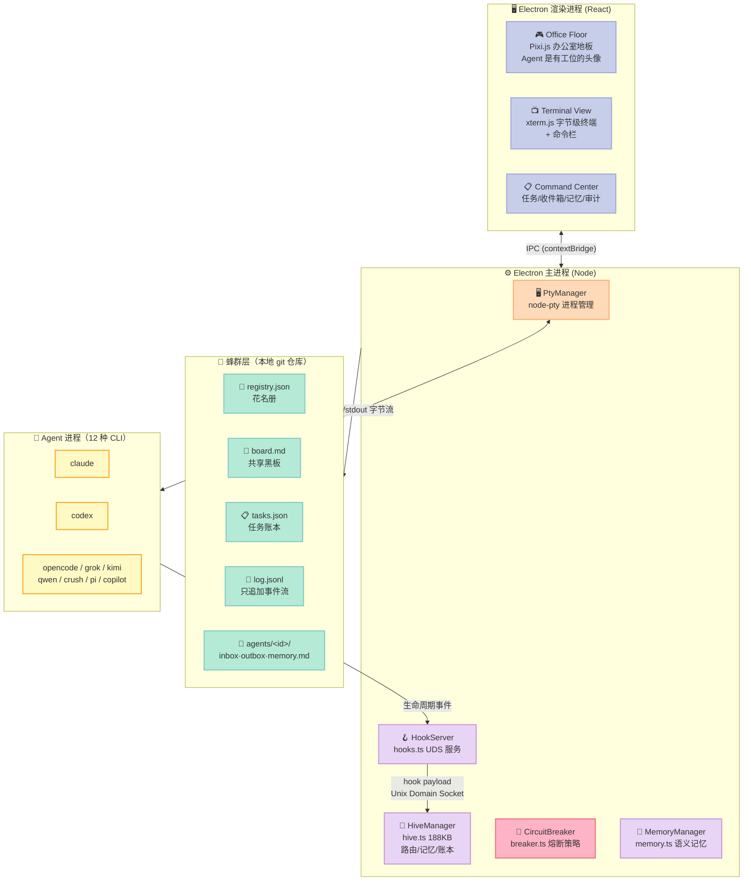
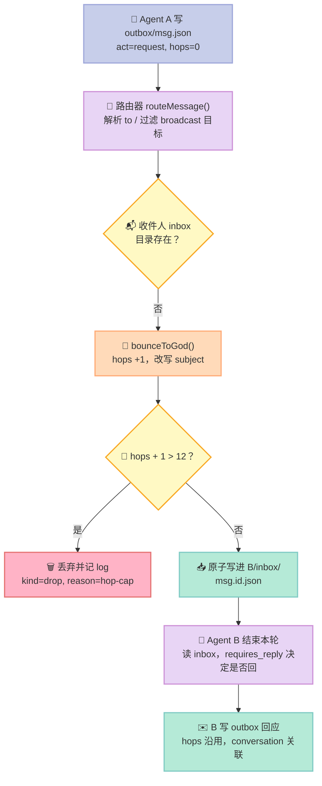
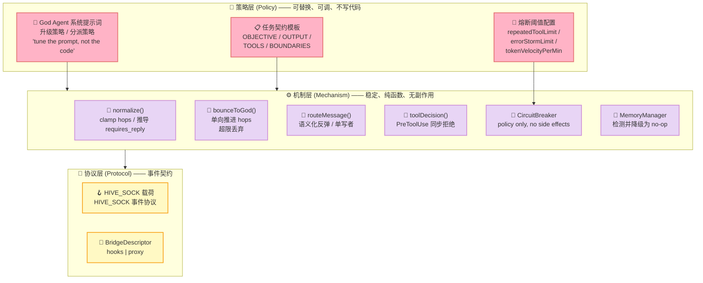

> **一句话结论**：这个项目最值得学的不是"能同时跑 12 个 Claude Code"，而是它把**多 Agent 通信协议做成了文件系统**——用 git 做协调层、用言语行为（speech act）区分"谁欠谁回复"、用跳数上限（hop cap）给 AI 之间可能发生的无限乒乓装一个物理熔断器。

---

## 引子：两个 AI 互相回邮件，收到第 13 封时会发生什么？

先讲一个几乎所有多 Agent 框架都会踩、但很少有人正面处理的坑。

假设你有两个 Agent：A 问 B 一个问题，B 答了，但答案没解决问题，A 又问，B 又答……这是**良性循环**。现在换个情况：B 的回答格式不对，A 理解不了，于是换个说法再问；B 还是那个格式，还是理解不了。于是 A 改、B 改、A 改、B 改……

这是 **ping-pong livelock（乒乓活锁）**。在传统分布式系统里，解法很简单：给消息加一个 TTL 或者最大跳数，超了就丢弃。但当"发消息"的是 LLM 时，事情变复杂了——**Agent 会自己给自己编造跳数字段**。它可能在消息里写 `"hops": 3`，甚至写 `"hops": 0` 来骗系统"我还是第一跳"。

那么，一个真正工程化的 Harness 应该怎么做？

答案藏在 `HarnessMD/munder-difflin` 这个项目的源码注释里。它是 2026 年成长最快的 Agent Harness 之一——2026-05-31 创建，**5 个多月冲到 9,494 ⭐**，2026-11-11 拿下 **GitHub Trending 日榜第一**，1,336 个 fork。它的定位一句话说清：

> **"an open-source alternative to the dots, bots and muses of the world, run an office of claude code/codex like agents on your laptop, sandboxes or anywhere, uses your existing subscriptions"**
>
> （运行你自己的 Claude Code / Codex 克隆体办公室的 Agent Harness，用你已经在付费的订阅，跑在本机、沙箱或任何地方。）

本文要拆的就是这间"办公室"背后的协议设计。

---

## 一、项目定位：它不是 Agent 框架，是 Agent 的"办公室管理系统"

### 1.1 先把定位说准

`munder-difflin` 极易被误解成"又一个多 Agent 编排框架"。它不是。

| 维度 | 典型 Agent 框架（如 LangGraph / CrewAI） | Munder Difflin |
|---|---|---|
| Agent 从哪来 | **自己调 LLM API**，框架负责 prompt 与 tool | **直接启动现成的 CLI 进程**（`claude` / `codex` / `grok` / `kimi` / `qwen` / `opencode` / `crush` / `pi` / `copilot` / `cursor` / `agy` + 任意自定义命令） |
| 计费 | 框架自己的 API Key | **复用你现有的订阅**，跑在各自的小时限额里 |
| Agent 能力 | 框架定义的能力（tool / skill / memory） | **CLI 自带全套能力**（Claude Code 的 hooks、skills、MCP、subagent 全都免费继承） |
| 编排者 | 框架内的 orchestrator 对象 | 一个名叫 **Michael** 的 "god agent"，它本身也是一个 `claude` 进程 |
| 产品形态 | Python/TS 库 | **Electron 桌面应用**（React + Pixi.js + xterm.js + node-pty） |

这就是它的核心洞察：**Claude Code 已经不是"一个工具"，而是一个成熟的 Agent 运行时**。它自带 skills、hooks、MCP、subagent、权限提示、上下文压缩。重新造一个运行时是浪费；但把 12 个这样的运行时协同起来，是真问题。

`munder-difflin` 的答案：**不重造运行时，只造协同层**。

### 1.2 仓库体检（2026-11-12 实测）

| 项 | 值 |
|---|---|
| Stars | ⭐ **9,494** |
| Forks | 1,336 |
| Open Issues | 289 |
| 主语言 | **TypeScript**（Electron 主进程 + React 渲染进程） |
| License | MIT |
| 创建时间 | 2026-05-31（**5.5 个月**） |
| 最近推送 | 2026-11-11 |
| 最新版本 | v0.5.6（release 节奏：v0.5.2 → v0.5.3 → v0.5.5，10 月 1 日） |
| 文件树 | 4,161 个 blob |
| 核心文档 | `HIVE.md`（11,128 字符）、`SPEC.md`（15,344）、`MEMORY_GRAPH_SPEC.md`（15,588）、`docs/ARCHITECTURE.md`（5,337）、`docs/message-queue.md`（7,759） |
| 核心源码 | `src/main/hive.ts`（**188,831 字符**）、`src/main/hooks.ts`（30,313）、`src/main/pty.ts`（43,583）、`src/main/breaker.ts`（20,172）、`src/main/memory.ts`（20,648）、`src/shared/agentProvider.ts`（39,293） |

**GitHub Trending 日榜第一 + 289 个 open issue** 这个组合很说明问题：它不是无人问津的小仓库，是正在被真实使用的、有大量真实 bug 反馈的活跃项目。它的 issue 标题本身就极有价值——例如 `#833 Windows: agents silently and permanently archived after abnormal exit 1073807364 (0.5.7)`，一句话暴露了 Windows 进程退出码处理的坑。

### 1.3 在 Harness 6 件套矩阵里的位置

| 组件 | 覆盖度 | 说明 |
|---|---|---|
| **Rule** | ⭕ 弱 | 不提供规则语言，靠注入系统 prompt（`identity.md` + `PROTOCOL.md`） |
| **Skill** | ✅ 强 | `skills.ts` 统一发现 Claude Code / OpenCode / Codex 的 skill 目录 + 227 个 skill 的目录浏览（**只发现不安装**） |
| **Sub-Agent** | ✅ 强 | 12 个 provider 的 worker 进程，每个一个独立身份 |
| **Workflow** | ✅ 强 | 蜂群路由 + 任务账本 + 4 段式任务契约 |
| **Script** | ✅ 强 | `PROTOCOL.md` / `COMMANDS.md` / `identity.md` 是 agent 可执行的协议脚本 |
| **MCP** | ⭕ 中 | `mcpCatalog.ts` + 默认 MCP 合并，但不造 MCP Server |

**它属于"Multi-Agent Harness"横向对比赛道**，但独特之处在于：**它是唯一一个把多 Agent 通信协议完全落到文件系统上、并且把"跳数上限"这种分布式系统原语引入 LLM 通信的开源项目**。

---

## 二、架构：两条数据平面 + 一个蜂群

### 2.1 渲染层与两条平面

`docs/ARCHITECTURE.md` 画出的结构是这样的：



**为什么是两条平面？** `SPEC.md` 里讲得很直接：

> "Hooks alone don't give you the raw stream the user expects to see. The tmux pipe alone doesn't tell you which tool is running without fragile output parsing. Together: the canvas is event-driven; the terminal view is byte-for-byte authentic."
>
> （单靠 Hooks 拿不到用户期待的原始输出流；单靠 tmux pipe 又无法在不脆弱地解析输出的前提下判断正在跑哪个工具。合在一起：画布由事件驱动，终端视图字节级真实。）

| 平面 | 承载什么 | 技术 | 消费者 |
|---|---|---|---|
| **Terminal Plane** | 字节流 | `node-pty` | xterm.js 视图 + 命令栏 |
| **Event Plane** | 结构化生命周期事件 | Claude Code Hooks → `cth-hook` shim → Unix Domain Socket `~/.cth/events.sock` | 头像动作 + 熔断器 + 渲染器 |

这条"双平面"设计值得单独记住，因为它是**通用模式**：任何"既要真实终端、又要知道 Agent 在干什么"的需求，都得同时解决这两个问题。

### 2.2 蜂群层：git 作为协调与审计层

`HIVE.md` 的第 2 条"锁定设计决策"是整个项目最有价值的部分：

> "Git as the coordination/audit layer, **single committer**. Everything the hive knows is files in one local git repo. To avoid `.git/index.lock` corruption with many concurrent agents, **only the Electron main process commits**. Agents never call git — they write plain files."
>
> （Git 作为协调/审计层，单一提交者。蜂群知道的一切都是本地 git 仓库里的文件。为避免多并发 Agent 造成 `.git/index.lock` 损坏，**只有 Electron 主进程提交**。Agent 永不调用 git —— 它们只写纯文件。）

磁盘布局：

```
hive/
  PROTOCOL.md            # agent 面向的契约（怎么记、怎么发消息）
  registry.json          # 花名册：每个 agent 的角色/能力/状态/工位
  board.md               # 共享黑板（唯一真正被多方共写的文件）
  tasks.json             # 任务账本
  log.jsonl              # 只追加事件流
  agents/<agentId>/
    identity.md          # 我是谁（启动时读）
    memory.md            # 我的长期记忆（启动时读，学到就追加）
    inbox/               # 别人发给我的消息 <ts>-<msgid>.json
    inbox/.done/         # 已处理（保留审计，不删）
    outbox/              # 我要发的消息（路由器来取）
    cursor.json          # { lastProcessed: <msgid> }  防重复处理
```

三条关键规则：

1. **单文件单写者（Single-writer-per-file）**：每个 Agent 只写自己的 `agents/<id>/` 目录。跨 Agent 投递由主进程的**路由器**完成——把 `outbox/` 里的文件搬进收件人的 `inbox/`。**没有任何文件被两个进程共写**。
2. **原子写**：每条消息一个 JSON 文件，用 "临时文件 + `rename`" 写入，绝不出现半截 JSON。

```typescript
// src/main/hive.ts —— 原子写
private atomicWriteJson(p: string, data: unknown): void {
  const tmp = `${p}.tmp-${shortRand()}`;
  writeFileSync(tmp, JSON.stringify(data, null, 2), 'utf8');
  renameSync(tmp, p);            // POSIX rename 是原子的
}
```

3. **唯一提交者 + git 调优**：源码里有一段极有价值的注释，解释了为什么 git 命令要带 `-c gc.autoDetach=false`：

```typescript
// src/main/hive.ts —— git (single committer, retry + stale-lock recovery)
//
// `gc.autoDetach=false` is what makes this call actually synchronous.
//
// A commit runs `gc --auto`, and git detaches that into a BACKGROUND process
// by default. `spawnSync` returns when `git commit` exits, so the caller
// believes the hive is quiescent while a gc it cannot see is still writing
// into `.git/objects/`. Anything that touches the hive directory right after
// a commit races that process: removing a hive home throws ENOTEMPTY, and
// a read can catch a half-written pack.
//
// It reproduces on its own — create a HiveManager on a fresh temp home, call
// ensureAgent, then remove the home: ~3.5% of iterations throw ENOTEMPTY,
// and the leftover is always `.git/objects/`, sometimes still holding a
// `bitmap-ref-tips_*` temp file that vanishes a fraction of a second later.
// With this flag, gc runs inline and 200 iterations pass clean.
private git(args: string[], cwd: string): { ok: boolean; out: string; err: string } {
  const res = spawnSync('git', ['-c', 'commit.gpgsign=false',
    '-c', 'gc.autoDetach=false', '-c', 'user.name=Hive', '-c', 'user.email=hive@local',
    ...args], { cwd, encoding: 'utf8', timeout: 8000 });
  return { ok: res.status === 0, out: res.stdout ?? '', err: res.stderr ?? '' };
}
```

**这段注释就是本文最想传达的东西之一**：Harness 的工程质量不在"功能有多少"，而在"作者有没有真的在生产环境踩过坑并把坑写进注释"。3.5% 的 ENOTEMPTY 复现率、"`bitmap-ref-tips_*` 临时文件在几分之一秒后消失"——这种细节不是设计出来的，是被生产环境打出来的。

---

## 三、核心机制一：FIPA-lite 言语行为消息协议

### 3.1 为什么不用普通的 JSON 消息

绝大多数多 Agent 框架的消息格式是这样的：

```json
{ "from": "agent_a", "to": "agent_b", "content": "帮我看看这个 bug" }
```

问题在于：**系统无法从这条消息判断出"agent_b 有没有欠 agent_a 一个回复"**。而这恰恰是消息系统最核心的语义——如果不能判断谁欠谁回复，就既无法做超时提醒，也无法做活锁检测，也无法做"未响应请求"的可视化。

`HIVE.md` 第 4 节直接说明了借鉴对象：

> "Borrow the one useful idea from **FIPA-ACL/KQML** — the **speech act** — and drop the LISP syntax. Seven semantic fields."
>
> （从 FIPA-ACL/KQML 借鉴唯一有用的想法——言语行为——然后扔掉 LISP 语法。七个语义字段。）

### 3.2 七字段消息模式

```typescript
// src/main/hive.ts
export type MessageAct =
  | 'request' | 'inform' | 'propose' | 'query' | 'agree' | 'refuse' | 'done';

export interface HiveMessage {
  id: string;
  conversation: string;
  in_reply_to: string | null;
  from: string;
  to: string;                 // an agentId, 'god', or 'broadcast'
  act: MessageAct;
  subject: string;
  body: string;
  hops: number;
  requires_reply: boolean;
  needs_human: boolean;
  created_at: string;
}
```

| 字段 | 语义 | 谁填 |
|---|---|---|
| `act` | **言语行为**——这条消息在做什么 | agent 填写，harness 校验 |
| `hops` | 已中转次数（活锁计数器） | **harness 独占**，agent 写的会被 clamp |
| `requires_reply` | 是否强制对方回复 | **由 `act` 自动推导** |
| `needs_human` | 是否需要人类介入 | 路由器/god 可以翻转 |
| `conversation` | 线程 id，把一问一答串起来 | harness |
| `in_reply_to` | 上一条消息 id | agent |
| `needs_human` / `id` / `created_at` | 升级标记 / 唯一可排序 id / 时间戳 | harness |

**核心推导规则**（`normalize()`）：

```typescript
requires_reply: partial.requires_reply ?? ['request', 'query', 'propose'].includes(act),
```

也就是：**只有 `request` / `query` / `propose` 这三种言语行为"欠回复"；`inform` / `agree` / `refuse` / `done` 是终态**。

这条一行代码，把"消息"变成了"带义务的消息"。它带来三个直接能力：

1. **未响应可视化**——扫一遍 inbox 就能算出谁欠谁。
2. **活锁检测**——reply 必然 `hops + 1`。
3. **路由决策**——god agent 可以只处理 `requires_reply` 的请求，`inform` 直接归档。

### 3.3 hop-cap：给 AI 之间装一个物理熔断器

这是全文最精彩的一段。`HIVE.md` 里的规则：

> "Anti-livelock rules: only `request`/`query`/`propose` obligate a reply (pure `inform`/`done` are terminal); **every reply increments `hops`**; **past a hop cap the god agent escalates instead of letting two agents loop forever**; re-seeing a processed `id` is a no-op (idempotent via cursor)."
>
> （反活锁规则：只有 request/query/propose 强制回复；**每次回复都让 hops 递增**；**超过跳数上限后由 god agent 升级处理，而不是让两个 agent 无限循环**；重复看到已处理的 id 是空操作。）

源码实现分成两个函数，**关键在于"谁能推进 hops"**：

```typescript
// src/main/hive.ts
const HOP_CAP = 12;

/** Normalize a partial message into a full HiveMessage. */
private normalize(partial: Partial<HiveMessage>, from: string): HiveMessage {
  const act = (partial.act ?? 'inform') as MessageAct;
  return {
    // ...
    // hops is harness-owned (PROTOCOL.md: "The harness fills in `id`, `from`,
    // `hops`, and timestamps"), so an agent-authored value is only a carried
    // count, never authoritative. Clamp it into range: an echoed relay must
    // keep climbing toward the cap, while a copied-forward `hops: 13` must
    // not read as a runaway loop (only a harness bounce moves the counter —
    // see bounceToGod). A negative value would just buy more free bounces,
    // so the floor is 0.
    hops: Math.max(0, Math.min(typeof partial.hops === 'number' ? partial.hops : 0, HOP_CAP)),
    requires_reply: partial.requires_reply ?? ['request', 'query', 'propose'].includes(act),
    // ...
  };
}

/** One harness bounce of `msg` to god: bump the hop counter, rewrite the
 *  subject, and log the drop once the counter passes HOP_CAP. Agents can't
 *  move hops past the cap themselves (normalize clamps what they wrote), so
 *  this fuse can only fire on a REAL relay loop — a bounced mail that keeps
 *  coming back undeliverable — and never on an agent-authored number. */
private bounceToGod(msg: HiveMessage, godId: string, subject: string): void {
  const hops = msg.hops + 1;
  if (hops > HOP_CAP) {
    // loop guard — drop a runaway message rather than let agents ping-pong.
    // There's no human queue to fall back on; the god agent owns conflicts.
    this.appendLog({ kind: 'drop', reason: 'hop-cap', from: msg.from, to: msg.to, id: msg.id });
    return;
  }
  this.deliver({ ...msg, hops, to: godId, subject }, godId);
}
```

**三层设计，逐层加固**：

| 层 | 机制 | 防住什么 |
|---|---|---|
| 1 | `normalize` 把 agent 自写的 `hops` **clamp 到 [0, 12]** | Agent 写 `hops: 0` 试图"重置计数器"、写 `hops: 999` 试图"假装快满了"、写 `hops: -5` 试图"多买几次反弹" |
| 2 | `bounceToGod` 用 `msg.hops + 1` **只加 1**，且只在超过 12 时才丢弃 | 计数只能由 harness 单向推进，agent 无法跳跃 |
| 3 | `log.jsonl` 记录 `kind: 'drop', reason: 'hop-cap'` | 丢弃是可审计的，不是静默的 |

注释里那句 **"A negative value would just buy more free bounces, so the floor is 0"** 是整段代码的精华——它把"Agent 会不会恶意/无意地利用协议字段"当成一个真实的攻击面来防。这是把 LLM 当作**不可信对端**来设计的思路，在 2026 年的 Harness 里还不多见。

### 3.4 一条消息的完整生命周期

把上面的规则串起来，一次"Agent A 向 Agent B 要东西"要经过 5 步：



注意这条链路上**没有消息队列、没有 RPC、没有 agent 框架的对象引用**——只有"写文件"和"搬文件"。这也是为什么它能在 5.5 个月内从 0 做到 9.5k ⭐：**协议足够简单，简单到任何人都能看懂 `PROTOCOL.md` 然后自己写一个 Agent 进来**。

### 3.5 语义化反弹：让"消息丢失"变成"消息可见"

同一个 `routeMessage()` 里还有一组非常细腻的分支。源码注释举了真实事故：

```typescript
// An ARCHIVED recipient (its terminal is gone) still has an inbox, so the
// mail lands there and reads as delivered — and stays unread. Filing it
// is right: a worker re-hired under the same id reads it on its first turn
// (a released worker's inbox is settled only up to its done signal). But
// the sender learned nothing, so god kept mailing dead agents for hours
// (seen live 2026-08-16), and a request to a worker nobody re-hires was
// simply lost. Now mail that expects an answer is filed AND its sender is
// told, at once, that no one is there to answer it.
if (t !== godId && reg.agents[t]?.archived) {
  if (this.deliver(msg, t)) delivered.push(t);
  this.appendLog({ kind: 'archived-recipient', from: msg.from, to: t, id: msg.id, act: msg.act });
  const sender = reg.agents[msg.from];
  if (msg.requires_reply && sender && !sender.archived) {
    this.routeMessage(this.normalize({
      to: msg.from,
      act: 'inform',
      // ...
```

翻译一下这个设计决策：

| 情况 | 朴素做法 | munder-difflin 的做法 |
|---|---|---|
| 收件人已归档（终端没了） | 消息扔进 inbox，看起来"已送达" | **归档保留 + 立刻给发送方回一条 `inform`**："没人会回你" |
| 收件人是"只发不收"的 prep 助手 | 消息烂在 inbox 里没人读 | **反弹给 god**，附带改写的 subject 说明原因 |
| 收件人目录不存在 | `deliver` 返回 false，消息静默消失 | **反弹给 god + 记 log** |

这三条合起来表达了一个观点：**在 LLM 协作系统里，"消息丢了"比"消息错了"更危险**——因为丢掉的 `request` 意味着有个 Agent 在等一个永远不会来的回答，而它自己不知道。

---

## 四、核心机制二：Stop 钩子自治循环——以及一次主动的反悔

`HIVE.md` 原本的设计是：

> "**Autonomous loop = `Stop` hook.** An agent that finishes drains its inbox via a `Stop` hook that returns `{"decision":"block","reason":…}` to keep it working, guarded by `stop_hook_active` to prevent infinite loops."

即：Agent 干完活 → Stop 钩子触发 → 钩子检查邮箱 → 有未读消息就返回 `{"decision":"block"}` → Agent 被迫继续干。

这正是很多"长跑 Agent"框架的核心技巧。**但这个项目把它删掉了**。看 `hooks.ts` 的现状：

```typescript
// src/main/hooks.ts
if ((event === 'Stop' || event === 'SubagentStop') && agentId) {
  // Respect any upstream Stop hook that already re-entered this boundary.
  if (p.stop_hook_active) { this.emit(agentId, event, p); return {}; }
  // Never turn unread hive mail into a forced continuation at Stop. That old
  // path bypassed terminal-draft/HITL safety and could spend credits while a
  // user was answering a question. Inbox files remain durable; the renderer
  // wakes the agent later through its guarded idle-only delivery path.
  this.notify(agentId ?? 'Agent', 'finished — idle');
  this.emit(agentId, event, p);
  return {};
}
```

注意 `Never turn unread hive mail into a forced continuation at Stop` 这句。理由有两条，每一条都很实在：

1. **绕过 HITL 安全**：强制续跑会在用户正在回答一个权限提示时，把新的内容塞进终端草稿——用户以为自己在回答问题，实际上提交的内容被污染了。
2. **烧钱**：用户回答问题的那 30 秒里，Agent 在满速消耗 token。

**改成了什么？** 改成"空闲唤醒"（idle-only delivery）：消息仍然**持久化在 inbox 文件里**（不丢），但唤醒动作交给渲染层，在 Agent 真正空闲时通过一个受保护的路径投递。

这是一个非常成熟的工程判断：**机制（消息持久化 + 投递）保留，触发策略（何时强制续跑）交给上层**。这正是 Harness 设计里"机制与策略分离"的典范——而且它是通过**主动删掉自己第一版设计**来实现的。

同一个 `hooks.ts` 里还保留着真正需要的硬拦截：

```typescript
// 7C.1 — HITL gate: deny a tool call at the PreToolUse boundary when the
// agent is paused or this tool is gated. Race-free (immediate return, no
// renderer round-trip → can't hit the shim timeout). Slow human APPROVAL is
// deliberately left to Claude's native permission prompt.
if (event === 'PreToolUse' && agentId && this.control) {
  const d = this.control.toolDecision(agentId, p.tool_name ?? '');
  if (d.deny) {
    this.emitControl(agentId, p.tool_name, d.reason);
    this.emit(agentId, event, p);
    return {
      hookSpecificOutput: {
        hookEventName: 'PreToolUse',
        permissionDecision: 'deny',
        permissionDecisionReason: d.reason ?? 'Denied by operator.'
      }
    };
  }
}
```

**注意"Race-free (immediate return, no renderer round-trip)"这个括号**——它解释了为什么"拒绝"必须同步返回而"批准"可以异步：拒绝要走 UI 往返就可能撞上 shim 超时，这是竞态；而批准本来就慢，交给 Claude Code 原生权限提示更自然。**把快路径和慢路径分开，是 Hook 设计的基本功。**

---

## 五、核心机制三：steer → constrain → stop 熔断阶梯

`breaker.ts`（20,172 字符）解决的是一个 Claude Code 本身没解决的问题。它的文件头注释写得非常清楚：

> "Claude Code exposes `--max-turns` but **NO dollar ceiling**, so we enforce one ourselves. This module owns the **POLICY only** — trip conditions + the steer → constrain → stop escalation ladder. **It has no side effects**: it reads signals and returns decisions; the caller performs the enforcement."
>
> （Claude Code 暴露了 `--max-turns` 但**没有美元上限**，所以我们自己实现一个。本模块只负责**策略**——触发条件 + steer → constrain → stop 升级阶梯。它**没有副作用**：读信号、返回决策；执行由调用方负责。）

**"Policy only, no side effects"** 是 Harness 组件设计的黄金标准。看它的接口：

```typescript
export type BreakerLevel = 'healthy' | 'steering' | 'constrained' | 'stopped';
export type BreakerAction = 'none' | 'steer' | 'constrain' | 'stop';

export interface BreakerDecision {
  state: BreakerState;
  action: BreakerAction;
  /** True when level changed since the previous beat (escalation OR recovery). */
  changed: boolean;
}
```

### 5.1 三个输入源

| 来源 | 信号 | 通道 |
|---|---|---|
| **用量采样** | 成本、token 速度（Δoutput/Δt，**不是**把单次采样当增量） | `UsageProvider` |
| **钩子事件** | 重复相同 tool 调用、api_error 风暴 | `recordToolUse` / `recordError` |
| **文件 mtime** | 无进展（协调文件 + 工作目录） | `progressing` / `lastWorkAt` |

### 5.2 阶梯设计


四条关键安全属性（全部写在源码注释里）：

1. **steer-first**——永远先尝试纠偏，不上来就杀。
2. **one level per beat**——每拍最多升一级，绝不跳级。
3. **de-escalates a level per healthy beat**——恢复时降级，不会"一次误判终身瘫痪"。
4. **`hardStop` 默认关闭**——"without it the ladder caps at `constrained` and never kills"。

### 5.3 无进展检测的三口时钟

这是熔断器里最精细的部分。它要区分"Agent 在干活"和"Agent 在空转"，但"干活"的形态太多了：

```typescript
export interface BreakerInput {
  agentId: string;
  sample: AgentUsageSample | null;
  /** Did the agent make coordination progress recently (file-mtime signal)? */
  progressing: boolean;
  /** When the agent's own WORKING DIRECTORY last changed, or omitted when the
   *  caller cannot tell. Coordination and work are different things: an agent
   *  can spend twenty minutes editing files, running a build and committing
   *  without touching a single hive message, and `progressing` answers only
   *  the first question. */
  lastWorkAt?: number;
}
```

三类"其实是工作"的情况，各有专门的时钟：

| 情况 | 例子 | 对应机制 |
|---|---|---|
| 只改文件不发消息 | 改 20 分钟代码、跑 build、commit 但没发一条消息 | `lastWorkAt`（工作目录 mtime） |
| 工具流有变化 | 后台 workflow、往 git/Jira 写东西 | `lastDistinctToolAt`（不同 name+input 的工具调用） |
| 纯对话 | 人类在跟它聊天，"散文进、散文出" | `lastUserPromptAt`（`UserPromptSubmit` 打点） |

第三种尤其有意思——注释明确说这是 **"A clock, not an exemption"**：

> "A live conversation is work that touches neither hive files nor tools — prose in, prose out — so the no-progress arm reads it via this third progress clock (#376). **A clock, not an exemption: it expires on its own, and a runaway loop (one prompt, then many tool calls) never refreshes it.**"
>
> （实时对话是既不碰蜂群文件也不碰工具的工作——散文进、散文出——所以无进展分支通过这第三口进度时钟来读它。**是时钟，不是豁免：它会自己过期，而失控循环（一个 prompt，然后大量工具调用）永远不会刷新它。**）

这正是**把 LLM 当作不可信对端**的思路：不能给它一个永久豁免，只能给它一个会过期的窗口。

---

## 六、核心机制四：Provider 抽象——如何让 12 种 CLI 都说同一种"蜂群语言"

这是我认为整个项目**最被低估的设计**。

问题：Claude Code 有 Hooks（能报告"我现在在用哪个工具"、"我干完了"），但 `qwen` CLI **没有 Hook 机制**。你怎么让一个不支持生命周期的 CLI 也参与蜂群？

`src/shared/agentProvider.ts` 的答案是 **BridgeDescriptor**：

```typescript
/** Structured descriptor for how a NON-hiveAware provider gets hive lifecycle
 *  events (live status + Stop→inbox-drain + cost), introduced alongside the legacy
 *  `hookBridge` so call sites can switch on `bridge.kind` without a big-bang
 *  rewrite. Two kinds:
 *   - 'hooks'  → a config-file hook shim is installed (agy/codex). Derived from the
 *               legacy `hookBridge` by `bridgeOf`, so agy/codex keep working with no
 *               preset change.
 *   - 'proxy'  → the CLI has NO hook surface (qwen), so a loopback reverse-proxy
 *               sidecar observes its LLM traffic and SYNTHESIZES the same HIVE_SOCK
 *               payloads the shims emit. */
export type BridgeDescriptor =
  | { kind: 'hooks'; shim: 'agy' | 'codex' | 'pi' | 'opencode' | 'grok' | 'gemini' }
  | {
      kind: 'proxy';
      api: 'openai' | 'anthropic';
      baseUrlEnv: string;
      inboxDelivery: 'terminal' | 'serve';
    };
```

| Bridge Kind | 适用 | 机制 |
|---|---|---|
| `hooks` | Claude Code / Antigravity / Codex / OpenCode / Grok / Gemini / Pi | 装一个 shim（`cth-hook` / `agy-hook`），CLI 主动 POST 生命周期事件到 UDS |
| `proxy` | qwen（无 Hook 能力） | **环回反向代理 sidecar** 观察 LLM 流量，**合成出同样的 HIVE_SOCK 载荷** |

`proxy` 这条路是真正的巧思：**在 CLI 和 LLM 之间插一个 sidecar，把它的 HTTP 流量翻译成蜂群事件**。改 CLI 的 base URL 环境变量指向 sidecar，sidecar 转发请求并从响应里推断"这次用了什么工具、这一轮结束了"。

**这提炼出一条通用原则**：

> **Agent 运行时是可替换的，事件协议才是稳定契约。**

Claude Code 明天改 hook 格式？改 shim 就行。某个新 CLI 完全不支持 hook？走 proxy 合成。**协议（"我用了什么工具"、"我干完了"、"我花了多少钱"）是稳定的，实现路径是可插拔的。**

对应的 provider 列表：

```typescript
export type AgentProvider =
  | 'claude' | 'codex' | 'grok' | 'kimi' | 'gemini' | 'antigravity'
  | 'qwen' | 'opencode' | 'crush' | 'pi' | 'copilot' | 'cursor' | 'custom';
```

12 种。而且 `custom` 允许任意自定义命令——这意味着**任何能在终端里跑的 CLI 都能变成蜂群成员**。

---

## 七、机制与策略分离：这个项目的分层解剖

Harness Design 里最看重的一条原则是"机制与策略分离"。`munder-difflin` 在这点上做得相当彻底：



三个具体证据：

**1. 升级策略在 prompt 里，不在代码里**

`HIVE.md` 第 6 节：

> "Its escalation policy (what counts as 'critical') **lives in its system prompt and is the primary control surface — tune the prompt, not the code**."
>
> （它的升级策略（什么算"关键"）**活在系统提示词里，是主要的控制面——调提示词，不要改代码**。）

而 god agent 的系统提示词本身就是一篇长文（`hive.ts:1586`），里面有大量精妙的策略条款：

> "...**DELEGATE** — decompose work and fan it out to the hive agents via their inboxes (route messages and assign owners; **do not do their jobs**)... **prefer routing to an EXISTING agent that fits** — above all when the request names one ('ask Pam to…', 'have Jim…'), route to that agent instead of reflexively creating a new one. **One capable owner beats a duplicate.**"
>
> （……**委派**——分解工作并通过收件箱扇出给蜂群 Agent（路由消息并指定归属人；**不要抢他们的活**）……**优先路由给已存在的合适 Agent**——尤其当请求点名了某个 Agent（"让 Pam 做…"、"让 Jim 做…"）时，路由给那个 Agent 而不是条件反射地新建一个。**一个能干活的 owner 胜过一个重复的。**）

还有关于人机协作的：

> "In tasks.json, **ALWAYS set each task's 'assignee' to the worker's agent id the moment you dispatch it, and NEVER clear it on status changes** — a done card must still say who did the work (the human reads the board by who-did-what)."
>
> （在 tasks.json 里，**一旦分派就 ALWAYS 把 assignee 设成 worker 的 agent id，并且永远不要在状态变更时清空它**——一张 done 的卡片仍然必须说明是谁干的（人类是靠"谁干了什么"来读看板的）。）

**2. 熔断器是纯策略**

`breaker.ts` 文件头已经引用过了："It has no side effects: it reads signals and returns decisions; the caller performs the enforcement."

**3. 记忆层可检测、可降级**

`memory.ts`：

> "Degrades silently to no-op when the `mempalace` CLI isn't installed — the markdown memory still works."
>
> （当 `mempalace` CLI 没装时**静默降级为 no-op**——markdown 记忆仍然工作。）

而且选 CLI 而不是 MCP 是一个明确的设计决策：

> "CLI-only (no MCP): the harness keeps a single shared palace under harnessHome, points every agent's `MEMPALACE_PALACE_PATH` at it, mines each agent's `memory.md` into its own wing (mtime-gated)"
>
> （只走 CLI（不用 MCP）：Harness 在 harnessHome 下保留一个共享 palace，让每个 Agent 的 `MEMPALACE_PALACE_PATH` 指向它，把每个 Agent 的 `memory.md` 按 mtime 门控挖进各自的"翼"）

### Less is More 检查

| 组件 | 判断 | 理由 |
|---|---|---|
| FIPA-lite 消息协议 | ✅ **外部物理世界必需** | LLM 自己学不会"谁欠谁回复"这种全局义务语义，必须由 harness 提供 |
| hop-cap | ✅ **外部物理世界必需** | LLM 无法可靠地自我计数，需要物理熔断器 |
| 单写者 + 原子写 | ✅ **外部物理世界必需** | POSIX 文件系统语义，模型无从推断 |
| 双平面（terminal + event） | ✅ **外部物理世界必需** | 字节流 vs 结构化事件是两种物理事实 |
| Michael god agent | ⚠️ **部分可被模型替代** | 但"路由 + 裁决 + 黑板独占写"是机制，promotion 部分才是策略 |
| 2D 办公室地板 | ❌ **纯审美** | 对 agent 零影响，纯人机界面 |
| 打字机效果 / 角色精灵 | ❌ **纯审美** | 同上 |

**Less is More 的答案很清晰：通信协议和文件系统语义是"物理必需"，可视化是"人类可选"。** 这个项目两者分得很干净——`scene/office/` 整个目录删掉，蜂群照跑。

---

## 八、Bitter Lesson 视角：多少代码会被模型淘汰？

这是个尖锐的问题，我给一个具体的判断。

### 8.1 会被淘汰的（"聪明但终将被淘汰"）

| 代码 | 为什么终将被淘汰 |
|---|---|
| `skills.ts` 的 frontmatter 解析（手写正则，不用 YAML 库） | 模型不需要严格解析 frontmatter；写个正则就够了。这段代码的手艺（"故意不用 YAML parser，因为 description 经常是多行 `|` 块"）是**人类工程智慧的产物**，模型写不出这种注释，但它也**不需要**这种注释 |
| `redactSecrets()` 的正则组 | 密钥格式会变。这本质上是在追一个不断移动的目标 |
| `parseSkillFrontmatter` 的多行处理 | 同上 |

### 8.2 不会被淘汰的

| 代码 | 为什么必须留下 |
|---|---|
| `normalize()` 的 clamp | **这是协议不变量**。模型再强，也不可能自发地把"谁欠谁回复"当成一等语义 |
| `bounceToGod()` 的 hop-cap | 物理熔断器。模型的自控力不构成工程保证 |
| `atomicWriteJson` 的 temp+rename | POSIX 语义 |
| 单写者 + 单一提交者 | 文件系统并发语义 |
| `CircuitBreaker` 的阶梯 | 成本护栏是**外部物理约束**（真的在花钱） |
| `BridgeDescriptor` 的 proxy 合成 | 协议适配，与模型无关 |

**结论**：这个项目大约 **70% 的代码属于"协议与物理约束"（不会被淘汰）**，30% 属于"格式适配与人机界面"（会随着模型变强而缩水）。这个比例相当健康——很多 Agent 框架正好相反：90% 的代码在处理 prompt 模板，而 prompt 模板正在被模型内化。

---

## 九、横向对比：三个同类项目，三种架构哲学

### 9.1 对比总表

| 维度 | **Munder Difflin** | **Omnigent** | **Agent Orchestrator** | **oh-my-claudecode** |
|---|---|---|---|---|
| Stars | ⭐ 9,494 | ⭐ 11,341 | ⭐ 14,450 | ⭐ 40,773 |
| 语言 | TypeScript | Python | TypeScript | TypeScript |
| License | MIT | Apache-2.0 | Apache-2.0 | MIT |
| 创建时间 | 2026-05-31 | 2026-06-11 | 2026-02-13 | 2026-01-09 |
| **Agent 来源** | **现成 CLI 进程（12 种）** | Claude Code / Codex / Cursor / Pi + 自定义 | Claude Code / Codex / **35+** | **仅 Claude Code** |
| **通信介质** | **文件系统（inbox/outbox）+ git** | 消息队列（框架内） | 任务队列 + PR | 文件 / GitHub |
| **生命周期事件来源** | Hooks **或** 环回代理合成 | 框架 wrapper | CLI 适配层 | Claude Code Hooks |
| **多 Agent 模型** | 共享黑板 + 言语行为协议 | **"meta-harness"，可换 harness 不重写** | 任务 → 合并 PR 流水线 | Teams-first 团队模型 |
| **护栏** | steer→constrain→stop 熔断 + 成本上限 | 策略强制 | 人工审阅门 | 团队角色分工 |
| **产品形态** | Electron 桌面 + 2D 办公室 | CLI / 库 | 桌面 + iOS + Android | Claude Code 插件 |

### 9.2 三个真正的设计分歧

**分歧一：Agent 是"进程"还是"对象"？**

- **Omnigent / Agent Orchestrator**：Agent 是一个**对象**，由框架创建、调用、销毁。通信是框架内的消息传递。
- **Munder Difflin**：Agent 是一个**操作系统进程**，由 `node-pty` 拉起，有自己的 PID、终端、订阅额度。通信是**文件投递**。

后果是什么？Munder Difflin 的 Agent 可以**被人接管**——用户在终端视图里直接打字进去。它也天然继承了 CLI 的全部能力（skills、MCP、subagent），不需要重新实现。

代价是：**进程级隔离远弱于对象级隔离**。同一个 `hive/` 目录，多进程并发写就要靠"单写者 + 单一提交者"这套规矩来兜。

**分歧二：通信协议是"框架定义"还是"文件约定"？**

- **Agent Orchestrator**：通信是内部 API，消息在内存/数据库里，外部不可见。
- **Munder Difflin**：通信协议是**公开的文件格式**。`PROTOCOL.md` 明确写着 Agent 该怎么读自己的 inbox、怎么写 outbox。

这带来一个非常实用的性质：**你用任何语言、任何进程都能加入这个蜂群**，只要遵守 `PROTOCOL.md`。哪怕不是 LLM，一个 shell 脚本也能当 Agent。

**分歧三：护栏是"事前审批"还是"事中熔断"？**

- **oh-my-claudecode**：靠团队角色和流程约束，事前分工。
- **Munder Difflin**：**事中熔断**——`steering` 先发纠偏消息，`constrained` 加约束，`stopped` 才停。默认 `hardStop: false`。

这个差异背后是不同的世界观：**前者相信"分好工就不会出事"，后者相信"Agent 会跑偏，所以要有一个能观察、能纠偏、能在必要时停机的看门狗"。**

老实说，对于 LLM 驱动的系统，我更认同后者。LLM 的行为漂移是**统计性的必然**，不是"角色没分好"的问题。

---

## 十、从零搭建：如果你要复刻这套设计

### 10.1 最小可行实现（MVP）

下面这份代码把三个最核心的原语从 18 万字符的 `hive.ts` 里抽了出来：**FIPA-lite 言语行为消息 + hop-cap 防活锁 + 单写者原子写路由**。约 330 行，纯标准库，复制下来就能跑：

```python
"""
MVP: 从 Munder Difflin 的 HIVE.md / src/main/hive.ts 抽离的核心机制复刻
=============================================================

抽离的 3 个原语：
  1. FIPA-lite speech-act 消息（act / hops / requires_reply）+ 语义化路由
  2. Hop-cap 防乒乓活锁（agent 不能自己突破上限，只有 harness bounce 能推进计数）
  3. Single-writer-per-file + 原子写（temp file + rename）+ 单一 committer 的路由模型

对应源码：
  - HarnessMD/munder-difflin  src/main/hive.ts
      MessageAct / HiveMessage / normalize() / bounceToGod() / routeMessage()
      HOP_CAP = 12
  - HarnessMD/munder-difflin  HIVE.md  §3 on-disk layout / §4 Message schema (FIPA-lite)

直接运行：python3 mvp_hive.py
"""

from __future__ import annotations

import json
import os
import shutil
import tempfile
from dataclasses import dataclass, field, asdict
from enum import Enum
from typing import Optional


# ─── 第 1 部分：核心数据模型（对应 hive.ts 的 HiveMessage / MessageAct）────────

class MessageAct(str, Enum):
    """FIPA-lite 言语行为。借鉴 FIPA-ACL 的 speech act，丢掉 LISP 语法。"""
    REQUEST = "request"     # 我要你做某事 -> 强制对方回复
    INFORM = "inform"       # 我告诉你一件事 -> 终态，不需要回复
    PROPOSE = "propose"     # 我提个方案 -> 强制对方回复
    QUERY = "query"         # 我问你个问题 -> 强制对方回复
    AGREE = "agree"         # 我同意 -> 终态
    REFUSE = "refuse"       # 我拒绝 -> 终态
    DONE = "done"           # 我做完了 -> 终态


#: 只有这三种 act 会强制对方回复（hive.ts 的 requires_reply 推导规则）
OBLIGATING_ACTS = {MessageAct.REQUEST, MessageAct.QUERY, MessageAct.PROPOSE}

#: hive.ts: `const HOP_CAP = 12;`
HOP_CAP = 12


@dataclass
class HiveMessage:
    """一条蜂群消息。对应 hive.ts 的 HiveMessage interface。"""
    id: str
    conversation: str
    in_reply_to: Optional[str]
    from_agent: str
    to: str                        # agent id | 'god' | 'broadcast'
    act: MessageAct
    subject: str
    body: str
    hops: int = 0
    requires_reply: bool = False
    needs_human: bool = False
    created_at: str = ""

    def to_json(self) -> str:
        return json.dumps(asdict(self), ensure_ascii=False, indent=2)


# ─── 第 2 部分：核心 class（对应 hive.ts 的 HiveManager）────────────────────

class Hive:
    """极简蜂群路由器：单写者目录 + 原子写 + FIPA-lite 路由 + hop-cap 防活锁。"""

    def __init__(self, root: str, god_id: str = "god"):
        self.root = os.path.abspath(root)
        self.god_id = god_id
        self.agents: dict[str, dict] = {}       # registry.json 的内存版
        self.log: list[dict] = []               # append-only log.jsonl
        self._seq = 0
        os.makedirs(self.root, exist_ok=True)

    # ── 目录布局（对应 HIVE.md §3）──────────────────────────────────────────
    def agent_dir(self, agent_id: str) -> str:
        return os.path.join(self.root, "agents", agent_id)

    def inbox(self, agent_id: str) -> str:
        return os.path.join(self.agent_dir(agent_id), "inbox")

    def outbox(self, agent_id: str) -> str:
        return os.path.join(self.agent_dir(agent_id), "outbox")

    def register(self, agent_id: str, *, role: str = "worker", is_assistant: bool = False):
        """注册一个 agent。is_assistant=True 表示"只发不收"的 prep 助手。"""
        self.agents[agent_id] = {"role": role, "is_assistant": is_assistant, "archived": False}
        for sub in ("inbox", "outbox", "inbox/.done"):
            os.makedirs(os.path.join(self.agent_dir(agent_id), sub), exist_ok=True)

    # ── 原子写（对应 hive.ts 的 atomicWriteJson）─────────────────────────────
    @staticmethod
    def _atomic_write_json(path: str, data) -> None:
        """temp file + rename。绝不让读者看到半截 JSON。"""
        d = os.path.dirname(path)
        os.makedirs(d, exist_ok=True)
        fd, tmp = tempfile.mkstemp(dir=d, prefix=".tmp-", suffix=".json")
        try:
            with os.fdopen(fd, "w", encoding="utf-8") as f:
                json.dump(data, f, ensure_ascii=False, indent=2)
            os.replace(tmp, path)          # POSIX rename 是原子的
        except BaseException:
            if os.path.exists(tmp):
                os.unlink(tmp)
            raise

    # ── normalize（对应 hive.ts 的 normalize()）─────────────────────────────
    def _next_id(self) -> str:
        self._seq += 1
        return f"msg-{self._seq:05d}"

    def normalize(self, partial: dict, from_agent: str) -> HiveMessage:
        act = MessageAct(partial.get("act", MessageAct.INFORM.value))
        # hops 是 harness 拥有的：agent 自己写的 hops 永远不是权威值，
        # 只能是一个"携带计数"，必须被 clamp 到 [0, HOP_CAP]。
        raw_hops = partial.get("hops")
        hops = raw_hops if isinstance(raw_hops, (int, float)) else 0
        hops = max(0, min(int(hops), HOP_CAP))
        return HiveMessage(
            id=partial.get("id") or self._next_id(),
            conversation=partial.get("conversation") or f"conv-{self._seq:05d}",
            in_reply_to=partial.get("in_reply_to"),
            from_agent=partial.get("from_agent") or from_agent,
            to=partial.get("to") or self.god_id,
            act=act,
            subject=partial.get("subject", ""),
            body=partial.get("body", ""),
            hops=hops,
            requires_reply=partial.get("requires_reply", act in OBLIGATING_ACTS),
            needs_human=partial.get("needs_human", False),
            created_at="2026-11-12T00:00:00Z",
        )

    # ── deliver（对应 hive.ts 的 deliver()）──────────────────────────────────
    def deliver(self, msg: HiveMessage, to_id: str) -> bool:
        inbox = self.inbox(to_id)
        if not os.path.isdir(inbox):
            return False                        # 未知收件人 -> 交由调用方 bounce
        self._atomic_write_json(os.path.join(inbox, f"{msg.id}.json"), asdict(msg))
        return True

    # ── bounceToGod（对应 hive.ts 的 bounceToGod()）──────────────────────────
    def bounce_to_god(self, msg: HiveMessage, subject: str) -> bool:
        """一次 harness 反弹：hops +1。超过 HOP_CAP 就丢弃。"""
        hops = msg.hops + 1
        if hops > HOP_CAP:
            self._log("drop", reason="hop-cap", from_agent=msg.from_agent,
                      to=msg.to, id=msg.id)
            return False
        bounced = HiveMessage(**{**asdict(msg), "hops": hops,
                                 "to": self.god_id, "subject": subject})
        return self.deliver(bounced, self.god_id)

    # ── routeMessage（对应 hive.ts 的 routeMessage() 的核心分支）────────────
    def route(self, msg: HiveMessage) -> list[str]:
        delivered: list[str] = []

        # 1) "human" 和 "god" 都解析成 god agent —— 没有独立的人工审批队列
        resolve_to = lambda to: self.god_id if to in ("human", "god") else to

        # 2) broadcast 扇出：排除自己，排除只发不收的助手，排除已归档的 agent
        if msg.to == "broadcast":
            targets = [
                aid for aid, meta in self.agents.items()
                if aid != msg.from_agent
                and not meta.get("is_assistant")
                and not meta.get("archived")
            ]
        else:
            targets = [resolve_to(msg.to)]

        for t in targets:
            if t == msg.from_agent:
                continue                          # 永不投递给自己
            meta = self.agents.get(t)

            # 3) 只发不收的 prep 助手：邮件会烂在 inbox 里没人读 -> 反弹给 god
            if meta and meta.get("is_assistant"):
                self.bounce_to_god(
                    msg,
                    f'[bounced — "{t}" is the send-only prep assistant] {msg.subject}')
                continue

            # 4) 已归档的收件人（终端已消失）：邮件归档，并通知发送方"没人会回"
            if meta and meta.get("archived"):
                if self.deliver(msg, t):
                    delivered.append(t)
                    if msg.requires_reply:
                        self.bounce_to_god(
                            msg,
                            f'[unanswered — "{t}" is archived and nobody will reply] '
                            f'{msg.subject}')
                continue

            if self.deliver(msg, t):
                delivered.append(t)
            else:
                # 收件人目录不存在 -> 反弹一次（可能触发 hop-cap）
                self.bounce_to_god(
                    msg, f'[bounced — unknown recipient "{t}"] {msg.subject}')

        self._log("message", from_agent=msg.from_agent, to=msg.to,
                  act=msg.act.value, id=msg.id, delivered=delivered)
        return delivered

    # ── send（对外入口）─────────────────────────────────────────────────────
    def send(self, partial: dict, from_agent: str = "system") -> HiveMessage:
        msg = self.normalize(partial, from_agent)
        self.route(msg)
        return msg

    # ── append-only log（对应 log.jsonl）────────────────────────────────────
    def _log(self, kind: str, **fields):
        row = {"kind": kind, **fields}
        self.log.append(row)
        with open(os.path.join(self.root, "log.jsonl"), "a", encoding="utf-8") as f:
            f.write(json.dumps(row, ensure_ascii=False) + "\n")

    # ── 读 inbox（模拟 agent 在任务开始时"读自己的信箱"）───────────────────
    def read_inbox(self, agent_id: str) -> list[dict]:
        inbox = self.inbox(agent_id)
        if not os.path.isdir(inbox):
            return []
        out = []
        for name in sorted(os.listdir(inbox)):
            if not name.endswith(".json"):
                continue
            with open(os.path.join(inbox, name), encoding="utf-8") as f:
                out.append(json.load(f))
        return out


# ─── 第 3 部分：演示（fake agents，不涉及任何真实 LLM）───────────────────────

def scenario_1_normal_routing():
    """正常路径：A 向 B 发 request，B 收到；A 向 C 发 inform，C 收到但不欠回复。"""
    print("=" * 68)
    print("场景 1：正常路由 —— 言语行为决定谁欠谁回复")
    print("=" * 68)
    root = tempfile.mkdtemp(prefix="hive-mvp-")
    try:
        h = Hive(root)
        for aid in ("alice", "bob", "carol"):
            h.register(aid)

        m1 = h.send({"from_agent": "alice", "to": "bob", "act": "request",
                     "subject": "需要数据库 schema", "body": "请给我 users 表结构"},
                    from_agent="alice")
        print(f"  alice -> bob  act={m1.act.value:<8} hops={m1.hops} "
              f"requires_reply={m1.requires_reply}")

        m2 = h.send({"from_agent": "alice", "to": "carol", "act": "inform",
                     "subject": "构建完成", "body": "CI 已通过"}, from_agent="alice")
        print(f"  alice -> carol act={m2.act.value:<8} hops={m2.hops} "
              f"requires_reply={m2.requires_reply}")

        bob = h.read_inbox("bob")
        carol = h.read_inbox("carol")
        print(f"  bob 的 inbox: {len(bob)} 条 -> {[b['subject'] for b in bob]}")
        print(f"  carol 的 inbox: {len(carol)} 条 -> {[c['subject'] for c in carol]}")
        assert len(bob) == 1 and bob[0]["requires_reply"] is True
        assert len(carol) == 1 and carol[0]["requires_reply"] is False
        print("  ✅ 只有 request 强制对方回复；inform 是终态")
    finally:
        shutil.rmtree(root, ignore_errors=True)


def scenario_2_hop_cap():
    """活锁防护：agent 自己写 hops=999 也没用，只有 harness bounce 能推进计数。"""
    print()
    print("=" * 68)
    print("场景 2：hop-cap 防乒乓活锁")
    print("=" * 68)
    root = tempfile.mkdtemp(prefix="hive-mvp-")
    try:
        h = Hive(root)
        h.register("god")
        h.register("alice")
        # "ghost" 故意不注册 —— 模拟"收件人目录不存在"（比如 agent 被删了）

        # 2.1 agent 自报 hops=999，normalize 必须 clamp 到 HOP_CAP
        m = h.normalize({"from_agent": "alice", "to": "bob",
                         "act": "request", "hops": 999}, "alice")
        print(f"  agent 自报 hops=999 -> normalize 后 hops={m.hops} "
              f"(HOP_CAP={HOP_CAP})")
        assert m.hops == HOP_CAP

        # 2.2 agent 自报 hops=-5 -> clamp 到 0（负数等于白送反弹次数）
        m2 = h.normalize({"from_agent": "alice", "to": "bob",
                          "act": "request", "hops": -5}, "alice")
        print(f"  agent 自报 hops=-5  -> normalize 后 hops={m2.hops}")
        assert m2.hops == 0

        # 2.3 真正的死循环：收件人 "ghost" 从未注册 -> deliver 失败 -> bounce 给 god
        #     (hops+1)。god 是个中继：它把打不通的邮件原样退回给原收件人，
        #     于是形成 alice -> ghost -> god -> ghost -> god ... 的乒乓。
        #     只有 harness 的 bounce 能推进 hops，agent 自己写的 hops 永远无效。
        msg = h.normalize({"from_agent": "alice", "to": "ghost",
                           "act": "request", "subject": "ping"}, "alice")
        rounds = HOP_CAP + 6
        for _ in range(rounds):
            before = len(h.log)
            h.route(msg)
            # route() 内部会在 bounce_to_god 里先写 drop 日志、再写 message 日志，
            # 所以不能只看 log[-1]，要扫描这一轮新增的日志里有没有 drop。
            if any(r.get("kind") == "drop" for r in h.log[before:]):
                break
            # god 收到的邮件如果 hops 没超限，它会原样再投一次（真中继）
            god_inbox = h.read_inbox("god")
            if not god_inbox:
                break
            latest = god_inbox[-1]
            os.remove(os.path.join(h.inbox("god"), f"{latest['id']}.json"))
            msg = h.normalize({"from_agent": "alice", "to": "ghost",
                               "act": "request", "subject": latest["subject"],
                               "hops": latest["hops"]}, "alice")

        drops = [r for r in h.log if r.get("kind") == "drop"]
        god_inbox = h.read_inbox("god")
        print(f"  死循环最多 {rounds} 轮后：god 累计收到 {HOP_CAP} 条，"
              f"drop 事件 {len(drops)} 条")
        assert len(drops) >= 1, "应该触发 hop-cap 丢弃"
        assert drops[-1]["reason"] == "hop-cap"
        print(f"  ✅ 第 {HOP_CAP + 1} 跳被丢弃：reason={drops[-1]['reason']}，"
              f"god 收到的 {HOP_CAP} 条就是上限，不会无限乒乓")
    finally:
        shutil.rmtree(root, ignore_errors=True)


def scenario_3_bounce_and_archived():
    """单写者 + 语义化反弹：投给"只发不收"的助手 / 已归档的 agent 都要有反馈。"""
    print()
    print("=" * 68)
    print("场景 3：单写者目录 + 语义化反弹")
    print("=" * 68)
    root = tempfile.mkdtemp(prefix="hive-mvp-")
    try:
        h = Hive(root)
        h.register("god")
        h.register("alice")
        h.register("prep", is_assistant=True)      # 只发不收
        h.register("dead")                          # 已归档

        # 3.1 投给 prep 助手 -> 反弹给 god，原件不进 prep 的 inbox
        h.send({"from_agent": "alice", "to": "prep", "act": "request",
                "subject": "请帮我准备任务简报"}, from_agent="alice")
        prep_inbox = h.read_inbox("prep")
        god_inbox = h.read_inbox("god")
        print(f"  alice -> prep : prep.inbox={len(prep_inbox)} 条（应为 0），"
              f"god.inbox={len(god_inbox)} 条")
        assert len(prep_inbox) == 0
        assert len(god_inbox) == 1 and "bounced" in god_inbox[0]["subject"]

        # 3.2 投给已归档的 dead -> 归档 + 通知发送方"没人会回"
        h.agents["dead"]["archived"] = True
        h.send({"from_agent": "alice", "to": "dead", "act": "request",
                "subject": "还需要复核结果"}, from_agent="alice")
        dead_inbox = h.read_inbox("dead")
        god_inbox2 = h.read_inbox("god")
        print(f"  alice -> dead : dead.inbox={len(dead_inbox)} 条（归档保留），"
              f"god.inbox={len(god_inbox2)} 条（多了未回复通知）")
        assert len(dead_inbox) == 1
        assert len(god_inbox2) == 2
        assert "unanswered" in god_inbox2[1]["subject"]
        print("  ✅ 邮件不丢：要么归档，要么反弹，发送方永远知道结果")

        # 3.3 单写者校验：任何时刻一个 inbox 目录只有一个 writer
        alice_inbox = h.read_inbox("alice")
        print(f"  alice 自己没有收到任何消息（自己不投给自己）：{len(alice_inbox)} 条")
        assert len(alice_inbox) == 0
        print("  ✅ 没有任何文件被两个进程共写")
    finally:
        shutil.rmtree(root, ignore_errors=True)


def run_demo():
    scenario_1_normal_routing()
    scenario_2_hop_cap()
    scenario_3_bounce_and_archived()
    print()
    print("=" * 68)
    print("全部 3 个场景通过 ✅")
    print("=" * 68)


if __name__ == "__main__":
    run_demo()
```

**实际运行输出**（本机 Python 3.11 实测）：

```
====================================================================
场景 1：正常路由 —— 言语行为决定谁欠谁回复
====================================================================
  alice -> bob  act=request  hops=0 requires_reply=True
  alice -> carol act=inform   hops=0 requires_reply=False
  bob 的 inbox: 1 条 -> ['需要数据库 schema']
  carol 的 inbox: 1 条 -> ['构建完成']
  ✅ 只有 request 强制对方回复；inform 是终态

====================================================================
场景 2：hop-cap 防乒乓活锁
====================================================================
  agent 自报 hops=999 -> normalize 后 hops=12 (HOP_CAP=12)
  agent 自报 hops=-5  -> normalize 后 hops=0
  死循环最多 18 轮后：god 累计收到 12 条，drop 事件 1 条
  ✅ 第 13 跳被丢弃：reason=hop-cap，god 收到的 12 条就是上限，不会无限乒乓

====================================================================
场景 3：单写者目录 + 语义化反弹
====================================================================
  alice -> prep : prep.inbox=0 条（应为 0），god.inbox=1 条
  alice -> dead : dead.inbox=1 条（归档保留），god.inbox=2 条（多了未回复通知）
  ✅ 邮件不丢：要么归档，要么反弹，发送方永远知道结果
  alice 自己没有收到任何消息（自己不投给自己）：0 条
  ✅ 没有任何文件被两个进程共写

====================================================================
全部 3 个场景通过 ✅
====================================================================
```

### 10.2 哪些是必须的，哪些可以先省略

**必须（否则系统会崩）**：

| 组件 | 为什么不能省 |
|---|---|
| 消息模式（含 `act` / `hops`） | 没有它就无法判断谁欠谁回复 |
| `hops` 的 clamp + 单一推进者 | 没有它 LLM 会无限乒乓 |
| 单写者目录约定 | 没有它多进程会互相覆盖 inbox |
| 原子写 | 没有它会读到半截 JSON |
| 消息投递日志 | 没有它丢失的消息无法排查 |

**可以先省略**：

| 组件 | 理由 |
|---|---|
| git 提交 | 先用纯文件；只有需要审计/回滚时才上 git |
| 2D 办公室可视化 | 纯装饰，零功能影响 |
| 语义记忆（MemPalace） | markdown 记忆先够用；`memory.ts` 本身就是"检测不到就降级" |
| 熔断器的成本臂 | 先做"重复 tool 调用"臂（最易触发） |
| god agent | 先用一个普通路由规则顶上 |
| proxy bridge | 先只支持有 hook 的 CLI |

### 10.3 踩坑预警

我把这套设计里**最容易被忽略的坑**列出来，每一条都对应真实故障：

**坑 1：把 `hops` 交给 agent 写**

这是最直觉的错误做法——"让 agent 自己数跳数"。但 LLM 会：写 0（想重置）、写 999（想伪装）、写负数（想多买几次）。**必须 clamp 到 `[0, HOP_CAP]`，且只有 harness 的 bounce 能推进。**

**坑 2：`git commit` 与 gc 竞态**

`git commit` 默认会 fork 一个后台 `gc --auto` 进程。`spawnSync` 返回时你以为蜂群静默了，实际上后台 gc 还在写 `.git/objects/`。结果：删 hive 目录报 `ENOTEMPTY`（**3.5% 复现率**），读文件可能读到半写的 pack。**修法**：`-c gc.autoDetach=false`。

**坑 3：Stop 钩子强制续跑会污染终端草稿**

Agent 干完活 → 强制续跑 → 此时用户正在终端里回答 Claude Code 的权限提示 → Agent 的内容被拼进用户草稿 → 用户提交了一锅粥。**修法**：把"消息持久化"和"何时唤醒"分开，唤醒交给上层在真正空闲时做。

**坑 4：给已归档的 Agent 发 `request`**

Agent 归档了（终端没了），但它的 inbox 目录还在。消息投递成功，看起来"已送达"，实际永远没人读。发送方还以为在等回复。**修法**：归档保留 + 立刻回一条 `inform` 告诉发送方"没人会回"。这个 bug 在真实环境里造成过 "god kept mailing dead agents for hours"。

**坑 5：广播会扇出给"只发不收"的助手**

prep 助手这类角色只能发不能收。把广播包含进去，消息就烂在它的 inbox 里。**修法**：广播目标过滤掉 `isAssistant`，直邮给它则反弹给 god。

**坑 6：成本护栏和压缩事件打架**

`/compact` 会产生一个 token 尖峰。如果熔断器看的是绝对 token 速度，压缩这一下就会误触发，把正常工作的 agent 打成 steering。**修法**：`PreCompact` 打开豁免窗口，`PostCompact` 收窄成尾随宽限期，并给一个 5 分钟的兜底（防止 `PostCompact` 因崩溃不送达）。

**坑 7：把"没进展"等同于"没动蜂群文件"**

一个 agent 改 20 分钟代码、跑 build、commit，全程没发一条消息——它是在干活，不是在空转。**修法**：三口进度时钟（协调文件 mtime / 工作目录 mtime / 不同工具调用 / 用户 prompt），且每口都是**会过期的时钟，不是永久豁免**。

---

## 十一、优缺点

### 11.1 左侧：架构简洁性 / 扩展性 / 易用性

| 维度 | 评价 | 具体依据 |
|---|---|---|
| **架构简洁性** | ✅ **优秀** | 通信协议 = 7 个字段的 JSON；存储 = 普通文件；协调 = 单写者 + 单一提交者。**没有消息队列、没有事件总线、没有分布式事务**——git 仓库就是全部 |
| **扩展性** | ✅ **优秀** | ① 加新 CLI = 加一个 `AgentProviderPreset`（有 `defaultCommand` / `autoModeFlag` / `modelFlag` / `commandGroups`）；② 有 hook 的走 `hooks` bridge，没 hook 的走 `proxy` bridge；③ 加新能力 = 往 `PROTOCOL.md` 加一段，Agent 读 prompt 就会用 |
| **易用性** | ⚠️ **中等** | ✅ 桌面 App + 2D 办公室，用户体验轻松；❌ 但 289 个 open issue、Windows 异常退出码导致 agent 静默永久归档（#833）、`git commit` 的 ENOTEMPTY 竞态——**生产可用性还没打磨到位** |

### 11.2 右侧：性能 / 复杂度 / 维护性

| 维度 | 评价 | 具体依据 |
|---|---|---|
| **性能** | ⚠️ **可接受，有硬伤** | ✅ 文件投递几乎零延迟；✅ 原子写避免半读；❌ **每次消息变更都 git commit**（注释里提到 cost-ledger 曾经"一个季度 0.25 GB，每次提交存整份文件"，最后用 `git add` 的增量策略绕开）；❌ `hive.ts` 已经 **188,831 字符**，`git/trees` 拉全仓库 4,161 个 blob |
| **复杂度** | ⚠️ **高但分层清晰** | ❌ 12 种 provider × 2 种 bridge × 蜂群协议 × 熔断器 × 语义记忆 × 2D 渲染——**概念负担很重**；✅ 但"策略/机制/协议"三层分离做得干净，`breaker.ts` 明确"policy only, no side effects" |
| **维护性** | ✅ **良好** | ✅ **注释密度极高且信息量高**（"It reproduces on its own — ~3.5% of iterations throw ENOTEMPTY"）；✅ 5,000+ 行测试（`test/` 目录几十个 `.test.cjs`）；✅ 有 `docs/ARCHITECTURE.md` / `HIVE.md` / `SPEC.md` 三层文档；⚠️ 但 `hive.ts` 单文件 188KB 是**明确的拆分信号**，多人并行改必冲突 |

---

## 十二、总结与行动建议

### 12.1 这个项目教我们的三件事

**第一件事：多 Agent 通信协议值得被认真设计。**

从 FIPA-ACL 借一个"言语行为"的 idea，扔掉 30 年的 LISP 语法，得到 7 个字段——然后这三个字段（`act` / `hops` / `requires_reply`）一举解决了"谁欠谁回复"、"怎么检测活锁"、"怎么做未响应可视化"三个问题。**这是抽象的力量：不是发明新东西，是从旧东西里挑对的那一个。**

**第二件事：把 LLM 当作不可信对端。**

`hops` 的 clamp、"负数等于白送反弹次数"、把用户 prompt 时钟做成"会过期的时钟而不是永久豁免"——这些设计背后是同一个假设：**Agent 会无意（或有意）违反协议**。这不是防御性编程的老调重弹，而是在 Agent 时代才真正成立的新约束。

**第三件事：Harness 的价值在"协议与物理约束"，不在"prompt 模板"。**

这个项目 70% 的代码是协议与物理约束（不会被模型淘汰），30% 是格式适配与人机界面（会缩水）。这个比例，是判断一个 Harness 是否"押对了方向"的一个好指标。

### 12.2 给不同读者的建议

| 你是 | 建议 |
|---|---|
| **正在做多 Agent 系统的工程师** | 立刻抄 `act` / `hops` / `requires_reply` 三件套 + clamp 规则。这是投入产出比最高的一段代码 |
| **正在做 Agent 团队的 Tech Lead** | 抄"单写者 + 单一提交者 + 原子写"三件套。你的多 Agent 协作迟早会撞上 `index.lock` 或半截文件 |
| **Claude Code / Codex 重度用户** | 直接装这个 App。注意它**复用你的订阅额度**——12 个 agent 同时跑会烧得很快，务必配成本上限 |
| **正在造 Agent 运行时的人** | 认真读 `BridgeDescriptor`。**"事件协议稳定、实现路径可插拔"** 这条原则比任何具体代码都值钱 |
| **只想学 Harness 方法论的人** | 读 `HIVE.md`（11K 字符）和 `breaker.ts` 的文件头注释。**看注释里的"为什么"比看代码本身值钱十倍** |

### 12.3 一句话收尾

> **好的 Harness 不是让 Agent 更聪明，而是让 Agent 的错误变得有界、可观测、可恢复。**
>
> `munder-difflin` 最有价值的地方，不是它能同时跑 12 个 Claude Code——而是它证明了：**当 Agent 之间开始互相说话，最先需要工程化的不是"怎么让它们说得更好"，而是"怎么让它们停下来"。**

---

## 附：本文数据来源与验证方式

| 数据 | 来源 | 验证时间 |
|---|---|---|
| Stars / Forks / Issues / License / 创建时间 | GitHub REST API `GET /repos/HarnessMD/munder-difflin` | 2026-11-12 |
| 文件树 4,161 blob | GitHub Tree API `git/trees/HEAD?recursive=1` | 2026-11-12 |
| `HIVE.md` / `SPEC.md` / `MEMORY_GRAPH_SPEC.md` / `docs/ARCHITECTURE.md` / `docs/message-queue.md` | GitHub Contents API（base64 解码） | 2026-11-12 |
| `src/main/hive.ts`（188,831 字符）等 11 个源码文件 | 同上 | 2026-11-12 |
| 对比项目数据（Omnigent / Agent Orchestrator / oh-my-claudecode） | GitHub REST API `GET /repos/{owner}/{repo}` | 2026-11-12 |
| MVP 全部输出 | 本机 Python 3.11.15 实跑（`python3 mvp_hive.py`，3 场景全通过） | 2026-11-12 |

> **仓库地址**：https://github.com/HarnessMD/munder-difflin
> **License**：MIT（源码引用仅作技术分析用途）
