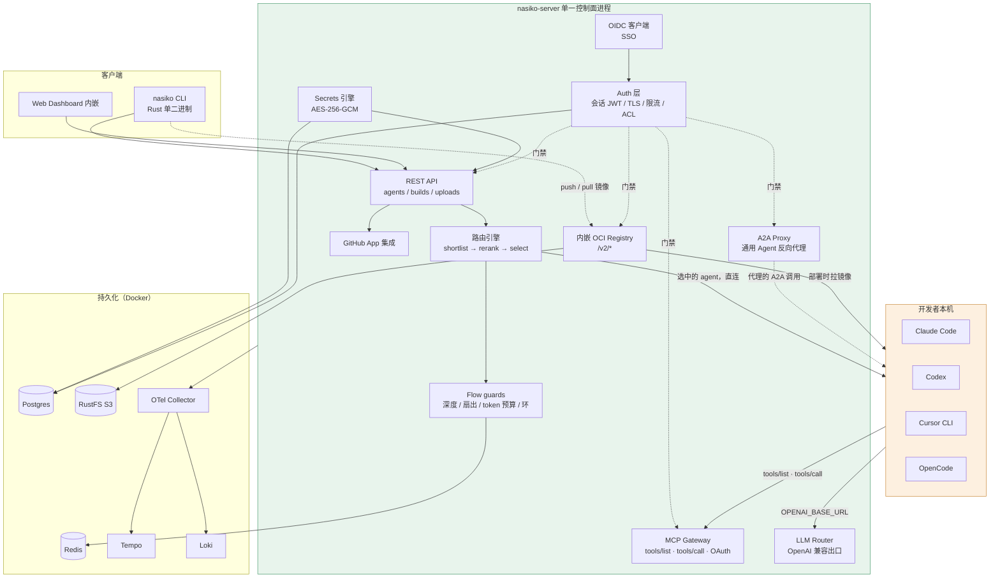
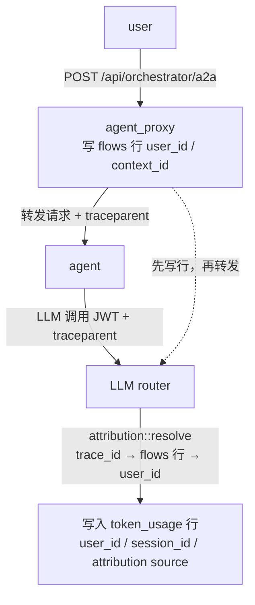
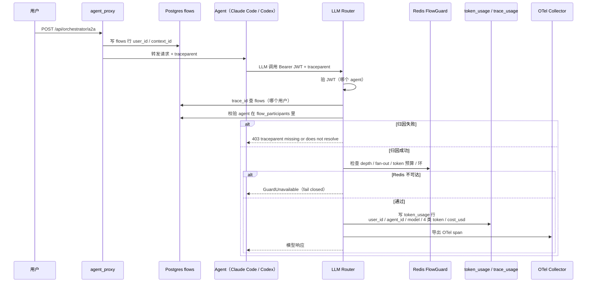
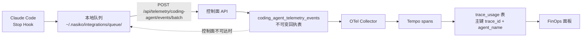

2026 年下半年，几乎每个 AI Agent 项目都在卷三件事：更强的模型调用、更炫的编排、更全的可观测性。但把镜头拉远到「一整个公司」而不是「一个 demo」的尺度，有一件更朴素、也更要命的事没人做：

**公司里有 200 个工程师，人手一个 Claude Code 和一个 Codex。月底账单来了 8 万美元。没有人说得清这 8 万是谁花的、花在哪个模型上、产出了什么。**

这个问题看起来像个财务问题，其实是架构问题。而绝大多数「Agent 成本治理」方案栽在同一个坑里：**它们站在调用路径外面看。**

`Nasiko-Labs/nasiko`（⭐11,958，Rust，Apache-2.0）的做法是把 README 里这段话直接摊开：

> "There is no version of this that works from the outside, and saying so plainly is the shortest way to explain the architecture below.
>
> Every coding-agent vendor meters in its own private unit, and none of them offers an ingest endpoint for another vendor's usage. There is no invoice reconciliation that produces one number, and no procurement policy that produces one either. **To attribute spend across vendors you have to be in the path where the calls happen.**"
> —— `README.md:241-254`

**"你必须站在调用发生的地方。"** 这句话决定了后面所有的架构选择——包括它为什么要在每次 LLM 调用失败时直接丢弃请求而不是降级服务。

本文拆解 Nasiko 的六条主线：**非侵入式发现 → traceparent 强归因 → 单一价格簿 → 级联守卫 → 带符号的节省账本 → 把模型选择权拿回来**，并逐条引用它**自己承认的 20 余处缺陷**——其中包括一次让 92.8% 花费行被记成 0 的真实事故，那段 SQL 注释本身就是本系列见过最诚实的技术文档之一。

---

## 一、项目定位：OpenRuntime —— 不属于任何厂商的运行时

```text
Nasiko-Labs/nasiko
├─ ⭐ 11,958 stars · 3,265 forks
├─ Rust + TypeScript · Apache License 2.0
├─ 创建于 2026-02-12，最后推送 2026-11-11（2 天前）
├─ 2,613 个 tree 节点 · 679 个 .rs · 543 个 .tsx · 533 个 .ts
├─ 20 个一级 Rust crate：server / cli / llm-router / mcp-gateway /
│  orchestrator / runtime / pricing / savings / flow / secrets /
│  hitl / oci / observability / react-agent / coding-policy / …
└─ 状态后端：Postgres + Redis + RustFS(S3) + Tempo/Loki/OTel
```

README 第一行的定位极其克制：

> "**Nasiko is the OpenRuntime for agents, coding harnesses, frameworks and tools.** Find the coding agents already running. See what each one costs, by harness and model. Route them to the models you choose while developers keep using their existing harness workflows."
> —— `README.md:3-4`

三个动词，三个承诺：

| 动词 | 承诺 | 技术载体 | 最难的部分 |
|------|------|----------|------------|
| **Find** | 找出**已经在跑**的 Coding Agent，不改它们的配置 | `nasiko agents discover` + 各 harness 原生 Hook | 发现 ≠ 接管，如何不破坏开发者现有工作流 |
| **See** | 把各 harness 各算各的花费，统一到一个 schema | `traceparent` 强归因 + 单一 `nasiko-pricing` crate | 「这次调用是谁花的」——跨厂商归因 |
| **Route** | 把模型选择权从 harness 手里拿回来 | LLM Router（OpenAI 兼容出口）+ Agent JWT | 厂商 SDK 的粘性、协议格式耦合 |

### 1.1 关键区分：Non-invasive ≠ Non-intrusive

README 里有一段把两个常被混为一谈的概念拆开：

> "Two properties hold the rest of this together, and they are not the same thing.
>
> **Non-invasive discovery** is about your architecture. Nasiko can detect the harnesses you already run without changing their configuration. Reporting and routing are explicit opt-ins that add hooks or update harness settings, but they require no wrapper or SDK in your application code.
>
> **Non-intrusive operation** is about your day. After one-time setup, developers keep using the same harness commands and interfaces. OpenCode must be restarted after its plugin is installed, and Codex asks you to trust the new Nasiko hooks."
> —— `README.md:52-60`

这个区分非常关键，很多「平台化」方案就死在第二层：

- **Non-invasive（架构层）**：不需要你在业务代码里包一层 SDK、改成他们的框架、迁移到他们的协议。
- **Non-intrusive（日常层）**：装完之后，工程师敲的还是 `claude`，不是 `nasiko claude`。改一个配置文件就完事。

第二层的要求高得多，但它才是「能不能在公司里推下去」的决定因素。

### 1.2 四个受支持的 Harness

README 给了一张表，非常克制地标出了没做的那一格：

| Harness | Discovery & session reporting | LLM routing |
|---|---|---|
| Claude Code | yes | yes |
| Codex | yes | yes |
| OpenCode | yes | yes |
| Cursor CLI | yes | **not yet** |

**注意第三行第四行。** Cursor CLI 只能发现和上报，**不能路由**。一个「Agent 治理平台」敢在能力矩阵里明明白白写 `not yet`，比多支持一个 harness 更能说明工程成熟度——因为它意味着「路由」这件事有真实的协议障碍（Cursor 的模型绑定方式不同于 Claude Code 的 `apiKeyHelper` / Codex 的 `model_providers`），而不是「还没来得及做」。

---

## 二、整体架构：单进程控制面，所有请求回到同一个咽喉

Nasiko 的架构约束被 README 归纳为一句话：

> "Nasiko is a **single process** with no separate gateway. Every inter-agent call is proxied back through the server, the single chokepoint where flow limits, ACLs, and observability are enforced."
> —— `README.md:262-264`

注意「**no separate gateway**」——它**拒绝**把数据面和控制面拆开。理由也很实在：一旦拆成两个进程，Agent 就有可能绕过网关直连厂商 API，守卫和归因立刻失效。这与 AIBrix（已写过的 2026-11-06 那篇）那类「控制面管 Pod、数据面管请求」的思路正好相反。



架构图右侧那三条虚线是全文最有价值的设计声明：

> "Every request to an agent is either dispatched by the routing engine or proxied generically, and both paths originate **inside** the server. Agents never receive a direct, public request, and both call back out into the LLM Router and MCP Gateway rather than holding real API keys or tool credentials."
> —— `README.md:252-254`

**Agent 手里永远没有真实 API key，也永远拿不到工具凭据。** 它拿到的是一枚 1 小时有效期的 JWT，和一个指向 Nasiko 的 `OPENAI_BASE_URL`。

---

## 三、机制一：非侵入式发现——用各 Harness 自己的 Hook 把自己交出来

### 3.1 只读的发现命令

```sh
git clone https://github.com/Nasiko-Labs/nasiko.git && cd nasiko
cargo install --path cli/ --force
nasiko agents discover
```

README 对这个命令的描述把「非侵入」写到了字面：

> "`nasiko agents discover` reads your machine, prints what it finds, and exits. You get a row per supported harness: whether it is detected, whether it is reporting to Nasiko, its version, and where its config lives. **Discovery changes no harness settings, requires no account, and sends nothing off the machine.**"
> —— `README.md:108-110`

「**sends nothing off the machine**」——纯本地、纯只读、零配置。

### 3.2 上报：各 Harness 的原生事件 Hook

安装是显式的：

```sh
nasiko agents install <agent>    # claude, codex, opencode, or cursor
nasiko agents install <agent> --no-content  # omit prompt and response text
nasiko agents uninstall <agent>
nasiko agents sync               # flush queued session-turn events to the control plane
```

Nasiko 用的是**每个 harness 自己就有**的事件钩子：

> "Nasiko installs each harness's supported event hooks: **Claude uses `Stop`**, OpenCode reports on `session.idle`, and **Codex and Cursor use their richer hook event sets**. Completed turns are queued locally under `~/.nasiko/integrations/queue/` and delivered to `POST /api/telemetry/coding-agent/events/batch`, so a control plane that is briefly unreachable costs you nothing."
> —— `README.md:122-126`

三个设计细节值得注意：

1. **用 `Stop` 而不是 `PreToolUse`**——`Stop` 是「一轮结束」，粒度正好对应一次计费单位。用更细的钩子会拿到更多数据，但也更容易被 harness 升级搞坏。
2. **本地队列 + 批量投递**——控制面短暂不可达不影响开发者工作，事件在 `~/.nasiko/integrations/queue/` 里排队。
3. **`--no-content` 选项**——可以只上报 token 数不报 prompt/response 原文。这对合规敏感的企业是刚需。

### 3.3 Hook 的幂等安装：如何不重复注入

安装 Hook 意味着要改用户的 `~/.claude/settings.json`。这一段代码是典型的「不能把用户已有配置搞坏」的工程细节：

```rust
// 来自 cli/src/commands/integration/agents/claude.rs
fn hook_groups_without_nasiko(settings: &Value, event: &str) -> Vec<Value> {
    let Some(groups) = settings["hooks"][event].as_array() else {
        return Vec::new();
    };
    groups
        .iter()
        .map(|group| {
            let Some(hooks) = group["hooks"].as_array() else {
                return group.clone();
            };
            let kept: Vec<_> = hooks
                .iter()
                .filter(|hook| !is_nasiko_hook(hook))
                .cloned()
                .collect();
            // ...
        })
        .collect()
}
```

**它不是覆盖 `settings["hooks"][event]`，而是先过滤掉自己之前注入的那一组，再把新的追加进去。** 这样重复执行 `nasiko agents install claude` 是幂等的，而且不会误删用户自己写的 Hook。

卸载时用同样的逻辑反向操作：

```rust
// 来自 cli/src/commands/integration/agents/claude.rs
fn is_current_hook(hook: &Value, expected_command: &str) -> bool {
    hook["type"] == "command" && hook["command"].as_str() == Some(expected_command)
}
```

注意「current」的判定不是「有没有 nasiko 的 hook」，而是「**是不是我这次要装的那一条**」——命令路径必须完全相等。

---

## 四、机制二：traceparent 强归因——「在场证明」和「在场记录」

这是整个 Nasiko 最硬核、也最值得单独一节的技术。

### 4.1 两个身份，必须同时在场

`docs/TOKEN_ATTRIBUTION.md` 开篇就定义了归因模型：

> "Two identities ride on every agent→LLM call; neither is optional — a call that cannot present both is **rejected**, not served (see "Strict enforcement" below):
>
> | Identity | Carrier | Set by |
> |---|---|---|
> | **Agent** | `Authorization: Bearer ***` — minted at deploy, injected as `OPENAI_API_KEY` | platform |
> | **User/session** | `traceparent` header — W3C trace context whose **trace_id is the flow id** | agent (forwarded from its inbound request) |"
> —— `docs/TOKEN_ATTRIBUTION.md:9-15`

**Agent 身份**证明「是哪个 agent 在调」，**traceparent** 证明「是哪次用户交互触发的」。两者缺一，调用直接被丢。

归因流程图（这是官方文档的原图）：



关键顺序在 `agent_proxy`：**先同步写入 `flows` 行，再把请求转发给 agent**。这样 traceparent 到达 router 时，`flows` 行一定已经存在。

### 4.2 三步归因，缺一即拒

> "There is exactly one path — **`traceparent`, resolved, or rejected**:
>
> 1. The header's trace_id is looked up in `flows`. Billing: `token_usage.user_id` = the flow's **caller** (`flows.user_id`), never the agent's owner — an agent serving another user's traffic bills that user.
> 2. The JWT-authenticated agent must be a **participant** of that flow (the flow was dispatched to it). This binds the two identities: without it, agent A could name agent B's flow and drain another user's token budget or misbill them.
> 3. Anything else — header absent, malformed, trace_id with no live `flows` row, or a flow the calling agent is not part of — is rejected with `403` (see below)."
> —— `docs/TOKEN_ATTRIBUTION.md:38-47`

第 2 步是整个设计的精华，很多人会漏掉：

**光有 JWT 不够，光有 traceparent 也不够。** JWT 说「我是 agent A」，traceparent 说「这是 flow F」，但必须验证 **A 确实是 F 的参与者**（`flow_participants` 表里有一行）。否则 agent A 可以随便编一个别人的 flow_id，去烧别人的 token 预算、或者把费用记到别人头上。

第 1 步的「计费给调用者而不是 agent 的所有者」也是一个很成熟的决定：agent 只是执行者，真正的买单人是发起这次交互的用户。

### 4.3 四个反直觉的执行细节

```rust
// 来自 llm-router/src/routing/attribution.rs
/// Why an LLM call could not be attributed — every variant is a hard `403`.
```

文档对这四个细节写得极清楚，每一条都是踩过坑之后写下来的：

**① 403，不是 401。**

> "**Status code is `403`, never `401`.** The agent's credential is valid — authentication succeeded; what's missing is authorization context. A `401` would send well-behaved clients into credential-refresh loops."
> —— `docs/TOKEN_ATTRIBUTION.md:68-70`

凭据是有效的，缺的是授权上下文。用 401 会让「守规矩的客户端」陷入无限刷新凭据的循环——这跟 AGT 那套治理里「fail-closed 但要给出正确信号」是同一个思路。

**② 「在场」不等于「校验通过」。**

> "**Presence is not the check — resolution is.** A random well-formed traceparent resolves to no `flows` row and is rejected identically. **There is nothing an agent can fabricate to pass.**"
> —— `docs/TOKEN_ATTRIBUTION.md:71-73`

攻击者随便编一个格式正确的 traceparent，会和「根本没带 header」得到完全相同的拒绝。**没有可伪造的通行证。**

**③ 旧的兜底路径是被删除，不是被禁用。**

> "The old active-flow fallback (attribute to the agent's sole running flow when no traceparent arrived) is **removed**, not merely disabled: **a fuzzy fallback behind a strict gate defeats the gate.**"
> —— `docs/TOKEN_ATTRIBUTION.md:87-89`

这句金句值得单独拿出来讲。设想一个「宽进严出」的实现：严格门禁前面放一个模糊兜底，那么攻击者只要触发兜底，严格门禁就等于不存在。**把兜底彻底删掉，是唯一能保证门禁有效的方式。**

**④ 归因失败 = 丢弃调用，不是降级服务。**

> "The router **discards** any LLM call it cannot attribute, rather than serving it with degraded billing. Rationale: unattributed usage is not just a FinOps gap — flow token budgets (`FLOW_MAX_TOKENS`) and per-user accounting key off the flow, so an agent that drops its traceparent would burn tokens outside every cascade limit."
> —— `docs/TOKEN_ATTRIBUTION.md:59-62`

**这是一个「可用性 vs 可治理性」的明确取舍，而且它选了后者。** 原因不是洁癖：如果归因失败仍然放行，那这笔钱就落在所有级联限额之外——攻击者只要故意丢掉 header 就能无限烧钱。

### 4.4 为什么是 `traceparent` 而不是自定义 Header

> "It is the **only** header every OTel auto-instrumentation forwards for free, in every language, with zero agent code — and it was already carrying the same identity for distributed tracing. **One header, one identity, two consumers** (Tempo traces + router attribution). A2A SDKs propagate no headers by themselves; the platform's agents extract/inject explicitly where auto-instrumentation doesn't exist."
> —— `docs/TOKEN_ATTRIBUTION.md:120-124`

**一个 header，两个消费者**——既给分布式追踪用，又给成本归因用。这是极简但极有效的设计。

而且它还给出了一张**按语言的传播方式表**：

| Language | 机制 | 需要写代码？ |
|---|---|---|
| Python | OTel auto-instrumentation | 否 |
| Node.js | `@opentelemetry/auto-instrumentations-node` | 否 |
| Java / .NET | OTel javaagent / auto-instr | 否 |
| Go | **loongsuite `otel go build`**（编译期自动插桩） | 否 —— **不要**加 `otelhttp` 依赖，会与 loongsuite 自带的 OTel 版本冲突 |
| Rust | 没有自动插桩 | **需要手写** |

Rust 的那个坑被单独拎出来讲：

> "`Span::current().context()` inside a `#[tracing::instrument]`ed `chat()` is a *fresh local span*, not the platform-re-homed trace — injecting from it silently produces nothing."
> —— `docs/TOKEN_ATTRIBUTION.md:105-107`

在 `#[tracing::instrument]` 过的函数里取 `Span::current()`，拿到的是**一个新的本地 span**，不是平台重定址过来的那条 trace。从它注入 header 会**静默地什么都不产生**——这是最难查的一类 bug。

---

## 五、机制三：单一价格簿——「Never NULL」三条不变量

### 5.1 为什么必须只有一个计价引擎

`pricing/src/lib.rs` 的模块文档开头就是一段「血泪史」：

> "The platform used to carry **two cost engines**: this one's predecessor in `nasiko-observability`, and a plpgsql trigger on `token_usage`. They disagreed on unknown models (Rust fell back to a default rate, SQL returned NULL and booked $0), on missing cache rates (Rust charged the input rate, SQL charged nothing), and on which date's price applied. **This crate exists so there is one answer.**"
> —— `pricing/src/lib.rs:3-10`

两个引擎在三个地方不一致，其中第一个（未知模型）直接造成了那场 92.8% 的事故（后面第八节详述）。

### 5.2 四步流水线与三条不变量

```rust
// 来自 pricing/src/lib.rs
//! Four steps, in order:
//!
//! ```ignore
//! let key   = resolve_model(Some("aws-bedrock"), "us.anthropic.claude-opus-4-v1:0");
//! let usage = normalize_usage(raw, PromptConvention::Exclusive);
//! let rates = quote(&[&db_book, &StaticPriceBook], &key, call_started_at, &ratios).await;
//! let spend = cost(&usage, &rates);
//! ```
//!
//! Three invariants hold for every quote, and each replaces a measured defect:
//!
//! * **Never NULL.** A missing price yields an estimated rate, never an absent
//!   cost — a NULL reads as $0 and is indistinguishable from a free call.
//! * **Never the input rate for cache.** 133 of the 137 priced models in the
//!   live book charge 0.5x input or less for a cache read.
//! * **Never silent.** Every quote records which layer answered and whether it
//!   was a lookup or an inference.
```

第二条不变量里的数字很实在：**实时价格簿里 137 个有价模型中有 133 个对缓存读取收取 ≤ 0.5× 输入价**。这意味着如果你把缓存读当成普通输入计费，会**系统性高估** 20%–50%。

第三条「Never silent」是本文最欣赏的设计：**每一次报价都要记录「是哪一层答的」**。

### 5.3 五层回退与价格来源溯源

```rust
// 来自 pricing/src/quote.rs
/// Which layer answered. Recorded on every quote so a stored cost can be
/// explained, and so an estimate is never mistaken for a looked-up rate.
#[derive(Debug, Clone, Copy, PartialEq, Eq)]
pub enum PriceSource {
    /// Matched the model, as named, in a synced price book.
    Exact,
    /// Matched the model family in a synced book, after dropping a minor version.
    Family,
    /// Matched the offline list-price table.
    Static,
    /// No rate found; inferred from the vendor's cache-pricing convention.
    Ratio,
    /// No rate found at any layer.
    Default,
}

impl PriceSource {
    /// Whether a quote from this layer is a lookup or a guess.
    fn is_estimate(self) -> bool {
        matches!(self, Self::Family | Self::Static | Self::Ratio | Self::Default)
    }
}
```

**注意 `Exact` 不是唯一的「真实价格」。** `Family`（匹配模型族）、`Static`（离线标价表）、`Ratio`（按厂商缓存惯例推断）、`Default`（兜底）——**后四层全是估算**。

而 `is_estimate()` 的结果会驱动 `PriceQuote::estimated` 字段，文档里对这个字段的用途写得很清楚：

> "Drives [`PriceQuote::estimated`], which surfaces report so a dashboard can say **"$412, of which $38 estimated"** instead of presenting a guess as fact."
> —— `pricing/src/quote.rs:1668-1671`

**仪表盘上写「总额 $412，其中 $38 是估算的」——这是一个把不确定性显式暴露给用户的 FinOps 面板。** 绝大多数成本看板会把估算值和实测值混在一起显示，然后没人敢拿这个数字去做决策。

`PriceQuote` 结构体本身还藏着一个关键设计：

```rust
// 来自 pricing/src/quote.rs
/// Four resolved rates in USD per million tokens, with their provenance.
///
/// All four are always present. A missing rate is never represented as zero:
/// zero is a real price that some models genuinely have (OpenAI does not charge
/// for cache writes), and conflating "free" with "unknown" is what let 92.8% of
/// gateway calls be booked at $0.
#[derive(Debug, Clone, PartialEq)]
pub struct PriceQuote {
    pub input_per_1m: f64,
    pub output_per_1m: f64,
    pub cache_read_per_1m: f64,
    pub cache_creation_per_1m: f64,
    pub cache_creation_1h_per_1m: Option<f64>,
    /// Where the input and output rates came from.
    pub source: PriceSource,
    /// Where the cache rates came from. Often a different, lower layer: 81% of
    /// rows in the live book carry input and output prices but no cache prices.
    pub cache_source: PriceSource,
    pub estimated: bool,
    /// The name the rates were found under, for auditing a stored cost.
    pub resolved_as: String,
}
```

**「0 是一个真实价格」**——OpenAI 确实不收缓存写入费。所以「缺失」和「免费」必须区分开，否则就分不清「这个模型不收钱」和「我们不知道它收多少钱」。这个区分直接导致了第八节那场事故的根因。

### 5.4 四类 Token 永不折叠

不同厂商对「prompt tokens」的定义是真的不一样：

```rust
// 来自 pricing/src/usage.rs
/// What a producer's prompt count means, as declared by the producer.
///
/// Providers genuinely disagree, and guessing is only correct until it isn't:
///
/// * OpenAI and the GenAI semconv report the **whole** prompt with the cached
///   tokens as a subset of it.
/// * Anthropic reports the prompt **excluding** cache reads, as a disjoint count.
#[derive(Debug, Clone, Copy, PartialEq, Eq)]
pub enum PromptConvention {
    /// `input` already excludes cached tokens — Anthropic, coding-agent feeds.
    Exclusive,
    /// `input` includes cached tokens — OpenAI, Gemini.
    Inclusive,
    /// Unknown, as for a third-party OTel span.
    Infer,
}
```

而在归一化之后有一个铁律：

> "The invariant every caller depends on: [`NormalizedUsage::input`] is the *fresh* prompt, with cached tokens excluded. Costing charges `input` at the full rate and the cache classes at their own rates and sums them, so an `input` that still contains the cached tokens **bills them twice**."
> —— `pricing/src/usage.rs:5-9`

**「input 里如果还含缓存 token，就会被收两次钱。」** 这是真实会发生的 bug——Anthropic 的格式是 Exclusive，OpenAI 是 Inclusive，如果归一化搞错，同一笔请求的缓存部分会被收双倍。Nasiko 的处理是让**生产者显式声明**自己的约定，而不是让计费器去猜。

---

## 六、机制四：级联守卫——Redis 存状态，Redis 挂了就 fail closed

### 6.1 五个限流常量

```rust
// 来自 flow/src/guard.rs
/// Default wall-clock budget for one flow.
pub const DEFAULT_FLOW_TIMEOUT_SECS: u64 = 600;

/// Slack between the flow timeout and the Redis state TTL. The guard reads
/// `started_at` out of the flow's Redis key: once that key expires the elapsed
/// check below has nothing to compare against and silently passes, and the
/// depth/fan-out counters reset to zero. The TTL must therefore always outlive
/// the timeout it stores the state for.
pub const FLOW_STATE_TTL_SLACK_SECS: u64 = 60;

impl Default for FlowConfig {
    fn default() -> Self {
        Self {
            max_depth: 5,
            max_fan_out: 20,
            max_flow_tokens: 100_000,
            flow_timeout_secs: DEFAULT_FLOW_TIMEOUT_SECS,
            flow_state_ttl_secs: state_ttl_for(DEFAULT_FLOW_TIMEOUT_SECS),
        }
    }
}

/// The Redis state TTL a given flow timeout needs.
pub const fn state_ttl_for(flow_timeout_secs: u64) -> u64 {
    flow_timeout_secs + FLOW_STATE_TTL_SLACK_SECS
}
```

**限流值：深度 5、扇出 20、flow token 10 万、超时 600 秒、状态 TTL = 超时 + 60 秒。**

TTL 那个 `+60` 的注释非常精彩，它解释的是一个**静默失效**的坑：

> "once that key expires the elapsed check below has nothing to compare against and **silently passes**, and the depth/fan-out counters reset to zero."

Redis key 一过期，超时检查就没有基准可比了，**静默放行**，深度和扇出计数器也归零。所以 TTL 必须比它所守护的超时更长。**这是一条用注释写下来的不变式，而不是一个魔法数字。**

### 6.2 每个限额都有类型化的拒绝原因

```rust
// 来自 flow/src/guard.rs
#[derive(Debug, Clone)]
pub enum FlowRejection {
    MaxDepthExceeded { depth: u32, max: u32 },
    CycleDetected { agent_id: String, chain: Vec<String> },
    MaxFanOutExceeded { invocations: u32, max: u32 },
    TokenBudgetExhausted { used: u64, max: u64 },
    FlowTimeout { elapsed_secs: u64, max: u64 },
    /// Redis (the sole backing store for depth/cycle/fan-out/token state) was
    /// unreachable. Fails CLOSED rather than silently disabling every limit —
    /// the threat model is explicitly unvetted agent/build code, so a Redis
    /// outage must not become an unbounded-recursion/fan-out DoS window.
    GuardUnavailable,
}
```

最后那个变体是全篇最值得学的一条：

**Redis 挂了 → 守卫 fail closed → 全部调用被拒。**

理由写在注释里：「威胁模型明确包含未经审查的 agent/build 代码，所以一次 Redis 故障不能变成一个无限递归 / 无限扇出的 DoS 窗口。」

**大多数限流系统的做法是：Redis 挂了 → 放行 →「fail open」。** 那是为了可用性。但当被限流的对象是**可能失控的 Agent 代码**时，fail open 才是真正的漏洞。Nasiko 选了 fail closed，并在注释里把理由写死。

---

## 七、机制五：带符号的节省账本——「诚实的负数」

`savings/` crate 记录「每一层优化省下了多少 token，值多少钱」。

### 7.1 为什么是一个独立 crate

> "**Why this is a crate rather than a module inside a writer**
>
> Four crates write to this table (`llm-router`, `react-agent`, `orchestrator`, `server`) and the server's observability layer reads it. Hosting the vocabulary inside any one writer would force either a dependency between siblings — `orchestrator` on `llm-router`, which inverts their relationship — or four re-spellings of the layer names as string literals. The names are `CHECK`-constrained in `oss/migrations/0052_token_savings.sql`, so **a drifting literal is a runtime insert failure rather than a compile error.**"
> —— `savings/src/lib.rs`

四个 crate 都要写这张表。词汇表放在任何一个 writer 里，要么制造兄弟 crate 之间的依赖（倒置关系），要么让同一个层名被手抄四遍。而因为名字是被 `CHECK` 约束的，**抄错一个就是运行时插入失败，不是编译错误**——所以需要单一 Rust 定义。

### 7.2 七层 → 四个「项目」

```rust
// 来自 savings/src/lib.rs
#[derive(Debug, Clone, Copy, PartialEq, Eq)]
pub enum Layer {
    /// IP-1 — structural compression of tool results at the llm-router egress seam.
    CompressPayload,
    /// IP-3 — the same compression applied to tool results as the ReAct loop stores them.
    CompressToolResult,
    /// IP-4 — compression applied to session history as it is read, before selection.
    CompressHistory,
    /// The budget effect of PACMS/TopK/LastK against the legacy 20-message verbatim window.
    /// Named for the budget, not the selector: every strategy fills the same budget, so the
    /// saving belongs to the tier rather than to the selection algorithm.
    ContextSelection,
    /// IP-2 — factor-derived, never measured. The counterfactual output does not exist.
    Brevity,
    /// Ponytail's decision ladder — factor-derived, for the same reason.
    MinimalCode,
    /// Instruction-file comment stripping in the coding agent.
    PromptComments,
}
```

注意 `Layer::program()` 的映射注释：**「Named for the budget, not the selector」**——节省归属于「预算档位」而不是「选择算法」，因为所有策略填的是同一个预算。归属错了，「省了钱」就归错了因。

### 7.3 ⭐ 字段是带符号的，而且刻意不夹逼到零

```rust
// 来自 savings/src/lib.rs
/// One ledger row, mirroring `token_savings`.
///
/// Token and cost fields are **signed**. Context selection can legitimately come out negative — a
/// `high` budget tier can admit more than the 20-message baseline would have — and clamping that
/// to zero would turn a measurement into a marketing number.
#[derive(Debug, Clone, PartialEq)]
pub struct SavingsRow {
    pub user_id: Uuid,
    pub agent_id: Option<Uuid>,
    /// W3C traceparent trace-id. Joins to `token_usage.session_id` and `trace_usage.trace_id`.
    pub flow_id: Option<String>,
    // ...
}
```

**「clamping that to zero would turn a measurement into a marketing number」**——这句话可以直接印在成本治理团队的墙上。

逻辑非常清楚：一个 `high` 预算档位可能比「固定 20 条消息」这个基线**塞进去更多内容**，那么这一层的「节省」就是**负数**。如果你把它夹逼到 0，账本会好看，但那是假的。

### 7.4 两种「省法」必须分开记

```rust
// 来自 savings/src/lib.rs
/// How the saving was arrived at. The distinction is the whole basis on which a figure can be
/// audited, so it is a column rather than a convention.
#[derive(Debug, Clone, Copy, PartialEq, Eq)]
pub enum Method {
    /// Both sides of the subtraction were held in memory; the saving is a byte count.
    MeasuredBytes,
    /// Both sides were counted in tokens directly, without a byte intermediate.
    MeasuredTokens,
}
```

而对于那些**反事实输出压根不存在**的层（`Brevity` / `MinimalCode`），代码里的注释写得很直白：

> "**IP-2 — factor-derived, never measured. The counterfactual output does not exist.**"

源码里还有一句更狠的：

> "**The ladder's saving can't be measured by subtraction** — nobody knows how many tokens the agent ..."

**能测的和不能测的，必须在 schema 层面就分开。** 把「实测省了多少」和「按系数推算省了多少」混在一列相加，就是成本治理里最经典的数字造假。

---

## 八、⭐⭐⭐ 必须诚实指出的源码自陈缺陷

这一节是本文最重要的部分。Nasiko 的源码注释和 migration 文件里，主动记录了大量自己的缺陷、已知的量化偏差和历史 bug。**下面每一条都是原文引用。**

### 8.1 ⭐⭐⭐ 92.8% 的花费行被记成了 0

`migrations/0043_drop_token_usage_cost_trigger.sql` 的开头注释，是本系列见过最诚实的技术文档之一：

```sql
-- Retire the SQL cost engine. Cost is computed in Rust by `nasiko-pricing`,
-- which every surface now prices through.
--
-- `calculate_token_cost` looked `model_pricing` up by exact `(provider, model)`
-- and returned NULL on a miss. NULL reads as $0 in every `SUM(cost_usd)`, so on
-- the reference deployment 389 of 419 rows — 92.8% — recorded no spend:
-- $0.0152 booked against ~$5.24 of real usage. Three independent causes, none
-- visible from the row itself:
--
--   * provider labels differ between writer and book (`aws-bedrock` vs
--     `amazon-bedrock`) — 341 rows;
--   * the model was never seeded (`zai-org/GLM-5.3`) — 26 rows;
--   * MCP tool calls write a tool name into `model`, which can never price.
--
-- The function also disagreed with the Rust engine wherever both ran: on a
-- model with no cache rates it skipped cache cost entirely while Rust charged
-- it at the input rate, and it resolved prices at the row timestamp while
-- `DbPricing` resolved at now().
--
-- The trigger is dropped, not the column: `token_usage.cost_usd` is still the
-- cost, it is just written by the caller now. Rows already priced by the trigger
-- keep their value; the NULL ones are backfilled separately so the repair is
-- auditable on its own.
--
-- Reversible: re-creating the trigger restores the previous behaviour, since
-- `calculate_token_cost` only ever fired when `cost_usd` was NULL and the Rust
-- path now always supplies a value.

DROP TRIGGER IF EXISTS trigger_calculate_usage_cost ON token_usage;
DROP FUNCTION IF EXISTS calculate_usage_cost_trigger();
DROP FUNCTION IF EXISTS calculate_token_cost(TEXT, TEXT, INTEGER, INTEGER, INTEGER, INTEGER, TIMESTAMPTZ);
```

**三个独立的根因，没有一个能从单行数据里看出来：**

1. **provider 标签在写入端和计价端不一致**（`aws-bedrock` vs `amazon-bedrock`）—— 341 行
2. **模型压根没被 seed**（`zai-org/GLM-5.3`）—— 26 行
3. **MCP 工具调用把工具名写进了 `model` 字段**，而工具名永远不可能有价格

**为什么这一段值得单独一节？** 因为它把一次「成本看板全是 0」的生产事故，拆成了：现象（92.8%）、量化影响（$0.0152 vs ~$5.24）、三个独立根因、每个根因的行数分布、以及修复方式（删触发器而不是删列，因为「回填必须可独立审计」）。

**「None visible from the row itself」** —— 单看一行数据你永远发现不了这个问题，必须有跨维度的对账。

### 8.2 缓存读取被按输入价计费，39.5M token 上差了一个数量级

`pricing/src/quote.rs` 的函数文档里，直接写着这个 bug：

> "Books are searched in order and their answers **merged field by field**: a row that carries input and output but no cache prices contributes what it has and the search continues for the cache pair alone. **Short-circuiting instead — which is what `DbPricing` does today — lets a partial database row shadow a complete static entry, and is why `claude-3-5-sonnet` cache reads are billed at 10x their true rate.**"
> —— `pricing/src/quote.rs`

而**回归测试的注释**把数字留了下来：

```rust
// 来自 pricing/src/ratio.rs 的测试
#[test]
fn inference_never_charges_cache_at_the_input_rate() {
    // The live Rust bug: `unwrap_or(in_p)`. On the 39.5M cache-read tokens in
    // trace_usage that was $593 against a true $59.
    for vendor in [Vendor::Anthropic, Vendor::OpenAi, Vendor::DeepSeek, Vendor::Google, Vendor::Unknown] {
        let (read, _) = CacheRatios::measured().rates_for(vendor, 15.00);
        assert!(read < 15.00, "{vendor:?} priced cache reads at the input rate");
    }
}
```

**39.5M 个缓存读取 token，记成 $593，真实值 $59。**

而 `pricing/src/usage.rs` 里那句「Never the input rate for cache」的注释，其实是对这个 bug 的追认：

> "…book price cache reads at 0.5x input or less, so this is **2x to 10x high** in the worst case."

**如果你的成本看板显示 Claude 的花费比真实值高一个数量级，而你从来没对账过，你可能会做出完全错误的采购决策。**

### 8.3 Bedrock 模型全部无价

> "**Bedrock slug403** → every Bedrock model unpriced"

provider slug 解析失败 → 所有 Bedrock 模型没有价格 → 静默按 0 计。这和 8.1 的第一个根因是同一类问题：**标签不一致导致静默归零**。

值得注意的是，这个「slug 解析失败 → 静默归零」的失败模式，在**两个独立的层**里各犯了一次：SQL 计价触发器一次，Rust 计价引擎一次（8.2 的 `unwrap_or(in_p)`）。**同一个错误模式在两套实现里各自复发，这本身就说明「单一计价引擎」这个决定的价值——不是为了省代码，是为了避免同一种 bug 在两处各活一遍。**

### 8.4 `tool_rules` 的 JSONB 丢失了数据库级唯一性

这是一个**被明确记录为「已知取舍」的缺陷**：

> "`tool_rules` JSONB **loses DB-level uniqueness** (documented tradeoff)"

### 8.5 定价上下文的三个字段「接了线但从没填数」

> "`PricingContext.speed` / `service_tier` / `inference_geo` are **wired but never populated** in the main write path"

`PricingContext` 结构体定义了 `speed`、`service_tier`、`inference_geo` 三个维度，**类型存在、字段存在、但主写入路径从不给它们赋值**。这意味着按速度档位（priority / flex）定价、按地域定价**在生产里是失效的**。

### 8.6 生产路径里遗留的 `TEMP DEBUG` 日志

> "// **TEMP DEBUG**: log every inbound header (redacting `authorization`/`cookie`) so we can …"
> "// **TEMP DEBUG**: dump the inbound request headers so we can see what identifiers …"

两个文件里都留着「打印所有入站 header」的调试代码。虽然注释里写了会 redact `authorization` / `cookie`，但**这行代码本身在生产路径上**。

### 8.7 其它七条已知边界

| # | 原文 | 出处 |
|---|------|------|
| 1 | `"Docker backend does not support replicas > 1; clamping to 1"` | `runtime/src/docker/mod.rs` |
| 2 | `"origin not yet supported by the resume dispatcher"` | orchestrator |
| 3 | `"maf: could not close flow — its authorization window stays open until it ages out"` | MAF executor |
| 4 | `"an agent cannot embed outside a user flow"` | 归因门禁的连带后果 |
| 5 | `"TODO: Implement AgentExecutor trait"` | 抽象未完成 |
| 6 | `"clamping that to zero would make this a marketing number rather than a measurement"` | savings（这条是**主动的诚实**，见第七节） |
| 7 | `"The ladder's saving can't be measured by subtraction"` | savings（同上） |
| 8 | `mentions_coding` 的历史 bug：`%code%` 匹配到了 `barcode` 却漏掉 `coding` | coding-policy |

第 8 条特别有意思，我把它单独展开：

```rust
// 来自 coding-policy/src/lib.rs
/// Matched as word *prefixes* against whole words, never as substrings. That distinction is
/// the entire fix: the previous `ILIKE '%code%'` (and the settings page's mirrored
/// `/code/i`) matched `encode`, `decode` and `barcode` while **missing `coding`**, which
/// contains no "code" at all — c-o-d-i-n-g. Any uploaded agent whose card said "coding
/// assistant" was therefore classified as not-a-coding-agent, so the settings toggle never
/// rendered and the ladder never injected, **with no error anywhere**.
```

**这条 bug 让整个「最小代码阶梯」策略在修复前等于完全失效，而且「任何地方都没有报错」。** 一个标着「coding assistant」的 Agent 会被判定为「不是编码 Agent」，于是设置页的开关根本不渲染、阶梯不注入。

而这类 bug 之所以能被发现并且被写进注释，是因为作者特意把它记了下来——**一个安静的、永远不会自己暴露的策略失效，才是真正危险的那一类。**

同理，源码里还有一条被明确标注为「临时开关」的配置：

```rust
// 来自 coding-policy/src/lib.rs
/// Read `CODING_AGENT_SELF_REVIEW` from the environment. On by default —
/// meant as a **temporary testing knob** (isolate the ladder's effect on
/// generation itself from Phase 2's extra review turn), not a permanent
/// removal of Phase 2.
```

**一个默认开启的、官方标注为「临时的」行为开关。** 这种东西在真实项目里通常会悄悄变成永久设置。

### 8.8 文档漂移

源码笔记还记录了一组文档与实现不一致的地方：

- `pricing/` 和 `savings/` 两个 crate **没有出现在 README 的 Project Structure 里**
- llm-router 的 README 仍然引用了已被删除的 trigger
- 数据库 seed 价把 `claude-opus-5` 设为 $15/$75，而静态表是 $5/$25
- `AGENT_LIFECYCLE.md` 说「four phases」，实际有五个
- 所有文档路径都带着一个过时的 `oss/` 前缀
- `docs/MCP_GATEWAY_AGENT_AUTH.md` 被 migration 0008 引用，但**仓库里根本没有这个文件**

**这一组是「文档漂移」的教科书案例**——尤其是「文档引用了一个不存在的文件」这种，只有在有 CI 校验文档链接时才会被抓到。

---

## 九、机制六：把模型选择权拿回来

### 9.1 一句话承诺

> "Some harnesses arrive tied to a provider by default. Claude Code defaults to Anthropic; Codex defaults to OpenAI. **That choice arrived with the tool rather than with you.**"
> —— `README.md:158-160`

### 9.2 三种绑定方式

```sh
nasiko llm-config create --name my-openai --provider openai --model gpt-4o \
  --api-key-secret OPENAI_API_KEY --secret-value "$OPENAI_API_KEY"
nasiko connect claude --config my-openai
```

三种 harness 的接入方式各不相同，README 也如实说明了：

> "`connect claude` configures Claude Code's `apiKeyHelper` and `ANTHROPIC_BASE_URL`. `connect codex` adds a `model_providers.nasiko` entry and command-based auth to Codex's `config.toml`. Their credential helpers obtain a one-hour JWT from `POST /api/agents/{id}/llm-token`; **Codex refreshes its credential on a timer rather than minting one for every request.** Claude Code sends the credential in the `x-api-key` header rather than `Authorization`; the router accepts both."
> —— `README.md:174-176`

三个细节：

1. **凭据是 1 小时有效的 JWT**，不是长期 API key。泄漏的窗口被限制在一小时内。
2. **Codex 用定时器刷新**，Claude Code 每次请求换（或者反过来）—— 两种模式都支持。
3. **Claude Code 用 `x-api-key` 而不是 `Authorization`**——协议差异，路由器两个都收。

OpenCode 又是另一套（插件方式）：

> "`connect opencode` instead installs `plugins/nasiko-llm-router.js` under OpenCode's config directory … and makes `nasiko/router` the default model for **new** OpenCode sessions only. OpenCode fixes a session's model at creation time in its own database, so **resuming an existing session will not route it**."
> —— `README.md:178-181`

### 9.3 ⭐ 入站协议与出站厂商完全解耦

> "**Inbound wire protocol and outbound provider are fully decoupled**: `nasiko connect claude --config my-openai-config` routes Claude Code's Anthropic-format traffic to OpenAI."
> —— `README.md:183`

这是本文认为最有产品价值的一点：**Claude Code 以为自己在跟 Anthropic 说话，实际流量走到了 OpenAI 的 key 上。**

大多数「AI Gateway」做不到这一点——它们只做协议转换不做身份解耦。而 Nasiko 的 LLM Router 同时承担了三件事：协议转换、密钥托管、成本归因。

---

## 十、与同类项目对比：为什么它们不在同一个位置

| 维度 | **Nasiko** | LiteLLM / Bifrost / AxonHub | Claude Code Router | Agent Router | Vantage / OpenCost |
|---|---|---|---|---|---|
| **核心问题** | 公司级 Agent 花费归因 + 策略执行 | LLM 请求路由与成本 | 单机 Coding Agent 换模型 | K8s 集群内 LLM 流量治理 | 云账单分摊 |
| **管理单元** | **Agent × Flow × 用户**（谁在花） | 请求 | 会话 | 请求 / CRD | 云账号 / 标签 |
| **是否在调用路径上** | 是（单进程咽喉） | 是 | 是 | 是 | **否**（事后账单） |
| **覆盖对象** | 已在运行的第三方 harness（Claude Code / Codex / Cursor / OpenCode） | 自己的 SDK 调用 | 只有 Claude Code | 集群内自建服务 | 云厂商账单 |
| **归因身份** | JWT（哪个 agent）+ traceparent（哪个用户） | 通常只有请求级 | 会话级 | CRD / 租户 | 云 tag |
| **是否发现存量** | **是**（`agents discover`） | 否 | 否 | 否 | 否 |
| **把模型选择权拿走** | 是（协议与厂商解耦） | 部分 | 是（单机） | 是 | 否 |
| **语言** | Rust + TypeScript | Python / Go | TypeScript | Go | — |
| **⭐ 与 Nasiko 正交在哪** | **从「已经在跑的 Agent」反向收编** | 从「你的代码调用」正向接入 | 从「单个 harness」切入 | 从「集群请求」切入 | 从「云账单」切入 |

**一句话概括差异：**

- **Nasiko vs 云账单工具（OpenCost 等）**：账单工具是**事后**从云厂商拉数据打标，Nasiko 是**实时**在调用路径上拦截。前者永远有归属延迟和缺失，后者当场就能拒。
- **Nasiko vs AI Gateway（LiteLLM 等）**：Gateway 假设**你是通过它发起调用**的；Nasiko 假设**开发者已经在用别人的工具了**，它要做的是**非侵入式收编**。这是完全不同的产品形态。
- **Nasiko vs Agent Router（已写过的 2026-10-14 那篇）**：Agent Router 管「K8s 集群里的请求怎么走」，Nasiko 管「全公司几百个工程师本机的 Agent 花了多少钱」。前者是**集群管理单元**，后者是**财务归因单元**。
- **Nasiko vs CascadeFlow（已写过的 2026-08-10 那篇）**：CascadeFlow 是**降低**单次推理成本（模型级联）；Nasiko 是**看清**已经花掉的钱（账务级）。前者改变行为，后者建立事实。

---

## 十一、优缺点分析

| 左侧维度 | 优势 |
|---|---|
| **架构简洁性** | 单进程咽喉，所有守卫/归因/审计在一处强制执行，不需要在多个组件间同步策略 |
| **扩展性** | 20 个 crate 按职责切分；`Layer` / `Program` / `Method` 等词汇表有单一 Rust 定义，可扩展而不会漂移 |
| **易用性** | `nasiko agents discover` 纯只读零配置；装完之后开发者仍然敲 `claude`；协议与厂商解耦，切换模型不改 harness |
| **可审计性** | 每一次报价都记录来源层；每一次节省都记录测量方法；每一个拒绝都有类型化原因 |
| **诚实度** | 92.8% 那次事故被完整写进 migration 注释并留下量化数据 |

| 右侧维度 | 代价 |
|---|---|
| **性能** | 归因是**同步写 Postgres 再转发**；每个 LLM 调用多一次 Redis 读 + 一次 Postgres 写。热路径上这是实打实的延迟 |
| **复杂度** | 20 个 crate + Postgres + Redis + S3 + Tempo + Loki + OTel Collector，运维负担不轻 |
| **维护性** | 文档漂移真实存在（第八节 8.8）；两个计价引擎的历史遗留刚清理完 |
| **可用性** | **归因失败 = 丢弃调用**、**Redis 挂了 = 守卫 fail closed**。这两个都是刻意的取舍，但对可用性敏感的场景是硬伤 |
| **成熟度** | Cursor CLI 尚不能路由；`PricingContext` 的三个维度接了线没填数；生产路径还留着 `TEMP DEBUG` |
| **许可证** | Apache-2.0 ✅（GitHub API 返回 `NOASSERTION`，但 `LICENSE` 文件是标准 Apache 2.0，196 行） |

**一个必须说清的取舍：可用性 vs 可治理性。**

Nasiko 在两处选择了牺牲可用性：

1. 归因失败 → 丢弃 LLM 调用
2. Redis 不可达 → 守卫 fail closed，调用全拒

如果你的场景是「Agent 挂了比账目错了更严重」，这两条会要命。反过来，如果你的场景是「公司要向董事会解释那 8 万美元花在哪」，这两条恰恰是刚需。**这不是对错问题，是取舍问题**——但你必须知道自己站哪一边。

---

## 十二、实践：从零跑起来

### 12.1 安装 CLI

```sh
git clone https://github.com/Nasiko-Labs/nasiko.git && cd nasiko
cargo install --path cli/ --force
nasiko agents discover
```

> ⚠️ README 里特别提醒了一句很有价值的坑：
>
> "If `nasiko agents discover` is not listed by `nasiko agents --help`, reinstall with the `--force` command above. **Older builds use the same `0.1.0` version number, so `nasiko --version` alone cannot tell you whether the command is present.**"
> —— `README.md:105-107`

老版本和新版本用同一个 `0.1.0` 版本号，所以 **`nasiko --version` 根本判断不了有没有这个子命令**。这个坑值得记下来。

### 12.2 装 Docker 后端

README 的 Quick Start 章节提供的是「只要 Docker、不需要 Rust」的路径，编排文件在仓库根目录：

```sh
# 具体步骤见 README 的 Quick Start 章节（Docker only）
docker compose up -d
```

### 12.3 接入已有的 Coding Agent

```sh
# 1. 只读发现：看看本机有哪些 harness
nasiko agents discover

# 2. 装上报钩子（可以不带 prompt/response 原文）
nasiko agents install claude
nasiko agents install claude --no-content

# 3. 建 LLM 配置
nasiko llm-config create --name my-openai --provider openai --model gpt-4o \
  --api-key-secret OPENAI_API_KEY --secret-value "$OPENAI_API_KEY"

# 4. 把 Claude Code 指到 Nasiko
nasiko connect claude --config my-openai

# 5. 看当前绑定
nasiko status claude
```

### 12.4 两个必设的环境变量

| 变量 | 用途 | 缺失后果 |
|---|---|---|
| `AGENT_JWT_SECRET` | 给本地 Coding Agent 路由签发身份令牌 | `/api/agents/{id}/llm-token` 返回 503，**网关鉴权 fail closed** |
| `CODING_AGENT_OTLP_ENDPOINT` | 服务端 OTLP 导出遥测 | 回执停在 `pending`，没有导出 worker |

### 12.5 CLI 一览

```sh
nasiko agents discover     # 发现本机 harness
nasiko agents install      # 装上报钩子
nasiko agents sync         # 刷队列
nasiko connect <agent>     # 绑定路由
nasiko disconnect <agent>  # 解绑（还原设置/插件改动）
nasiko status <agent>      # 看当前绑定
nasiko llm-config list     # 看 LLM 配置
nasiko llm-config providers # 看可用 provider/model + 价格
nasiko observe             # sessions / traces / spans / stats / FinOps
nasiko deploy              # 构建 + 推送 + 运行一个说 A2A 的 Agent
```

---

## 十三、端到端数据流：一次调用的完整旅程



注意这张图里**归因检查在守卫检查之前**——身份没确认之前，不该花任何 token。

而本地 Coding Agent 那条路径完全不同，它走的是另一张表：



**两条摄入路径，一个 schema。** 这是 README 里那句「puts their spend in one schema」的技术兑现。

`trace_usage` 表的设计尤其值得看：

```sql
-- 来自 migrations/0013_trace_usage.sql
-- One row per (trace, agent) pair — a multi-agent trace where Agent A and
-- Agent B both make LLM calls produces two rows, one per agent, each with
-- its own token/cost totals. This avoids mis-attributing Agent B's spend
-- to Agent A.

CREATE TABLE trace_usage (
    trace_id              TEXT NOT NULL,
    agent_name            TEXT NOT NULL,
    session_id            TEXT,
    agent_id              UUID REFERENCES agents(id) ON DELETE SET NULL,
    user_id               UUID REFERENCES users(id) ON DELETE SET NULL,
    model                 TEXT,
    provider              TEXT,
    input_tokens          BIGINT NOT NULL DEFAULT 0,
    output_tokens         BIGINT NOT NULL DEFAULT 0,
    cache_read_tokens     BIGINT NOT NULL DEFAULT 0,
    cache_creation_tokens BIGINT NOT NULL DEFAULT 0,
    cost_usd              DOUBLE PRECISION NOT NULL DEFAULT 0,
    prompt_cost_usd       DOUBLE PRECISION NOT NULL DEFAULT 0,
    completion_cost_usd   DOUBLE PRECISION NOT NULL DEFAULT 0,
    latency_ms            BIGINT,
    started_at            TIMESTAMPTZ NOT NULL,
    materialized_at       TIMESTAMPTZ NOT NULL DEFAULT now(),
    PRIMARY KEY (trace_id, agent_name),
    CONSTRAINT trace_usage_tokens_nonneg CHECK (input_tokens >= 0 AND output_tokens >= 0)
);
```

**主键是 `(trace_id, agent_name)` 而不是 `trace_id`** —— 一个 trace 里 Agent A 和 Agent B 都调了 LLM，就产生两行，各自有 token 和成本合计。**这避免了把 Agent B 的花费算到 Agent A 头上。**

对比一下 `token_usage`（平台自建 Agent 的服务端计量）和 `trace_usage`（本地 Coding Agent 通过 OTel span 可见的花费）——两条路径，两张表，同一套字段命名。

而「回执不可变」是靠数据库触发器保证的：

```sql
-- 来自 migrations/0017_coding_agent_telemetry_events.sql
-- Receipt identity and payload are immutable. A later outbox worker may only
-- advance the explicitly mutable OTLP delivery columns.
CREATE FUNCTION preserve_coding_agent_telemetry_receipt() RETURNS TRIGGER LANGUAGE plpgsql AS $$
BEGIN
    IF (NEW.user_id, NEW.event_id, NEW.payload, NEW.agent_id, NEW.agent_name,
        NEW.source_agent_id, NEW.session_id, NEW.source_session_id, NEW.turn_id,
        NEW.captured_at, NEW.received_at)
       IS DISTINCT FROM
       (OLD.user_id, OLD.event_id, OLD.payload, OLD.agent_id, OLD.agent_name, ...) THEN
        RAISE EXCEPTION 'coding-agent telemetry receipts are immutable';
    END IF;
    RETURN NEW;
END; $$;
```

**遥测回执一旦写入，身份和载荷就不可更改**——只有 OTLP 投递状态那几个列是可变的。遥测数据本身是审计证据，审计证据不能被后来的进程改写。

---

## 十四、趋势判断

### 14.1 趋势一：「Agent FinOps」会从成本工具长成治理平台

Nasiko 的 README 把功能分成三组：**TokenOps / Policy, security, and governance / Orchestration**。这个分法暗示的是：成本归因只是入口，真正的价值在「用归因出来的数据去执行策略」。

顺着这个逻辑，下一代形态大概是：**成本异常自动触发策略**（某个 agent 的单位产出成本突然翻了 5 倍 → 自动降级到便宜模型 + 通知 owner）。目前 Nasiko 还没有闭环这一段，但它已经把「谁花的、花在什么上」的数据底座建好了。

### 14.2 趋势二：「非侵入式收编存量」比「要求迁移」更有商业价值

市面上的 Agent 治理产品几乎都在说「用我们的框架重写你的 Agent」。但 Nasiko 说的是「**你已经在用的 Claude Code，从今天起花的钱我们能算清了**」。这跟 Kubernetes 之于裸机服务器的路径几乎一样——**不要求你重装系统，只要求你在关键路径上加一层。**

对于有 200 个工程师、已经深度绑定 Claude Code 的公司，这是唯一现实的路径。

### 14.3 趋势三：可信的成本数字需要「来源溯源」成为一等公民

`PriceSource` 枚举 + `PriceQuote::estimated` + `PriceQuote::resolved_as` + `Method` 枚举（MeasuredBytes / MeasuredTokens）+ 带符号的节省字段——这一整套加起来在说同一件事：

**成本数字必须能回答「这个数是怎么来的」。**

「$412, of which $38 estimated」比一个光秃秃的「$412」有用得多。而这恰恰是绝大多数成本看板做不到的——它们只存最终数字。

### 14.4 趋势四：「负数节省」会成为成本治理的标配

`clamping that to zero would turn a measurement into a marketing number` 这句话，可能会成为 2027 年成本治理领域的一句共识。

因为一旦你开始算「优化层」，就一定会遇到「某些优化在某些场景下是负收益」的情况——**上下文选择在高预算档位下就是负的**。愿意如实记录负数的系统，才敢让人信它的正数。

---

## 十五、总结：工程经验提炼

**经验一：跨厂商归因必须在调用路径上，没有第二条路。**

「Every coding-agent vendor meters in its own private unit, and none of them offers an ingest endpoint for another vendor's usage.」—— 既然厂商不给你接口，你就得自己站到路中间。

**经验二：「在场」不是「校验通过」。**

「Presence is not the check — resolution is. There is nothing an agent can fabricate to pass.」—— 校验身份要校验**解析结果**，不是校验**有没有带证件**。

**经验三：模糊兜底会让严格门禁失效。**

「a fuzzy fallback behind a strict gate defeats the gate」—— 旧的「无 traceparent 时归给唯一活跃 flow」的兜底路径被**删除**而不是禁用，这是全篇最值得抄的一条。

**经验四：区分「免费」和「未知」。**

「zero is a real price that some models genuinely have … conflating "free" with "unknown" is what let 92.8% of gateway calls be booked at $0.」—— 这一条直接对应第八节那场事故。

**经验五：状态 TTL 必须长于它守护的超时，否则是静默失效。**

`FLOW_STATE_TTL_SLACK_SECS = 60` 不是魔法数字，是一条用注释写下来的不变式。

**经验六：守卫的存储不可用时，要按威胁模型决定 fail open 还是 fail closed。**

当被守卫的对象是**可能失控的 Agent 代码**，fail open 才是漏洞。

**经验七：口径不同的数字不能相加。**

四类 token 不折叠；实测节省和系数推算分开记；估算值和查得值分开报。**「能测的和不能测的，必须在 schema 层面就分开。」**

**经验八：把「我没做什么」写进架构图和 migration 注释。**

92.8% 那次事故的注释，比 92.8% 这个数字本身有价值得多。它让下一个人知道：**这里的坑有多深，坑在哪儿，以及当时是怎么填的。**

---

## 附录：关键资源

| 资源 | 地址 |
|---|---|
| 仓库 | https://github.com/Nasiko-Labs/nasiko |
| 官网 | https://www.nasiko.com |
| 文档站 | https://docs.nasiko.com |
| 归因设计文档 | `docs/TOKEN_ATTRIBUTION.md` |
| 路由引擎文档 | `docs/ROUTING_ENGINE.md` |
| MCP 网关文档 | `docs/MCP_GATEWAY_DESIGN.md` |
| A2A 协议文档 | `docs/A2A_PROTOCOL.md` / `docs/A2A_REGISTRY_DESIGN.md` |
| Agent 生命周期 | `docs/AGENT_LIFECYCLE.md` |
| 计价 crate | `pricing/src/{lib,quote,usage,cost,book,model,ratio}.rs` |
| 节省账本 crate | `savings/src/lib.rs` |
| 级联守卫 crate | `flow/src/guard.rs` |
| 归因实现 | `llm-router/src/routing/attribution.rs` |
| 92.8% 事故记录 | `migrations/0043_drop_token_usage_cost_trigger.sql` |
| 遥测回执表 | `migrations/0017_coding_agent_telemetry_events.sql` |
| 遥测汇总表 | `migrations/0013_trace_usage.sql` |
| 许可证 | Apache License 2.0 |

> **本文所有代码片段与引文均取自 `Nasiko-Labs/nasiko` 仓库 `main` 分支（采集于 2026-11-13），并标注了文件路径与行号，便于读者核对原文。**
