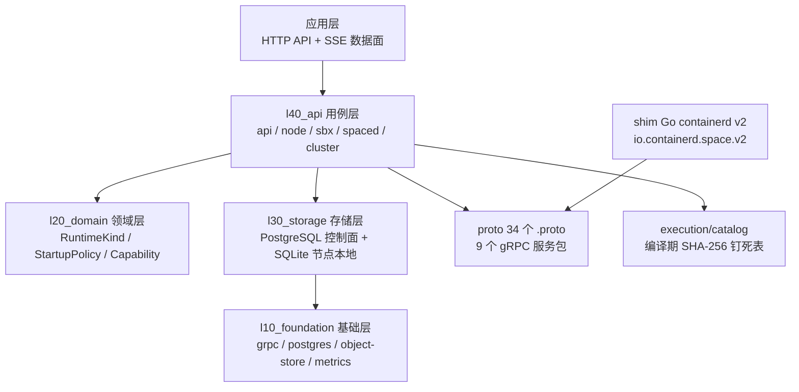
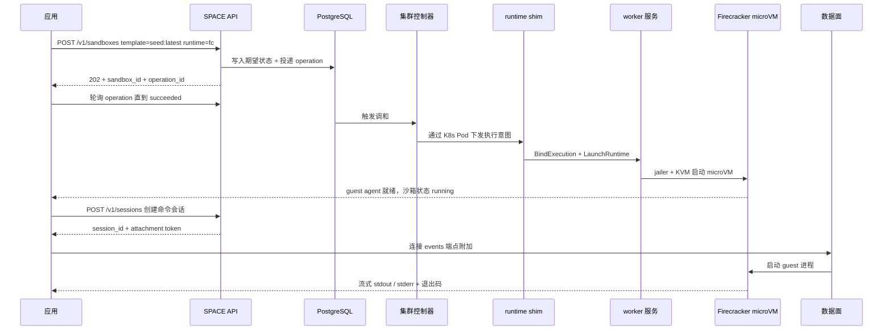
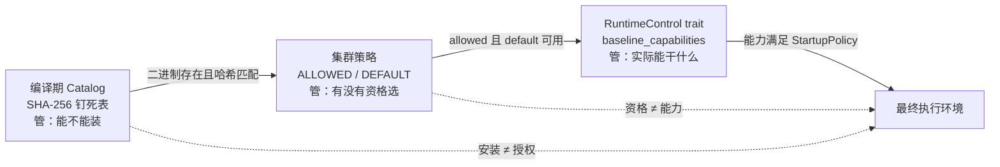

2026 年下半年，几乎每一个 Agent 框架都在卷三件事：更强的模型调用、更复杂的编排、更炫的 Dashboard。但真正落到生产环境时，会撞上一个完全不同的墙——**你凭什么相信这个 Agent 跑的那段代码没有动过你的东西？**

围绕这堵墙，业界已经演化出两条路线。

一条是 **nono** 那样的内核级沙箱：用 Landlock LSM / Seatbelt 直接在 syscall 层拦截，零延迟、零镜像。另一条是 **Firecracker / Kata / gVisor** 那样的隔离运行时：用硬件虚拟化边界给 Agent 一整个独立内核。

但这两条路线都有一个共同的隐含假设：**运行环境是固定的**。你选定了 Firecracker，就永远是 Firecracker；你审查通过了 v1.15.1，就永远是 v1.15.1。

2026 年 10 月，Perplexity 开源了 **SPACE**（Sandboxed Platform for Agentic Code Execution），把第三个维度摆上了台面：**运行时本身是一个需要被供应链治理的插件**。

> `crates/l20_domain/execution/spec/src/runtime.rs:26-30`
> ```rust
> /// Runtime technology used to execute a sandbox.
> ///
> /// This is the "what runs the VM/container" axis. It is intentionally separate
> /// from template selection, so the same template tag can resolve to different
> /// runtime-specific artifacts.
> ```

这句话是整个项目的设计起点：**"哪个 VMM 来跑"和"跑什么内容"是两个正交的轴**。而这个正交性一旦成立，就立刻带来一个棘手问题——如果运行时可以换，那么"运行时二进制本身"就成了新的信任边界。

SPACE 的答案，是把信任边界**编译进二进制**。

---

## 一、项目定位与核心价值

### 1.1 一句话定义

**SPACE 是一个用 Firecracker microVM 隔离执行不可信代码的沙箱平台，它的独特之处不在于"用 Firecracker"，而在于把"允许安装哪些运行时"这件事变成了一张编译期钉死的 SHA-256 哈希表。**

`README.md:7-9` 原文：

> SPACE (Sandboxed Platform for Agentic Code Execution) is a sandbox platform for running code in isolated Firecracker microVMs. Applications use its HTTP API to create Linux environments, execute commands, collect output, and manage sandbox lifecycles.
>
> Use SPACE when your application needs a separate execution environment for an agent, a user workspace, or a code-running job. Your application decides what to run and what results to keep; SPACE manages the sandbox, its processes, and the connection carrying command output.

注意最后一句的分工声明：**应用决定跑什么、留什么结果；SPACE 只管沙箱、进程和输出通道**。这是一个非常克制、非常清晰的边界——平台不做业务编排，不抢 Agent 框架的活。

### 1.2 仓库统计（2026-11-14 实测）

| 指标 | 值 |
|---|---|
| 仓库 | `perplexityai/SPACE` |
| Stars | 2,115 |
| License | Apache-2.0 |
| 主语言 | Rust |
| 创建时间 | 2026-10-01（**仅 6 周**） |
| 最近推送 | 2026-11-14（同日） |
| Tree 节点 | 6,937 |
| crates/ 目录 | 4,826 个文件 |
| proto/ 目录 | 92 个文件（34 个 .proto） |
| docs/ 目录 | 104 个文件 |

6 周从 0 到 2.1k star、每天还在推代码 —— 这是 2026 年 10 月刚刚开坑的项目，也解释了为什么它还没被任何人写过。

### 1.3 能力矩阵

| 能力 | 状态 | 说明 |
|---|---|---|
| 沙箱生命周期 | ✅ | create / start / stop / kill / pause / resume / suspend / restore / wake / checkpoint / rollback |
| 命令流式输出 | ✅ | 独立数据面 + session 级 attachment token |
| 快照 / 挂起 | ✅ | VM 内存 + rootfs 快照，btrfs CoW |
| 模板 / 基础快照 | ✅ | `seed:latest` 等 tag + digest 引用 |
| 温池 (warm pool) | ✅ | 预热实例池，减少冷启动 |
| E2B 兼容层 | ✅ | ECW (E2B Compatibility Wrapper) |
| **多运行时可插拔** | ⚠️ **名义存在** | 3 个枚举值，**只有 Firecracker 完全实现**；gVisor 是纯占位 |
| **Direct substrate** | ⚠️ **不完整** | 自陈 12 项功能缺失（见第八节） |
| 跨环境恢复 | ❌ | 官方文档明确"暂不启用" |

---

## 二、整体架构

### 2.1 顶层架构图



### 2.2 一次请求的完整旅程

`docs/architecture.md:49` 一句话点破了控制面的本质：

> The API records desired state in PostgreSQL. Controllers and worker services reconcile the running system with that state, **so an accepted request is not a readiness signal**.

翻译过来就是：**HTTP 200 不代表沙箱能用了**。这不是 bug，是设计——控制面存"期望状态"，工作节点持续调和。



三个值得注意的设计：

1. **管理面和数据面物理分离**。管理请求走 API + Bearer Token；命令输出走独立的 attachment token（"the two tokens are not interchangeable"）。
2. **文件系统是 btrfs CoW**，所以创建沙箱 rootfs 是秒级而不是分钟级。
3. **通信协议分层清晰**：gRPC 是服务间协议，Unix domain socket 是节点内协议。

### 2.3 五层 crate 职责

| 层 | 路径数 | 职责 | 典型内容 |
|---|---|---|---|
| `l10_foundation` | 539 | 通用积木，无业务语义 | grpc / postgres / sqlite / btrfs / s3 / valkey / uds / metrics / k8s |
| `l20_domain` | 336 | 领域模型 + 线协议，**不做 I/O** | `execution/spec` / `template` / `events` / `public/api` |
| `l30_storage` | 364 | 存储实现 | sandbox store / node store / cluster store / credential store |
| `l40_api` | 3111 | 用例 + 服务入口 + 客户端 | api(679) / node(612) / sbx(389) / spaced(289) |
| `l50_app` | 250 | 薄二进制 | node / sbx / spaced / admin-cli / net-gateway |

`l20_domain` 里有个细节很见功力 —— 它是**纯模型层，不做 I/O**：

```rust
// crates/l20_domain/execution/spec/src/runtime.rs
#[derive(Clone, Copy, Debug, Eq, PartialEq, Ord, PartialOrd, Hash)]
pub enum RuntimeKind {
    /// Firecracker microVM runtime.
    Firecracker,
    /// Cloud Hypervisor microVM runtime.
    CloudHypervisor,
    /// gVisor container runtime.
    Gvisor,
}
```

注意它派生了 `Ord`/`PartialOrd` —— 运行时之间有**确定的偏序关系**，这在后面讲策略收窄时会用到。

---

## 三、核心引擎一：运行时选择的三重权威分离

这是 SPACE 最独特、也最值得学的设计。

大多数"可插拔"系统只有一个权威：装了什么就用什么，或者配了什么就用什么。SPACE 有**三个互相独立的权威平面**，且**任何一个都不能越权**。

### 3.1 权威一：编译期 Catalog = 安装信任根

`crates/l40_api/execution/catalog/src/catalog.rs:1-13` 原文：

> The runtime releases and guest kernels a node may install, pinned by the SHA-256 of every byte that ends up executed or booted.
>
> The pins are the trust root for installs. A release source's own checksums come from the same origin as the bytes, so they guard the transfer, not the origin; **a pin recorded here was reviewed when it was added**, as the image build's pins are. The runtime manager checks a download against its pin before unpacking it, and node-manager checks every byte it publishes into the node's store against the same pin, **so a compromised downloader cannot get other bytes executed**.

这段话里有三层信息，每一层都是可迁移的工程智慧：

**第一层：pin 的作用是防"来源"而不是防"传输"。**
> A release source's own checksums come from the same origin as the bytes, so they guard the transfer, not the origin

上游 Firecracker 官方提供的 `.sha256.txt` 和 Firecracker 二进制来自同一个源站。**攻击者攻陷了源站，他可以同时替换二进制和它的校验和**。所以"下载后比对官方 checksum"这种做法在源站被攻陷时是失效的。

**第二层：真正的信任根是"人审过的 pin 表"。**
> a pin recorded here was reviewed when it was added

这张表是**编译进 Rust 二进制**的常量：

```rust
// crates/l40_api/execution/catalog/src/catalog.rs:44-56
const COMPILED_RELEASES: &[CompiledRelease] = &[
    CompiledRelease {
        runtime: RuntimeKind::Firecracker,
        version: "1.15.1",
        architecture: "x86_64",
        archive_sha256: "d4a32ab2322d887ca1bc4a4e7afa9cc35393e6362dfc2b3becb389d362e4275a",
        binaries: &[
            (
                "bin/firecracker",
                "7e8b57e88c459396d4680d83dcdd8c7f72305447cb55b11f4ac98ad70a3f7825",
            ),
            (
                "bin/jailer",
                "4830a9b1fc6cece036d8992ff12f1fe9c5247aacad77f42c7aba683c7a08622e",
            ),
        ],
    },
```

注意 **archive 和每个二进制各自都有独立的 SHA-256**。归档包哈希防"下载到别的包"，单文件哈希防"归档包内部被替换"。双层校验。

**第三层：两道独立校验点。**
> The runtime manager checks a download against its pin before unpacking it, and node-manager checks every byte it publishes into the node's store against the same pin

下载时校验一次（防传输篡改），**发布到节点存储时再校验一次**（防下载器本身被攻陷）。第二道校验是关键 —— 它保证"就算 downloader 被完全控制，它也放不进别的字节"。

这个模式可以直接搬到任何场景：**任何"从外部拉取并执行"的系统，都需要一张人审过的哈希表，而不是信任源站自己的校验和。**

Catalog 还有一条容易被忽略的边界：

> A deployment adds entries with root-owned JSON files in a catalog directory (see [`RuntimeCatalog::load`]); they may add pins and kernels, **but not releases whose state format the build does not know**, since the execution inventory refuses a node carrying one. **An entry that contradicts the compiled table is an error.**

运维可以加 pin，但**不能加二进制不认识其状态格式的版本**，且**任何与编译表矛盾的条目直接报错**。这是"扩展不覆盖"原则。

### 3.2 权威二：集群策略 = 资格裁决

`crates/l40_api/node/runtime/core/src/selection/policy.rs:8-9` 定义了两个环境变量：

```rust
pub const ALLOWED_ENVIRONMENTS: &str = "SPACE_ALLOWED_EXECUTION_ENVIRONMENTS";
pub const DEFAULT_ENVIRONMENT: &str = "SPACE_DEFAULT_EXECUTION_ENVIRONMENT";
```

但真正重要的是这个 `narrow` 方法的文档（`policy.rs:207-213`）：

> Narrow these startup settings by the cluster policy, **never widening them**: the cluster can remove environments and revoke `legacy`, and pick the default among the environments left. `default_usable` says whether the cluster default is installed and verified; one that isn't is refused. A refused default falls back to the configured one while that still executes, and otherwise leaves no compiled default, **so unbound new work is refused rather than run on an environment the cluster removed.**

三个关键词：

1. **never widening** —— 集群策略只能**收窄**，不能放宽。单向棘轮。
2. **default_usable** —— 集群指定的默认环境如果**没装或没验证过**，会被拒绝。
3. **宁可没有默认，也不要在已被移除的环境上跑** —— 兜底逻辑是"拒绝执行"，不是"降级执行"。

`policy.rs` 开头就把职责边界写清楚了：

> Execution eligibility, independent of discovery and artifact retention: the startup settings, optionally narrowed by the cluster's desired policy.

**资格**、**发现**、**制品留存**是三件事。策略层管资格，不管另外两个。

### 3.3 权威三：适配器能力 = 运行时能力

这一层回答的是"这个运行时**现在**能干什么"。

`crates/l20_domain/execution/spec/src/runtime.rs:126-148`：

```rust
    /// Returns the baseline capabilities normally expected from this runtime.
    ///
    /// Deployment-specific configuration can still narrow or extend this set.
    pub const fn baseline_capabilities(self) -> RuntimeCapabilities {
        match self {
            Self::Firecracker => RuntimeCapabilities::full_node(),
            // Upstream VMM features are not SPACE lifecycle capabilities.
            // Advertise each capability only when its adapter is qualified.
            Self::CloudHypervisor => RuntimeCapabilities {
                pause_resume: true,
                snapshot: true,
                fork: false,
                prewarmed_pool: true,
                network_gateway: true,
                volume_manager: false,
            },
            Self::Gvisor => RuntimeCapabilities {
                pause_resume: false,
                snapshot: false,
                fork: false,
                prewarmed_pool: false,
                network_gateway: true,
                volume_manager: true,
            },
        }
    }
```

注释里那句是精华：

> **Upstream VMM features are not SPACE lifecycle capabilities.**
> **Advertise each capability only when its adapter is qualified.**

翻译：**"上游支持" ≠ "本平台支持"**。

Cloud Hypervisor 上游确实有 fork 能力，但 SPACE 的 CH 适配器没做完资格认证，所以 `fork: false`。gVisor 更极端 —— 它的 `baseline_capabilities` 里 `pause_resume / snapshot / fork / prewarmed_pool` 全是 `false`，只有 `network_gateway` 和 `volume_manager` 是 `true`。

**这是一个把"上游能力"和"平台承诺"显式分离的模型。** 大多数项目会直接宣传上游特性，然后在用户真正调用时炸掉。SPACE 把它编码进了类型系统。

### 3.4 三重权威的协作关系



**三层是单向串联的，每一层只回答自己那一个问题。** 这带来一个非常实用的性质：

`docs/execution-environments.md:28-30` 原文：

> Designated nodes can select other approved compiled bindings through the regular APIs when the node execution policy allows them; **installation alone never authorizes selection.**

以及 `docs/execution-environments.md:74-75`：

> **Execution consumers must separately verify node usability and allowed selection. No caller may turn successful decoding into execution permission.**

> 「安装成功」≠「有权执行」。「解析成功」≠「执行许可」。

这两句话可以直接抄到任何"可插拔组件"系统的设计文档里。

---

## 四、核心引擎二：RuntimeControl trait —— 插件点其实是个 match

### 4.1 trait 定义

`crates/l40_api/node/runtime/core/src/control.rs:65-78`：

```rust
/// Control is independent of process launch: an in-process runtime can implement
/// this interface without pretending to expose an HTTP socket or jailer.
pub trait RuntimeControl: Send + Sync {
    fn state(&self) -> ControlFuture<'_, VmState>;
    /// Change resident execution state once; callers reconcile ambiguous results.
    fn set_paused(&self, paused: bool) -> ControlFuture<'_, ()>;
    /// Capture/restore the runtime-owned state workspace. These mutations are
    /// never replayed after transport uncertainty.
    fn capture_state(&self, workspace: StateWorkspace, memory_bytes: u64) -> ControlFuture<'_, ()>;
    fn restore_state(&self, workspace: StateWorkspace, memory_bytes: u64) -> ControlFuture<'_, ()>;
    /// Configure and boot a newly launched idle runtime; never replay after uncertainty.
    fn boot<'a>(&'a self, configuration: &'a crate::boot::StandaloneBoot) -> ControlFuture<'a, ()>;
    fn request_guest_shutdown(&self) -> ControlFuture<'_, ()>;
}
```

三个设计点：

**第一，trait 名字是 Control 而不是 Runtime。** 它管的是"控制一个已存在的运行时"，不是"怎么启动运行时"。启动是另一条路径（`launch/`）。这种拆分让**进程内运行时**（不需要 socket、不需要 jailer）也能实现这个接口。

**第二，两处"never replay after transport uncertainty"。** `capture_state` / `restore_state` / `boot` 这三个方法在传输不确定时**绝不重放**。这是分布式系统的经典难题 —— 你发了条命令，连接断了，你不知道对方执行了没有。选择"不重放"而不是"重试"，是因为重放状态捕获可能产生损坏的快照。

**第三，`set_paused` 的注释是 "Change resident execution state once; callers reconcile ambiguous results."** —— **调用方负责调和模糊结果**，trait 本身不做重试语义。

### 4.2 插件点：一个 match，不是动态注册表

`control.rs:80-96`：

```rust
/// Construct only in the process authorized to own this runtime's control plane.
/// The socket is a locally derived adapter locator, never a tenant input.
#[cfg(feature = "host-runtime")]
pub fn connect(
    runtime: RuntimeKind,
    socket: PathBuf,
    peer: Option<crate::launch::ProcessObserver>,
) -> Result<Box<dyn RuntimeControl>, ControlError> {
    match runtime {
        RuntimeKind::Firecracker => Ok(Box::new(crate::fc_api::FcApiClient::new(socket))),
        RuntimeKind::CloudHypervisor => Ok(Box::new(cloud_hypervisor::Client::new(
            socket,
            peer.ok_or(ControlError::MissingPeer)?,
        ))),
        RuntimeKind::Gvisor => Err(ControlError::UnsupportedRuntime(runtime)),
    }
}
```

**这是全文最重要的一段代码，因为它诚实地暴露了"pluggable"这个词的真实分量。**

插件点是一个 `match`，不是动态注册表。新增一个运行时 = 加一个 `RuntimeKind` 变体 + 在这里加一个 arm + 实现 trait。**这跟动态插件架构（dlopen / WASM / 进程外服务发现）完全是两回事。**

而且注意 gVisor 那一行：

```rust
RuntimeKind::Gvisor => Err(ControlError::UnsupportedRuntime(runtime)),
```

**gVisor 在枚举里，但没有任何实现。** 每一处需要 gVisor 的地方都直接返回 `UnsupportedRuntime`：

- `control.rs:94` —— `connect`
- `control.rs:173` —— `socket_path`
- `control.rs:189` —— `isolation_root`
- `control.rs:206` —— `guest_endpoint_identity`

**"占位但不假装"** —— 这是工业级项目处理未完成功能的正确姿势。

### 4.3 连"看起来实现"的功能也有 Unsupported

Firecracker 是唯一"完整"的运行时，但**它自己的部分操作也是 Unsupported**：

```rust
// 说明：以下为源码节选，方法体在节选边界处截断，故花括号不成对。
// 来自 crates/l40_api/node/runtime/core/src/control.rs:105-108
impl RuntimeControl for crate::fc_api::FcApiClient {
    fn capture_state(
        &self,
        _workspace: StateWorkspace,
        _memory_bytes: u64,
    ) -> ControlFuture<'_, ()> {
        Box::pin(async {
            Err(ControlError::UnsupportedOperation {
                runtime: RuntimeKind::Firecracker,
                operation: "state workspace capture",
            })
        })
    }
```

对应的错误类型定义：

```rust
// control.rs:13-19
#[error("runtime {0} has no control adapter")]
UnsupportedRuntime(RuntimeKind),
#[error("{operation} is not supported by runtime {runtime}")]
UnsupportedOperation { runtime: RuntimeKind, operation: &'static str },
```

**注意错误消息里带了 runtime 名和 operation 名。** 排查时不需要去翻代码猜是哪个环节不支持。这是个很小但很体贴的细节。

---

## 五、核心引擎三：隔离边界 —— 真实存在于 jailer 参数里

前面说过，全文只有 3 个 TODO 标记（后面会讲），但真正的技术细节藏在参数里。

### 5.1 Firecracker jailer 的实际命令行

`crates/l40_api/node/runtime/core/src/launch/os/linux.rs:637-708`：

```rust
// 说明：以下为源码节选，函数体在节选边界处截断，故花括号不成对。
// 来自 crates/l40_api/node/runtime/core/src/launch/os/linux.rs:637-708
fn jailer_args(config: JailerArgs<'_>) -> Vec<String> {
    // ...
    let mut args = vec![
        "--id".to_string(),
        sandbox_id.to_string(),
        "--exec-file".to_string(),
        firecracker_bin.to_string(),
        "--uid".to_string(),
        uid.to_string(),
        "--gid".to_string(),
        gid.to_string(),
        "--chroot-base-dir".to_string(),
        chroot_base_dir.to_string(),
        "--netns".to_string(),
        ns_path.to_string(),
        "--cgroup-version".to_string(),
        "2".to_string(),
        "--parent-cgroup".to_string(),
        "space".to_string(),
        "--cgroup".to_string(),
        format!("cpu.max={}", cgroup_limits.cpu_max),
        "--cgroup".to_string(),
        format!("memory.max={}", cgroup_limits.memory_max),
        "--cgroup".to_string(),
        format!("pids.max={}", cgroup_limits.pids_max),
        "--resource-limit".to_string(),
        format!(
            "no-file={}",
            pplx_space_host_layout::SANDBOX_PROCESS_NOFILE_LIMIT
        ),
        "--new-pid-ns".to_string(),
    ];
    if daemonize {
        args.push("--daemonize".to_string());
    }
    args.extend([
        "--".to_string(),
        "--api-sock".to_string(),
        "firecracker.sock".to_string(),
    ]);
```

把这串参数翻译成隔离栈：

| 参数 | 隔离层 |
|---|---|
| Firecracker 进程本身 | **KVM 硬件虚拟化**（独立内核） |
| `--chroot-base-dir` | 文件系统 chroot |
| `--cgroup-version 2` + `cpu.max` / `memory.max` / `pids.max` | **cgroup v2** 资源限制 |
| `--netns` | 网络命名空间 |
| `--new-pid-ns` | PID 命名空间 |
| `--uid` / `--gid` | 降权到专用非特权用户 |

**每个沙箱得到的是：独立内核 + 独立文件系统根 + 独立网络栈 + 独立 PID 空间 + cgroup 资源上限。**

这跟 gVisor（用户态内核，共享宿主内核）、runc（共享内核 + namespace）**不是同一个安全等级**。

### 5.2 非 Linux 平台的显式失败

```rust
// crates/l40_api/node/runtime/core/src/launch/os/other.rs:213-215
pub fn launch_via_jailer(_config: JailerLaunch<'_>) -> Result<u32, String> {
    Err("launch_via_jailer is only supported on Linux".to_string())
}
```

macOS / Windows 上整个 jailer 机制不存在，函数直接返回错误。**不做"尽力而为"的模拟** —— 那是最危险的：用户以为有隔离，其实没有。

### 5.3 网络隔离

`docs/architecture.md:170`：

> In Kind, sandbox pods run in their own namespace, `sandboxes`, apart from the control plane in `space`. NetworkPolicies there admit only the API, the cluster controller and the data plane, on the port they dial, and limit sandbox egress to the public IPv4 internet and cluster DNS

默认拒绝：沙箱只能访问 API、控制器和数据面，**出网只允许公网 IPv4 和集群 DNS**。

---

## 六、SubstrateAdapter —— 第二个正交的可插拔轴

前面说的 `RuntimeKind` 是"用哪个 VMM 跑"。SPACE 还有另一个完全正交的轴：**谁来编排沙箱**。

`crates/l40_api/api/src/controllers/substrate/mod.rs:1272`：

```rust
// 说明：以下为源码节选，trait 体在节选边界处截断，故花括号不成对。
// 来自 crates/l40_api/api/src/controllers/substrate/mod.rs:1272
#[allow(async_fn_in_trait)]
pub trait SubstrateAdapter: Send + Sync {
    /// Stable label written to control-plane metadata for this substrate.
    ///
    /// This is descriptive metadata. Runtime routing should use the active
    /// execution binding, not this label.
    fn managed_by(&self) -> &'static str;

    /// What this substrate supports. Required, so every substrate (and the
    /// `Substrate` forwarding impl) states its answer.
    fn capabilities(&self) -> SubstrateCapabilities;

    async fn create_execution<'a>(
        &'a self,
        request: CreateExecutionRequest<'a>,
    ) -> Result<CreateExecutionOutcome, SubstrateError>;
    // ...
```

两个实现：

- **Kubernetes** —— 创建 sandbox Pod（本地 Kind 安装用）
- **Direct** —— 直接 dial worker 的 node-api，**不创建 Pod**

`docs/architecture.md:51`：

> SPACE can manage workers directly or through Kubernetes. The [direct adapter](../crates/l40_api/api/src/controllers/substrate/direct.rs) calls worker services without creating Kubernetes sandbox pods. The [Kubernetes adapter](../crates/l40_api/api/src/controllers/substrate/kubernetes/mod.rs) is used by the local Kind installation in these guides.

`managed_by()` 的注释又是一个"别用错字段"的警告：

> This is descriptive metadata. **Runtime routing should use the active execution binding, not this label.**

**描述性元数据 ≠ 路由依据。** 路由要走执行绑定。

### 6.1 shim 目录的真面目

`shim/` 有 61 个文件，很多人会以为是什么"轻量适配层"。实际上它是一个**完整的 containerd runtime v2 shim**：

```go
// shim/main.go —— 整个文件
package main

import (
	"context"

	"github.com/containerd/containerd/v2/pkg/shim"
)

func main() {
	shim.Run(context.Background(), NewManager("io.containerd.space.v2"))
}
```

注册名 `io.containerd.space.v2`。它把 OCI runtime spec 翻译成 SPACE 的 pod 注解（`space.pplx.net/*` 命名空间下有 20 多个注解：`sandbox-id` / `network-policy` / `checkpoint` / `vcpu` / `memory-mib` / `execution-generation` / `suspend-restore-storage-uri` / `volume-encryption` …），然后通过 Unix socket `/space/run/sandbox-manager/sandbox-manager.sock` 和 `sandbox-manager` 对话。

连接重试预算也写得很克制：

```go
	sbxMgrConnectTimeout      = 5 * time.Second
	connectRetryBudget        = 10 * time.Second
	connectRetryInitialDelay  = 100 * time.Millisecond
```

---

## 七、状态机与持久化

### 7.1 双层存储

| 后端 | 角色 | 内容 |
|---|---|---|
| **PostgreSQL** | 控制面期望状态 | sandbox 行、模板、策略、操作记录、节点注册 |
| **SQLite** | 节点本地状态 | sandbox-manager / template-manager / volume-manager / runtime-manager / node-manager / build-manager |

`AGENTS.md` 原文：

> PostgreSQL is the control-plane desired-state store; SQLite stores selected on-node state such as template-manager data.

> Mutations persist intent and enqueue node reconciliation. The cluster controller drains triggers; **periodic node reconciliation is the correctness backstop**.

最后半句是分布式系统的标准范式：**事件驱动是快路径，周期性调和是正确性兜底**。

### 7.2 生命周期词汇表

`AGENTS.md` 里有一份非常清晰的生命周期定义，这解决了 Agent 沙箱领域一个长期混乱的问题 —— `stop` / `pause` / `suspend` 到底什么区别：

> - `create` / `delete`: create or delete a sandbox.
> - `stop` / `start`: stop or start **without implying snapshot persistence**.
> - `pause` / `resume`: **keep the Firecracker VM resident in memory**.
> - `suspend` / `restore`: **persist VM memory and state, release worker resources**, and later restore the snapshot.
> - `wake`: intentionally accept any valid start, resume, or restore path.

对应到 `docs/architecture.md:179-184` 的状态表：

| 状态 | 进程能否执行 | 保留什么 | 下一步 |
|---|---|---|---|
| Running | 可以 | 活的 VM 内存 + 可写文件系统 | 继续跑命令 / pause / suspend / delete |
| Paused | 已暂停 | VM 内存常驻 + 文件系统在 worker 上。**这不是持久快照** | Wake 恢复 |
| Suspended | 不可执行 | VM 内存 + 运行时状态 + rootfs 的快照；**活跃 VM 资源已释放** | Wake 恢复 |
| Deleted | 不可执行 | 沙箱不再通过 API 可用 | 另建一个 |

**`pause` 不是 `suspend`** —— 这个区分极其重要。pause 占着内存不放，suspend 释放资源能省成本。很多沙箱平台把这两个混为一谈，导致"暂停"其实是"悄悄付着钱"。

### 7.3 迁移不可变原则

`db/README.md`：

> Migrations under `db/` are **immutable once they have been applied by any shared environment. Do not edit an applied migration to change behavior or fix a bug: add a new migration in the same store directory instead.

以及一条冷门但真实的坑：

> One more gap to know about: a deadlock raises `40P01`, not `55P03`, and is not retried either. `deadlock_timeout` is 1s, at or below every in-file bound the corpus uses (`1s` and `5s`), so a file that holds `ACCESS EXCLUSIVE` from an earlier statement while a later one waits **can lose that way rather than to its own `lock_timeout`**.

这条细节只有真正在生产上跑过 PostgreSQL 的人才会知道：**死锁错误码是 `40P01`，不是 `55P03`**（后者是 lock_not_available）。

---

## 八、⭐ 必须诚实指出的源码自陈缺陷

这是本系列最有价值的部分。SPACE 的诚实程度罕见地高 —— **全文只有 3 个 TODO 标记**，但缺陷都写在散文和表格里。

### 8.1 Direct substrate 的 12 行 Gaps 表

`crates/l40_api/api/src/controllers/substrate/direct.rs:84-101`，原文照抄：

```text
| Refused or missing | Effect today | Owner | Removed by |
|---|---|---|---|
| Node-pool placement | `SubstrateError::Unsupported`: a create naming a node pool is refused | ac-pplx | Node-pool membership for registered nodes, read by core placement |
| Forks (restoring a durable fork disk as a new sandbox) | `Unsupported`: the create is refused | ac-pplx | A Direct launch that stages the fork disk on the chosen node |
| Cluster pool configs (`list_pool_configs`, `upsert_pool_config`, `disable_pool_config`) | `Unsupported` from the trait defaults | ac-pplx | Pool-config handling in the core for both substrates |
| Warm-pool claims with custom vCPU or memory, or with volume encryption | The claim misses and the create boots cold | ac-pplx | Pool members of that shape, or an adoption that applies it |
| Admission-time pool slot claims (`claim_admission_pool_slot`) | Always miss | ac-pplx | A Direct warm-pool slot store the core claims from at admission |
| Retire fence | `retire_execution` ignores its fence, but still stops the sandbox and clears its routing | ac-pplx | A fence check against the Direct execution it names |
| Stopped-disk backup on retire | `retire_execution` enqueues none; the stopped disk stays on the node | ac-pplx | A retried Direct retire (next row), then the enqueue |
| Retire retry | Nothing retries a failed Direct retire | ac-pplx | The sweeper's failed-cleanup retry running for both substrates |
| Drain and evacuation | `SubstrateCapabilities::supports_node_drain` is false. Admin `:drain`, `:terminate`, `:cordon`, `:uncordon` and `:force-upload-local-snapshots` return 501 before reading or writing the node | ac-pplx | Core drain and evacuation for both substrates over a Direct `set_node_schedulability` |
| Per-client live cap | `DirectSubstrate::live_sandboxes_for_client` answers `Unknown(Unsupported)`: Direct keeps no per-client inventory, so the cap admits every activation | the-gigi-pplx | A per-client count of Direct's live executions from its node records, plus reserving for `ReserveAtClaim` at Direct's restore entry |
| Drain, orphan, failed-row repair and node-sync loops | Not started on Direct | ac-pplx | Those loops running for both substrates through the adapter |
| Network-slot headroom (`Substrate::network_slot_headroom`) | Reads `Unknown(Unsupported)`, so the activation limiter's slot check admits every Direct cold create | ac-pplx | Slot capacity of registered nodes, read by an admission check that runs for both substrates |
```

**这张表的格式本身就值得单独学：**

1. **四列：缺什么 / 今天什么效果 / 谁负责 / 靠什么移除。**
   第三列是团队代号（`ac-pplx`、`the-gigi-pplx`），第四列是**移除条件**而不是"计划"。
2. **"Effect today" 写的是可观察的行为**，不是抽象描述。"the cap admits every activation" 比 "per-client cap not implemented" 有用一百倍。
3. **两条限流相关的缺陷（live cap、network slot headroom）方向相反**：一个说"上限放行所有"，一个说"槽位检查放行所有"。**Direct substrate 上所有准入限流都是失效的。** 这是安全相关的重要信息，被写在自家代码注释里。

紧跟着的注释还解释了**为什么**会这样：

```rust
//! # Kubernetes-only reconcilers
//!
//! The cluster controller's `run_reconcilers` starts its drain, orphan,
//! failed-row repair and node-sync loops only for Kubernetes. The loops it
//! starts for both substrates include the public-operation dispatcher, which
//! retries transient failures of the create, lifecycle and delete operations
//! it executes. Direct reaches `retire_execution` only through the
//! transient-lifecycle sweeper's best-effort `cleanup_after_sweep`, and the
//! sweeper's failed-cleanup retry does nothing unless the running substrate is
//! Kubernetes, **so nothing retries a failed Direct retire**. That is also why
//! Direct's retire enqueues no stopped-disk backup: the Kubernetes teardown
//! fails its retire when a retryable enqueue fails and relies on that retry,
//! and even a best-effort enqueue is not a cheap side call, since sbx-mgr
//! refuses it with `FailedPrecondition` on a node without cluster-api wiring
//! and otherwise takes a btrfs snapshot of the stopped sandbox.
```

**这段把"缺陷"和"根因"和"为什么现在不能修"串成了一条因果链。** 这比 issue tracker 里的 12 条独立 issue 有用得多。

### 8.2 环境放置门禁未实现

`crates/l40_api/api/src/controllers/substrate/kubernetes/mod.rs:9`：

```text
| Environment placement gate `on` (`SPACE_ENVIRONMENT_PLACEMENT_GATE`) | `on` fails startup with `SubstrateError::Unsupported`. A Kubernetes create names no cache partition, so the worker boots the digest's legacy-partition build whatever environment the pod requires, and a runtime-upgrade activation's pod requires the recorded environment rather than the upgrade's target. `shadow` records, labels and counts, and places as `off` | the-gigi-pplx | the worker taking the pod's environment as its cache-partition preference, and activation pods recording an upgrade's target |
```

注意这个设计：门禁不是简单的开/关，而是**三态**：

| 模式 | 行为 |
|---|---|
| `off` | 忽略门禁 |
| `shadow` | **只记录、只打标签、只计数**，实际按 `off` 放置 |
| `on` | 真正执行门禁；**启动直接失败**（`SubstrateError::Unsupported`） |

**`shadow` 模式是特性开关（feature flag）的正确形态** —— 先在全量流量上"空跑"验证判定逻辑，再切换到强制。这种模式在 Agent 平台里非常实用：你可以先收集"哪些工作会被门禁拒绝"的数据，确认无误后再开。

### 8.3 环境目录的"待办清单"

`docs/execution-environments.md:200-220` 用祈使句列出了下一阶段必须做的事，这在文档里很少见：

> The next environment inventory and placement implementation must:
>
> - Distinguish installation, verified usability, execution approval and qualified operation support. **Report snapshot creation and loading independently, including the writer format and supported loader profiles. The legacy inventory's `can_create`/`can_load` projection is not sufficient environment-level evidence.**
> - Preserve producer metadata through snapshot publication, upload, restore and template base-snapshot paths. **Keep the snapshot's disk dependencies associated with its memory state; a compatible state loader does not prove disk usability.**
> - Apply the same adapter compatibility rules at placement and node admission. **Direct placement's current major-only state-format comparison is insufficient evidence where node admission also checks minor versions.**
> - Treat unknown profiles, absent operation support and stale observations as insufficient evidence. **Node admission must recheck usability because published observations are not reservations. An incompatible request must not silently choose another environment or degrade restore into cold boot.**
> - Keep cross-environment restore disabled until a separate qualified change covers loader selection, CPU/host/device constraints, disk dependencies, producer-versus-loader recording and mixed-version rejection tests.

**最后一句尤其重要**：

> **Keep cross-environment restore disabled until a separate qualified change covers ...**

**宁可不支持，也不要"降级成冷启动"悄悄通过。** 冷启动看起来"成功"了，实际上语义完全不同（丢失了内存状态）。这种"静默降级"是最难排查的一类 bug。

### 8.4 全仓库只有 3 个 TODO

```
crates/l30_storage/sandbox/store/src/drain.rs:666:
/// TODO(legacy): Remove the nullable-row ready-snapshot gate once every

crates/l40_api/internal/api/server/src/lib.rs:1358:
    // TODO: [legacy] Remove once all restore callers look up exact artifact

crates/l40_api/spaced/guest/execution/src/process.rs:557:
// TODO(spaced): persist or reconstruct the process registry if callers need
```

整个 6,937 节点、4,826 个 Rust 文件的仓库，只有 3 个 TODO。

**对比一下我调研过的其他项目**：几十个上百个 TODO 稀松平常。SPACE 的做法是：**把已知限制写进散文、写成表格、写进契约文档**，而不是留在代码注释里当 TODO。

这个差异有实际后果 —— TODO 会被随手删掉（"反正不做了"），而写在 `docs/` 和模块级 `//!` 文档里的缺口说明**会跟着代码一起被 review**。

### 8.5 其他值得单独点名的自陈缺陷

**E2B 兼容层的限制**（`docs/ecw.md:255-300`）：

> - Unsupported sandbox-create capabilities `mcp`, `volumeMounts`, and `iam` are rejected with an E2B-shaped `400` response. `autoPauseMemory=true` is accepted; `false` is rejected **because SPACE cannot cold-resume from a filesystem-only E2B pause**.
> - A sandbox list page holds at most `limit` sandboxes and ends early once it reaches 8 MiB of estimated JSON, always returning at least one sandbox. **A page that ends early still sets `x-next-token`, which the SDK paginator follows; a client must not treat a short page as the last one.**
> - Sandbox `pause`, `connect`, and `resume` reject `memory=false` ... **because ECW cannot honor those variants yet**.

**运行时目录的坦诚**（`docs/runtime-manager-catalog.md`）：

> Line 5-6: Diagnostic discovery recognizes Cloud Hypervisor release directories containing `bin/cloud-hypervisor`. **A valid executable is reported without a memory-state format: recognizing the installation does not enable execution, snapshots or warm pools.**
>
> Line 26-27: These are reviewed install candidates; **byte verification does not establish that a particular SPACE workload boots successfully on them.**
>
> Line 56-59: The September snapshot's `vmlinux-5.10.260` is deliberately excluded: **both architectures report `Linux version 5.10.255-260`, which contradicts the listed version and would be rejected by the installer.**
>
> Line 96-97: **New cold boots never fall back to the newest installed candidate.**
>
> Line 118-121: Node-manager refuses removal of E0 identities even with empty inventory or after restart. Other managed candidates remain removable because they cannot execute from that store. **Removing E0 in place is not a supported upgrade mechanism.**
>
> Line 129-131: **No bootstrap reconciler, placement enforcement, builder selection API or image-payload removal is introduced here. Those are subsequent rollout stages.**
>
> Line 152-153: **No deployment gate waits on runtime-manager for execution readiness.**

**内核版本号对不上这种鸡毛蒜皮的事都记录在案** —— 这是真正把"发布目录"当成供应链制品管理的地方。

**操作不会自动重放的说明**（`docs/architecture.md:194-199`）：

> A created or overwritten file that can replace its destination is published atomically when its writes complete, and **persisted at lifecycle boundaries, not per write: an acknowledged one is not guaranteed to survive a sandbox crash, forced stop or host failure.**

**"返回成功"≠"已经落盘到磁盘"** —— 这个区别对 Agent 写文件的安全性至关重要。

---

## 九、与同类项目对比

### 9.1 四方对照

| 维度 | **SPACE** | E2B | OpenSandbox | nono |
|---|---|---|---|---|
| 隔离机制 | Firecracker + KVM + jailer | Firecracker | gVisor / Kata / Firecracker（可配） | Landlock LSM / Seatbelt |
| 隔离等级 | **硬件虚拟化** | 硬件虚拟化 | 取决于配置 | **内核 LSM，共享内核** |
| 启动开销 | 数百毫秒 | 数百毫秒 | 数十~数百毫秒 | **~0.5ms** |
| 内存占用 | 数十 MB+ | 数十 MB | 50–300MB | **~5MB** |
| 可插拔运行时 | **3 个枚举，1 个实现** | 固定 Firecracker | 6 种 surface 可配 | 固定 LSM |
| 运行时供应链治理 | **✅ 编译期 SHA-256 钉死表** | ❌ | ❌ | ⚠️ Sigstore 集成（供应链验证但非运行时 pin） |
| 编排底座 | **Kubernetes / Direct 双 substrate** | 云托管 | Kubernetes | 本地进程 |
| E2B API 兼容 | ✅ ECW | ✅ 原生 | ❌ | ❌ |
| 自陈缺陷形式 | **12 行 Gaps 表 + 散文契约** | — | — | 散文 + 语料库 |

### 9.2 设计差异的本质

**这四个项目其实在回答四个不同的问题：**

- **nono** 回答："*怎么让 Agent 在**不换内核**的前提下看不到我的凭据？*" → 内核 LSM 拦截 syscall
- **E2B** 回答："*怎么让开发者**不用管 VM**就能跑代码？*" → 云托管 + 隐藏一切
- **OpenSandbox** 回答："*怎么让 Agent 的**运行环境可配置**（gVisor/Kata/Firecracker）？*" → 6 surface × 5 隔离层
- **SPACE** 回答："*当运行环境**本身变成可切换的插件**时，怎么保证换来的那个插件是可信的？*" → **编译期哈希表 + 三重权威分离**

**只有 SPACE 正面回答了"运行时作为插件的供应链安全问题"。** 这是 2026 年 Agent 基础设施开始进入"运行时可插拔"阶段后才出现的新问题。

### 9.3 一句话对比表

| 你想要 | 选谁 |
|---|---|
| 最低延迟、单机、读文件/跑命令 | **nono** |
| 托管服务、开发者零运维 | **E2B** |
| K8s 集群内、运行时可配、多 Agent 编排 | **OpenSandbox** |
| **生产级代码执行、运行时可换且要可审计** | **SPACE** |

---

## 十、优缺点分析

### 10.1 左侧：架构简洁性 / 扩展性 / 易用性

| 项 | 评价 |
|---|---|
| **架构简洁性** | ✅ 极高。5 层 crate 分层，依赖方向由 `archcheck` 工具在 CI 里强制；`l20_domain` 纯模型层零 I/O；34 个 .proto 把跨服务契约全部显式化 |
| **扩展性** | ✅ 双轴可插拔（RuntimeKind × SubstrateAdapter）。加新运行时 = 加枚举变体 + 实现 trait + 加 catalog pin；加新编排底座 = 实现 SubstrateAdapter |
| **易用性** | ⚠️ **中等偏低**。HTTP API 设计干净（`/v1/sandboxes/{id}:pause` 这种 Google 风格动词），但**部署门槛很高**：需要 Linux x86_64 + KVM + `/dev/kvm` + `/dev/net/tun` + btrfs + 允许特权容器的 Docker + Kind 集群 + 30GiB 空闲空间。macOS 上直接跑不了 |
| **文档质量** | ✅ 极高。104 个 docs 文件，每个已知限制都有专门章节，还配了 `docs/book/` 出版流程 |
| **诚实度** | ✅✅ **罕见地高**。12 行 Gaps 表、9 条"must"待办清单、3 个 TODO、逐条列出的 E2B 限制 |

### 10.2 右侧：性能 / 复杂度 / 维护性

| 项 | 评价 |
|---|---|
| **性能** | ⚠️ 冷启动是 Firecracker 级别（数百 ms + 数十 MB 内存），比 nono 的 0.5ms / 5MB 差几个数量级。但换来的是**硬件级隔离**和**快照/恢复能力**（nono 做不到） |
| **复杂度** | ❌ **很高**。6,937 个 tree 节点、4,826 个 Rust 文件、34 个 proto、9 个 gRPC 服务包、双存储后端、双 substrate、双 API（public/admin/e2b/debug）。**这不是一个能读完的项目** |
| **维护性** | ⚠️ 中等。分层和工具链（archcheck / 预提交钩子 / 迁移不可变原则）做得很好，但**代码量本身是负担**；且 `docs/` 里到处是"predate current code"的免责声明 |
| **上手门槛** | ❌ 高。要理解 Kubernetes、Firecracker、btrfs、cgroup v2、containerd shim、gRPC、PostgreSQL/SQLite 双存储 |

### 10.3 一个被低估的取舍

SPACE 选择了**"少而真"**而不是"多而全"：

- 只支持 3 种运行时，其中 1 种完整实现
- 只有 Firecracker 的 `pause_resume` / `snapshot` / `fork` / `prewarmed_pool` 全开
- gVisor 只有 `network_gateway` / `volume_manager` 亮着，其余全 `false`

**这跟 OpenSandbox 的"6 surface × 5 隔离层"路线完全相反。**

如果你是个人开发者，OpenSandbox 那种"什么都能配"的灵活性很香。如果你要跑生产，SPACE 这种"每个能力都写清楚谁实现了、谁没实现、什么时候能实现"的诚实更值钱 —— 因为**配置失败和静默降级是两种完全不同的故障**。

---

## 十一、实践：跑起来

### 11.1 环境要求（务必先看）

`docs/installation.md` 原文要求：

> Use an apt-based **Linux x86_64 host with KVM**. The host needs `/dev/kvm`, `/dev/net/tun`, loop devices, btrfs support, and a local Docker daemon that permits privileged containers. **A VM must expose the required devices and support nested virtualization; these instructions do not run directly on macOS.** Keep at least 30 GiB free...

**macOS 上跑不了。** 需要一台带 KVM 的 Linux x86_64 机器（云主机也可以，要求嵌套虚拟化）。

### 11.2 拉取源码

```bash
git clone https://github.com/perplexityai/SPACE.git &&
  cd SPACE
```

### 11.3 主机自检

项目自带检查脚本，先确认设备齐全：

```bash
for device in /dev/kvm /dev/net/tun; do
  if [[ ! -c "$device" ]]; then
    printf 'Required device is unavailable: %s\n' "$device" >&2
    exit 1
  fi
done

if [[ ! -r /dev/kvm || ! -w /dev/kvm ]]; then
  printf 'The current user needs read and write access to /dev/kvm.\n' >&2
  exit 1
fi
```

### 11.4 安装依赖并启动

项目提供了三个脚本，按顺序执行（来自 `docs/installation.md`）：

```bash
# 1. 前置依赖安装（需要 root 或非交互式 sudo）
sudo ./infra/space/kind/scripts/install-prereqs.sh

# 2. 安装 Firecracker 发行版
sudo ./infra/space/kind/scripts/install-fc-vendor.sh

# 3. 拉起 Kind 集群
./infra/space/kind/scripts/up.sh
```

安装完成后会导出三个环境变量：

```bash
export SPACE_API_URL="http://127.0.0.1:8080"
export SPACE_DATA_PLANE_URL="http://127.0.0.1:8090"
export SPACE_API_TOKEN="<你的 token>"
```

**注意两个 token 不可互换**：管理请求用 API Bearer Token，命令流用返回的 attachment token。

### 11.5 跑第一个沙箱

项目提供了一个**只用标准库**的 Python 示例，不需要装 SDK 或建虚拟环境：

```bash
python3 examples/first_sandbox.py
```

它会依次完成：创建沙箱 → 等待就绪 → 创建命令会话 → 附加到事件流执行命令 → 解码 stdout/stderr → 检查退出码 → 列出沙箱和进程 → 询问是否删除。

你会看到：

```text
Hello from SPACE
Command completed successfully
```

⚠️ **重要**：`docs/first-sandbox.md` 明确警告 ——

> **A successful HTTP response or a closed stream alone is not a successful command.**

以及：

> **starting the example again creates a new request, not a retry of the previous run.**

### 11.6 自定义命令

示例里的命令定义可以直接改：

```python
COMMAND = {
    "command": ["sh", "-c", "printf '%s\\n' \"$GREETING\"; pwd"],
    "cwd": "/tmp",
    "env": {"GREETING": "Hello from Python"},
    "timeout": "30s",
}
```

关键约束（`docs/first-sandbox.md`）：

> Commands use an **argument array**, not an implicitly interpreted shell string. Use `sh -c` explicitly for shell expansion, pipes, or redirection. **Executables and working directories must exist inside the sandbox, not just on the host.**

**命令用参数数组，不是 shell 字符串** —— 需要管道/重定向就显式 `sh -c`。这从 API 层面就杜绝了"宿主和沙箱路径搞混"的问题。

### 11.7 生命周期操作

```bash
# 暂停（VM 内存常驻，不释放资源）
curl -X POST "http://127.0.0.1:8080/v1/sandboxes/${SBX_ID}:pause" \
  -H "Authorization: token ${SPACE_API_TOKEN}" \
  -H "Idempotency-Key: $(uuidgen)"

# 挂起（保存快照，释放资源 —— 省成本）
curl -X POST "http://127.0.0.1:8080/v1/sandboxes/${SBX_ID}:suspend" \
  -H "Authorization: token ${SPACE_API_TOKEN}" \
  -H "Idempotency-Key: $(uuidgen)"

# 唤醒（接受任意合法的 start / resume / restore 路径）
curl -X POST "http://127.0.0.1:8080/v1/sandboxes/${SBX_ID}:wake" \
  -H "Authorization: token ${SPACE_API_TOKEN}" \
  -H "Idempotency-Key: $(uuidgen)"
```

每次生命周期变更都必须带 `Idempotency-Key`，然后轮询对应的 operation。

### 11.8 API 契约文档

```bash
# 稳定契约
curl "http://127.0.0.1:8080/openapi-m1.json"

# 含 incubating 操作
curl "http://127.0.0.1:8080/openapi.json"

# 全部操作（需要凭据）
curl "http://127.0.0.1:8080/openapi-full.json" \
  -H "Authorization: token ${SPACE_API_TOKEN}"
```

`README.md:64` 说明：

> The API serves its generated reference at `/openapi-m1.json` ... Some incubating operations, including snapshots, checkpoint, and rollback, are hidden: **unless the deployment enables them for your organization, they answer as if they did not exist.**

---

## 十二、趋势判断与工程经验

### 12.1 四个趋势判断

**趋势一：Agent 沙箱正在从"单一隔离方案"走向"运行时可插拔"。**

2025 年我们只有"要不要沙箱"这个问题。2026 年 11 月，OpenSandbox 支持 6 种隔离 surface，SPACE 引入 RuntimeKind，Agent 沙箱的隔离后端正在变成一个**可替换的插件**。但一旦可替换，"替换进来的那个东西可不可信"就成了新问题 —— SPACE 的编译期 SHA-256 表就是对这个问题的一个工程回答。

**趋势二：供应链治理正在下沉到"每一个会被执行的字节"。**

SLSA / Sigstore / in-toto 这套工具链过去治理的是"构建产物"。SPACE 的 catalog 把它推到了极致 —— **运行时二进制和 guest kernel 本身**。每个文件独立哈希，归档包再哈希一遍，下载时校验，发布时再校验。这套模式可以直接搬到任何"下载并执行"的场景。

**趋势三：能力矩阵正在成为一等的 API 类型，而不是文档表格。**

`RuntimeCapabilities` 结构体 + `baseline_capabilities()` const fn + `StartupPolicy::required_capabilities()`，把"这个运行时支持什么"变成**编译期可检查的**东西。用户问一句 `supports_startup(policy)` 就知道能不能用。

**趋势四：显式的"不支持"比隐式的降级值钱一个数量级。**

SPACE 在 12 个地方返回 `Unsupported` / `Unknown(Unsupported)` / 501，宁可直接拒绝，也不让它"看起来工作"。对比那些"悄悄降级成冷启动"或者"悄悄用默认配置"的实现 —— 后者出问题时你查一周都查不出来。

### 12.2 六条可迁移的工程经验

**1. 「安装成功」≠「有权执行」。**
拆成三个独立的权威平面：安装信任根（hash）、资格（policy）、能力（capability）。任何一个都不能越权。

**2. 「上游支持」≠「本平台支持」。**
能力矩阵要按**你的适配器**来填，不是按上游文档填。

**3. 源站自己提供的 checksum 防不了源站被攻陷。**
真正的信任根是**人审过的、编译进二进制的**哈希表。而且要在"下载时"和"发布时"各校验一次。

**4. 策略只能收窄，不能放宽。**
集群策略对节点策略是单向棘轮。默认值不可用时，宁可"没有默认"，也不要"降级到已被移除的环境"。

**5. 已知缺口要写成表格，不只是 issue。**
`缺什么 | 今天什么效果 | 谁负责 | 靠什么移除` —— 四列。第三列是责任人，第四列是移除条件。写在模块级 `//!` 文档里会跟着代码一起被 review。

**6. 影子模式（shadow）是切换强制门禁的正确姿势。**
先在 `shadow` 下全量跑、只记录不拒绝，验证判定逻辑无误，再切 `on`。比"直接开关"安全一个数量级。

### 12.3 最后一句

SPACE 最值得学的不是 Firecracker，也不是 Rust 分层，而是它对**"什么我们还没做好"**的系统性诚实。

在一个 AI 项目里，最常见的失败模式不是"做不出来"，而是"**假装做出来了**" —— 把未实现的运行时塞进枚举、把不支持的参数静默忽略、把跨环境恢复悄悄降级成冷启动。

SPACE 选择另一种做法：**把 12 项缺口写进代码注释，把 9 条待办写进规范文档，把 3 个 TODO 留给真正临时的事。**

这可能是 2026 年 Agent 基础设施最稀缺的品质。

---

## 附录：关键资源

| 资源 | 地址 |
|---|---|
| 仓库 | https://github.com/perplexityai/SPACE |
| 官方文档站 | https://space.docs.perplexity.ai/ |
| API 参考 | https://space.docs.perplexity.ai/api/index.html |
| 架构文档 | `docs/architecture.md` |
| 安装文档 | `docs/installation.md` |
| 第一个沙箱 | `docs/first-sandbox.md` |
| 执行环境规范 | `docs/execution-environments.md` |
| 运行时目录说明 | `docs/runtime-manager-catalog.md` |
| E2B 兼容层说明 | `docs/ecw.md` |
| 仓库 Agent 契约 | `AGENTS.md` |
| License | Apache License 2.0 |

**核心源码路径速查**

| 内容 | 路径 |
|---|---|
| 运行时枚举与能力矩阵 | `crates/l20_domain/execution/spec/src/runtime.rs` |
| RuntimeControl trait | `crates/l40_api/node/runtime/core/src/control.rs` |
| 编译期 SHA-256 钉死表 | `crates/l40_api/execution/catalog/src/catalog.rs` |
| 集群策略收窄逻辑 | `crates/l40_api/node/runtime/core/src/selection/policy.rs` |
| Direct substrate 与 12 行 Gaps 表 | `crates/l40_api/api/src/controllers/substrate/direct.rs` |
| SubstrateAdapter trait | `crates/l40_api/api/src/controllers/substrate/mod.rs` |
| Firecracker jailer 参数 | `crates/l40_api/node/runtime/core/src/launch/os/linux.rs` |
| containerd shim | `shim/space.go` |
| 迁移不可变原则 | `db/README.md` |
