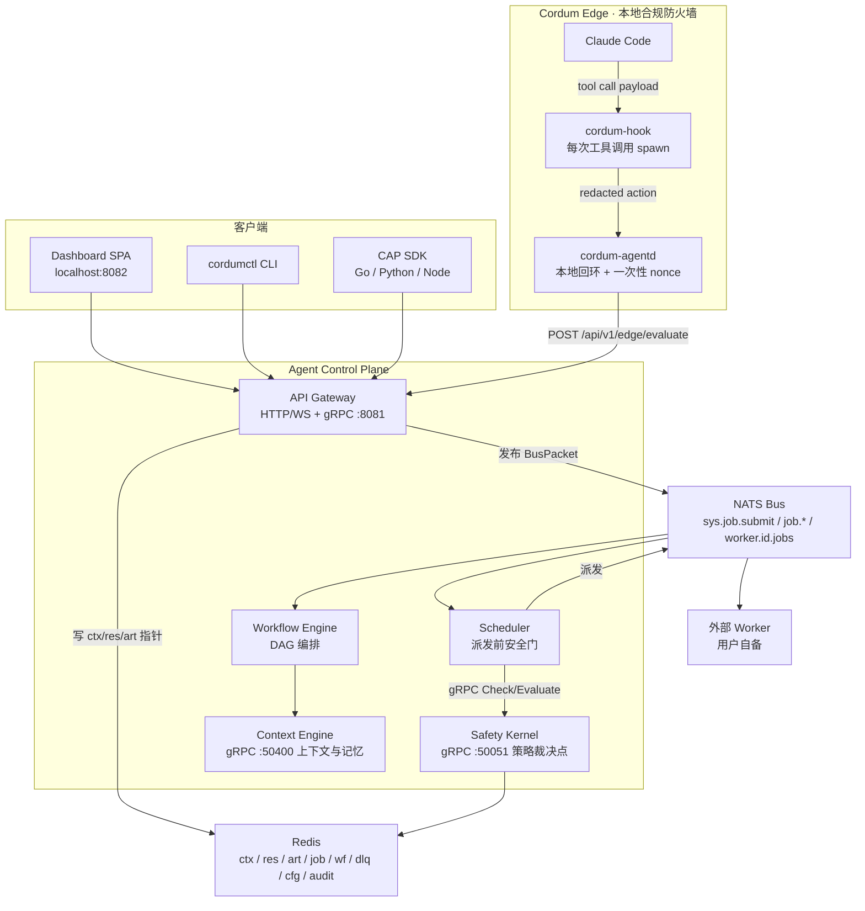
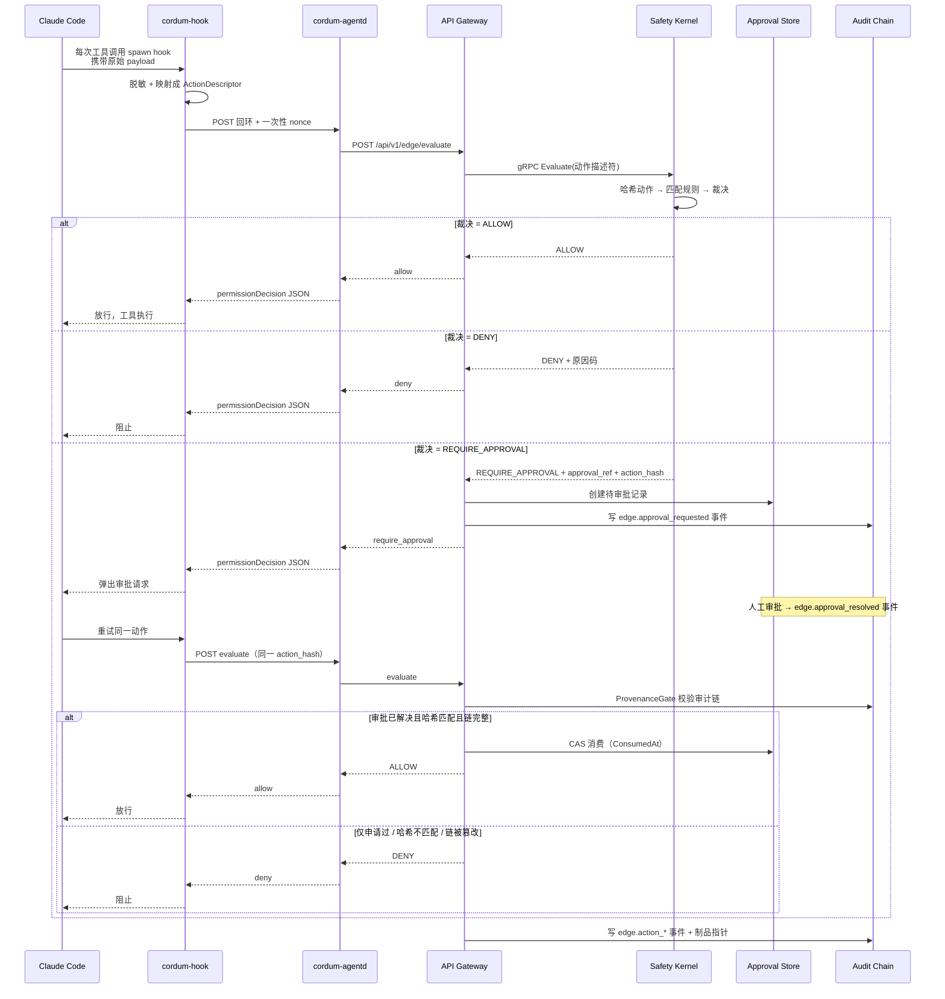
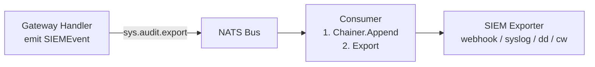
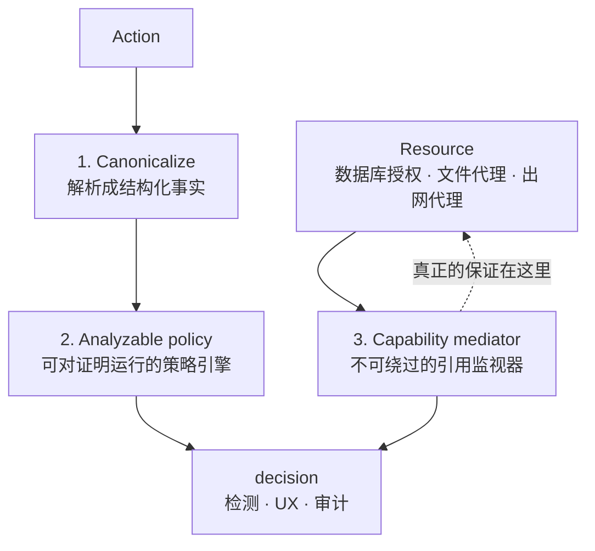

## 一、引子：一个所有 Agent 治理方案都绕开的空洞

2026 年，AI Agent 治理已经是一个「解决方案过剩」的领域。

我们有沙箱：Docker、gVisor、Firecracker、E2B，把 Agent 关进进程、容器或 microVM 里；我们有可观测性：OpenTelemetry、Langfuse、RagaAI Catalyst，把每一次调用都记录下来；我们有模型侧护栏：Guardrails AI、Nemo Guardrails、Llama Guard，拦住进出模型的危险内容；我们还有网关：LiteLLM、ContextForge、MCP Gateway，在流量路径上做统一管控。

看起来四面出击。但如果我提一个具体场景，你立刻会发现这些方案**没有一个站在正确的位置上**：

> 你的 Coding Agent 已经合法持有 AWS 凭证、数据库连接串、一个已认证的 MCP 会话。它现在准备执行 `terraform apply` 修改生产数据库，或者把 `~/.aws/credentials` 读出来发到外部 webhook。
>
> - **沙箱拦不住它。** 沙箱限制的是「进程能对这台机器做什么」，而这个 Agent **本来就有权限**。容器或 microVM 不会削减一个已经合法持有的凭据的能力。
> - **可观测性拦不住它。** 日志和 trace 只能**解释**已经发生的事故，拦不住**导致事故的那次调用**。
> - **模型护栏拦不住它。** 模型护栏检查的是**进出模型**的内容，而执行这个工具调用的是**派发动作的代码**，不是模型。
> - **网关拦不住它。** 网关管的是请求级路由与配额，不是「这一个具体动作」是否该被放行。

这四条边界的共同盲区是：**它们都不是「动作被派发」的那个点**。

Cordum 的自我定位恰恰落在这个空洞里。README 里有一张「Cordum 在 Agent 技术栈中的位置」表，把每一层都列出来并标注**执行边界**，最后一行是 Cordum 自己的：

> **Action control plane (Cordum)** | The point where an action is submitted or dispatched | Gateway submit-time policy checks, scheduler pre-dispatch safety checks, the MCP server policy pipeline, and the Cordum Edge hook.

这就是本文要讲的项目：**cordum-io/cordum** —— 一个用 Go 写的、源码可读的、**行动控制平面（Agent Control Plane）**。

本文的核心论点只有一句：**Agent 治理的下一个战场不在「Agent 能做什么」，而在「这个动作此刻是否该被派发」。**

---

## 二、项目定位与核心价值

### 2.1 仓库快照

| 项 | 值 |
|---|---|
| 仓库 | [cordum-io/cordum](https://github.com/cordum-io/cordum) |
| 一句话定位 | The action firewall for AI agents —— AI Agent 的行动防火墙 |
| 语言 / 规模 | Go 1,657 个 `.go` 文件；TypeScript 884 + Python 819；仓库树 5,060 节点 |
| Stars / Forks | ⭐ 510 / 34 |
| 许可证 | **BUSL-1.1**（Business Source License，非 OSI 开源；2029-01-01 或版本首次发布四周年孰早转 Apache-2.0） |
| 创建 / 最近推送 | 2026-01-11 / 2026-11-15（写作当天） |
| 最新版本 | `v1.3.1`（2026-11-11 发布） |
| 文档 | `docs/` 下 221 个 Markdown、12 篇 ADR（ADR-001 ~ ADR-012） |
| 贡献者 | 7 人（多为单人主导的早期项目） |
| 主干语言生态 | Go 后端 + React Dashboard + 三语言 SDK（Go / Python / Node） |

⚠️ **许可证必须先说清楚**：`license.spdx_id` 返回 `NOASSERTION`，读 `LICENSE` 本体是标准 **BUSL 1.1**，附 Additional Use Grant（允许生产与自托管，但**不得用于提供竞品服务**）。这不是 MIT/Apache，商用前请自行评估。同一组织的 [cordum-io/cap](https://github.com/cordum-io/cap)（CAP 协议本身）才是 Apache-2.0。

### 2.2 它解决的到底是什么问题

Cordum 的 README 里有一节标题就叫 **"Why Pre-Dispatch Action Governance?"**，把上面那四条盲区写得很清楚：

> - **Runtime sandboxes isolate the host, not the authority.** A container or microVM limits what a process can do to the machine it runs on. It does not limit what an agent can do with credentials or sessions it legitimately holds.
> - **Observability records an action after it runs.** Logs and traces explain an incident; they do not hold the call that caused it.
> - **Model and prompt guardrails sit at the LLM boundary.** They check what goes into and comes out of a model. Executing the resulting tool call or job happens in the code that dispatches it.

然后给出 Cordum 的答案：

> Cordum puts a policy decision at that dispatch boundary.

具体拆成五件事：

1. **归一化 + 哈希的动作描述符**。CAP job、MCP 工具调用、Edge hook 动作，各自有自己的规范化形式，最终都折算成 SHA-256 哈希。
2. **显式裁决**。策略求值产出 `ALLOW` / `DENY` / `REQUIRE_APPROVAL` / `THROTTLE` / `ALLOW_WITH_CONSTRAINTS` 五种结果之一；**未知裁决一律按 DENY 处理**。
3. **哈希绑定审批**。审批不是一句「我同意」，而是绑定到 **具体动作的 SHA-256**；载荷一变就是 `approval_mismatch`。
4. **声明式 YAML 策略**，未命中任何规则 = `default_decision: deny`。
5. **Cordum Edge**：把同一套治理下沉到开发者笔记本上的 Claude Code。

### 2.3 三层生命周期：Before / During / Across

Cordum 把治理切成三段：

- **BEFORE（Governance）**：动作派发**前**做策略求值、安全门控、限流、必要时触发人工审批。
- **DURING（Safety）**：实时监控运行中的 Agent，支持**步骤级审批**、熔断器、超时。
- **ACROSS（Observability）**：全机队视角的审计链、能力路由、Agent 池健康度。

这个切分有一个很实用的价值：**它明确了「谁负责什么」**。BEFORE 是确定性代码（策略引擎）；DURING 是运行时反馈；ACROSS 是事后可验证的证据链。

---

## 三、整体架构：7 个服务、2 个基础设施

### 3.1 顶层架构

Cordum 不是单进程应用，而是一组用 **NATS（消息总线）+ Redis（状态存储）+ gRPC（同步调用）** 组合起来的微服务。



官方 `docs/system_overview.md` 里的原始架构图（逐字引用）：

```
Clients/UI
  |
  v
API Gateway (HTTP/WS + gRPC)
  | writes ctx/res/artifact pointers
  v
Redis (ctx/res/artifacts, job meta, workflows, config, DLQ, schemas, locks)
  |
  v
NATS bus (sys.* + job.* + worker.<id>.jobs)
  |
  +--> Scheduler (safety gate + routing + job state)
  |       |
  |       +--> Safety Kernel (gRPC policy check)
  |
  +--> External Workers (user-provided)
  |
  +--> Workflow Engine (run orchestration)
```

### 3.2 一个值得学的架构决策：指针优先的总线

`DESIGN.md:113-123` 逐字引用：

> ## 4) Pointer-Based State Separation
> The bus carries **pointers**, not large payloads. Input, output, and artifacts live in Redis and are referenced by pointers:
> - `context_ptr` -> `redis://ctx:<job_id>`
> - `result_ptr`  -> `redis://res:<job_id>`
> - `artifact_ptrs` -> `redis://art:<id>`
> This keeps bus payloads small, preserves durability, and allows audit tooling to dereference pointers when needed.

这是一个很小但很关键的设计：**Agent 的上下文可能极大（几十万 token 的历史），如果直接塞进 NATS 消息，总线会被撑爆且无法持久化。** 用指针 + Redis 承载大对象，总线只传调度元数据。

配套的 Redis keymap（`docs/system_overview.md:176-208` 节选）：

| Key | 类型 | 用途 |
|---|---|---|
| `ctx:<job_id>` | String | 输入载荷 |
| `res:<job_id>` | String | 结果载荷 |
| `art:<id>` | String | 制品载荷 |
| `job:{base64url(job_id)}:runtime` | Hash | 生产派发权威、attempt、去重、状态、outbox |
| `wf:run:<run_id>:timeline` | List | **仅追加**的工作流时间线 |
| `dlq:entry:<job_id>` | — | 死信队列 |
| `cfg:system:policy` | — | 策略分片 bundle |
| `audit:chain:<tenant>` | Stream | **审计哈希链** |

### 3.3 Redis / NATS / gRPC 的职责切分

ADR-003（`docs/adr/003-redis-nats-split.md`）逐字引用：

> ## Decision
> Split responsibilities:
> - **Redis** — primary state store for all mutable data (jobs, runs, config, sessions, context pointers)
> - **NATS JetStream** — message bus for event delivery, job dispatch, and streaming

具体到协议面：

- **NATS 主题**：`sys.job.submit`、`sys.job.result`、`sys.job.progress`、`sys.job.dlq`、`sys.job.cancel`、`sys.heartbeat`、`sys.workflow.event`，以及池主题 `job.*` 和直连主题 `worker.<id>.jobs`。
- **投递语义**（`docs/AGENT_PROTOCOL.md` 逐字引用）：默认是**纯 NATS pub/sub（至多一次）**；开启 `NATS_USE_JETSTREAM=1` 后持久主题切换为显式 ack/nak 语义（**至少一次**）。
- **gRPC**：`CordumApi`（提交/查询 job）、`ContextEngine`（`BuildWindow` / `UpdateMemory`）、`SafetyKernelServer`（`Check` / `Evaluate` / `Explain` / `Simulate` / `ListSnapshots`）、`OutputPolicyServiceServer`（`CheckOutput`）。

**为什么 Safety Kernel 是 gRPC 而不是 HTTP？** 因为它是**同步阻塞的裁决点**——派发前必须拿到裁决结果才能继续。这与网关那种「异步记录」的性质完全不同。`Explain` / `Simulate` 两个方法是给运维用的：前者解释「为什么这条规则命中」，后者用历史数据**预演**策略变更的影响。

---

## 四、核心引擎一：策略规则模型与匹配语义

### 4.1 规则结构：所有匹配维度都在 `Match` 里

`core/infra/config/safety_policy.go:149-159` 逐字引用：

```go
type PolicyRule struct {
	ID           string              `yaml:"id"`
	Tier         string              `yaml:"tier,omitempty" json:"tier,omitempty"`
	Selector     PolicySelector      `yaml:"selector,omitempty" json:"selector,omitempty"`
	Match        PolicyMatch         `yaml:"match"`
	Velocity     *VelocityConfig     `yaml:"velocity,omitempty"`
	Decision     string              `yaml:"decision"` // allow|deny|require_approval|allow_with_constraints|throttle
	Reason       string              `yaml:"reason"`
	Constraints  PolicyConstraints   `yaml:"constraints"`
	Remediations []PolicyRemediation `yaml:"remediations"`
}
```

而 `tenant` / `topic` / `capability` / `risk_tags` / `labels` 这些维度**不在规则顶层**，全在 `Match` 里（`safety_policy.go:340-358`）：

```go
type PolicyMatch struct {
	Tenants                  []string            `yaml:"tenants"`
	Topics                   []string            `yaml:"topics"`
	Capabilities             []string            `yaml:"capabilities"`
	RiskTags                 []string            `yaml:"risk_tags"`
	Requires                 []string            `yaml:"requires"`
	PackIDs                  []string            `yaml:"pack_ids"`
	ActorIDs                 []string            `yaml:"actor_ids"`
	ActorTypes               []string            `yaml:"actor_types"`
	AgentRiskTiers           []string            `yaml:"agent_risk_tiers"`
	AgentDataClassifications []string            `yaml:"agent_data_classifications"`
	Labels                   map[string]string   `yaml:"labels"`
	LabelAllowlist           map[string][]string `yaml:"label_allowlist,omitempty"` // deny when label value NOT in list
	LabelThreshold           map[string]float64  `yaml:"label_threshold,omitempty"` // deny when label value > threshold
	SecretsPresent           *bool               `yaml:"secrets_present,omitempty"`
	Predicate                string              `yaml:"predicate,omitempty"`
	Delegation               *DelegationMatch    `yaml:"delegation,omitempty"`
	MCP                      MCPPolicy           `yaml:"mcp"`
}
```

### 4.2 匹配语义：维度间 AND，维度内分两种

`core/infra/config/safety_policy.go:814-867` 逐字引用（节选）：

```go
func matchRule(match PolicyMatch, input PolicyInput) bool {
	if len(match.Tenants) > 0 && !containsString(match.Tenants, input.Tenant) {
		return false
	}
	if len(match.Topics) > 0 && !matchAnyTopic(match.Topics, input.Topic) {
		return false
	}
	if len(match.Capabilities) > 0 && !containsString(match.Capabilities, input.Meta.Capability) {
		return false
	}
	if len(match.RiskTags) > 0 && !containsAny(match.RiskTags, input.Meta.RiskTags) {
		return false
	}
	if len(match.Requires) > 0 && !containsAll(input.Meta.Requires, match.Requires) {
		return false
	}
	...
	if len(match.LabelAllowlist) > 0 && !labelAllowlistMatch(match.LabelAllowlist, input.Labels) {
		return false
	}
	return true
}
```

三条规则要记住：

1. **维度之间是 AND**：每一个非空维度都必须匹配。
2. **空切片 = 通配**：维度为空直接跳过，不参与判定。
3. **维度内部有两种语义**：
   - `RiskTags` 用 `containsAny` —— 规则的风险标签**命中任意一个**即匹配（OR 语义）。
   - `Requires` 用 `containsAll` —— 输入必须**携带全部**所需能力（AND 语义）。
   - `LabelAllowlist` 是**反向匹配**：值**不在**白名单里才算命中（用于「只有 A/B 类标签才算低危」）。

### 4.3 优先级：第一个匹配的规则获胜

这是 Cordum 策略引擎最关键也最容易踩坑的语义。`safety_policy.go:681-715` 逐字引用：

```go
// Evaluate returns the decision for the provided input, using rules or legacy tenant config.
func (p *SafetyPolicy) Evaluate(input PolicyInput) PolicyDecision {
	rules := p.Rules
	if len(rules) == 0 {
		rules = legacyRules(p)
	}
	for _, rule := range rules {
		if matchRule(rule.Match, input) {
			decision := normalizeDecision(rule.Decision)
			return PolicyDecision{
				Decision:         decision,
				Reason:           rule.Reason,
				RuleID:           rule.ID,
				RuleTier:         NormalizePolicyTier(rule.Tier),
				Constraints:      rule.Constraints,
				ApprovalRequired: decision == "require_approval",
				Remediations:     rule.Remediations,
			}
		}
	}
	dd := strings.ToLower(strings.TrimSpace(p.DefaultDecision))
	if dd == "allow" || dd == "permit" {
		return PolicyDecision{Decision: "allow", Reason: "no matching rule — default policy: allow", RuleTier: NormalizePolicyTier(p.Tier)}
	}
	// Fail-closed: empty, "deny", or any unrecognized default_decision value
	// results in deny. This prevents typos like "alow" from silently allowing.
	if dd != "" && dd != "deny" {
		slog.Warn("unrecognized default_decision value, defaulting to deny (fail-closed)", "raw", p.DefaultDecision)
	}
	return PolicyDecision{
		Decision: "deny",
		Reason:   "no matching rule — default policy: deny",
		RuleTier: NormalizePolicyTier(p.Tier),
	}
}
```

请注意这个函数的三个设计要点：

- **硬 `return`，第一个命中即终止**。YAML 里 `rules:` 数组的**顺序就是优先级**。
- **未命中任何规则 → 看 `default_decision`**，只有显式写 `allow` / `permit` 才放行。
- **拼写错误不会造成放行**：注释直接写明 `This prevents typos like "alow" from silently allowing`——`alow` 会被识别为「无法识别的值」，落回 deny 并打 WARN。

**但这个 fail-closed 有一个陷阱**，项目自己也在文档里承认了（`docs/policy/global-authority.md:198-227` 逐字引用）：

> - **Decision string typos silently no-op.** Invariant rules with unknown `decision` values (e.g. `dney` instead of `deny`) skip the DENY-uncrossable enforcement — they fall into the ALLOW bucket per `isInvariantDeny` semantics. Authors should validate via `config.ParseSafetyPolicy` errors at upload time.

也就是说：**顶层 `default_decision` 的拼写错误是安全的，但「不变量规则」（invariants，DENY 不可跨越的地板）的 `decision` 拼写错误会让这条地板规则退化成普通规则**，失去「不可跨越」的属性。这是一个真实的、官方承认的缺口。

### 4.4 真实策略文件长什么样

`config/safety.yaml` 的开头部分（逐字引用）：

```yaml
# Cordum base safety policy.
#
# Signing:
#   - In dev / local (CORDUM_POLICY_STRICT=off or unset-but-dev) this file
#     loads unsigned. Useful for `make dev-up` and tests.
#   - In enforce mode (CORDUM_POLICY_STRICT=enforce or env.IsProduction())
#     a sibling safety.yaml.sig is required. Generate it with:
#       CORDUM_POLICY_SIGNING_KEY=... cordumctl policy sign --in safety.yaml
#     and deploy the matching public key via CORDUM_POLICY_PUBLIC_KEY_<ID>.
#
# Default decision when no rule matches. Fail-closed: unmatched jobs are denied.
default_decision: deny

rules:
  # Default topic — used by integration test probes and production gates
  - id: default-topic-allow
    match:
      topics:
        - job.default
    decision: allow
    reason: "Default topic for gate probes and integration tests."
```

再看一组**同 topic、不同 label、不同裁决**的规则（`config/safety.yaml:105-137` 逐字引用）——这是整个策略模型最值得学的一段：

```yaml
  - id: b2b-internal-allow
    match:
      topics:
        - job.b2b.orchestrate
        - job.b2b.hr-setup
        - job.b2b.it-inventory
        - job.b2b.procurement-source
      labels:
        _source: "workflow"
    decision: allow
    reason: "B2B topics auto-approved for workflow-dispatched jobs."

  - id: b2b-pack-allow
    match:
      topics:
        - job.b2b.orchestrate
        - job.b2b.hr-setup
        - job.b2b.it-inventory
        - job.b2b.procurement-source
      labels:
        _source: "pack"
    decision: allow
    reason: "B2B topics auto-approved for pack workers."

  - id: b2b-api-review
    match:
      topics:
        - job.b2b.orchestrate
        - job.b2b.hr-setup
        - job.b2b.it-inventory
        - job.b2b.procurement-source
    decision: require_approval
    reason: "Direct API access to B2B topics requires human approval."
```

**读法**：同四个 topic，**来源不同 → 裁决不同**。workflow 内部派发的自动放行，pack worker 派发的也放行，但**直接从 API 调用的必须人工审批**。这就是 `_source` 标签存在的全部意义——**「谁在调用」比「调用什么」更能决定风险**。

### 4.5 输入侧扫描：prompt injection 与路径穿越

`config/safety.yaml:184-233` 逐字引用（节选）：

```yaml
input_policy:
  fail_mode: closed  # "closed" = requeue when kernel down, "open" = allow through

input_rules:
  # =========================================================================
  # Global prompt injection detection — applies to ALL job topics.
  # Catches LLM prompt injection attempts (system override, ignore rules,
  # jailbreak directives). Escalates to human review rather than outright
  # deny to reduce false-positive impact on legitimate prompts.
  # =========================================================================
  - id: global-prompt-injection-scan
    description: "Detect LLM prompt injection patterns in job input content."
    severity: high
    match:
      topics:
        - "job.*"
      scanners:
        - "prompt_injection"
    decision: require_approval
    reason: "Prompt injection pattern detected in job input — requires human review."

  # =========================================================================
  # Path traversal and dangerous payload detection (red-team #17/#18).
  # Catches ../../../ traversal in tenant/org fields and execute=true overrides.
  # =========================================================================
  - id: global-path-traversal-scan
    description: "Detect path traversal patterns in job input content."
    severity: high
    match:
      topics:
        - "job.*"
      content_patterns:
        - "\\.\\./\\.\\."
        - "\\.\\.\\\\"
    decision: require_approval
    reason: "Path traversal pattern detected in job input — requires human review."
```

这里有个**很值得学的裁决哲学**：prompt injection 检测**不直接 deny，而是升级为人工审批**。注释写明理由——「Escalates to human review rather than outright deny to reduce false-positive impact on legitimate prompts」。**误报成本 > 漏报成本**时，降级为人工闸门是合理的。

---

## 五、核心引擎二：Safety Kernel 的 18 步裁决流水线

这是整个项目最硬核的部分。`core/controlplane/safetykernel/kernel.go:685-1070` 的 `server.evaluate()` 是唯一的策略求值入口。它的执行顺序是：

```mermaid
flowchart TB
    START["evaluate(req, method)"] --> N1["1. 身份归一化<br/>identity mirror 不匹配 → DENY"]
    N1 --> N2["2. 读策略快照<br/>单次 RLock 防止 TOCTOU"]
    N2 --> N3["3. Tier 作用域解析<br/>workflow-tier / job-tier 规则切片"]
    N3 --> N4["4. 决策缓存查询<br/>velocity/action/agent-enriched 时绕过"]
    N4 --> N5["5. policy == nil → DENY<br/>no policy loaded — fail-closed"]
    N5 --> N6["6. 租户默认值<br/>defaultTenant → default"]
    N6 --> N7["7. 主题合法性<br/>空 → DENY；非 job. 前缀 → DENY"]
    N7 --> N8["8. 服务端风险标签派生<br/>覆盖客户端标签 · 反伪造"]
    N8 --> N9["9. SecretsPresent + Agent 身份增强<br/>服务端解析 risk_tier"]
    N9 --> N10["10. Action-Gate 管线<br/>先于传统规则 · 首个非 ALLOW 即短路"]
    N10 --> N11["11. 规则求值<br/>recover() 捕获 panic → deny"]
    N11 --> N12["12. 租户 MCP 允许表<br/>覆盖为 deny"]
    N12 --> N13["13. 裁决字符串 → proto 枚举<br/>未知 → DENY"]
    N13 --> N14["14. 生效配置叠加<br/>denied topics → DENY"]
    N14 --> N15["15. 输入规则求值<br/>只能升级：allow → deny / require_human"]
    N15 --> N16["16. 计算 approvalRequired<br/>approvalRef = job_id"]
    N16 --> N17["17. 影子求值提交<br/>非阻塞 · 不影响生效裁决"]
    N17 --> N18["18. 回写缓存<br/>剥离 ApprovalRef"]
    N18 --> END["返回裁决"]

    style N5 fill:#ffe0e0
    style N10 fill:#fff4d6
    style N13 fill:#ffe0e0
    style N17 fill:#e8f4ff
```



### 5.1 关键片段一：fail-closed 的第一道闸

`kernel.go:583-605` 逐字引用：

```go
	// Fail-closed: when no policy is loaded, deny all requests.
	// This prevents a misconfigured deployment from silently allowing everything.
	if policy == nil {
		return &pb.PolicyCheckResponse{
			Decision:       pb.DecisionType_DECISION_TYPE_DENY,
			Reason:         "no policy loaded — fail-closed",
			PolicySnapshot: snapshot,
		}, nil
	}

	if tenant == "" {
		tenant = defaultTenant
	}
	if tenant == "" {
		tenant = "default"
	}

	if topic == "" {
		return &pb.PolicyCheckResponse{Decision: pb.DecisionType_DECISION_TYPE_DENY, Reason: "missing topic"}, nil
	}
	if !strings.HasPrefix(topic, "job.") {
		return &pb.PolicyCheckResponse{Decision: pb.DecisionType_DECISION_TYPE_DENY, Reason: "unsupported topic"}, nil
	}
```

**策略没加载出来 → 全部拒绝**。这和「配置文件读不出来就先用默认值」是完全相反的哲学。

### 5.2 关键片段二：Action-Gate 管线先于规则求值

`kernel.go:817-838` 逐字引用：

```go
// 说明：以下为源码节选，函数体在节选边界处截断，故括号不成对。
	// Action-layer gates run BEFORE legacy rule evaluation. The pipeline
	// short-circuits on the first non-ALLOW decision; an empty result
	// falls through to the existing evaluator. Both the extractor and the
	// pipeline are nil for clients running without the in-process gateway
	// wiring, so the legacy path is unchanged for plain gRPC consumers.
	s.mu.RLock()
	gatePipeline := s.actionGatePipeline
	gateExtractor := s.actionExtractor
	gateAuditSink := s.actionGateAuditSink
	s.mu.RUnlock()
	if gateExtractor != nil {
		input.Action = gateExtractor(ctx, req)
	}
	if gatePipeline != nil && input.Action != nil {
		if gateDec, fired := gatePipeline.Run(ctx, &input); fired {
			resp := actionGateResponse(gateDec, snapshot)
			if gateAuditSink != nil {
				gateAuditSink(ctx, actionGateAuditEvent(req, &input, gateDec))
```

这意味着 Cordum 有**两套门**：
- **Action-Gate**（新）：对**具体动作**做语义判定 —— 文件路径、MCP 工具、URL、变更操作。短路由到第一个非 ALLOW 决策。
- **传统规则**（旧）：对 **job 请求**做租户/主题/能力匹配。

**新的先跑，短路。** 这样「这个动作本身就不该发生」不必等规则引擎跑完。

### 5.3 关键片段三：未知裁决 = DENY

`kernel.go:913-920` 附近，`default:` 分支直接落到 DENY 并附带 `audit_event=policy_decision_unknown`。这是**第二层**防护（第一层是 `normalizeDecision`）。README 里对此有明确表述：

> - **Explicit verdicts.** Policy evaluation yields `ALLOW`, `DENY`, `REQUIRE_APPROVAL`, `THROTTLE` or `ALLOW_WITH_CONSTRAINTS`. The gateway, scheduler and Edge evaluate path treat an unknown verdict as `DENY`.

### 5.4 五种裁决的语义

| 裁决 | 运行时行为 |
|---|---|
| `ALLOW` | 动作/作业可继续；派发到池主题或 worker 直连主题 |
| `DENY` | 作业状态置 `DENIED`，不派发；**未知裁决也归此类** |
| `REQUIRE_APPROVAL` | `approval_required=true`，`approval_ref = job_id`；作业状态置 `APPROVAL_REQUIRED`；审批**绑定策略快照 + 作业哈希**后才重新入队 |
| `THROTTLE` | 限流裁决；滑动窗口超限才触发 |
| `ALLOW_WITH_CONSTRAINTS` | 放行，但响应携带 `PolicyConstraints`（预算、沙箱 profile、工具链、diff 上限）—— **由 scheduler 部分执行** |

⚠️ 一个容易困惑的细节：**YAML 里写 `require_approval`，而线上 proto 枚举是 `REQUIRE_HUMAN`**。`docs/safety/decision-thresholds.md:75` 的路由表把 `require_approval` / `require-approval` / `require_human` 三种写法都映射到 `REQUIRE_HUMAN`。Edge 侧还多一个 Edge 专属的 `CONSTRAIN`。

---

## 六、核心引擎三：哈希绑定审批 —— 让「同意」精确到一个动作

这是 Cordum 最有价值的设计，也是整个「可审计的确定性决策」的核心。

### 6.1 三套哈希，三种用途

Cordum 里有三个不同的哈希函数，服务于不同边界：

| 哈希 | 位置 | 用途 | 格式 |
|---|---|---|---|
| `reqhash.Hash` | `core/protocol/reqhash/reqhash.go` | **JobRequest 规范哈希** —— 把一个作业请求归一化后哈希 | 裸 hex，无前缀 |
| `CanonicalActionHash` | `core/policy/actiongates/mutation_gate.go` | **动作形状哈希** —— 审批绑定到具体动作 | 裸 hex |
| `edgeEvaluateActionHash` | gateway | Edge 侧动作哈希 | 带 `sha256:` 前缀 |

### 6.2 JobRequest 规范哈希的完整配方

`core/protocol/reqhash/reqhash.go` 整个文件逐字引用（这是本文最想推荐读者精读的一段代码）：

```go
// Package reqhash is the single source of truth for JobRequest
// canonicalisation used by the scheduler, gateway, and infra/store
// packages. It strips mutable approval labels and scheduler-injected
// env vars, then rounds the proto through protojson so that hashing
// the in-memory form matches hashing the Redis-read form on the same
// logical request. Without a shared helper the three packages had
// independent copies that were required to stay byte-equivalent by
// convention; see task-fa783d7a for the divergence that motivated
// task-090ab6af.
package reqhash

// Canonical returns a copy of req with mutable fields stripped
// (approval_* labels, bus.LabelBusMsgID, policylabels.PolicyAttachmentID,
// config.EffectiveConfigEnvVar) and proto unknown fields removed via a
// protojson round-trip. The
// round-trip matches what the store persists into Redis, so the
// canonical form is stable regardless of whether the caller holds the
// original in-memory proto or a Redis-read form.
func Canonical(req *pb.JobRequest) (*pb.JobRequest, error) {
	clone, err := protoutil.CloneJobRequest(req)
	if err != nil {
		return nil, err
	}
	if clone.Labels != nil {
		for key := range clone.Labels {
			lower := strings.ToLower(key)
			// policy.attachment_id is injected during policy attachment (after the
			// submit-time hash is pinned), so it must be stripped here or the
			// reconcile-time RequestHash drifts from the pinned JobHash and a
			// still-pending approval is wrongly invalidated as stale_request.
			if strings.HasPrefix(lower, "approval_") || key == bus.LabelBusMsgID || key == policylabels.PolicyAttachmentID {
				delete(clone.Labels, key)
			}
		}
		if len(clone.Labels) == 0 {
			clone.Labels = nil
		}
	}
	if clone.Env != nil {
		delete(clone.Env, config.EffectiveConfigEnvVar)
		if len(clone.Env) == 0 {
			clone.Env = nil
		}
	}
	raw, err := protojson.MarshalOptions{EmitUnpopulated: true}.Marshal(clone)
	if err != nil {
		return nil, fmt.Errorf("canonical job request marshal: %w", err)
	}
	out := &pb.JobRequest{}
	if err := (protojson.UnmarshalOptions{DiscardUnknown: true}).Unmarshal(raw, out); err != nil {
		return nil, fmt.Errorf("canonical job request unmarshal: %w", err)
	}
	return out, nil
}

// Hash computes the deterministic canonical hash of a JobRequest as a
// hex-encoded sha256. Equal logical requests produce equal hashes
// across the protojson round-trip the store performs, across mutable
// approval-label churn, and across scheduler env-var injection.
func Hash(req *pb.JobRequest) (string, error) {
	canonical, err := Canonical(req)
	if err != nil {
		return "", err
	}
	data, err := proto.MarshalOptions{Deterministic: true}.Marshal(canonical)
	if err != nil {
		return "", err
	}
	sum := sha256.Sum256(data)
	return hex.EncodeToString(sum[:]), nil
}
```

**这段代码教了三件事：**

1. **「什么算同一个请求」必须由单一权威定义。** 包注释直接写明动机：以前 scheduler / gateway / infra-store 三处各有一份拷贝，「were required to stay byte-equivalent by convention」（靠约定保持字节一致）—— 靠人守约定迟早出事，所以抽成 `single source of truth`。

2. **归一化要剔除「可变字段」。** `approval_*` 前缀标签、总线消息 ID、`policy.attachment_id`、调度器注入的环境变量——这些都会在请求生命周期内变化，如果参与哈希，同一个逻辑请求在不同时间点会得到不同哈希，导致**待审批的作业被误判为 `stale_request`**。注释把这个具体故障写得很清楚。

3. **protojson 往返是为了对齐存储形态。** 内存里的 proto 和从 Redis 读回来的 proto 可能因未知字段处理方式不同而产生不同字节。`EmitUnpopulated: true` + `DiscardUnknown: true` 的往返把两者拉齐。

### 6.3 动作哈希：审批绑定的具体形态

`core/policy/actiongates/mutation_gate.go:174-241` 逐字引用（节选）：

```go
// CanonicalActionHash returns a stable hex-encoded SHA-256 of the action's
// authorization-relevant fields. Map ordering is normalized so equivalent
// payloads hash identically regardless of insertion order. nil returns "".
//
// The hash binds an approval to a specific action shape: when the resolved
// approval.ActionHash differs from this value, the gate raises an
// approval_mismatch conflict — the approval was granted for a different
// payload.
func CanonicalActionHash(act *config.ActionDescriptor) string {
	if act == nil {
		return ""
	}
	payload := canonicalPayload(act)
	buf, err := json.Marshal(payload)
	if err != nil {
		// All entries in payload are primitives/strings/maps/slices that
		// json.Marshal can encode; this branch is defensive.
		return ""
	}
	sum := sha256.Sum256(buf)
	return hex.EncodeToString(sum[:])
}

func canonicalPayload(act *config.ActionDescriptor) map[string]any {
	payload := map[string]any{
		"kind": string(act.Kind),
		"verb": string(act.Verb),
	}
	if act.Server != "" {
		payload["server"] = act.Server
	}
	if act.Tool != "" {
		payload["tool"] = act.Tool
	}
	if act.TargetPath != "" {
		payload["target_path"] = act.TargetPath
	}
	if act.TargetURL != "" {
		payload["target_url"] = act.TargetURL
	}
	if act.TargetResource != nil {
		payload["target_resource"] = map[string]any{
			"type":         act.TargetResource.Type,
			"id":           act.TargetResource.ID,
			"owner_tenant": act.TargetResource.OwnerTenant,
		}
	}
	if len(act.Filters) > 0 {
		payload["filters"] = act.Filters
	}
	if len(act.Wildcards) > 0 {
		payload["wildcards"] = sortedCopy(act.Wildcards)
	}
	if len(act.Args) > 0 {
		payload["args"] = act.Args
	}
	if len(act.RiskTags) > 0 {
		payload["risk_tags"] = sortedCopy(act.RiskTags)
	}
	return payload
}
```

两个细节值得注意：
- **`encoding/json` 天然排序 map 键**，所以哈希是稳定的；`Wildcards` 和 `RiskTags` 是**概念上的集合**，所以额外 `sortedCopy` 排序。
- **只有「授权相关字段」进入哈希**：`kind`、`verb`、`server`、`tool`、`target_path`、`target_url`、`target_resource`、`filters`、`wildcards`、`args`、`risk_tags`。这意味着**换一个目标路径，审批就失效**。

### 6.4 审批生命周期：5 状态、9 冲突类型、7 项绑定检查

`core/edge/approval.go` 整个文件逐字引用：

```go
package edge

import "time"

// ApprovalStatus captures the lifecycle state for a generic Edge approval.
type ApprovalStatus string

const (
	ApprovalStatusPending     ApprovalStatus = "pending"
	ApprovalStatusApproved    ApprovalStatus = "approved"
	ApprovalStatusRejected    ApprovalStatus = "rejected"
	ApprovalStatusExpired     ApprovalStatus = "expired"
	ApprovalStatusInvalidated ApprovalStatus = "invalidated"
)

// ApprovalDecision captures the resolver decision wire value for an Edge approval.
type ApprovalDecision string

const (
	ApprovalDecisionApprove    ApprovalDecision = "approve"
	ApprovalDecisionReject     ApprovalDecision = "reject"
	ApprovalDecisionExpire     ApprovalDecision = "expire"
	ApprovalDecisionInvalidate ApprovalDecision = "invalidate"
)

// EdgeApproval is a generic approval record for action-level governance across
// hook, MCP, LLM, runtime, and workflow layers.
type EdgeApproval struct {
	ApprovalRef      string           `json:"approval_ref"`
	TenantID         string           `json:"tenant_id"`
	SessionID        string           `json:"session_id"`
	ExecutionID      string           `json:"execution_id"`
	EventID          string           `json:"event_id"`
	PrincipalID      string           `json:"principal_id"`
	Requester        string           `json:"requester"`
	ResolverID       string           `json:"resolver_id"`
	ResolvedBy       string           `json:"resolved_by"`
	Status           ApprovalStatus   `json:"status"`
	Decision         ApprovalDecision `json:"decision"`
	Reason           string           `json:"reason"`
	ResolutionReason string           `json:"resolution_reason"`
	RuleID           string           `json:"rule_id"`
	PolicySnapshot   string           `json:"policy_snapshot"`
	ActionHash       string           `json:"action_hash"`
	InputHash        string           `json:"input_hash"`
	CreatedAt        time.Time        `json:"created_at"`
	ExpiresAt        *time.Time       `json:"expires_at"`
	ResolvedAt       *time.Time       `json:"resolved_at"`
	ConsumedAt       *time.Time       `json:"consumed_at"`
	Labels           Labels           `json:"labels"`
	Metadata         Metadata         `json:"metadata"`
}
```

冲突类型（`core/edge/approval_store.go:43-60` 逐字引用）：

```go
const (
	ApprovalConflictKindUnknown        ApprovalConflictKind = ""
	ApprovalConflictKindNotFound       ApprovalConflictKind = "not_found"
	ApprovalConflictKindRejected       ApprovalConflictKind = "rejected"
	ApprovalConflictKindExpired        ApprovalConflictKind = "expired"
	ApprovalConflictKindConsumed       ApprovalConflictKind = "consumed"
	ApprovalConflictKindArgsMismatch   ApprovalConflictKind = "args_mismatch"
	ApprovalConflictKindPolicyMismatch ApprovalConflictKind = "policy_mismatch"
	ApprovalConflictKindTupleMismatch  ApprovalConflictKind = "tuple_mismatch"
	ApprovalConflictKindSelfApproval   ApprovalConflictKind = "self_approval"
	ApprovalConflictKindCrossTenant    ApprovalConflictKind = "cross_tenant"
)
```

**派发前的 7 项绑定检查**，顺序严格（`core/policy/actiongates/approval_binding.go:82-124` 逐字引用）：

```go
func validateApprovalBinding(
	approval *edge.EdgeApproval,
	actx *auth.AuthContext,
	actionHash string,
) approvalBindingFailure {
	if approval.TenantID != actx.Tenant {
		return approvalBindingAccessDenied("approval is for a different tenant", "approval_tenant_mismatch")
	}
	if approval.ResolverID != "" && approval.ResolverID == actx.PrincipalID {
		return approvalBindingAccessDenied("self-approval is not allowed", "self_approval")
	}
	if approval.Status != edge.ApprovalStatusApproved {
		return approvalBindingConflict("approval_status_" + string(approval.Status))
	}
	if approval.Decision != edge.ApprovalDecisionApprove {
		return approvalBindingConflict("approval_decision_" + string(approval.Decision))
	}
	if approval.ConsumedAt != nil {
		return approvalBindingConflict("approval_consumed")
	}
	if approval.ExpiresAt != nil && time.Now().UTC().After(*approval.ExpiresAt) {
		return approvalBindingConflict("approval_expired")
	}
	if approval.ActionHash != actionHash {
		return approvalBindingConflict("approval_mismatch")
	}
	return approvalBindingFailure{}
}
```

**这 7 行检查就是「可审计的确定性决策」的最小实现**：

| 检查 | 拦截的攻击 |
|---|---|
| 租户一致 | 跨租户复用审批（横向越权） |
| 拒绝自批 | Agent 自己给自己签批准 |
| 状态 / 裁决 | 用 pending / rejected / expired 的审批蒙混 |
| 未被消费 | 同一个审批重复使用（重放） |
| 未过期 | 拿三天前的审批放行今天的动作 |
| **动作哈希一致** | **拿「允许读文件」的审批去放行「删除生产表」** |

**顺序也很讲究**：租户和自批是「访问拒绝」（`CodeAccessDenied`），其余是「冲突」（`CodeConflict` → HTTP 409）。哈希校验**放在最后**，因为前面的都是廉价字符串比较，哈希比较最贵。

### 6.5 单次消费：Redis CAS

`core/edge/approval_store_redis.go:429-499` 逐字引用（节选）：

```go
// 说明：以下为源码节选，函数体在节选边界处截断，故括号不成对。
	err := redisutil.Retry(ctx, s.client, func(tx *redis.Tx) error {
		approval, err := loadApprovalFromTx(ctx, tx, req.ApprovalRef)
		if err != nil {
			if errors.Is(err, redis.Nil) {
				claimErr = ErrNotFound
				return nil
			}
			return err
		}
		if approval.TenantID != req.TenantID {
			claimErr = ErrNotFound
			return nil
		}
		if approval.Status != ApprovalStatusApproved || approval.ConsumedAt != nil {
			if kind, reason := terminalApprovalClaimConflict(approval); kind != ApprovalConflictKindUnknown {
				claimErr = newApprovalConflict(kind, reason)
			}
			return nil
		}
		consumedAt := req.ConsumedAt.UTC()
		if consumedAt.IsZero() {
			consumedAt = s.now().UTC()
		}
		if approval.ExpiresAt != nil && consumedAt.After(*approval.ExpiresAt) {
			claimErr = newApprovalConflict(ApprovalConflictKindExpired, "approval expired")
			return nil
		}
		if kind, reason := classifyApprovalClaimMismatch(approval, req); kind != ApprovalConflictKindUnknown {
			claimErr = newApprovalConflict(kind, reason)
			return nil
		}
		...
		next := *approval
		next.ConsumedAt = &consumedAt
```

**注意「租户不匹配返回 `ErrNotFound` 而不是「无权限」**——这是一个安全上的好习惯：**不泄露「这个审批 ref 存在」这一信息**。

**单次消费在 Redis 事务里用 CAS 完成**，两个并发请求只有一个能拿到 `ConsumedAt`。

---

## 七、Cordum Edge：把治理下沉到开发者笔记本

前六节讲的都是「企业内的 Agent 池」。Cordum Edge 解决的是另一个更贴近日常的场景：**开发者笔记本上的 Claude Code**。

### 7.1 它是并行运行时，不是 Job 流水线的一个功能

`docs/system_overview.md:82-112` 逐字引用：

> - Cordum Edge — Compliance Firewall for local AI-agent actions
>   (`cmd/cordum-hook`, `cmd/cordum-agentd`, `cmd/cordumctl/edge_claude.go`, `core/edge`,
>   `core/controlplane/gateway/handlers_edge_*.go`)
>   - Parallel runtime to the Job pipeline above, NOT a feature within it.
>     Edge governs what an AI agent (Claude Code today) is about to do BEFORE
>     its tool call runs; Jobs govern what a worker IS doing.
>   - Per-tool-call data path: Claude Code spawns `cordum-hook` per tool call →
>     hook redacts the action and POSTs to local `cordum-agentd` (one-shot
>     nonce, loopback only) → agentd forwards to Gateway
>     `POST /api/v1/edge/evaluate` → Safety Kernel evaluates the action
>     against tenant policy → response is `ALLOW`, `DENY`, or
>     `REQUIRE_APPROVAL` (with optional `approval_ref`) → hook prints the
>     Claude-Code-shaped permissionDecision JSON → Claude Code blocks/runs
>     accordingly.

### 7.2 完整数据路径



### 7.3 ProvenanceGate：一句「申请过」不等于「批准过」

这是整个 Edge 设计里最精妙的一环。`docs/edge-policy.md:176-202` 逐字引用：

> ### ProvenanceGate: resolved approval audit evidence
>
> For destructive action-gate decisions, a backend `approved` approval is
> necessary but not sufficient. After the mutation gate validates the stored
> `EdgeApproval`, `ProvenanceGate` verifies the tenant audit chain and requires a
> canonical resolved approval event:
>
> - event type `EventEdgeApprovalResolved` / `edge.approval_resolved`;
> - decision `approved` or `approve`;
> - exact tenant match;
> - exact `approval_ref` and `action_hash` match in bounded audit `extra`.
>
> `EventEdgeApprovalRequested` / `edge.approval_requested` rows are request
> lifecycle context only. A requested-only row, wrong tenant, wrong ref, wrong
> hash, rejected/expired decision, malformed event JSON, Redis/audit verifier
> outage, or compromised hash/HMAC/linkage is an evidence gap and the gate fails
> closed. The failure is reported with bounded reason codes such as
> `audit_evidence_missing`, `audit_chain_compromised`, or
> `audit_chain_verifier_unavailable`; raw prompts, tool payloads, transcripts,
> approval secrets, and command output are never embedded in the audit evidence.

**翻译成人话：**

审批存储里写着「已批准」**还不够**。必须**同时**在审计链里找到一条 `edge.approval_resolved` 事件，且这条事件的租户、`approval_ref`、`action_hash` 三个字段**全部精确匹配**，并且**整条哈希链验证通过**。

**为什么这样设计？** 因为审批存储是一个**可变的数据库**，而审计链是**只能追加的证据**。如果只信审批存储，攻击者只要能改数据库就能伪造批准。而要求「数据库里的批准」+「链上证明这个批准确实发生过」两条独立证据同时成立，攻击者就必须**同时**篡改状态库和破坏哈希链——而破坏哈希链会级联失效。

`docs/audit-chain.md:190-208` 的表述同样直白：

> `EventEdgeApprovalRequested` / `edge.approval_requested` is intentionally not
> accepted as approval provenance by itself: it only proves a review was requested.

### 7.4 证据包：导出什么、绝不导出什么

`docs/edge.md:48-50` 逐字引用：

> Raw prompts, tool payloads, transcripts, command output, API keys, bearer tokens,
> and hook nonces must not be stored in Edge events. Use redacted summaries,
> stable hashes, and artifact pointer metadata.

那到底存了什么？`docs/edge.md:52-62` 给出了硬编码白名单：

> Governance events (`edge.action_denied`, `edge.policy_decision`) surface
> *descriptive* action targets without violating that rule: a hard-coded allowlist
> of classifier-derived enums is copied into the audit `extra` map — `target_class`,
> `target_sensitive_area`, `target_traversal`, `command_class`, `command_family`,
> `mcp_server` / `mcp_tool` / `mcp_action`, `runtime_event` / `runtime_host`, plus a
> composed `target_summary` (e.g. `shell:destructive/filesystem_delete`,
> `file:secret`, `mcp:github/create_issue`). No raw file path, command, prompt, or
> secret is ever written — only these safe, bounded descriptors, and caller-supplied
> labels are never copied.

**注意 `target_summary` 的形态**：`shell:destructive/filesystem_delete` —— 一个**受控词表的枚举**，而不是原始路径。审计员看得出「这是一次破坏性的文件删除」，但看不到「删的是哪个文件」。

制品类型表（`docs/edge-export.md:115-130` 逐字引用）：

| 类型 | 携带内容 |
|---|---|
| `edge.transcript` | 脱敏后的 Claude 会话记录 |
| `edge.diff` | 脱敏后的文件 diff（Edit/Write/MultiEdit） |
| `edge.tool_input` | 脱敏后的 Bash/Read/Edit 输入参数 |
| `edge.tool_result` | 脱敏后的工具输出 |
| `edge.test_output` | 脱敏后的 `npm test`/`go test`/CI 输出 |
| `edge.mcp_request` | 脱敏后的 MCP 工具调用请求体 |
| `edge.mcp_response` | 脱敏后的 MCP 工具调用响应体 |
| `edge.llm_prompt_redacted` | 脱敏后的 LLM prompt（provider 侧） |
| `edge.llm_response_redacted` | 脱敏后的 LLM 响应（provider 侧） |
| `edge.evidence_bundle` | 这个包本身（自引用） |

**注意脱敏发生在服务端**（`docs/system_overview.md`：「redaction enforced server-side」），且 `include_artifact_bodies` 参数在 P0 版本**不被接受**：

> * `include_artifact_bodies` is **not** accepted in P0. Bundles always
>   carry artifact metadata only; raw bodies stay in the artifact store.

体积上限：`CORDUM_EDGE_EXPORT_MAX_BYTES` 默认 10 MiB、上限 64 MiB；`max_events` 默认和上限都是 5000；Redis 扇出上限 100 executions/session × 5000 events/execution = 单会话最坏 50 万事件。

---

## 八、审计链：让证据本身可被验证

### 8.1 三个性质

`docs/audit-chain.md:5-19` 逐字引用：

> Cordum's audit chain provides **cryptographic tamper-evidence** for every
> security-relevant event that flows through the control plane. It combines:
>
> 1. **SHA-256 hash chaining** — each event's hash includes its predecessor's
>    hash, so modifying any historical event invalidates every successor.
> 2. **HMAC-SHA256 authentication** (optional) — each event is signed with a
>    shared secret so only processes holding the key can produce valid entries.
> 3. **Redis Streams** as the append-only storage layer, with a CAS-guarded
>    head pointer for concurrent safety.
>
> Together these properties satisfy the SOC2 CC7.2 (monitoring of controls)
> and CC7.3 (detection of security incidents) trust criteria documented in
> `core/audit/soc2.go`.

### 8.2 哈希链机制

`docs/audit-chain.md:43-89` 逐字引用：

> ### Canonical Hashing
> The event hash is SHA-256 of the JSON encoding with these fields **zeroed
> before hashing**: `seq`, `event_hash`, `hmac`. Critically, `prev_hash` is
> **included** in the hashed bytes:
>
> ```text
> event_hash = SHA-256(canonical_json(event with seq=0, event_hash="", hmac=""))
> ```
>
> This means:
> - Modifying any field of any past event changes its `event_hash`.
> - Because the next event's `prev_hash` recorded the original hash, the next
>   event now fails verification too.
> - The corruption **cascades forward** through the entire chain.

**「级联失效」是哈希链的全部价值**：改一条历史事件，后面所有事件的 `prev_hash` 都对不上，整条链从那里开始全部作废。攻击者要修复就必须重算整条链——而链尾的哈希是写进 Redis Stream 的，重算需要同时控制写入。

**追加用 Lua 脚本做 CAS**（逐字引用）：

> ### CAS Append (Lua Script)
> Appending is protected by a Compare-and-Set Lua script that atomically:
> 1. Reads the current head pointer
> 2. Compares it to the caller's expected value
> 3. If they match: `XADD` the event, `SET` the new head
> 4. If they don't: returns 0 (CAS miss → Go retries with jitter)
>
> This prevents two concurrent producers from both seeing the same head and
> both committing at the same sequence number.
>
> ### Anti-Head-Poison Guard
> If an attacker `DEL`s the head key while the stream still has entries, a
> naive CAS check would allow seq=1 to be reused. The Lua script guards
> against this: when the caller claims genesis (empty head), it additionally
> checks `XLEN == 0`.

**「防头指针投毒」这一段特别值得学。** 攻击者删掉 head 指针（`DEL audit:chain:head:<tenant>`），链看起来「空了」，朴素实现会以为可以从 seq=1 重开，从而**复用序号**掩盖篡改。Lua 脚本在「声称是创世」时额外检查 `XLEN == 0`。

### 8.3 HMAC：为什么 SHA-256 链不够

`docs/audit-chain.md:91-123` 逐字引用：

> ### Threat Model
> SHA-256 hash chaining detects **external tampering** (someone modifies
> entries in the stream). However, an attacker with **Redis write access**
> could recompute the entire chain from any point — the hashes are
> deterministic from the event payload alone.
>
> HMAC-SHA256 closes this gap. With HMAC enabled, producing a valid chain
> entry requires possession of the signing key. An attacker who can write to
> Redis but doesn't have the key cannot forge valid HMAC tags.

**这段话点出了一个很多人忽略的问题：哈希链对「有 Redis 写权限的攻击者」是不够的**——因为哈希是纯函数，能改内容就能重算哈希。只有 HMAC（需要密钥）才把「能写 Redis」和「能伪造证据」这两件事解耦。

### 8.4 验证端点与缺口分类

`GET /api/v1/audit/verify?tenant=<tenant_id>`，支持 `since` / `until`（unix 毫秒）与 `limit`（默认 10000，上限 100000）：

| 状态 | 含义 |
|---|---|
| `ok` | 所有事件验证通过（哈希 + 链接 + HMAC） |
| `compromised` | 至少一个事件验证失败 |
| `partial` | 存在缺口，但全部是 `retention_trimmed`（预期内） |

| 缺口类型 | 含义 |
|---|---|
| `missing` | 序号在流中缺失（保留边界之后） |
| `out_of_order` | 序号出现在其前驱之前 |
| `hash_mismatch` | 事件哈希或 prev_hash 链接失败 |
| `hmac_mismatch` | HMAC-SHA256 标签验证失败 |
| `retention_trimmed` | 日志保留策略导致的预期缺口 |

**把 `retention_trimmed` 和真正的篡改区分开**，避免运维在长链上收到误报——这是个很体贴的设计。

### 8.5 流水线与失败模式



上游 `docs/audit-chain.md:210-225` 的原始 ASCII 图（逐字引用）：

> ```
> ┌──────────────┐      ┌──────────┐      ┌──────────────┐      ┌──────────┐
> │ Gateway      │─────▶│ NATS Bus │─────▶│ Consumer     │─────▶│ SIEM     │
> │ Handler      │      │          │      │ (chain then  │      │ Exporter │
> │              │      │          │      │  export)     │      │          │
> └──────────────┘      └──────────┘      └──────────────┘      └──────────┘
>   emit SIEMEvent       sys.audit.        1. Chainer.Append     webhook/
>                        export            2. Export              syslog/
>                                                                 dd/cw
> ```

> The consumer owns chain ordering — it runs as a single NATS queue-group
> replica per tenant, so concurrent producers across gateway replicas don't
> race on sequence numbers.

失败模式（`CORDUM_AUDIT_CHAIN_FAIL`）：

| 模式 | 链失败时的行为 |
|---|---|
| `strict`（默认） | 丢弃事件，ack NATS 消息 |
| `permissive` | 记 WARN，不带链字段照样导出 |

---

## 九、Cordum Edge 的自我批判：这个项目最诚实的一段

这是本文我最想推荐读者看的部分。`docs/edge-074-policy-mechanism.md` 逐字引用：

> **Status:** PLANNED epic. Author: governance review following EDGE-073 (cross-tool secret-read bypass).
> **Why:** EDGE-073 fixed `cat .env` walking past the `Read .env` deny, but its adversarial review proved the deeper problem: **string/regex classification cannot be both complete and precise.** It missed bare secret names (`cat credentials`) *and* false-positived legitimate assets (`openssl x509 -in server.crt`). You cannot tune your way out of that — a classifier reasons over a *representation* of an adversarial, dynamic action and is always guessing. This epic moves Edge governance off guessing.

**翻译**：项目自己承认，基于字符串/正则的分类器**在原理上不可能既完整又精确**。它漏掉了 `cat credentials`（裸密钥名），又误伤了 `openssl x509 -in server.crt`（合法证书）。而且明确指出「**调参解决不了这个问题**」。

然后它提出了三层方案（上游原文，逐字引用）：

> ```
>   Action ─▶ (1) Canonicalize ─▶ (2) Analyzable policy ─▶ decision        ← detection / UX / audit
>                                                           │
>   Resource ◀───────────────── (3) Capability mediator ───┘              ← the actual guarantee
> ```



> 1. **Canonicalize, don't pattern-match.** Parse the action into structured facts (shell AST → `reads/writes/sinks`; SQL → `operation/tables`). Reason over structure, not substrings. Kills the EDGE-073 precision failures; dynamic/unparseable → `unresolved` → default-deny.
> 2. **Analyzable policy-as-code.** Express policy in an engine you can run *proofs* against (Cedar's validator, or a Rego property suite), so "no request this policy permits deletes the DB" is *checked*, not hoped.
> 3. **Capability mediation.** Hard "no"s are enforced at reference monitors on the resource (DB grants, FS broker, egress proxy). Completeness comes from non-bypassability; the classifier+policy become detection, UX ("here's why"), and audit.

> - **Determinism ≠ completeness.** The current classifier is already a deterministic pure function (sorted tags, no rand/time/map-order). But a deterministic classifier that doesn't tag `cat .env` deterministically *allows* it. Determinism buys "no random escape"; default-deny buys "no unforeseen escape"; capability mediation buys "no escape." You need all three.
> - **Fail-closed is a degraded-case tradeoff, not a mechanism for a specific "no".** Relying on it means the policy engine being up is load-bearing for safety. Push the guarantee to the resource and the engine's fail mode becomes low-stakes/tunable.
> - **Denylist vs allowlist.** The demo runs `default_decision: allow` (why `.env` slipped); production runs `default_decision: deny` + a narrow safe allowlist. Only the latter is a security posture.

**这段话的价值超过整篇文档的其他部分。** 它做了一件极难的事：**在自己的产品文档里论证自己的核心机制有原理性上限，并给出迁移路径。**

尤其值得玩味的是那句「Fail-closed is a degraded-case tradeoff, not a mechanism for a specific 'no'」——**fail-closed 只是降级时的取舍，不是一种具体的「不许」机制。** 真正的「不许」必须落在资源侧的引用监视器上（数据库授权、文件系统代理、出网代理），因为那里的保证**不可绕过**。

**一个能把「审批记录」和「审计证据」两条独立来源对上的系统，靠的不是更聪明的分类器，而是让真正的权限边界落在资源侧。** 这个洞察的价值远超这个项目本身。

---

## 十、⭐ 必须诚实指出的源码自陈缺陷

按照本系列的传统，这一节是本系列最有差异化价值的部分。Cordum 的源码和文档里有 **26+ 处自陈缺陷**，我按安全相关性排序，全部是原文引用。

### 10.1 安全相关（按严重度）

**① MCP 会话污染查询默认 fail-open** — `core/policy/actiongates/mcp_gate.go:56-59`：

```go
	// FailClosedDestructiveOnTaintLookupError requires human approval for a
	// destructive MCP call when the session-taint lookup errored. Default false
	// preserves the historical fail-open path.
	FailClosedDestructiveOnTaintLookupError bool
```

**② 动作门 `Constraints` 根本不是执行面** — `core/policy/actiongates/types.go:50-56`：

```go
// Constraints is reserved for non-production/test adapters or a future typed
// action-gate design. Production action gates must not populate it or imply
// that generic map entries are enforced; typed runtime constraints are owned
// by policy bundles and SafetyKernel PolicyConstraints.
```

**③ 限速检查 fail-open（两次）** — `core/controlplane/safetykernel/velocity.go:99-100`：

```go
// CheckAndRecord atomically records the request and checks if velocity is exceeded.
// Returns (exceeded, currentCount, error). On error the caller should fail-open.
```

同文件 `:246-257`：

```go
// 说明：以下为源码节选，函数体在节选边界处截断，故括号不成对。
		if rule.Velocity != nil {
			if s.velocityChecker == nil {
				velocityCheckTotal.WithLabelValues(rule.ID, "skipped").Inc()
				slog.Warn("velocity rule matched but checker unavailable (fail-open, skipping)",
					"component", "safety", "rule", rule.ID,
					"skip_reason", "no_redis_client",
					...
				continue // fail-open: skip this rule
			}
```

**④ 调度器在 Safety Kernel 不可达时 fail-open 放行** — `core/controlplane/scheduler/engine.go:1742-1766`：

```go
// 说明：以下为源码节选，函数体在节选边界处截断，故括号不成对。
		if rule, ok := e.inputFailOpenRule(req.GetTenantId(), topic); ok {
			slog.Warn("safety kernel unavailable — FAIL-OPEN: allowing job",
				"job_id", jobID, "topic", topic, "reason", record.Reason,
				"trace_id", traceID, "input_fail_mode", "open", "scope_rule", rule)
			e.incInputFailOpen(topic, rule)
			if e.counterClient != nil {
				e.counterClient.Incr(lockCtx, "cordum:scheduler:input_fail_open_total")
			}
			// Emit dedicated audit event so SIEM can detect bypass-on-unavailable
			// without inferring it from WARN logs. The event carries fail_mode_origin
			// so reviewers can distinguish global-default fail-open (env var) from
			// per-tenant fail-open (FailModeResolver). Audit-fix task-2a52e7da #11.
			e.emitSafetyBypassAuditEvent(lockCtx, req, topic, record.Reason, rule)
			record.Decision = SafetyAllow
			record.Reason = "fail-open: safety unavailable — " + record.Reason
			// Tag job so dashboard can show bypass warning
			if req.Labels == nil {
				req.Labels = map[string]string{}
			}
			req.Labels["safety_bypassed"] = "true"
			req.Labels["safety_bypass_reason"] = record.Reason
```

**缓解措施做得很到位**：打 WARN、计指标（`cordum:scheduler:input_fail_open_total`）、发独立审计事件（`EventSafetyBypassAdmit`，严重度 HIGH）、给作业打 `safety_bypassed` 标签。而且生产 profile 直接禁掉它 — `core/controlplane/scheduler/production_profile.go:20-28`：

```go
	ErrProductionFailOpenConfigured  = errors.New("scheduler: CAP-PRODUCTION forbids fail-open input/output safety modes")
	ErrProductionIdentityDisabled    = errors.New("scheduler: CAP-PRODUCTION identity enforcement is disabled")
```

**⑤ 输出策略的 `fail_mode: closed` 是「纸面承诺」** — 源码 `core/infra/config/safety_policy.go:143-147`：

```go
// OutputPolicyConfig controls output-policy evaluation behavior.
type OutputPolicyConfig struct {
	Enabled  bool   `yaml:"enabled"`
	FailMode string `yaml:"fail_mode,omitempty"` // open|closed (open is current runtime behavior)
}
```

文档 `docs/output-policy.md:65` 逐字引用：

> Current scheduler behavior is effectively `fail_mode: open`:
>
> - if sync check fails, scheduler increments `output_policy_skipped` and does not block result completion
>
> `fail_mode: closed` is not currently implemented as a first-class runtime toggle in the scheduler path.

**而 shipped 的 `config/safety.yaml` 声明的是 `output_policy: fail_mode: closed`** —— 配置文件断言的保证，调度器路径并不兑现。这是一个货真价实的「配置说谎」。

**⑥ Edge 的 `enforce` 模式默认也是 fail-open** — `docs/edge/README.md:86`：

> `enforce` / `local-dev-enforce` ... Known-safe actions may proceed; risky or unclassified actions deny/fail closed **only when `CORDUM_AGENTD_FAIL_CLOSED` is enabled**. That variable defaults to `false`, so an `enforce` session without it fails **open** on agentd error/timeout.

**⑦ DNS 重绑定 TOCTOU 被明确排除在范围外** — `core/policy/actiongates/url_gate.go:15-26`：

```go
// Resolver uncertainty fails closed; transport callers
// that later open sockets should still pin or revalidate the selected address
// at connect time to close DNS-rebinding TOCTOU gaps outside this policy gate.
```

**⑧ 扫描器名字拼错会让 deny 规则变成空操作** — `core/controlplane/safetykernel/output_policy.go:35-42`：

```go
// scannerUnknownTotal counts rule scanner references that did not resolve to a
// registered scanner at compile time. A miss means the rule cannot detect via
// that scanner (scanWithScanners silently skips it), so on a default-deny
// component a single typo turns a deny/quarantine rule into a no-op — this
// metric (plus a compile-time WARN) makes that misconfiguration observable
// instead of silent.
```

**⑨ 审计链在生产环境可以不带 HMAC 启动** — `core/audit/chain.go:38-43`：

```go
	// EnvHMACOptional, when set to true, allows production boot without
	// CORDUM_AUDIT_HMAC_KEY (escape hatch; logs a loud warning). Required
	// because the audit chain underwrites ProvenanceGate audit_chain_compromised
	// — unsigned chains weaken that defense.
	EnvHMACOptional = "CORDUM_AUDIT_HMAC_OPTIONAL"
```

**⑩ 标签白名单 / 阈值在标签缺失时 fail-open** — `core/infra/config/safety_policy.go:869-877`：

```go
// 说明：以下为源码节选，函数体在节选边界处截断，故括号不成对。
// labelAllowlistMatch returns true when ANY label value is NOT in its allowlist.
// This is an inverse match: the rule fires (returns true) when a value is OUTSIDE the list.
// If the label is missing from input, skip that check (fail-open).
func labelAllowlistMatch(allowlists map[string][]string, labels map[string]string) bool {
	for key, allowed := range allowlists {
		actual, exists := labels[key]
		if !exists {
			continue // label not present → skip check (fail-open)
		}
```

### 10.2 设计取舍与已知边界

**⑪ 代理身份增强用了系统级跨租户旁路** — `core/controlplane/safetykernel/kernel.go:1278-1290`：

```go
// tenant must be the calling request's own tenant (already resolved by
// the caller — see evaluate()). The AgentIdentityStore lookup below uses an
// empty-tenant lookup, which is a system-level bypass that skips the
// store's own tenant check, so it must be verified here: without it, a
// worker credential (or guessed agent_id) linked to another tenant's agent
// identity could have that agent's risk_tier / data_classifications
// influence policy decisions for jobs submitted by a different tenant. The
// cache key includes the tenant for the same reason — keying on agentID
// alone would let a cross-tenant lookup poison the cache entry that a
// same-tenant request later reads.
```

**⑫ 策略签名默认只 WARN 不 ENFORCE** — `core/policysign/strict.go:19-26`：

```go
const (
	// ModeWarn logs verification failures but returns ok. This is the
	// default and the only mode appropriate during a staged rollout.
	ModeWarn Mode = iota

	// ModeOff skips verification entirely. Intended for local development
	// and tests where operators explicitly opt out of signing.
	ModeOff
)
```

**⑬ 版本分层限额会静默跳过限速规则** — `core/controlplane/safetykernel/velocity.go:228-241`：

```go
		if rule.Velocity != nil {
			velocityRuleCount++
			if velocityRuleLimit != licensing.Unlimited && velocityRuleCount > velocityRuleLimit {
				slog.Warn("velocity rule skipped by tier limit",
					"component", "safety",
					"rule", rule.ID,
					...
				continue
			}
		}
```

这不是安全限额，是**商业限额**——但它意味着低版本套餐上某条限速规则会**静默停止生效**。

**⑭ 约束项大部分只是「计划中」** — `docs/CORE.md` 多处：

> (line 198) attach constraints (max diff size, deny-paths, network restrictions); enforcing them is planned (see the [enforcement support matrix](contract/enforcement-matrix.yaml))

> (line 624) **Status:** Partially implemented: the scheduler enforces the `max_retries` and `max_concurrent_jobs` constraints; the runtime, artifact and diff budgets are advisory.

**⑮ LLM 流式代理的跨 chunk 重组尚未实现** — `docs/edge/llm-proxy-governance.md:138-160`：

> A secret split across a
> chunk boundary (e.g. half an API key in chunk *N*, the other half in chunk
> *N+1*) can evade per-chunk scanning even though every individual chunk looks
> clean — full server-side reassembly-before-classification (buffering chunks by
> `stream_id`, ordering by `sequence`, scanning once on `final`) is a real
> architectural feature and is **not implemented yet**. This is a known,
> documented gap, not a silent one — treat it as follow-up work, tracked
> alongside this doc.

而且它给出了明确的**契约**要求代理方遵守：

> - **Proxies MUST NOT treat a `redaction_complete: false` decision as a
>   governance verdict for forwarding purposes.** Per-chunk decisions are
>   best-effort only.

**⑯ 钩子沙箱的残余假设** — `docs/edge/hook-runner-sandboxing.md`：

> - `PATH` is preserved only outside production lock because Cordum runs on developer laptops and must launch standard tools. Production-locked launches should prefer absolute paths for managed binaries.
> - OS-level sandboxing such as seccomp/AppArmor is out of v1 scope.
> - Symlink hardening is limited to normalization and optional prefix checks; the configured managed settings directory remains an OS permission boundary.

**⑰ Keychain 威胁模型明确排除的场景** — `docs/security/agentd-keychain.md:173-177`：

> | f | Root / admin user dumping the keychain | Out of scope. macOS Keychain, libsecret, and Credential Manager all trust local administrative principals by design. |
> | g | Memory dump of a running agentd process | Out of scope. Any process that has root/admin and can read another process's memory can extract the in-memory secret. |
> | h | Keychain-unlock phishing / social engineering | Out of scope. If an operator approves a malicious "agent wants to read your Keychain" prompt, no in-code defense reaches that surface. |

**⑱ 开发包装器不是强制执行** — `docs/edge.md:98-99`：

> Enterprise managed settings, endpoint controls, binary trust, and keychain/service bootstrap are the fleet enforcement boundary. The developer wrapper alone does not stop a user from running raw `claude`.

**⑲ 策略片段的并发写竞态** — `docs/policy/global-authority.md:198-227`：

> - **Concurrent writer race on PUT /global.** The handler does read-modify-write of the configsvc doc; the snapshot_version check is best-effort optimistic concurrency, not a CAS. A pack install landing between the snapshot check and the `configsvc.Set` could be silently overwritten.

**⑳ syslog 的 PEN 是占位符** — `core/audit/syslog.go:22-24`：

```go
// Private Enterprise Number for structured data.
// 49462 is a placeholder; replace with IANA-assigned PEN for production.
const cordumPEN = "49462"
```

**㉑ 影子求值池大小是硬编码常量** — `core/controlplane/safetykernel/shadow_eval.go:95-101`：

```go
// shadowEvalDefault* are the production pool sizes. 64 workers × 1000
// queue matches the plan. If a future tuning reveals backpressure
// issues these become env-driven; for now they stay constants.
const (
	shadowEvalDefaultWorkers   = 64
	shadowEvalDefaultQueueSize = 1000
)
```

**㉒ `verifyBundleSignature` 的「跳过这个 bundle」分支是死代码** — `core/controlplane/safetykernel/policy_signing.go:39-43`：

```go
// Return contract:
//   - nil error, accept=true: load this bundle
//   - nil error, accept=false: skip this bundle (kept for future use; not
//     currently returned because enforce refuses the whole load instead)
//   - non-nil error: caller must refuse the entire load
```

**㉓ 健康分明确不是实时仪表** — `core/governance/health.go:1-12`：

```go
// Package governance holds cross-cutting metrics derived from Cordum's
// audit, approval, and policy subsystems.
//
// The HealthScore type is the composite metric surfaced on the Command
// Center home page. It is deliberately NOT a real-time gauge — the
// underlying data sources (audit stream scan, approval latency
// histogram, topic-coverage count, chain verification) are too expensive
// to recompute per request. A ComputeHealth call caches per-tenant
// results for 60 seconds so the Command Center can poll on a ~15 s
// cadence without hammering Redis.
```

**㉔ 异步输出检查 fail-open** — `core/controlplane/scheduler/engine.go:2855-2858`：

```go
			slog.Warn("async output check failed, fail-open: allowing", "job_id", jobID, "error", err)
```

**㉕ 审计消费者可以丢弃未入链事件（宽松模式）** — `core/audit/consumer.go:35-56`：

```go
// ChainFailMode controls consumer behaviour when Chainer.Append fails.
//
// In ChainFailStrict (the default) an event that cannot be chained is
// dropped — the consumer acks the NATS message (so it is not redelivered
// indefinitely) and does NOT forward the event to the SIEM exporter.
// Exporting an un-chained event would leave a SIEM entry the verify
// endpoint cannot cover, so strict is the safer production default.
//
// ChainFailPermissive logs a WARN and still forwards to the exporter.
// Useful for dev/staging where Redis may be unavailable, and for incident
// recovery when operators choose to accept non-tamper-evident export in
// exchange for visibility.
```

**㉖ 异步输出检查里的一个 `TODO`**：整个 focus tree 里只存在**一个** `TODO` 标记——这本身就说明该项目的技术债**不是用 TODO 写的，而是写在散文和表格里**（这与 2026-11-11 写的 agent-desktop 项目形成鲜明对比——那次的源码里有 102 处自陈缺陷，而这次只有 1 个 TODO，缺陷全部以设计文档的形式沉淀）。

---

## 十一、与其他方案的对比：到底差在哪一层

### 11.1 五层边界的对照表

Cordum README 自己的对照表（逐字引用）：

> | Layer | Enforcement boundary | Examples |
> |-------|----------------------|----------|
> | Model and prompt guardrails | Inputs to and outputs from an LLM | Guardrails AI runs Input/Output Guards in your application. NeMo Guardrails adds programmable guardrails to LLM-based conversational applications. Llama Guard is a family of input and output moderation models. |
> | Traffic and MCP gateways | The network path between clients, models, tools and APIs | IBM ContextForge is a registry and proxy that federates MCP, A2A and REST/gRPC APIs. LiteLLM is an AI gateway with a single interface to many LLM providers. |
> | In-process hooks | Checks inside the agent's own process, such as framework callbacks or function wrappers | — |
> | **Action control plane (Cordum)** | **The point where an action is submitted or dispatched** | Gateway submit-time policy checks, scheduler pre-dispatch safety checks, the MCP server policy pipeline, and the Cordum Edge hook. |
> | Runtime sandboxes | The process, OS or VM the action runs in | Docker runs applications in a loosely isolated environment called a container. gVisor is an application kernel that isolates applications from the host OS. Firecracker runs workloads in lightweight virtual machines called microVMs. E2B runs AI-generated code in isolated cloud sandboxes. |

### 11.2 与三个具体项目的设计差异

| 维度 | **Cordum** | **Microsoft AGT**（OS 内核治理） | **hol-guard**（制品准入） | **OpenShell / nono**（沙箱） |
|---|---|---|---|---|
| **核心问题** | 这个**动作**此刻该不该派发？ | Agent 的**行为**被什么策略管控？ | 装进笼子的**东西**本身干不干净？ | Agent 跑在**哪个沙箱**里？ |
| **拦截时机** | 派发瞬间（pre-dispatch） | 每次 tool call API 调用 | 进入运行时**之前** | 进程启动 / 系统调用 |
| **裁决原语** | 5 值 + 未知即 DENY | 5 原语 ALLOW/DENY/AUDIT/ESCALATE/DEFER（**无序**） | 6 值全序严重度格（Allow < Warn < Review < RequireReapproval < SandboxRequired < Block） | 机制而非策略（CapabilitySet + JSON profile） |
| **决策依据** | YAML 声明式规则 + 动作哈希 | Cedar/Rego/自定义策略引擎 | 制品指纹 + AI-BoM + 信任分 | OS 能力（Landlock LSM / Seatbelt） |
| **人工介入** | ✅ 哈希绑定、单次消费、审计链双证据校验 | ✅ 但决策原语无序，做不到「最严者胜」 | ⚠️ 审批哈希绑命令内容 | ❌ |
| **可审计性** | ✅ SHA-256 哈希链 + HMAC + 验证端点 + 缺口分类 | ⚠️ 审计记录 | ✅ 组合轨迹 + 规则摘要 | ✅ 审计包 + Sigstore |
| **对未知输入** | 未知裁决 → DENY | 未知 → 需显式指定 | 未知输入 → 归一到 Review（保守） | — |

**关键差异在于「裁决原语是否全序」。** hol-guard 用 6 值**全序整数**严重度格（`Allow(0) < Warn(1) < ... < Block(5)`），所以「多来源决策合并时最严者胜」可以被机器验证。Microsoft AGT 的 5 原语是**无序集合**，做不到。Cordum 的 5 值裁决同样是**无序**的——它没有「多来源裁决合并」这个场景，因为它的裁决是**单点产生**的（Safety Kernel 一个权威），这个简化换来了另一件事：**没有「弱来源稀释强来源」的风险**。

### 11.3 与 MCP / CAP 的关系

Cordum 自己实现了 [CAP（Cordum Agent Protocol）](https://github.com/cordum-io/cap)，并明确区分了它和 MCP（README 逐字引用）：

> | Protocol | Focus | Level | Responsibility |
> |----------|-------|----------------|----------------|
> | **MCP** (Model Context Protocol) | **Tool Calling** | Local | How a model interacts with a tool. |
> | **CAP** (Cordum Agent Protocol) | **Governance** | Network | How an agent is governed within an enterprise. |
>
> - **MCP** is for *within* the agent — it defines how a model calls local tools.
> - **CAP** is for *above* the agent — it defines the governance control plane for the entire agent fleet.

**这个区分非常清晰**：MCP 是**模型与工具之间**的协议（在 Agent 内部），CAP 是**企业治理层**的协议（在 Agent 之上）。CAP v2 的线格式冻结到 2027 年 2 月。

**但要客观地说：CAP 目前的采用度远不如 MCP。** Cordum 只有 7 个贡献者，⭐510，而 MCP 已是 Agent 生态的事实标准。CAP 目前的实际价值是**给 Cordum 自己的多语言 SDK 提供了一套可移植的作业契约**，而不是已经成为一个跨厂商标准。

---

## 十二、优缺点分析

### 12.1 左侧：架构简洁性 / 扩展性 / 易用性

**架构简洁性 —— 优秀。**

- 策略引擎只有一个权威（Safety Kernel），裁决单点产生，没有多来源合并的复杂度。
- 「Redis 管状态 / NATS 管总线 / gRPC 管同步调用」的切分干净且有 ADR 记录（ADR-003）。
- 指针优先的总线（`context_ptr` → `redis://ctx:<job_id>`）让大对象不进总线。
- 策略是**纯声明式 YAML**，不需要写代码就能加规则。

**扩展性 —— 优秀。**

- CAP SDK 覆盖 Go / Python / Node 三语言。
- Integration Packs 把 Slack、GitHub、AWS、Jira、Terraform、Datadog、PagerDuty 等做成可安装的 overlay（工作流 + schema + 策略片段），**Core 不部署 pack worker**，它们是独立部署。
- Action-Gate 是可插拔管线（文件门、URL 门、MCP 门、变更门），新门不改编排核心。
- 有 `docs/contract/enforcement-matrix.yaml` 这样的**执行矩阵**，明确哪些约束真的被执行、哪些只是建议——这种「能力边界表」本身就是一个值得学习的工程习惯。

**易用性 —— 中等。**

- 一条命令起全栈：`./tools/scripts/quickstart.sh`，自动生成证书、自动配置、自动跑冒烟测试。
- 但**默认密码是 `admin` / `ChangeMe123!`**，7 个服务 + NATS + Redis + TLS + Helm，对中小团队来说运维负担不轻。
- `cordumctl edge claude` 是开发者/演示入口，**真正的强制执行需要企业级的 managed settings + 端点管控**。

### 12.2 右侧：性能 / 复杂度 / 维护性

**性能 —— 设计上够快，但有几个已知瓶颈。**

- **决策缓存**：`cacheKeyForRequest` + TTL，Redis 存。但**缓存键故意不包含 agent 身份增强结果**，所以有 agent store 时必须**绕过缓存**（否则 agent 风险等级升级后，缓存里的 ALLOW 还会继续生效）。这是正确性优先于命中率的取舍。
- **有 velocity 规则时也必须绕过缓存**——滑动窗口状态每次请求都在变，缓存任何结果（包括 fallthrough ALLOW）都会让窗口无法正确推进。
- **策略快照用单次 RLock 读取**（`kernel.go` 注释：「The RLock is read-only so concurrent evaluations still run in parallel」）——这是并发正确性和读性能的良好平衡。
- **审计链的 CAS 是串行瓶颈点**：单租户单 queue-group 副本，保证序号不冲突，代价是单租户吞吐上限。
- **Edge 每次工具调用都要走一趟本地 agentd → Gateway → Safety Kernel 的 gRPC 往返**。在本地开发场景里，这是可感知的延迟。

**复杂度 —— 显著。**

- 5,060 个树节点、1,657 个 Go 文件、221 篇文档、12 篇 ADR。
- `core/controlplane/scheduler/engine.go` 单文件 128KB、`core/infra/store/job_store.go` 117KB。
- 策略模型有**两套**（config 里的 `SafetyPolicy` 与 governance evaluator），枚举和规则 ID 都不同——**这是最容易让读者困惑的地方**，写文档时必须分开讲。
- 概念负担重：CAP、Edge、Action-Gate、Shadow、ProvenanceGate、CAS 消费、策略分层、速度限制……

**维护性 —— 取决于团队。**

- 7 个贡献者，11 次提交在 2026 年 11 月——**极其活跃，但也极其集中**。
- **文档质量高得惊人**：221 个 md、每个错误码一页、ADR 记录了设计取舍。
- **诚实度罕见**：26+ 处自陈缺陷写进源码注释和设计文档。
- 但 **BUSL-1.1 + 7 个贡献者 + 16 个 open issue** 意味着**长期维护风险不小**。

---

## 十三、实践：跑起来看看

### 13.1 一键启动全栈

```bash
git clone https://github.com/cordum-io/cordum.git
cd cordum
./tools/scripts/quickstart.sh
```

前置条件（README 逐字引用）：

> **Prerequisites:** Docker Desktop v4+ (or Engine v20.10+ with Compose v2,
> ≥ 4 GB RAM allocated), Go 1.26.3+ (for first-run cert generation), and
> `curl`. On Windows use MSYS2 / Git Bash / WSL.

跑完你会得到（README 逐字引用）：

> - Dashboard at http://localhost:8082 — log in as `admin` / `ChangeMe123!`
>   (the default dev password, also saved to `.env` as `CORDUM_ADMIN_PASSWORD`;
>   change it before exposing the stack).
> - Gateway at http://localhost:8081 with a generated `CORDUM_API_KEY` in `.env`.
> - TLS CA, server, and client keypairs under `./certs/`.
> - A working approval-gate workflow proven by the built-in
>   `platform_smoke.sh` run.

### 13.2 用预构建镜像

```bash
git clone https://github.com/cordum-io/cordum.git
cd cordum
go run ./cmd/cordumctl generate-certs   # writes ./certs/{ca,server,client}
export CORDUM_API_KEY=$(openssl rand -hex 32)
export REDIS_PASSWORD=$(openssl rand -hex 16)
docker compose pull         # pulls every Cordum service from ghcr.io
docker compose up -d        # starts the stack — no image build needed
```

⚠️ README 在这里有一段**被安全扫描替换过的 shell 片段**（`export CORDUM_API_KEY=*** rand -hex 32)`），实际应为 `$(openssl rand -hex 32)`。这是上游 README 的排版问题，复制时注意。

### 13.3 提交一个作业

```bash
export CORDUM_API_KEY=$(grep CORDUM_API_KEY .env | cut -d= -f2)

curl -sS --cacert ./certs/ca/ca.crt \
  -X POST https://localhost:8081/api/v1/jobs \
  -H "X-API-Key: $CORDUM_API_KEY" -H "X-Tenant-ID: default" \
  -H "Content-Type: application/json" \
  -d '{"topic":"job.default","prompt":"hello"}'
```

### 13.4 看三种裁决

README 里有一段很漂亮的演示说明（逐字引用）：

> A single `hello, operator!` workflow fans out to three topics and
> exercises every safety-kernel decision class in under 30 seconds:
>
> ```
>   +--------------------+--------------------------+--------------------+---------
>   | Step               | Topic                    | Verdict            | Reason
>   +--------------------+--------------------------+--------------------+---------
>   | greet              | job.demo-quickstart.greet           | ALLOW              | Safe…
>   | attempt_delete     | job.demo-quickstart.delete-all      | DENY               | Block…
>   | escalate_admin     | job.demo-quickstart.admin           | REQUIRE_APPROVAL   | Sign…
>   +--------------------+--------------------------+--------------------+---------
> ```

```bash
cordumctl pack install ./demo/quickstart/pack
cordumctl demo run quickstart
```

**这是理解这套东西最快的路径**：30 秒内看完 ALLOW / DENY / REQUIRE_APPROVAL 三种裁决。

### 13.5 用 Go SDK 写一个 CAP Worker

```go
import (
    "log"

    "github.com/cordum/cordum/sdk/runtime"
)

type Input struct {
    Prompt string `json:"prompt"`
}

type Output struct {
    Summary string `json:"summary"`
}

func main() {
    // AllowUnsigned is required when the worker holds no signing keys;
    // CAP fails closed at startup otherwise. Provision worker trust keys
    // for anything beyond local development -- see docs/sdk/handshake.md.
    agent := &runtime.Agent{Retries: 2, AllowUnsigned: true}

    runtime.Register(agent, "job.summarize", func(ctx runtime.Context, input Input) (Output, error) {
        // Your agent logic here
        return Output{Summary: input.Prompt}, nil
    })

    if err := agent.Start(); err != nil {
        log.Fatal(err)
    }
    select {}
}
```

⚠️ 注意那个 `AllowUnsigned: true` 注释——**CAP 在启动时是 fail-closed 的**：没有签名密钥的 worker 会被拒绝启动，只有显式打开 `AllowUnsigned` 才放行。这是全文第一个「fail-closed 是默认」的证据。

### 13.6 给 Claude Code 装上合规防火墙

```bash
export CORDUM_GATEWAY=https://localhost:8081
export CORDUM_API_KEY=$(grep CORDUM_API_KEY .env | cut -d= -f2)
export CORDUM_TENANT_ID=default
./bin/cordumctl edge claude
```

README 逐字引用：

> The wrapper renders a temporary `settings.json`, spawns `cordum-agentd` on a
> local loopback nonce, and starts Claude Code with the command hook installed.
> Read .env is denied; Edit/Write requires approval; safe reads pass through
> untouched. The dashboard shows the live session timeline at
> [/edge/sessions](http://localhost:8082/edge/sessions).

**Read .env 被拒、Edit/Write 需审批、安全读取直通** —— 这正是开场那个场景的最小实现。

### 13.7 部署到 Kubernetes

```bash
helm install cordum oci://ghcr.io/cordum-io/cordum/charts/cordum \
  --namespace cordum --create-namespace \
  --set secrets.apiKey=$(openssl rand -hex 32) \
  --set redis.auth.password=$(openssl rand -hex 32) \
  --set ingress.enabled=true \
  --set ingress.className=nginx \
  --set ingress.api.host=api.cordum.example.com \
  --set ingress.dashboard.host=cordum.example.com
```

⚠️ README 自己给了一个安全提醒（逐字引用）：

> `--set` values land in the Helm release's stored values (and your shell
> history) — fine for a quick eval, but for production prefer
> `redis.auth.existingSecret` (see `cordum-helm/values.yaml`) over
> `redis.auth.password`, and patch `secrets.apiKey` into the rendered
> Secret out-of-band rather than passing it on the command line; that
> chart doesn't yet have an `existingSecret` equivalent for the API key.

### 13.8 验证镜像签名

README 逐字引用：

> Every release-tag image is signed with [cosign] keyless OIDC. The example
> below verifies `api-gateway`; repeat the same command (swapping the image
> name) for each of the seven Cordum images before deploying to production —
> verifying one image does not attest the rest:

```bash
cosign verify ghcr.io/cordum-io/cordum/api-gateway:1.2.3 \
  --certificate-oidc-issuer https://token.actions.githubusercontent.com \
  --certificate-identity-regexp 'https://github\.com/cordum-io/cordum/\.github/workflows/docker\.yml@refs/tags/v.*'
```

---

## 十四、趋势判断与工程经验提炼

### 14.1 四个趋势判断

**趋势一：「Agent 治理」正在从「行为约束」转向「行动裁决」。**

第一代 Agent 治理关注「Agent 不能做什么」（沙箱、护栏）。第二代关注「Agent 做了什么」（可观测性、审计）。第三代是 Cordum 代表的这一层——**「这个动作此刻是否该被派发」**。这三层不是替代关系，而是正交的。

**趋势二：「人工审批」正在从 UI 模式变成密码学绑定。**

传统 HITL 是「弹个窗，点个同意」。Cordum 的做法是：**审批 = 一个绑定到动作 SHA-256 的、有过期时间、单次消费、且必须与审计链上的 resolved 事件对上的对象**。这让审批从「界面上的一个按钮」变成了「可审计的证据」。随着 Agent 动作越来越不可逆（转账、删库、改生产配置），这个转变是必需的。

**趋势三：治理层正在下沉到开发者本地。**

Cordum Edge 把「企业控制面」的裁决逻辑搬到了开发者的 Claude Code 里。这条路线的意义不在于「安全」，而在于**让治理在开发第一天就可见**——你第一次跑 Coding Agent 时就能看到「这个动作被拦下来了，因为规则 X」。**治理如果只在生产环境可见，就永远得不到开发者的信任。**

**趋势四：「fail-closed」正在让位于「不可绕过的能力边界」。**

Cordum 自己的 `edge-074-policy-mechanism.md` 文档给出了这个洞察：

> Fail-closed is a degraded-case tradeoff, not a mechanism for a specific "no". Relying on it means the policy engine being up is load-bearing for safety. Push the guarantee to the resource and the engine's fail mode becomes low-stakes/tunable.

**真正的「不许」应该在资源侧**（数据库 GRANT、文件系统代理、出网代理），因为那里的保证不可绕过。策略引擎应该退化成「检测 + 解释 + 审计」。这个判断我认为是这份文档里最有价值的部分，也是 2026 H2 Agent 治理架构最可能的演化方向。

### 14.2 六条可迁移的工程经验

**① 「什么算同一个东西」必须由单一权威定义。**
`reqhash` 的包注释直接点名了动机：以前三个包各有一份拷贝，「靠约定保持字节一致」。**凡是「多个组件必须对同一个对象达成一致判断」的场景，都该抽一个 `canonicalize + hash` 的单一权威。**

**② 审批必须绑定到内容，而不是绑定到会话或时间窗。**
`action_hash` 一变，审批立即失效。这一个设计就消灭了「拿 A 的批准放行 B」这一整类攻击。

**③ 「我申请过」不等于「我被批准过」。**
ProvenanceGate 要求**两条独立证据**（状态库的批准 + 审计链的 resolved 事件）同时成立，且租户 / ref / hash 三字段精确匹配。**任何「审批请求」记录都不能被当作「审批通过」的证据。**

**④ 未知必须按最严格的处理。**
未知裁决 → DENY；未识别的 `default_decision` → DENY；未识别的策略包 → 拒绝整个加载。**「未知」是最危险的状态，而不是最安全的。**

**⑤ 审计链对有写权限的攻击者不够，必须加 HMAC。**
SHA-256 链能发现「有人改了历史记录」，但**能改内容就能重算哈希**。只有需要密钥的 HMAC 才把「能写存储」和「能伪造证据」解耦。

**⑥ 区分「预期缺口」和「真篡改」。**
`retention_trimmed` 与 `hash_mismatch` 分开报，避免运维在长链上被误报淹没。**告警的可操作性是安全系统的一部分。**

### 14.3 一句话总结

> **Cordum 把 Agent 治理的粒度从「模型说了什么」推进到了「这个动作是否被派发」，并且用哈希绑定 + 双证据审批 + 哈希链审计，把这份「不该做」变成了可验证、可追责、可复现的确定性记录。**
>
> 它不是最成熟的项目（7 个贡献者、BUSL-1.1、大量约束仍是 planned），但它是**目前开源世界里把这个位置讲得最清楚的一个**——尤其是它愿意在自己的设计文档里论证自己核心机制的原理性上限，这比多写一万行代码更有价值。

---

## 附录：关键资源

| 资源 | 地址 |
|---|---|
| 仓库 | https://github.com/cordum-io/cordum |
| CAP 协议（Apache-2.0） | https://github.com/cordum-io/cap |
| Integration Packs | https://github.com/cordum-io/cordum-packs |
| Python SDK | `pip install cap-sdk-python` |
| Node SDK | `npm install cap-sdk-node` |
| Helm Chart | `oci://ghcr.io/cordum-io/cordum/charts/cordum` |
| 容器镜像 | `ghcr.io/cordum-io/cordum/{api-gateway,scheduler,safety-kernel,workflow-engine,context-engine,mcp,dashboard}` |
| 核心设计文档 | `docs/system_overview.md`、`docs/CORE.md`、`docs/audit-chain.md`、`docs/edge-policy.md` |
| ⭐ 必读 | `docs/edge-074-policy-mechanism.md`（对分类器原理性上限的自我批判） |
| 架构决策记录 | `docs/adr/001` ~ `docs/adr/012`（001-008 Accepted；009-012 Proposed） |
| 执行能力矩阵 | `docs/contract/enforcement-matrix.yaml` |
| 许可证 | BUSL-1.1（2029-01-01 或版本首次发布四周年孰早转 Apache-2.0） |
| 最新版本 | `v1.3.1`（2026-11-11） |
