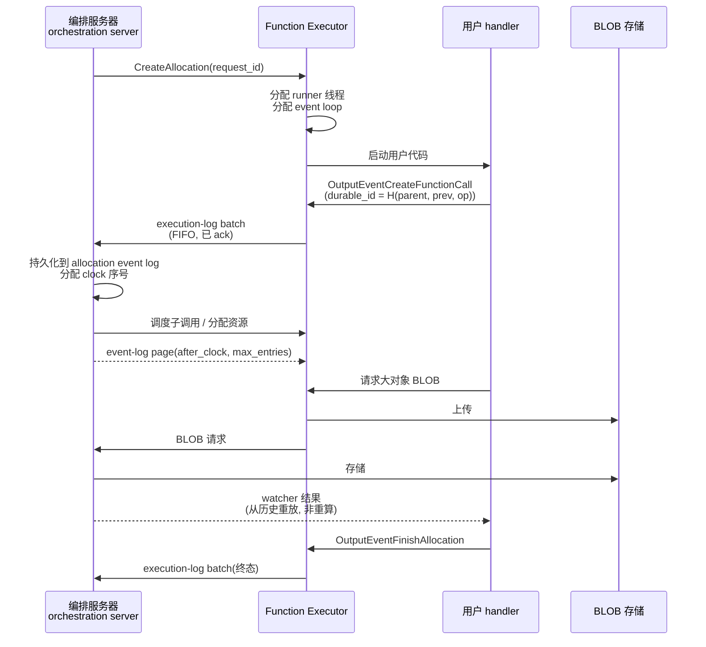
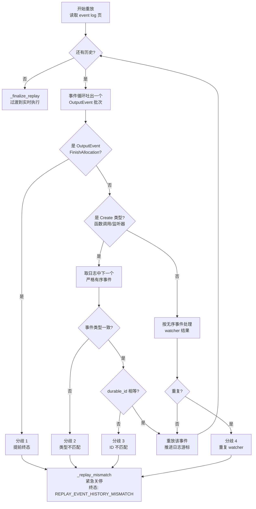
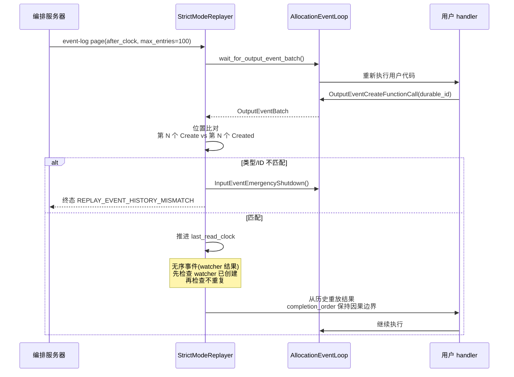

2026 年下半年，几乎每一个 Agent 框架都在卷三件事：更强的模型调用、更复杂的编排、更炫的 Dashboard。但真正落到企业生产环境时，会撞上一个完全不同的墙——**你凭什么相信这个 Agent 干了它声称干的事？**

这个问题有三种常见做法，都不太行：

- **信任模型输出**。Agent 说它读了这个文件，你信它。
- **信任日志**。Agent 的每一步都有日志，但日志是 Agent 自己写的，它可以在写日志的时候说谎。
- **信任重试**。出错了重跑一遍。但重跑会得到不同结果，因为 LLM 是非确定性的、外部世界变了、时间也变了。

真正难的是第四种：**你需要一种机制，让「重跑」这件事本身可被验证**。如果重放一次能精确复现上一次的控制流，那你就得到了一个可以拿来对账的事实——而不只是一个说法。

Tensorlake 的 Function Executor 就是干这个的。它是 Tensorlake 平台里 serverless 函数运行时的那一半（另一半是 MicroVM 沙箱），Apache-2.0，Rust + Python + TypeScript 三栈。它的 Function Executor 侧**完整开源**——包括那套把「重放」做成协议级不变量的严格重放器。

本文从它的 `.specs/` 形式化规范和 Python 源码出发，拆解这套「执行历史即事实」的设计。

---

## 一、项目定位：Agent 需要的是「durable execution」，不是「重试」

### 1.1 平台全景

Tensorlake 的自我定位是：

> "Tensorlake is a compute infrastructure platform for building agentic applications with sandboxes."
> "The Sandbox API creates MicroVM sandboxes which you can use to run agents, or use them as an isolated environment for running tools or LLM generated code."
>
> `README.md`

平台有两个主要面：

| 面 | 做什么 | 开源状态 |
|---|---|---|
| **Sandbox** | MicroVM 有状态执行环境，文件系统接近 SSD 速度，支持快照/克隆/自动挂起恢复/活迁移 | SDK 与 CLI 开源；**块存储挂载核心（gsvc-mount）不在公开仓库** |
| **Function Executor** | serverless 函数运行时，带 fan-out 能力，把长任务编排挂到 Agent 上 | **协议、SDK、执行器、规格文档全部开源** |

本文聚焦 Function Executor 这一半——**因为它才是那个把「可验证性」做成了协议不变量的部分**，而沙箱那一半的能力矩阵，在 2026 年已经有大量文章覆盖（Firecracker / gVisor / Landlock / microVM 各有各的文章）。

### 1.2 Agent 作为一类新工作负载

README 里对问题的定义相当精确：

> "Agents are a new kind of workload. They are neither stateless microservices nor run-to-completion batch jobs. They accumulate state, need strict isolation, call out to model APIs and tool servers, and can burn money in a loop if nobody is watching."
>
> `README.md`

拆开来是四个约束：

1. **有状态**——不是无状态微服务，也不是跑完就结束的批任务
2. **需要严格隔离**——跑的是 LLM 生成的代码
3. **会调外部**——模型 API 和工具服务器
4. **没人盯着就会烧钱**——循环停不下来

对应的三个原语：

| 你想要 | AX/Function Executor 给你 |
|---|---|
| 在隔离沙箱里跑不受信任的 Agent 代码，带 CPU/内存限制 | **Task** |
| 预置 Git 仓库、MCP server、skill 包，让每个 Agent 起步就有料 | **Workspace** |
| 配置平台自己用哪个 LLM，凭据来自 K8s secret | **Model** |

而 Function Executor 这一侧对应的三个原语是：

| 规格文件里的实体 | 职责 |
|---|---|
| `Application` | 一次部署的完整应用定义 |
| `Function` | 应用里的一个函数（可被并发调用） |
| `Request` | 一次应用请求 |
| `Allocation` | 一次函数调用的具体执行实例 |

### 1.3 为什么「重放」不是小事

先说清楚为什么不能简单地「重跑一遍」。

Agent 的一���函数调用里通常包含：调用子函数、发起 fan-out、等子结果、读写状态、上传大对象。这些操作有**不同的完成顺序**——子调用 A 可能比 B 先返回，但用户代码的 `await` 顺序是固定的。如果重放时把 A、B 的结果按不同顺序交还给用户代码，用户代码的分支就可能走岔。

更麻烦的是**结果本身**：LLM 的输出是不可复现的。所以重放时不能重新调用模型，必须**从历史里取回上次的结果**。

Tensorlake 的规格文档把这件事拆成了三个可判定的条件：

> "Replay conforms only if the same operations are issued in the same order, results are consumed at the same causal boundary, and no operation is duplicated."
>
> `.specs/function-executor/specs/03-execution-and-replay.md`

翻译成工程语言：

| 条件 | 含义 | 实现手段 |
|---|---|---|
| **same operations in same order** | 同样的操作、同样的顺序 | durable ID 哈希链 + 位置比对 |
| **results consumed at same causal boundary** | 结果在用户代码的同一个因果位置被消费 | watcher 结果走「无序事件」通道，但必须先重放 watcher 创建 |
| **no operation is duplicated** | 不重复执行 | 两个 `_replayed_*_ids` 集合 |

这三条就是本文的主线。

---

## 二、整体架构：一次分配（Allocation）的完整生命周期

### 2.1 分层视图

Executor 与编排服务器之间是一条**共享 gRPC 协议**。规格文档给出的系统形状：

```text
deployment archive
       |
       v
+----------------------+       shared gRPC protocol       +----------------------+
| Function Executor    | <------------------------------> | orchestration server |
|                      |                                  |                      |
| service lifecycle    | -- execution-log batches ------> | scheduling / retry   |
| allocation runners   | <-- event-log pages ------------ | durable persistence  |
| language SDK runtime | -- state and BLOB requests ----> | state / BLOB broker  |
+----------+-----------+                                  +----------------------+
           |
           v
     customer handler
```

> "The executor separates those responsibilities. It runs language-specific customer code while the server remains the authority for scheduling, retries, request aggregation, and durable event persistence."
>
> `.specs/function-executor/specs/00-overview.md`

这里有一条贯穿全文的设计线索：**「谁拥有什么」被切得非常干净**。

规格文档把它写成三条关键决策：

> "*Process ownership.* **One initialized function per executor process.** This permits loaded models and other customer resources to be shared without cross-function registry ambiguity."
> "*Orchestration split.* **The server owns scheduling and durable persistence.** The executor emits intent and waits for authoritative protocol events."
> "*Protocol source.* **One repository-level protobuf definition.** Both languages compile or load the same messages and RPC service."
>
> `.specs/function-executor/specs/00-overview.md`

第三条尤其关键：**一份仓库级 protobuf 定义，Python 和 TypeScript 两边编译或加载同一套消息和服务**。这不是「两边各实现一遍然后对齐」，而是「协议是唯一的真相」。

### 2.2 目标与非目标

规格文档把目标写成了七条：

> "1. Load exactly one function definition and share its process resources across allocations.
> 2. Validate initialization and allocation inputs before retaining runtime state.
> 3. Run user code until it produces one terminal success or failure event.
> 4. Express child calls, fan-out, reduce chains, watchers, and tail calls through the shared protocol.
> 5. Replay durable behavior deterministically from the allocation event log.
> 6. Reconcile BLOB requests, request state, progress, and metrics without blocking unrelated allocations.
> 7. Shut down active allocations with bounded cleanup and observable terminal results."
>
> `.specs/function-executor/specs/00-overview.md`

而 Non-goals 同样明确：

> "## Non-goals
> - Scheduling allocations or function retries.
> - Persisting the request event log or execution log.
> - Aggregating the final application request outcome.
> - Granting platform credentials to customer code.
> - Mixing Python and TypeScript definitions in one deployed application archive."
>
> `.specs/function-executor/specs/00-overview.md`

注意最后一条：**不允许在一个部署归档里混用 Python 和 TypeScript 定义**。这是一个容易被忽略但影响很大的约束——它意味着跨语言互操作不走「多语言归档」，而是走 **gRPC 协议边界**。

### 2.3 端到端一次分配的时序



关键点：**Executor 从不自己决定重试、调度、持久化**。它只发意图，然后等服务器给的权威事件。这条分工让「重放」有了稳定的历史来源。

---

## 三、核心机制一：durable ID —— 把控制流变成哈希链

### 3.1 为什么不能用普通 ID

想象两个 Agent 函数调用，逻辑上完全一样，但分别叫 `a` 和 `b`。如果 ID 是随机的，重放时你怎么知道「这次重放的第 3 个子调用」就是上次那个「第 3 个子调用」？你只能比顺序——但顺序信息本身不足以证明它们是同一个操作。

Tensorlake 的做法是：**ID 由操作在执行树中的位置内容推导出来**。

规格文档的表述：

> "TypeScript durable function-call IDs are SHA-256 hashes of the parent call ID, previous durable ID, operation kind, and target function name. **Python durable IDs remain language-runtime values but must be deterministic under strict replay.**"
>
> `.specs/function-executor/specs/01-domain-model.md`

注意一个细节：**Python 的 durable ID 不是哈希，是语言运行时的值**，但必须「在严格重放下是确定性的」。这是一个有意思的取舍——Python 侧靠 SDK 侧的确定性 ID 生成规则来保证，而 TypeScript 侧因为跨语言边界，必须用哈希。

### 3.2 哈希链：顺序被编码进 ID

Python 侧的实现（`src/tensorlake/function_executor/allocation_runner/event_loop/durable_id.py`）：

```text
# 来自 src/tensorlake/function_executor/allocation_runner/event_loop/durable_id.py
def future_durable_id(
    future: Future,
    parent_function_call_id: str,
    previous_future_durable_id: str,
    future_durable_ids: dict[str, str],
) -> str:
    """..."""
    parts: list[str] = [
        parent_function_call_id,
        previous_future_durable_id,
        ...
    ]
    # ordered child durable ids
    for child in ...:
        parts.append(future_durable_ids[child])
    return hash_parts(parts)
```

而 `hash_parts` 用的是**长度前缀**拼接：

```text
# 来自 src/tensorlake/function_executor/allocation_runner/event_loop/durable_id.py
    sha256 = hashlib.sha256()
    for s in strings:
        encoded: bytes = s.encode("utf-8")
        sha256.update(len(encoded).to_bytes(8, "big"))
        sha256.update(encoded)
        sha256.update(b"|")
    return sha256.hexdigest()
```

长度前缀的作用是**消除拼接歧义**——注释里写得很清楚：

> "collisions (e.g. ["ab", "c"] vs ["a", "bc"] produce different hashes)."
>
> 来自 `durable_id.py` 的 docstring

而链式维护在 `event_loop.py` 里：

```text
# 来自 src/tensorlake/function_executor/allocation_runner/event_loop/event_loop.py
        # Allocation Execution state.
        #
        # Durable ID of the previous future started by this allocation.
        self._previous_future_durable_id: str = function_call_id
        # Futures that were created (started) during this allocation.
        # Future ID -> Future Durable ID.
        self._future_durable_id: dict[str, str] = {}
```

每个 Future 的 ID 哈希了**父调用 ID + 前一个兄弟 Future 的 ID + 有序子 ID**。这构成一条**沿执行路径的哈希链**。

**推论**：任何一处顺序或身份漂移，都会改变该点的 durable ID，并**级联到所有后续 ID**。这就是严格重放能够**位置化**（positional）检测漂移的根本原因——不需要比较操作内容，只需要比较 ID 是否相等。

### 3.3 ⭐ 一个诚实的边界：多线程用户代码不可重放

同一个文件里有一段注释，是全项目最诚实的一段之一：

```text
# 来自 src/tensorlake/function_executor/allocation_runner/event_loop/event_loop.py
        # If user code calls this durable id computation from multiple concurrent threads,
        # we could read the same previous ID and thus generate wrong ID for different futures.
        # This breaks replay. Locking this section would not help because lock acquisition
        # order between threads is non-deterministic. Multi-threaded user code makes
        # the application non-deterministic regardless if use a lock here or not.
```

这段话的价值在于它**明确拒绝了「加锁就能解决」的诱惑**：加锁确实能让「读到同一个 previous ID」不再发生，但**锁的获取顺序本身在多线程下是非确定的**，所以问题无解。

**结论不是「我们不支持多线程」，而是「多线程用户代码本质上不可重放，加锁与否都一样」**。这是一个诚实的、可验证的边界声明，而不是一个 TODO。

### 3.4 一个反直觉的设计：严格控制流，宽松数据

durable ID 的哈希输入里**刻意排除了用户数据**。注释里的原话：

> "Strict on Control Flow but Lenient on Data. 'The History is the Source of Truth.'"
>
> 来自 `durable_id.py`

这是整套设计里最精妙的一点，值得单独讲：

- **控制流必须严格**：调用了哪个函数、顺序如何、扇出成什么形状——这些进入哈希
- **数据必须宽松**：传了什么参数、返回了什么值——这些**不**进入哈希

为什么？因为如果数据也进哈希，那么：
- LLM 返回的随机性会导致 ID 每次都不同 → 重放永远失败
- 大对象（几十 MB 的 BLOB）每次哈希都要重新扫一遍 → 性能灾难

而用户数据在重放时**本来就该从历史里取回**（因为 LLM 输出不可复现）。所以「宽松」不是妥协，而是**正确的建模**：重放的语义是「控制流必须一模一样，数据由历史提供」。

---

## 四、核心机制二：两种日志的职责分离

### 4.1 分配事件日志 vs 执行日志

Executor 里有**两条独立的日志流**，这是理解整套机制的关键。

| | 分配事件日志（allocation event log） | 执行日志（execution log） |
|---|---|---|
| 拥有者 | **编排服务器** | **Function Executor** |
| 方向 | 服务器 → Executor（读页） | Executor → 服务器（写批次） |
| 内容 | 「发生了什么」的权威历史 | 「要做什么」的意图流 |
| 用途 | **重放的依据** | 驱动服务器调度/持久化 |
| 是否可重放 | **是**，唯一真相 | 否，副作用流 |

源码里的表述：

> "The allocation event log is the *replayable record*; the execution log is the *non-replayable effect stream*. During strict replay, the executor **does not re-emit** effects for ops that were already recorded — it consumes the recorded history and re-feeds it into the event loop. Effects that are 'past the replay point' are re-emitted normally (see `_finalize_replay(batch.events[i:])`)."
>
> 来自 `allocation_runner` 源码分析

**这就是「副作用只发生一次」的机制**：重放时不重新发副作用，而是把历史结果喂回事件循环。

### 4.2 执行日志：FIFO + 显式确认 = at-least-once

执行日志的实现（`execution_log_buffer.py`）有一个细节很讲究：

> "It is a **FIFO of acknowledged batches**: `get_current_batch()` returns the *front* batch and **does not remove it**; the Server must call `advance()` to pop it. This gives **at-least-once delivery with explicit acknowledgement** — the Server can crash mid-batch and re-read the same batch."
>
> 来自 `execution_log_buffer.py` 源码分析

即：**取批次不移除，必须由服务器显式 `advance()` 才出队**。服务器在批次中途崩溃，重读同一批次即可——这是标准的 at-least-once 语义，且不依赖任何事务机制。

### 4.3 逻辑时钟：一个「日志位置」，不是墙上时间

重放需要知道「我现在读到历史的哪了」。这个位置由三个变量表示：

- `after_clock` —— 从哪个 clock 之后开始读
- `response_clock` —— 服务器回应的这个页的 clock
- `last_read_clock` —— 已经消费到的位置

分页参数 `max_entries`，默认：

```text
# 来自 src/tensorlake/function_executor/allocation_runner/event_log_reader.py
OPTIMAL_EVENT_LOG_READ_BATCH_SIZE = 100
```

而 clock 的取值范围有明确约束：

> "Event-log clocks cross the shared Python/TypeScript protocol boundary."
>
> 来自 `event_log_reader.py`

这解释了为什么全局共享类型里有一个看起来很奇怪的定义：

```json
// 来自 .specs/canonical-types.schema.json
"SafeNonNegativeInteger": {
  "description": "A non-negative integer exactly representable by both Python and JavaScript runtimes.",
  "type": "integer",
  "minimum": 0,
  "maximum": 9007199254740991
}
```

`9007199254740991` 就是 2^53−1，JavaScript `Number` 的安全整数上界。**clock 必须能被 Python 和 TypeScript 双方精确表示**——否则跨语言边界上就会出现精度丢失，进而破坏重放的正确性。

这是本系列文章里少见的「一个数字解释了为什么整套跨语言协议要这么设计」的例子。

### 4.4 完成顺序：第二个更细的逻辑时钟

事件循环里还有一个独立的 `completion_order`：

> "**This is the 'same causal boundary' guarantee:** `FIRST_COMPLETED` picks the Future with the minimum *completion_order*, i.e. the first completion **in the executor's serialized observation order**, not the first in wall-clock time. A result that arrived later in wall-clock but got a higher completion_order cannot leak into the returned `done` set."
>
> 来自 `event_loop.py` 源码分析

这是「因果边界」得以保持的第二个机制。设想用户代码写 `Future.wait(return_when=FIRST_COMPLETED)`：如果按墙上时间挑第一个完成的，那么重放时两个结果到达顺序变了，挑中的就可能是另一个 → 分支走岔。按 `completion_order` 挑，则挑的是**执行器序列化观测顺序里的第一个**，与墙上时间无关 → 可重放。

---

## 五、核心机制三：严格重放器的五种分歧判定

### 5.1 重放器的定位

严格重放器（`strict_mode_replayer.py`）的工作方式是**位置化比较器**：

1. 驱动事件循环，让用户代码重新跑
2. 事件循环吐出 `OutputEvent` 批次
3. 把每个 output event 与分配事件日志里**下一个**记录事件对位
4. 对不上 → 分歧

### 5.2 五类分歧

源码里能识别出的分歧类型：

| # | 分歧 | 日志原文 |
|---|---|---|
| 1 | 重放中提前看到终态 | "Finish allocation event observed during replay, indicating a replay mismatch." |
| 2 | 事件类型不匹配 | "Replay mismatch: expected OutputEventCreateFunctionCall, got different output event type." |
| 3 | **durable ID 不匹配** | "Replay mismatch: positional AllocationEventFunctionCallCreated durable_id mismatch" |
| 4 | watcher 重复创建 | "Replay mismatch: duplicate function call watcher " |
| 5 | 未知事件类型 | "Replay mismatch: unknown allocation event type." / "Replay mismatch: unknown event loop output event type." |

第 3 类是核心：位置对上了，**但 ID 不等** → 说明用户代码这次走了不同的路径。

代码：

```text
# 来自 src/tensorlake/function_executor/allocation_runner/strict_mode_replayer.py
                        fcc: AllocationEventFunctionCallCreated = (
                            alloc_event.function_call_created
                        )
                        if fcc.function_call_id != output_event.durable_id:
                            self._logger.info(
                                "Replay mismatch: positional AllocationEventFunctionCallCreated durable_id mismatch",
                                expected=output_event.durable_id,
                                got=fcc.function_call_id,
                            )
                            return self._replay_mismatch()
```

### 5.3 分歧是终态，不是重试

```text
# 来自 src/tensorlake/function_executor/allocation_runner/strict_mode_replayer.py
    def _replay_mismatch(self) -> StrictReplayResult:
        """Sends emergency shutdown to event loop and returns a replay mismatch result."""
        self._event_loop.add_input_event(InputEventEmergencyShutdown())
        return StrictReplayResult(
            last_clock=self._alloc_buffer.last_read_clock,
            pending_event_loop_output_events=[],
            finish_event=self._finish_event_helper.from_replay_mismatch(),
        )
```

**分歧不重试**。原因很实在：如果重放已经走到一半才分歧，说明历史本身可能有问题，或者代码变了；再重放一次大概率同样分歧，还会浪费资源。Executor 层面直接紧急关停并交出「replay mismatch」终态；要不要重试是**服务器**的决定。

### 5.4 ⭐ 有序事件 vs 无序事件：整套机制最精妙的一处

规格文档在 `_run` 的注释里把假设写得很清楚：

```text
# 来自 src/tensorlake/function_executor/allocation_runner/strict_mode_replayer.py
        # Key algorithm assumptions and design choices:
        # -  AllocationEventFunctionCallCreated, AllocationEventFunctionCallWatcherCreated events appear in the
        #    allocation log in the same order as OutputEventCreateFunctionCall, OutputEventCreateFunctionCallWatcher
        #    events are emitted by the event loop. This is ensured by Server.
        # -  AllocationEventFunctionCallWatcherResult events appear in the allocation log in any order after
        #    their corresponding AllocationEventFunctionCallWatcherCreated events.
        #    This is because each function call takes an arbitrary amount of time to complete.
```

**「有序」的**是：函数调用的**创建**（`FunctionCallCreated` / `FunctionCallWatcherCreated`）。
**「无序」的**是：函数调用的**结果**（`FunctionCallWatcherResult`）。

原因显而易见：创建是用户代码同步发起的，顺序确定；而结果何时回来取决于子调用跑多久，本质不确定。

源码里的处理：

```text
# 来自 src/tensorlake/function_executor/allocation_runner/strict_mode_replayer.py
                # Unordered alloc events are never checked for matching with event loop output events.
```

那么无序事件怎么保证「不重复」和「因果边界」？靠两个集合 + 一个前置条件：

- `_replayed_watcher_ids`：已重放的 watcher 创建
- `_replayed_watcher_result_ids`：已重放的结果

规则是：

| 检查 | 无序事件的要求 |
|---|---|
| watcher 创建 | 必须**先**被重放（否则用户代码永远等不到结果 → 死锁） |
| 结果 | 不能重复重放（否则用户代码看到两次结果） |
| 顺序 | **不比** |

这恰好对应了第一节那三条重放条件：

| 重放条件 | 由哪个机制保证 |
|---|---|
| same operations in same order | 位置比对 + durable ID 相等 |
| results consumed at same causal boundary | 无序结果 + watcher 创建前置 + `completion_order` |
| no operation duplicated | `_replayed_*_ids` 集合 |

### 5.5 死锁陷阱：为什么 watcher 必须在 Server 侧重建

注释里有一段关于死锁的警告，非常具体：

```text
# 来自 src/tensorlake/function_executor/allocation_runner/strict_mode_replayer.py
        # -  Server re-creates all the unfinished watchers that didn't add their AllocationEventFunctionCallWatcherResult to allocation
        #    event log before starting the replay. Otherwise, user code will never get AllocationEventFunctionCallWatcherResult and will
        #    deadlock during replay. We can't recreate watchers in the replayer because this will result in extra allocation events logged
        #    during replay that don't match user code behavior, so the next replay will fail with a mismatch.
        # -  If Server deletes AllocationEventFunctionCallWatcherResult during pre-replay history edit then it has to re-create the watcher.
        #    Otherwise, user code will never get AllocationEventFunctionCallWatcherResult and deadlock during replay.
```

这里有一个**递归的困难**：

- 重放前，未完成的 watcher 必须被重建，否则用户代码死锁
- 但如果**在 replayer 里**重建，重放过程会往日志里写额外的分配事件
- 这些额外事件与用户代码行为不匹配 → **下一次重放必然分歧**

所以 watcher 重建**只能在 Server 侧做**（重建不产生日志写入）。这是一个「为了保证未来的重放能成功，现在的实现必须克制」的典型例子。

### 5.6 重放到实时的过渡

```text
# 来自 src/tensorlake/function_executor/allocation_runner/strict_mode_replayer.py
    def _finalize_replay(
        self, not_replayed_event_loop_output_events: list[OutputEventType]
    ) -> StrictReplayResult:
        """Handles the replay-to-live transition.

        Gathers all the event loop output events that were emitted during replay but
        were not actually replayed because replay reached end of allocation event log
        without any replay mismatch error.
        """
        return StrictReplayResult(
            last_clock=self._alloc_buffer.last_read_clock,
            pending_event_loop_output_events=not_replayed_event_loop_output_events,
        )
```

历史读完了，但事件循环可能已经吐出了一批**还没被重放消费**的 output event（因为历史在中途耗尽）。这些事件属于「重放点之后」，必须**转成正常执行事件**发出去——注释里说得很直白：

> "All the not matching events from that last batch needs to be converted to event loop execution events and forwarded to execution log buffer as during normal execution. This is because all these event loop output events are past the replay point and need to be executed normally."

### 5.7 严格重放的判定流程



---

## 六、核心机制四：SDK 侧的「持久路径 vs 本地路径」

### 6.1 用户怎么定义一个应用

Python 侧用装饰器：

```text
# 来自 src/tensorlake/applications/...（装饰器注册路径）
    def __init__(self, ...) -> None:
        register_decorator(self)
```

注册时会生成应用版本：

```text
# 来自 src/tensorlake/applications/...（应用定义注册）
            version=nanoid(alphabet="0123456789abcdefghijklmnopqrstuvwxyz"),
```

**应用版本是随机 nanoid**——也就是说，**每次注册都是一个新版本**，重放时靠版本号区分代码。

TypeScript 侧是显式函数调用：`registerFunction` / `registerApplication`，并且**重名会抛错**（Python 侧是「最后定义者胜」）。

### 6.2 两个隐藏的旋钮

Python SDK 的函数注册里藏着两个明确标注「未实现」的选项：

```text
# 来自 src/tensorlake/applications/...（函数注册选项）
            # Hidden from users because not implemented in Server yet.
            cacheable=...,
            # Hidden from users because not implemented in Telemetry yet.
            max_concurrency=...,
```

这是很值得学习的做法：**选项先在 SDK 里存在，但明确标注「服务器端还没实现」并对用户隐藏**。相比之下，很多项目会先把选项暴露出去，然后让用户发现「设了没用」。

### 6.3 请求上下文：三种状态写入阶段

`RequestContext` 暴露的东西两边基本一致：

| 字段 | 作用 |
|---|---|
| `requestId` | 请求标识 |
| `headers` | 请求头 |
| `state` | 请求状态（可读可写） |
| `progress` | 进度上报 |
| `metrics` | 指标上报 |

TypeScript 额外暴露一个**公开的 `AbortSignal`**——这个差异后面会讲。

请求状态的写入是**三阶段协议**：

1. `POST /request_state/prepare_write` —— 申请写
2. 上传 BLOB
3. `POST /request_state/commit_write` —— 提交

读取则是 `POST /request_state/prepare_read`。

而序列化格式两边**不一样**：Python 用 **pickle**，TypeScript 强制 **JSON**。

### 6.4 TypeScript 的 promise 因果追踪

这是 SDK 侧最有技术含量的一段。TypeScript 侧给「持久化 thenable」打上来源元数据（用 `Symbol.for` 做跨 SDK 副本共享的注册表），并**改造了 `Promise.resolve/race/any/all/allSettled` 和 `Promise.prototype.then`**，把每个竞争者分类为「持久的」还是「普通的」，然后调用 `trackDurableAggregate()`。

核心规则（原文引用）：

> "Constructing an aggregate attaches internal reactions to its durable inputs, but that does not mean application code is awaiting the result. Mark the aggregate itself as detached so a later user reaction becomes the durable assimilation observed by strict replay."
>
> 来自 `typescript/src/function-executor/` 相关源码

这句话解释了一个微妙的语义问题：**`Promise.all([...])` 只是「构造了一个聚合」，不等于「用户代码在等它的结果」**。如果把聚合本身当成「用户已经在等」，那么用户的 `await` 会被记到错误的位置，重放就会分歧。所以聚合必须被标记为「detached」，等用户真的对它产生反应时，那才是「持久化同化」。

`Promise.any` 还有一条额外规则：**普通门不能仅仅因为某个普通的 fulfillment 回调跑过就过期**。

### 6.5 取消：Python 与 TypeScript 的巨大差距

| | TypeScript | Python |
|---|---|---|
| 公开取消信号 | **有**，`AbortSignal` | **没有** |
| 优雅关闭宽限期 | `SHUTDOWN_GRACE_PERIOD_MS = 10_000`（10 秒） | `FORCED_SHUTDOWN_TIMEOUT_SECONDS = 4`（4 秒） |
| 强制退出方式 | — | `force_exit=lambda: os._exit(1)` |

规格文档把这条列为已确认的差距：

> "**(A5) The Python executor cannot be gracefully interrupted; it is force-killed.**"
> "**(A8) Python has no public cancellation signal.**"
>
> 来自 `.specs/reviews/2026-07-25-function-executor-applications-sdk-conformance.md`

原因也很直白：Python 无法安全地中断一个任意用户线程。

---

## 七、⭐⭐⭐ 必须诚实指出的源码自陈缺陷

这一节是本系列的传统。以下全部来自 Tensorlake 自己的代码注释与规格文档，**逐字引用**。

### 7.1 反序列化失败不总是可重放的（最严重的一处）

```text
# 来自 src/tensorlake/function_executor/allocation_runner/allocation_event.py
        # Even though we fully control serialization format for child function call outputs,
        # deserialization still might fail if the output contains classes not available in the caller
        # function image. So we treat it as user code error, not internal error.
        #
        # FIXME: This error is not replayable in all cases. The fact that we failed deserializing here is
        # not written to allocation event log, so if user updates the caller function image fixing the
        # deserialization problem and then replays the request then the replay history can diverge if
        # user code previously handled this deserialization error instead of letting it bubble up and fail
        # the function call.
```

这段话描述了一个真实的重放正确性漏洞：**反序列化失败没有写进分配事件日志**。于是如果用户升级了调用方镜像（修好了反序列化问题），然后重放这段历史，**历史就会分歧**——因为上次用户代码捕获了这个错误并走了分支，这次不会。

换句话说：**「升级代码后重放旧历史」在这条路径上是不安全的**，而且这个事实只写在源码注释里。

### 7.2 cause-effect 异常跟踪未实现

```text
# 来自 src/tensorlake/function_executor/allocation_runner/allocation_runner.py
# TODO: Implement cause-effect exception -> alloc log event ID tracking
# via TensorlakeError._event_details field. See
# https://www.notion.so/tensorlake/UX-of-durable-execution-error-handling-and-replay-31ba5404295580b684f4f8be38eb4feb
```

### 7.3 内部错误绝不能上报给用户代码

这段注释解释了一个反直觉的决策：

```text
# 来自 src/tensorlake/function_executor/allocation_runner/allocation_runner.py
            except BaseException as e:
                # NB: If an exception is raised in an allocation event handler, we should not report it
                # to event loop as an "internal error" input event because the original event
                # that we failed to process might be a "success" event. If we report "internal error"
                # here then we'll diverge user code execution from the event history which is
                # a durable execution bug. Instead we just stop the allocation execution immediately.
                # This will allow us to fix the root cause of this failure an replay the function call
                # with its event history intact.
```

（顺便，注释里的 "an replay" 是原文的笔误。）

对应到事件循环侧，注释写得更狠：

> "This is the single most important safety mechanism for replay: if an internal error occurs and it were reported to user code as a normal exception, user code might catch it and take a different branch than the one recorded in history. Instead the loop is hard-killed with a `BaseException` subclass that user `except Exception:` blocks cannot catch."

**内部错误用 `BaseException` 而不是 `Exception`** —— 这是为了让用户的 `except Exception:` 抓不到它。因为一旦用户代码捕获了内部错误，它就可能走一条历史里没有的分支，重放就永久分歧了。

### 7.4 紧急关停不足以产生新批次

```text
# 来自 src/tensorlake/function_executor/allocation_runner/allocation_runner.py
                # Conversion failures are executor failures, not new inputs for
                # user code to handle. The user thread may already have exited
                # after emitting its finish event, so emergency shutdown alone
                # cannot be relied on to produce another output batch.
```

### 7.5 BLOB-less 失败关联是一个启发式

```text
# 来自 src/tensorlake/function_executor/allocation_runner/blob_manager.py
    # associate a BLOB-less response with the oldest outstanding request
```

TypeScript 侧同样：

```text
# 来自 typescript/src/function-executor/allocation.ts
    // match a BLOB-less response to the oldest request
```

规格文档的措辞：

> "Responses are correlated by ID. **An output-BLOB error without a BLOB payload is matched to the oldest outstanding output request because the response contains no BLOB ID.**"
>
> `.specs/function-executor/specs/02-protocol-and-service.md`

这是一个**已知不精确**的关联：出错时如果响应里没带 BLOB ID，只能退化到「最老的未完成请求」。并发高的时候可能关联错。

### 7.6 自适应重放只是个枚举值

规格文档的对照表：

> "| Replay | Strict and non-replay execution | **Adaptive replay is present in the enum but not an executor contract** |"
>
> 来自 `.specs/reviews/2026-07-25-function-executor-applications-sdk-conformance.md`

即：`ReplayMode.ADAPTIVE` 这个枚举值存在，但**不是一个被承诺的契约**。文档主动澄清了这一点，避免用户误以为可以用。

### 7.7 其他

| 限制 | 原文 / 出处 |
|---|---|
| Python 大部分校验推迟到部署时 | "**Python defers most validation to deployment for decorator ergonomics.** TypeScript validates registration shape, options, schemas, and defaults when the registration is created." |
| 不支持 CommonJS 与混合语言归档 | "Deployment creates one-language archives. The CLI bundles TypeScript ESM for Node.js 24 and embeds the executor capsule resolved from the exact SDK package. **CommonJS entrypoints and mixed-language bundles are unsupported.**" |
| 归档大小限制不在执行器范围内 | "archive size limits are external to the executor source" |
| `File` 不能嵌套在复杂类型提示里 | "Only simple type hints like 'foo: File' are supported" |
| BLOB 下载是串行的 | 源码中 `TODO: Do this in parallel. Keep in mind that the underlying BLOB store...` |
| 多线程用户代码不可重放 | 见 §3.3 |

### 7.8 一个「规范自己说错了」的诚实记录

一致性评审文档里记录了一件很有说服力的事：

> "the first canonical draft described TypeScript archive extraction as size-bounded"

即：**规范的第一版草稿把 TypeScript 归档解压描述成有大小上限的，实际代码不是这样，于是规范被修正**。而且这份评审还列出了 **10 处已修复的分歧**，其中包括**它自己测试夹具里的两个 bug**。

一份规范主动记录「我曾经写错了、我改过来了」，比一份看起来永远正确的规范可信得多。

---

## 八、端到端：一次严格重放到底发生了什么



**注意「从历史重放结果」这一格**：结果不是重算的，是从日志里取回的。这就是为什么 LLM 的随机性不破坏重放——**模型输出本来就是「历史」，而不是「要重跑的东西」**。

---

## 九、与同类项目的设计差异

这一节讲**设计思路的差异**，不列功能。

| 项目 | 核心抽象 | 「可验证」怎么来的 | 与 Tensorlake 的关键差异 |
|---|---|---|---|
| **Tensorlake Function Executor** | Application / Function / Request / Allocation | **重放历史即事实**：durable ID 哈希链 + 位置化比对 + 无序结果通道 | — |
| **Restate**（2026-06-30 已写） | Durable Execution | 事件溯源 + 确定性重放，靠 SDK 的 workflow 抽象 | Restate 的重放是**框架自带**的（用户写 workflow，框架管确定性）；Tensorlake 是**协议层**的（用户写普通 async 函数，协议保证可重放） |
| **Hatchet**（2026-07-31 已写） | Durable Execution Engine | Postgres 存 workflow 状态，队列驱动 | Hatchet 是**编排引擎**（用户定义 workflow 步骤）；Tensorlake 是**函数运行时**（用户写普通代码，重放保证由协议提供） |
| **TriggerDev**（2026-08-18 已写） | Waitpoint / Snapshot | 事件驱动的状态机快照 | TriggerDev 的快照是**状态快照**；Tensorlake 的日志是**执行历史**（记录的是「做过什么」，不是「现在是什么」） |
| **ActiveGraph**（2026-11-10 已写） | 事件溯源图运行时 | 单一投影器 `apply_event`，日志是唯一真相 | ActiveGraph 强调「重放 = 重新思考图状态」；Tensorlake 强调「重放 = 精确复现控制流，结果取自历史」 |
| **Chidori**（2026-08-19 已写） | Host-call Journal | 确定性重放 | Chidori 记录的是**宿主调用**（如 HTTP 请求）；Tensorlake 记录的是**函数调用与扇出**，并且对「结果到达顺序不确定」有专门的无序通道设计 |
| **Datus**（2026-11-03 已写） | Subject Tree + 语义层 | 退役语义 fail-closed | 属于数据工程上下文层，与执行确定性正交 |

**一句话总结差异**：

> Restate / Hatchet / TriggerDev / ActiveGraph 都在**框架层**提供确定性；
> Tensorlake 把确定性下沉到**协议层**——用户写的是普通的 Python / TypeScript 异步函数，框架不要求你用它的 DSL，代价是协议必须自己维护 durable ID、逻辑时钟和两种日志。

---

## 十、优缺点分析

### 10.1 左侧：架构简洁性 / 扩展性 / 易用性

| 维度 | 评价 | 依据 |
|---|---|---|
| **架构简洁性** | ⭐⭐⭐⭐⭐ 极好 | 「谁拥有什么」切得非常干净：Server 拥有调度与持久化，Executor 只发意图；两种日志职责分明（历史 vs 副作用） |
| **扩展性** | ⭐⭐⭐⭐ 好 | 新增语言 = 实现一份协议；`One repository-level protobuf definition` 保证两端一致。代价是不能混语言归档 |
| **易用性** | ⭐⭐⭐ 一般 | 用户写的是普通 async 函数（好），但要理解 durable ID、clock、allocation 这些概念（坏）；Python 侧校验推迟到部署期，错误发现得晚 |
| **可审计性** | ⭐⭐⭐⭐⭐ 极好 | 每次分配的执行历史都是可重放、可对账的事实；规范甚至主动记录自己的错误 |
| **跨语言一致性** | ⭐⭐⭐⭐ 好 | 单一 proto 定义 + `SafeNonNegativeInteger` 这类显式约束，但 Python 侧没有公开取消信号，两边能力不对等 |

### 10.2 右侧：性能 / 复杂度 / 维护性

| 维度 | 评价 | 依据 |
|---|---|---|
| **性能** | ⭐⭐⭐ 中等 | 每次函数调用都要算 durable ID（SHA-256 链）；重放要分页读历史；BLOB 下载是串行的（源码 `TODO: Do this in parallel`） |
| **复杂度** | ⭐⭐ 很高 | durable ID 链、两种时钟（clock + completion_order）、两种日志、有序/无序事件分类、三阶段状态写入、11 个 gRPC RPC——**心智负担很重** |
| **维护性** | ⭐⭐⭐⭐ 好 | `.specs/` 形式化规范 + 一致性评审 + 机器检查；但规范与代码的偏离（§7.1 反序列化）说明**同步靠人工** |
| **可移植性** | ⭐⭐ 中等 | 核心机制绑死在 Tensorlake 的服务器实现上；`gsvc-mount` / `gsvc-codec` 不开源，块存储挂载无法自建 |
| **调试友好度** | ⭐⭐⭐⭐ 好 | 分歧是终态而非静默重试；日志有明确的 mismatch 原因（5 类）；`ax describe` 式的事件历史可查 |

### 10.3 一个必须说的取舍：这是「云平台」，不是「可自建的开源栈」

`crates/gsvc-mount/src/lib.rs` 和 `crates/gsvc-codec/src/lib.rs` 是**纯占位文件**：

```rust
//! Resolution-only placeholder for the private `gsvc-mount` mount core.
//!
//! The real crate is not vendored into this public repository. This file exists only so the
//! optional `gsvc-mount` dependency of `tensorlake-cli` resolves without access to the private
//! artifact_storage repo. It is never compiled by a valid build — see this crate's `Cargo.toml`.

compile_error!(
    "the `mount` feature requires the private gsvc-mount core, which is not vendored into this \
     public repo. Build the official mount-enabled binary with `just build-cli-mount` (it swaps \
     in the real source from a sibling artifact_storage checkout), or build without \
     `--features mount`.",
);
```

也就是说：**块存储挂载、packfile 编解码、Lattice 调度器都在私有仓库里**。公开仓库给你的是协议、SDK 和执行器——而**执行器恰恰是最有价值的部分**，因为它承载了「严格重放」这套语义。

所以对读者的实际建议是：**把这套「durable ID 哈希链 + 位置化重放比对 + 有序/无序事件分治」的设计当作范式来读，而不是当作一个可以今天就自建的组件。**

---

## 十一、实践：跑起来看看

### 11.1 环境准备

Tensorlake 的 Function Executor 是完整的 Python 包，可以本地跑。

```bash
# 来自 README.md
pip install tensorlake
```

CLI 是独立二进制，不走 PyPI / npm：

```bash
# 来自 README.md
curl -fsSL https://tensorlake.ai/install | sh
```

登录并配置上下文：

```bash
# 来自 README.md
export TENSORLAKE_API_KEY="***"
tl login
```

### 11.2 定义一个应用

```text
# 来自 src/tensorlake/applications/...（装饰器用法）
from tensorlake.applications import application, function

app = application(name="research-pipeline")

@app.function
async def fetch(url: str) -> str:
    # 你的普通 async 函数，不需要任何框架 DSL
    async with client.get(url) as resp:
        return await resp.text()

@app.function
async def summarize(docs: list[str]) -> str:
    return await llm.summarize(docs)
```

### 11.3 沙箱侧（CLI）

```bash
# 来自 README.md
# 创建一个沙箱（一个阻塞请求；超时只是排队，不会取消）
tl sbx create

# 排队创建并立即返回，之后再取
tl sbx create --queue
tl sbx wait <sandbox-id> --timeout 1800

# 在沙箱内执行命令
tl sbx exec <sandbox-id> -- sh -lc "printf 'Hello from the sandbox!\n'"

# 阻断全部出网
tl sbx update <sandbox-id> --no-internet

# 只允许访问指定目的地
tl sbx update <sandbox-id> --network-allow api.example.com
```

### 11.4 用 Python SDK 创建沙箱

```text
# 来自 README.md
from tensorlake.sandbox import SandboxClient

client = SandboxClient.for_cloud(api_key="your-api-key")

with client.create_and_connect() as sandbox:
    result = sandbox.run("sh", ["-lc", "printf 'Hello from the sandbox!\\n'"])
    print(result.stdout)  # "Hello from the sandbox!"

    sandbox.write_file("/tmp/data.txt", b"some data")
    content = sandbox.read_file("/tmp/data.txt")

    proc = sandbox.start_process("sleep", ["300"])
    print(proc.pid)
# 退出 context manager 时沙箱自动终止
```

### 11.5 沙箱状态机（用于理解生命周期）

Python SDK 的状态枚举（`src/tensorlake/sandbox/models.py`）：

| 状态 | 含义 |
|---|---|
| `pending` | 已排队，等待调度 |
| `running` | 运行中 |
| `snapshotting` | 正在快照 |
| `suspending` | 正在挂起 |
| `suspended` | 已挂起（可 resume） |
| `terminated` | 已终止 |
| `timeout` | 超时 |
| `failed` | 失败 |

`pending` 的细分原因：

| 原因 | 含义 |
|---|---|
| `scheduling` | 调度中 |
| `waiting_for_container` | 等容器 |
| `no_executors_available` | 无可用执行器 |
| `no_resources_available` | 无可用资源 |
| `pool_at_capacity` | 池已满 |
| `max_capacity_reached` | 达到最大容量 |
| `no_executor_for_snapshot_location` | 快照位置无可用执行器 |
| `unplaceable` | 无法放置 |

终止原因：`no_capacity` / `cancelled`。

快照分两类：

| 类型 | 捕获内容 | 恢复方式 |
|---|---|---|
| `memory` | VM 内存 + 文件系统 | warm restore |
| `filesystem` | 仅文件系统 | 从 tarball 冷启动（bypasses the overlay-path constraints of non-CAS sandboxes） |

---

## 十二、趋势判断与工程经验提炼

### 12.1 四个趋势判断

**1. 「Agent 需要 durable execution，不只是重试」会从基础设施下沉到框架层。**
2026 年大家还在讨论「Agent 失败了怎么办」，主流答案是重试 + 退避。但重试对 LLM 天然无效——同样的输入会得到不同的输出。Tensorlake 这套「执行历史即事实」的思路，回答的是更本质的问题：**Agent 的行为能不能像数据库事务一样被对账？** 我预期 2027 年会有更多框架内建 durable ID 概念。

**2. 「严格控制流、宽松数据」是 Agent 确定性建模的一个通用范式。**
durable ID 排除用户数据、只哈希控制流结构，这个取舍可以直接搬到任何「需要重放 LLM Agent」的场景——你不可能重算 LLM 输出，但你可以验证控制流是否一致。**这是本文最可移植的一条结论。**

**3. 有序/无序事件分治是所有并发重放系统的必备结构。**
「创建必须严格有序，结果顺序不确定但必须先有 watcher」这个模式，不只适用于 Tensorlake。任何「重放 + 并发外部结果」的系统都会撞上同一道题。

**4. 「规范主动记录自己写错了」会成为企业级 AI 基础设施的信任标志。**
`.specs/reviews/` 那份 38KB 的一致性评审，记录了 10 处已修复分歧（包括自己测试夹具的 bug），并且明确写下「第一版草稿把 TypeScript 归档解压描述成有大小上限的，实际不是」——这种坦诚本身就是产品能力。

### 12.2 可直接引用的工程模式

| # | 模式 | 出处 |
|---|---|---|
| 1 | **控制流进哈希、数据不进哈希** | `durable_id.py`：「Strict on Control Flow but Lenient on Data. 'The History is the Source of Truth.'」 |
| 2 | **ID 用长度前缀拼接，消除拼接歧义** | `hash_parts()`：`["ab","c"]` vs `["a","bc"]` 产生不同哈希 |
| 3 | **位置化比对 + 内容派生 ID**，不比较操作内容 | `strict_mode_replayer.py`：位置对上就够，ID 不等即分歧 |
| 4 | **有序事件与无序事件分治** | watcher 创建严格有序，watcher 结果走无序通道 + 前置检查 |
| 5 | **分歧是终态，不是重试** | `_replay_mismatch()` 紧急关停，交服务器决定 |
| 6 | **内部错误用 `BaseException`**，让用户 `except Exception` 抓不到 | `_TensorlakeEventLoopExit` |
| 7 | **内部错误绝不上报为用户可处理的输入事件** | `allocation_runner.py`：否则用户会走未记录分支 |
| 8 | **日志读取用显式 advance()**，实现 at-least-once | `execution_log_buffer.py` |
| 9 | **跨语言协议里的数字要显式约束表示范围** | `SafeNonNegativeInteger` 上界 2^53−1 |
| 10 | **「为了未来重放能成功，现在必须克制」** | watcher 重建只能放 Server 侧 |
| 11 | **不可重放的路径要显式承认，不要假装支持** | 多线程用户代码：「Multi-threaded user code makes the application non-deterministic regardless if use a lock here or not.」 |
| 12 | **规格要能记录自己曾经写错** | `.specs/reviews/` 一致性评审 |
| 13 | **未实现的选项先在 SDK 存在但对用户隐藏** | `cacheable` / `max_concurrency` 注释 |
| 14 | **副作用流与历史流分离**，重放时不重复发副作用 | 分配事件日志 vs 执行日志 |

### 12.3 一句话总结

> **Tensorlake 最有价值的不是它的沙箱，而是它对「Agent 的执行历史是什么」这个问题给出的答案：历史不是日志，是一串由控制流结构推导出来的哈希；重放不是重跑，是把哈希链与历史逐位对账。** 无论你是否用它的产品，这套「严格控制流、宽松数据」的设计，都值得抄。

---

## 附录：关键资源

| 资源 | 地址 |
|---|---|
| GitHub 仓库 | https://github.com/tensorlakeai/tensorlake |
| 形式化规格 | 仓库 `.specs/` 目录（function-executor / applications-sdk / reviews） |
| 协议定义 | `proto/tensorlake/function_executor/proto/function_executor.proto` |
| 严格重放器 | `src/tensorlake/function_executor/allocation_runner/strict_mode_replayer.py` |
| durable ID | `src/tensorlake/function_executor/allocation_runner/event_loop/durable_id.py` |
| 事件循环 | `src/tensorlake/function_executor/allocation_runner/event_loop/event_loop.py` |
| 官方文档 | https://docs.tensorlake.ai |
| PyPI | `pip install tensorlake` |
| License | Apache-2.0 |

**仓库统计（2026-11-16）**：⭐ 1,044 · Apache-2.0 · Rust + Python + TypeScript · 2,435 个 tree 节点 · 最近推送 2026-11-13 · 未归档
