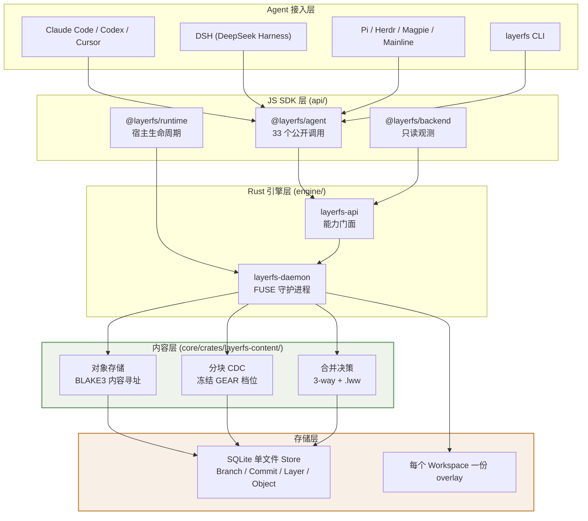
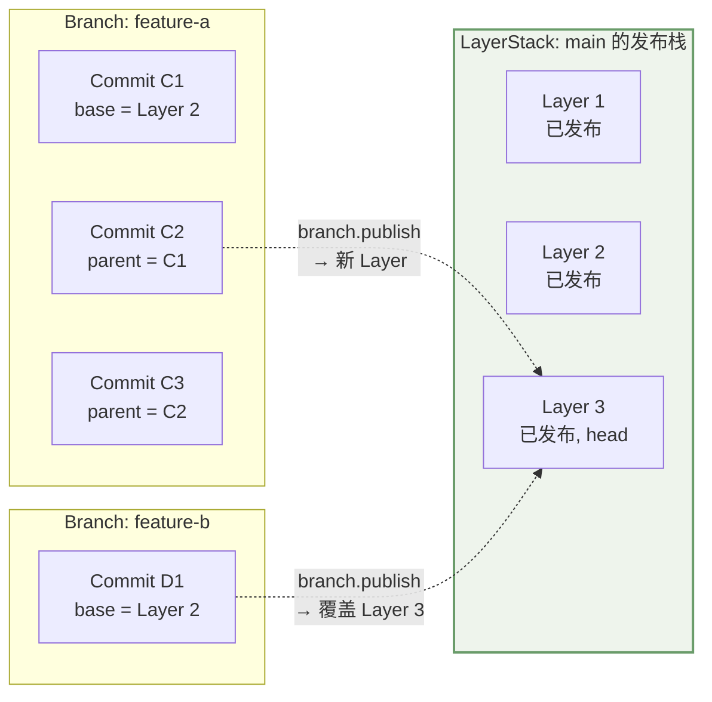
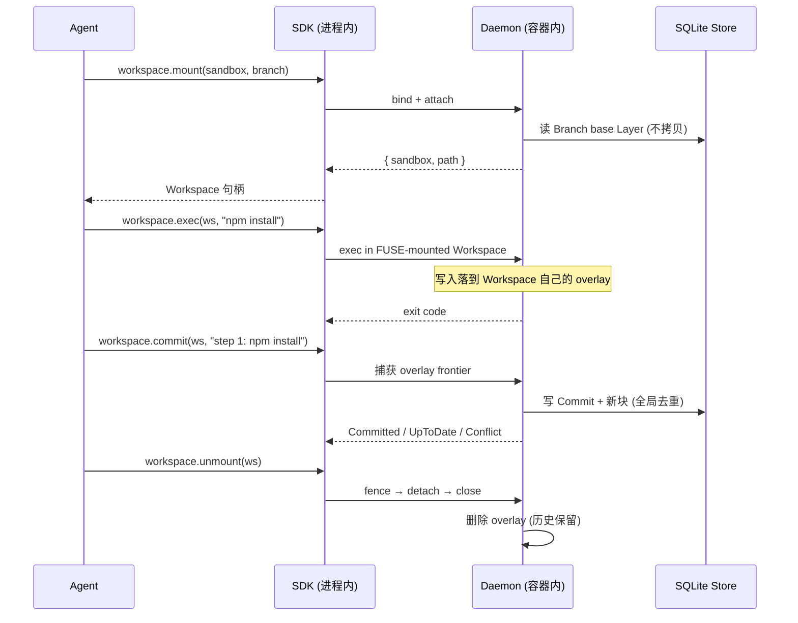

## 引子：一个只会「改文件」的 Agent，缺的是什么

我们过去两年写 Agent，做得最多的一件事是：让 Agent 拥有文件系统。

Claude Code 能读写代码，Codex 能跑命令，Cursor 能改文件。看起来「Agent 能操作文件」这件事已经解决了。

但真正把 Agent 放进生产环境的人会发现一个更基础的问题：**Agent 改过文件，但没人说得清它到底改了什么。**

一次 `npm install` 动了 4,000 个文件。一次 `pytest` 生成了 `.pytest_cache` 和一堆 `__pycache__`。Agent 在 `src/` 里改了一个函数，同时在 `node_modules/` 里升级了三个依赖。等你 review 的时候，diff 里全是锁文件和 vendor 代码，真正的业务改动被淹没了。

于是各家开始打补丁：

- **Codex** 搞 `git worktree`，给每个 Agent 一份独立的检出。
- **各类 ADE 桌面应用**给每个 Agent 一个独立的沙箱容器。
- **各种 review harness** 在事后用 LLM 去猜「这一坨 diff 里哪些是重要的」。

这些方案共同的隐含假设是：**「Agent 的历史」是一份需要事后解析的 diff。**

LayerFS 提出了一个完全不同的答案：**「Agent 的历史」不是 diff，而是文件系统本身。**

> Every tool call an agent makes is one **step**, and every step that changes files becomes a Commit on the agent's Branch. The Branch's history is the record of what the agent did, step by step.
>
> —— `.agents/skills/layerfs-js-sdk/SKILL.md`

一次工具调用 = 一个 Commit。不是「一次会话一个 Commit」，不是「一次 PR 一个 Commit」，而是**每一次 `npm test`、每一次 `fs.write`、甚至一次什么都不改的 `ls`，都各自是历史里的一格**。

这不是把 git 换个皮。这是把「版本控制」的粒度从「开发者提交」下沉到了「Agent 的单次动作」。

本文逐行读 LayerFS 的 Rust 核心源码和 JS SDK，讲清这套设计到底怎么落地、为什么这么设计，以及——**这个项目自己承认了哪些缺陷**。

---

## 一、项目定位：LayerFS 是什么

### 1.1 一句话定义

> **LayerFS 是一个给 AI Agent 用的分层文件系统：每个 Agent 挂载一个完整可写的 Workspace（工作区视图）覆盖在共享的已提交历史之上，干完活把改动提交成一条 Commit，然后工作区消失。**

注意这里的三个关键词：

| 关键词 | 含义 | 与传统方案的差别 |
|---|---|---|
| **Ephemeral（短暂）** | Workspace 只在命令运行期间存在 | 传统沙箱是「容器起来 → 工作 → 容器销毁」，但**历史不保留** |
| **Durable History（持久历史）** | 每次工具调用的结果都成为 Branch 上的一条 Commit | 传统方案的历史要么是 git commit（人工触发），要么是容器日志（不可查询） |
| **Layered（分层）** | 挂载时不做任何拷贝，直接在已提交的根上叠一层自己的 overlay | 传统 `git worktree` 要 checkout 一份实体文件 |

### 1.2 仓库统计

| 指标 | 数值 |
|---|---|
| 仓库 | [`Ephemeral-AI-Lab/layerfs`](https://github.com/Ephemeral-AI-Lab/layerfs) |
| Stars | 2,814 |
| Forks | 159 |
| Open Issues | 48 |
| 主要语言 | **Rust**（核心）+ TypeScript/JavaScript（SDK 与 CLI） |
| License | MIT |
| 创建时间 | 2026-08-10 |
| 最近推送 | 2026-11-16 |
| 仓库体积 | 6,021 个 tree 节点，874 MB |
| 当前版本 | 1.1.0（2.0.0 在 `layerfs_v2_0_0` 分支开发中） |
| 官网 | https://layerfs.ai/ |

**3 个月 2,814 星** —— 在「Agent 基础设施」这个 2026 年才成形的赛道里，这个增速相当可观。对比一下：`nono`（OS 内核级沙箱）用了更长时间才到这个量级。

### 1.3 它解决的是哪个真问题

先说清楚它**不是**什么，免得后面看偏：

- 它**不是**沙箱。沙箱解决的是「Agent 跑起来别弄坏我的机器」，LayerFS 解决的是「Agent 弄完之后，我得知道它弄了什么」。
- 它**不是**版本控制系统。git 解决的是「开发者之间的协作」，LayerFS 解决的是「Agent 的动作级审计」。
- 它**不是**容器镜像层。overlayfs 的 upper layer 用完就扔，LayerFS 的 upper layer **被转成不可变快照**，带历史、带合并、带冲突。

那它到底是什么？

**它是给 Agent 用的「文件系统即数据库」。** 一次 mount = 一次事务边界，一次 commit = 一条不可变记录。

---

## 二、整体架构：五层堆栈

LayerFS 的结构比一般的 Agent 框架清晰得多，因为它只有一条主线：**工具调用 → 文件系统 → Commit → 历史**。



### 2.1 数据流：一次 Bash 调用的一生

LayerFS README 用一段 `text` 图把整条链路说清楚了：

> ```text
> agent tool call
>  ├─ file tool (read, write, edit, grep …) ── SDK, in process ──────► Store
>  └─ Bash ── mount ─► exec ─► commit ─► unmount                       ▲
>              └─ Workspace: FUSE view in a Sandbox's daemon ───────────┘
>                 (committed root + its own overlay)
> ```

拆开讲：

**轨道 A：`fs.*` 文件操作（进程内）**
直接打开 Store 文件、在自己的进程里改，改完直接写一条 Commit。**没有 mount，没有 FUSE，没有容器。** 适合「读一个文件」「改一行代码」这类轻量操作。

**轨道 B：Bash 命令（跨进程）**
必须先 mount 一个 Workspace（一次 mount = 一个 FUSE 挂载点 + 一份 overlay），在容器里 exec，命令结束后把整个 overlay 收成一条 Commit。

这两条轨道都写进**同一个 Store**，因此 `fs.read` 能读到 Workspace 刚提交的内容（README 的 Agent 契约里明确：「A read returns the Branch's latest Commit, so it sees what every Workspace and every other writer has committed.」）。

### 2.2 模块职责一览

| 目录 | 节点数 | 职责 |
|---|---|---|
| `core/crates/layerfs-content/` | 4,152 | **纯逻辑层**：对象编解码、CDC 分块、编辑引擎、合并决策、历史记录。完全不碰 IO。 |
| `engine/crates/layerfs-*` | 1,140 | **引擎层**：FUSE 守护进程、能力门面、失败分类、恢复策略。 |
| `docs/` | 360 | 设计文档、基准报告、限制清单、架构决策记录。 |
| `api/` | 235 | **JS SDK + CLI**：三个 npm 包，33 个公开调用。 |
| `tools/` | 57 | 辅助工具。 |
| `plugins/` | 36 | 7 个宿主 Agent 的适配插件（Codex / Cursor / DSH / Herdr / Magpie / Mainline / Pi）。 |

`core` 占了全仓 69% 的代码，而且是纯 Rust 逻辑——这解释了为什么它能同时跑 POSIX 一致性测试（pjdfstest 8,798 条断言）和文件系统性能基准。

---

## 三、核心机制一：Branch / Commit / Layer 三元模型

这是理解 LayerFS 一切设计的钥匙。**三个词经常被混用，但它们在源码里是三个严格区分的类型。**

### 3.1 三个类型定义（逐字引用源码）

`core/crates/layerfs-history/src/contract/records.rs`：

```rust
// 来自 core/crates/layerfs-history/src/contract/records.rs:37-52
/// One LayerStack: a named linear Layer publication timeline.
#[derive(Clone, Debug, Eq, PartialEq)]
pub struct LayerStackRecord {
    /// Stack identity.
    pub id: LayerStackId,
    /// Authority-local unique name.
    pub name: HistoryName,
    /// Allocation scope shared by every Branch and Commit in this stack.
    pub scope: ObjectId,
    /// Frozen filesystem profile identity of this stack.
    pub profile: ObjectId,
    /// Current conditional head Layer.
    pub head_layer: LayerId,
}

/// One Branch: a base Layer plus an optional head Commit.
```

`CommitRecord`（同文件）：

```rust
// 来自 core/crates/layerfs-history/src/contract/records.rs:85-96
    /// Ancestry; not a diff and not a conflict resolution.
    pub parent: Option<CommitId>,
    /// Base Layer the Commit was built from.
    pub base_layer: LayerId,
    /// The other side of a Branch merge: a Commit or a Layer.
    pub second_parent: Option<NodeId>,
    /// Who made the Commit and how.
    pub meta: CommitMeta,
}

/// How a Commit was made.
#[derive(Clone, Copy, Debug, Eq, PartialEq)]
pub enum CommitVia {
    /// A Workspace Commit (a mounted Workspace's captured changes).
    Workspace,
    /// A direct Branch file operation.
```

### 3.2 三者的关系

用一张图说清：



三条语义，各不相同：

| 概念 | 是什么 | 谁创建 | 能否修改 |
|---|---|---|---|
| **Commit** | Branch 上的一条不可变记录，一次工具调用的完整结果 | `fs.write` / `workspace.commit` | ❌ 永远不可变 |
| **Branch** | 一条 Commit 链 + 一个 base Layer | `branch.fork` | 链可以追加，base 固定 |
| **Layer** | 发布到 `main` 栈上的一层不可变快照 | `branch.publish` | ❌ 永远不可变 |

**Commit 是 Agent 的「步」，Branch 是 Agent 的「分支思路」，Layer 是「已发布的成果」。**

### 3.3 ⭐ 关键设计：Commit 不是 diff

`CommitRecord` 的注释写得很克制：

> `/// Ancestry; not a diff and not a conflict resolution.`

意思是 Commit **不存 diff**，它存的是「这次改完之后，整个文件树长什么样」——由内容寻址的对象引用组成。

这个决定带来了两个后果：

1. **读历史永远是 O(1) 定位 + O(需要读的块) 读取**，不需要重放 diff 链。
2. **代价是存储必须靠去重扛住**。这就是下一节 CDC 分块的意义。

### 3.4 对象身份：带域分隔符的 BLAKE3

`core/crates/layerfs-content/src/object/id.rs`：

```rust
// 来自 core/crates/layerfs-content/src/object/id.rs:12-30
//! ct bytes, so it is not a raw content digest of the payload and
//! identical canonical bytes always produce the same ID.

/// Width of a canonical object identity in bytes.
pub const DIGEST_BYTES: usize = 32;

/// Frozen domain separator for v2 object identity.
pub const OBJECT_DOMAIN: &[u8] = b"layerfs/object/v2\0";
```

注意注释里那句：**「it is not a raw content digest of the payload」**。

这是什么意思？如果两个不同语义的对象碰巧有相同的字节表示（比如「一个空目录」和「一个空文件」可能都是一段空字节），直接用内容哈希就会撞车。所以 LayerFS 先把对象**规范化编码**（canonical bytes），再对「域分隔符 + 规范化字节」做 BLAKE3。

域分隔符（domain separator）末尾那个 `\0` 是关键 —— 它保证 `layerfs/object/v2\0` 这个前缀不可能和任何对象内容混淆。同样的手法在 Commit / Layer / Branch 的 ID 上也用了一套：

- `b"layerfs/commit/v3\0"`
- `b"layerfs/layer/v2\0"`
- `b"layerfs/sdk-branch/v1\0"`
- `b"layerfs/object/v2\0"`

> **⭐ 这是一个可以立刻抄走的设计。** 任何做内容寻址存储的系统，都应该给每类对象一个独立的、版本化的、带 `\0` 结尾的域分隔符。LayerFS 的每个 ID 宽度还不同（Branch 17 字节、Commit 33 字节、LayerStack 17 字节、Layer 33 字节）—— **把 ID 长度编进类型里，编译器就能挡住截断和混淆**。

### 3.5 对象的 13 种角色

`core/crates/layerfs-content/src/object/output.rs` 定义了 `ObjectRole`，一个对象在存储里可以是这 13 种角色之一：

```text
WholeFile, Chunk, ExtentLeaf, ExtentBranch, FileState,
InodeLeaf, DirectoryLeaf, DirectoryBranch, InodeBranch,
FilesystemRoot, AttributeLeaf, AttributeBranch, Symlink
```

这是一套**从 Unix inode 模型演化出来的对象图**：

- `Chunk` / `ExtentLeaf` / `ExtentBranch` → 文件内容的分块与块树
- `InodeLeaf` / `InodeBranch` → inode 元数据
- `DirectoryLeaf` / `DirectoryBranch` → 目录项
- `FilesystemRoot` → 整棵树的根
- `AttributeLeaf` / `AttributeBranch` → 扩展属性

**整个文件系统被表示成一棵不可变、内容寻址的 Merkle 树。** 一条 Commit 就是这棵树的一个根引用。

---

## 四、核心机制二：冻结的 GEAR 分块 —— 「大文件，小编辑」

### 4.1 问题的本质

Agent 改文件，绝大多数是「小编辑」：改一行、加一个函数、调一个参数。

但如果存储是「整文件一个对象」，那么：

- 改一行 → 整文件重新哈希 → 整文件重新存储 → **4.9 GB 的树变成 4.9 GB 的新树**
- 157 个快照 × 每份完整副本 = 灾难

git 用 delta 解决这个（存「相对上一个版本改了什么」），但 delta 链会**越滚越长**，而且 git 是按行/块匹配，不是内容定义的，对二进制和「文件开头插入一行」这种场景会失效。

LayerFS 选的是第三条路：**内容定义分块（Content-Defined Chunking, CDC）**。

### 4.2 冻结的 GEAR 档位

`core/crates/layerfs-content/src/file/cdc/gear.rs`：

```rust
// 来自 core/crates/layerfs-content/src/file/cdc/gear.rs:13-20
/// Smallest emitted chunk payload.
pub const MINIMUM_CHUNK_BYTES: usize = 8_192;
/// Boundary-search target below which the small mask applies.
pub const TARGET_CHUNK_BYTES: usize = 16_384;
/// Largest emitted chunk payload.
pub const MAXIMUM_CHUNK_BYTES: usize = 32_768;
```

文件头注释把整套设计讲得非常清楚：

```rust
// 来自 core/crates/layerfs-content/src/file/cdc/gear.rs:1-8
//! rolling GEAR content-defined chunking.
//!
//! The profile (minimum/target/maximum chunk sizes, normalization shift, seed,
//! masks and gear table) is frozen: changing any of it changes every boundary
//! partition and every chunk identity. Scanning is streaming and bounded - one owned
//! chunk buffer of exactly the maximum chunk size, no whole-input retention.
```

**「changing any of it changes every boundary partition and every chunk identity」** —— 这句话解释了为什么档位必须冻结：

如果改了目标块大小，同一份文件的分块边界就变了 → 每个 chunk 的哈希都变了 → **整个仓库的历史全部失效**。

所以这套参数一旦发布就不能动。LayerFS 用「Profile identity = Digest of sizes, shift, seed, masks, and frozen GEAR table」把整组参数本身也做成了一个可寻址对象，存进 `LayerStackRecord.profile` 字段。

**参数被冻结，profile 身份被存进每一个 Stack** —— 这是一个干净的「版本化格式」设计：将来做 GC 的时候，能按 profile 分组处理。

### 4.3 CDC 为什么能解决「小编辑」

CDC 的核心性质：**分块边界由文件内容决定，而不是由固定偏移决定。**

在文件开头插入一行 → 后面所有内容的字节位置都平移了 → 但由于边界是由内容里的「指纹」决定的，**后续的块边界会自动重新对齐**（只要插入的内容不超过 min 块大小）。

对比一下：

| 方案 | 文件开头插入一行 | 存储单元 |
|---|---|---|
| 固定块（block size） | 后面每块都错位，全部失效 | 固定偏移 |
| git delta（行匹配） | 通常能处理文本，对二进制差 | 基于上一个版本 |
| **GEAR CDC** | 块边界自动重对齐 | 内容指纹 |

这就是 README 里「157 snapshots of a real project in 100 MB, 19.9× smaller than Btrfs + zstd」的来源。

### 4.4 编辑引擎：只重切被替换的字节

`core/crates/layerfs-content/src/file/edit/engine.rs` 的核心思想：

> `apply_edits` preserves untouched extents and only re-chunks replacement bytes; "It does not need to rerun CDC across every unchanged byte."

**改一个 100 MB 的文件里的一行，只需要：**
1. 保留原有的块引用（一个指针，不拷贝）
2. 只对被替换的那几 KB 字节跑 CDC 切块
3. 重新组装块树

这与 git delta 的思路完全不同：git 存的是「差异描述」，LayerFS 存的是「新的块引用图」。

### 4.5 两种编码机制：CAS 与 Delta 的边界

LayerFS 同时实现了两种压缩/编码路径，文档 `cas_cdc.md` 讲得很清楚：

> Delta encoding and ordinary compression are not synonyms.

| 机制 | 作用 | 前提 |
|---|---|---|
| **CAS（内容寻址存储）** | 完全相同的对象只存一份 | 全局去重 |
| **Delta（Zstd-prefix）** | 与一个 base 对象共享前缀 | 需要 base |

> 来自 `core/docs/architecture/`：`not a stored list of filesystem edits, an XOR delta, or a byte-range patch script`

**Delta 不是 diff。** 它是 Zstd 的前缀压缩变体：两个对象共享前缀时，只存「共享了多少」+「剩余部分的字节」。

这里有个诚实的取舍，源码注释里写明：**只有一次 PREFIX 试探**，不会为了找更好的 base 做多次尝试。文档也承认「chunk candidates 不使用相似度索引」。

---

## 五、核心机制三：挂载 → overlay → commit → unmount

### 5.1 Workspace 是什么

Agent 契约（SKILL.md）对 Workspace 的定义：

> **Workspace** | A complete, writable view of a Branch where ordinary commands run, `{ sandbox, path }`. `workspace.commit` saves **everything** in it: `node_modules`, `.git`, build output, caches

三个关键点：

1. **完整**：包含 `.git`、`node_modules`、构建产物、缓存——**不只是源码**。
2. **可写**：普通命令（`npm install`、`pytest`）可以在里面跑。
3. **挂载极廉价**：「Mounting is cheap: it doesn't copy or scan the tree.」

第 3 点是整个设计的性能基石。

### 5.2 挂载做了什么（以及没做什么）

`api/agent/src/workspace/mount.js` 全文只有 19 行，但注释信息量极大：

```javascript
// 来自 api/agent/src/workspace/mount.js:1-19
// workspace.mount(sandbox, branch): a new Workspace of a Branch in the
// running Sandbox `sandbox` names (its number, as sandbox.create returns it),
// and nowhere else: there is no placement (owner 2026-10-23), and a mount
// never starts a Sandbox. Refused NoSuchSandbox when it is not running (or
// closed itself) and Capacity when it holds 16 Workspaces; each refusal's
// message names the calls to make instead. The Sandbox fixes the image. The
// Branch is found by name in the project's Store; the daemon binds its id.
// The native call gets { sandbox, branch } with the client's project, home,
// deploy and storePath. Returns the Workspace, `{ sandbox, path }`, and its
// Sandbox's `image`.
import { invokeClient } from "../client.js";
import { LayerFSError } from "../errors.js";
export async function mount(client, sandbox, branch, ...rest) {
  if (typeof sandbox !== "string" || !/^[1-9][0-9]{0,9}$/.test(sandbox) || typeof branch !== "string" || rest.some((value) => value !== undefined)) {
    throw new LayerFSError("InvalidInput", "workspace.mount(sandbox, branch) takes a Sandbox number such as \"1\" (from sandbox.create() or project.list_sandboxes()) and a Branch name, and n");
  }
  const value = await invokeClient(client, "workspace.mount", { sandbox, branch });
  return { sandbox: value.sandbox, path: value.path, image: value.image };
}
```

**挂载没有做的事**：不复制、不扫描、不 checkout。它只是：
1. 在 Workspace 自己的 overlay SQLite 文件里记下「我要看 Branch X 的哪个 base Layer」
2. 启动 FUSE，把 committed root 绑上去
3. 把 overlay 作为 upper layer 叠上去

### 5.3 引擎侧：挂载是两步确认

`engine/crates/layerfs-api/src/sandbox/mount.rs` 里的关键设计是：**mount 是两个独立的、需要各自确认的步骤**。

> `bind()` 然后 `attach()`

为什么要拆成两步？因为「绑定」是逻辑操作（「这个 Workspace 指向哪个 Branch」），「挂载」是内核操作（「让 FUSE 在某个路径可见」）。中间可能失败。

而且失败语义被明确定义：

> `/// Lost delivery keeps the original request/unknown, with no automatic rebind.`
> `/// A lost reply leaves the outcome unknown; observe it with 'locate', never by replay.`

**「丢失回包 → 结果未知 → 用 `locate` 去观察，绝不用重放」** —— 这是本系列反复出现的「诚实失败语义」模式。

### 5.4 提交：三种结局

`engine/crates/layerfs-api/src/sandbox/commit.rs` 定义了 Commit 的三种结果：

| 结果 | 含义 |
|---|---|
| `Committed` | 有改动，已写入一条新 Commit |
| `UpToDate` | 什么都没改，**不产生历史** |
| `Conflict` | 与其它写者改到了同一处，需要人工/规则解决 |

`UpToDate` 这个状态是刻意设计的。Agent 契约里写：

> A step that changes nothing makes no Commit. `workspace.commit` returns `UpToDate`, and a message alone never creates history: a read or a passing `npm test` that writes nothing leaves no trace on the Branch, **by design**.

**「一条没有改动的步骤不留下痕迹」** —— 历史是精炼的，不是一本流水账。这和很多 harness「每一步都记一条 event log」的做法正好相反。

### 5.5 卸载：丢弃未提交内容，但绝不删历史

```text
fence activity → detach FUSE → logical close
```

卸载会做三件事：
1. **围栏（fence）**：等所有正在进行的文件系统操作结束
2. **分离 FUSE**：摘掉挂载点
3. **逻辑关闭**：删除 Workspace 自己的 overlay 文件

关键的安全属性：

> **It discards local uncommitted changes. It never implicitly publishes a Commit.**

未提交的改动被丢弃；**卸载永远不会隐式发布任何东西**。发布必须显式调 `branch.publish`。

### 5.6 端到端时序



---

## 六、核心机制四：冲突检测与 `.lww` 规则

### 6.1 冲突是怎么判定的

`core/crates/layerfs-content/src/merge/types.rs`：

```rust
// 来自 core/crates/layerfs-content/src/merge/types.rs
/// Kind of one conflicting path.
#[derive(Clone, Copy, Debug, Eq, PartialEq)]
pub enum ConflictKind {
    /// Both sides changed a file's lines differently.
    Content,
    /// Both sides added different files at one path.
    AddAdd,
    /// Ours changed a file theirs deleted.
    ModifyDelete,
    ...
    /// Binary content that cannot be merged line by line.
    Binary,
    /// Marker blocks written into the file, in order.
    Markers,
    /// Mode changed on both sides differently.
    Mode,
}
```

八种冲突类型，其中最值得说的是 **`ModifyDelete`**：我们改了文件，对方删了它。这在 git 里需要人工判断（谁对？），LayerFS 把它列为一等冲突类型。

判定方式是标准的三方比较：**base / ours / theirs**。

文本文件会做真正的三路合并，并写入冲突标记（`Markers` 类型）。

### 6.2 `.lww`：Last-Writer-Wins 规则文件

Agent 契约里的说明：

> ## Merge rules: `/.lww`
>
> Parallel Workspaces and Branches meet in a merge, either when a `workspace.commit` finds that its Branch moved or in `branch.merge`. Source files merge line by line, and overlaps become a `Conflict` you resolve by reading. Generated state (`node_modules`, lockfiles, build output) can't be merged that way, so list it in a `/.lww` file at the project root. Both kinds of merge then keep the **newer** version of those paths whole and report each decision in the result's `lww` list.
>
> ```
> %include .gitignore
> ```
>
> Treat it as your `.gitignore`: `%include .gitignore` is normally the whole file. Add a line only in the extreme case, for a generated file you keep in Git that keeps conflicting, such as a lockfile. **Never list source files.**

**`.lww` 的语法完全复用 `.gitignore` 的模式匹配**，还支持 `%include <file>` 引入别的文件。

匹配上的冲突按 **mtime 更新者胜**，平手则保留 ours。源码里：

```rust
// 来自 core/crates/layerfs-content/src/merge/types.rs
/// One path a `.lww` rule decided.
pub struct LwwDecision {
    /// True when ours was newer or as new.
    pub kept_ours: bool,
    /// True when the kept side had deleted the path.
    pub deleted: bool,
    /// The deciding rule as written.
    pub rule: String,
}

/// Which side's `/.lww` decides.
pub enum RulesFrom {
    /// Ours (a Branch merge reads the left Branch).
    ...
}
```

**每次决策都会被记录下来**（`LwwDecision` 里带 `rule: String`——原样保留那条规则），并汇总进合并结果的 `lww` 列表。

### 6.3 一个容易被忽略的细节：`main` 是只读的

Agent 契约里反复强调：

> **`main` is read-only.** It's published, not a Branch: read it and fork from it, but don't write, edit, mount or commit to it. Those calls, and `branch.list_commits("main")`, are refused with `NoSuchBranch`.

`main` 不是 Branch，是**发布目标**。所以 `branch.list_commits("main")` 也会被拒绝——因为 `main` 上没有 Commit 链，只有 Layer 栈。

### 6.4 ⭐ 危险设计：发布是「覆盖式」的

这是我认为 LayerFS 最需要警惕的一处设计。

`core/crates/layerfs-history/src/contract/records.rs`：

```rust
// 说明：以下为源码节选，结构体体在节选边界处截断，故括号不成对。
// 来自 core/crates/layerfs-history/src/contract/records.rs:186-196
/// One immutable Layer publication.
#[derive(Clone, Debug, Eq, PartialEq)]
pub struct LayerRecord {
    /// How many earlier main Layers this publication displaced, recorded
    /// atomically. They are the newest `overwrote_count` Layers below it in
    /// the stack chain; `HistoryCatalog::overwritten` pages them.
    pub overwrote_count: u64,
    /// Layer identity.
    pub id: LayerId,
    /// Owning stack.
    pub stack: LayerStackId,
    /// Previous publication in this stack; absent only for genesis.
    pub parent: Option<LayerId>,
```

以及 `AddLayerOutcome`：

```rust
// 说明：以下为源码节选，枚举体在节选边界处截断，故括号不成对。
// 来自 core/crates/layerfs-history/src/contract/records.rs:464-472
pub enum AddLayerOutcome {
    /// A new immutable Layer was inserted on the stack head and the stack
    /// advanced. Publication is overwrite-only: the Layer's
    /// `overwrote_count` counts the stack's Layers since the Branch's base
    /// that the published Commit does not contain; they stay in history and
    /// `HistoryCatalog::overwritten` lists them.
    Added {
        /// The new Layer.
```

README 说得更直接：

> **Publishing a stale Branch is different: it may skip newer `main` Layers**; merge `main` into the Branch first.

翻译成人话：**如果你的 Branch 是从 3 天前的 `main` 拉出来的，而你直接把 `main` 更新了两次，你 publish 的时候会把那两次更新直接盖掉。**

**系统不会拒绝你，它只会安静地记录 `overwrote_count = 2`，让你事后能查到。**

被覆盖的 Layer **仍然留在历史里**（`HistoryCatalog::overwritten` 可以翻出来），所以不是数据丢失——但对 Agent 来说，这是一个**极易踩的坑**：Agent A 和 Agent B 并行工作，A 先 publish，B 后 publish，B 会静默覆盖 A 的成果。

---

## 七、Store：一个 SQLite 文件装下所有历史

### 7.1 架构

`core/docs/architecture/84-global-sqlite-store.md` 描述的设计非常克制：

> One SQLite file holds every Branch, Commit and content object. Each daemon and SDK process opens it directly; **there is no database server**.

表结构（来自同一份架构文档）：

```text
pack, pack_unit, object_location, inode_value,
branch, "commit", layer, layer_stack,
store_totals, scope_allocator, binding_hint, content_signature
```

关键配置：

| 配置 | 值 | 含义 |
|---|---|---|
| Profile | **Disposable** | 无崩溃/断电持久性 |
| Journal | WAL | 写前日志 |
| `synchronous` | **OFF** | 不等落盘就返回 |
| `page_size` | 4096 | |
| `busy_timeout` | 0 | 忙时直接失败，**不排队** |

### 7.2 一个 Store，多个进程

> Store calls run in the caller's process on Linux, with the Store on ext4, xfs or btrfs. On macOS and Windows they go through the home's worker; without a worker they fail `Unsupported`.

这个设计有个直接后果：**`fs.*` 调用在 Agent 自己的进程里执行**。这既是性能优势（没有 IPC），也是安全边界问题——**Agent 进程直接持有 Store 文件的读写句柄**。

### 7.3 Workspace overlay 是独立的

每个 Workspace 有自己的 overlay SQLite 文件（从一个模板拷贝出来），卸载时删除。

> The host Store's selected Durable/Disposable profile and the daemon's disposable overlay profile are **separate contracts**. The cache and overlay do not inherit a durability guarantee merely because the global Store uses Durable.

**全局 Store 和 overlay 的持久性是两个独立契约** —— 即使全局 Store 用了 Durable，overlay 也不会自动继承。

---

## 八、Agent 集成层：一份写给 Agent 的契约

这是 LayerFS 最独特的地方：**它有一份 20KB 的 `SKILL.md`，是写给 AI Agent 读的操作契约**。

### 8.1 核心心智模型

> ## How an agent works in LayerFS
>
> Every tool call an agent makes is one **step**, and every step that changes files becomes a Commit on the agent's Branch. The Branch's history is the record of what the agent did, step by step.
>
> | Agent tool | LayerFS calls | Recorded as |
> | --- | --- | --- |
> | File read: read, list, search, diff | `fs.read`, `fs.list`, `fs.grep`, `fs.glob`, `fs.diff_files` | Nothing: reads don't change history |
> | File change: write, edit, many-file change | `fs.write`, `fs.edit`, `fs.apply`, `fs.mkdir`, `fs.mv`, `fs.cp`, `fs.rm` | One Commit per call. Atomic: the whole change lands, or nothing does |
> | Bash | A Workspace per call: `workspace.mount` → `workspace.exec` → `workspace.commit` → `workspace.unmount` | One Commit with everything the command changed: sources, lockfiles, `node_modules`, build output |

这张表就是全部的集成契约：**读不改历史；改是一次调用一条 Commit；Bash 是一次调用一条 Commit。**

### 8.2 两套 API 的选择规则

契约给 Agent 的决策规则非常明确：

> **Two ways in: `fs.*` for cheap, targeted file work; a Workspace for Bash commands**, which often change files too, and for file work too heavy for single calls.

`fs.*` 的定位：

> an `fs.*` call runs in your process on the project's Store, without a Workspace or kernel mount, so it avoids the Bash mount lifecycle.

而且它明确说了并发行为：

> **No merge:** if another writer committed on the Branch during the call, it's refused with `HeadMoved` and nothing is written. Read the file again, then redo your change.

**`HeadMoved` 拒绝写入，不自动合并** —— 因为 `fs.*` 是轻量快路径，不值得为它做合并。

### 8.3 `fs.*` vs Workspace 的完整对比

| 维度 | `fs.*` | Workspace |
|---|---|---|
| 执行位置 | Agent 自己的进程 | Sandbox 容器（Daemon） |
| 是否需要 FUSE | ❌ | ✅ |
| 是否需要容器 | ❌ | ✅ |
| 原子性 | 整次调用全成或全败 | commit 时捕获整个 overlay |
| 并发写冲突 | 拒绝 `HeadMoved` | 合并或报 `Conflict` |
| 能看到 Workspace 未提交改动 | ❌ | ✅ |
| 适合 | 读文件、改源码、列目录 | 跑测试、装依赖、构建 |

### 8.4 三个 npm 包

`api/README.md` 里的分工：

| 包 | 职责 | 关键点 |
|---|---|---|
| `@layerfs/agent` | Agent 的主要入口 | **33 个公开调用**：2 static + 2 instance + 2 project + 14 fs + 6 branch + 3 sandbox + 4 workspace |
| `@layerfs/backend` | 只读观测 | 13 个方法，不改任何东西 |
| `@layerfs/runtime` | 宿主生命周期 | 管理 worker / 运行时镜像 |

`@layerfs/agent/internal` 被**明确标记为非公开**。

### 8.5 一段真实可跑的 Agent 脚本

契约里的 `project.mjs` 示例（`SKILL.md` 第 206 行起）：

```javascript
// 来自 .agents/skills/layerfs-js-sdk/SKILL.md:158-204（改写为完整可运行示例）
import { LayerFS, isRefusal } from "@layerfs/agent";

const layerfs = await LayerFS.open("shop");   // 打开项目的 Store
try {
  // 轻量文件操作：进程内，一次调用一条 Commit
  const listing = await layerfs.fs.list("main", "src");
  console.log(listing);

  const content = await layerfs.fs.read("main", "src/cart.js");
  console.log(content.text.slice(0, 200));

  await layerfs.fs.write("cart", "src/cart.js", "export const total = 0;\n", {
    message: "step 1: reset total"
  });
} finally {
  await layerfs.close();
}
```

Bash 那条轨道：

```javascript
// 来自 .agents/skills/layerfs-js-sdk/SKILL.md:206-316（按契约重构）
import { LayerFS } from "@layerfs/agent";

const layerfs = await LayerFS.open("shop");
let ws = null;
try {
  const sandbox = await layerfs.sandbox.create();       // 返回 { sandbox: "1", image: "sha256:…" }
  ws = await layerfs.workspace.mount(sandbox.sandbox, "cart");

  await layerfs.workspace.exec(ws, "npm test", { stream: false });

  // 失败也要提交，让历史记录里能看到这一步失败了
  const result = await layerfs.workspace.commit(ws, "step 2: npm test");
  console.log(result.status);   // Committed | UpToDate | Conflict
} catch (err) {
  if (isRefusal(err)) console.error("refused:", err.reason);
  throw err;
} finally {
  if (ws) await layerfs.workspace.unmount(ws);   // 契约要求：unmount 必须放 finally
  await layerfs.close();
}
```

**契约里反复强调的一条硬规则**：

> **Always unmount.** Put every `workspace.unmount` in a `finally` block. A forgotten Workspace stays mounted, and its Sandbox never closes.

### 8.6 CLI：一条命令一次 SDK 调用

CLI 的定位写得很清楚：

> The `layerfs` command makes one SDK call per command, for example `layerfs project list_branches` or `layerfs fs read <branch> <path>`. Use it for single steps and an SDK script for anything more.

**安装命令**（逐字来自 `api/docs/agent.md`）：

```bash
# 来自 api/docs/agent.md:411-436
npm --prefix "$LAYERFS_REPO/api" install
npm --prefix "$LAYERFS_REPO/api/cli" install
"$LAYERFS_REPO/api/cli/src/layerfs.js" help
```

需要 Node 20+，还需要 SDK 的原生插件（`npm --prefix api run build:native`）。**CLI 没有发布到 npm**（`api/cli/package.json` 里是 `"private": true`），要用得先有一份 LayerFS 检出。

一段完整的 CLI 会话（同样逐字来自官方文档）：

```bash
# 来自 api/docs/agent.md:411-436
export LAYERFS_PROJECT=shop                        # 或每次命令带 --project shop
layerfs branch fork cart
printf '# Shop\n' | layerfs fs write cart /README.md -m readme
layerfs sandbox create                             # {"sandbox":"1","image":"sha256:…"}
layerfs workspace mount 1 cart                     # {…,"ws":"1:/workspaces/3"}
layerfs workspace exec 1:/workspaces/3 "npm test" --stream
layerfs workspace commit 1:/workspaces/3 -m "step 1: npm test"
layerfs workspace unmount 1:/workspaces/3
layerfs sandbox close 1
```

### 8.7 Trace：一次调用一行 JSON

`api/agent/src/trace.js` 通过 `LAYERFS_TRACE` 环境变量开启，每次调用写一行 JSON，内容会被**脱敏成字节数**（不记内容）。

配套还有 `layerfs-sdk-observe` 这个独立 skill，提供 tracing 参考文档。

**42 个存储计数器 + 31 个构造计数器** —— 这个细节说明作者是认真在做性能回归监控的。

### 8.8 七个宿主插件

`plugins/` 目录下有 7 个 `plugin.json`：

- `codex-parallel-verify`
- `cursor-agents`
- `dsh-layerfs`（DeepSeek Harness，最完整，有专门的 install.md）
- `herdr-layerfs`
- `magpie-layerfs`
- `mainline-layerfs`
- `pi-layerfs`

**注意：这些插件不在 LayerFS 主仓的核心路径上** —— 主仓提供 SDK 和 CLI，插件只是各宿主的薄适配层。这一点在 Pi 插件的 README 里说得很直白：

> LayerFS here uses a Disposable Store (WAL, `synchronous=OFF`): history persists across normal sessions but has no crash or power-loss durability. Keep another copy of irreplaceable source data.

---

## 九、基准测试：8 组数字，以及它们测的是什么

LayerFS 的基准测试有一个很罕见的优点：**每个数字都链接到方法、环境和凭据（receipts）**，而且诚实公布了输的那几项。

| 套件 | 测什么 | LayerFS 1.0.0 结果 |
|---|---|---|
| **fs-bench** | Cloudflare Compute 自己的 12 场景文件系统基准，原样不改、同一镜像 | **5.20 s vs 8.88 s，1.71× 更快**；12 个场景里 10 个更快 |
| **dsh-dedup** | 真实项目的历史，157 个快照（4.94 GB 的树） | **100.1 MB vs 1,994.6 MB，比 Btrfs + zstd 小 19.9×**；156/156 读回 |
| **pjdfstest** | POSIX 一致性，8,798 条断言，对标内核 overlayfs | **0 个意外失败**；但只保留了 overlayfs 通过项的 **76%**，其余每个失败都是有意的格式限制 |
| **fsx** | 随机读、随机写、mapped I/O、truncate，逐字节校验 | **14/14 通过**，306 万次操作，0 次比对错误 |
| **fsstress** | 4 个并发进程，然后 Commit、重新挂载、比对 | **3,755/3,755 条目完全一致**；**5.21 GB 被一次 Commit 捕获，耗时 4.9 s** |
| **smallfile** | 10 万个 4 KiB 文件，4 线程，对标 libfuse passthrough | 9 项操作里 9 项更快，**1.27×–10.71×** |
| **mdtest** | 元数据创建、重命名、删除，对标 libfuse passthrough | 1 进程 0.86–1.28×，4 进程 1.21–4.22× |
| **fio** | 数据 I/O 带宽，对标 libfuse passthrough | 随机读写混合 1.49–2.23×；**顺序写 0.31×（更慢）、顺序读 0.81×、随机写 0.40×** |

### 9.1 怎么读这张表

**值得肯定的三点：**

1. **它公布了输的项。** `fio` 顺序写 0.31× —— 慢了接近 3 倍，**直接写进 README 表格**，没有任何粉饰。
2. **每个数字都带基线。** 不是「我们很快」，而是「对标谁、快多少」。
3. **样本量诚实。** 表格下方注明：*"One sample per case, seed 1, no best-of."* —— **每个 case 只跑一次，固定随机种子，不挑最好的那次**。

**必须警惕的三点：**

1. **这是 1.0.0 的数字，不是 1.1.0 的。** README 自己写了：*"The results below are 1.0.0's, measured on `main` at `e5c7aaae05`."* 而 1.1.0 的发布说明明确说：**"1.1.0 publishes no benchmark."** —— 当前版本没有自己的基准数据。
2. **pjdfstest 的「0 意外失败」需要配着「76% 通过率」读。** 只保留 overlayfs 76% 的通过项 —— 意味着 **24% 的 POSIX 行为是不支持的**。这不叫「通过」，这叫「明确知道自己不支持什么」。
3. **文档里记录了已发布的性能回归。** 限制清单里有：一次 FAIL（16.107 s vs 15 s 的门槛）、125 个 WARN 单元格、198 个单元格里 139 个慢了 ≥15%（中位数 1.34×）、单 worker 构造导致 1.50–1.65× 的去重/CDC 回归。

### 9.2 为什么 Btrfs 在这个场景更费空间

`docs/research/layerfs-vs-btrfs-157/REPORT.md` 第 3 节专门回答了这个问题，结论有 4 层：

1. **CoW 不去重整体重写。** Btrfs 的写时复制按 extent 共享，但一个被整体重写的文件，每个 extent 都是新的 —— 没有去重。
2. **元数据 CoW 来自去重引用更新。** 去重引用变了 → 元数据块也要复制。
3. **小文件 + 元数据 DUP 放大成本。** 4 KB 的文件只用到 extent 的一小部分，剩下的空间浪费掉。
4. **LayerFS 连结构也压缩**，不只是压缩 payload —— 5 个组成部分加起来 184,598,528 字节的完整账目。

这份报告有个诚实的注脚：**报告里的 `comparison.png`、`evidence.json` 和原始运行数据已经永久丢失** —— 报告本身也承认这点。

---

## 十、⭐⭐⭐ 必须诚实指出的源码自陈缺陷

这是本系列的核心栏目。LayerFS 在这一点上**做得比本系列见过的绝大多数项目都好** —— 它的 Rust 引擎源码里**几乎没有 TODO / FIXME 标记**，因为它用「契约风格」写作：每个限制都作为「代码实际做什么」的事实陈述写在散文里。

我系统搜过 `api/`、`engine/`、`core/`、`plugins/`、`docs/`，下面是完整的清单。

### 10.1 最大的那个：完全没有持久性

`docs/release-notes/1.1.0/README.md`：

> - **Store profile.** Disposable is the only executed profile; there is no crash or power-loss durability. Durable is NOT_RUN — disabled by owner until explicit reauthorization.

`AGENTS.md`：

> **Disposable / WAL / synchronous=OFF is the only permitted global Store profile. Durable execution is disabled indefinitely, until the owner explicitly allows it again.**

`docs/versioned/0.1.6/limitations.md`：

> - Ordinary writes are acknowledged into live buffered ownership; backing flush, filesystem fsync and canonical Commit are distinct operations. **An acknowledged write is not a crash-durable database publication.**

而且限制清单第一句就是：

> LayerFS is for local evaluation and development. Keep independent copies of important data; **it is not a backup service or a hostile-code security boundary**.

**「Durable 代码能编译，但被禁止运行」** —— 这是罕见的技术债处理方式：代码在，但不启用。

### 10.2 永不重试、永不重放

`AGENTS.md`：

> - One attempted operation; no automatic retry/busy handler, refresh/reprepare or failed-operation replay. Readiness waits are not retries. Preserve exact failure/uncertainty and custody; no guessed resend, deletion or success.

`api/agent/src/client.js`：

> // One call through this process's binding (transport/index.js: the native
> // addon in this process, or the worker client). The binding resolves
> // `{ value }` or `{ refused }` (plus `telemetry` when traced); a refusal
> // becomes a LayerFSError. **Nothing is retried.**

`engine/crates/layerfs-api/src/base/failure.rs`：

> /// Exact selected operation; never replayed by the facade.
> pub request: Request,

**「重试会掩盖真实故障」这个判断是对的**，但代价是：网络/IO 抖动直接变成失败，Agent 必须自己处理。

### 10.3 没有重启恢复

`api/docs/agent.md`：

> Daemon/container restart recovery and replay of uncertain operations are excluded.

`.agents/skills/layerfs-js-sdk/references/methods/workspace.md`：

> - No restart recovery: if the container dies, its Workspaces are gone. **Stop and report.**

### 10.4 FUSE 视图故意不支持一批 POSIX 特性

`README.md` 的 Prior art 表格：

> LayerFS's FUSE view **deliberately omits FIFOs, sockets, device nodes, set-id bits and separate atime/ctime**

`docs/versioned/0.1.6/limitations.md`：

> - A newly created FUSE file uses direct I/O for its create handle. mmap on that handle is unsupported (`ENODEV`); close/reopen restores the normal cached-open path. Tested dirty-mapping/SDK coherence **does not imply unrestricted POSIX compatibility** for every program or filesystem feature.

### 10.5 内核脏的共享 mmap 不会被 Commit 捕获

> - **Kernel-dirty shared mmap is still not captured by a Commit.** A write made through a shared `mmap` that the kernel has not written back is not part of the published snapshot. The boundary is isolated to exact byte level and no registered benchmark selection is affected; **it remains the specification's open obligation.**

**这一条对 Agent 场景特别重要**：如果 Agent 跑的工具用 mmap 写文件（某些数据库、某些 C 库会），那部分改动**不会进入历史**。

### 10.6 Store 调用是 Linux 专属

> This is Linux only, with the Store on a local filesystem the daemons share (ext4, xfs, btrfs); **anywhere else opening fails `Unsupported`**, and without a `storePath` it fails `InvalidInput`.

### 10.7 `exec` 没有超时

契约要求 Agent 自己包超时。而且插件 README 里提到一个具体后果：

> ...a zombie variant can still occur after a timed-out command; start a new session if it does.

### 10.8 Init 会拒绝一整类源码树

> A source entry Init cannot store is refused as `InvalidInput` whose `detail` names it: `{ reason, path }` ... The reasons are `NotDirectory` (the source is a symlink or not a directory), `Mode` (a set-user-ID or set-group-ID bit on any entry, or the sticky bit on a file), `Mtime` (a modification time out of range) and `Changed` (the entry changed while Init read it).

**符号链接目录不能作为 init 源** —— 这对很多真实项目（monorepo 里的 symlink workspace）是个硬限制。

### 10.9 发布是覆盖式的（见 §6.4）

> Publishing a stale Branch is different: **it may skip newer `main` Layers**

### 10.10 完全没有 GC

对象和历史都不回收。README 的表述是：

> Saved objects are never rewritten. **The Store only grows.**

> 来自 `core/docs/architecture/`：`The Store only grows.`

**跑几个月的 Agent 会把磁盘吃满**，而且没有任何回收机制。

### 10.11 合并有硬边界

源码常量直接写在 `policy.rs` 里：

```rust
// 来自 core/crates/layerfs-content/src/contract/policy.rs:26-30
FILE_DELTA_MAX_DEPTH: u8 = 16;
/// Default chunk dependency bound.
pub const DEFAULT_CHUNK_DELTA_MAX_DEPTH: u8 = 8;
/// Largest accepted dependency depth for either role.
pub const MAXIMUM_DELTA_MAX_DEPTH: u8 = 50;
```

加上：`.lww` 最多 16 个 include 文件、resolver 缓存 64 KiB、二进制合并有大小上限。

### 10.12 `fs.read` 拒绝二进制

二进制文件走 base64 通道。契约里 Pi 插件的 README 提到：

> `edit` takes `{path, oldText, newText}`, not Pi's `edits[]`; `read` is bounded UTF-8 text. **Binary files go through base64 in `layerfs_fs`.**

### 10.13 发布门禁被豁免了

1.1.0 的发布说明里记录了 owner 主动豁免了三个发布门禁，并写下了残余风险：

> **Residual risk: a Linux FUSE or in-process Store regression since then would ship undetected.**

**「项目自己知道自己的 CI 门禁有洞，并公开写下来了」** —— 这是本系列见过最诚实的一类自陈缺陷。

### 10.14 设计文档是「提案」，不是「实现」

> **No implementation, bootstrap measurement or workload qualification is claimed.**

### 10.15 一句话总结这些缺陷

LayerFS 的缺陷几乎全部集中在**同一个根因**上：**它是一个「为了 Agent 而生」的实验性基础设施，作者选择了「宁可少做，不要做错」的取舍。**

- 不做持久性 → 因为持久化会拖慢每次工具调用；
- 不做重试 → 因为重试会掩盖真实故障；
- 不做 POSIX 全兼容 → 因为 Agent 不需要 FIFO；
- 不做 GC → 因为还没到那个规模。

**这是一个清醒的取舍，但它也划定了适用边界：LayerFS 适合「本地评估与开发」，不适合「生产环境的唯一真相来源」。**

---

## 十一、与同类项目的设计差异

先说清楚谁不是同赛道：

- **Sandbox 类**（tenbox / opensandbox / nono / e2b）—— 解决「Agent 跑在哪、隔离什么」。LayerFS 不提供安全边界，它自己在限制清单里明说「it is not a ... hostile-code security boundary」。
- **Git worktree 类**（Worktrunk / agent-orchestrator）—— 解决「多个 Agent 各拿一份检出」。LayerFS 的挂载**不拷贝任何东西**。
- **Agent 运行时类**（activegraph / tensorlake）—— 解决「控制流可重放」。LayerFS 管的是**文件系统状态**。

真正的对标对象是**存储与文件系统本身**。

### 11.1 四方对比

| 维度 | **LayerFS** | overlayfs | Btrfs / ZFS | Git worktree |
|---|---|---|---|---|
| **上层写入去哪** | overlay → **转成不可变 Commit** | overlay，用完即弃 | CoW extent | 工作区文件 |
| **历史是否保留** | ✅ 每条 Commit | ❌ | ✅ 快照 | ✅ 但需手动 commit |
| **提交粒度** | **一次工具调用** | — | 手动 snapshot | 手动 `git commit` |
| **去重粒度** | **内容块（BLAKE3 + CDC）** | 无 | extent 级 | 文件级（靠 delta） |
| **挂载成本** | **不拷贝、不扫描** | 不拷贝 | 不拷贝 | **实体 checkout** |
| **合并** | ✅ 3-way + `.lww` 规则 | ❌ | ❌ | ✅ 但要 git 参与 |
| **多写者** | ✅ 分支 + 冲突检测 | ❌ | ❌ | 需手动 |
| **持久性** | ❌ Disposable only | ✅ 内核级 | ✅ 成熟可靠 | ✅ |
| **POSIX 完整度** | ~76% of overlayfs | ✅ 内核 | ✅ | ✅ |
| **依赖 `.git`** | ❌ 完全不需要 | ❌ | ❌ | ✅ |

### 11.2 设计差异一：LayerFS vs Git worktree —— 「提交」由谁触发

**Git worktree 的隐含假设**：提交是**开发者**的动作，所以它必须手动触发。

git 里有个很好用的东西叫 `git stash`，但它解决的是「临时存一下」，不是「每一步都有记录」。Agent 场景下这个假设直接崩了。

**LayerFS 的做法**：提交是**系统**的动作，触发条件是「这次工具调用改了文件」。

结果就是：Agent 跑 20 步，Branch 上就有 20 条 Commit（其中没有改动的那些返回 `UpToDate`，不占位）。**这份历史和 Agent 的思考过程严格同构。**

LayerFS README 的 Prior art 表格把这条讲得很清楚：

> A Workspace holds the whole tree, **including `.git`, ignored files, dependencies and build output**, so a new mount needs no reinstall. **Commits happen per tool call, not when someone runs `git commit`.**

**「Workspace 连 `.git` 目录本身都在里面」** —— 这意味着 Agent 在 Workspace 里跑的 `git status`、`git diff` 看到的是**已提交的 Layer 状态**，而不是一个空目录。

### 11.3 设计差异二：LayerFS vs overlayfs —— 上层被「提升」成了历史

这是 LayerFS 最有价值的一个设计转变。

overlayfs 的模型是：

```
lower (只读) + upper (可写)
```

upper 层用完就扔。它的语义是「临时修改」。

LayerFS 的模型是：

```
committed root (只读) + workspace overlay (可写) --commit--> 不可变 Commit
```

**upper 层不是被扔掉，而是被「提升」成了历史里的一条记录**，带分支、带合并、带冲突。

overlayfs 在内核里，更完整；LayerFS 是 FUSE 用户的，所以只能覆盖 76% 的 POSIX 行为。**但 LayerFS 多出来的那一层语义，是 overlayfs 永远给不了的。**

### 11.4 设计差异三：LayerFS vs Btrfs —— 去重粒度的差别

两者都做 CoW，都做快照。差别在**共享的粒度**：

> Sharing is by content, not by extent, so a file that is rewritten in full still stores only its new chunks.

Btrfs 共享 extent。一个文件被整体重写（哪怕内容 99% 相同），所有 extent 都是新的 → 空间翻倍。

LayerFS 共享**内容块**。整体重写时，未变的内容块哈希相同 → 直接复用。

再加上小文件场景：Btrfs 的 4 KB 文件只用到 extent 的前 4 KB，剩下的浪费；LayerFS 的内容寻址不浪费。

**这就是 19.9× 的来源。**

但 Btrfs 有一件事 LayerFS 做不到：**它对大文件的原地编辑也便宜，而且它是成熟的、有持久性的内核文件系统。** LayerFS 自己的报告里承认：

> Btrfs and ZFS also stay cheap for in-place edits of large files, and they are durable, mature kernel filesystems; **LayerFS is not**.

### 11.5 与「Agent 基础设施」赛道的其它项目比

| 项目 | 管理单元 | 一句话 |
|---|---|---|
| **LayerFS** | **文件系统的历史** | 「每次工具调用 = 一条 Commit」 |
| Shepherd | 执行轨迹 | 「可逆执行 + 签名即权限面」 |
| activegraph | 运行时状态图 | 「事件溯源，状态是日志的投影」 |
| tensorlake | 一次执行 | 「严格重放，控制流严格、数据宽松」 |
| AOCI | 理解制品 | 「理解本身是需版本化的 Git 制品」 |

**这五个项目是同一批思想的不同切面**：

- Shepherd 管「能不能回滚」
- activegraph 管「状态从哪来」
- tensorlake 管「能否精确复现」
- AOCI 管「Agent 怎么理解代码」
- **LayerFS 管「Agent 到底改了什么」**

它们**互补**，不重叠。LayerFS 填的是「文件系统状态即 Agent 记忆」这个至今没人占的格子。

---

## 十二、优缺点分析

### 12.1 左侧：架构简洁性 / 扩展性 / 易用性

| 维度 | 评价 | 说明 |
|---|---|---|
| **架构简洁性** | ⭐⭐⭐⭐⭐ | 三元模型（Branch/Commit/Layer）解释了一切；一个 SQLite 文件装下所有历史；没有数据库服务器 |
| **扩展性** | ⭐⭐⭐⭐ | JS SDK 33 个调用 + Rust 引擎分层清晰；7 个宿主插件证明接口抽象得当。但 Store 是全局单文件，横向扩展受限 |
| **易用性** | ⭐⭐⭐ | **对 Agent 极易**（SKILL.md 是现成的契约，CLI 一条命令一次调用）；**对人类较难**（要 Docker、要 Linux Store、要理解 Branch/Layer 的区别） |
| **可审计性** | ⭐⭐⭐⭐⭐ | **这是它的杀手锏**。每一步都有 Commit、每条决策都有 `rule` 字段、每次覆盖都有 `overwrote_count` |
| **对现有工具的侵入性** | ⭐⭐⭐⭐⭐ | **零改动**。不用改 Agent 的 prompt、不用包装 SDK、不改工具配置 |

### 12.2 右侧：性能 / 复杂度 / 维护性

| 维度 | 评价 | 说明 |
|---|---|---|
| **挂载性能** | ⭐⭐⭐⭐⭐ | 不拷贝不扫描，是设计的第一性目标 |
| **写入性能** | ⭐⭐⭐⭐ | 小编辑成本极低（只重切被替换字节）；顺序写比 libfuse 慢 0.31× |
| **大规模历史** | ⭐⭐⭐⭐⭐ | 19.9× 去重，8,798 条 POSIX 断言 0 意外失败 |
| **实现复杂度** | ⭐⭐（很复杂） | 4,152 个节点的 Rust 核心；13 种对象角色；Merkle 树 + CDC + 3-way 合并 + FUSE |
| **运维复杂度** | ⭐⭐⭐ | 没有 GC（Store 只增不减）；Store 必须是 Linux 本地 ext4/xfs/btrfs；容器 + Daemon + Worker 三层 |
| **维护成本** | ⭐⭐⭐ | 冻结的 CDC 档位意味着**格式不能演进**；1.1.0 的发布门禁被豁免，CI 有洞 |
| **成熟度** | ⭐⭐ | 1.1.0，2.0.0 在开发分支；没有 npm 包、没有预编译二进制、没有公开镜像 |

### 12.3 一句话总结

> **LayerFS 是「Agent 文件系统的正确方向」的一个高质量原型：它把「Agent 的历史」从「事后解析的 diff」变成了「文件系统本身」，代价是牺牲了持久性、POSIX 完整性和成熟度。**

如果你的团队正在做多 Agent 并行、需要精确审计每次改动，**LayerFS 的设计值得整体照抄**（尤其那三条：域分隔符的内容寻址、CDC 档位冻结并把 profile 存进 Stack、每条决策都记下「依据哪条规则」）。但如果你需要生产级持久性，**今天应该用 git + worktree + 一个 review harness**，而不是 LayerFS。

---

## 十三、实践：怎么用起来

### 13.1 前置条件

| 要求 | 说明 |
|---|---|
| Node.js 20+ | JS SDK 与 CLI |
| Linux | **Store 调用只能在 Linux 进程里跑**（ext4/xfs/btrfs）；macOS/Windows 需要走 worker |
| Docker | Sandbox 容器 |
| Rust 1.85.1+ | 构建原生插件（`npm --prefix api run build:native`） |

### 13.2 三步跑通

```bash
# 1. 拿到源码
git clone https://github.com/Ephemeral-AI-Lab/layerfs.git
export LAYERFS_REPO="$PWD/layerfs"

# 2. 构建 + 安装（逐字来自 api/README.md 与 api/docs/agent.md）
npm --prefix "$LAYERFS_REPO/api" install
npm --prefix "$LAYERFS_REPO/api/cli" install
npm --prefix "$LAYERFS_REPO/api" run build:native

# 3. 验证
"$LAYERFS_REPO/api/cli/src/layerfs.js" help
```

### 13.3 一个完整的 Agent 会话

```bash
# 来自 api/docs/agent.md 的官方会话示例
export LAYERFS_PROJECT=shop

layerfs branch fork cart
printf '# Shop\n' | layerfs fs write cart /README.md -m readme
layerfs sandbox create                             # {"sandbox":"1","image":"sha256:…"}
layerfs workspace mount 1 cart                     # {…,"ws":"1:/workspaces/3"}
layerfs workspace exec 1:/workspaces/3 "npm test" --stream
layerfs workspace commit 1:/workspaces/3 -m "step 1: npm test"
layerfs workspace unmount 1:/workspaces/3
layerfs sandbox close 1

# 看看这个 Branch 的历史 —— 每一步一条 Commit
layerfs branch list_commits cart
```

### 13.4 完整 CLI 命令表

| SDK 调用 | CLI 命令 |
|---|---|
| `LayerFS.init(name, folder, timeout?)` | `layerfs init <name> <source-dir> [--timeout <n>]` |
| `project.list_branches` | `layerfs project list_branches [--page-size <n>] [--page-pos <n>]` |
| `project.list_sandboxes` | `layerfs project list_sandboxes [--page-size <n>] [--page-pos <n>]` |
| `branch.fork` | `layerfs branch fork <name> [<from-ref>]` |
| `branch.list_commits` | `layerfs branch list_commits <branch> [--page-size <n>] [--page-pos <n>]` |
| `branch.diff_commits` | `layerfs branch diff_commits <from-commit> <to-commit> [--page-size <n>] [--page-pos <n>] [--cursor <text>] [--no-hunks]` |
| `branch.diff_branches` | `layerfs branch diff_branches <from-branch> <to-branch> [--page-size <n>] [--page-pos <n>] [--cursor <text>] [--no-hunks]` |
| `branch.merge` | `layerfs branch merge <a> <b> <name> [-m <text>] [--units <json>]` |
| `branch.publish` | `layerfs branch publish <branch> [<commit>]` |
| `fs.read` | `layerfs fs read <ref> <path> [--start-line <n>] [--end-line <n>]` |
| `fs.list` | `layerfs fs list <ref> [<path>] [--page-size <n>] [--page-pos <n>]` |
| `fs.stat` | `layerfs fs stat <ref> <path>` |
| `fs.grep` | `layerfs fs grep <ref> <pattern> [<path>] [--page-size <n>] [--page-pos <n>]` |
| `fs.glob` | `layerfs fs glob <ref> <pattern> [<path>] [--page-size <n>] [--page-pos <n]>` |
| `fs.diff_files` | `layerfs fs diff_files <left-ref> <left-path> <right-ref> <right-path>` |
| `fs.blame` | `layerfs fs blame <ref> <path> [--from-line <n>]` |
| `fs.write` | `layerfs fs write <branch> <path> [-m <text>] [--mode <octal>] [--from <file>]` |
| `fs.edit` | `layerfs fs edit <branch> <path> [-m <text>] [--old <text>] [--old-from <file>] [--new <text>] [--new-from <file>]` |
| `fs.apply` | `layerfs fs apply <branch> [-m <text>] [--from <file>]` |
| `fs.mkdir` | `layerfs fs mkdir <branch> <path> [-m <text>] [--mode <octal>]` |
| `fs.rm` | `layerfs fs rm <branch> <path> [-m <text>]` |
| `fs.cp` | `layerfs fs cp <branch> <from-path> <to-path> [-m <text>]` |
| `fs.mv` | `layerfs fs mv <branch> <from-path> <to-path> [-m <text>]` |
| `workspace.mount` | `layerfs workspace mount <sandbox> <branch>` |
| `workspace.exec` | `layerfs workspace exec <ws> <command> [-m <text>] [--stream]` |
| `workspace.commit` | `layerfs workspace commit <ws> [-m <text>] [--force]` |
| `workspace.unmount` | `layerfs workspace unmount <ws> [--discard] [--force]` |
| `sandbox.create` | `layerfs sandbox create [--image <text>]` |
| `sandbox.list_workspaces` | `layerfs sandbox list_workspaces <sandbox> [--page-size <n>] [--page-pos <n>]` |
| `sandbox.close` | `layerfs sandbox close <sandbox>` |

### 13.5 环境变量

| 变量 | 含义 |
|---|---|
| `LAYERFS_HOME` | LayerFS 记录项目与 Sandbox 的私有目录 |
| `LAYERFS_DOCKER` | Docker daemon 的 Unix socket / endpoint |
| `LAYERFS_IMAGE` | 新 Sandbox 使用的运行时镜像 digest（`sha256:…`） |
| `LAYERFS_VOLUME` | 本项目 Store 所在的具名 Docker volume |
| `LAYERFS_DAEMON` | 构建好的 Linux daemon 可执行文件路径 |
| `LAYERFS_STORE_PATH` | 项目 Store 文件路径（**仅 Linux**） |
| `LAYERFS_TRACE` | 开启 trace 输出 |

---

## 十四、趋势判断

### 14.1 「Agent 的历史」正在成为一类独立的基础设施

过去两年，Agent 生态里被反复解决的问题是「怎么让 Agent 更能干」。2026 年下半年开始转向「怎么让 Agent 的产出**可被信任**」。

而「可被信任」的第一块基石就是**可审计的历史**。LayerFS 代表的这条路线有三条明显的信号：

1. **审计粒度下沉到单次动作。** Shepherd（可逆执行）、activegraph（事件溯源）、tensorlake（严格重放）、tracekit（防篡改审计）—— 五个项目在两个月内从五个不同角度逼近同一个问题。
2. **存储层成为承载者。** LayerFS 把答案放在文件系统，而不是放在 harness 的 event log 里。**「Agent 的记忆应该是文件系统，而不是日志」** 是这一轮最有分量的架构主张。
3. **契约写给 Agent 读。** SKILL.md 20KB、`.agents/skills/` 目录、7 个宿主插件 —— 「给人读的文档」正在变成「给 Agent 读的文档」。

### 14.2 内容寻址 + CDC 会成为 Agent 存储的默认选择

LayerFS 的 19.9× 去重比不是营销数字，是可复现的：

- 块大小 8 KiB / 16 KiB / 32 KiB，shift 2，seed 0
- BLAKE3 + 域分隔符
- 编辑时只重切被替换的字节

**这套参数你可以今天就抄进自己的系统。** 而且「把 profile 身份存进每一个 Stack」这个做法，能让你在几年后仍然能按格式分组做 GC。

### 14.3 「诚实失败语义」会成为工业级 Agent 基础设施的标志

LayerFS 有一整套我很少在开源项目里见到的东西：

- 「重试会掩盖真实故障，所以永不重试」
- 「丢失回包 → 结果未知 → 用 `locate` 观察，绝不用重放」
- 「一次改动不生效，就不产生历史」
- 「卸载永不隐式发布」
- 「把 `overwrote_count` 记下来，让覆盖可被事后发现」

**这五条构成了一个完整的「不撒谎」契约。** 它和本系列之前写过的 AGT（单调严重度格）、hol-guard（单向权威校验器）、nasiko（「模糊兜底会让严格门禁失效」）是同一种工程价值观。

### 14.4 但也要清醒：这一层现在还很脆

LayerFS 自己的数字说明了一切：

- 完全没有持久性（Disposable only）
- 顺序写比 passthrough 慢 3 倍
- POSIX 行为只覆盖 overlayfs 的 76%
- **完全没有 GC**
- 发布门禁被豁免，CI 有洞
- 1.1.0 **不发布任何基准数据**

**这不意味着 LayerFS 设计错了**，而意味着它还在「证明范式可行」的阶段。**它证明的是：把 Agent 的历史做成文件系统的历史，是可行的，而且能做到 19.9× 去重、0 意外 POSIX 失败。** 剩下的工程化工作（持久性、GC、性能、成熟度）会由后续版本或社区来完成。

### 14.5 三条可以今天就用的工程结论

**第一条：给每类对象一个版本化的、带 `\0` 结尾的域分隔符。**

```text
layerfs/object/v2\0
layerfs/commit/v3\0
layerfs/layer/v2\0
layerfs/sdk-branch/v1\0
```

成本是几个字节，收益是永久消除跨类型哈希碰撞。**任何做内容寻址的系统都应该抄。**

**第二条：把「工具调用」定义为「事务边界」。**

不是一次会话，不是一个 PR —— 是一次工具调用。这样历史才和 Agent 的思考过程同构。

**第三条：每条决策都要记下「依据哪条规则」。**

`LwwDecision` 里的 `rule: String` 字段是个好例子：冲突被自动解决了，但你**知道它是被哪条规则解决的**。这个字段的成本是一个字符串，价值是审计时能立刻回答「为什么」。

---

## 十五、总结

LayerFS 做的事情，用一句话讲完是：

> **让 Agent 每做一次工具调用，就在文件系统里留下一条不可变的 Commit。**

它的三条核心设计：

| 设计 | 做法 | 价值 |
|---|---|---|
| **Branch / Commit / Layer 三元模型** | Commit 是 Agent 的一步，Branch 是一条思路，Layer 是发布成果 | Agent 的历史和它的思考严格同构 |
| **冻结的 GEAR CDC + BLAKE3 内容寻址** | 块边界由内容决定，参数冻结且 profile 入库 | 157 个快照只占 100 MB，比 Btrfs + zstd 小 19.9× |
| **挂载不拷贝、不扫描** | 直接在已提交根上叠 overlay | Bash 调用的挂载成本接近于零 |

它的三条硬边界：

| 边界 | 后果 |
|---|---|
| **Disposable only** | 没有崩溃/断电持久性，不能当唯一真相来源 |
| **无 GC、无 POSIX 全兼容、无重试** | 适合本地评估与开发，不适合生产托管 |

它最值得学的，不是代码，是**态度**：

- 源码里几乎没有 TODO，限制全写在散文里，并明确写清「这是什么、不是什么」；
- 基准表里**自己公布输的那一项**（fio 顺序写 0.31×）；
- 明确写「pjdfstest 0 个意外失败，但只保留 overlayfs 通过项的 76%」；
- 明确写「这些数字是 1.0.0 的，1.1.0 不发布基准」；
- 明确写「CI 的三个门禁被豁免，残余风险是 FUSE 或 Store 回归会静默上线」。

**一个能把「我们测了 8 组基准，其中 4 组我们更慢」写在 README 第一屏的项目，值得你花 40 分钟读完。**

如果你想动手：

1. 先读 `.agents/skills/layerfs-js-sdk/SKILL.md` —— **这是整个项目里信息密度最高的一份文档**，20KB，写给 Agent 读的设计契约；
2. 再读 `core/crates/layerfs-content/src/file/cdc/gear.rs` 的文件头注释 —— 20 行讲清了内容寻址存储的成败关键；
3. 最后读 `core/crates/layerfs-content/src/merge/types.rs` 的 `ConflictKind` 和 `LwwDecision` —— 冲突处理是所有多 Agent 系统的公共难题。

---

## 附录：关键资源

| 资源 | 地址 |
|---|---|
| GitHub 仓库 | https://github.com/Ephemeral-AI-Lab/layerfs |
| 官网 / 文档 | https://layerfs.ai/ · https://layerfs.ai/docs/ |
| 基准报告 | https://layerfs.ai/benchmarks/ |
| Agent 契约（SKILL.md） | `https://github.com/Ephemeral-AI-Lab/layerfs/blob/main/.agents/skills/layerfs-js-sdk/SKILL.md` |
| JS SDK 指南 | `api/README.md` |
| Agent 调用文档 | `api/docs/agent.md` |
| DSH 集成 | https://github.com/Ephemeral-AI-Lab/dsh-layerfs |
| Btrfs 对比报告 | `docs/research/layerfs-vs-btrfs-157/REPORT.md` |
| 限制清单 | `docs/versioned/0.1.6/limitations.md` |
| 全局 Store 架构 | `core/docs/architecture/84-global-sqlite-store.md` |
| License | MIT |
| 当前版本 | 1.1.0（2026-11）；2.0.0 在 `layerfs_v2_0_0` 分支 |
