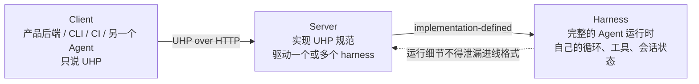
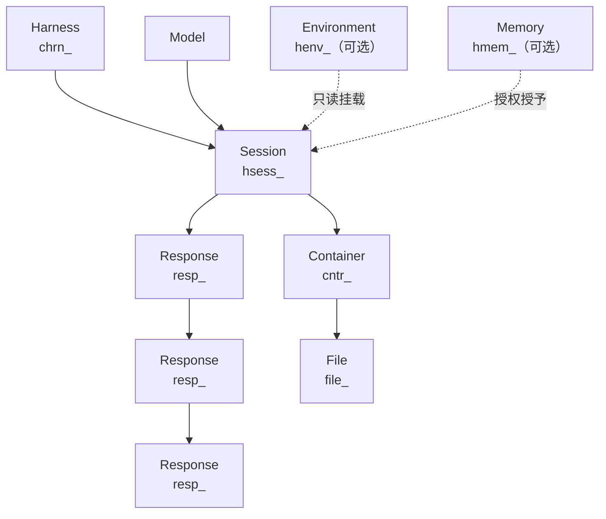
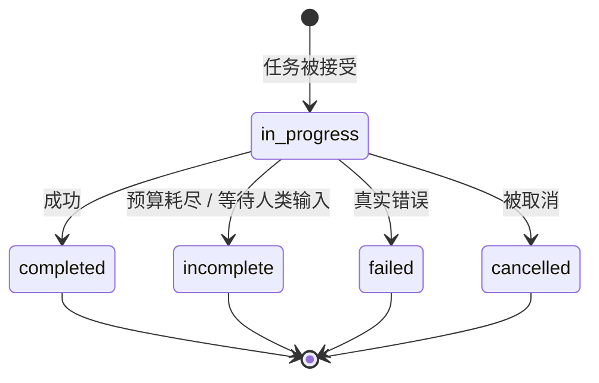
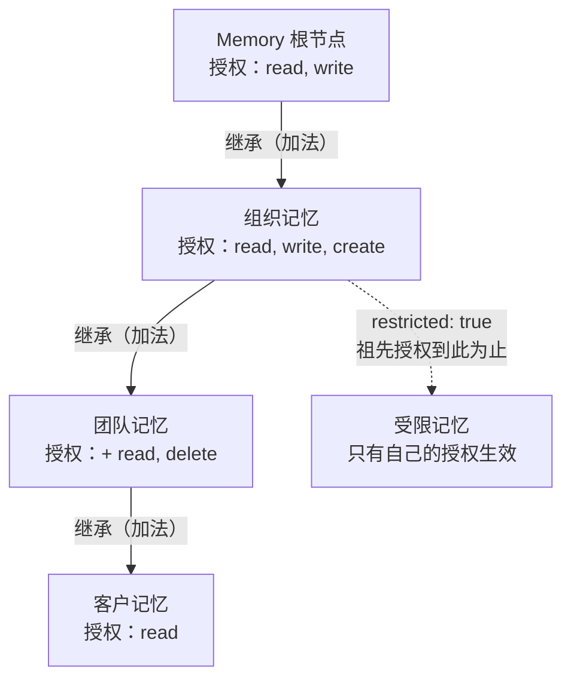

## 引子：当你有 31 个 Coding Agent 的时候

如果你在 2026 年做 AI Agent 产品，几乎必然会遇到这个场景：

用户在你的产品里点了「帮我改一下这个 bug」。你的后端需要调用一个 Coding Agent。桌面上躺着 31 个可选方案——Codex、Claude Code、Hermes、Pi、DeepSeek Harness、OpenCode、Kilo Code、Qwen Code、Gemini CLI、Cline、goose、Kimi Code CLI、Aider、OpenHands、Agent Zero、ZeroClaw、Mistral Vibe……每一个都是优秀的、活跃的、被广泛使用的 Coding Agent。

然后你发现你要做一件很麻烦的事：**为每一个都写一套集成**。

README 里那张动画图说得很直白：不用 HarnessRouter，接 4 个 harness 需要 36 项集成责任；接第 5 个变成 45 项。你每加一个 harness，产品代码就要多一块分支逻辑：会话怎么建、流式事件怎么对齐、文件产物怎么取、取消怎么传播、失败了错误码怎么映射……而更糟的是，这些细节**会漏进你的产品**。

这就是 **HarnessRouter**（⭐4,381，Apache-2.0，2026-08-09 建仓，3.5 个月长到 4.4k ⭐，490 fork）要解决的问题。但它的解法不是「写 31 个 adapter」——那只是把问题换个地方放。它做了一件更有意思的事：

> **先写一份协议（UHP，Unified Harness Protocol），再写一份能证明你遵守这份协议的一致性测试套件，然后让 31 个 harness 都去接这份协议。**

这跟 MCP、A2A、ACP 的思路是同一个家族，但有一个关键区别：**UHP 附带一份可执行的一致性套件（111 项检查），而规范里任何一句「没有测试强制执行的话，那只是一个愿望，不是一份标准」。**

本文分三层来看：UHP 协议本身的设计（为什么这么切分对象、为什么 404 而不是 403、为什么 `tools` 字段必须明说自己什么都不做）；一致性套件的实现（怎么用真实任务去验证协议，而不是只做 schema 校验）；以及规范和实现**亲口承认**的 26 处缺口与 16 处妥协——这部分才是这个项目最值得学的东西。

---

## 一、项目定位：基础设施层，不是又一个 Harness

### 1.1 它站在哪一层

先看一眼它自己的定位。README 第一句就划清了边界：

> "**Build agent products without handling harness engineering.** HarnessRouter is the infrastructure layer that turns existing harnesses like Codex and Claude Code into plug-and-play agent backends, letting your product run tasks, retrieve results, and switch harnesses through one API."

关键在于**它是基础设施层，不是又一个 harness**。它不提供 Agent 循环、不提供工具系统、不提供模型抽象——它提供的是「让别人的 Agent 循环变成你的后端」的那层管道。

再看它的仓库结构，四个顶层目录把职责切得很干净：

| 目录 | 职责 | 规模 |
|---|---|---|
| `protocol/` | UHP 规范本体：按版本分章的 Markdown + JSON Schema + OpenAPI + 一致性套件 | 4 个规范版本 |
| `gateway/` | 服务端实现：OpenAI Responses 兼容 API、控制面、记忆面、SQL 面 | `app.py` 1.6MB |
| `runner/` | 实际跑 harness 的执行器（子进程/会话用户隔离） | `server.py` 1.1MB |
| `ui/` | Console 前端（React/TSX） | 195 个 `.tsx` |

以及 31 个 harness base 的一览表（README 原文）：

> "**31 harness bases today:** Codex, Claude Code, Hermes, Pi, DeepSeek Harness, OpenCode, Kilo Code, Qwen Code, Gemini CLI, Cline, Oh My Pi, goose, Kimi Code CLI, MiniMax Code, Aider, OpenHands, CheetahClaws, Grok Build, Agent Zero, System One, Qoder Cloud Agent, MiMo Code, jcode, OpenSquilla, nanobot, ZeroClaw, Mistral Vibe, Docker Agent, fast-agent, Deep Agents Code and Roder."

### 1.2 为什么「写一份协议」比「写 31 个 adapter」更难，也更值钱

这是本文最核心的判断。

写 31 个 adapter 是**一次性工程**：加一个 harness，写一个类，实现 5 个方法，跑通。这件事第 1 个 harness 一周，第 5 个 harness 可能一周，第 31 个可能一周——线性增长，但每次都能用。

写一份协议是**持续治理**：你得决定会话怎么标识、错误怎么分类、字段什么时候能加什么时候不能删、流式事件怎么排序、什么能力是可选的、客户端怎么发现对方支持什么……然后你得写一份测试套件去证明它，而且这个套件得**真的能抓到实现方的 bug**。

后者贵得多。但只有后者能给你这个东西：

> **换 harness 不需要改产品代码。**

这不是「adapter 写得薄一点」能实现的。adapter 层永远会漏细节——某天 Codex 报了个新错误码，Claude Code 的取消是异步的，Gemini CLI 的流式事件顺序不一样……每一个漏掉的细节都是一次「换 harness 就炸产品」。

### 1.3 与本系列已有 119 篇「harness 类」文章的正交性

这个系列写过大量 harness 相关的内容：Claude Code 源码分析、goose、herdr、opencode、pi-agent、MetaHarness（10 个 host adapter）、oh-my-openagent（22 个 harness-neutral package）……把它们列在一起，会发现一个共同点：

**它们全部在讲「某一个 harness 内部长什么样」，或者「怎么把多个 harness 编排起来」。**

而 HarnessRouter 讲的是第三件事：**一份让 harness 变得可互换的线上协议**。

这个区别可以用一组具体的判别问题验证：

| 判别维度 | MetaHarness（已写） | oh-my-openagent（已写） | HarnessRouter（本文） |
|---|---|---|---|
| 抽象位置 | 进程内 Kernel/Adapter/Surface | 包级 harness-neutral 组件 | **网络协议层** |
| 有无线上格式 | 无 | 无 | **有：HTTP/JSON + SSE** |
| 有无版本号 | 无 | 无 | **有：日期版本 `2026-08-11` → `2026-10-19`** |
| 有无 JSON Schema / OpenAPI | 无 | 无 | **有，且按版本归档** |
| 有无可执行一致性测试 | 无 | 无 | **有：111 项检查，真跑任务** |
| 换 harness 要不要改产品 | 要（要改 adapter 层） | 要（要改包配置） | **不要（换 `metadata.harness_id`）** |
| 「合规」怎么判定 | 靠文档 | 靠文档 | **靠可执行套件产出报告** |

这张表是本文的「零号防线」判据：**候选项目是否提供「可执行的、可版本化的、可机器验证的互操作契约」**。在 554 篇历史文章里，`unified-harness-protocol` / `uhp` / `conformance` 这几个探针**全部 0 命中**。

---

## 二、UHP 协议：五层架构与七个对象

### 2.1 三个角色，一条信任边界

UHP 的架构规范开头就画了这样一张图：



规范对三者的定义非常严格（Architecture §1 原文）：

> **Client** — "an application that wants work done: a product backend, a CLI, a CI job, another agent. A client speaks only UHP. It MUST NOT be required to know which harness implementation runs behind the server, nor how the server executes it."
>
> **Server** — "implements this specification. It accepts tasks, drives one or more harnesses, and reports progress and results in the vocabulary defined here. Everything about *how* it runs a harness — containers, subprocesses, queues, remote workers — is out of scope for this specification and MUST NOT leak into the wire format."
>
> **Harness** — "a complete agent runtime with its own loop, tools and session state. UHP does not specify the harness itself; it specifies how a client drives one through a server. Harnesses are identified by a **base**: a stable string such as `codex`, `claude-code` or `hermes`."

请注意 Server 那句里的 **"MUST NOT leak into the wire format"**。这是整个协议的**第一原则**，规范把它单列成 Design Principle #1：

> "**The client should not be able to tell which harness ran the work** — except by asking. Every difference between harnesses that a client can observe is a leak, and each leak is a place where swapping harnesses breaks a product."

这句话值得反复读。一个「适配层」永远做不到这条，因为 adapter 总会把某些 harness 的特性透出来。只有**协议**能做到——只要规范写死了「服务器怎么跑 harness 属于范围外」，那所有实现方就必须自己把差异吞掉。

### 2.2 七种对象与 ID 前缀

Architecture §3 定义了七种对象，每种都带一个类型前缀 ID：



对象语义（Architecture §3 原文）：

- "A **response** is one task: one request in, one result out. It is the atomic unit of work."
- "A **session** is a chain of responses that share conversational context and a working directory."
- "A **container** is the file namespace of a session. Files the agent writes become artifacts in it."
- "An **environment** is a project's files and installed dependencies, built once and mounted read-only into every session that names it; a harness names one as the default for its tasks. **It is never part of a container**: artifacts come from the working directory, the environment is what the working directory reads."
- "A **memory** is a place that outlasts every session: a node in a tree, holding records, with access granted per node and inherited downward. **An agent is granted memories as a person is**; a memory is never part of a session or a container."

最后那句 **"An agent is granted memories as a person is"** 是整个记忆模型的地基——它意味着记忆权限不需要为「Agent」这个主体专门发明一套机制。

### 2.3 「配置过的 harness」是一等对象

这是 UHP 一个非常关键、也很容易被忽略的设计（Architecture §1）：

> "A **configured harness** is a base plus configuration — default model, system prompt, tool restrictions, skills, MCP servers, step and time budgets. It is the unit a client selects when it sends work, and it is addressed by a server-assigned id."

规范还专门解释了「为什么要配置对象而不只是 base」：

> "The same base behaves very differently with a different system prompt, a different model, or a different tool set. Making the configuration a first-class, addressable object means a product can change how its agent behaves **without redeploying its backend**, and means **two products can share a server without sharing behaviour**."

第二个收益尤其重要：「两个产品可以共用一个服务器而不共用行为」。这正是 SaaS 化 Agent 基础设施的前提。

### 2.4 三级一致性等级：Core / Extended / Full

UHP 定义了三个**累积**的一致性等级（Architecture §2）：

| 等级 | 必须实现什么 |
|---|---|
| **Core** | "Capability discovery, harness discovery, non-streaming and streaming task execution, session continuation, cancellation, and the error model." |
| **Extended** | "Core, plus file input, artifact retrieval, and session listing/inspection." |
| **Full** | "Extended, plus harness lifecycle management (create, update, delete) and session sharing." |

关键在这段：

> "A client MUST NOT assume any capability above **Core** without checking capability discovery. A server MUST NOT advertise a capability it does not implement — **advertising is a promise, and a client that trusts it and receives a `404` has been lied to in a way it cannot recover from.**"

**「广告即承诺」**——这句话配上后面的一致性套件，就变成了一个可以机器验证的契约，而不是一句口号。

而且规范对「conformant」这个词的用法做了极严格的限定：

> "A server that passes at a class MAY describe itself as 'UHP <version> conformant (<class>)', naming the version its discovery document serves as `default_version`, which the suite reports. **No other use of the term 'conformant' is meaningful.**"

### 2.5 六条设计原则

Architecture §6 列出了六条原则，规范自己说「它们解释了后面所有形状的由来」：

1. "**The client should not be able to tell which harness ran the work** — except by asking."
2. "**Progress is a stream of facts, not a rendering.** Events describe what happened — text, a tool call, a file — never how to display it."
3. "**A field means one thing.** Where UHP extends a borrowed surface, it adds fields; it never redefines one."
4. "**Absent is not empty, and empty is not zero.** A server that does not know a value omits it. It MUST NOT invent a placeholder, an estimate, or a zero."
5. "**Failure is a first-class result.** Every failure is reportable in the same envelope as success, with a machine-readable code. A client should never have to parse prose to find out what to do."
6. "**The specification, the reference implementation and the conformance suite move together.** A sentence here that no test enforces is a wish, not a standard."

第 4 条和第 6 条会在后面的「自陈缺陷」一节反复出现——它们是判断这个项目成熟度的标尺。

### 2.6 任务状态机与「什么不算失败」

Lifecycle §3 定义了任务状态机。核心规则：

- `in_progress` 是唯一非终态
- 四个终态：`completed` / `failed` / `incomplete` / `cancelled`
- **终态是吸收态**（absorbing），一旦到达不可再变

`incomplete` 这个状态值得单独说。它不是 `failed`，它表示「工作没做完，但也没出错」——比如触达了 step budget，或者在等一个人回答问题：

> `incomplete_details.reason` ∈ { `max_steps`, `timeout`, `input_required` }



但这里有一个**已知的、被规范自己承认的分类错误**（Tasks §3.3）：

> "A later version moves an interrupted turn from `failed` to `incomplete` with `incomplete_details.reason` `interrupted`, since a client treats the two classes differently; these fields then move to `incomplete_details`."

也就是说：**目前「被中断」的任务还报 `failed`**，尽管它语义上应该是 `incomplete`。规范诚实地记下了这个欠账，并说明了为什么这很重要——「客户端对这两类的处理方式不同」。

### 2.7 流式：sequence_number 是协议的信任根

SSE 事件流的核心规则（Streaming §1）：

> "- Every event MUST carry `type` and `sequence_number`.
> - `sequence_number` MUST start at `0` and increase by exactly 1 per event within a stream. A client can therefore detect a dropped event rather than silently rendering a gap.
> - The stream MUST end with exactly one terminal event.
> - A server MUST NOT buffer the stream to completion before sending it. **A stream delivered all at once at the end is not a stream, and a client cannot tell the difference between that and a hang.**
> - Servers behind a proxy MUST disable response buffering. **This is the single most common deployment error for UHP servers; it looks exactly like the harness being slow.**"

「代理开了响应缓冲」这件事，规范直接点名它是「UHP 服务器最常见的部署错误」——因为它长得跟「harness 很慢」一模一样。这种把运维陷阱写进协议正文的做法，比写在 wiki 里有用得多。

事件词表覆盖 6 类共 18 种事件：

| 类别 | 事件 |
|---|---|
| 响应生命周期（5） | `response.created` / `response.in_progress` / `response.completed` / `response.incomplete` / `response.failed` |
| 输出项（2） | `response.output_item.added` / `response.output_item.done` |
| 助手文本（5） | `response.content_part.added` / `response.output_text.delta` / `response.output_text.done` / `response.content_part.done` / `response.output_text.annotation.added` |
| 推理摘要（3） | `response.reasoning_summary_part.added` / `.text.delta` / `.part.done` |
| 工具调用（2） | `response.function_call_arguments.delta` / `.done` |
| 错误（1） | `error` |

排序保证（Streaming §3）也很克制——**该保证的严格保证，不该保证的明确写「不保证」**：

> **MUST guarantee:**
> 1. `response.created` is the first event.
> 2. Exactly one terminal event is the last.
> 3. For any item, `output_item.added` precedes every event referring to it, and `response.output_item.done` follows them all.
> 4. `sequence_number` is strictly monotonic with no gaps.
>
> **MUST NOT guarantee, and a client MUST NOT assume:**
> - that items complete in the order they were added (a long tool call may finish after later text);
> - that text arrives in any particular chunk size;
> - that any optional event type appears at all.

最后一条特别值得注意：**「不许保证 item 按添加顺序完成」**——因为一个长工具调用可能比后面的文本更晚结束。这种「明确承认乱序」的诚实，比假装顺序保证要好得多。

还有一个精巧的冗余设计（Streaming §4）：

> "Each carries the complete final `response` object — **a client that missed intermediate events can rely on this one alone to render the result. This redundancy is deliberate: a dropped connection mid-stream should cost latency, not correctness.**"

以及断线重连的定位（Streaming §5）：

> "A client SHOULD treat the stream as an optimisation and the stored response as the source of truth. **Products written the other way round — where the stream is the only place a result exists — lose work every time a load balancer recycles a connection.**"

### 2.8 错误模型：52 个错误码，一个信封

错误模型的设计非常克制（Errors §1）：

> "A server MUST NOT return `200` with an error inside. The failure of a *task* is reported as a response with `status: "failed"` and HTTP `200`, because the request succeeded; the failure of a *request* is a non-2xx with this envelope. **Those are different events and MUST NOT be conflated.**"

一个错误信封，6 种粗分类，**52 个具体错误码**：

| 分类 | 数量 | 例子 |
|---|---|---|
| 请求与路由（§3.1） | 40 | `session_not_found` / `session_expired` / `harness_mismatch` / `harness_busy` / `idempotency_key_reused` / `branch_unavailable` |
| 认证与限额（§3.2） | 5 | `missing_credential` / `invalid_credential` / `insufficient_scope` / `rate_limited` / `quota_exhausted` |
| 执行（§3.3） | 7 | `harness_error` / `harness_unavailable` / `provider_error` / `timeout` / `cancelled` / `preview_unavailable` / `preview_failed` |

规范还给了明确的**重试策略表**和**超时建议**，后者很实用：

> "Streaming: no total timeout. Use an inactivity timeout instead — a server SHOULD emit a comment line (`: keep-alive`) at least every 30 seconds so the client can distinguish a working agent from a dead connection."

### 2.9 一个必须单独讲的细节：404 而不是 403

Architecture §5 有一条容易被忽略但极其重要的安全设计：

> "A server MUST scope every object to the principal that created it. A client MUST NOT be able to read, continue, cancel or delete another principal's response, session, or file — **including by guessing an id**. Servers MUST return `404`, not `403`, for objects outside the caller's scope, **so that an id's existence is not disclosed.**"

返回 `403` 等于告诉攻击者「这个 ID 是真的，只是你没权限」——这就把 ID 空间变成了可枚举的。返回 `404` 则把「不存在」和「存在但你不能看」在外部观察上完全合并。

这是本系列见过的**最干净的一条信息不泄露设计**，可以直接搬到任何「多租户 + 不可猜测资源 ID」的系统里。

---

## 三、一致性套件：把「广告是承诺」变成可执行断言

到这里我们已经看了协议。但 UHP 真正与众不同的不是协议本身——MCP、A2A、ACP 都有协议——而是它附带了一份**能真跑任务的一致性套件**。

### 3.1 它怎么跑

一致性套件在 `protocol/conformance/`，是一个独立的 Python 包 `uhp_conformance`。调用方式：

```bash
uhp-conformance --base-url http://localhost:3000/api/harness \
                --class full \
                --json report.json
```

关键设计决策：**它会真的跑 7 个真实 Agent 任务**。这是有代价的（要花钱、要时间），但理由很硬——只做 schema 校验只能验证「形状对不对」，而真正要抓的缺陷是「行为对不对」。

> The suite runs ~7 *real* agent tasks deliberately, because the defects worth catching are invisible to schema checks.

### 3.2 111 项检查，一个装饰器

检查的实现模式非常清晰（`protocol/conformance/uhp_conformance/checks.py`）：

```python
@check("S-04", "sequence_number starts at 0 and has no gaps", "core",
       f"{SPEC}/streaming.md#3-ordering-guarantees")
def s04(ctx):
    evs = _run_stream(ctx)
    if not evs:
        raise Skip("no events to check")
    seqs = [e.get("sequence_number") for e in evs]
    assert all(isinstance(s, int) for s in seqs), "some events have no integer sequence_number"
    assert seqs[0] == 0, f"first sequence_number is {seqs[0]}, expected 0"
    expected = list(range(len(seqs)))
    assert seqs == expected, (
        f"sequence_number is not gapless and monotonic; first divergence at index "
        f"{next(i for i, (a, b) in enumerate(zip(seqs, expected)) if a != b)}. "
        "A client cannot distinguish a dropped event from a server that skips numbers.")
```

三个细节值得学：

**① 每个检查都锚定规范的具体章节。** 第三个参数 `f"{SPEC}/streaming.md#3-ordering-guarantees"` 是规范文件路径 + 锚点。检查失败时，你能直接点进去看规范原文。这是「规范、参考实现、一致性套件一起动」（Design Principle #6）的物理实现。

**② 断言消息写的是「为什么这重要」，不是「什么不等」。** 对比一下：

- 差的写法：`assert seqs == expected, "sequence numbers wrong"`
- 这里的写法：`"A client cannot distinguish a dropped event from a server that skips numbers."`

后者把**协议层的理由**带进了失败消息。读者拿到一份失败的 conformance 报告，能立刻知道这为什么重要。

**③ 报告的是「第一个分歧位置」而不是笼统的「不相等」。**

再看一个更有意思的检查——`S-09`，验证流是真正渐进式而不是攒到最后一次性吐出：

```python
@check("S-09", "The stream is progressive, not buffered to the end", "core",
       f"{SPEC}/streaming.md#1-opening-a-stream")
def s09(ctx):
    evs = _run_stream(ctx)
    if len(evs) < 3:
        raise Skip("too few events to judge progressiveness")
    first, last = evs[0].get("__t", 0), evs[-1].get("__t", 0)
    if last < 0.5:
        raise Skip(f"the whole task finished in {last:.2f}s — too fast to distinguish buffering")
    spread = last - first
    assert spread > 0.05, (
        f"all {len(evs)} events arrived within {spread*1000:.0f}ms of each other after {last:.1f}s. "
        "The stream appears to be buffered and flushed at the end, which a client cannot "
        "distinguish from a hang. Check for response buffering in a proxy.")
    return f"events spread over {spread:.1f}s"
```

这里有两个精彩的工程细节：

- `__t` 时间戳由 SSE 解析器打在每个事件上（`client.py`：`ev["__t"] = time.time() - t0`），在 schema 校验前会被剥掉。这个时间戳是**测试基础设施**（用来判断渐进性），不进协议。
- 当任务跑得太快（< 0.5 秒），它**主动 Skip** 并写明原因：「too fast to distinguish buffering」。而不是给一个假阳性。

### 3.3 「保留字段」三连检查：一个字段的完整生命周期

`tools` 和 `include` 这两个字段是 UHP 里最奇特的设定——它们**什么都不做**，但服务端**必须报告它们被忽略了**。

规范原文（Tasks §1.4）：

> "They are **reserved**: a server accepts them, never acts on them, and reports them under `metadata.ignored_fields`."

> "**Removal is a question for the next version. This one is additive-only and cannot drop a field, so the honest form here is to say plainly that these two do nothing.**"

「因为这个版本只能加字段不能删字段，所以诚实的做法是明说这两个字段什么都不做」——这种推理非常 UHP。

为什么要有保留字段？因为 UHP 的 API 形状要兼容 OpenAI Responses API，而有些客户端会无差别地发 `tools`。如果服务端直接报错，这些客户端就接不上。

而检查套件为这两个字段写了**三个**检查，构成完整的三段式：

```python
@check("T-08", "A request carrying reserved fields is accepted, not rejected", "core",
       f"{SPEC}/tasks.md#11-request-fields")
def t08(ctx):
    r = _run_with_reserved(ctx)
    assert r.status == 200, (
        f"a task sending `tools` and `include` returned HTTP {r.status}: {r.body[:200]!r}. §1.1 "
        "requires a server to ignore rather than reject, and §1.4 makes both fields reserved — a "
        "client that sends them for wire compatibility with another API must not be refused.")
    d = r.json or {}
    assert d.get("status") in {"completed", "incomplete"}, (
        f"the task carrying reserved fields ended {d.get('status')!r}; accepting a request means "
        "running it, not failing it later for the same reason")
    return "accepted and ran"
```

```python
@check("T-09", "Reserved fields are reported in metadata.ignored_fields", "core",
       f"{SPEC}/tasks.md#14-reserved-fields-tools-and-include")
def t09(ctx):
    r = _run_with_reserved(ctx)
    if r.status != 200:
        raise Skip("the request carrying reserved fields was not accepted (see T-08)")
    meta = ((r.json or {}).get("metadata") or {})
    got = meta.get("ignored_fields")
    assert got is not None, (
        "the response has no `metadata.ignored_fields` for a request that sent `tools` and "
        "`include`. §1.1 requires ignoring to be observable: silently dropping a field is "
        "indistinguishable from acting on it, and the client cannot tell which happened.")
    ...
```

第三个检查 `T-10` 是**反向**的，它的 docstring 是全项目最精彩的一段注释之一：

```python
@check("T-10", "A task that sends no reserved field is not told one was ignored", "core",
       f"{SPEC}/tasks.md#11-request-fields")
def t10(ctx):
    """The other half of T-09. A server that hardcodes the list reports fields the client never
    sent, which is a different lie in the same place: it tells a client its request was altered
    when it was not."""
    d = (_run_blocking(ctx).json or {})
    got = ((d.get("metadata") or {}).get("ignored_fields")) or []
    over = [f for f in ("tools", "include") if f in got]
    assert not over, (
        f"the response names {over} in ignored_fields for a request that sent neither. "
        "ignored_fields reports what this request carried and the server dropped, not a "
        "catalogue of what the server would drop.")
```

「**这是 T-09 的另一半。一个把列表写死的服务端会报告客户端根本没发过的字段——这是同一个位置的另一种谎言：它告诉客户端你的请求被改过了，而其实没有。**」

这段注释体现了整套套件的方法论：**不只验证「该做的做了」，还验证「不该做的没做」。** 后者才是大多数实现会犯、而 schema 校验抓不到的错。

### 3.4 报告格式：Skip 永远不是 Pass

这是整套套件最有分量的部分。

`report.py` 里 `highest_class()` 的 docstring 直接把一个已修的 bug 写在代码里：

```python
def highest_class(results, required_checks=None) -> str:
    """The highest class every check of which — and of the classes below it — ran and passed.

    "Fully passed" means exactly that: a fail or error anywhere at or below the class breaks
    the ladder, and so does a skip, because a skipped check was not verified. A class with no
    results at all breaks it too — before this rule, a run that only exercised `core` reported
    `highest_class_passed: "full"`, crediting classes that never ran (issue #7's green-summary
    shape, in class form)."""
```

「**在这条规则之前，一次只跑了 core 的运行会报告 `highest_class_passed: "full"`，把根本没跑过的等级算成通过**」——把一个曾经产生假绿灯的 bug 永久留在代码注释里，这是我在本系列见过最诚实的一类工程实践。

覆盖率计算用 `Counter`，这样重复结果和未知结果都能被抓到：

```python
def _coverage(results, required_checks):
    """Compare the results with the registry, including duplicate or unexpected results."""
    expected = Counter((c.cls, c.id) for c in required_checks)
    observed = Counter((r.cls, r.id) for r in results)
    missing = list((expected - observed).elements())
    extra = list((observed - expected).elements())
    return not missing and not extra, missing, extra
```

而终端判决有**四级阶梯**（`report.py`）：

```python
# 说明：以下为源码节选，判决阶梯的片段在函数体中间截断，故缩进不成对。
    if n[Outcome.FAIL] or n[Outcome.ERROR]:
        lines.append(c(f"    NOT CONFORMANT at class '{cls}'", RED))
        if achieved:
            lines.append(f"    Highest class fully passed: {achieved}")
    elif not complete:
        lines.append(c(f"    PARTIAL RUN — class '{cls}' not verified", YELLOW))
        if achieved:
            lines.append(f"    Highest class fully passed: {achieved}")
    elif n[Outcome.SKIP]:
        # Same vocabulary as the JSON report: skips demote the verdict, they never vanish into it.
        lines.append(c(f"    CONFORMANT WITH SKIPS — UHP {served} ({cls})", YELLOW))
        lines.append(c("    Note: skipped checks were not verified. A skip is not a pass.", YELLOW))
    else:
        lines.append(c(f"    CONFORMANT — UHP {served} ({cls})", GREEN))
```

**「Skip 会降级判决，但绝不会消失在判决里。」**

而整套套件的设计规则写在 `registry.py` 里：

> "SKIP — the check could not run, and the reason is recorded. **A skip is never a pass: a report that hides skips behind a green summary is how a suite starts lying.**"

这句话是本文最想传达的技术主张。**一个把 SKIP 混进 PASS 的测试套件，会在第一次「跳过了但没人管」之后，慢慢变成一个谎报装置。** 而 UHP 用三种手段防住这件事：

1. SKIP 必须是 SKIP，不能是 PASS；
2. 任何 SKIP 都会把判决从 `CONFORMANT` 降级为 `CONFORMANT WITH SKIPS`（黄色）；
3. `highest_class` 里，**一个 SKIP 就会打断等级阶梯**——因为「跳过的检查没有被验证过」。

还有一个细节：**这个套件里没有 `not_applicable` 这个结果**。四种结果只有 `pass` / `fail` / `skip` / `error`。「不适用」必须表达成一个带原因的 SKIP，原因文本要说明**为什么**不适用：

- `"this server does not report the resume capability"`（T-15）
- `"this server does not report the input_requests capability"`（T-13/T-14）
- `"the agent never called ask_user, so no question was put and nothing was measured"`（T-13）
- `"the fixture's tool uhp_steps was never called, so no work was cut at the budget and nothing was measured"`（T-12）

「没有观测到，就不要假装观测到了」——这一条贯穿了协议和套件两层。

### 3.5 检查套件给自己写的元测试

`protocol/conformance/tests/` 下有 3 个测试文件，它们测的不是协议，而是**检查本身**。以 `test_step_budget.py` 为例，它会起一个带 `DEFECT` 环境变量的桩服务端，然后断言：

- 每种缺陷都能被对应的检查抓到
- 没有任何检查以 ERROR 结束（ERROR 是套件自己的 bug，不是被测实现的 bug）
- **一个缺陷只产生一个红标**（不会多个检查同时报同一个问题，制造噪音）

```python
# tests/test_step_budget.py 的思路（节选）
def test_each_defect_is_caught_by_its_own_check():
    for defect in DEFECTS:
        server = stub_server(defect=defect)
        results = run_checks(server, only=["T-12"])
        failed = [r for r in results if r.outcome is Outcome.FAIL]
        assert len(failed) == 1, (
            f"defect {defect!r} produced {len(failed)} failures; "
            "each defect must be reported by exactly one check")
```

**给测试写测试**，这是让测试套件本身可信的唯一办法。

### 3.6 一个有趣的事实：文档漂移

`protocol/conformance/README.md` 里写的是 "101 checks"、"Full +51"，而代码里实际注册的是 **111** 项。子代理在核对时发现了这个差异并标了出来。

这不算致命问题（README 会过时），但它恰好说明了一件事：**当一致性等级由「注册表里的检查」决定时，文档里的数字会自然漂移。** 权威来源是代码里的 `REGISTRY`，不是 README。

---

## 四、记忆模型：树、加法授权，和一个截断开关

UHP 的记忆是一个**可选子协议**（`memories` capability）。不实现它，服务器在每个等级上仍然合规。这一章（`memories.md`，55KB）大概是整个 UHP 规范里最厚的一章，也是设计密度最高的一章。

### 4.1 三方职责切分

规范用一张表把责任分得很干净：

```
the provider    its own store and intelligence   how memory is derived and kept
UHP Memories    this chapter                     what a memory is, who may reach it, when a harness calls it
MCP             the tools an agent holds         how an agent calls it in a turn
```

「UHP 定义**记忆是什么、谁能访问、harness 什么时候调用它**」，但不规定「记忆怎么被推导出来」——那是 provider 的事。这个切分让 UHP 可以覆盖 Mem0、Graphiti、Hindsight、ReMe 这些完全不同的引擎。

### 4.2 为什么是树，而不是固定的一组 scope

规范专门解释了这个问题（memories.md §"Why a tree and not a fixed set of scopes?"）：

> "Memory products each name their own levels (user, agent, run, app, team, project) and **none of the lists agree**. A level is a meaning an implementation gives to a place in a tree: the protocol carries the tree and the inheritance, and a server is free to say that one node is an organization and the one under it a customer. **A node exists where access differs, and nowhere else**: a session's memory needs no node of its own when it is read by exactly the principals that read its parent."

「**没有一个产品对层级的命名是一致的**」——Mem0 叫 user、Graphiti 叫 entity、别的叫 group。协议不去统一命名，只提供树 + 继承，然后给出一条判据：

> **「节点只在该处访问权不同的时候才存在，别的地方不存在。」**

这条判据非常实用。它避免了「为了语义完整性而开一堆没用的节点」——如果一个会话的记忆只被它父节点的授权者读，那它根本不需要独立节点。

### 4.3 权限：加法继承 + 一个截断开关

四种特权：`read` / `write` / `create` / `delete`。继承是**加法**的——祖先的授权向下累加，没有「拒绝」这种特权。

唯一的例外是 `restricted` 标志：

> `restricted` (boolean, client) — "When `true`, grants on ancestors stop here."

所以整个权限模型只有一条规则和**一个开关**：



这是本系列见过的**最简权限模型**：一条继承规则 + 一个截断标志。没有 deny 列表、没有 ACL 求值、没有优先级冲突——因为「加法继承 + 截断」在数学上不会有歧义。

### 4.4 observe vs remember：谁说了算

规范区分了两个方向：

- **`observe`** — provider 决定要不要把这件事写进记忆（"the provider decides"）
- **`remember`** — agent 主动要求记住

对应地，`forget` 和 `erase` 也是两个不同的动作：

> `forget` — closes the fact but keeps the trace（关闭事实但保留痕迹）
> `erase` — removes it for good, requires `delete` privilege, and **is never an agent tool**（彻底删除，需要 delete 权限，**永远不是一个 agent 工具**）

「erase 永远不是 agent 工具」——这条限制意味着**Agent 不能自己把记忆彻底抹掉**。这是一个非常具体的安全边界：软删除（forget）是 agent 能做的，硬删除（erase）必须由人在控制面上做。

### 4.5 四个记忆时刻

规范定义了 harness 在会话生命周期里**接触记忆的四个时刻**，其中只有两个是 agent 能选的：

1. **Prime** — 会话开始前注入相关记忆
2. **Tools** — 挂载记忆工具（走 MCP）
3. **Observe** — 记录发生了什么
4. **Consolidate** — 巩固/合并

「只有两个是 agent 的选择」这个限制，正是「Agent 与人平权获得记忆授权」这一原则的推论——Agent 能读自己被授权的记忆，但不能自己决定扩大自己的授权面。

### 4.6 规范还承认：记忆质量不在一致性套件范围内

memories.md 末尾两句自我批评非常关键：

> "The suite runs with one credential, so **what one principal may not read of another's is not yet checked by it**."
>
> "An interface that passes says nothing about whether a memory is any good."

**第一条是一个安全漏洞的自陈**：一致性套件只用一个凭据跑，所以「A 主体不能读 B 主体的记忆」这件事**根本没有被自动验证过**。

**第二条划清了协议层与产品质量的边界**：接口合规不代表记忆有用。「该不该记住」是另一套测量。

---

## 五、环境模型：构建，而不是拷贝

环境（Environment）解决的是「Agent 每次跑任务都要重新装依赖」这个具体问题。规范的核心主张是：

> An environment is "**built, not copied**".

它由一组**不可变的、带版本的层**构成，每个层对应 manifest 里的一种构建动作：

| manifest 条目 | 作用 |
|---|---|
| `pip` | Python 依赖 |
| `npm` | Node 依赖 |
| `apt` | 系统包 |
| `requirements.txt` | Python 依赖清单 |
| `pyproject.toml` | Python 项目依赖 |
| `package.json` | Node 项目依赖 |
| `setup.sh` | 任意自定义构建脚本 |

构建好的环境**只读挂载**进每个引用它的会话。而 harness 可以指定一个默认环境，任务可以通过 `metadata.environment` 覆盖。

规范还专门澄清了环境和容器的区别（Architecture §3）：

> "**It is never part of a container**: artifacts come from the working directory, the environment is what the working directory reads."

产物来自工作目录，环境是工作目录**读取**的东西。一个是写，一个是读。

### 5.1 harness 与 environment 的职责对照

| 维度 | Harness | Environment |
|---|---|---|
| 是什么 | Agent 运行时（循环、工具、会话状态） | 项目文件与已装依赖 |
| 谁来选 | 客户端通过 `metadata.harness_id` | harness 默认值，任务可覆盖 |
| 可变性 | 可创建/更新/删除（Full 等级） | 不可变、带版本、只读挂载 |
| 生命周期 | 长期存在 | 构建一次，跨会话复用 |

---

## 六、记忆引擎选型：一个纯函数的、可以被反驳的路由器

这一节是实现侧的内容，但它示范了一种非常值得学的工程态度。

`gateway/memory_choice.py` 决定「这个 Agent 该配哪个记忆引擎」，候选是四个真实产品：Mem0、Graphiti、Hindsight、ReMe。

模块 docstring 原文：

> "**Pure and deterministic**: the same agent always gets the same answer, and the answer is one sentence a person can read and disagree with. **No model runs here, and nothing is fetched.** What is running is the caller's to say (`running`); this module only chooses among it."

```python
NONE, MEM0, GRAPHITI, HINDSIGHT, REME = "none", "mem0", "graphiti", "hindsight", "reme"
ORDER = (NONE, MEM0, GRAPHITI, HINDSIGHT, REME)
ENGINES = (MEM0, GRAPHITI, HINDSIGHT, REME)

REASON = {
    NONE: "This agent works on what it's given each time; memory would add nothing.",
    MEM0: "It serves people, so it keeps each person's facts and preferences, separately per person.",
    GRAPHITI: "It tracks people, things and how they relate over time.",
    HINDSIGHT: "It learns from its own work, consolidating experience into lessons.",
    REME: "Its memory is notes people can read and edit.",
}
UNSAID = "Nothing about it says otherwise, so it keeps each person's facts and preferences, separately per person."

# How much a word counts where it is said: an agent's name says what it is, its instructions say much else.
FIELD_WEIGHT = {"name": 3.0, "description": 2.0, "hint": 2.0, "instructions": 1.0, "tools": 1.0}
# The hint decides alone when its best nature scores at least this, and no other comes within half of it.
HINT_CLEAR = 2.0
```

词表按「短语优先」设计，注释解释了这个细节：

> "A pattern with a space in it is a phrase: it is read first, and **the words it took are not read again**, so 'code review' is a review and not code, and 'sales pipeline' is a CRM."

「短语优先 + 短语吃掉的词不再单独读」——这样一个两词短语不会被拆成两个独立信号污染打分。

这个模块的三个设计决策，每一条都可以直接搬到别处：

1. **不跑模型。** 这个判断本质是「从 Agent 自己的话里读出它是什么性质」，用词表打分就够了。跑模型会带来不确定性，而选型结果需要**可复现**。
2. **不联网。** 同上，可复现。
3. **输出是一句人能读懂并能反驳的话。** `REASON` 字典里每条都是完整的英文句子。人不一定同意这个选型，但至少能看懂依据在哪，然后去改词表。

「**可复现 + 可被人反驳**」这两个性质，比「用大模型判断得更准」在工程上更值钱。

---

## 七、⭐ 必须诚实指出的源码自陈缺陷

这是本系列的核心特色，也是 HarnessRouter 做得最好的部分之一。规范和实现**主动**记录了自己的缺口。

### 7.1 规范侧：26 处自认缺口

我把 UHP 规范全文读完后收集到的显式自陈，按重要性排列：

| # | 缺口 | 原文要点 |
|---|---|---|
| 1 | **`tools` / `include` 什么都不做** | "They are **reserved**: a server accepts them, never acts on them, and reports them under `metadata.ignored_fields`." |
| 2 | **永不加「按请求授予工具」** | "**narrowing is safe, widening is escalation.** ... It should never add a per-request *grant*." |
| 3 | **被中断的任务目前误报 `failed`** | "A later version moves an interrupted turn from `failed` to `incomplete`..." |
| 4 | **分支不恢复依赖和 CLI 状态** | "A branch restores the user's files, **not installed dependencies or native CLI state**." |
| 5 | **分支有硬超时** | "The reference bounds a branch's whole preparation by one deadline (300 seconds); past it, the answer is `503`." |
| 6 | **输入历史可能被静默丢弃** | "Beyond a bound it MUST NOT import any of them and MUST NOT refuse the request for it." |
| 7 | **应用层反压完全未定义** | 只有 "MUST NOT buffer the stream to completion" 和代理缓冲开关，**没有 credit / window / ack 协议** |
| 8 | **会话过期时间由服务器自定** | "Session expiry is server policy." |
| 9 | **幂等键只保证保留 24 小时** | "Idempotency keys SHOULD be retained for at least 24 hours." |
| 10 | **顶层 `detail` 字段已废弃** | "That field is deprecated, carries no information not in `error.message`." |
| 11 | **旧路径 `/v1/traces/{id}` 保留** | "a server MAY keep serving it (the reference implementation does, as the same handler)" |
| 12 | **只能加字段不能删字段** | "This one is additive-only and cannot drop a field" |
| 13 | **一致性套件只有一个凭据** | "what one principal may not read of another's is not yet checked by it" |
| 14 | **记忆质量不在测试范围** | "An interface that passes says nothing about whether a memory is any good." |
| 15 | **`base` 不枚举** | 客户端无法预知某 base 支持哪些工具；只要求「不得广告自己给不了的」 |
| 16 | **`disabledTools` 可能只是软约束** | 运行时不支持硬阻断时只能靠 standing instruction 传达 |
| 17 | **版本错位** | `IMPLEMENTATIONS.md` 全标注 `UHP 2026-09-12`，而规范最新是 `2026-10-19` |
| 18 | **harness base 数量不一致** | CE 26 个 vs 托管 16 个 |

第 7 条（反压未定义）和第 13 条（跨主体越权未验证）是**安全/正确性上最值得关注的两个缺口**。

第 2 条特别值得单独讲：

> "The durable rule underneath, which applies beyond this field: **narrowing is safe, widening is escalation.** A future version could reasonably add a typed per-request tool *disable* list. It should never add a per-request *grant*."

「**收窄是安全的，放宽是提权。**」这 nine 个字可以直接搬进任何「工具权限 / 能力协商」类系统的设计文档。它把「未来可能的扩展方向」提前定性为禁区，避免了一个看似无害的字段在几年后变成提权通道。

### 7.2 实现侧：16 处妥协

| # | 位置 | 缺口 |
|---|---|---|
| 1 | `control_store.py` L184 | "**NOTE: fencing is not yet wired into the turn path (deferred).**" — 租约栅栏已就绪，但 turn 提交时还没真正用它 |
| 2 | `control_store.py` L564–567 | API key 缓存是写穿 + 双写，**不是强一致**；TTL 只是陈旧上界 |
| 3 | `control_store.py` | 分区内聚被 apikey 打破（`pk == id == token hash`），因为认证前不知道 org |
| 4 | `control_store.py` L210, L262 | **租约路径 fail-open**：存储故障时 turn 无栅栏运行 |
| 5 | `control_store.py` | `lease_acquire` 已被 `lease_admit` 取代，**两者并存**（旧函数还在文件里） |
| 6 | `memory_choice.py` | 只做选型，**不产出 UHP 能力文档**，也不实现 memories 端点 |
| 7 | `checks.py` README | "101 checks" vs 代码实际 111 项（文档漂移） |
| 8 | `harnesses.md` L111 | `fallback` 字段已废弃但仍在发 |

第 1 条和第 4 条是同一个主题的两面：**fencing（栅栏令牌）机制已经写好了，但还没接进 turn 路径；而接进去之前，租约路径是 fail-open 的。**

这暴露了一个真实的工程权衡：**「正确性关键路径 fail-closed，优化路径 fail-open」**是 `control_store.py` 的设计原则，但**租约恰恰属于正确性关键路径**，目前却是 fail-open 的。这是一个已经写在代码注释里的、尚未偿还的技术债。

### 7.3 对比：什么样的自陈缺陷最值钱

值得强调的是**这些缺口的写法**。UHP 不是在 issue 里写「TODO: 支持反压」，而是在规范正文里写：

> "A server MAY additionally support SSE `Last-Event-ID` resumption. If it does, it MUST resume from the event *after* the given `sequence_number` and MUST NOT replay events the client already saw."

——把「这个功能是可选的，但如果你实现了就必须这样实现」写清楚。

而一致性套件 README 里那句：

> "A **missed** case is a known gap, recorded on purpose. When the scanner learns to catch one, the test fails until the corpus and this page are updated together."

（这是 hol-guard 项目的做法，UHP 用的是同一思路。）

**自陈缺陷的三个层次**：
1. **承认缺口**（"反压未定义"）
2. **说明为什么现在不补**（"这个版本只能加字段不能删字段，所以明说这两个字段什么都不做"）
3. **规定补上时的行为**（"未来版本会把中断从 failed 移到 incomplete"）

第 3 层是最难的，也是最值钱的。

---

## 八、与同类项目对比

### 8.1 四方对照

| 维度 | **UHP / HarnessRouter** | MCP | A2A | ACP |
|---|---|---|---|---|
| 解决什么 | 让 **coding agent** 可互换 | 让 agent 接 **工具** | 让 agent 与 **agent** 对话 | 让 **editor** 驱动 agent |
| 谁是主角 | harness（Agent 运行时） | tool | agent | editor + agent |
| 规范形态 | 日期版本 + JSON Schema + OpenAPI + 一致性套件 | JSON Schema，版本化 | JSON Schema，版本化 | Rust schemars → JSON Schema |
| 有可执行一致性测试 | ✅ 111 项，真跑任务 | ❌ 有 SDK 但无强制套件 | ❌ 有 TCK 雏形 | ✅ `acp-tck` 兼容性测试套件 |
| 有幂等语义 | ✅ `Idempotency-Key` | ❌ | ❌ | ❌ |
| 有多租户越权语义 | ✅ 404-not-403 | ❌ | 部分 | ❌ |
| 错误码数量 | 52 个机器可读码 | 少 | 少 | 少 |

### 8.2 与 ACP 的对比：最像，但方向相反

ACP 是本系列写过的（2026-10-27），也是「协议层」赛道的另一个开山之作。两者对比很有意思：

**相同点**：
- 都是「三方角色 + 能力协商 + 版本化规范」
- 都刻意把「谁拥有运行时」这件事定义清楚
- ACP 也有 `acp-tck` 测试套件，说明「协议必须配测试」这个共识已经形成

**不同点**：

| | ACP | UHP |
|---|---|---|
| 协议三角的位置 | editor ↔ agent（第三条边） | client ↔ harness（运行时可互换） |
| 终端句柄所有权 | **反转**——终端跑在 client 侧，agent 只拿 terminalId | harness 跑在 server 侧，client 完全不知道 |
| 传输 | JSON-RPC 双向 | HTTP/JSON + SSE 单向流 |
| 能力协商 | `clientCapabilities` / `agentCapabilities`，省略即不支持 | 三级一致性等级 + `GET /v1/uhp` 能力发现 |
| 一致性验证 | 兼容性测试套件 | 111 项检查 + 报告 + 版本标签 |

最有意思的是**所有权方向**：ACP 说的是「终端跑在客户端侧，所以信任边界画在 editor↔agent 之间」；UHP 说的是「harness 跑在服务端侧，所以客户端完全看不到 harness」。**两个协议都在回答同一个问题——信任边界画在哪——但答案相反。**

### 8.3 与 MCP / A2A 的关系：互补而非竞争

`protocol/ECOSYSTEM.md` 里明确划了边界。UHP 不替代 MCP/A2A：

- **MCP 管 agent↔tool**：agent 手里有什么工具、怎么调
- **A2A 管 agent↔agent**：agent 之间怎么发现和通信
- **UHP 管 client↔harness**：产品怎么把活派给一个 coding agent

特别是插件：UHP **不定义插件格式**——「a plugin *is* an Agent Plugins 1.0.0 package」。UHP 只是规定「harness 可以带插件，插件可以加载失败，失败要被记录而不是被静默丢弃」（对应一致性检查 `P-07`）。

### 8.4 与「写 31 个 adapter」方案的对比

| 维度 | 31 个 adapter | UHP 协议 + 一致性套件 |
|---|---|---|
| 初始成本 | 低（第 1 个一周） | 高（协议 + 套件要数月） |
| 加第 31 个 harness | 线性增加 | 一个 base + 跑一次一致性套件 |
| harness 行为有差异时 | 差异漏进产品 | 差异必须被服务器吞掉 |
| 出问题时 | 「Codex 那边有点怪」 | 精确到 `checks.py` 里的某一行 + 规范章节锚点 |
| 合规性判定 | 靠自觉 | 机器可验证 |
| 别人能接入吗 | 不能（在你的代码里） | 能（照规范实现 + 过套件） |

UHP 的成本曲线是**先高后平**，adapter 是**一直线性**。当 harness 数量少（2-3 个）时，adapter 方案完全够用；当你有 31 个、还打算让外部开发者接入时，协议方案是唯一选择。

---

## 九、优缺点分析

### 9.1 优势侧：架构简洁性 / 扩展性 / 易用性

| 优势 | 说明 |
|---|---|
| **协议形状极简** | 五层（传输/发现/任务/会话/流），七个对象，五个 REST 端点族。客户端要学的概念很少 |
| **可插拔性真正成立** | `base` 是**不透明字符串**——规范明确说 "anything else means the protocol has to be revised every time a harness is released"，所以新 harness 上线不需要改协议 |
| **会话隐式创建** | "Requiring `POST /sessions` before any work could be done would add a round trip, a failure mode, and an object to clean up — for a concept most first tasks never need." 只发一次任务的客户端**永远学不到「session」这个词** |
| **一致性等级让能力协商变简单** | 客户端只需要问「你是哪个等级」，不需要逐个探测 20 项能力 |
| **404-not-403** | 天然防 ID 枚举，不需要额外的 rate limit 逻辑 |
| **错误可机器处理** | 52 个码 + 重试策略表 + 超时建议，客户端不需要解析散文 |
| **文档即契约** | 每个一致性检查都锚定规范章节，失败报告能直接跳转 |
| **部署友好** | 一条 `docker run` 起步，4GB 磁盘，不需要账号、不带试用 key |

### 9.2 代价侧：性能 / 复杂度 / 维护性

| 代价 | 说明 |
|---|---|
| **多一跳网络延迟** | task 经过 client → gateway → runner → harness → provider，多了 2-3 跳。README 自己的 benchmark 说端到端 4m36s → 1m25s（快 3.2 倍），**但那是换 harness 带来的收益，不是这一层开销的量级** |
| **协议维护成本高** | 日期版本、只能加不能删、4 个规范版本已经存在。每个版本都要维护 schema + OpenAPI + 一致性套件 |
| **一致性套件要花钱跑** | 每次验证要真跑 7 个任务。这是「可验证」的代价 |
| **harness 特性表达受限** | 协议刻意不泄漏 harness 差异。**harness 独有的强能力会被协议削平**——这是设计目标，但对某些 harness 是损失 |
| **反压缺失** | 长时间、大输出的任务，服务端与客户端之间的流控只能靠 HTTP 层和会话级串行化 |
| **生态仍在早期** | 规范最新 `2026-10-19`，`IMPLEMENTATIONS.md` 还标着 `2026-09-12`；harness base 数量 CE（26）与托管（16）不一致 |
| **实现侧技术债** | fencing 未接入 turn 路径、租约路径 fail-open、`lease_acquire` 与 `lease_admit` 并存 |

### 9.3 一个公允的判断

HarnessRouter 不是「谁都能抄的架构」。它适合：
- **有多个 coding agent 要接的产品团队**
- **需要按任务切换 harness（成本/延迟）** —— README 的 benchmark 就是这个场景
- **需要对外提供「跑 agent」能力的多租户平台**
- **愿意为「换 harness 不改产品」付初期成本的团队**

它不适合：
- 只需要接 1-2 个 harness 的小项目（adapter 更快）
- 需要 harness 独有特性透传给用户的场景（协议会削平）
- 对首 token 延迟极端敏感的场景（多一跳）

---

## 十、实践：跑起来

### 10.1 三十秒起步

```bash
docker run -d --name harnessrouter \
  -p 127.0.0.1:3000:3000 \
  -v harnessrouter:/data \
  harnessrouter/harnessrouter
```

首次启动会安装所选 harness 的 CLI，等日志出现：

```text
[harnessrouter] ready on :3000
```

然后读初始密码：

```bash
docker exec harnessrouter cat /data/selfhost-initial-password
```

打开 `http://localhost:3000`，登录后在 Console 里配置 provider key，再建一个 agent setup。

> **注意**：README 明确说 "**Do not add `--user`.** The entrypoint and Runner need root to manage per-session users." —— 加 `--user` 会破坏 per-session 用户隔离。

### 10.2 第一个 API 调用

```bash
export HARNESSROUTER_BASE_URL=http://localhost:3000/api/harness

curl --fail-with-body -sS "$HARNESSROUTER_BASE_URL/v1/responses" \
  -H "Authorization: Bearer ${HARNESSROUTER_API_KEY}" \
  -H 'content-type: application/json' \
  -d '{
    "input":"Reply with exactly: it works.",
    "metadata":{"harness_id":"codex"},
    "model":"gpt-5.4-mini",
    "stream":false
  }'
```

把 `"stream":true` 就能收到 SSE 事件流。

### 10.3 幂等重试：同一个 key 不会跑两次

```bash
IDEMPOTENCY_KEY=$(python3 -c 'import uuid; print(uuid.uuid4())')

for attempt in 1 2; do
  curl --fail-with-body -sS "$HARNESSROUTER_BASE_URL/v1/responses" \
    -H "Authorization: Bearer ${HARNESSROUTER_API_KEY}" \
    -H 'content-type: application/json' \
    -H "Idempotency-Key: $IDEMPOTENCY_KEY" \
    -d '{
      "input":"Reply with exactly: it works.",
      "metadata":{"harness_id":"codex"},
      "model":"gpt-5.4-mini",
      "stream":false
    }'
  printf '\n'
done
```

两个响应有**同一个 `id`**，session 里只有**一个 turn**：重试返回第一次请求的结果，不会启动第二次执行。如果第一次还在跑，重试会**等它**。

### 10.4 验证你的实现是否合规

```bash
pip install -e protocol/conformance

uhp-conformance --base-url http://localhost:3000/api/harness \
                --class full \
                --json conformance-report.json
```

报告会给出四级判决之一：

- `NOT CONFORMANT at class 'full'`（红）
- `PARTIAL RUN — class 'full' not verified`（黄）
- `CONFORMANT WITH SKIPS — UHP 2026-10-19 (full)`（黄，附「skip 不是 pass」的提醒）
- `CONFORMANT — UHP 2026-10-19 (full)`（绿）

### 10.5 两条工程实践（README 原文，强烈建议照做）

**① 追踪上下文要显式传递。** README 说：

> "Send the W3C Trace Context headers `traceparent` and `tracestate` on the request, and the task's model calls carry a child of that trace: the same trace id, a new span id and the sampled flag, so the provider's log and yours are one trace. A value that is not valid W3C syntax is dropped, never refused: **a broken tracing header does not fail a task.**"

**② 长精确值不要放进 prompt。**

> "Never put a long exact value such as a token, an id or a hash in the prompt: **the agent retypes what it reads, and a model drops and swaps characters in strings like that.** Attach it as a file... or hand it to the agent through the harness's environment. A harness takes an `env` map whose values resolve on every turn: `$headers.X-Name` takes that header from the request, `vault:name` takes a stored secret..."

并且 `vault:` 引用的值会被从**所有离开沙箱的东西**里脱敏——响应、流、trace、存储记录，即使 agent 把它打印出来。但 README 紧接着给了诚实的警告：

> "**The redaction protects the record, not the agent**: a value the agent can read it can also send elsewhere if a prompt or a page tells it to, so hand it a token scoped to the user and the task, short-lived and least privilege."

「脱敏保护的是记录，不是 Agent」——这句话比脱敏实现本身更值钱。

---

## 十一、趋势判断与工程经验提炼

### 11.1 四条趋势

**趋势一：Coding Agent 正从「工具」变成「可插拔后端」。**

2024 年我们说「接入 Claude Code」，2026 年我们说「接入一个 harness」。UHP 把这件事标准化了。当有 30+ 个成熟 harness 时，**「选哪个」从一个工程决策变成了一个运行时决策**——HarnessRouter README 那个 benchmark（同一任务 8 种 harness×model 配置，最优成本和最优延迟落在不同配置上）说明：**最优配置是任务相关的**。这意味着「按任务选 harness」会成为一个标准产品能力。

**趋势二：「协议 + 一致性套件」正在成为 Agent 基础设施的标配。**

MCP 有 schema，A2A 有 schema，ACP 有 `acp-tck`，UHP 有 111 项检查。**光有 schema 不够**——schema 只能验证形状，验证不了行为。而 UHP 证明了行为验证是可以做的：起真任务、注入缺陷、断言被抓到。

**趋势三：一致性套件的「Skip 不等于 Pass」将成为行业共识。**

这是本文最想推的一条。Agent 生态里大量的「测试通过」其实是「测试没跑」。UHP 用四级判决 + `highest_class` 里的 SKIP 打断阶梯 + `served_version` 不提升旧版本标签，三重机制堵住了这个洞。**任何给 agent 基础设施做验证的系统，都应该抄这一套。**

**趋势四：规范里的「自陈缺陷」正在成为信任机制。**

UHP 在规范正文里写了 26 条缺口，在代码注释里写了 16 条妥协。这看起来是「自曝弱点」，实际上是最强的信任建立方式——因为读者能验证这些说法，而且这些说法**可以被搜索**。相比之下，「我们非常严谨」这种宣传语没人能验证。

### 11.2 十二条可迁移的工程经验

1. **「广告即承诺」要能被机器验证。** 能力声明如果没有测试强制，它就是营销文案。
2. **Skip 永远不是 Pass。** 一个把 SKIP 混进 PASS 的套件会慢慢变成谎报装置。判决要分四级，Skip 要降级。
3. **在代码里给测试写测试。** 每个缺陷必须被唯一的检查抓到——多抓会产生噪音，少抓会漏。
4. **给缺陷留一个永久墓碑。** 把曾经产生假绿灯的 bug 写进 docstring，让它永远可见。
5. **「不要做什么」要比「做什么」写得更细。** `tools` 字段的保留语义、`metadata.ignored_fields` 的双向检查，都是「不做什么」的精确表达。
6. **断言消息要写协议层的理由。** "A client cannot distinguish a dropped event from a server that skips numbers" —— 这句话让失败的报告变成了可读的解释。
7. **404 而非 403。** 作用域外的对象一律 404，把「不存在」和「无权限」在外部观察上合并。
8. **加法继承 + 一个截断标志。** 最简的权限模型：没有 deny、没有优先级、没有求值冲突。
9. **「收窄是安全的，放宽是提权」。** 任何「未来可能加的字段」都要提前定性。
10. **让流是优化，让存储是真相。** "Products written the other way round — where the stream is the only place a result exists — lose work every time a load balancer recycles a connection."
11. **选型要纯函数、要可复现、要可被人反驳。** `memory_choice.py` 不跑模型、不联网、输出一句带理由的话——这个取舍比「更聪明」更有价值。
12. **脱敏保护的是记录，不是 Agent。** 任何「我们做了脱敏」的声明，都应该补一句「它不保护能读到值的那一方」。

### 11.3 一点冷静的观察

UHP 面临的最大挑战不是技术，是**生态**。协议的价值来自采纳，而采纳需要时间。目前它有 4 个规范版本、一份 111 项的套件、一个 Apache-2.0 的完整实现、31 个 harness base——基础很扎实，但：

- `IMPLEMENTATIONS.md` 的版本标签还停在 `2026-09-12`，落后最新规范一个版本；
- harness base 数量在两处文档里不一致（26 vs 16）；
- 一致性套件还只用一个凭据跑，跨主体越权没有自动验证；
- 反压在协议层完全未定义。

这些都是「早期协议」的正常症状。但它提示了一个规律：**协议的标准地位不会自动产生**。它需要有人持续投入——维护者要么是一个有影响力的公司，要么是一群愿意做脏活的人。UHP 目前看起来是后者（一个 3.5 个月的社区项目，490 fork）。

不管怎样，「**用一份带可执行一致性测试的协议，让 31 个异构 Agent 变成可插拔后端**」这件事本身，已经被证明是可行的。这比具体是哪个项目做的更重要。

---

## 附录：关键资源

| 资源 | 地址 |
|---|---|
| GitHub 仓库 | https://github.com/HarnessRouter/harnessrouter |
| 官网 | https://harnessrouter.ai/ |
| UHP 规范入口 | `protocol/`（按版本分章：`protocol/versions/2026-10-19/`） |
| 一致性套件 | `protocol/conformance/`（`uhp_conformance` 包 + `tests/`） |
| 规范架构章 | `protocol/versions/2026-10-19/architecture.md` |
| Harness 模型 | `protocol/versions/2026-10-19/harnesses.md` |
| 记忆模型 | `protocol/versions/2026-10-19/memories.md`（55KB，最厚一章） |
| 流式规范 | `protocol/versions/2026-10-19/streaming.md` |
| 错误码表 | `protocol/versions/2026-10-19/errors.md`（52 个码） |
| 治理与版本策略 | `protocol/GOVERNANCE.md` / `protocol/VERSIONING.md` |
| 实现者指南 | `protocol/CONNECTING.md` / `protocol/SERVING.md` |
| OpenAPI | `$HARNESSROUTER_BASE_URL/v1/openapi.json`（运行时生成）/ `/v1/docs` |
| License | Apache-2.0 |

---

## 附：项目数据快照（2026-11-19）

| 指标 | 值 |
|---|---|
| Stars | ⭐ 4,381 |
| Forks | 490 |
| Open Issues | 25 |
| 语言 | Python（472 个 `.py`） |
| 仓库体积 | 57,910 KB |
| Tree 节点 | 1,433 |
| 创建时间 | 2026-08-09 |
| 最近推送 | 2026-11-19 |
| License | Apache-2.0 |
| Harness base | 31（CE 26 / 托管 16，文档数量存在差异） |
| UHP 规范版本 | 4 个（`2026-08-11` / `2026-09-12` / `2026-09-28` / `2026-10-04` / `2026-10-19`） |
| 一致性检查 | 111 项（Core 41 / Extended 9 / Full 61） |
