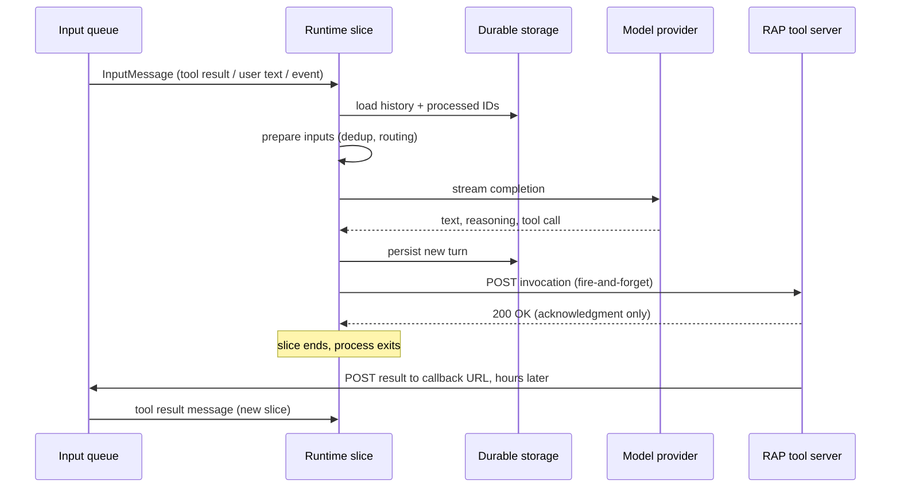
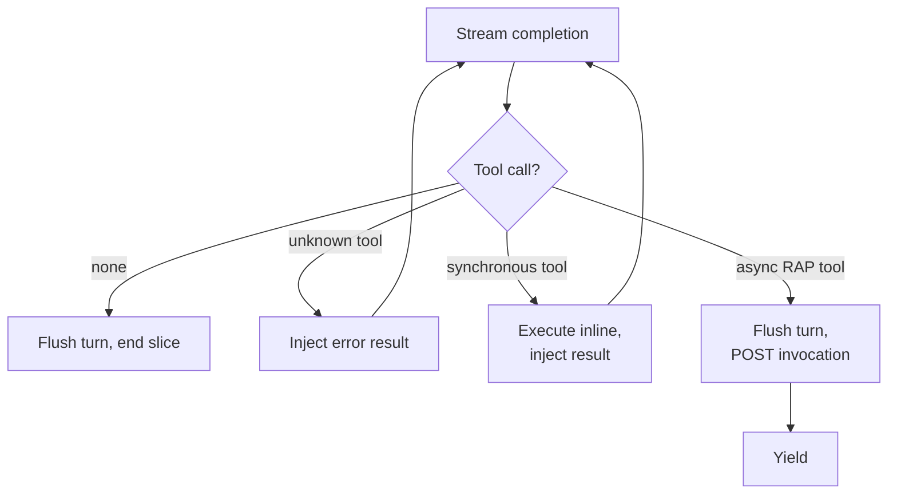
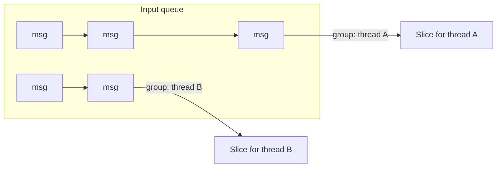
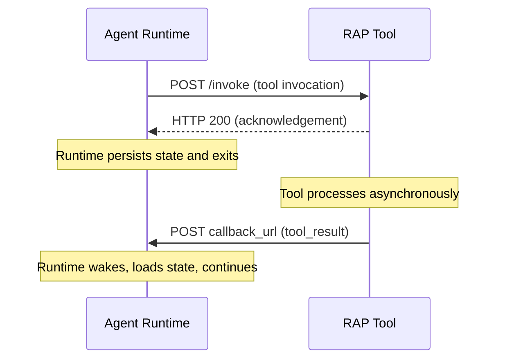
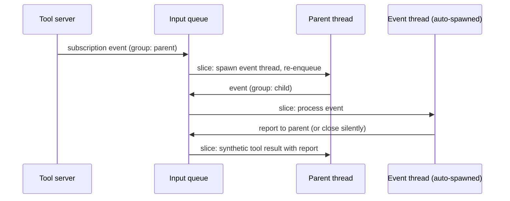
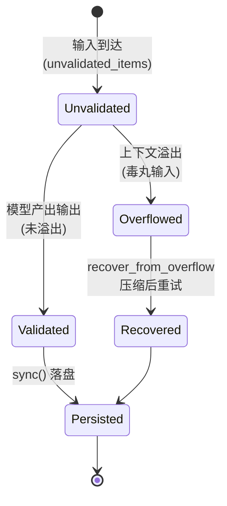

## 引子：一个被反复重造的问题

写 Agent 系统的人几乎都会遇到同一个场景：**Agent 调用了一个很慢的工具**。

CI 流水线要跑 20 分钟、部署要等人审批、GitHub PR 要等评审、监控告警可能在三天后到达。于是每个团队都在同一块地上反复挖坑：写轮询循环、接 webhook、做状态持久化、搞唤醒调度。

这些模式不是「实现细节」，它们是**协议级的缺口**。但现有的 Agent 协议几乎都假设「工具是快的」——MCP 的 `tools/call` 是同步的：Agent 调工具，然后阻塞直到返回。

> In MCP, the agent calls a tool and blocks until it returns. This works for fast lookups. It falls apart when a CI pipeline takes 20 minutes, a deployment needs human approval, or you want to be notified when a PR gets reviewed. The agent burns compute waiting, or resorts to polling.
>
> —— `docs/docs/rap/what-is-rap.md:10`

这句话背后是一个更根本的架构事实：**当前的 Agent 运行时没有「等待」这个概念**。Agent 进程为了等一个工具结果，必须一直活着、一直占着连接、一直付钱。Serverless 平台尤其尴尬——要么把 invocation 吊着等（付空闲墙钟时间，还会撞 invocation 超时），要么干脆放弃 serverless。

`hydro-project/infinity` 提出了一个相当彻底的答案。它的 README 第一句就把目标说得很直白：

> Infinity is a Rust framework for building massively concurrent agentic systems, light enough to fit 75k agents in the memory of a Raspberry Pi. Infinity does for agents what async did for threads: instead of blocking on slow tools, Infinity agents run them concurrently, yield while they wait, and cost nothing until the next event arrives.
>
> —— `README.md:3`

**「Infinity 对 Agent 做的事，就是 async 对线程做的事。」** 这句话是理解整个项目的钥匙。

Infinity 同时带两样东西：

1. **Infinity Runtime** —— 一个 Rust 的 Agent 运行时库（`infinity-agent-core`），核心机制是「执行片段（slice）」模型 + 「让出（yield）」。
2. **RAP（Reactive Agent Protocol）** —— 一个**开放的、独立的**协议规范，把「异步工具调用 / 订阅事件流 / 零成本冬眠」提升到协议层，不再让每个团队自己造轮子。

本文将拆开这两层，逐行读它的架构文档与 Rust 源码，并**逐条引用它自己承认的 20 处工程缺口**——这些注释比任何功能列表都更能说明项目成熟度。

---

## 一、项目定位与核心价值

### 1.1 仓库画像

| 维度 | 值 |
|---|---|
| 仓库 | [`hydro-project/infinity`](https://github.com/hydro-project/infinity) |
| 描述 | An agent runtime and tool protocol for principled agent concurrency |
| 主语言 | Rust |
| License | Apache-2.0 |
| Stars / Forks | 845 / 98 |
| Watchers | 4 |
| 创建时间 | 2026-04-13 |
| 最近推送 | 2026-11-19 |
| 贡献者 | 8 人（主维护者 `shadaj` 贡献 433 次） |
| Open Issues | 59 |
| 官网 | <https://infinity.hydro.run> |
| Topics | `agents` / `concurrency` / `distributed-systems` / `rust` |
| 文档 | Docusaurus，`docs/docs/` 下 56 篇（含完整 RAP 规范） |
| Crate 数量 | 20 个 crate workspace |

**先说清楚一个判断**：⭐845 不算高。但这个项目值得写，原因有三：

1. **范式正交**。它不是又一个 Agent 框架，而是一个**并发原语 + 协议层**——而这两块在已有 555 篇里几乎没人碰。
2. **深度足够**。`event_processor.rs` 单文件 219KB / 5000+ 行，`docs/docs/rap/spec/` 下是一份带 RFC 2119 关键词的完整协议规范（`MUST` / `MUST NOT` / `SHOULD` / `MAY`）。这不是 demo 级别的东西。
3. **它自己会写缺陷**。源码里有大量 `TODO(deferral)`、`not persistable yet`、`deliberately`、`not supported in Direct mode` 式的注释（后面专门开一节逐条列）。**能把自己的边界写清楚的工业级项目，才有资格被当范文读。**

### 1.2 它到底解决什么问题

一句话：**让 Agent 具备「等待」的能力，而不付等待的代价。**

拆成三个可验证的能力：

| 能力 | MCP / 常规 Agent 运行时 | Infinity + RAP |
|---|---|---|
| 慢工具调用 | 阻塞 Agent 进程 | fire-and-forget，Agent 立即让出 |
| 长时事件流（PR 评审 / 告警） | 自己写轮询或 webhook 管道 | 协议内建**订阅**，跨冬眠持久 |
| 空闲时成本 | 进程常驻，付内存和 CPU | 进程**完全退出**，零成本 |
| 工具执行超时 | 协议不定义 | 协议**故意不定义**（见 §6） |

第三行是杀手锏。Infinity 的冬眠不是自己实现的定时器，而是**蹭了 serverless 平台自带的 scale-to-zero**：

> The Infinity Runtime is the first agent runtime that fits the platform's execution model directly: the platform's own scale-to-zero behavior serves as the hibernation mechanism.
>
> —— `docs/docs/infinity-runtime/architecture.md:126`

这句话的分量在于：它不是「把 serverless 当兼容目标」，而是**把 serverless 的约束当成设计前提反推架构**。

### 1.3 仓库结构

```text
crates/
├── infinity-agent-core/      # 运行时核心（28 个源文件，event_processor.rs 是心脏）
│   └── src/
│       ├── event_processor.rs    # 219KB —— 事件循环、历史管理、溢出恢复
│       ├── system/
│       │   ├── builder.rs        # AgentSystemBuilder —— 12 个构建器方法
│       │   ├── thread.rs         # Thread —— 单线程的 slice 推进
│       │   ├── defer.rs          # 延迟队列（deferral）
│       │   ├── observer.rs       # 生命周期事件观察者
│       │   └── local/            # 常驻模式：driver / handle / launch / router / sender
│       ├── tools/                # rap_tool / thread / sleep / cancel_subscription
│       ├── stores.rs             # ConversationStore + StateStore 的内存实现
│       └── traits.rs             # 4 个平台 trait（可替换存储的关键）
├── rap-protocol/             # RAP 线上协议类型（13KB）
├── rap-client/               # RAP HTTP 客户端
├── infinity-protocol/        # 内部运行时协议（20KB）
├── infinity-mcp-bridge/      # MCP ↔ RAP 兼容层（27KB）
├── infinity-rap-bridge/      # RAP ↔ 运行时桥
├── infinity-daemon/          # 常驻守护进程
├── sandbox-core/             # 沙箱核心（105KB）
├── sandbox-local/            # 本地沙箱
├── sandbox-remote/           # 远程沙箱
└── infinity-agent-lambda/    # AWS Lambda 集成
```

---

## 二、核心思想一：唯一不变量 ——「执行片段永不阻塞外部」

整个 Infinity Runtime 是围绕**一条不变量**组织的：

> The Infinity Runtime is organized around one invariant: **an execution slice never blocks on anything external**. This invariant determines what happens inside a slice, how the runtime yields, and how turn durability, deduplication, and message ordering keep a conversation correct on infrastructure that only offers at-least-once delivery.
>
> —— `docs/docs/infinity-runtime/architecture.md:8`

这一句话决定了后面所有设计。要理解它，得先理解三个词：**slice（片段）**、**yield（让出）**、**一切皆消息**。

### 2.1 一切皆消息

运行时只消费一种输入：`InputMessage`。

> The runtime consumes exactly one kind of input: an `InputMessage` on the input queue. User text, tool results, subscription events, reports from child threads, OAuth challenges, and timer wake-ups are all represented by this same type, and they are distinguished by their content and an optional `synthetic` tag.
>
> —— `docs/docs/infinity-runtime/architecture.md:12`

六种语义完全不同的东西——用户输入、工具结果、订阅事件、子线程回报、OAuth 挑战、定时唤醒——**塌缩成同一个类型**。区分靠内容和一个可选的 `synthetic` 标记。

> This uniformity is what lets the runtime shut down completely between slices. There is no in-process state machine that tracks "waiting for tool X" or "sleeping until 9am". Whatever the agent is waiting for will eventually show up as a message, and the slice that processes it will reconstruct everything it needs from storage.
>
> —— `docs/docs/infinity-runtime/architecture.md:14`

**这是整个设计的支点。** 没有「正在等工具 X」的状态机，就没有需要保活的进程，就没有必须持有的连接。Agent 等的东西，**最终一定会以消息的形式出现**；处理它的那次 slice 会从存储里重建所需的全部状态。

所以「冬眠」的物理含义非常朴素：

> Between turns, an agent is pure data, just its conversation history with no task, no stack, and no open connection, so a waiting agent hibernates for free and wakes on the next message.
>
> —— `README.md:21`

**两轮之间，Agent 就是一段纯数据**——只有对话历史，没有任务、没有栈、没有打开的连接。于是「等待中的 Agent」免费 hibernation。

### 2.2 一个 slice 的解剖

一个 slice 从「某线程收到一条或多条消息」开始，到「运行时派发了一个工具调用」或「完成了一次无工具调用的补全」结束。



三个阶段直接映射到核心 API：

1. **Load（加载）** —— `HistoryManager::new_with_history` 从 `ConversationStore` 恢复线程历史，沿祖先链回溯子线程，并在有压缩摘要的位置替换成摘要；同时从 `StateStore` 加载已处理消息 ID 集合。
2. **Prepare and complete（准备与补全）** —— 每个输入过一遍 `prepare_input`：去重重投递的消息、丢弃已关闭线程的消息、路由订阅事件、把可执行内容追加进历史。若有可执行输入，`run_completion` 从 `ModelProvider` 流式拉取补全。
3. **Dispatch and yield（派发与让出）** —— 若模型产出工具调用，`execute_action` 调用对应 `Tool` 实现。对 RAP 工具，这是一次携带参数和 `callback_url` 的 HTTP POST；工具服务器确认请求后调用立即返回。slice 持久化剩余状态并结束。

关键的yield 点在这里：

> The model's decision to call a tool is what ends the slice. This is the yield point, and it is the reason the runtime never needs to hold a connection open: the tool result will re-enter through the front door as a fresh `InputMessage`, whether it takes 100 milliseconds or three days.
>
> —— `docs/docs/infinity-runtime/architecture.md:49`

**模型的「决定调用工具」这个动作本身，就是让出的时机。** 结果 100 毫秒后到还是三天后到，都从正门重新进来，成为一条全新的 `InputMessage`。

### 2.3 不是所有工具都该让出

一个容易被忽略的细节：有些工具**不该**让出。

> Not every tool should yield. For example, `spawn_thread` completes in microseconds against the conversation store, so yielding for it would waste a full store round trip. It would also risk a race: a concurrent event could arrive between the dispatch and the result, which would make the call appear cancelled even though it ran.
>
> —— `docs/docs/infinity-runtime/architecture.md:53`

`spawn_thread` 微秒级完成，让出反而浪费一次存储往返；更糟的是会让出点与结果之间可能挤进一个并发事件，导致调用**看起来像被取消了，尽管它其实跑了**。

所以工具可以 opt-in 同步执行：实现 `Tool::execute_synchronous`。运行时遇到这类工具时，**内联执行**、把结果直接注入历史，然后**在同一 slice 内回环**再做一次补全，而不是让出。



还有一个贴心的兜底：**未知工具名走同一条回环路径**，只是注入一个错误结果。

> Unknown tool names take the same loop-back path with an injected error result, so a hallucinated tool call will cost one extra completion rather than a stuck conversation.
>
> —— `docs/docs/infinity-runtime/architecture.md:66`

模型幻觉出一个不存在的工具，代价是**多一次补全**，而不是**一段卡死的对话**。这是很典型的「用结构消灭 bug 类别」思路。

---

## 三、核心思想二：并发与排序 —— 「线程内 FIFO，线程间并行」

### 3.1 为什么顺序要求能塞进队列层

并发最麻烦的不是「跑得快」，而是**顺序**。

> Within a single thread, slices must be serialized, since two slices that load and write the same history concurrently would corrupt it. Across threads there is no shared state, so threads should run in parallel.
>
> —— `docs/docs/infinity-runtime/architecture.md:76`

同一线程内必须串行（否则两个 slice 同时读写同一份历史会写坏），不同线程之间没有共享状态、可以并行。

Infinity 的做法很妙：**把顺序要求直接编码进队列**。

> To achieve this, the runtime encodes the ordering requirement directly in the queue: messages are grouped by `group_id`, and the transport guarantees per-group FIFO ordering. On AWS, this is an SQS FIFO queue with `MessageGroupId`, where Lambda will automatically run one invocation per active group and scale groups independently. In an embedded runtime, it is one `mpsc` channel and worker task per thread.
>
> —— `docs/docs/infinity-runtime/architecture.md:78`



注意：**运行时本身不需要任何分布式锁**。并发控制在队列层就完成了——SQS FIFO 的 `MessageGroupId` 天然保证组内 FIFO，Lambda 天然做到「一个 active group 一次一个 invocation，各 group 独立扩缩」。

> **Concurrency control without locks.** FIFO message groups serialize each thread at the queue layer, so the runtime itself needs no distributed locking.
>
> —— `docs/docs/infinity-runtime/architecture.md:124`

这条是本项目最可移植的工程模式之一：**能用队列的分组语义表达的顺序，就不要用分布式锁表达。**

### 3.2 子线程 = 新消息组

并发能力也来自同一机制：

> This is also how threading gets its concurrency: spawning a child thread creates a new message group. Children inherit the parent's history up to the spawn point and run their own slices in parallel. When a child reports back, its report is tagged as a thread report, which the parent will see as a synthetic tool result.
>
> —— `docs/docs/infinity-runtime/architecture.md:90`

子线程 = 新 message group = 独立并行。子线程继承父线程**到派生点为止**的历史；子线程回报时被打上 thread report 标记，父线程看到的是一条**合成的工具结果**。

### 3.3 消息 ID 去重：把「至少一次投递」变成「幂等」

队列会重投。Infinity 的处理方式是每个输入消息和每次补全都带一个稳定 ID，`StateStore` 记录每个线程已处理过哪些 ID：

> Durability alone is not enough, because queues redeliver. Every input message and completion carries a stable ID, and the `StateStore` tracks which IDs each thread has already processed. A redelivered message will be recognized in `prepare_input` and skipped, which makes slices effectively idempotent on top of at-least-once delivery.
>
> —— `docs/docs/infinity-runtime/architecture.md:72`

**持久化只是第一步，队列会重投。** 在「至少一次投递」的语义上叠一层 ID 去重，slice 实际上就是幂等的。

---

## 四、核心思想三：RAP 协议 —— 把「等待」写进规范

Infinity Runtime 是一半，另一半是 **RAP（Reactive Agent Protocol）**：一个独立的开放协议。

### 4.1 协议的形状：fire-and-forget

RAP 只有两个角色：**Runtime**（Agent 宿主进程）和 **Tool**（独立 HTTP 服务）。

> RAP uses HTTP as its sole transport mechanism. The runtime communicates with tools by sending HTTP POST requests to the tool's registered endpoint, and tools communicate back by POSTing to a callback URL provided in the original invocation. All messages are JSON-encoded with `Content-Type: application/json` and MUST be UTF-8 encoded.
>
> —— `docs/docs/rap/spec/overview.md`



就这一个往返。**没有长连接、没有 SSE、没有 WebSocket。** 工具处理完（100ms 或 3 天后）自己 POST 回 `callback_url`，Runtime 被唤醒，从存储重建状态，继续。

### 4.2 六种消息类型

| 消息 | 方向 | 作用 |
|---|---|---|
| Tool Invocation | Runtime → Tool | 调用工具操作。含操作名、参数、callback URL、路由标识 |
| Tool Result | Tool → Runtime | 操作完成的结果。含结果文本 + 匹配原调用所需的标识 |
| Subscription Event | Tool → Runtime | 订阅流中的一个事件。引用原订阅调用，让 runtime 能关联到正确上下文 |
| OAuth | Tool → Runtime | 发起用户授权流。含授权 URL，runtime 展示给用户；授权完成后工具重试原操作 |
| User Choice | Tool → Runtime | 请求用户在多个选项中选择。含 prompt、choices 数组、response URL |
| View Update | Tool → Runtime | 向已连接的客户端推送具名视图更新。runtime 存储并转发，不做解释 |

后三种（OAuth / User Choice / View Update）是**协议级的「人在回路」**——注意它们不需要 Agent 进程还活着：工具 POST 过来，路由把 Runtime 叫醒，Runtime 处理完把结果送回前端。

### 4.3 RAP 报文格式（真实线上格式）

调用方向 Tool 发送：

```json
{
  "operation": "list_prs",
  "arguments": { "repo": "owner/name" },
  "id": "call_abc123",
  "call_id": "call_abc123",
  "callback_url": "https://runtime.example.com/callback/thread-42",
  "group_id": "thread-42",
  "user_id": "user-7",
  "thread_ancestors": ["thread-1", "thread-42"]
}
```

回调方向 Runtime 发送，用 `type` 做 tag：

```json
{
  "type": "tool_result",
  "group_id": "thread-42",
  "id": "call_abc123",
  "call_id": "call_abc123",
  "text": "PR #128 opened",
  "subscription": { "...": "..." }
}
```

其余四种回调变体分别是 `subscription_event`（带 `tool_call_id` / `associative` / `final`）、`oauth`（带 `auth_url`）、`user_choice`（带 `prompt` / `choices` / `default` / `response_url`）、`view_update`（带 `view_type` / `content`）。

工具集清单 `ToolsetManifest`：

```json
{
  "name": "github",
  "description": "GitHub integration",
  "endpoint": "https://tools.example.com/github",
  "tools": [
    {
      "name": "list_prs",
      "description": "List pull requests",
      "inputSchema": { "type": "object", "properties": { "repo": { "type": "string" } } },
      "annotations": { "readOnlyHint": true },
      "displayScript": null
    }
  ],
  "needsMigration": false
}
```

工具集从 well-known 发现端点拉取：`GET /.well-known/rap-toolset`。

**HTTP 状态码语义**（这是很值得学的细节）：

- `200` = **通用确认**（body 内容被忽略）
- `4xx` = **MUST NOT 重试**
- `5xx` = **SHOULD 重试**（带退避）

**注意：协议没有错误码枚举。** 错误以自由文本形式塞在 `tool_result.text` 里，前缀 `"Error: "`。

> There is no separate error message type.
>
> —— `docs/docs/rap/spec/basic/tool-result.md:210`

### 4.4 订阅事件流：跨冬眠持久的事件源

这是 RAP 最独特的能力，也是与 MCP 差距最大的地方。

> **Subscriptions.** A tool registers an ongoing subscription (e.g. "notify me on new GitHub PRs"). Each matching event wakes the agent, which processes it and goes back to sleep. The subscription persists across hibernations.
>
> —— `docs/docs/rap/what-is-rap.md:15`

「订阅在冬眠之间保持」这一句是重点——它意味着事件源本身是持久的，Agent 只是偶尔醒来看一眼。

运行时侧的处理很讲究。订阅事件到达时，**不直接塞进父线程的历史**：

> RAP subscriptions deliver an open-ended stream of events against a single tool call. When an event arrives for a thread, `prepare_input` does not append it to that thread's history. Instead, it spawns a temporary child thread that is seeded with the event and instructions for processing it, and then re-enqueues the event for the child.
>
> —— `docs/docs/infinity-runtime/architecture.md:94`



**每来一个事件就自动派生一个临时子线程**去处理，父线程的上下文保持干净：事件重要就收到一份报告，不重要就**什么都没有**。事件若标记为 *associative*，则跳过子线程直接内联注入——这适用于「每条事件都属于订阅线程自身历史」的场景，比如长跑命令的日志行。

### 4.5 MCP 兼容层：不用放弃 MCP 生态

> RAP is also fully compatible with MCP. Any MCP server works as a RAP tool through a backwards compatibility layer, so you keep the entire MCP ecosystem and gain async execution for the tools that need it.
>
> —— `docs/docs/rap/what-is-rap.md:19`

实现落在 `crates/infinity-mcp-bridge`（27KB）。核心是 `McpClient`——一个**懒连接、串行化**的 MCP 会话：

```rust
// 来自 crates/infinity-mcp-bridge/src/lib.rs:253
/// A lazily initialized, serialized MCP session.
pub struct McpClient { /* ... */ }

impl McpClient {
    // 来自 crates/infinity-mcp-bridge/src/lib.rs:272
    /// Create a lazy stdio MCP client.
    pub fn stdio(/* ... */) -> Self { /* ... */ }

    // 来自 crates/infinity-mcp-bridge/src/lib.rs:291
    /// Create a lazy Streamable HTTP MCP client.
    pub fn http(/* ... */) -> Self { /* ... */ }

    // 来自 crates/infinity-mcp-bridge/src/lib.rs:332
    /// List the server's tools as text suitable for a model and optional display segments.
    async fn list_tools(&self) -> Result<(String, Option<Vec<DisplaySegment>>), BoxError> {
        self.request("tools/list", Some(serde_json::json!({})))
        // ...
    }

    // 来自 crates/infinity-mcp-bridge/src/lib.rs:373
    /// Invoke one MCP tool and format its content for the model.
    async fn invoke_tool(/* ... */) -> Result</* ... */, BoxError> {
        self.request("tools/call", /* ... */)
        // ...
    }
}
```

翻译关系很直接：MCP 的 `tools/list` → 合成的 `ToolsetManifest`；RAP 的 `/invoke` → JSON-RPC `tools/call` → 结果包成 `tool_result`。

**但这里有一个必须诚实指出的点**：异步性是**在代理边界买来的**，不是在 MCP 内部。底层那次 `tools/call` 依然会阻塞 bridge。真正的异步要靠 MCP server 自己也支持 RAP，或者用 `rap-github-event-poller` 这类专门的 tool server。

---

## 五、核心思想四：持久化、上下文溢出与压缩

这是 `event_processor.rs`（219KB）最精彩也最复杂的部分。

### 5.1 三阶段未持久化模型

Infinity 对「一条输入什么时候可以安全落盘」有一套精细的规则。核心概念是 `unvalidated_items`：

> `unvalidated_items` — ... They are part of the in-memory `history` ... but are **not** persisted by [`Self::sync`]: one of them could be the oversized input that blows up the model's context window, and persisting it would permanently wedge the thread on a poison message.
>
> —— `crates/infinity-agent-core/src/event_processor.rs:152-158`

翻译一下：**一条用户输入在被模型「验证」之前不落盘**。因为它可能是个超长输入，一落盘就会永久卡死这个线程（毒丸消息）。

对应到源码注释：

```rust
// 来自 crates/infinity-agent-core/src/event_processor.rs:629
// Unvalidated inputs deliberately stay in memory (see the field docs)
```

```rust
// 来自 crates/infinity-agent-core/src/event_processor.rs:465
// The item is not persistable yet: it stays in `unvalidated_items` until the model produces output for it
```

而一旦模型真的为它产出了输出，说明输入被接受且「安全」了：

```rust
// 来自 crates/infinity-agent-core/src/event_processor.rs:509
// context window did not overflow, so the inputs are safe to persist.
```

**这是一条完整的三阶段状态机**：



### 5.2 上下文溢出的恢复路径

上下文溢出是 Agent 运行时的经典难题：用户发了一段超长文本，模型直接报 context length exceeded。Infinity 的处理分层：

```rust
// 来自 crates/infinity-agent-core/src/event_processor.rs:4608
/// An oversized *user input* cannot be shrunk: on a context-overflow
/// ... persisted, so the thread does not permanently hang on a poison
```

```rust
// 来自 crates/infinity-agent-core/src/event_processor.rs:1439
/// TODO(deferral): when the *committed* history is what overflows (shrinking
/// ... the thread should block on a lower-threshold compaction instead of
/// erroring. That needs deferral support for "wait for the in-flight
/// compaction child", which does not exist yet.
```

这里有两条路径，**作者诚实地承认其中一条没做完**：

- **未持久化输入溢出**（用户单条消息太长）→ 有恢复路径，因为这条输入尚未落盘，压缩历史救不了它，只能报错但不永久卡死。
- **已提交历史溢出**（累积的对话太长）→ **本应**触发「低阈值压缩」而不是直接报错，但压缩是作为一个**子线程**跑的，父线程需要「等这个在飞的压缩子线程回来」——而 **deferral 机制还不存在**。

### 5.3 压缩（Compaction）：按位置索引，所以子线程能精确还原

长命 Agent 迟早会撑爆上下文窗口。Infinity 的压缩机制：

> Long-lived agents eventually outgrow the model's context window. When a thread's history approaches the limit (the local driver triggers at roughly three quarters of the model's context window), the runtime will spawn a compaction thread that summarizes the conversation and stores the summary in the `ConversationStore`, tagged with the history index it covers. Subsequent slices will load the summary plus only the messages after that index. Because summaries are indexed by position, child threads that were spawned before a compaction can still reconstruct the exact history they inherited.
>
> —— `docs/docs/infinity-runtime/architecture.md:115`

**关键设计：摘要带它覆盖的历史位置索引。** 因此在压缩之前派生的子线程，仍然能精确还原它当时继承的那份历史（而不是拿到一份「已经被压缩过」的模糊摘要）。

### 5.4 Turn Buffer：流式输出只在回合完成时提交

> Streaming output is buffered in a **turn buffer** and is only committed when the turn completes, either because the model finishes without a tool call or because a tool call ends the turn. If the stream errors mid-turn, the buffer is discarded and the completion retries, so half-streamed assistant messages will never reach storage. When a tool call ends a turn, the runtime flushes the buffer *before* dispatching the invocation, which guarantees that the call is durable in history before its result can possibly arrive.
>
> —— `docs/docs/infinity-runtime/architecture.md:70`

两个保证：

1. **流式中断不留半截消息** —— buffer 丢弃 + 重试，存储里永远不会出现半截 assistant 消息。
2. **调用先于结果持久化** —— 工具调用结束回合时，**先 flush buffer 再派发 invocation**，保证「调用已经在历史里了」先于「它的结果可能到达」发生。

### 5.5 平台抽象：4 个 trait 决定一切

Infinity 能同时跑在常驻进程和 Lambda 上，靠的是把平台差异抽象成 4 个 trait：

```rust
// 来自 crates/infinity-agent-core/src/traits.rs:27
pub trait ConversationStore: Send + Sync + Clone {
    async fn ensure_root_thread(&self, thread_id: &ThreadId<str>) -> Result<(), Self::Error>;
    async fn thread_exists(&self, thread_id: &ThreadId<str>) -> Result<bool, Self::Error>;
    async fn load_history_up_to(/* ... */) -> Result</* ... */, Self::Error>;
    async fn load_history_with_ancestors(/* ... */) -> Result</* ... */, Self::Error>;
    async fn append_messages(/* ... */) -> Result</* ... */, Self::Error>;
    async fn spawn_thread(/* ... */) -> Result</* ... */, Self::Error>;
    async fn is_thread_closed(&self, thread_id: &ThreadId<str>) -> Result<bool, Self::Error>;
    async fn close_thread(&self, thread_id: &ThreadId<str>) -> Result<(), Self::Error>;
    // ... 以及压缩相关：mark_thread_as_compaction / save_compaction_summary / ...
}

// 来自 crates/infinity-agent-core/src/traits.rs:223
pub trait StateStore: Send + Sync + Clone {
    async fn get_processed_ids(/* ... */) -> Result</* ... */, Self::Error>;
    async fn add_processed_message_ids(/* ... */) -> Result</* ... */, Self::Error>;
    async fn get_metadata(/* ... */) -> Result</* ... */, Self::Error>;
    async fn set_metadata(/* ... */) -> Result</* ... */, Self::Error>;
    async fn get_active_subscriptions(/* ... */) -> Result</* ... */, Self::Error>;
    async fn add_active_subscription(/* ... */) -> Result</* ... */, Self::Error>;
    async fn remove_active_subscription(/* ... */) -> Result</* ... */, Self::Error>;
    async fn add_pending_user_choice(/* ... */) -> Result</* ... */, Self::Error>;
    // ...
}

// 来自 crates/infinity-agent-core/src/traits.rs:311
pub trait InputSender: Send + Sync + Clone {
    async fn send_to_input_queue(/* ... */) -> Result</* ... */, Self::Error>;
}
```

注意 `StateStore` 里同时管理着：**已处理消息 ID（去重）**、**元数据**、**活跃订阅**、**待决的用户选择**。这四类状态的共同点是——**都是「跨冬眠必须活下来」的东西**。

### 5.6 常驻模式 API

```rust
// 来自 README.md:5-19
let system = AgentSystemBuilder::new_local(
    InMemoryConversationStore::new(),
    InMemoryStateStore::new(),
    StaticModel::new(provider, "global.anthropic.claude-sonnet-4-6").await?,
)
.start();

let mut thread = system.thread_builder().launch().await;
thread.send_user_text("Write a haiku about Rust").await?;

while let Some(event) = thread.recv().await {
    println!("{event:?}");
}
```

`AgentSystemBuilder` 一共 12 个构建器方法：`tool` / `tools` / `extra_system_prompt` / `thread_config` / `callback_url` / `without_builtin_tools` / `with_tokio_sleep_tools` / `rap_notifier` / `build` / `new` / `new_local` / `build_local` / `start` / `start_with_observer`。

### 5.7 Step Mode：Serverless 的入口

在 Lambda 上不需要常驻任务，整个 handler body 就是一次 `step` 调用：

```rust
// 来自 docs/docs/infinity-runtime/agent-systems/step-mode.md
let collector = EventCollector::new();
let outcomes = system
    .step(inputs, &collector, &mut NoDeferral)
    .await?;
```

`InputSender` 在 step mode 下由平台提供（比如指向同一个触发 invocation 的 SQS FIFO 队列），运行时想「稍后」发生的事（子线程种子消息、给父线程的报告、定时唤醒）全通过它发出去——**这正是让 slice 得以结束的关键**。

> The sender is the loopback path. Everything the runtime wants to happen *later* (e.g. a child thread's seed message, a report to a parent, or a timer wake-up) is sent through it rather than called directly, which is what leaves the slice free to end. On Lambda, the sender is an SQS client pointed at the same FIFO queue that triggered the invocation, so the message will come back around as a future delivery.
>
> —— `docs/docs/infinity-runtime/agent-systems/step-mode.md`

---

## 六、⭐ 必须诚实指出的源码自陈缺陷

这是本系列最有价值的部分。Infinity 的源码和文档里有大量**作者主动承认的边界**，下面逐条引用。它们比任何功能列表都更能说明这个项目的成熟度。

### 6.1 运行时与核心逻辑（Rust 源码）

| # | 位置 | 原文 | 问题 |
|---|---|---|---|
| 1 | `event_processor.rs:1439` | `TODO(deferral): when the *committed* history is what overflows (shrinking... the thread should block on a lower-threshold compaction instead of erroring. That needs deferral support for "wait for the in-flight compaction child", which does not exist yet.` | **已提交历史溢出时不能自动降级为压缩**——deferral 机制（等待在飞的子任务）尚未实现 |
| 2 | `event_processor.rs:465` | `The item is not persistable yet: it stays in `unvalidated_items` until the model produces output for it` | 输入在模型验证前不可持久化，意味着**进程崩溃会丢输入** |
| 3 | `event_processor.rs:152-158` | `...persisting it would permanently wedge the thread on a poison message.` | 毒丸输入的存在本身就说明**单条超长用户输入没有事前长度校验** |
| 4 | `event_processor.rs:629` | `Unvalidated inputs deliberately stay in memory (see the field docs)` | 「刻意」只留内存 = 内存里堆积未验证输入 |
| 5 | `event_processor.rs:524-525` | `...their dedup IDs forgotten so a redelivery is not silently ignored` | 去重 ID 被遗忘的场景下，**重投递不会被静默忽略** |
| 6 | `event_processor.rs:665` | `let _ = self\n            .state_store\n            .add_processed_message_ids(&self.thread_id, msg_ids)` | **去重 ID 持久化失败被静默吞掉**（`let _ =`）——失败后重投递会被重复处理 |
| 7 | `event_processor.rs:1090-1096` | `Could not find original tool call for synthetic message: {}, dropping` | 找不到原始工具调用的合成消息**被丢弃**（不是报错） |
| 8 | `event_processor.rs:755-756` | `Callers use this to send best-effort cancellation notifications to RAP tool servers so they can abort in-flight operations.` | 取消通知是 **best-effort**——工具可能收不到 |
| 9 | `event_processor.rs:1745-1759` | `Bedrock emits *concurrent* tool calls in one assistant message ... Only the first call is executed ... everything streamed after it must be dropped here.` | **并发工具调用只执行第一个**，其余被丢弃（Bedrock 特有） |
| 10 | `event_processor.rs:1619-1621` | `Deliberately no inactivity timer here: once a stream is live it is never artificially cut off by us. Stall handling, if any, belongs to the provider.` | **运行时不做流超时保护**——流挂死只能靠 provider |
| 11 | `event_processor.rs:776-778` | `an event referencing a compacted-away inherited call is still dropped` | 引用已被压缩掉的继承调用的事件**仍被丢弃** |
| 12 | `event_processor.rs:1616` | `We avoid `yield` inside `select!` (async_stream limitation)` | 受 `async_stream` crate 限制，不能在 `select!` 里让出 |
| 13 | `infinity-daemon/src/lib.rs:62` | `let listener = UnixListener::bind(&sock_path)?; // TODO(shadaj): do we also need to lock the file?` | Unix socket 文件**没有加锁**——并发启动可能冲突 |
| 14 | `sandbox-core/src/server.rs:519` | `Re-initializing with a different repository is not supported.` | 沙箱不能换 repo 重新初始化 |
| 15 | `sandbox-core/src/server.rs:1882` | `squash_sandbox is not supported in Direct mode` | 某种沙箱模式在 Direct 模式下不可用 |
| 16 | `sandbox-core/src/server.rs:2060` | `migration across multiple repositories is not supported` | 跨多 repo 迁移不支持 |
| 17 | `crates/rap-protocol/src/lib.rs:34-40` | `Currently an alias of [`ToolCallId`] ... Tracked as a candidate for becoming a distinct kind in .../issues/109.` | `ToolCallId` 目前只是别名，**尚未成为独立类型** |

### 6.2 协议规范层面（RAP Spec）

规范里的自陈缺陷更值得读，因为它们是**设计边界**而非 bug：

| # | 位置 | 原文 | 边界 |
|---|---|---|---|
| 18 | `spec/basic/tool-cancellation.md:10` | `This notification is **advisory**. Tool servers are free to ignore it entirely, and the runtime MUST NOT depend on the notification being received or acted upon.` | 取消通知纯建议性，**工具可以完全无视** |
| 19 | `spec/basic/lifecycle.md:174` | `The protocol does not define timeouts for tool execution. Tools MAY take arbitrarily long to return results. This is a deliberate design choice...` | **协议故意不定义工具执行超时** |
| 20 | `spec/basic/lifecycle.md:115` | `Active invocations that have been acknowledged but not yet completed MAY be lost.` | **已确认但未完成的调用可能丢失** |
| 21 | `spec/server/subscription-events.md:163` | `The runtime is not required to cancel subscriptions automatically when a thread closes.` | 线程关闭时 runtime **无义务**取消订阅 |
| 22 | `spec/server/subscription-events.md:166` | `If a subscription is not cancelled and the subscribing thread is closed, events will still arrive at the callback URL but the runtime may not have a valid thread to process them in.` | 线程已关闭但事件仍会到达 → **事件无处可去** |
| 23 | `spec/basic/transport.md:74` | `The authentication mechanism between runtime and tool is implementation-specific. The protocol does not mandate any particular authentication scheme.` | **协议不强制任何认证方案** |
| 24 | `spec/basic/toolsets.md:111` | `The runtime MUST NOT load toolset definitions from local files, inline configuration, or any other source` | 工具定义**只能**来自远端发现端点 —— 离线场景无解 |
| 25 | `spec/basic/toolsets.md:113` | `a tool server that deploys breaking changes to its schema while agents hold cached definitions will receive invocations with stale arguments` | **工具 schema 破坏性变更会打穿已缓存的 Agent** |
| 26 | `spec/basic/toolsets.md:172` | `Partial loading... is not permitted` | 不允许部分加载 |
| 27 | `spec/basic/thread-closure.md:10` | `This notification is **advisory**. Tool servers are free to ignore it entirely` | 线程关闭通知同样是建议性的 |
| 28 | `spec/basic/migration.md:66` | `The protocol does not prescribe how tool servers transfer state` | 协议**不规定**工具如何迁移状态 |
| 29 | `spec/overview.md:103` | `While RAP itself cannot enforce these security principles at the protocol level` | 协议层**无法强制**安全原则，全靠实现者自觉 |
| 30 | `spec/basic/lifecycle.md:113` | `The protocol does not define a shutdown handshake for tool providers` | 没有 shutdown 握手 |
| 31 | `spec/basic/toolsets.md:84` | `the protocol does not currently define any annotation keys` | 注解键**尚未定义** |
| 32 | `infinity-protocol/src/lib.rs:175-180` | 256 MiB frame limit | 内部帧大小上限 |
| 33 | `infinity-protocol/src/lib.rs:279-283` | SwitchModel `does not propagate to child threads` | **换模型不传播到子线程** |
| 34 | `crates/infinity-agent-cli/src/terminal.rs:244` | `thread_buffers.clear(); // for now, we can't properly restore them` | 终端缓冲区**无法正确恢复** |

### 6.3 这份清单告诉我们什么

把 34 条放在一起看，能读出三种不同层次的自陈：

1. **承认缺口**（#1 #10 #13 #24）——「这个还没做」；
2. **说明为何现在不补**（#19 #23 #29）——「这是刻意的设计选择，因为协议不该越权」；
3. **规定补上时的行为**（#20 #22）——「如果发生 X，runtime 允许怎样」，这是最难也最值钱的一层。

第 3 类尤其值得学。比如 #20 明确写「已确认未完成的调用**可能丢失**」——它没有假装保证 exactly-once，而是把这个缺口**写进契约**，让使用者知道能依赖什么。

---

## 七、与同类项目对比：设计差异在哪里

选三个最有参照价值的：**MCP**（协议对手）、**LangGraph**（Agent 编排的另一个答案）、**Temporal / Restate**（持久化执行的另一个答案）。

| 维度 | **RAP / Infinity** | **MCP** | **LangGraph** | **Temporal / Restate** |
|---|---|---|---|---|
| **管什么** | Agent ↔ 工具的**异步**契约 + Agent 运行时 | Agent ↔ 工具的**同步**契约 | Agent 的**控制流**（状态图） | 业务函数的**可靠执行** |
| **等待模型** | fire-and-forget + 回调唤醒 | 同步阻塞 `tools/call` | 运行时内阻塞 | 事件循环重放 |
| **空闲成本** | 进程完全退出，零成本 | 不适用（无运行时） | 进程常驻 | Worker 常驻 |
| **连接模型** | 无长连接，纯 HTTP POST | 会话内请求/响应 | 进程内 | 事件循环 |
| **跨进程恢复** | 全部状态在存储，按 thread ID 寻址 | 不适用 | 需外部 checkpoint | **核心能力** |
| **并发控制** | 队列分组 FIFO（无锁） | 不适用 | 图内调度 | Worker 租约 |
| **人在回路** | 协议级 OAuth / User Choice / View Update | 无 | 需自建 | 有信号 |
| **工具生态** | MCP 全兼容（桥接层） | —— | 任意函数 | 任意函数 |
| **成熟度** | 规范 v0.2.0（2026-10），↵845⭐ | 事实标准 | 大量生产使用 | 大量生产使用 |

### 7.1 与 MCP：不是「更好」，是**补了一个维度**

MCP 解决的问题是「怎么让 LLM 知道有哪些工具、怎么调」——它非常成功。RAP 解决的是**另一个问题**：「工具很慢怎么办」。

两者是**正交**的，不是替代关系。Infinity 的选择是：**不放弃 MCP 生态，在代理边界做桥接**。这也是最务实的路径——MCP 已经有数千个 server，RAP 犯不着重造。

### 7.2 与 LangGraph：Agent 编排的两条路

LangGraph 是**状态机视角**：Agent 的控制流是一张图，节点是步骤，边是转移，状态用 checkpoint 存。

Infinity 是**消息视角**：Agent 的存在形式是「消息队列里的一个 group_id」，控制流被摊平成「到达 → 处理 → 让出 → 再到达」。

| | LangGraph | Infinity |
|---|---|---|
| 状态载体 | 图状态对象 | 对话历史（纯数据） |
| 节点内部 | 可以阻塞任意久 | **永不阻塞外部**（硬约束） |
| 持久化 | checkpoint（可选） | **强制**（冬眠的前提） |
| 并发单元 | 图的并行分支 | **消息组** |

LangGraph 能做的事 Infinity 大多做不了（比如复杂的条件分支图）；但 Infinity 能做的事 LangGraph 天然做不到——**在 serverless 上跑到 scale-to-zero**。这不是程度差异，是**架构范式差异**。

### 7.3 与 Temporal / Restate：都在做「可恢复」，但层次不同

Temporal / Restate 管的是**业务函数**的可靠执行：函数重放、副作用去重、exactly-once。它们比 Infinity 更「重」，但也更通用。

Infinity 管的是**Agent 回合**的可恢复。而它做对了一件 Temporal 做不到的事——

> **Strict on Control Flow but Lenient on Data**（这是本系列之前讲 Tensorlake 时提出的模式）

Infinity 的持久化键是 **thread ID + 消息 ID**（结构性的），而**不是**把 LLM 输出也哈希进去（数据性的）。因为 LLM 输出天然随机，数据进哈希会导致每次重放必然不一致。Infinity 选择了「只持久化结构、允许数据任意」的路线——这正是它能在 Agent 场景下做重放的关键。

（顺带一提，这个「严格控制流、宽松数据」的划分和 Tensorlake 那篇是同一个模式的两次独立发现。）

---

## 八、优缺点分析

### 8.1 架构简洁性 / 扩展性 / 易用性

**简洁性：极好。** 一条不变量（「slice 永不阻塞外部」）推导出全部设计。`Everything is a message` 让运行时只需要处理一种输入类型。`ConversationStore` + `StateStore` + `InputSender` + `HttpClient` 四个 trait 就把平台差异全部收敛干净。

**扩展性：很好。** RAP 是独立开放协议，任何人可以实现自己的 tool server 或 runtime。协议自带 OAuth / User Choice / View Update 等扩展位。子线程机制天然支持多 Agent 分工。

**易用性：好但有门槛。** `AgentSystemBuilder::new_local(...).start()` 三行起一个 Agent，README 示例干净。但要理解 slice / yield / deferral / compaction 这几个概念，需要读者有分布式系统和异步编程的基础。

### 8.2 性能 / 复杂度 / 维护性

**性能：并发效率极高。** 「75k agents in the memory of a Raspberry Pi」这个数字背后是「两轮之间 Agent 就是纯数据」——没有常驻 task、没有栈、没有连接。单 slice 成本 = 一次补全 + 几次存储调用 + 一次 HTTP。

**复杂度：调度复杂度低，概念复杂度高。** 没有分布式锁、没有工作流引擎、没有状态机表——这是优点。但「slice」这个抽象对读者的心智负担不低。

**维护性：中等，有明确风险点。** 8 个贡献者、433 次提交集中在一人（`shadaj`），巴士因子偏低；59 个 open issue；`deferral` 这种核心机制还在 TODO 中。Rust + Apache-2.0 + 规范先行，长期看是健康信号，但**项目仍处于 v0.2.0**。

### 8.3 风险清单（诚实版）

| 风险 | 依据 | 影响 |
|---|---|---|
| **协议采用度存疑** | RAP 规范 v0.2.0，仅 2026-10 发布，⭐845 | 生态几乎为零，需要自己写 tool server |
| **单点维护** | 8 contributors，主维护者 433 commits | 关键人风险 |
| **核心机制未完成** | `TODO(deferral)`（#1） | 已提交历史溢出时行为退化 |
| **认证靠自觉** | 协议不强制（#23） | callback URL 被猜到即可注入消息 |
| **静默失败路径多** | `let _ =`（#6）、`dropping`（#7） | 故障可能被吞掉 |
| **MCP 异步是代理层的** | bridge 内部仍阻塞 | 需要异步时得自己写 RAP tool |

---

## 九、实践：动手跑一个

### 9.1 从零起一个 Agent

Rust 项目的标准起步（以 Cargo workspace 为例）：

```toml
# 来自 crates/infinity-agent-core/Cargo.toml 的依赖形态
[dependencies]
infinity-agent-core = "0.2"
infinity-provider-protocol = "0.2"   # 协议型 provider
rap-client = "0.2"
tokio = { version = "1", features = ["full"] }
```

最小可运行骨架（基于 README 的 `new_local` 示例）：

```rust
use infinity_agent_core::stores::{InMemoryConversationStore, InMemoryStateStore};
use infinity_agent_core::system::{AgentSystemBuilder, StaticModel};

#[tokio::main]
async fn main() -> Result<(), Box<dyn std::error::Error + Send + Sync>> {
    // provider: 任何实现了 ModelProvider 的东西
    let provider = /* ... */;
    let model = StaticModel::new(provider, "global.anthropic.claude-sonnet-4-6").await?;

    let system = AgentSystemBuilder::new_local(
        InMemoryConversationStore::new(),
        InMemoryStateStore::new(),
        model,
    )
    .start();

    let mut thread = system.thread_builder().launch().await;
    thread.send_user_text("Write a haiku about Rust").await?;

    while let Some(event) = thread.recv().await {
        println!("{event:?}");
    }
    Ok(())
}
```

### 9.2 挂一个真实的 RAP 工具

工具侧只需要一个 HTTP 端点，能接受 invocation、能 POST 回结果：

```bash
# 用 curl 手工模拟一次 RAP invocation（教学用途）
curl -X POST https://your-tool.example.com/invoke \
  -H 'Content-Type: application/json' \
  -d '{
    "operation": "list_prs",
    "arguments": {"repo": "owner/name"},
    "id": "call_abc123",
    "call_id": "call_abc123",
    "callback_url": "https://runtime.example.com/callback/thread-42",
    "group_id": "thread-42"
  }'
```

工具侧稍后把结果打回：

```bash
curl -X POST https://runtime.example.com/callback/thread-42 \
  -H 'Content-Type: application/json' \
  -d '{
    "type": "tool_result",
    "group_id": "thread-42",
    "id": "call_abc123",
    "call_id": "call_abc123",
    "text": "PR #128 opened: fix the flaky test"
  }'
```

**注意第二个 curl 是关键**：它可以在 3 天后执行，届时 Agent 进程早已退出。

### 9.3 把现有 MCP server 接进来

```rust
// 来自 crates/infinity-mcp-bridge/src/lib.rs:272 / :291
use infinity_mcp_bridge::McpClient;

// stdio 方式（本地 MCP server）
let mcp = McpClient::stdio("my-server", vec!["npx".into(), "-y".into(), "my-mcp-server".into()], Default::default());

// Streamable HTTP 方式（远程 MCP server）
let mcp = McpClient::http("my-server", "https://mcp.example.com/mcp".to_owned(), Default::default());
```

然后把 `mcp` 包装成 `Toolset` 挂到 builder 上即可。

### 9.4 本地跑起来

仓库根目录有 `check.bash`（作者在 `AGENTS.md` 里要求提交前必须跑）。文档站通过 Docusaurus 构建（`docs/` 目录）。

---

## 十、趋势判断与工程经验提炼

### 10.1 四个趋势判断

**1. 「Agent 等待能力」会成为协议层的下一个战场。**
MCP 解决了「工具怎么调」，但对「工具很慢」只有一句「你自己想办法」。RAP 把订阅、长时调用、冬眠写进协议，这是**第一个把 Agent 的等待语义提升到协议层的尝试**。即使 RAP 本身不成气候，这个议题会被其它协议重新提出。

**2. Async 语义会向 Agent 框架下沉。**
「Infinity 对 Agent 做的事，就是 async 对线程做的事」——这个类比会被越来越多的框架采纳。判断一个 Agent 运行时成不成熟，可以问一句：**它的模型调用会阻塞吗？** 如果会，它就还没法上 serverless。

**3. 「无锁并发」会从队列层下沉到 Agent 运行时。**
用 SQS FIFO 的 `MessageGroupId` 表达「线程内串行、线程间并行」，是一个比分布式锁更便宜、更可靠的做法。这个模式会被其它事件驱动的 Agent 系统复用。

**4. 协议层项目会越来越多，但采纳是最大瓶颈。**
MCP 靠「零成本接入已有生态」取胜；RAP 要克服「生态从零开始」的困难。**协议规范的质量（边界写得多清楚、自陈缺陷多诚实）会成为采纳率的真正决定因素**——这正是本项目做得最好的地方。

### 10.2 可直接搬走的工程经验

| # | 经验 | 原文依据 |
|---|---|---|
| 1 | **一条不变量推导出全部设计** | `an execution slice never blocks on anything external` |
| 2 | **把不同语义塌缩成同一种消息，进程才能完全退出** | `Everything is a message` |
| 3 | **能用队列分组表达的顺序，就不要用分布式锁** | `Concurrency control without locks` |
| 4 | **持久化键用结构（ID），不要用数据（LLM 输出）** | 三阶段未持久化模型 |
| 5 | **流式输出只在回合完成时提交，且先 flush 再派发** | turn buffer |
| 6 | **未知工具走回环路径注入错误，代价是「多一次补全」而非「卡死」** | `a hallucinated tool call will cost one extra completion rather than a stuck conversation` |
| 7 | **压缩摘要按位置索引，子线程才能精确还原继承的历史** | compaction |
| 8 | **在至少一次投递上叠一层 ID 去重 = 幂等** | `StateStore` 去重 |
| 9 | **自陈缺陷要分三层写：承认缺口 / 说明为何不补 / 规定补上时的行为** | §6.3 |
| 10 | **协议不该替实现者做安全决策，但必须把风险写明** | `RAP itself cannot enforce these security principles at the protocol level` |

---

## 附录：关键资源

| 资源 | 链接 |
|---|---|
| 仓库 | <https://github.com/hydro-project/infinity> |
| 官网 / 文档站 | <https://infinity.hydro.run> |
| RAP 规范（权威） | <https://infinity.hydro.run/docs/rap/spec/overview> |
| RAP 是什么 | <https://infinity.hydro.run/docs/rap/what-is-rap> |
| 运行时架构 | <https://infinity.hydro.run/docs/infinity-runtime/architecture> |
| Step Mode（Serverless） | <https://infinity.hydro.run/docs/infinity-runtime/agent-systems/step-mode> |
| 构建自己的 RAP 工具 | <https://infinity.hydro.run/docs/rap/using-rap/building-a-rap-tool> |
| 构建自己的 RAP Runtime | <https://infinity.hydro.run/docs/rap/using-rap/building-a-runtime> |
| 运行时核心 crate | `infinity-agent-core`（Rust，Apache-2.0） |
| 协议 crate | `rap-protocol` / `rap-client`（Rust，Apache-2.0） |
| 兼容性桥 | `infinity-mcp-bridge` |
| License | Apache-2.0 |

> **本文所有代码块与引文均来自仓库 `main` 分支（2026-11-19 快照），并标注了文件路径与行号，可直接核对。**
