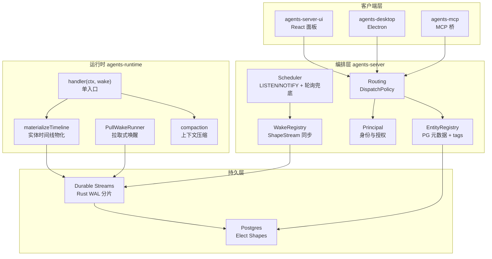
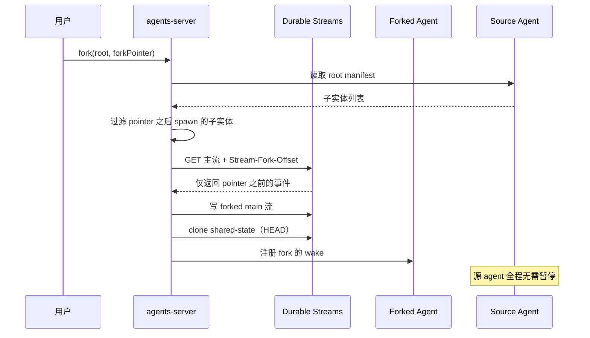
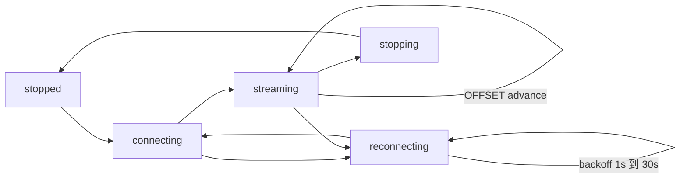

## 引子：一个被问了两年的问题

写 Agent 框架的时候，几乎所有人都会问同一个问题：**「Agent 的状态存哪儿？」**

答案通常是三种：

1. **存字段**——数据库里一张 `agents` 表，`status = 'running' | 'idle' | 'error'`，完事。
2. **存日志**——事件溯源（Event Sourcing），把每次动作 append 成一条事件，状态是事件的 fold。
3. **存检查点**——Checkpoint 范式，跑到哪一步就存到哪，重启从检查点恢复。

这三种在过去两年里都已经被写透了。本系列已经覆盖过 ActiveGraph（事件溯源）、Tensorlake（严格重放）、LayerFS（工具调用即 Commit）、Cline（事务性检查点）——**它们都是「状态属于这个 Agent」的世界观**：状态是私有的、本地的、进程内的。

但还有第四个问题，几乎没人正面回答过：

> **如果 Agent 的状态本身需要被同步呢？**

不是「同步给用户看」的那种同步（那是 SSE / WebSocket）。是真正的同步：**多个设备、多个副本、多个进程，乃至另一个 Agent，都能看到同一份 Agent 状态，且这份状态在任意一点都可以分叉、合并、回放。**

2026 年 11 月，Neon 官方把这个答案做出来了。`neondatabase/electric` 的仓库描述只有一句话：

> **The agent platform built on sync.**

它的 homepage 是 `electric.ax`（ax = agents + electric）。这个仓库 ⭐10,435、Apache-2.0、3,911 个文件，由 TypeScript（Agent 运行时）、Rust（Durable Streams WAL）、Elixir（Postgres 同步引擎）三套技术栈组成。

这篇文章要拆的，就是它最反直觉的那个设计：**Agent 的状态不是字段，是事件流的物化；Agent 不是被轮询的，是被唤醒的。**

## 一、项目定位与核心价值

### 1.1 它到底是什么

Electric 有两层身份，这个区分很重要：

| 层 | 是什么 | 技术栈 | 规模 |
|---|---|---|---|
| **Electric（同步引擎）** | Postgres 的 read-path 同步引擎，基于 Shape 做部分复制 | Elixir（189 个 `.ex`） | 自 2022 年起，ElectricSQL 项目 |
| **Electric Agents（Agent 平台）** | 建在同步引擎之上的 Agent 运行时 + 编排服务器 | TypeScript（890 个 `.ts`）+ Rust（20 个 `.rs`） | 7 个包，`packages/agents-*` |

本文重点在第二层。Agent 子系统由七个包组成，官方开发文档写得很清楚：

| 包 | 职责 |
|---|---|
| `agents-runtime` | 核心运行时——实体定义、上下文、handler 生命周期 |
| `agents-mcp` | MCP 桥接库 |
| `agents-server` | 编排服务器——wake 注册表、调度器、Electric + Postgres 集成 |
| `agents` | 内置 Agent（Horton & Worker）与工具（bash/read/write/edit/fetch/search） |
| `agents-server-ui` | React 监控面板 |
| `agents-desktop` | Electron 桌面壳 |
| `agents-server-conformance-tests` | **一致性测试套件**（本系列见过的第一份 Agent 平台级 conformance suite） |

### 1.2 它解决的真问题

传统 Agent 平台的状态管理，有三个长期没解好的硬骨头：

**① 状态没有单一真相源。** Agent 跑在容器里，UI 跑在浏览器，调度器跑在 server 里。谁是「当前状态」的权威？通常答案是「数据库」，但数据库里的状态字段和 Agent 内存里的实际状态会漂移。

**② 状态不可分叉。** 想复现「agent 在第 37 步做了什么」？做不到。想从某个历史点拉出一个新 agent 试试另一条路？做不到。想让两个 agent 从同一份历史出发各自演化？做不到。

**③ 触发靠轮询。** 调度器每 5 秒扫一遍表看「有没有该跑的 agent」。这意味着：延迟至少一个轮询周期、数据库 QPS 随 agent 数量线性增长、Agent 空转时也在烧钱。

Electric 的答案是把三件事**统一到同一个原语上**：

> **状态 = 同步可复制的 append-only 实体时间线。**
> **触发 = 时间线上的一条「唤醒事件」。**
> **身份 = 时间线上的一个 Entity。**

这不是三个独立机制，而是**同一个机制的三种视图**。这是本文最想传达的东西。

### 1.3 仓库统计

| 指标 | 值 |
|---|---|
| Stars | ⭐10,435 |
| Forks | 402 |
| Open Issues | 300 |
| License | Apache-2.0 |
| 主语言 | TypeScript（另有 Elixir / Rust） |
| 创建时间 | 2022-06-01（Electric 同步引擎本体） |
| 最近推送 | 2026-11-18 |
| 仓库节点 | 3,911 |
| Topics | `agent` `agents` `crdt` `crdts` `data` `elixir` `platform` `postgres` `replication` `runtime` `sync` |

> 注：仓库历史属于 ElectricSQL 项目，`electric-sql/electric` 现在会 301 重定向到 `neondatabase/electric`（Neon 收购后迁移）。

## 二、整体架构

Electric Agents 的数据流是**双向**的，这是它最反直觉的地方：



核心链路是：

1. **Postgres 是元数据真相源**——实体注册、tags、权限、调度任务。
2. **Durable Streams 是事件真相源**——每个实体拥有一条 append-only 流。
3. **WakeRegistry 本身也是同步的**——它通过 ElectricSQL ShapeStream 复制，所以「谁该被唤醒」这件事在多副本之间自动一致。
4. **Runtime 拉取式消费**——Agent 自己 `pull` 流，看到 wake 事件才干活。

## 三、Entity：Agent 世界的「一等公民」

### 3.1 身份是 URL，不是 UUID

这是 Electric 和几乎所有框架的第一个分歧点。

```text
# 来自 packages/agents-server/src/entity-manager.ts
 * Entity identity is the URL (/{type}/{instance_id}). Entity tags and
 * lifecycle state are persisted directly in Postgres. Durable streams remain
 * the append-only transport for inbox/state events.
 */
export class EntityManager {
```

⭐ 注意这段类注释把三层职责说得非常清楚：**身份是 URL（`/{type}/{instance_id}`）**、**tags 与生命周期状态直接存在 Postgres**、**Durable Streams 只是 inbox/state 事件的 append-only 传输层**。

这意味着 Durable Streams **不是数据库**，而是一条可靠的、有序的、可分叉的事件传输通道——Postgres 才是状态的权威存储点。这与 ActiveGraph 的「This is an event log, not a database.」是同一种自觉。

Entity 的身份因此是一个**可读、可路由、可当 URL 用的路径**，而不是一串随机 UUID。这意味着：

- `GET /principal/agent%3Aworker-1` 天然有语义
- Entity URL 可以直接出现在日志、错误消息、webhook 目标里
- 复制、fork、spawn 出来的实体，URL 结构完全一致

### 3.2 Entity Type 是一组 Collection 定义

`defineEntity(name, definition)` 声明一个 entity type。它包含三类 collection：

| 类别 | 作用 | 官方字段 |
|---|---|---|
| `creationSchema` | 创建参数校验 | zod schema |
| `inboxSchemas` | **收件箱**——外部消息的类型化入口 | 事件名 → schema |
| `state` | **状态集合**——从时间线物化出来的行 | 每个 collection 有 `type` + `primaryKey` |

下面是**官方 README 里的完整可运行示例**（来自 `packages/agents-runtime/README.md`）：

```ts
import { z } from 'zod'
import { defineEntity } from '@electric-ax/agents-runtime'

defineEntity(`pr-reviewer`, {
  description: `Code review agent`,

  creationSchema: z.object({
    repo: z.string(),
    prNumber: z.number().int(),
  }),

  inboxSchemas: {
    'pr-opened': z.object({
      diff: z.string(),
      baseBranch: z.string().optional(),
    }),
  },

  state: {
    reviewStatus: {
      schema: z.object({
        key: z.string(),
        status: z.enum([`pending`, `reviewing`, `done`]),
      }),
      type: `review_status`,
      primaryKey: `key`,
    },
  },

  async handler(ctx, wake) {
    if (ctx.firstWake && !ctx.db.collections.reviewStatus.get(`current`)) {
      ctx.db.actions.reviewStatus_insert({
        row: { key: `current`, status: `reviewing` },
      })
    }

    if (wake.type === `inbox`) {
      ctx.useAgent({
        systemPrompt: `Review pull requests carefully and concisely.`,
        model: `claude-sonnet-4-5-20250929`,
        tools: [...ctx.electricTools],
      })
      await ctx.agent.run()
      ctx.db.actions.reviewStatus_update({
        key: `current`,
        updater: (draft) => {
          draft.status = `done`
        },
      })
    }
  },
})
```

**请注意这段代码里最反直觉的地方**：`handler` 从头到尾**没有一行代码去「设置 Agent 的状态」**。`status` 从 `pending` 变成 `reviewing` 再变成 `done`，不是靠 `ctx.setState('running')`，而是靠：

1. `ctx.db.actions.reviewStatus_update(...)` **往实体时间线上追加一条事件**；
2. 运行时**重新物化**时间线，`ctx.db.collections.reviewStatus.get('current')` 读出来的就是最新值。

**状态是事件流的物化，不是被写入的字段。**

> ⚠️ 这也意味着：如果 agent 崩了，`status` 仍然是正确的——因为它由已持久化的事件推导，崩溃只影响「还没写的事件」。这就是「状态即物化」的全部好处。

### 3.3 时间的第二类公民：Manifest

Agent 的运行时状态不只在 `state` 里。Electric 还定义了一组 **manifest kind**，用来描述「这个实体当前挂着什么」：

```text
// 来自 packages/agents-runtime/src/entity-schema.ts
type ManifestGoalEntryValue = {
  key?: string
  kind: `goal`
  id: string
  objective: string
  status: GoalStatusValue
  // `null` means unbounded — the user must opt in explicitly.
  tokenBudget: number | null
  // Maintained by the handler's in-memory step accumulator (the single
  // write path for usage); enforcement aborts mid-run via the step-end hook.
  tokensUsed: number
  // Optional completion note recorded by mark_goal_complete — what was
  // accomplished, or what blocked the goal.
  summary?: string
  // ISO strings, matching every other manifest kind.
  createdAt: string
  updatedAt: string
}
```

manifest kind 全集包括：`goal`、`child`、`source`、`sharedState`、`effect`、`attachment`、`context`、`cronSchedule`、`futureSendSchedule`、`replayWatermark`。

⭐ 关键设计：**Goal 不是独立的 Entity，而是 manifest 里的一条 entry**。这意味着 goal 天然可同步、可复制、可回放——因为 manifest 就住在实体时间线上。

## 四、核心引擎一：EventPointer —— 二元定位

要理解 Electric Agents，先得理解它的坐标系统。

### 4.1 为什么单个 offset 不够

Durable Streams 协议里，事件按 **batch**（chunk）投递。一个 batch 里有 N 条 JSON 消息，它们共享同一个 anchor offset。

于是「定位第 3 个 batch 里的第 2 条消息」需要两个数：`{offset: 3, subOffset: 2}`。

### 4.2 EventPointer 的定义

```text
// 来自 packages/agents-runtime/src/event-pointer.ts
export interface EventPointer {
  /** Anchor offset on the source stream, or `null` for stream-start. */
  offset: string | null
  /**
   * Count of JSON messages past `offset` to include — sub-offset N
   * includes items `[0 .. N-1]`. For "include item at index j," set
   * `subOffset = j + 1`.
   */
  subOffset: number
}
```

这个二元组**直接映射 Durable Streams 协议的两个 HTTP 头**：`Stream-Fork-Offset` 与 `Stream-Fork-Sub-Offset`。

⭐ **这意味着「在历史某一点分叉」不是一个业务功能，而是协议原生能力。** 没有额外的 fork API、没有额外的状态拷贝——只是发两个头。

### 4.3 ⭐⭐ 排序不是时间戳，是可字典序比较的 token

这是整套设计里最漂亮的一处工程细节。

状态物化时，每一行要放进一条全局有序的时间线。行不能靠时间戳排序（多个进程写，时钟不可信），那靠什么？

答案：**把 `(offset, subOffset)` 编码成一个固定宽度的字符串 token**，直接落进行的一个虚拟列 `_timeline_order`。

```text
// 来自 packages/agents-runtime/src/event-pointer.ts
/**
 * Format an `EventPointer` as a lexicographically-sortable token for
 * use in `_timeline_order` / `__electricRowOffsets`-derived ordering.
 *
 * The format is:
 *
 *   `stream:<zero-padded-offset>:<zero-padded-subOffset>`
 *
 * - Empty / null offsets zero-pad to all-zeros, which sorts before any
 *   non-empty offset — correct, since the first batch of a fresh read
 *   has `offset === null` and its items must sort before later batches.
 * - Higher offset → sorts later. Within the same offset, higher
 *   sub-offset → sorts later. Net: strict monotonic order matching
 *   the stream's order.
 */
export function formatPointerOrderToken(pointer: EventPointer): string {
  const paddedOffset = (pointer.offset ?? ``).padStart(OFFSET_WIDTH, `0`)
  const paddedSubOffset = pointer.subOffset
    .toString()
    .padStart(SUB_OFFSET_WIDTH, `0`)
  return `${STREAM_TOKEN_PREFIX}${paddedOffset}:${paddedSubOffset}`
}
```

（`OFFSET_WIDTH = 24`，`SUB_OFFSET_WIDTH = 8`，`STREAM_TOKEN_PREFIX = 'stream:'`。）

⭐ **这招的价值在于：排序变成了一个可以直接在 SQL 里 `ORDER BY` 的普通字符串比较**，不需要额外的排序键、不需要逻辑时钟、不需要 Lamport 计数器。而且它和流的顺序**严格一致**（strict monotonic）。

顺便，`comparePointers` 也不是比较数字，而是比较 token 字符串：

```text
// 来自 packages/agents-runtime/src/event-pointer.ts
export function comparePointers(
  left: EventPointer,
  right: EventPointer
): number {
  const leftToken = formatPointerOrderToken(left)
  const rightToken = formatPointerOrderToken(right)
  if (leftToken < rightToken) return -1
  if (leftToken > rightToken) return 1
  return 0
}
```

### 4.4 ⭐ 由此推出的能力：可分叉的历史

因为状态是事件流，**可以在任意 EventPointer 处切开历史、分叉出一个新 agent**——而且**不需要源 agent 停下来**。

```text
// 来自 packages/agents-server/src/entity-manager.ts
  /**
   * Optional anchor pointing at an event on the source root's `main` stream.
   * When set: only events at or before the pointer are kept on the root's
   * forked `main`, and the root's manifest is filtered so that descendants
   * spawned after the pointer are dropped from the fork (their now-orphan
   * subtrees are not forked). The pointer applies only to the root's
   * `main` stream; shared-state streams clone at HEAD regardless.
   */
  forkPointer?: EventPointer
```

配合协议头的 `Stream-Fork-Offset`，这就是完整的 fork 语义：



**这与 LayerFS 的「工具调用即 Commit」是不同维度**：LayerFS 让「每次工具调用是一条可查询的提交」，Electric 让「整个 Agent 的历史是一条可分叉的时间线」。

## 五、核心引擎二：实体时间线的物化

### 5.1 物化：把流变成可查询的表

Agent 醒来时，运行时要把它的 append-only 流物化成**带类型的 TanStack DB collections**，然后才交给 handler。

```text
# 来自 packages/agents-runtime/README.md
Each entity owns an append-only stream. On every wake, the runtime materializes
that stream into typed TanStack DB collections, builds a `HandlerContext`, and
runs your entity's single `handler(ctx, wake)` entrypoint.
```

物化之后，handler 拿到的是「普通的表格 API」：

```text
// 来自 packages/agents-runtime/README.md
ctx.db.actions.counts_insert({ row: { key: `main`, value: 0 } })
ctx.db.actions.counts_update({
  key: `main`,
  updater: (draft) => {
    draft.value++
  },
})
ctx.db.actions.counts_delete({ key: `main` })

ctx.db.collections.counts.get(`main`)
ctx.db.collections.counts.toArray
```

⭐ 值得注意的是**写入 API 的形态**：`counts_update` 收的是一个 `updater(draft)` 函数，而不是「新的完整值」。这是 TanStack DB 的乐观更新范式——你在 draft 上改，改完自动 diff 成一条事件。

### 5.2 ⭐⭐ 状态是从事件流推导出来的

这是整个范式的核心，也是最容易误解的地方。

代码里**没有** `setState`。`getEntityState()` 是从 `runs` + `inbox` 两类 collection 推导出来的：

```text
pending / queued / working / idle / error
```

推导逻辑在 `entity-manager.ts` 的 `reduceStateRows` 里——**这才是真正的「reduce」**：

```text
# 来自 packages/agents-server/src/entity-manager.ts
const rootManifests = this.reduceStateRows(filteredEvents, `manifest`)
const sharedStateIds = new Set<string>()
for (const manifest of rootManifests.values()) {
  this.collectSharedStateIds(manifest, sharedStateIds)
}
preFilteredRoot = {
  manifests: rootManifests,
  childStatuses: this.reduceStateRows(filteredEvents, `child_status`),
  replayWatermarks: this.reduceStateRows(
    filteredEvents,
    `replay_watermark`
  ),
  sharedStateIds,
}
```

⭐ 于是「Agent 的状态」有了三个非常自然的性质：

| 性质 | 为什么 |
|---|---|
| **不会漂移** | 状态由已持久化事件推导，没有第二份可变状态可漂移 |
| **可以回放** | 重放事件流即可重建任意历史时刻的状态 |
| **可以分叉** | 从任意 EventPointer 切出新流，物化出来就是那个时刻的状态 |

### 5.3 ⚠️ 物化层的两个真实陷阱

**陷阱一：TanStack DB 的 include 是延迟物化的。**

```text
# 来自 packages/agents-runtime/src/entity-timeline.ts
useLiveQuery reads of a sub-collection that has an include co-defined in the
same select return the row with content: null + a deferred Symbol(includesRouting)
marker. Naming the include field in a downstream .select is what forces
materialization ... Bare top-level references leave the include deferred until
UI reads it through useLiveQuery, which never gets through.
```

**陷阱二：schema 校验会吃掉虚拟列。**

```text
# 来自 packages/agents-runtime/src/entity-stream-db.ts
// Wrap a Standard Schema so that named virtual columns (e.g. `_timeline_order`,
// `_principal`) survive the validation step. TanStack DB calls the schema's
// validate() on every insert/update and uses result.value as the stored row,
// so any key not explicitly passed through by the schema is dropped. We
// extract the virtual fields before validation and re-attach them after.
```

第 2 条很值得注意：**`_timeline_order` 这个排序键是虚拟列**，而 TanStack DB 的 schema 校验会把它删掉。所以代码里专门包了一层 `wrapSchemaWithVirtualColumns` 把它们救回来。这是一种「框架的校验语义和我们的存储语义不一致」时必须做的适配层——真实生产代码里这类补丁很常见，能看出作者踩过坑。

## 六、核心引擎三：Pull-Wake —— Agent 被唤醒而不是被轮询

### 6.1 唤醒是一条事件

这是全文最关键的设计。

传统做法：调度器每 N 秒查一次数据库，问「有没有 agent 该跑了？」

Electric 的做法：**唤醒本身就是实体时间线上的一条事件**。Agent 醒来时，从流里读到这条事件，就知道自己该干活了。

唤醒条件只有两类（来自 `types.ts` 与 `wake-registry.ts`）：

| 条件 | 语义 |
|---|---|
| `runFinished` | 某个 run 变成 completed/failed |
| `{ on: 'change', collections?, ops? }` | **实体状态发生变化**（可指定 collection、可指定操作类型、可带 debounce 与 timeout） |

⭐ **注意第二条**：唤醒条件是「状态变了」而不是「该做某件事了」。这是一个真正的**反应式**模型——逻辑写在 handler 里，触发条件保持通用。

### 6.2 拉取式而非推送式

Agent 侧有一个专门的 runner，用 `xstate` 定义的有限状态机管理「连流 → 收事件 → 断线重连 → 停机」。

```text
// 来自 packages/agents-runtime/src/pull-wake-machine.ts
/**
 * Side effects the lifecycle machine triggers but does not own. Diagnostics,
 * heartbeating, and claim processing live in the runner closure; the machine
 * decides *when* they happen so every (state, event) pair is explicit.
 */
export interface PullWakeMachineEffects {
  /** Open the wake stream. The signal is aborted whenever `connecting` exits. */
  connectStream: (signal: AbortSignal) => Promise<PullWakeStreamResponse>
  onStreamConnected: () => void
  onStreamDisconnected: () => void
  onWake: (event: PullWakeEvent) => void
  onOffset: (offset: string) => void
  /** A connect attempt or stream session ended in error. */
  onReconnectError: (error: unknown) => void
  notifyHeartbeatChange: () => void
  cancelResponse: (response: PullWakeStreamResponse, reason: Error) => void
  /** Entered `stopping`: abort in-flight work and stop heartbeats. */
  onStopping: () => void
  /** Drain sequence: wait for claim actors, abort wakes, drain wakes. */
  shutdown: () => Promise<void>
}
```

⭐ 「**机器决定何时，闭包决定怎么做**」——状态机只管 `(state, event) → state` 的纯转移，所有副作用通过 `effects` 接口注入。这让整条唤醒生命周期**可以被完整枚举和测试**。

退避策略也是显式的：

```text
// 来自 packages/agents-runtime/src/pull-wake-machine.ts
export const INITIAL_RECONNECT_BACKOFF_MS = 1_000
export const MAX_RECONNECT_BACKOFF_MS = 30_000
```

### 6.3 状态机全图



### 6.4 ⭐ DispatchPolicy：同一抽象的两种投递模式

「谁该被唤醒」通过 `DispatchPolicy` 决定。它的 `targets` 是元组，**第一个是主目标**，继承链是「entity 自身 > 父 entity > entity type 默认」。

⭐ 最巧妙的一点：**推和拉只是同一套 subscription 抽象的两种投递模式**：

| target 类型 | 投递模式 | 语义 |
|---|---|---|
| `runner` | **拉**（`type: 'pull-wake'`） | Agent 主动连流读 wake 事件 |
| `webhook` | **推**（`type: 'webhook'`） | 服务端主动 POST 到外部端点 |

路由的真正动作也不是「调用 handler」，而是**把实体流 link 到目标 subscription**——数据流本身被接上了，触发只是这条链接生效的表现。

### 6.5 Scheduler：反向对照

有意思的是，**调度器本身反而用的是推送式**——通过 `pgClient.listen(...)` 订阅 Postgres 的 LISTEN 通道提前唤醒，`safetyPollMs`（默认 10 秒）轮询兜底：

```text
// 来自 packages/agents-server/src/scheduler.ts
    this.claimExpiryMs = options.claimExpiryMs ?? 30_000
    this.safetyPollMs = options.safetyPollMs ?? 10_000
    this.listenEnabled = options.listen !== false
```

```text
// 来自 packages/agents-server/src/scheduler.ts
    if (this.listenEnabled) {
      this.listenerMeta = await this.pgClient.listen(
```

多实例安全靠 `for update skip locked` + claim 租约（`claimExpiryMs` 默认 30 秒过期）。幂等键是 `(tenant_id, cron_expression, cron_timezone, cron_tick_number)`。

⭐ 这说明作者很清楚**拉与推各有适用面**：Agent 自己拉（因为 Agent 可能不在跑），调度器用推（因为调度器一直在跑）。

## 七、身份与授权：Agent 是一等公民

### 7.1 PrincipalKind：agent 和 user 平级

```text
// 来自 packages/agents-server/src/principal.ts
export type PrincipalKind = `user` | `agent` | `service` | `system`
```

⭐ **这是全系列 556 篇里第一次出现把 `agent` 和 `user` 放在同一个枚举里的项目。** 绝大多数框架里，Agent 要么「代替用户」操作（拿用户 token），要么「以服务身份」操作（拿 service token）——**Agent 是一个独立主体这件事，在别处很少被认真对待。**

身份通过 HTTP header 传递：

```text
// 来自 packages/agents-server/src/principal.ts
export const ELECTRIC_PRINCIPAL_HEADER = `electric-principal`
```

解析规则也很克制：

```text
// 来自 packages/agents-server/src/principal.ts
export function parsePrincipalKey(input: string): Principal {
  const colon = input.indexOf(`:`)
  if (colon <= 0) throw new Error(`Invalid principal identifier`)
  const kind = input.slice(0, colon) as PrincipalKind
  const id = input.slice(colon + 1)
  if (!PRINCIPAL_KINDS.has(kind)) throw new Error(`Invalid principal kind`)
  if (!id || id.includes(`/`)) throw new Error(`Invalid principal id`)
  const key = `${kind}:${id}`
  return { kind, id, key, url: `/principal/${encodeURIComponent(key)}` }
}
```

### 7.2 ⭐⭐ Principal 本身就是一条可同步的 Entity

这是最反直觉也最漂亮的一点。

```text
// 来自 packages/agents-server/src/principal.ts
export const principalIdentityStateSchema = Type.Object(
  {
    kind: Type.Union([
      Type.Literal(`user`),
      Type.Literal(`agent`),
      Type.Literal(`service`),
      Type.Literal(`system`),
    ]),
    id: Type.String(),
    key: Type.String(),
    url: Type.String(),
    updated_at: Type.String(),
    display_name: Type.Optional(Type.String()),
    email: Type.Optional(Type.String()),
    avatar_url: Type.Optional(Type.String()),
    auth_provider: Type.Optional(Type.String()),
    auth_subject: Type.Optional(Type.String()),
    claims: Type.Optional(Type.Record(Type.String(), Type.Unknown())),
    created_at: Type.Optional(Type.String()),
  },
  { additionalProperties: false }
)
```

⭐ **身份不是一张固定的 `users` 表，而是一个 entity type**。这意味着：Agent 的身份可以被同步、可以被复制、可以被 fork、可以被其他 Agent 观察，也**可以被写进同一条实体时间线**。

整个系统因此只有一个统一的抽象：**一切皆 Entity，Entity 皆有时间线。**

### 7.3 Sandbox 身份：三个正交的事实

沙箱的选择逻辑被提炼成一个**纯函数**，刻意不含任何 IO：

```text
// 来自 packages/agents-runtime/src/sandbox/identity.ts
/**
 * Pure resolution of a sandbox's lifecycle knobs from the per-entity sandbox
 * config plus the live wake. Kept free of any provider or IO so it's trivially
 * unit-testable and reusable by both the wake path (process-wake) and the spawn
 * `inherit` path.
 *
 * Three orthogonal facts come out of this:
 *
 *  - KEY SCOPE (identity): an explicit `key` (set directly or adopted via
 *    `inherit`) is a cross-entity rendezvous handle and always wins. Absent a
 *    key, `scope` derives one: `'wake'` ⇒ `${entityUrl}#${wakeId}` (full
 *    per-wake isolation), `'entity'` (the default) ⇒ `entityUrl` (a stable
 *    per-entity workspace shared across that entity's wakes).
 *
 *  - DURABILITY (`persistent`): drives the *owner's* idle-teardown action —
 *    `true` preserves the sandbox (stop / suspend) for later reattach, `false`
 *    wipes it (remove / kill). When unset it defaults by scope: a per-wake
 *    sandbox is ephemeral, an explicit-key or per-entity one is persistent.
 *
 *  - OWNERSHIP (`owner`): an owner CREATES the sandbox and its lifecycle governs
 *    teardown (idle ⇒ stop/remove per `persistent`; terminal ⇒ reclaim). A
 *    non-owner can only ATTACH to an already-live sandbox and never creates or
 *    tears down — so a subagent can't conjure a fresh, empty sandbox under a
 *    shared key. Defaults to `true`; `inherit` resolves to `owner: false`.
 *
 * "Full isolation" therefore comes purely from a unique per-wake key, never a
 * separate code path — the provider only ever sees a resolved key, persistent,
 * and owner flag.
 */
```

⭐ 最后那句话是重点：**「完全隔离」不需要单独写一条代码路径，只需要一个唯一的 per-wake key。** 这是把「安全属性」降维成「身份属性」的高明做法。

### 7.4 claim-write-token：单写者令牌

能力令牌是纯内存的，绑定 `(service, streamPath, consumerId)` 三元组，单写者语义（`mint` 会踢掉旧 consumer）：

```text
// 来自 packages/agents-server/src/claim-write-token-store.ts
interface ActiveClaimWriteToken {
  token: string
  consumerId: string
}

export class ClaimWriteTokenStore {
  private readonly claimsByStream = new Map<string, ActiveClaimWriteToken>()
  private readonly streamKeysByConsumer = new Map<string, Set<string>>()

  mint(service: string, streamPath: string, consumerId: string): string {
    const streamKey = this.streamKey(service, streamPath)
    const consumerKey = this.consumerKey(service, consumerId)
    const previousClaimForStream = this.claimsByStream.get(streamKey)
    if (previousClaimForStream) {
      this.removeConsumerStream(
        this.consumerKey(service, previousClaimForStream.consumerId),
        streamKey
      )
    }

    const token = randomUUID()
    this.claimsByStream.set(streamKey, { token, consumerId })
    this.addConsumerStream(consumerKey, streamKey)
    return token
  }
```

令牌通过 `electric-claim-token` 或 `Authorization: Bearer` 头回传。

## 八、Durable Streams 的 Rust WAL

事件最终要落到磁盘。这一层用 Rust 实现，因为 WAL 是 IO 密集型。

### 8.1 分片与路由

持久化 shard 数量固定 + FNV-1a 哈希路由。核心机制是 **contiguous-written watermark**：

- `written_high`——已连续写入的水位
- `BTreeSet written_ahead`——已写入但前面还有洞的部分

⭐ 只有当整个前缀都 fsync 完成后，ack 才推进。这样 ack 语义是严格的：**ack 过的数据一定在盘上**。

### 8.2 ⭐ Checkpoint 不阻塞 ack

checkpoint 可以在 ack 之外独立推进，代价是 **WAL 可能无限增长**。这是一个明确的取舍——用磁盘空间换 ack 延迟。

### 8.3 Tier 策略

`tier.rs` 实现了分层存储（热数据在内存/本地，冷数据下沉）。⭐ 作者在注释里诚实标注了一处未完成的回收：

```text
# 来自 packages/durable-streams-rust/src/tier.rs
// NOTE: the live data file's sealed region is intentionally NOT
// reclaimed here. A sealed segment is served from its chunk file /
// remote object (resolve_range routes sealed offsets there), so the
// live file's copy is redundant — but hole-punching it races with the
// engines' in-flight lazy reads (sendfile / Body::FileRange) into the
// just-sealed tail, which would then read zeros from the freed blocks.
// Safe reclaim needs read/punch coordination (epoch/refcount) or
// compaction; that is a planned follow-up. Until then the live file
// retains the sealed prefix (extra disk; the no-corruption guarantee
// and the no-race guarantee both hold).
```

## 九、⭐⭐⭐ 必须诚实指出的源码自陈缺陷

这是本系列的核心特色。Electric Agents 的代码注释里**主动记录了自己的边界**，数量和诚实度都相当高。以下 12 条全部是**原文引用**。

### 9.1 协议级限制：本地 sub-offset 计数

```text
# 来自 packages/agents-runtime/src/event-pointer.ts
 * Limitation: local counting is correct when reads start from the
 * beginning of the stream. If a future read-side feature ever lets us
 * resume from an arbitrary mid-chunk cursor, our local counter would
 * miscount items that the server already skipped past. When the
 * protocol grows wire-provided values for that case, the local
 * counter goes away.
```

**问题**：EventPointer 的 sub-offset 是**客户端本地数出来的**，因为协议只提供 fork 侧的 sub-offset，不提供 read 侧的。如果将来协议支持「从 chunk 中间恢复读」，本地计数就会算错。

**为什么会这样**：

```text
# 来自 packages/agents-runtime/src/event-pointer.ts
 * Why this shape and not the wire's opaque offset alone:
 * the protocol ships fork-side sub-offsets but does NOT add read-side
 * sub-offsets — the wire never tells the client the sub-offset of a
 * delivered item. We compute them locally by counting positions within
 * each `JsonBatch.items` and pairing them with the batch's start offset
```

⭐ **这是本系列见过最标准的「自陈缺陷三层次」写法**：① 承认缺口 → ② 说明为何现在不补 → ③ **规定补上时的行为**（协议一旦提供 wire 值，本地计数器就消失）。第三层最值钱。

### 9.2 ⭐⭐⭐ offset 顺序 ≠ 因果顺序

```text
# 来自 packages/agents-runtime/src/timeline-context.ts
 * Runtime output is buffered through its producer, while SIGINT is appended
 * directly by the server. Under interruption the signal can therefore get a
 * lower stream offset than the aborted run it interrupted. For model-facing
 * context, present the interrupted assistant run before the interrupt marker
 * so the next user message is interpreted against a coherent transcript.
```

⭐ **这是本篇文章最值得记住的一条。**

Agent 的运行输出是经过 producer 缓冲后写入流的；而 `SIGINT`（中断信号）是服务端**直接** append 的。所以**中断信号的 offset 可能比它所中断的那个 run 的 offset 更小**——时间线上「先发生的」排在「后发生的」前面。

解决办法不是改排序算法（那会破坏严格单调性），而是**在组装模型上下文时手工 reorder**：把被中断的 assistant run 放在中断标记之前。

这暴露了一个更本质的问题：**在分布式 append-only 流上，顺序是「写入顺序」而非「因果顺序」。** 任何声称提供「因果一致性」的方案都得回答这个问题。

### 9.3 持久化格式的迁移债

```text
# 来自 packages/agents-runtime/src/event-pointer.ts
 * `OFFSET_WIDTH` is the legacy pad width used by `_timeline_order`.
 * Bumping it would invalidate every persisted timeline ordering — so
 * if you ever need to widen it, you also need a migration path.
```

⭐ 改一个常量就会作废所有已持久化的排序。**这种「一个数字锁死整个存储格式」的债，作者写在了注释里。**

### 9.4 本地乐观行的 offset 是伪造的

```text
# 来自 packages/agents-runtime/src/entity-stream-db.ts
 * applyEvent stages an in-process event (not delivered through a wire batch).
 * It carries a single event, so the pointer's sub-offset is always 1 ...
 * If no real offset is available, synthesize a monotonically-increasing
 * local:... token so successive applyEvent calls still sort in invocation order.
```

**本地乐观更新的 pointer 是假的**——用 `local:` 前缀的合成 token 保证「至少能按调用顺序排」。这是本地优先 UI 的必然代价。

配套的还有一条降级策略：

```text
# 来自 packages/agents-runtime/src/entity-stream-db.ts
 * Local optimistic events can arrive faster than a prior insert commit;
 * treat missing-row updates as insertions so repeated in-process runs do
 * not fail on transient ordering gaps.
```

**「找不到行就当插入」**——乐观更新降级成插入。

### 9.5 fork 语义不对称

```text
# 来自 packages/agents-server/src/entity-manager.ts
 * The pointer applies only to the root's
 * `main` stream; shared-state streams clone at HEAD regardless.
```

**fork 指针只对 root 的 main 流生效；共享状态流一律按 HEAD 克隆。** 也就是说 fork 出来的 agent 和源 agent 共享的状态，是「fork 那一刻之后仍然继续演进」的。这在某些场景下会造成 fork 两边状态分叉。

### 9.6 ⭐ Shape key 不保证是主键 → 选择 fail closed

```text
# 来自 packages/agents-server/src/wake-registry.ts
 * // Shape keys are protocol-level identifiers and are not guaranteed to be
 * // the table primary key. The wake_registrations shape uses
 * // `replica: full`, so deletes should carry the deleted row in old_value;
 * // use that row id to remove the matching in-memory registration. If the
 * // id is unavailable, reset the cache so we fail closed rather than
 * // keeping a stale wake registration alive.
```

⭐ **「宁可失效，不可错唤醒」**——拿不到主键就清空缓存，而不是保留一条可能过期的唤醒注册。

### 9.7 ⭐ SSRF 防护有明确缺口

```text
# 来自 packages/agents-runtime/src/sandbox/docker/net-policy.ts
 * Refuse literal private / link-local / loopback / cloud-metadata IPs
 * regardless of the allowlist — the most common LLM-attempted SSRF exfil
 * pattern. Encoded literal forms (integer/hex IPv4, `::ffff:`-mapped, bracketed
 * IPv6) are canonicalized first so they can't bypass the checks. DNS names that
 * *resolve* to private space, and redirects to a private host, are NOT caught
 * here (a known gap: closing it would require resolving on the host and pinning
 * the resolved IP per hop, which we don't do); this guard denies direct
 * literal-IP egress.
```

⭐ **作者明说「这是一个已知缺口」**，并且说清了修复代价（需要逐跳解析并 pin IP）。

值得肯定的是防护本身做得相当细致——连 `inet_aton` 的宽松 IPv4 形式都处理了：

```text
# 来自 packages/agents-runtime/src/sandbox/docker/net-policy.ts
 * Parse the loose IPv4 forms libc's `inet_aton` (and therefore `getaddrinfo`
 * on Linux/macOS) accepts, returning the canonical dotted quad — or `null` if
 * `h` isn't a valid loose-IPv4 literal ... These forms resolve to private
 * space via the OS resolver but slip past a dotted-quad-only check, so they
 * must be canonicalized before classification.
```

`127.1`、`127.0.1`、`0177.0.0.1`、`2130706433` 全部折叠成 `127.0.0.1`。

⚠️ 但还有一个更关键的边界：

```text
# 来自 packages/agents-runtime/src/sandbox/docker/net-policy.ts
 * This governs the `fetch` tool only — code run via `exec` has direct bridge
 * egress when the policy is not deny-all. deny-all is hard-enforced separately
 * by creating the container with `NetworkMode=none`.
```

**`fetch` 工具受 allowlist 约束，但 `exec` 跑的代码不受**（除非 deny-all 模式下用 `NetworkMode=none` 硬隔离）。这意味着**任何能执行 shell 的 Agent 都可以绕过 allowlist 直连外网**。

### 9.8 ⭐ 沙箱所有权：非 owner 只能 attach

```text
# 来自 packages/agents-runtime/src/sandbox/identity.ts
 * A non-owner can only ATTACH to an already-live sandbox and never creates or
 * tears down — so a subagent can't conjure a fresh, empty sandbox under a
 * shared key.
```

这条是**安全属性**：子 Agent 不能凭空造一个空沙箱来冒充共享工作区。

### 9.9 claim-write-token 是纯内存的，会被后续 wake 抢占

前面 §7.4 已经给出了 `ClaimWriteTokenStore` 的完整实现。这里要看的是**清理逻辑里写明的边界**：

```text
// 来自 packages/agents-server/src/routing/internal-router.ts
      // Clear the in-memory write token only if this consumer still owns it.
      // If a newer wake has taken over, that newer wake owns the token now
      // and we must not clear it out from under it.
      if (stillOwnsClaim) {
        ctx.runtime.claimWriteTokens.clearStream(
          ctx.service,
          releasedClaimStream
        )
      }
```

⚠️ **注意代码里没有任何关于「server 重启后令牌丢失」的显式声明**——但两个 `Map` 都在内存里这件事本身就说明了一切：**进程重启会清空所有 claim 令牌**，多副本部署下每个副本的令牌表也是彼此独立的。这一点源码没有主动标注，属于读者需要自己从实现细节推断的隐性约束。

### 9.10 ⭐ 拉取模式的经典竞态

```text
# 来自 packages/agents-server/src/routing/entities-router.ts
 * // Deliver the initial message via entityManager.send AFTER the
 * // dispatch subscription is linked — same ordering spawn uses. Sending
 * // before linking would land the inbox row on the stream before the
 * // dispatcher is subscribed, and the dispatcher would never pick it up.
```

**「先订阅，后发消息」**——顺序反了，消息就永远躺在流里没人读。这是 pull 模式最经典的竞态，作者在代码里写清了顺序约束。

### 9.11 事件最终一致的真实代价：首次 preload 会 401

```text
# 来自 packages/agents-server/src/routing/durable-streams-router.ts
 * Without this, a brand-new shared-state always 401s on the first preload
```

新建的共享状态在第一次 preload 时会 401。原因是权限状态和流状态之间存在一个传播窗口——**最终一致性的账单，由用户来付**。

### 9.12 必须存下来但不能显示的内容

```text
# 来自 packages/agents-runtime/src/entity-schema.ts
 * Anthropic emits "redacted thinking" content blocks the client can't display
 * but MUST round-trip back to the model on the next turn or the conversation
 * errors. Persist verbatim, render nothing.
```

⭐ **「原样持久化，什么都不渲染」**——Anthropic 的 redacted thinking block 不能显示，但必须原样回传给模型，否则对话报错。这是一个「存了但不用」的字段，注释写得很清楚。

### 9.13 其它值得记录的自陈限制

| 位置 | 限制 |
|---|---|
| `entity-schema.ts` | 自定义 collection **默认无 schema 校验**——「shape is enforced by the write side」 |
| `entity-registry.ts` | 「Electric predicates cannot depend on `now()`」——过期行必须靠服务端清扫 |
| `entity-projector.ts` | flush 失败被 `catch {}` 静默吞掉，靠下次 reconcile 修补 |
| `entity-projector.ts` | diff 用 `JSON.stringify(left) === JSON.stringify(right)` 整行比较，脆 |
| `entity-schema.ts` | token 预算是**估算**：「JSON estimate of the prompt's stable parts — { system, tools } token counts (char/4)」 |
| `entities-router.ts` | 「If subscriber-flexibility ever becomes a real use case, replace this with a proper `canAccessEntity` check」——订阅者校验目前是临时实现 |
| `pull-wake-runner.ts` | 「onError is reporting-only; reporters must not control runner lifecycle」——错误上报不能影响 runner 生命周期 |
| `webhook-signing.ts` | 默认 signer 每次调用 `createEd25519WebhookSigner()` 都走 `generateKeyPairSync('ed25519')` 随机生成密钥对——多实例部署时各副本公钥不同 |
| `scheduler.ts` | 「Cron streams are **virtual shared sources**」——没有任何 wake 注册指向它时「stop the chain here instead of keeping a forever-global tick alive」 |
| `tag-stream-outbox-drainer.ts` | outbox **每行独立 producer**（`producerId = tag-outbox-${row.id}`，epoch=0, seq=0）——因为「the protocol requires same-epoch seqs to be contiguous」，共享 producer 会在别的实体的行交错时 409 |
| `LIMITATIONS.md` | 「Electric doesn't handle TRUNCATE messages」+「No transaction boundaries in shape logs」 |

⭐ 仓库根目录的 `LIMITATIONS.md` 只有 195 字节，但两条都点到要害：

```text
# 来自 LIMITATIONS.md
# Limitations

- Electric doesn't handle TRUNCATE messages.
  - First implementation is to invalidate the shapes that are possibly affected by TRUNCATE.
- No transaction boundaries in shape logs
```

## 十、与同类项目对比

选三个最接近的对比对象：

| 维度 | **Electric Agents** | ActiveGraph | Tensorlake | LangGraph |
|---|---|---|---|---|
| 状态载体 | 同步可复制的**实体时间线** | 进程内事件日志 | 事件日志（严格重放） | 图状态 + Checkpoint |
| 跨进程共享 | ✅ 原生（CRDT + Shape） | ❌ 进程内 | ⚠️ 服务端托管 | ❌ 进程内 |
| 历史可分叉 | ✅ **EventPointer 任意点 fork** | ✅ fork diff | ❌ | ❌ |
| 触发机制 | **拉取式 wake**（Agent 主动连流） | 事件驱动 | 事件驱动 | 图边驱动 |
| 身份模型 | **agent/user/service/system 平级** | 无专门模型 | 无 | 无 |
| 持久化 | Rust WAL（分片 + fsync watermark） | 内存 + SQLite | 服务端 | 外部 store |
| Agent 状态推导 | **从事件流物化** | 从事件流投影 | 从事件重放 | Checkpoint 恢复 |
| 上下文压缩 | ✅ **mid-turn compaction** | ❌ | ❌ | ❌ |
| 一致性测试套件 | ✅ 独立包 | ⚠️ CONTRACT | ⚠️ `.specs/` | ❌ |

### 10.1 vs ActiveGraph：同源不同「边界」

ActiveGraph（本系列 2026-11-10 写过）也是事件溯源，核心抽象 `apply_event` 单一投影器。两者相似度很高，但**信任边界完全不同**：

- ActiveGraph 问的是「这个 Agent 的**内部**状态机怎么保持一致」——进程内、单租户、事件日志是唯一真相。
- Electric 问的是「这个 Agent 的状态怎么**跨设备跨副本**保持一致」——分布式、CRDT、可分叉。

⭐ 一句话判据：**看状态是否需要离开进程**。需要 → Electric；不需要 → ActiveGraph 更简单。

### 10.2 vs Tensorlake：严格重放 vs 可同步

Tensorlake 的卖点是「Strict on Control Flow but Lenient on Data」——重放能精确复现控制流。

Electric 的取向相反：**Data 也是严格同步的**（每个事件都有确定的 offset 与 sub-offset），但**不追求「重放一定成功」**——恰恰相反，它追求「从任意点分叉出一条新的合法历史」。

⭐ Tensorlake 适合「财务流水必须逐笔对账」；Electric 适合「多个客户端看同一份 Agent 状态，且允许分叉试验」。

### 10.3 vs LangGraph：图 vs 时间线

LangGraph 的状态是一个**图**——节点是步骤，边是转移，检查点存快照。

Electric 的状态是一条**时间线**——没有「当前在哪个节点」的概念，只有「事件流到哪了」。状态机的位置是**推导出来的**，不是显式存的。

⭐ 这带来一个实际差异：LangGraph 的检查点是「快照」，恢复只能回到快照点；Electric 的状态是「物化」，可以**从任意事件点分叉**，而不只是回到快照。

## 十一、优缺点分析

### 11.1 架构简洁性 / 扩展性 / 易用性

| 项 | 评价 |
|---|---|
| **架构简洁性** | ⭐⭐⭐⭐⭐ 极致统一。一切皆 Entity，一切 Entity 皆有时间线。身份、状态、调度、共享状态、fork——全部用同一个原语表达，没有第二套机制。 |
| **扩展性** | ⭐⭐⭐⭐⭐ 加一种新的 state collection 只要 `defineEntity` 里加一项；加一种新的唤醒条件只要扩展 `on: 'change'`；加一种新的投递模式只要扩展 DispatchTarget。**注意：加东西不用改引擎核心。** |
| **易用性** | ⭐⭐⭐☆☆ handler 是**单一入口**（`handler(ctx, wake)`），没有 setup/loader 阶段，TanStack DB 提供了熟悉的 collection/action API。上手曲线主要在**理解范式本身**——不写 `setState` 需要一点心智转换。 |

### 11.2 性能 / 复杂度 / 维护性

| 项 | 评价 |
|---|---|
| **性能** | ⭐⭐⭐⭐☆ 拉取式避免空转烧钱；WAL 的 contiguous-written watermark 保证 ack 严格；调度器用 LISTEN/NOTIFY 避免轮询 QPS。**但**物化每次 wake 都要把流投影成表，大历史下有成本；`_timeline_order` 是字符串排序而非数值排序，索引效率略低。 |
| **复杂度** | ⭐⭐☆☆☆ **这是最主要的代价。** 三个技术栈（TS + Rust + Elixir）、三套时钟语义（offset / sub-offset / 时间戳）、投影器与物化层的双层抽象。理解成本远高于「一个 Agent 循环 + 一个状态字段」。 |
| **维护性** | ⭐⭐⭐⭐☆ 注释密度极高、自陈限制详尽（这本身就是可维护性的证据）；但 `entity-manager.ts` 单文件 124KB、`entity-registry.ts` 67KB，**热点文件偏大**。 |

### 11.3 ⭐ 最核心的取舍

> **用「理解成本」换「分布式一致性」。**

如果你的 Agent 只跑在一个进程里、只需要给用户看进度、也不需要 fork 历史——Electric 是**过度设计**。LangGraph 或任何「状态字段 + 事件循环」的方案都更合适。

但如果你需要：**多端同步、断线续跑、历史分叉、跨 Agent 共享状态、审计级可回放**——那这套统一抽象带来的收益是数量级的。

## 十二、实践：跑起来

### 12.1 环境准备

官方开发文档（`docs/agents-development.md`）明确列出了前置条件：

```text
- Docker Desktop running (for Postgres + Electric)
- Node.js and pnpm (see .tool-versions for exact versions)
- .env file at the project root with at least ANTHROPIC_API_KEY
```

⚠️ 注意文档里的这句话：

```text
Both entrypoints call process.loadEnvFile() on startup, loading from the current
working directory — so always run entrypoints from the project root.
```

**必须从项目根目录启动**，否则 `.env` 加载不到。

### 12.2 一键启动

```sh
./scripts/dev.sh build       # one-shot install + build of all required packages
./scripts/dev.sh start       # docker + 5 dev processes; Ctrl-C to stop
./scripts/dev.sh start --detach        # same, but exits after spawning (logs to .dev-logs/)
./scripts/dev.sh start --with-agents   # also spawn built-in agents (Horton + Worker)
./scripts/dev.sh desktop     # run the Electron desktop app in this terminal
./scripts/dev.sh isolated    # run an isolated stack on random ports and
                             # open Electron desktop against it
./scripts/dev.sh stop        # stop processes + docker compose down
./scripts/dev.sh teardown    # stop + remove Postgres volume + .streams-data/
./scripts/dev.sh status      # show which services are running
```

⭐ `./scripts/dev.sh isolated` 特别值得注意：它会用**随机空闲端口**跑一整套隔离栈（Postgres / Electric / Jaeger / agents-server / 内置 Agent / UI / 桌面端），并用基于分支名的 Docker Compose project 名（`agents-<branch-slug>`）方便识别和清理。**测试 worktree 或 PR 时用这个路径，不会和另一个正在跑的栈打架。**

### 12.3 底层同步引擎单独跑

Agent 平台依赖的 Postgres 同步引擎，其启动方式在项目根 README 里：

```sh
docker compose -f .support/docker-compose.yml up
```

起来之后可以直接用 HTTP API 拉一份 shape：

```sh
curl -i 'http://localhost:3000/v1/shape?table=foo&offset=-1'
```

### 12.4 用 SDK 写一个自己的 Agent

安装运行时包：

```bash
pnpm add @electric-ax/agents-runtime
```

对端依赖：`@tanstack/db >= 0.5.33`。

最小可运行例子（官方 README）：

```ts
import http from 'node:http'
import { z } from 'zod'
import { createRuntimeHandler, defineEntity } from '@electric-ax/agents-runtime'

defineEntity(`assistant`, {
  description: `Simple durable chat assistant`,

  state: {
    status: {
      schema: z.object({
        key: z.string(),
        value: z.enum([`idle`, `working`]),
      }),
      type: `status`,
      primaryKey: `key`,
    },
  },

  async handler(ctx) {
    if (!ctx.db.collections.status.get(`current`)) {
      ctx.db.actions.status_insert({
        row: { key: `current`, value: `idle` },
      })
    }

    ctx.useAgent({
      systemPrompt: `You are a helpful assistant.`,
      model: `claude-sonnet-4-5-20250929`,
      tools: [...ctx.electricTools],
    })
  },
})

const runtime = createRuntimeHandler({
  baseUrl: `http://127.0.0.1:4437`,
  serveEndpoint: `http://127.0.0.1:3000/webhook`,
})

await runtime.registerTypes()

const server = http.createServer(async (req, res) => {
  if (req.url === `/webhook` && req.method === `POST`) {
    await runtime.onEnter(req, res)
    return
  }

  res.writeHead(404)
  res.end()
})

server.listen(3000, `127.0.0.1`)
```

### 12.5 ⭐ spawn / observe / send：Agent 之间怎么协作

```text
// 来自 packages/agents-runtime/README.md
const child = await ctx.spawn(
  `researcher`,
  `r-1`,
  { topic: `durability` },
  { wake: { on: `runFinished`, includeResponse: true } }
)

// Return from this wake. Continue when the child completion wake arrives.

const observed = await ctx.observe(entity(`/researcher/r-2`), {
  wake: { on: `runFinished`, includeResponse: true },
})
const status = observed.status()

ctx.send(`/other-entity/id`, { text: `hello` }, { type: `message` })
```

⭐ **三个动词说明了一整套多 Agent 语义**：

- `spawn` —— 创建子实体并注册唤醒条件，**当前 wake 直接返回**，等子实体的完成 wake 到达再继续。这是「协作 = 事件流上的因果链」，不是「阻塞等待」。
- `observe` —— 订阅另一个实体的状态，**拿到的也是一个 entity URL**（观察者本身是一个实体）。
- `send` —— 往另一个实体的 inbox 发消息。

### 12.6 ⭐ 共享状态：多个 Agent 读写同一块板子

```text
// 来自 packages/agents-runtime/README.md
const boardSchema = {
  findings: {
    schema: z.object({
      key: z.string(),
      domain: z.string(),
      finding: z.string(),
    }),
    type: `finding`,
    primaryKey: `key`,
  },
}

if (ctx.firstWake) {
  ctx.mkdb(`board-1`, boardSchema)
```

⭐ `ctx.mkdb('board-1', boardSchema)` —— 共享状态也是一个 **entity**，有自己独立的 collection schema。它和普通 `state` 的区别是：共享状态被多个 Agent 访问，因此**它是 CRDT 语义的**，而单实体 state 只需要单写者语义。

### 12.7 上下文压缩：mid-turn compaction

Electric 有一个别的框架很少做的东西：**turn 内压缩**。

压缩的触发点挂在 pi-agent 的 `transformContext` 上——**每次模型步之前都跑一次**：

```text
// 来自 packages/agents-runtime/src/compaction-midturn.ts
/**
 * Build the per-turn mid-turn compaction hook for one agent run. The returned
 * function is wired to pi-agent's `transformContext` — it runs before every
 * model step. Once the estimated outgoing context crosses the ceiling it folds
 * the WHOLE context into a summary and continues from `[summary, ...anything
 * appended since]` (Codex-style — no verbatim pre-compaction tail).
 *
 * Summarizing everything is what keeps the persisted checkpoint sound: the
 * `writeCheckpoint` wiring stamps it with `watermark = timeline head`, and a
 * verbatim tail kept below that head would be dropped on the next turn's
 * reconstruction yet excluded from the summary — silently losing context. By
 * covering everything up to the head, summary and watermark agree.
 *
 * The summary is cached for the rest of the turn: later steps reuse it
 * (returning the compacted view) instead of re-summarizing. Coverage is only
 * extended once new messages appended this turn push back over the ceiling, and
 * a re-summarization chains off the previous summary (prev summary + new
 * middle) rather than re-reading the whole already-summarized bulk.
 *
 * Returns `null` to leave the context untouched (no compaction needed/active).
 */
```

⭐ **这段注释解释了一个非常容易做错的设计决策**：为什么是「全量折叠」而不是「保留最近 N 条原文」？

因为压缩检查点会被打上 `watermark = timeline head`。如果保留了一段原文尾巴在 head 之下，它在下一轮重建时会被丢掉，却没被算进摘要里——**上下文静默丢失**。所以必须覆盖到 head 为止，让「摘要范围」和「watermark」严格一致。

⭐ 另一个亮点是**链式重算**：

```text
// 来自 packages/agents-runtime/src/compaction-midturn.ts
    // Chain off the previous summary so we don't re-summarize the whole bulk.
    const toSummarize = state
      ? [
          buildCompactionSummaryMessage(state.summary),
          ...messages.slice(state.coveredCount, coveredCount),
        ]
      : messages.slice(0, coveredCount)
```

再次超阈值时，只摘要「旧摘要 + 新增中段」，**不重读整坨历史**。这让 turn 内多次压缩的代价从 O(n) 降到 O(新增量)。

⚠️ **但要注意代价与边界**：

- **「Codex-style — no verbatim pre-compaction tail」**——压缩后原始的工具输出可能丢失（不像 Codex 那样保留最后一段原文）。这是为了保住 checkpoint 的 soundness 而主动放弃的。
- **摘要失败即放弃压缩**，继续带满上下文跑：

```text
// 来自 packages/agents-runtime/src/compaction-midturn.ts
    } catch {
      deps.writeCheckpoint(`failed`, ``)
      // Fall back to any compaction we already had (or leave untouched).
      return compactedView(messages)
    }
```

⭐ **这个设计的真正价值在于：压缩本身也是一个可回放的事件**——检查点是 timeline 上的一行（状态 `running` / `complete` / `failed`），而不是一个不可见的黑盒操作。你可以查「这次上下文是什么时候被压缩的、用的哪个水位、压缩成功没有」。

## 十三、趋势与总结

### 13.1 三个趋势判断

**① 「Agent 状态同步化」会成为 2027 年的主线。**

2026 年大家在做的是「Agent 怎么持久化」——checkpoint、事件日志、状态字段。但真正的需求是**「同一个 Agent 在手机、浏览器、IDE、另一个 Agent 里都是同一个」**。这个需求一旦被认真对待，就必然走向 CRDT / 同步引擎，而不只是数据库。

Electric 是第一个把 Postgres 同步引擎和 Agent 运行时**做成同一个产品**的开源项目。

**② 「拉取式唤醒」会取代「轮询式调度」成为 Agent 平台默认。**

轮询调度的问题在 Agent 数量涨起来后会非常明显：数据库 QPS 线性增长、延迟至少一个周期、空转烧钱。拉取式（Agent 自己连流）把「要不要醒」的判断权交还给数据本身——**有事件才醒，没事件就完全不占资源**。

⭐ 而且这套机制天然适配 serverless：Agent 进程可以随时退出，下次醒来时从 offset 续读。

**③ 「Agent 作为一等身份」会从边缘特性变成核心需求。**

`PrincipalKind = user | agent | service | system` 这个枚举看起来只是加了一个成员，但它把整个授权模型的前提改了：**Agent 不是「代表某人操作」，而是「以自己的身份操作」**。

一旦 Agent 有独立身份，那么「谁授权了它」「它能访问什么」「它的操作记在谁名下」「它被撤销后怎么办」全都变成必须回答的问题。Electric 把 Principal 做成一条可同步的 Entity，等于给这些问题预留了统一的答案。

### 13.2 ⭐⭐⭐ 最可移植的工程模式

抛开 Electric 本身，这套设计里有 5 条可以直接搬到任何 Agent 系统的经验：

| # | 模式 | 出处 |
|---|---|---|
| 1 | **状态是事件流的物化，不是被写入的字段** —— 没有 `setState`，只有「追加事件 → 重新推导」 | `entity-manager.ts` |
| 2 | **定位用 (offset, subOffset) 二元组，且编码成可字典序比较的 token** —— 排序因此能直接下沉到 SQL | `event-pointer.ts` |
| 3 | **唤醒是一条事件，条件是「状态变了」而不是「该做某事了」** —— 逻辑留在 handler，触发保持通用 | `wake-registry.ts` |
| 4 | **把安全属性降维成身份属性** —— 「完全隔离」不需要独立代码路径，只需要一个唯一的 per-wake key | `sandbox/identity.ts` |
| 5 | **自陈缺陷写到三层次** —— 承认缺口 → 说明为何现在不补 → **规定补上时的行为** | `event-pointer.ts` |

第 5 条是本系列反复验证的方法论：**注释里只写「TODO fix this」的项目，你只知道它有 bug；写清「为什么现在不修 + 将来修好时该怎样」的项目，你才真正理解它的设计边界。**

### 13.3 这套范式适合谁

| 你的处境 | 建议 |
|---|---|
| 单进程 Agent，只需要状态字段 | **用简单方案**。Electric 是过度设计。 |
| 需要多端同步 / 断线续跑 | Electric 的实体时间线值得认真读。 |
| 需要「从历史某点分叉出另一个 agent」 | ⭐ Electric 是目前唯一把这个做成一等公民的开源项目。 |
| 需要 Agent 有独立身份 + 可审计 | ⭐ 读 `principal.ts` 和 `permissions.ts`。 |
| 需要多 Agent 共享状态 | ⭐ `ctx.mkdb()` 的共享实体模型。 |
| 正在写自己的 Agent 框架 | ⭐ 读 `event-pointer.ts` + `pull-wake-machine.ts`，这两处的设计可以直接抄。 |

---

## 附录：关键资源

| 资源 | 地址 |
|---|---|
| 仓库 | https://github.com/neondatabase/electric |
| Agent 平台主页 | https://electric.ax |
| Electric 官网 | https://electric-sql.com |
| 快速开始 | https://electric-sql.com/docs/quickstart |
| Sync HTTP API | https://electric-sql.com/docs/api/http |
| Shapes 指南 | https://electric-sql.com/docs/guides/shapes |
| Agents 开发文档 | 仓库内 `docs/agents-development.md` |
| Runtime README | 仓库内 `packages/agents-runtime/README.md` |
| License | Apache-2.0 |
| 已声明限制 | 仓库根目录 `LIMITATIONS.md` |

> **仓库已迁移**：`electric-sql/electric` 会 301 重定向到 `neondatabase/electric`（Neon 收购后迁移）。本文所有链接均使用新路径。
