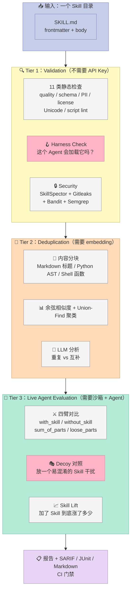
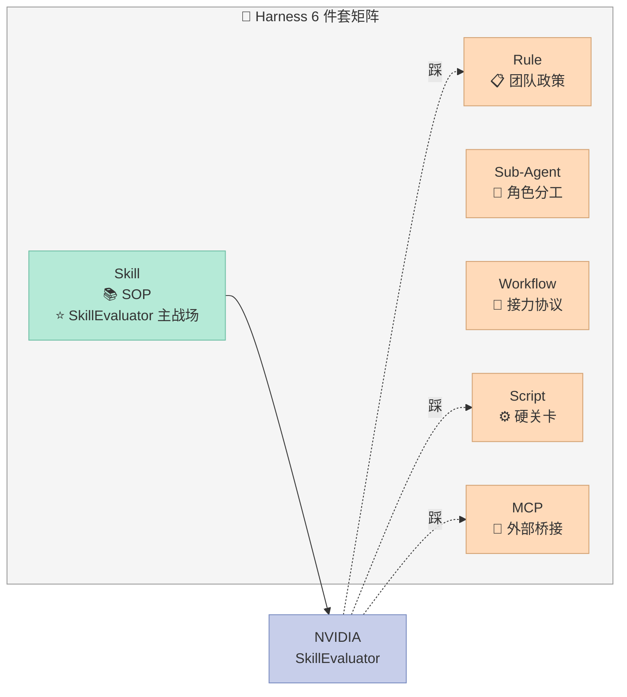
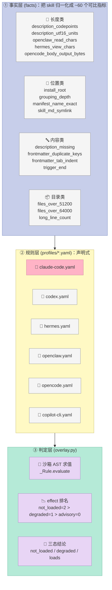
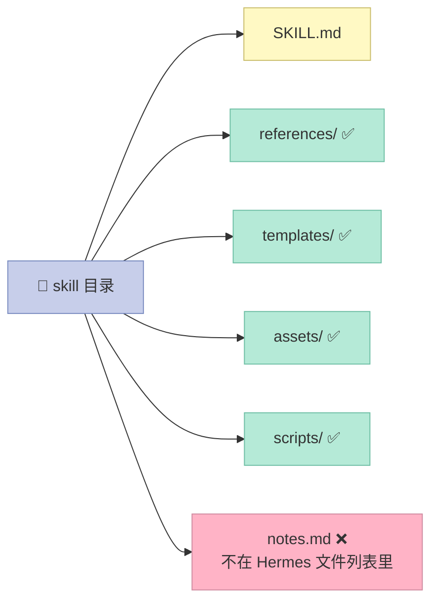

## 引子：你的 Skill 写得很认真，但 Agent 从来没见过它

先做一个小实验。

你在 `.claude/skills/deploy-helper/SKILL.md` 里写了一份 200 行的部署流程，`description` 写得清清楚楚，"Use when deploying the service to staging or production"。CI 绿灯，扫描器没报任何问题，PR 顺利合并。

然后你打开 Claude Code，问它"帮我部署到 staging"。

它没有调用你的 Skill。它自己重新写了一套 `docker compose` 命令——因为它**根本没看到你的 Skill**。

这不是假设。这是 Skill 生态里最普遍、也最尴尬的一类失败：**Skill 存在于磁盘上，但不存在于模型的上下文里**。你写了 200 行 SOP，交付物是零。

更麻烦的是，你**没有任何办法知道**它没被加载。传统 Skill 质量门禁查的是什么？frontmatter 字段齐不齐、description 有没有写、schema 能不能过。这些都是**静态扫描**——它们能证明你的文件"长得像"一个合法 Skill，但证明不了 Agent 会读它。

NVIDIA 在 2026 年 6 月开源的 **SkillEvaluator**（[NVIDIA/SkillEvaluator](https://github.com/NVIDIA/SkillEvaluator)，4,329⭐，Apache-2.0，arXiv 2608.20614）就是冲着这个缺口去的。它的产品名是 **ACES**（Agentic Continuous Evaluation of Skills），一句话概括其设计哲学：

> **不要扫描 Skill，要运行它。**

这篇文章拆它的三层设计，并复刻其中最有意思的一层——**Harness Check 规则引擎**——让你能自己搭一个。

---

## 一、项目定位：Skill 交付链路上缺失的那一环

### 1.1 它到底在解决什么

Skill 生态已经有三类工具，各自解决一段问题：

| 类别 | 代表 | 回答的问题 | 覆盖不到的地方 |
|------|------|-----------|--------------|
| **供应链扫描器** | [NVIDIA/SkillSpector](https://github.com/NVIDIA/SkillSpector)（22.7k⭐，2026-10-28 已覆盖 x1） | 这个 Skill 有没有恶意？ | 干净的 Skill 也可能根本不被加载 |
| **静态质量门禁** | frontmatter lint / schema / PII / license | 这个 Skill 写得规范吗？ | 规范 ≠ 被加载 |
| **SkillEvaluator** | NVIDIA SkillEvaluator | 这个 Skill **会被加载吗**？**加载后真的有用吗**？ | — |

第三行是本文主角，也是本博客矩阵里至今空白的角度。

论文摘要里有一句话把这条断层说得非常直白：

> *Current gates often scan these artifacts for structure, style, and security, but they do not answer the deployment question: does the capability package help a live agent complete enterprise tasks under the same model, sandbox, and grading policy?*

论文在 **145 个真实 Skill**（企业内部仓库 + 公开目录）上实测了扫描型门禁与 LLM-judge 打分之间的相关性：

> *scan-only gates surface useful authoring issues but measure complementary facets (structural versus LLM-judge Spearman **ρ = 0.14**)*

**ρ = 0.14**。几乎不相关。这不是"扫描器做得不好"，而是**结构合规和实际效果是两个正交维度**——你的 frontmatter 完美无缺，模型该不加载还是不加载。

### 1.2 三道关卡

SkillEvaluator 的核心结构是三个**互相独立**的 Tier，每个 Tier 回答一个不同的问题：



关键设计：**每个 Tier 可以单独跑**。只跑 Tier 1 是零成本、零依赖的纯静态检查（不需要 API Key、不需要 Docker）；跑满三 Tier 才需要 embedding provider、Agent 运行时和沙箱。

这个分层很重要——因为 80% 的团队只想知道"我的 Skill 会不会被加载"，而这个问题**完全不需要 LLM**。

### 1.3 Harness 6 件套落点

在 Harness Engineering 的 6 件套矩阵里，SkillEvaluator 的位置是明确的：



- **主战场 = Skill 组件**：它评测的就是 SKILL.md 这个交付物本身。
- **踩 Script**：11 条 CI 检查、500+ 静态规则、`skillevaluator ci init` 一键生成门禁。
- **踩 Rule**：Harness Check 的判定结果最终会以 `Finding` 形式落进 Tier 1 的规则集。
- **踩 MCP**：插件（plugin）的 MCP server 分发是否成功，是插件兼容性检查的一部分。

---

## 二、Harness Check：把"Agent 会不会加载它"变成可计算问题

这是整个项目里最值得单独拆的一层。它回答的是一个**别的工具都没回答**的问题：

> 我这个 Skill，在 Claude Code / Codex / Hermes / OpenClaw / OpenCode / Copilot CLI 里，各自会被加载、降级、还是直接丢弃？

### 2.1 为什么这件事能变成可计算问题

因为**各个 harness 的加载行为是确定的**。不是模型随机的行为，是 harness 自己的代码逻辑：

- Claude Code 只扫 `.claude/skills` 和 `~/.claude/skills`，**不扫** `.agents/skills`。
- Codex 的扫描深度是 6 层，超过就找不到。
- Hermes 的技能列表只显示 description 的**前 ~60 个字符**。
- OpenClaw 把 CJK 字符按 **4 倍或更多**计数，64,000 字符的读取上限对中文 SKILL.md 意味着大约 3,700 个汉字。
- Codex 要求 `SKILL.md` 文件名**大小写完全精确**，`skill.md` 在 Linux 和 macOS 上都是"永不加载"（3/3 each）。
- Copilot CLI 的 description 限制是 **1024 个 UTF-16 code unit**——不是字符数。emoji 和 CJK 字符在 UTF-16 里算 2 个 unit。

这些规则**散落在各家 harness 的源码里**，没人把它们写下来，也没人告诉你"你踩了哪条"。

SkillEvaluator 的做法是：**用 canary 探针实测每个 harness 的行为，把结果固化成版本化的 YAML profile**。

每个 profile 头部都有这样一行"元数据"：

```yaml
harness: claude-code
display_name: Claude Code
verified: {version: 2.1.316, source: closed (bundled JS inspected), date: 2026-11-01,
           method: proxy-captured canary probes x3, os: linux}
```

`method: proxy-captured canary probes x3` 的意思是：**这个 profile 的每一条规则，都是通过抓代理流量 + 3 次 canary 探针实测出来的**，不是猜的。`date: 2026-11-01` 记录了验证日期——超过这个日期，harness 行为可能变。

Hermes 的 profile 更狠，直接钉到 commit：

```yaml
verified: {version: "main @ c419cf7c864a (binary reports 2026.9.24)",
           source: "NousResearch/hermes-agent c419cf7c864ac0ee511dbd9f7091a8bba0b567ee",
           date: 2026-11-01, method: proxy-captured canary probes x3 + source, os: linux}
notes:
  - "Pin the commit: the displayed version string did not match the installed code."
```

最后那条 note 是个工程细节：**Hermes 二进制自报的版本号和实际装的代码对不上**，所以 profile 钉的是 commit hash。

### 2.2 三层结构：事实 → 规则 → 判定



#### 事实层：每个 harness 的度量口径都不一样

这是整个设计里最精彩的细节。**"description 有多长"这个问题，六个 harness 有六种算法**：

| Harness | 度量口径 | 阈值 | 后果 |
|---------|----------|------|------|
| Claude Code | `description` + ` - ` + `when_to_use` 拼接后的**码点**数 | 1,536 | 列表里被截断 |
| Codex | description **码点**数 | 1,024 | 截断成 1,021 字符 + `...` |
| Copilot CLI | description **UTF-16 code unit** 数 | 1,024 | 差 4 个 unit 就整个 Skill 掉出去 |
| Hermes | 技能列表展示的前 **~60 字符** | 60 | "Use when..." 触发词被切掉 |
| Hermes | `skill_view` 返回的 JSON 总长度 | 100,000 | 模型只拿到 1,500 字符预览 |
| OpenClaw | **CJK 加权**后的读取长度 | 16,000 / 32,000 / 64,000 | 读取被拒绝或只给前缀 |
| OpenCode | 剥掉 frontmatter + 包 `<skill_content>` 后的**字节**数 | 51,200 / 2,000 行 | 模型要翻 spill 文件 |

**UTF-16 vs 码点**这个差别能直接咬人。一个 description 里放 5 个 emoji，码点数不变，但 UTF-16 unit 数 +5 —— 在 Copilot CLI 的 1024 限制下，这就是"差 4 个 unit 被整个丢弃"。

**OpenClaw 的 CJK 加权**更狠。源码里直接复刻了它的字符成本表：

```python
# OpenClaw 2026.10.9 cjk-chars.ts: CJK code points cost 4-16 chars, every other UTF-16 unit 1.
_OPENCLAW_CJK = (
    (3, ((0xB7, 0xB7), (0x3000, 0x319F), (0x4E00, 0x9FA5), (0xAC00, 0xD7AF), (0xFF01, 0xFF60))),
    (11, ((0x1100, 0x11FF), (0x2E80, 0x2FFF), (0x31A0, 0x4DFF), (0x9FA6, 0x9FFF),
          (0xA000, 0xA4FF), (0xA700, 0xA707), (0xA960, 0xA97F), (0xD7B0, 0xD7FF),
          (0xF900, 0xFAFF))),
    (7, ((0x2C7, 0x2C7), (0x2C9, 0x2CB), (0x2D9, 0x2D9), (0x2EA, 0x2EB),
         (0x305, 0x305), (0x323, 0x323), (0xFE10, 0xFE4F), (0xFF61, 0xFFDC),
         (0xFFE0, 0xFFE6))),
    (10, ((0x1D360, 0x1D371),)),
    (14, ((0x16FE0, 0x16FFF), (0x1AFF0, 0x1AFFF), (0x1B000, 0x1B16F), (0x1F200, 0x1F2FF),
          (0x20000, 0x2FA1F), (0x30000, 0x3347F))),
)
# Room OpenClaw keeps for its truncation notice; the skills_read path adds a JSON wrapper and cuts ~1% sooner.
_OPENCLAW_READ_OVERHEAD = 73


def _openclaw_read_chars(text: str) -> int:
    """SKILL.md size as OpenClaw's tool-result cap measures it."""
    extra = 0
    for ch in text:
        cp = ord(ch)
        if cp >= 0x80:
            extra += next((w for w, rs in _OPENCLAW_CJK if any(a <= cp <= b for a, b in rs)), 0)
    return _OPENCLAW_READ_OVERHEAD + len(text.encode("utf-16-le", "surrogatepass")) // 2 + extra
```

对中文作者的实际影响：一条 5,000 字的 SKILL.md，在 OpenClaw 眼里是 `5000 × 4 + 73 ≈ 20,073` 字符——**已经超过 16,000 的读取上限**。profile 里的 fix 建议因此是：

> *"Keep SKILL.md under about 15,000 characters (about 3,700 CJK characters) to load at every context size; move detail into references/ files."*

翻译过来就是：**中文 Skill 的正文上限大约是英文的三分之一**。这个结论，扫一万遍静态规则也扫不出来。

还有一类事实特别值得注意——**目录级事实**。Harness Check 不只看 SKILL.md，还看 skill 目录里带了什么：

```python
def _bundle_facts(skill_path: Path, manifest: Path) -> dict[str, Any]:
    base = skill_path.resolve()
    links, escapes, sizes, long_lines, unlisted = [], [], [], [], []
    for path in _bundle_files(skill_path, manifest):
        rel = path.relative_to(skill_path).as_posix()
        if path.is_symlink():
            links.append(rel)
            target = Path(os.path.realpath(path))  # unlike Path.resolve(), no error on a symlink loop
            if target == base or base in target.parents:
                continue  # counted under its own path
            escapes.append(rel)  # OpenCode follows it, so what it points to is read (and cut) like any file
        elif rel.split("/", 1)[0] not in _HERMES_LINKED_DIRS:
            unlisted.append(rel)
        ...
    return {
        "resource_symlinks": len(links),
        "resource_symlink_escapes": len(escapes),
        "files_over_51200": len(paged),
        "files_over_64000": len(multi_read),
        "long_line_count": len(long_lines),
        "hermes_unlisted_files": len(unlisted),
        ...
    }
```

三个要点：

1. **`os.path.realpath` 而不是 `Path.resolve()`** —— 因为 `resolve()` 在符号链接成环时会抛异常，`realpath` 不会。注释写得很清楚。这是个真实的坑。
2. **只有常规文件会被打开** —— 命名管道（named pipe）如果打开时没有写端，会**永久阻塞**。`_read_text` 先检查 `stat.S_ISREG`。
3. **Hermes 只把 `references/`、`templates/`、`assets/`、`scripts/` 四个目录算进 skill 的文件列表** —— 你在 skill 根目录放一个 `notes.md`，模型根本看不到，除非 SKILL.md 里点名它的路径。



#### 规则层：YAML 声明式 + 受限表达式

每条规则长这样（来自真实的 `codex.yaml`）：

```yaml
rules:
  - {id: CX-DESC-CUT, when: "description_codepoints > 1024", effect: degraded,
     outcome: listing shortened,
     message: "Description cut to 1,021 chars + '...' in the skill list ({description_codepoints} chars, {description_over} over 1,024).",
     fix: "Cut the description by at least {description_over} characters.",
     versions: "0.142+; 0.141 and older reject the skill (not loaded)", confidence: high}

  - {id: CX-STRICT-YAML, when: "frontmatter_tab_indent or frontmatter_duplicate_keys",
     effect: not_loaded,
     message: "Skill dropped: invalid YAML (tabs or duplicate keys).",
     fix: "Use spaces, not tabs, and remove duplicate keys.", confidence: high}

  - {id: CX-CASING, when: "not manifest_name_exact", effect: not_loaded,
     message: "Non-canonical name (skill.md/Skill.md): never loaded, on Linux or macOS (3/3 each).",
     fix: "Rename the file to SKILL.md (exact casing).", confidence: high}
```

四个设计细节值得单独说：

- **`effect` 是三档**：`not_loaded`（根本没加载）/ `degraded`（加载了但内容被截断、占位符没替换）/ `advisory`（建议，但不影响加载）。
- **`confidence: high`** —— 每条规则标注了自己的证据强度。
- **`versions`** —— 规则可能只在某些版本成立，比如 `CX-DESC-CUT` 的 `versions: "0.142+; 0.141 and older reject the skill (not loaded)"`。在旧版本上，同样的 description 长度会从"截断"升级为"整个 Skill 被拒"。
- **`{fact}` 占位符** —— 消息模板里的数字由事实层填充。`_fill()` 还会给整数加千分位。

**`when` 字段是表达式，不是代码**——但它必须能被安全求值。这是本项目工程上最值得学的一处设计。

#### 判定层：沙箱 AST 求值 + effect 排名

规则来自**打包进产品发行版的 YAML**，所以它们是"数据"而不是"代码"。如果直接 `eval()`，一个被污染或恶意构造的 profile 就能执行任意代码。SkillEvaluator 的做法是**白名单 AST 节点 + 自研求值器**：

```python
class _Rule:
    """规则表达式求值器：只允许比较/布尔运算，禁止函数调用。"""

    _ALLOWED = (
        ast.Expression, ast.BoolOp, ast.And, ast.Or, ast.UnaryOp, ast.Not,
        ast.Compare, ast.Name, ast.Load, ast.Constant, ast.Attribute,
        ast.List, ast.Tuple, ast.Eq, ast.NotEq, ast.Gt, ast.GtE, ast.Lt, ast.LtE,
        ast.In, ast.NotIn, ast.Is, ast.IsNot,
    )

    @classmethod
    def evaluate(cls, expression: str, names: dict[str, Any]) -> bool:
        tree = ast.parse(expression, mode="eval")
        for node in ast.walk(tree):
            if not isinstance(node, cls._ALLOWED):
                raise ValueError(f"Unsupported rule expression: {expression}")
        return bool(cls._eval(tree.body, names))

    @classmethod
    def _eval(cls, node: ast.AST, names: dict[str, Any]) -> Any:
        if isinstance(node, ast.Constant):
            return node.value
        if isinstance(node, ast.Name):
            return names[node.id]
        if isinstance(node, ast.Attribute):
            return (cls._eval(node.value, names) or {}).get(node.attr, [])
        if isinstance(node, (ast.List, ast.Tuple)):
            return [cls._eval(e, names) for e in node.elts]
        if isinstance(node, ast.UnaryOp):
            return not cls._eval(node.operand, names)
        if isinstance(node, ast.BoolOp):
            values = (cls._eval(v, names) for v in node.values)
            return all(values) if isinstance(node.op, ast.And) else any(values)
        if isinstance(node, ast.Compare):
            left = cls._eval(node.left, names)
            for op, comparator in zip(node.ops, node.comparators, strict=True):
                right = cls._eval(comparator, names)
                if left is None and not isinstance(op, (ast.Is, ast.IsNot, ast.Eq, ast.NotEq)):
                    return False
                ok = {
                    ast.Eq: lambda a, b: a == b,
                    ast.NotEq: lambda a, b: a != b,
                    ast.Gt: lambda a, b: a > b,
                    ast.GtE: lambda a, b: a >= b,
                    ast.Lt: lambda a, b: a < b,
                    ast.LtE: lambda a, b: a <= b,
                    ast.In: lambda a, b: a in b,
                    ast.NotIn: lambda a, b: a not in b,
                    ast.Is: lambda a, b: a is b,
                    ast.IsNot: lambda a, b: a is not b,
                }[type(op)](left, right)
                if not ok:
                    return False
                left = right
            return True
        raise ValueError("Unsupported rule expression")
```

注意 `_ALLOWED` 列表里**没有** `ast.Call`——所以 `open(...)`、`__import__(...)`、`os.system(...)` 全部在解析后就被拒。而且 `ast.Attribute` 只用来做字典取值（`(expr).get(attr)`），不解析成属性访问链。

判定层还有两个细节：

**① 取最严的 effect。** 一个 Skill 可以同时触发 5 条规则，最终状态取最严的那个：

```python
_EFFECT_RANK = {"advisory": 0, "degraded": 1, "not_loaded": 2}
# ...
worst = max(worst, _EFFECT_RANK[rule["effect"]])
status = "not_loaded" if worst == 2 else "degraded" if worst == 1 else "loads"
```

**② Harness Check 是 advisory 的，永远不改 Tier 1 的结论。** 源码注释写得很清楚：

```python
# Below the default gate (HIGH), so the check never fails a run unless a policy raises it.
_SEVERITY = {"not_loaded": Severity.MEDIUM, "degraded": Severity.LOW, "advisory": Severity.INFO}
```

`not_loaded` 的严重级是 **MEDIUM**，低于默认门禁的 **HIGH**。也就是说：**Harness Check 不会让你的 CI 变红**，除非你显式调高策略。这是刻意的——profile 是某个版本的行为快照，harness 一升级就可能过期，不该硬阻断别人的流水线。

**③ 版本漂移检测。** 你跑的 harness 版本和 profile 验证版本不一致时，加一条 advisory：

```python
def version_finding(profile: dict[str, Any], declared: str) -> dict[str, str] | None:
    """Advisory for a harness release other than the one the profile was verified on."""
    checked = str(profile.get("verified", {}).get("version", ""))
    if not declared or declared == checked or checked.startswith(f"{declared} "):
        return None
    return {
        "id": "VERSION-UNVERIFIED",
        "effect": "advisory",
        "message": f"Profile verified on {checked}; you run {declared}, so its rules may not hold.",
        "fix": "Check the findings on that release, or run the version the profile was verified on.",
    }
```

### 2.3 实际输出长什么样

`skillevaluator harness-check ./my-skill` 的输出（README 里的真实示例）：

```text
╭─ Harness compatibility · my-skill ──────────────────────────────────────────────────────╮
│  ⚠️ codex        degraded    Description cut to 1,021 chars + '...' in the skill list   │
│  ❌ claude-code  not loaded  .agents/skills is not scanned                              │
│  ✅ opencode     loads                                                                  │
│  ✅ hermes       loads                                                                  │
│  ✅ openclaw     loads                                                                  │
│  ❌ copilot-cli  not loaded  description is 1,028 UTF-16 units, 4 over the 1,024 limit  │
╰─────────────────────────────────────────────────────────────────────────────────────────╯
  ❌ 2 of 6 not loaded ─╯
```

最后一行 `2 of 6 not loaded` 就是最直接的答案：**你的 Skill 在 6 个主流 harness 里有 2 个根本加载不了**。

`copilot-cli` 那行是全文最惊悚的一句：`description is 1,028 UTF-16 units, 4 over the 1,024 limit`。**4 个字符**，整个 Skill 从 Copilot CLI 的世界里消失。

### 2.4 插件兼容性：同一套机制的第二个战场

Harness Check 不只管单个 Skill，还管**插件包**（plugin）。每个 profile 里有一段 `plugin:` 规则：

```yaml
plugin:
  rules:
    - {id: CP-PLUGIN-FORMAT,
       when: "not (fmt_claude or fmt_agent_v1 or fmt_copilot or fmt_root_json)",
       effect: not_loaded, outcome: rejected,
       message: "Copilot CLI installs .claude-plugin, .github/plugin, .plugin and plugin.json bundles; Codex- and Cursor-only bundles are refused.",
       fix: "Add .claude-plugin/plugin.json (Copilot reads it).", confidence: high}
  components: {skills: delivered, commands: listed, agents: delivered,
               hooks: runs, mcp: delivered, lsp: not_observed}
```

`components` 那行是 canary 探针的产物——**每个组件类型在固定版本 harness 里的实际结局**。对照看几个 harness：

| 组件 | Codex | Copilot CLI | OpenClaw | Hermes | OpenCode |
|------|-------|-------------|----------|--------|----------|
| skills | listed | delivered | listed | listed | — |
| commands | not_observed | listed | not_observed | not_observed | — |
| agents | not_observed | delivered | not_observed | not_observed | — |
| hooks | trust_gated | runs | not_observed | not_observed | — |
| mcp | delivered | delivered | deferred | not_observed | — |
| lsp | not_observed | not_observed | runs | not_observed | — |

`not_observed` 的含义是"实测没看到效果"，`deferred` 是"注册了但工具 schema 要模型主动搜才到"，`trust_gated` 是"要用户先信任插件内容才跑"。

这些结论直接来自 `plugin.py` 的映射表：

```python
# What a component outcome means for the plugin's status. Outcomes come from canary probes.
OUTCOME_EFFECT = {
    "delivered": None,
    "listed": None,
    "runs": None,
    "deferred": "advisory",
    "trust_gated": "advisory",
    "registered": "degraded",
    "not_observed": "degraded",
}
OUTCOME_TEXT = {
    "trust_gated": "{n} {kind}: run only after the user trusts the plugin's current content (or with a per-run trust bypass).",
    "deferred": "{n} {kind}: registered; tool schemas reach the model only when it searches for or asks to use them.",
    "registered": "{n} {kind}: started or registered, but nothing reached the model when tested.",
    "not_observed": "{n} {kind}: not registered or delivered when tested.",
}
```

注意 `deferred`（MCP 工具延迟加载）被归为 **advisory**，而 `not_observed`（Hermes 完全不加载 MCP server）被归为 **degraded**——这是两种完全不同的故障。

---

## 三、Tier 2 与 Tier 3：从"能加载"到"真的有用"

Harness Check 解决了"加载"问题，但加载不等于有用。SkillEvaluator 的 Tier 2 和 Tier 3 处理剩下的部分。

### 3.1 Tier 2：语义去重

Tier 2 回答"你的 Skill 和已有的 Skill 是不是在重复说同一件事"。

**分块策略是三种语言三套：**

```python
def chunk_file(collected: CollectedFile, min_chars: int = CONTENT_DEDUP_MIN_CHUNK_CHARS) -> list[ContentChunk]:
    """Route to the appropriate chunker based on file extension."""
    ext = collected.extension
    if ext in {".md", ".mdc"}:
        chunks = chunk_markdown(collected, min_chars)
    elif ext == ".py":
        chunks = chunk_python(collected, min_chars)
    elif ext == ".sh":
        chunks = chunk_shell(collected, min_chars)
    else:
        return []
    return [piece for chunk in chunks for piece in _bounded_pieces(chunk)]
```

- **Markdown**：按标题层级切分，用 `MarkdownIt` 识别围栏代码块——**代码块里的 `#` 不是标题**。
- **Python**：`ast.parse` 抽 docstring + 函数/类签名。这比按行切精确得多。
- **Shell**：正则找函数体 + 注释块（连续 3 行以上才算注释块）。

**聚类用余弦相似度 + Union-Find：**

```python
def build_clusters(chunks: list[ContentChunk],
                   threshold: float = CONTENT_DEDUP_SIMILARITY_THRESHOLD) -> list[ContentCluster]:
    """Cluster chunks by pairwise cosine similarity using Union-Find."""
    n = len(chunks)
    if n < 2:
        return []

    if n > CONTENT_DEDUP_MAX_CHUNKS:
        raise ValueError("Content chunk count exceeds the configured limit")
    dimension = len(chunks[0].embedding)
    if n * (n - 1) // 2 * dimension > CONTENT_DEDUP_MAX_SCALAR_COMPARISONS:
        raise ValueError("Content scalar comparison work exceeds the configured limit")
    units = [normalize_embedding_vector(chunk.embedding, dimension, allow_zero=True) for chunk in chunks]

    def siblings(i: int, j: int) -> bool:
        group = chunks[i].split_group
        return group is not None and group == chunks[j].split_group

    uf = UnionFind(n)
    # Row i contains the upper-triangle scores (i, i + 1), ..., (i, n - 1).
    # Packed doubles avoid a tuple key and boxed float for every pair.
    pair_scores = [array("d") for _ in range(n - 1)]

    for i, j in combinations(range(n), 2):
        score = unit_vector_similarity(units[i], units[j])
        pair_scores[i].append(score)
        if score >= threshold and not siblings(i, j):
            uf.union(i, j)
    ...
```

三个工程细节：

1. **`siblings()` 排除同一源 chunk 的碎片**。超长章节被 `_bounded_pieces` 切开后，同一个来源的碎片之间相似度必然接近 1，如果不管，会自己和自己聚成一团。
2. **双预算防护**：`MAX_CHUNKS=1024` 和 `MAX_SCALAR_COMPARISONS = 1024×1023/2 × 1024`。前者防 chunk 数爆炸，后者防**维度乘进来**后的标量比较量爆炸——1024 维 embedding × 52 万对 = 5.4 亿次乘加。
3. **`array("d")` 而非 `list[float]`**——省掉每个 pair 的 tuple key 和装箱 float。

阈值来自 `constants.py`：

```python
SIMILARITY_DEFAULT_THRESHOLD = 0.75       # Skill 之间的相似度
CONTENT_DEDUP_SIMILARITY_THRESHOLD = 0.80 # Skill 内部内容块的相似度
CONTENT_DEDUP_MIN_CHUNK_CHARS = 80
CONTENT_DEDUP_MAX_CHUNK_CHARS = 3000
CONTENT_DEDUP_MAX_CHUNKS = 1024
```

**Skill 之间的门槛（0.75）比 Skill 内部（0.80）更低**——因为两个 Skill 描述同一件事的意义，比一个 Skill 内部两段话重复的意义更严重。

### 3.2 Tier 3：Skill Lift——用配对实跑测"到底涨了多少"

这是整个项目最有分量的部分，也是 arXiv 论文的主体。

#### 三个"陷阱 Skill"机制

一个直接的问题：**你怎么证明"Agent 做对了"是因为你的 Skill，而不是因为它本来就会？**

SkillEvaluator 的答案是 **decoy**——故意放一个**看起来很像但内容错误**的 Skill 进去，看模型会不会被干扰。

```python
DECOY_MANIFEST_VERSION = 1
DECOY_SELECTION_STRATEGY = "description-similarity"
MAX_DECOYS = MAX_SIMILARITY_MATCHES
```

选 decoy 的策略是"description 相似度最高"，但注释里划了一条非常重要的界限：

> *Description similarity is a selection policy, not evidence that a skill is a prerequisite or that two skills are confusing to an agent. The manifest records the policy and source identities so evaluation never repeats retrieval.*

**相似度只是选谁当陪跑的策略，不是证据。** 选完之后，每个 decoy 都要冻结身份：

```python
def _source_digest(path: Path) -> str:
    digest = decoy_source_digest(path)
    if digest is None:
        raise ValueError(f"Selected decoy has an unsafe or unstable source tree: {path}")
    return digest
```

decoy manifest 记录了：catalog 的 sha256、provider、model、mode、endpoint_fingerprint、target 的 manifest sha256、每个 selected 的 source_digest。**任何一环变了，整个 manifest 作废**：

```python
def _validate_manifest(manifest: object, target: Path) -> tuple[list[Path], dict[str, Any]]:
    ...
    if data["strategy"] != DECOY_SELECTION_STRATEGY:
        raise ValueError("Unsupported decoy selection strategy")
    ...
    if target_data != {
        "name": target.name,
        "skill_name": entry.name,
        "manifest_sha256": _sha256(entry.full_text),
    }:
        raise ValueError("Decoy manifest target changed; regenerate the selection")
```

而且选 decoy 的时候有一串排除条件：**目标本身的副本、同名 Skill、内容别名（`_aliases_target`）、包含目标载荷的目录、重复的 source digest**——全都排掉。

#### 四个实验臂

```python
# Private arm identifiers shared by runtime evidence and comparisons.
ARM_WITH = "with_skill"
ARM_WITHOUT = "without_skill"
ARM_SUM_OF_PARTS = "sum_of_parts"
ARM_LOOSE_PARTS = "loose_parts"
```

- `with_skill`：装上目标 Skill。
- `without_skill`：不装（基线）。
- `sum_of_parts`：把插件拆成散件分别装。
- `loose_parts`：把插件的 skills / rules / MCP servers / subagents / commands / hooks 拆开、放到 Claude Code 能独立加载的位置，**没有插件外壳**。

`loose_parts` 的意义是**测出"胶水"的价值**：

> *The Integration lift (glue) is **full plugin minus loose parts**.*

也就是说：**装插件比装散件多出来的那部分收益，就是插件机制本身的贡献**。这个量测出来，才能回答"我到底该用插件形式还是散件形式"。

loose_parts 的实现非常严谨——每个散件都**按各自的方式重新摆放**，然后用内容哈希证明两臂携带的是同一份能力：

> *Content hashes prove the two arms carry the same capability: every piece is hashed as each arm stages it (staged into a private directory by the same code the runner uses), after a documented normalization.*

而加载与否，**只认 Claude Code 自己的 `system/init` 报告**：

> *Load is verified only by Claude Code's own `system/init` report, with one documented workaround: a successful call of an MCP server's tool proves a server that init reported as `pending` (or not at all).*

这个 workaround 也很务实：`system/init` 报告 MCP server 为 `pending`，但如果后续真的调用成功了，那它显然加载了。

#### 实测数字

论文在 **947 组配对实跑**（58 个生产 Skill、4 个主要 harness）上的结果：

| 指标 | 数值 |
|------|------|
| 平均复合 Skill Lift | **0.2134**（95% 配对用例 CI [0.1967, 0.2301]）|
| 平均纯结果提升（accuracy + goal accuracy 的均值）| **0.1799** |
| 复合提升为正的配对用例占比 | **72.8%** |

**约 27% 的配对用例里，加了 Skill 反而没提升。** 这是本文最该被记住的数字——**Skill 不是免费的，写得不好会变成上下文噪音**。

论文还指出提升最大的三个过程指标：**skill execution（Skill 执行）、behavior check（行为检查）、skill efficiency（Skill 效率）**——这些是关于**发现、路由、流程遵循、工具使用**的信号，正是文档扫描完全观察不到的东西。

#### 判定阈值

```python
TIER3_LIFT_PASS_THRESHOLD = 0.05      # 提升超过 5% 才算通过
TIER3_LIFT_FAIL_THRESHOLD = -0.10     # 跌超 10% 算失败
DIMENSION_VERDICT_PASS_THRESHOLD = 0.5
```

`+5% / -10%` 的不对称窗口是有意的——**允许噪声，但不容忍倒退**。

还有一层"必需检查"优先于总分：

```python
def attempt_verdict(overall_score, pass_threshold, goal_accuracy=None, *, reward=None, ...):
    """Apply required checks before the existing Overall threshold."""
    ...
    if goal_accuracy is not None:
        correct_answer = goal_accuracy >= goal_accuracy_pass_threshold
        if not correct_answer:
            return AttemptVerdict(passed=False, reason=f"goal not met (goal accuracy {goal_accuracy:.2f})", ...)
    if security_clean is False and security_score is not None and not unsupported_security:
        return AttemptVerdict(passed=False, reason=reason, ...)
    passed = overall_score is not None and overall_score >= pass_threshold
```

**答案错了就是不对，分再高也没用。** 这个顺序不能反。

### 3.3 成本与"扫不全"要诚实说出来

SkillEvaluator 有几个地方明确区分"跑了"和"跑全了"：

- **退出码三分**：`0` = 扫完且安全；`1` = 扫完但有问题；`2` = **没扫完**（错误）。"没扫完"和"扫完有问题"是两回事。
- **`INCOMPLETE` 状态**：README 明说 *"This is static quality only; publication evidence stays `INCOMPLETE`."* 只跑 Tier 1 的质量检查，发布证据就是 INCOMPLETE。
- **扫描器缺失不静默**：`--no-llm` 不豁免扫描器要求，*"a scanner that cannot run is `INCOMPLETE` and exits nonzero."*
- **默认门禁过宽**：README 承认 *"the exit code collapses SAFE and CAUTION into 0"* → CI 里至少要加 `--fail-on-incomplete`。

这套"**分清测了什么、没测什么**"的做法，比很多工具的"全绿即通过"诚实得多。

---

## 四、横向对比：三条路线在测什么

### 4.1 与 SkillSpector 的对比（同一个厂牌的两种哲学）

| 维度 | SkillSpector（2026-10-28 已覆盖 x1）| SkillEvaluator（本文）|
|------|------------------------------|------------------------|
| 核心问题 | 这个 Skill **有没有恶意**？ | 这个 Skill **会不会被加载 / 有没有用**？|
| 关键机制 | Inspection Ledger + fail-closed 门禁 | 版本化 harness profile + canary 探针 + 配对实跑 |
| 触发时机 | **装之前** | **装之后 / 跑起来** |
| 是否需要 LLM | 大部分不需要 | Tier 1 不需要，Tier 2/3 需要 |
| 最强项 | "我漏了什么"——账本完整性 | "它到底有没有生效"——真实配对数据 |

两者是**互补**的，不是重复的：装了 92 个第三方 Skill 的仓库正是 SkillSpector 的完美扫描对象，而 SkillEvaluator 告诉你扫描通过之后它们到底跑不跑得起来。

### 4.2 与 promptfoo / Giskard 的对比

| 维度 | promptfoo（27.5k⭐）| Giskard（6.0k⭐）| SkillEvaluator Tier 3 |
|------|-------------------|------------------|----------------------|
| 被测对象 | prompt / agent / RAG | LLM Agent | **Skill 这个交付物** |
| 方法 | 断言 + LLM 断言 | 扰动测试 + 扫描 | **配对实跑 + 多臂对比 + decoy** |
| 是否需要真实 Agent | 可选 | 可选 | **是**（Harbor 沙箱 + 真实 harness）|
| 产出 | 断言通过率 | 脆弱性分数 | **Skill Lift + 过程指标** |

promptfoo 和 Giskard 都在"测 agent"，SkillEvaluator 在"**测 Skill 这个资产本身对 agent 的影响**"。这是不同的观测对象——你可以想象一个团队同时用三者：promptfoo 测自己的 prompt，Giskard 测自己的 agent 抗不抗扰，SkillEvaluator 测"这个 Skill 到底值不值得装"。

### 4.3 与传统 Skill 静态扫描器的对比

最大的哲学差异：**SkillEvaluator 把"harness 的具体实现细节"当成一等公民数据**。

传统扫描器假设存在一个"标准 Skill 规范"，检查你是否符合。SkillEvaluator 的假设是：**根本没有统一标准，每个 harness 都是一个独立实现，各有各的怪癖**。

于是它的数据结构不是"一份规范 + 一堆 checker"，而是"**每个 harness 一份版本化的行为快照**"。这带来两个直接后果：

1. **能回答"兼容谁"这个问题**——不是"我合规吗"，而是"我在这 6 个 harness 里分别什么结局"。
2. **能自然地处理"规范与实现不一致"**——比如 Codex 的 description 限制，`versions` 字段直接记录了 0.142 前后的行为差异。

后者是传统扫描器根本没法表达的。

---

## 五、优缺点：架构简洁性 / 扩展性 / 易用性 vs 性能 / 复杂度 / 维护性

### 左侧：架构简洁性 / 扩展性 / 易用性

**架构简洁性 ★★★★★**

三层分离做得干净：事实层不知道规则，规则层不知道判定，判定层不知道 CLI。整个 Harness Check 的核心（`overlay.py`）1022 行，规则全在 YAML 里，加一条规则不用改 Python。

更妙的是**规则和数据同构**——`when` 表达式引用的事实名和事实层产出的键**完全一致**。这就是为什么能把 profile 做成 YAML 而不是硬编码。

**扩展性 ★★★★☆**

加一个新 harness = 丢一个 YAML + 跑 canary 探针。加一条新规则 = 在 YAML 里加一行。

规则引擎是**数据驱动的沙箱**——白名单 AST 求值器意味着 profile 可以被第三方分发、被用户本地覆盖、被 CI 参数化。

扣一分：`_Rule.evaluate` 只支持扁平的名字空间，不支持嵌套事实引用（比如"`skill.md` 的兄弟目录数量"）。复杂规则写不出来。

**易用性 ★★★★★**

- Tier 1 **零 API Key、零 Docker、零 GPU**，`pip install skillevaluator` 就能跑。
- `skillevaluator harness-check ./my-skill` 一条命令给全部 6 个 harness 的结论。
- `skillevaluator ci init` 自动开 PR 配好 CI 门禁，**不用写任何评估代码**。
- 提供可复制的 GitHub / GitLab 模板，以及 SARIF / JUnit / Markdown 三种报告格式。

这是"工具愿意被用"和"工具放在 README 里没人看"的分水岭。

### 右侧：性能 / 复杂度 / 维护性

**性能 ★★★★☆**

Tier 1 是纯本地文件 IO，毫秒级。Tier 2 的向量比较有双预算防护（chunk 数 + 标量比较量），`array("d")` 省内存。Tier 3 要起沙箱跑 Agent，慢是必然的，但四臂并行能压一部分。

**复杂度 ★★★★☆（对使用者）/ ★★★☆☆（对维护者）**

使用者侧复杂度低——三个 Tier 各自独立，按需选用。

维护者侧不低：**306 个 Python 源文件**，`plugin_signals.py` 一个文件就 225,352 字符（5000+ 行），负责把 6 个 harness 的 6 种工具调用格式归一化成统一的组件激活信号。`plugin_comparisons.py` 23,944 字符，`loose_parts.py` 78,593 字符。

这复杂度大部分来自**真实世界的脏**——每个 harness 的工具调用命名、结果格式、错误标记都不一样，归一化它们没有捷径。

**维护性 ★★★☆☆**

这是本项目最大的风险点：

1. **profile 会过期。** 六个 harness 都在快速迭代（Claude Code 2.1.316、Codex 0.166.0、OpenClaw 2026.10.9、OpenCode 1.19.5），profile 钉的是某一天的快照。`VERSION-UNVERIFIED` advisory 只能提醒，不能自动修复。
2. **canary 探针要人维护。** 每次 harness 升级，都得重跑探针更新 YAML。这是持续投入，不是写完就完。
3. **规则文本是硬编码的英文散文。** 每条 message 都是一句完整的话（含 fix 建议），无法本地化，无法结构化到机器可读的程度。

项目自己也承认这点——profile 全部是 `2026-11-01` 验证的，今天（2026-11-22）已经过去三周。

---

## 六、从零搭建启示：如果你要自己做一个 Harness Check

### 6.1 最小可行实现（MVP）

下面是**从 SkillEvaluator 抽离的核心机制复刻**——约 340 行，纯 Python 3 标准库，无网络无 LLM，可直接运行：

```python
#!/usr/bin/env python3
"""
从 NVIDIA/SkillEvaluator 抽离的核心机制复刻：Harness Check 规则引擎。

对应源码：
  src/skillevaluator/harness/overlay.py   (事实计算 + 规则求值 + 状态判定)
  src/skillevaluator/validators/harness.py (把规则映射成 Finding)
  src/skillevaluator/harness/profiles/*.yaml (每个 harness 一份版本化 profile)

三条核心机制：
  1) 事实层（facts）：把一个 skill 目录归一化成 ~60 个可比较的事实
     —— description 长度按 UTF-16 code unit 数、OpenClaw 按 CJK 加权、
        OpenCode 按"去掉 frontmatter 后的 body + wrapper"字节数
  2) 规则层（profiles）：YAML 声明式规则，when 是一个受限表达式
  3) 判定层（effect）：not_loaded(2) > degraded(1) > advisory(0)，取最严

不依赖网络、不依赖 LLM，纯确定性。
"""

from __future__ import annotations

import ast
import json
import re
import unicodedata
from dataclasses import dataclass, field
from pathlib import Path

# ---------------------------------------------------------------------------
# 1) 事实层：skill 目录 -> facts
# ---------------------------------------------------------------------------

# OpenClaw 2026.10.9 cjk-chars.ts: CJK code point 成本 3/7/11/14，其它 UTF-16 unit 成本 1
_OPENCLAW_CJK = (
    (3, ((0xB7, 0xB7), (0x3000, 0x319F), (0x4E00, 0x9FA5), (0xAC00, 0xD7AF), (0xFF01, 0xFF60))),
    (11, ((0x1100, 0x11FF), (0x2E80, 0x2FFF), (0x31A0, 0x4DFF), (0x9FA6, 0x9FFF),
          (0xA000, 0xA4FF), (0xA700, 0xA707), (0xA960, 0xA97F), (0xD7B0, 0xD7FF),
          (0xF900, 0xFAFF))),
    (7, ((0x2C7, 0x2C7), (0x2C9, 0x2CB), (0x2D9, 0x2D9), (0x2EA, 0x2EB),
         (0x305, 0x305), (0x323, 0x323), (0xFE10, 0xFE4F), (0xFF61, 0xFFDC),
         (0xFFE0, 0xFFE6))),
    (10, ((0x1D360, 0x1D371),)),
    (14, ((0x16FE0, 0x16FFF), (0x1AFF0, 0x1AFFF), (0x1B000, 0x1B16F), (0x1F200, 0x1F2FF),
          (0x20000, 0x2FA1F), (0x30000, 0x3347F))),
)
# OpenClaw 留给截断提示的余量；skills_read 路径多包一层 JSON，所以早 ~1% 截断
_OPENCLAW_READ_OVERHEAD = 73

FRONTMATTER_PATTERN = re.compile(
    r"^\ufeff?---[^\S\r\n]*\r?\n(.*?)\r?\n---[^\S\r\n]*(?=\r?\n|\Z)(?:\r?\n)?(.*)", re.DOTALL
)
# 触发词窗口：Hermes 的技能列表只显示前 ~60 字符，"Use when ..." 必须在里面
DESCRIPTION_TRIGGER_PATTERN = r"\b(?:use|apply)\s+(?:this\s+)?(?:skill\s+)?when\b"

_KNOWN_ROOTS = (
    ".agents/skills", ".claude/skills", ".codex/skills", ".github/skills",
    ".opencode/skills", ".opencode/skill", ".hermes/skills", ".copilot/skills",
    ".openclaw/skills", ".config/opencode/skills",
)


def _utf16_units(value: str) -> int:
    """UTF-16 code unit 数（不是字符数）——Copilot CLI 的 1024 限制按这个算。"""
    return len(value.encode("utf-16-le", "surrogatepass")) // 2


def _openclaw_read_chars(text: str) -> int:
    """OpenClaw 的工具结果预算怎么算：CJK 加权 + UTF-16 unit + 固定开销。"""
    extra = 0
    for ch in text:
        cp = ord(ch)
        if cp >= 0x80:
            extra += next((w for w, rs in _OPENCLAW_CJK if any(a <= cp <= b for a, b in rs)), 0)
    return _OPENCLAW_READ_OVERHEAD + len(text.encode("utf-16-le", "surrogatepass")) // 2 + extra


def _install_root(skill_path: Path) -> tuple[str | None, int]:
    """技能装在哪个已知扫描根下，以及根之下还套了几层分组目录。"""
    parts = skill_path.absolute().parts
    for root in sorted(_KNOWN_ROOTS, key=lambda r: -len(r.split("/"))):
        size = len(root.split("/"))
        for index in range(len(parts) - size - 1, -1, -1):
            if "/".join(parts[index: index + size]) == root:
                return root, len(parts) - (index + size) - 1
    return None, 0


def _parse_frontmatter(text: str) -> tuple[dict, str]:
    match = FRONTMATTER_PATTERN.match(text)
    if not match:
        return {}, text
    raw_yaml, body = match.groups()
    # 极简 YAML：只认顶层 key: value，够跑 demo 且不引第三方依赖
    data: dict = {}
    for line in raw_yaml.splitlines():
        if not line.strip() or line.startswith((" ", "\t", "#")):
            continue
        if ":" not in line:
            continue
        key, _, value = line.partition(":")
        value = value.strip().strip('"').strip("'")
        data[key.strip()] = value
    return data, body


def skill_facts(skill_path: Path) -> dict:
    """把一个 skill 目录归一化成事实字典。"""
    manifest = skill_path / "SKILL.md"
    raw = manifest.read_bytes() if manifest.is_file() else b""
    text = raw.decode("utf-8-sig", errors="replace")
    data, body = _parse_frontmatter(text)

    description = data.get("description", "")
    if not isinstance(description, str):
        description = ""
    root, depth = _install_root(skill_path)

    names = {p.name for p in skill_path.iterdir()} if skill_path.is_dir() else set()

    # Hermes 的 skill_view 返回 JSON（ensure_ascii=False），预算按 code point 算
    hermes_view = len(json.dumps(text, ensure_ascii=False)) + len(json.dumps(description, ensure_ascii=False)) + 400

    # OpenCode 剥掉 frontmatter 后包一层 <skill_content> 再算字节
    opencode_bytes = len(
        f'<skill_content name="{data.get("name", skill_path.name)}">\n# Skill: {data.get("name", skill_path.name)}\n\n{body.strip()}'.encode()
    )

    trigger = re.search(DESCRIPTION_TRIGGER_PATTERN, description, re.IGNORECASE)

    return {
        "skill_name": data.get("name") or skill_path.name,
        "install_root": root,
        "grouping_depth": depth,
        "manifest_name_exact": "SKILL.md" in names,
        "description_missing": "description" not in data,
        "description_empty": isinstance(description, str) and not description.strip(),
        "description_codepoints": len(description),
        "description_utf16_units": _utf16_units(description),
        "description_over": max(0, len(description) - 1024),
        # Claude Code 把 "<description> - <when_to_use>" 拼起来展示，整体按 1536 截断
        "claude_listing_codepoints": len(description) + (len(data.get("when_to_use", "")) + 3
                                                          if data.get("when_to_use") else 0),
        "trigger_end": trigger.end() if trigger else None,
        "skill_md_bytes": len(raw),
        "openclaw_read_chars": _openclaw_read_chars(text),
        "opencode_body_output_bytes": opencode_bytes,
        "opencode_body_output_lines": 3 + len(body.strip().splitlines()),
        "hermes_view_chars": hermes_view,
        "frontmatter_duplicate_keys": False,
        "frontmatter_tab_indent": False,
    }


# ---------------------------------------------------------------------------
# 2) 规则层：受限表达式求值器（沙箱 AST）
# ---------------------------------------------------------------------------

class _Rule:
    """只允许比较/布尔运算的表达式求值器。

    规则来自打包进产品的 YAML profile，所以表达式是"数据"不是"代码"——
    必须限制可用的 AST 节点，否则一个被污染的 profile 就能执行任意代码。
    """

    _ALLOWED = (
        ast.Expression, ast.BoolOp, ast.And, ast.Or, ast.UnaryOp, ast.Not,
        ast.Compare, ast.Name, ast.Load, ast.Constant, ast.Attribute,
        ast.List, ast.Tuple, ast.Eq, ast.NotEq, ast.Gt, ast.GtE, ast.Lt, ast.LtE,
        ast.In, ast.NotIn, ast.Is, ast.IsNot,
    )

    @classmethod
    def evaluate(cls, expression: str, names: dict) -> bool:
        tree = ast.parse(expression, mode="eval")
        for node in ast.walk(tree):
            if not isinstance(node, cls._ALLOWED):
                raise ValueError(f"Unsupported rule expression: {expression}")
        return bool(cls._eval(tree.body, names))

    @classmethod
    def _eval(cls, node, names):
        if isinstance(node, ast.Constant):
            return node.value
        if isinstance(node, ast.Name):
            return names[node.id]
        if isinstance(node, ast.Attribute):
            return (cls._eval(node.value, names) or {}).get(node.attr, [])
        if isinstance(node, (ast.List, ast.Tuple)):
            return [cls._eval(e, names) for e in node.elts]
        if isinstance(node, ast.UnaryOp):
            return not cls._eval(node.operand, names)
        if isinstance(node, ast.BoolOp):
            values = (cls._eval(v, names) for v in node.values)
            return all(values) if isinstance(node.op, ast.And) else any(values)
        if isinstance(node, ast.Compare):
            left = cls._eval(node.left, names)
            for op, comparator in zip(node.ops, node.comparators, strict=True):
                right = cls._eval(comparator, names)
                if left is None and not isinstance(op, (ast.Is, ast.IsNot, ast.Eq, ast.NotEq)):
                    return False
                ok = {
                    ast.Eq: lambda a, b: a == b,
                    ast.NotEq: lambda a, b: a != b,
                    ast.Gt: lambda a, b: a > b,
                    ast.GtE: lambda a, b: a >= b,
                    ast.Lt: lambda a, b: a < b,
                    ast.LtE: lambda a, b: a <= b,
                    ast.In: lambda a, b: a in b,
                    ast.NotIn: lambda a, b: a not in b,
                    ast.Is: lambda a, b: a is b,
                    ast.IsNot: lambda a, b: a is not b,
                }[type(op)](left, right)
                if not ok:
                    return False
                left = right
            return True
        raise ValueError("Unsupported rule expression")


# ---------------------------------------------------------------------------
# 3) 判定层：effect 排名 + 状态
# ---------------------------------------------------------------------------

_EFFECT_RANK = {"advisory": 0, "degraded": 1, "not_loaded": 2}


@dataclass
class HarnessResult:
    harness: str
    display_name: str
    status: str
    version: str
    findings: list = field(default_factory=list)


def _fill(text: str, facts: dict) -> str:
    """把 {fact} 占位符替换成实际值。"""
    def value(match):
        fact = facts.get(match.group(1), match.group(0))
        return f"{fact:,}" if isinstance(fact, int) and not isinstance(fact, bool) else str(fact)
    return re.sub(r"\{([a-z0-9_]+)\}", value, str(text))


def evaluate_profile(profile: dict, facts: dict) -> HarnessResult:
    """对一个 profile 求值：跑规则，取最严 effect，映射成 loads/degraded/not_loaded。"""
    findings, worst = [], -1
    for rule in profile.get("rules", []):
        expression = str(rule["when"])
        # install_root 未识别时跳过依赖根的规则（profile 说"装在哪"，我们不知道就不猜）
        if "install_root" in expression and facts.get("install_root") is None:
            continue
        try:
            fires = _Rule.evaluate(expression, facts)
        except (KeyError, SyntaxError, TypeError, ValueError):
            continue
        if not fires:
            continue
        finding = {
            "id": rule["id"],
            "effect": rule["effect"],
            "message": _fill(rule["message"], facts),
        }
        if rule.get("fix"):
            finding["fix"] = _fill(rule["fix"], facts)
        findings.append(finding)
        worst = max(worst, _EFFECT_RANK[rule["effect"]])

    status = "not_loaded" if worst == 2 else "degraded" if worst == 1 else "loads"
    return HarnessResult(
        harness=profile["harness"],
        display_name=profile.get("display_name", profile["harness"]),
        status=status,
        version=str((profile.get("verified") or {}).get("version", "")),
        findings=findings,
    )


# ---------------------------------------------------------------------------
# Profile（从 NVIDIA/SkillEvaluator 的 YAML profile 精简，保留最关键的规则）
# ---------------------------------------------------------------------------

PROFILES = [
    {
        "harness": "claude-code",
        "display_name": "Claude Code",
        "verified": {"version": "2.1.316", "date": "2026-11-01"},
        "rules": [
            {"id": "CC-ROOT", "when": "install_root not in roots",
             "effect": "not_loaded", "outcome": "not found",
             "message": "Claude Code reads only .claude/skills and ~/.claude/skills; .agents/skills is not scanned.",
             "fix": "Install it under .claude/skills or ~/.claude/skills (a symlink from .agents/skills works)."},
            {"id": "CC-GROUPING", "when": "grouping_depth > 0", "effect": "not_loaded",
             "message": "Claude Code finds skills only directly under the skills folder; grouping folders are not searched.",
             "fix": "Move the skill folder directly under .claude/skills."},
            {"id": "CC-DESC-CUT", "when": "claude_listing_codepoints > 1536", "effect": "degraded",
             "outcome": "listing shortened",
             "message": "Description cut at 1,536 characters ({claude_listing_codepoints} with when_to_use).",
             "fix": "Keep description and when_to_use at or under 1,536 characters together."},
            {"id": "CC-DESC-MISSING", "when": "description_missing or description_empty", "effect": "degraded",
             "message": "No usable description: Claude Code shows body text instead.",
             "fix": "Add a non-empty string description."},
        ],
    },
    {
        "harness": "codex",
        "display_name": "OpenAI Codex CLI",
        "verified": {"version": "0.166.0", "date": "2026-11-01"},
        "rules": [
            {"id": "CX-ROOT", "when": "install_root not in roots", "effect": "not_loaded",
             "message": "Codex reads .agents/skills and .codex/skills (project and user).",
             "fix": "Install it under .agents/skills or .codex/skills."},
            {"id": "CX-DESC-CUT", "when": "description_codepoints > 1024", "effect": "degraded",
             "outcome": "listing shortened",
             "message": "Description cut to 1,021 chars + '...' in the skill list ({description_codepoints} chars).",
             "fix": "Cut the description by at least {description_over} characters."},
            {"id": "CX-DEPTH", "when": "grouping_depth > 5", "effect": "not_loaded",
             "message": "Beyond Codex's scan depth of 6.",
             "fix": "Install the skill at most 5 folders below the skills root."},
            {"id": "CX-CASING", "when": "not manifest_name_exact", "effect": "not_loaded",
             "message": "Non-canonical name (skill.md/Skill.md): never loaded, on Linux or macOS.",
             "fix": "Rename the file to SKILL.md (exact casing)."},
            {"id": "CX-DMI-IGNORED", "when": "disable_model_invocation", "effect": "degraded",
             "message": "disable-model-invocation is ignored: the model still sees this skill.",
             "fix": "For Codex, add agents/openai.yaml with policy: {allow_implicit_invocation: false}."},
        ],
    },
    {
        "harness": "hermes",
        "display_name": "Hermes Agent",
        "verified": {"version": "main @ c419cf7c864a", "date": "2026-11-01"},
        "rules": [
            {"id": "HM-ROOT", "when": "install_root not in roots", "effect": "not_loaded",
             "message": "Hermes reads ~/.hermes/skills, and project .hermes/skills or .agents/skills only when trusted.",
             "fix": "Install it under ~/.hermes/skills, or .hermes/skills or .agents/skills in a trusted repo."},
            {"id": "HM-DESC-60", "when": "trigger_end is None or trigger_end > 60", "effect": "advisory",
             "outcome": "listing shortened",
             "message": "The skill list shows only the first ~60 chars of the description, and the trigger isn't in them.",
             "fix": "Put the trigger (\"Use when ...\") in the first 57 characters."},
            {"id": "HM-VIEW-BUDGET", "when": "hermes_view_chars > 100000", "effect": "degraded",
             "outcome": "instructions not delivered",
             "message": "skill_view returns ~{hermes_view_chars} chars, over the 100,000-char tool-result budget: the model gets a 1,500-char preview, not the instructions.",
             "fix": "Keep SKILL.md under ~95,000 characters; move detail into references/ files."},
            {"id": "HM-CASING", "when": "not manifest_name_exact", "effect": "not_loaded",
             "message": "Non-canonical name (skill.md/Skill.md): never loaded.",
             "fix": "Rename the file to SKILL.md (exact casing)."},
        ],
    },
    {
        "harness": "openclaw",
        "display_name": "OpenClaw",
        "verified": {"version": "2026.10.9", "date": "2026-11-01"},
        "rules": [
            {"id": "OW-ROOT", "when": "install_root not in roots", "effect": "not_loaded",
             "message": "OpenClaw reads skills/, .agents/skills, ~/.agents/skills and ~/.openclaw/skills.",
             "fix": "Install it under skills/ or .agents/skills in the workspace, or ~/.openclaw/skills."},
            {"id": "OW-STRICT-YAML", "when": "frontmatter_tab_indent or frontmatter_duplicate_keys",
             "effect": "not_loaded", "outcome": "rejected",
             "message": "Skill dropped: invalid YAML (tabs or duplicate keys).",
             "fix": "Use spaces, not tabs, and remove duplicate keys."},
            {"id": "OW-READ-REFUSED", "when": "openclaw_read_chars > 64000", "effect": "degraded",
             "outcome": "instructions not delivered",
             "message": "SKILL.md reads as {openclaw_read_chars} characters (OpenClaw counts each CJK character as 4 or more), over the 64,000-character read cap: the read is refused or returns a cut prefix.",
             "fix": "Keep SKILL.md under about 15,000 characters (about 3,700 CJK characters)."},
            {"id": "OW-FILE-CAP", "when": "skill_md_bytes > 256000", "effect": "not_loaded",
             "outcome": "rejected",
             "message": "SKILL.md over 256,000 bytes is skipped as invalid.",
             "fix": "Move detail into references/ files and keep SKILL.md under 256,000 bytes."},
        ],
    },
]

# 各 harness 的扫描根 + 附加事实（roots 是 profile 的一部分，rules 用它做 not in 判定）
ROOTS = {
    "claude-code": {"project": [".claude/skills"], "user": ["~/.claude/skills"]},
    "codex": {"project": [".agents/skills", ".codex/skills"], "user": ["~/.agents/skills", "~/.codex/skills"]},
    "hermes": {"project": [".hermes/skills", ".agents/skills"], "user": ["~/.hermes/skills"]},
    "openclaw": {"project": ["skills", ".agents/skills"], "user": ["~/.agents/skills", "~/.openclaw/skills"]},
}


# ---------------------------------------------------------------------------
# 演示
# ---------------------------------------------------------------------------

def _make_skill(root: Path, rel: str, name: str, description: str, body: str = "Do the thing.") -> Path:
    d = root / rel
    d.mkdir(parents=True, exist_ok=True)
    (d / "SKILL.md").write_text(
        f"---\nname: {name}\ndescription: {description}\n---\n\n{body}\n", encoding="utf-8"
    )
    return d


def run_demo() -> None:
    import tempfile

    with tempfile.TemporaryDirectory() as tmp:
        base = Path(tmp)

        # --- 场景 1: 装在 .claude/skills，description 合法，但用了中文长正文
        ok_skill = _make_skill(
            base, ".claude/skills/deploy-helper",
            "deploy-helper",
            "Use when deploying the service. " + "x" * 40,
            body="步骤说明。" * 40,
        )

        # --- 场景 2: 装在 .agents/skills（Claude Code 不扫这个根）+ 分组子目录 + 描述超长
        wrong_skill = base / ".agents/skills" / "group" / "overlong"
        wrong_skill.mkdir(parents=True)
        (wrong_skill / "SKILL.md").write_text(
            "---\nname: overlong\ndescription: " + ("d" * 1400) + "\n---\n\nbody\n",
            encoding="utf-8",
        )

        # --- 场景 3: 文件名大小写不对（skill.md）+ 名字缺失
        bad_case = base / ".codex/skills" / "badcase"
        bad_case.mkdir(parents=True)
        (bad_case / "skill.md").write_text(
            "---\nname: badcase\ndescription: Use when doing bad things.\n---\n\nbody\n",
            encoding="utf-8",
        )

        for label, skill in (
            ("场景 1：装在 .claude/skills，描述正常", ok_skill),
            ("场景 2：装在 .agents/skills/分组/ 下，描述 1400 字符", wrong_skill),
            ("场景 3：装在 .codex/skills，文件名是 skill.md（小写）", bad_case),
        ):
            print("=" * 78)
            print(f"■ {label}")
            print(f"  路径: {skill.relative_to(base)}")
            facts = skill_facts(skill)
            print(f"  install_root={facts['install_root']}  grouping_depth={facts['grouping_depth']}")
            print(f"  description: utf16_units={facts['description_utf16_units']} "
                  f"openclaw_read_chars={facts['openclaw_read_chars']} "
                  f"hermes_view_chars={facts['hermes_view_chars']}")

            for profile in PROFILES:
                roots = ROOTS[profile["harness"]]
                all_roots = [*roots["project"], *roots["user"]]
                names = {**facts, "roots": all_roots, "always": True,
                         "disable_model_invocation": False}
                result = evaluate_profile(profile, names)
                icon = {"loads": "✅", "degraded": "⚠️ ", "not_loaded": "❌"}[result.status]
                print(f"  {icon} {result.display_name:<20} {result.status:<11} "
                      f"(verified {result.version})")
                for finding in result.findings:
                    print(f"       [{finding['id']}] {finding['effect']}: {finding['message'][:96]}")
            print()

    print("=" * 78)
    print("■ 规则引擎沙箱自检：表达式只能读事实，不能执行任意代码")
    for expr, expected in (
        ("description_codepoints > 1024", True),
        ("description_missing or description_empty", False),
        ("grouping_depth > 0 and install_root == '.agents/skills'", True),
    ):
        got = _Rule.evaluate(expr, {
            "description_codepoints": 1400, "description_missing": False,
            "description_empty": False, "grouping_depth": 1,
            "install_root": ".agents/skills",
        })
        print(f"  {expr!r:<62} -> {got}  (expected {expected})")
    for bad in ("__import__('os').system('ls')", "open('/etc/passwd').read()"):
        try:
            _Rule.evaluate(bad, {})
            print(f"  ❌ 危险表达式竟然通过了: {bad}")
        except ValueError as exc:
            print(f"  ✅ 危险表达式被拒: {bad[:44]!r} -> {exc}")


if __name__ == "__main__":
    run_demo()
```

**实际运行结果**（本机实测，非手写）：

```text
==============================================================================
■ 场景 1：装在 .claude/skills，描述正常
  路径: .claude/skills/deploy-helper
  install_root=.claude/skills  grouping_depth=0
  description: utf16_units=72 openclaw_read_chars=989 hermes_view_chars=798
  ✅ Claude Code          loads       (verified 2.1.316)
  ❌ OpenAI Codex CLI     not_loaded  (verified 0.166.0)
       [CX-ROOT] not_loaded: Codex reads .agents/skills and .codex/skills (project and user).
  ❌ Hermes Agent         not_loaded  (verified main @ c419cf7c864a)
       [HM-ROOT] not_loaded: Hermes reads ~/.hermes/skills, and project .hermes/skills or .agents/skills only when trusted.
  ❌ OpenClaw             not_loaded  (verified 2026.10.9)
       [OW-ROOT] not_loaded: OpenClaw reads skills/, .agents/skills, ~/.agents/skills and ~/.openclaw/skills.

==============================================================================
■ 场景 2：装在 .agents/skills/分组/ 下，描述 1400 字符
  路径: .agents/skills/group/overlong
  install_root=.agents/skills  grouping_depth=1
  description: utf16_units=1400 openclaw_read_chars=1516 hermes_view_chars=3253
  ❌ Claude Code          not_loaded  (verified 2.1.316)
       [CC-ROOT] not_loaded: Claude Code reads only .claude/skills and ~/.claude/skills; .agents/skills is not scanned.
       [CC-GROUPING] not_loaded: Claude Code finds skills only directly under the skills folder; grouping folders are not searche
  ⚠️  OpenAI Codex CLI     degraded    (verified 0.166.0)
       [CX-DESC-CUT] degraded: Description cut to 1,021 chars + '...' in the skill list (1,400 chars).
  ✅ Hermes Agent         loads       (verified main @ c419cf7c864a)
       [HM-DESC-60] advisory: The skill list shows only the first ~60 chars of the description, and the trigger isn't in them.
  ✅ OpenClaw             loads       (verified 2026.10.9)

==============================================================================
■ 场景 3：装在 .codex/skills，文件名是 skill.md（小写）
  路径: .codex/skills/badcase
  install_root=.codex/skills  grouping_depth=0
  description: utf16_units=0 openclaw_read_chars=73 hermes_view_chars=404
  ❌ Claude Code          not_loaded  (verified 2.1.316)
       [CC-ROOT] not_loaded: Claude Code reads only .claude/skills and ~/.claude/skills; .agents/skills is not scanned.
       [CC-DESC-MISSING] degraded: No usable description: Claude Code shows body text instead.
  ❌ OpenAI Codex CLI     not_loaded  (verified 0.166.0)
       [CX-CASING] not_loaded: Non-canonical name (skill.md/Skill.md): never loaded, on Linux or macOS.
  ❌ Hermes Agent         not_loaded  (verified main @ c419cf7c864a)
       [HM-ROOT] not_loaded: Hermes reads ~/.hermes/skills, and project .hermes/skills or .agents/skills only when trusted.
       [HM-DESC-60] advisory: The skill list shows only the first ~60 chars of the description, and the trigger isn't in them.
       [HM-CASING] not_loaded: Non-canonical name (skill.md/Skill.md): never loaded.
  ❌ OpenClaw             not_loaded  (verified 2026.10.9)
       [OW-ROOT] not_loaded: OpenClaw reads skills/, .agents/skills, ~/.agents/skills and ~/.openclaw/skills.

==============================================================================
■ 规则引擎沙箱自检：表达式只能读事实，不能执行任意代码
  'description_codepoints > 1024'                                -> True  (expected True)
  'description_missing or description_empty'                     -> False  (expected False)
  "grouping_depth > 0 and install_root == '.agents/skills'"      -> True  (expected True)
  ✅ 危险表达式被拒: "__import__('os').system('ls')" -> Unsupported rule expression: __import__('os').system('ls')
  ✅ 危险表达式被拒: "open('/etc/passwd').read()" -> Unsupported rule expression: open('/etc/passwd').read()
```

三个场景的输出已经把整篇分析串起来了：

- **场景 1**：Skill 完全合规，但**在 3 个 harness 里加载不了**——因为只装在了 `.claude/skills`。这正是本文开头的那个场景。
- **场景 2**：装在 `.agents/skills/group/` 下（多了一层分组），Claude Code 直接不加载；同时 description 1400 字符，Codex 会截断。
- **场景 3**：文件名写成 `skill.md`，Codex 和 Hermes 都判定"永不加载"。

### 6.2 哪些组件是必须的，哪些可以先省略

| 组件 | 必须？ | 说明 |
|------|--------|------|
| **事实层** | ✅ 必须 | 没有它就没有统一的可比口径。整个项目的地基。 |
| **规则层（YAML profile）** | ✅ 必须 | 知识的载体。换成人写代码就没法分发给社区。 |
| **沙箱 AST 求值器** | ✅ 必须 | profile 是数据，必须能安全求值。**绝不能直接 `eval()`。** |
| **effect 三态 + 取最严** | ✅ 必须 | 让"多个问题"能收敛成一个结论。 |
| **目录级事实**（文件大小、行长、symlink） | 🔶 可后置 | 第一版只做 SKILL.md 也很有价值。 |
| **插件兼容性** | 🔶 可后置 | 依赖 manifest 格式知识，复杂度高。 |
| **UTF-16 / CJK 加权口径** | 🔶 可后置 | 但**只要有中文用户就必做**，否则误判会非常严重。 |
| **版本漂移 advisory** | 🔶 可后置 | 但 profile 一旦过期就必须有。 |
| **Tier 2 语义去重** | ❌ 可省略 | 需要 embedding provider，独立价值。 |
| **Tier 3 配对实跑** | ❌ 可省略 | 需要沙箱 + Agent，成本最高。但这是唯一能测"真的有用"的一层。 |

**建议的落地顺序**：事实层 + 单个 harness（挑你自己用的那个）+ 沙箱求值器 → 跑通 100 个真实 Skill 收集误报 → 扩到 3-4 个 harness → 有余力再做 Tier 2/3。

### 6.3 踩坑预警（7 条）

1. **不要用 `eval()` 求值规则。** profile 会随包分发，可能被篡改。白名单 AST 是唯一可接受的做法。
2. **UTF-16 unit ≠ 字符数 ≠ 字节数。** Copilot CLI 卡 1024 **UTF-16 unit**。用 `len()` 算字符数会漏掉 emoji 和 CJK 的双倍消耗。
3. **CJK 加权必须单独算。** OpenClaw 把 CJK 按 3/7/11/14 倍计。中文 SKILL.md 的有效上限约为英文的 1/3～1/4。
4. **`os.path.realpath` 而不是 `Path.resolve()`。** 后者在符号链接成环时抛异常。探针扫目录时一定会遇到软链。
5. **命名管道会永久阻塞。** 打开 FIFO 且没有写端时 `open()` 永不返回。扫目录前必须 `stat.S_ISREG` 检查。
6. **目录预算不只看 SKILL.md。** `references/` 里的超大文件同样会被 harness 的工具输出上限切掉，模型要翻 spill 文件。
7. **profile 会过期，规则要能被标记。** 没有 `verified.version` + `VERSION-UNVERIFIED` 提醒，半年后你的检查器就在骗人。

### 6.4 Bitter Lesson 检验

这个项目有多少"聪明但终将被淘汰"的代码？

**会缩水的部分（约 30%）**：
- 六个 profile YAML 里的具体数字——harness 一升级就得重测。**但这些数字背后的"每个 harness 度量口径不同"这个认知不会消失。**
- 六个 harness 的工具调用归一化（`plugin_signals.py` 5000+ 行）——每加一个 harness 就要重写一遍适配。
- 各 harness 的具体路径约定（`.claude/skills` vs `.agents/skills`）——生态统一后可能收敛。

**不会缩水的部分（约 70%）**：
- **事实层的思想**：把"同一个物理量在不同系统里的不同口径"显式建模。
- **沙箱 AST 求值器**：只要存在"用数据描述规则"这个需求，这段代码就一直需要。
- **effect 三态 + 取最严**：这是任何"多信号收敛成一个结论"场景的通用模式。
- **"我漏了什么"和"我测了什么"的分离**：退出码 0/1/2 的三分、INCOMPLETE 状态、advisory 不阻断门禁——这些是评测系统的通用工程原则。
- **配对实跑测增益的方法论**：with/without 对照、decoy 干扰、内容哈希证明两臂等价——这套东西和"被测对象"无关。

按 Andrew Ng 的判据："凡是能被学到的通用规律，才值得编码。"这个项目的**方法论层**符合，**具体数字层**不符合——但它诚实地把后者标成了"某个版本的行为快照"，而不是伪装成规范。

**Less is More 检查**：

| 组件 | 判定 | 理由 |
|------|------|------|
| 事实层归一化 | ✅ 外部物理世界必需 | 口径差异是外部现实，不是模型能学的 |
| profile YAML | ✅ 外部知识必需 | 各家实现细节，只能实测获得 |
| 沙箱 AST 求值器 | ✅ 外部安全必需 | 不做就有 RCE |
| Tier 2 embedding 去重 | ⚠️ 边际 | 可以用 BM25 之类先顶一顶 |
| Tier 3 全套沙箱 | ⚠️ 边际 | 小团队可能不值得，但这是唯一测"真有用"的一层 |

---

## 七、总结与行动建议

回到开头的那个场景：你的 Skill 写得很认真，但 Agent 从来没见过它。

SkillEvaluator 揭示的不是一个 bug，而是**一个结构性事实**：Agent Skill 生态里，"交付"和"生效"之间隔着一整层没有任何工具覆盖的鸿沟。

论文里那个 **ρ = 0.14** 的数字是这个鸿沟最简洁的证明：**静态合规和实际效果几乎不相关**。

而 **72.8%** 这个数字则说明另一半真相：**大多数 Skill 是有效的**——但那 27.2% 里的那些，是在拖后腿、占上下文、误导路由的。

如果你今天只能做三件事：

1. **跑一次 `skillevaluator harness-check ./my-skill`。** 零依赖、零成本，30 秒告诉你答案。重点看 `not_loaded` 那一栏——它会告诉你你的 Skill 在几个 harness 里根本不存在。
2. **把 description 压到 60 字符以内、触发词放最前面。** Hermes 只显示前 60 字符（56 + "..."），而"Use when..."通常在第 30 个字之后。现在就把触发词挪到第一句。
3. **中文 SKILL.md 的正文控制在 3,700 个汉字以内。** 这是 OpenClaw 的 64,000 字符上限（CJK 加权）除以 4 之后的安全线。超了，模型拿到的是 1,500 字符预览，不是你的 SOP。

如果你要长期做 Skill 工程，那么第 4 件事是：**在自己的 CI 里加一道 Harness Check 门禁**。不是加 `--fail-on-high`（默认门禁是 HIGH，Harness Check 是 MEDIUM，不会阻断），而是**先让它输出成 SARIF 报告，让团队先看到那张"6 个 harness × 你的 Skill"的兼容性矩阵**。看三周，再决定要不要阻断。

最后一条，也是最重要的一条：

> **Skill 的价值不在于你写了多少行，而在于 Agent 有没有真的用上它。**
>
> 没有证据的"我写了一个 Skill"，只是磁盘上的一个文件夹。

---

## 参考资料

- 项目仓库：<https://github.com/NVIDIA/SkillEvaluator>
- 论文：*Evaluating Skills, Not Just Agents: Agentic Continuous Evaluation of Skills* — <https://arxiv.org/abs/2608.20614>
- NVIDIA Developer Blog：<https://developer.nvidia.com/blog/evaluating-ai-agent-skill-performance-with-nvidia-skillevaluator/>
- 官方文档：<https://docs.nvidia.com/skills/skillevaluator/>
- 配套的 Skill 供应链扫描器：<https://github.com/NVIDIA/SkillSpector>
- Agent Skills 规范：<https://agentskills.io/>
