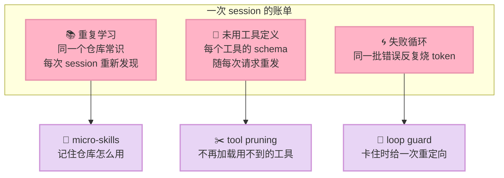
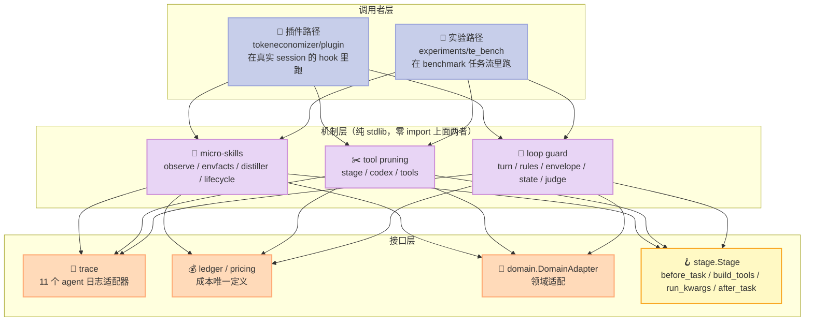
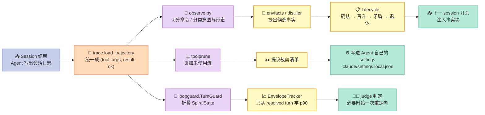
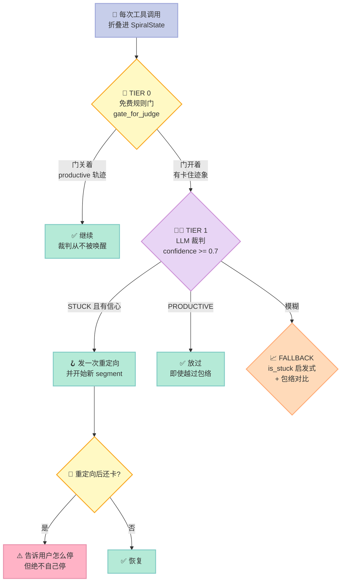
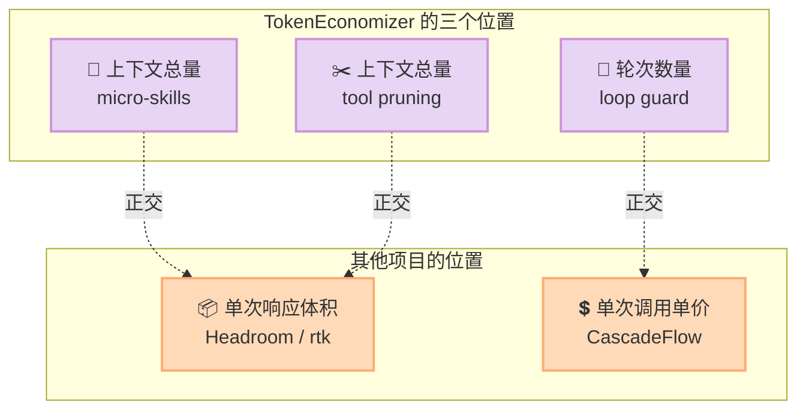

> 一个反常识的事实：**Coding Agent 的账单里，有一大块是你昨天就已经付过的。**
>
> 你在同一个仓库里用同一个 Agent 反复干活。第一天它发现 `pytest` 装不上，得改用 `python -m pytest`；第二天它又花了一次 token 重新发现一遍。第五天它带着 12 个工具定义进场，其中 9 个在这个仓库里从来没被用过——但每一个的定义都要随每次请求重发、重新计费。第七天它陷进了"改 A 文件 → 跑测试 → 报错 → 改 A 文件"的循环，烧了 40 轮才放弃。
>
> 这些都不是模型的错。模型每轮都在重新学同一个仓库的常识，而 **Harness 完全没有为"跨 session 的重复"留任何位置**。
>
> 今天要拆的 `microsoft/TokenEconomizer`（7,964⭐，MIT，UC Berkeley + Microsoft Research + Microsoft Security 联合出品，arXiv 2610.22732）就是来解决这件事的。它的做法值得每一个写 Agent Harness 的人抄作业：**不改 Agent 一行代码，在 Agent 自己的"已读区"和"自己的设置文件"里做减法。**

---

## 一、这个项目解决什么问题

TokenEconomizer 的自我定位是 **Experience-Driven Black-Box Cost Control for Coding Agents**——"经验驱动的黑盒成本控制"。三个关键词需要拆开看：

| 关键词 | 含义 | 为什么重要 |
|---|---|---|
| **Black-Box** | 不改 Agent 的模型、权重、代码，不 fork Claude Code / Codex | 你的 Agent 升级、换模型、被 vendor 锁死，插件都还活着 |
| **Experience-Driven** | 跨 session 学习，而不是每个 session 从零开始 | 复用"人反复用同一个仓库"这个真实工作流 |
| **Cost Control** | 目标是账单，不是 benchmark 分数 | 唯一诚实的 Harness 指标之一 |

### 1.1 三种具体的浪费

README 把 Coding Agent 的账单拆成三块，每一块对应一个机制：



**micro-skills** 解决第一种：把"这个仓库怎么跑测试"这种事实，学成一行声明式的事实，注入到下一个 session 的开头。

**tool pruning** 解决第二种：Claude Code 里加载的工具定义，会随**每一次请求**重发并计费。一个仓库里 90% 的工具从来没被碰过，那些 token 就是纯浪费。

**failure-loop intervention**（内部叫 loop guard）解决第三种：当一个 turn 反复撞同一个错误时，在它烧掉 40 轮之前给一次"换个思路"的重定向。

### 1.2 实测数据

论文在 **277 个 SWE-Bench 任务**（来自 6 个仓库）、**5 个 Agent×模型组合**上跑，每个任务独立开一个 session，同一仓库的任务按顺序跑、**从零开始学**：

| 组合 | 成本变化 | Pass@1 变化 |
|---|---|---|
| Claude Code + Sonnet 5 | **-23.6%** | **+1.3** |
| Claude Code + Opus 4.8 | **-30.9%** | -1.0 |
| Codex + GPT-5.6 Terra | **-24.7%** | **+0.9** |
| Codex + GPT-5.6 Sol | **-26.1%** | **+1.6** |
| Copilot CLI + Sonnet 5 | **-18.4%** | **+2.6** |

关键的三条：

- **30 个「仓库 × 组合」格子全部变便宜**（不是平均之后便宜，是每一个都便宜）——这比"平均降 25%"强得多，因为它排除了"某些仓库降很多、其他仓库反而变贵"这种平均数陷阱。
- **Pass@1 在 5 个组合里有 4 个上升**。省 token 常常意味着少思考、质量下降；这里 4/5 上升说明省下来的不是有效 token。
- **换场景也成立**：Web-Bench 上降 16-21%；两个"每个任务都在全新仓库"的安全审计 benchmark 上降 6-20%——**后者尤其关键，因为它排除了"模型只是记住了这个仓库"的嫌疑**。

> ⚠️ 有一处诚实的取舍要挑明：插件版把"提议事实的模型"和"卡死裁判"这两个调用跑在**用户自己的 Agent**上（`sidecall.py`），用的是更便宜的小模型；而论文实验里它们跑在 **Agent 自己的模型**上。作者的理由写在源码注释里："in a user's session the cheapest capable model is the right default, and the ledger records the real cost either way."（在真实会话里，最便宜的够用模型才是合理默认值；账本两种情况都如实记录。）这个选择让**插件版的实际收益低于论文数字**，但让真实账单更诚实。

---

## 二、架构：机制与策略的分离，是这个项目的真正骨架

TokenEconomizer 的 `docs/ARCHITECTURE.md` 只有几十行，但每一句都是设计决策。这是我近期读过的最干净的机制/策略分离实现之一。

### 2.1 四个接口，把"Agent""Harness""领域"全部挡在外面

三个机制（micro-skills / tool pruning / loop guard）**既不知道 Agent 是谁，也不知道 Harness 是什么，更不知道任务领域是什么**。所有跟这些相关的东西，只从四个小接口进来：

| 接口 | 职责 | 加一个新东西要做什么 |
|---|---|---|
| `tokeneconomizer.trace` | 唯一读 session 日志的地方，把各家格式统一成 `(tool_name, args, result, ok)` 调用序列 | 加一个 agent = 加一个 reader，**别的什么都不用动** |
| `tokeneconomizer.ledger` / `pricing` | 成本的唯一定义，机制记录开销，插件和实验读同一份 | 成本口径不会漂移 |
| `tokeneconomizer.domain.DomainAdapter` | 领域接口：读 session、保护哪些工具、循环信号、任务文本、micro-skill 词汇表 | 加一个新领域 = 加一个 adapter，**机制一行不改** |
| `tokeneconomizer.stage.Stage` | 机制暴露给运行者的钩子：`before_task` / `build_tools` / `run_kwargs` / `after_task` | 调用方（插件 or 实验）驱动 |

`trace/README.md` 末尾那句话是整个项目最值钱的一句：

> **A new agent needs a reader here and nothing else: once its log reads as `(name, args, result, ok)` calls, every mechanism handles it.**

翻译过来就是：**支持一个新 Coding Agent 的成本 = 写一个日志解析器。** 不用碰 micro-skills 的生命周期，不用碰 tool pruning 的证据流，不用碰 loop guard 的包络。

目前 `trace/` 下有 **11 个 agent 适配器**：Claude Code、Codex、Copilot CLI、Cursor Agent、Factory Droid、Grok Build、opencode、Hermes Agent、Pi、Antigravity CLI，外加共享的 JSONL 读取器。注意 Cursor 的处理——它的 transcript 格式和 per-session token 用量都不是公开接口，适配器就**本地记录 hook 事件、把 session 成本如实报成 unavailable**，而不是假装能算。

### 2.2 两个调用者，机制谁都不 import



而且这条边界**是被测试钉死的**，不是靠口头约定：

> `tests/test_plugin_package.py` pins both boundaries: the mechanisms never import `tokeneconomizer.plugin`, and nothing under `tokeneconomizer/` imports `experiments/`.

**这是 Harness 架构里最值得抄的一条工程实践**：把"架构约束"写成一条会失败的测试。靠 code review 守不住的边界，半年内一定会被一次"就加一行 import"的善意破坏。

### 2.3 数据流：一个 session 结束后，三个机制同时被喂



注意最后两条输出路径——**它们都不需要 Agent 学任何新东西**：

- 事实通过 **session 开头的上下文**进入，不新增工具；
- 工具通过 **Agent 自己的 settings 文件**被裁掉，不改 Agent 代码。

这是 README 里 "Work through what the agent already reads" 原则的落地。

---

## 三、三个机制的实现原理

### 3.1 micro-skills：事实的生命周期

free 版的 `envfacts.py` 识别 **6 类"证据形态"**，全部 **零 LLM 调用**：

| 家族 | 证据形态 | 生成的声明式事实 | 退休条件 |
|---|---|---|---|
| **FormRepair** | 形态 A 失败、形态 B 成功 | "`A …` fails here with ModuleNotFoundError; `B …` works." | 裸形态能跑通测试 |
| **Boundary** | 某主机每次连接都被拒、无一成功 | "Outbound connections to X, Y are refused here." | 对列出的主机抓取成功 |
| **EmptyProbe** | 某类探测每次都空 | "This checkout has no git remote and no branches… beyond HEAD" | 探测返回了东西（**硬退休**） |
| **ArgRepair** | 标签加载失败、改写后加载成功 | "`pytest` takes dotted test labels (`module.Class.test`, not `module::Class::test`)." | 同形态标签能加载 |
| **EnvValue** | 代码因缺环境变量失败、后来设了就好 | "Code that imports the project needs `V` set here: `V=x` works" | 该值再次以同样方式失败 |
| **AbsentTool** | 裸工具 command not found、且没有别的跑法 | "`T …` fails here with command not found, and no other way to run it has worked." | `T` 能跑，或找到可行形态 |

有两个细节值得单独说：

**第一，"AbsentTool" 和 "FormRepair" 的区别是"有没有可行替代"。** ArgRepair 那一行注释特别精准：

> A label naming something that does not exist matches neither rewrite, so a plain mistake never becomes a fact.

（一个指向不存在东西的标签，两种改写都匹配不上，所以一个普通的手误永远不会变成事实。）

这句话把"从错误里学习"和"把错误当噪音"切开了。

**第二，事实的注入有 lint。** `envfacts.py` 里有一条正则，拒绝任何读起来像"完成建议"或"验证建议"的事实：

```python
# envfacts.py —— 拒绝把事实变成"完成/验证建议"
_LINT_RE = re.compile(r"\b(skip|no need|don'?t|do not|stop|done|completed?|finish(?:ed)?|"
                      r"verify|verification|instead of (?:running|testing))\b", re.I)
```

为什么？**因为 micro-skills 学的是"环境怎么用"，不是"任务怎么做"。** 一旦学成后者，它就成了一个会误导 Agent 的通用助手——而 Harness 哲学里，"任务怎么做"应该是 Skill 的事，"环境怎么用"才是 micro-skill 的事。**职责边界被 lint 强制执行了。**

#### 生命周期：三态机 + 不对称评分

真正的核心在 `lifecycle.py`。一个事实是 `CANDIDATE`，直到在 **K_PROMOTE = 3** 个 session 上被确认：

```python
# tokeneconomizer/microskills/lifecycle.py（上游真实代码）
K_PROMOTE   = 3      # confirmations to promote -> ACTIVE
GAMMA       = 0.8    # recency decay per task-ago
LAMBDA      = 5.0    # contradiction weight (asymmetry: fail toward retirement)
SCORE_FLOOR = 0.0    # retire ACTIVE when recency score < floor
FIRE_GATE   = 0.40   # inject only if firing rate on this repo >= 40%
FIRE_MIN_N  = 4      # ...measured over at least this many exercised tasks


class Lifecycle:
    def score(self, now):
        s = sum(GAMMA ** (now - i) for i, _ in self.confirms)
        s -= LAMBDA * sum(GAMMA ** (now - i) for i in self.contradicts)
        return s

    def injectable(self):
        """ACTIVE and clears the firing gate -> goes into the rendered manual."""
        return (self.state == "ACTIVE"
                and self.fire_den >= FIRE_MIN_N
                and self.firing_rate() >= FIRE_GATE)

    def update(self, now, verdict, fired, exercised, files):
        if exercised:
            self.fire_den += 1
            if fired:
                self.fire_num += 1
        if verdict == "confirm":
            self.confirms.append((now, sorted(files)))
        elif verdict == "contradict":
            self.contradicts.append(now)
        if self.state == "CANDIDATE":
            if self._drifted_confirms() >= K_PROMOTE:
                self.state, self.promoted_at = "ACTIVE", now
        elif self.state == "ACTIVE":
            hard = self.high and verdict == "contradict" and HARD_KILL
            if hard or self.score(now) < SCORE_FLOOR:
                self.state, self.retired_at = "RETIRED", now
```

四个设计决策，每个都有代价权衡：

| 决策 | 值 | 为什么这么选 | 代价 |
|---|---|---|---|
| **晋升门槛** | 3 次确认 | 1 次是巧合，3 次是规律 | 前期要付 3 个 session 的学习成本 |
| **矛盾权重** | LAMBDA = 5.0 | **不对称**：错杀一条事实比漏杀一条贵 5 倍 | 事实变得保守、退休偏快 |
| **衰减** | GAMMA = 0.8 | 老的确认会过时；0.8^n 让 10 个 session 前的确认只剩 0.107 | 需要持续有新证据维持 |
| **触发门** | FIRE_GATE = 40% + 至少 4 个样本 | **事实只在"它防的浪费还在发生"时才注入** | 事实块可能长期为空 |

**FIRE_GATE 是最漂亮的一个。** 一个事实即使确认了 3 次、晋升成 ACTIVE，**如果它防的浪费最近不再发生了，就不注入**。这是对"陈旧知识污染上下文"的直接防御——很多"自动记忆"系统的失败模式正是这样：记住了太多已经不相关的东西。

`_drifted_confirms()` 里的"漂移"判定更精细：

```python
def _drifted_confirms(self):
    """确认必须落在不同的文件上——否则只是同一个巧合重复了三次。"""
    if not self.drift:
        return len(self.confirms)
    kept = []
    for idx, fs in self.confirms:
        fs = set(fs)
        if not fs or all(len(fs & set(k)) == 0 for _, k in kept):
            kept.append((idx, fs))
    return len(kept)
```

**三个 session 都改了同一个文件 → 只算一次确认。** 因为在那个小仓库里，每次都改同一个模块的三次失败，是同一个巧合的三次重演，不是一条独立的规律。而 `drift=False` 的环境事实（如"这个仓库没装 pytest"）不需要这个判定——**环境事实与改哪些文件无关**。

最后是"人工遗忘"机制。`Forgetting` 类让用户能手动退休一条事实：

```python
def forget(self, fid):
    """True when `fid` is forgotten now, False when it already was."""
    if fid in self.forgotten:
        return False
    fact = self.facts[fid]
    entry = {"claim": self._claim_of(fact), "record": fact.to_dict()}
    ...
    del self.facts[fid]
    self.forgotten[fid] = entry
    return True
```

注意 `forgotten` 里保留了 claim 和 record——**遗忘之后，这个 id 永远不会再被学成一条新事实**，但 `unforget` 可以把它原样恢复。**"遗忘"是幂等且可撤销的，不是删除。**

### 3.2 tool pruning：证据驱动的裁剪

裁剪逻辑的核心约束是"**不许冤枉**"：

- **曾经被用过 → 终身豁免。** 一个工具只要在任何一个 session 里被调用过，就永远不会被提议裁剪。
- **工作面工具受保护。** `tools.PROTECTED_TOOLS` 里的（Read/Edit/Write）永不提议。
- **必须跨 session。** 证据要求 prompt 数 **p = 10** 且跨 **m = 2** 个 session，或者任意长度的 **s = 5** 个 session。**单个 session 不能单独定罪。**

写入时机也很讲究：deny list 只在**仓库的 session 空闲 q = 60 分钟之后**才写。因为工具一变，Agent 的 prompt cache 就失效——**"a conversation resumed after its tools change must write its whole history to the prompt cache again instead of reading it"**（工具变更后续接的对话必须重写整段历史到 prompt cache，而不是读缓存）。而空闲一小时后缓存本来就过期了。**这是把"缓存经济学"写进了裁剪时机里**，很多做 token 优化的项目会漏掉这一层。

不同 Agent 的裁剪单位不一样，这是必然的——Agent 自己的设置文件结构不同：

| Agent | 裁剪单位 | 写到哪 |
|---|---|---|
| Claude Code | 单个工具 | `.claude/settings.local.json` |
| Codex | **能力包**（collaboration / goals / image-media…） | `.codex/config.toml` |
| Copilot CLI | 整个 MCP server | `.github/copilot/settings.local.json` |
| Pi / Cursor / Grok / opencode / Hermes / Antigravity | 无（没有持久化的 per-tool 设置） | — |

Codex 那边是"能力包"而不是单个工具，因为 Codex 的最小开关单位就是包。`codex.py` 里的 `CodexUntoolProfile` 为此维护一套独立的证据门控。

### 3.3 loop guard：三级级联，最贵的一级最少触发

loop guard 是三个机制里最复杂的，因为它要解决一个本质上模糊的问题："**这个 turn 是卡住了，还是在啃硬骨头？**"

上游的答案是**三级级联，从便宜到贵**：



**Tier 0 是免费的**，每次调用都跑，但它的任务只是"这条轨迹值不值得花一次付费模型调用看一眼"：

```python
# tokeneconomizer/loopguard/rules.py（上游真实代码）
def gate_for_judge(state, thr=None):
    """TIER-0 (free, every turn): cheap rule-based trigger deciding whether the recent
    trace is worth ELEVATING to the paid LLM judge. Permissive — it only needs a sign of
    POSSIBLE trouble after the loop has had time to form."""
    thr = thr or DEFAULT_THRESHOLDS
    if state.turns < thr["gate_min_turns"]:
        return False
    return (state.repeated_fail_sigs >= 1
            or state.error_outputs >= thr["gate_error_outputs"])
```

这个免费门的意义，源码注释说得很直接：

> This separation is what keeps the judge from being a per-step tax.

**没有这个免费门，LLM 裁判就会变成每一步都要付的税。** 这是所有"用 LLM 做运行时监控"的项目都会踩的坑——先想清楚"什么时候值得问模型"，再想"问模型"。

**Tier 1 的裁判会推翻包络。** 这点很重要：规则说"这 turn 有点长"，但裁判说"它在持续推进"，那它就**被放过**。规则是候选生成器，裁判是决策者。

**反过来，包络也有裁判推不翻的硬后门。** `backstop_mult = 2.5`：

```python
# rules.py —— 硬后门
"backstop_mult": 2.5,     # HARD backstop: beyond this multiple of the envelope, a
                          # stuck trajectory aborts REGARDLESS of the judge's verdict.
                          # A judge can read multi-file thrashing far past the envelope
                          # as "exploration"; it must not be able to veto such an
                          # outlier.
```

裁判会把"越过包络很多的多文件乱改"读成"探索"，所以硬后门是必需的。**规则管下限（不能漏），裁判管上限（不能冤），两者都留着。**

#### 包络：p90 而不是 max

包络是"这个仓库的正常 turn 通常跑多久"。它的实现有一个非常具体的教训：

```python
# tokeneconomizer/loopguard/envelope.py（上游真实代码）
class EnvelopeTracker:
    """Envelope: margin * the p<pct> of turn-counts among RESOLVED tasks seen so far.
    Using a PERCENTILE (default p90), not the max, makes the gate robust to a single
    very-long resolve — empirically one 115-turn xarray resolve set a max-based envelope
    to ~144 and disabled the guard for every 40-60-turn spiral below it; p90 ignores that
    lone outlier (envelope ~32) while staying HIGH on repos like matplotlib where long
    resolves are COMMON (so productive-long tasks stay protected)."""
```

这个例子太具体了，值得逐字理解：

- 仓库 xarray 里有一次 **115 轮**才解决的 task。
- 如果用 max 做包络，115 × 1.25 = **144 轮**。这个仓库里所有 40-60 轮的螺旋**全部落在包络内**，guard 彻底失灵。
- 用 p90，包络是 **~32 轮**，40-60 轮的螺旋照样能被抓住。
- 而在 matplotlib 这种"长解决是常态"的仓库上，p90 依然会给出很高的包络，**不会冤枉那些慢但有产出的 task**。

**max 让单个离群值毒化整个仓库的阈值；p90 让离群值只是离群值。** 这是统计常识，但很少有人真的在 Agent 阈值里用对。

另一个关键约束：

> Stays None until >=min_samples resolved tasks exist (don't trust a percentile of a handful of points), so we never abort on a repo we know little about yet.

**样本不够时包络是 `None`，意味着"还不知道"，不是"没有阈值"。** 而且：

> A turn's own outcome only ever gates LATER turns.

**一个 turn 自己的结果只能影响后面的 turn，永远不能影响它自己。** 这是一条干净的因果规则，避免了"用结果判结果"的自证循环。

### 3.4 sidecall：用你自己的 Agent 跑裁判

还有一个机制值得单独讲，因为它解决了一个非常现实的工程问题：**插件如果自己调 API，就得多管一个 API key。**

上游的做法是让插件调用**用户已经登录的那个 host CLI**：

```python
# tokeneconomizer/plugin/sidecall.py（上游真实代码，节选）
  * Claude Code: `claude -p --output-format json --tools "" --max-turns 1`, with none of the
    person's MCP servers, on `paid_model` (default `haiku`).
  * Codex: `codex exec --json --disable hooks --ephemeral -s read-only`.
  * Copilot CLI: `copilot -p` as a pure text completion ... every tool denied and excluded.
  * Hermes: `hermes chat -Q --oneshot --source tool --ignore-rules --max-turns 1 -t bot_room`
    on the person's default model. Never `hermes -z`, which auto-approves dangerous
    commands: a side call's prompt holds text a repository controls, and this form offers
    it no tool.
```

三个亮点：

1. **零凭据。** 插件不碰任何 API key，任何登录方式都行，调用成本记在用户已有的订阅上。
2. **零工具。** 每个 host 的 side call 都把工具全部关掉——因为 **"a side call's prompt holds text a repository controls"**（side call 的 prompt 里含有仓库控制的内容）。一个能读文件的裁判模型，就是一个提示注入的口子。所以 Hermes 那一行特意拒绝用 `hermes -z`（它会自动批准危险命令），改用只读形态。
3. **防递归。** 每个 side call 都带 `TE_SIDECALL=1`，插件的 hook 入口看到这个标记就什么都不做——**否则嵌套的 Agent 会触发这个插件自己的 hook，然后无限递归。**

这是一个很小但很致命的细节。整个"侧调用"设计说明了一件事：**在 Agent 生态里，"谁付钱""谁能写文件""谁调谁"必须想在前面，而不是后面补。**

---

## 四、和其他成本优化方案的差异

TokenEconomizer 常被拿去和"上下文压缩"类项目比，但它们解决的是**完全不同的问题**。

| 维度 | TokenEconomizer | Headroom | rtk | CascadeFlow |
|---|---|---|---|---|
| **做什么** | 跨 session 学**三种浪费** | 压缩工具输出/日志/文件/RAG 块 | 压缩 bash 命令输出 | Agent 内的级联推理调度 |
| **优化对象** | **上下文总量**（三个维度） | **单次响应里的 token** | **shell 输出** | **推理次数**（小模型先试） |
| **改不改 Agent** | ❌ 不改 | ❌ 不改（proxy） | ❌ 不改（proxy） | ✅ 改（包一层 runtime） |
| **需要历史** | ✅ 需要多 session | ❌ 单次即可 | ❌ 单次即可 | ❌ 单次即可 |
| **LLM 调用** | 少量（裁判/提议，可关） | 无（或可选） | 无 | 有（级联本身就是多模型） |
| **典型收益** | 18-31% 总成本 | 约 20% token | 60-90% shell token | 推理成本降 69-93% |
| **⭐ 星数** | 7,964 | 80,502 | 87,508 | 3,921 |

**最核心的差异是"优化对象"这一行。**

Headroom 和 rtk 是**流式**的：它们在工具输出进入模型之前把它压小。单次会话就能生效。但它们压的是"**这一次的内容**"。

TokenEconomizer 是**跨会话**的：它不减单次内容，它减的是"**第 N 次会话里那些第 1 次就已经学过的重复**"。这两个维度是正交的——**Headroom 压不掉"Agent 又花了一次 token 重新发现 `pytest` 装不上"这件事，因为那句话本身很短，压不动。**

再看 `CascadeFlow`——它是**推理侧**的成本优化：让便宜的小模型先试，不行再升级。这个思路和 TokenEconomizer 完全不同，前者优化"一次调用花多少"，后者优化"**多少次调用**"。

而 TokenEconomizer 的 loop guard，严格说是第四种：**它优化"卡住的那一轮烧多少"**。



**一个诚实的对比结论**：Headroom 的星数（80k）是 TokenEconomizer 的 10 倍，说明"压单次输出"这件事更简单、更普适、更容易传播。TokenEconomizer 复杂度高得多（要跨 session 积累、要小心不冤枉、要处理缓存失效时机），换来的是**在真实工作流里 20-30% 的总成本下降 + 质量不降**。

**如果你的痛点是"单个 MCP 工具返回 50KB 日志把上下文炸了"，用 Headroom。如果你每天在同一个仓库用同一个 Agent 干三周的活，用 TokenEconomizer。**

---

## 五、优缺点

### 左侧：架构简洁性 / 扩展性 / 易用性

| 维度 | 评价 | 依据 |
|---|---|---|
| **架构简洁性** | ✅ **极好** | 三个机制零 import 插件层、零 import 实验层，且这条边界被测试钉死。四个接口把 Agent/领域/成本/生命周期全部收拢。支持一个新 Agent = 写一个日志 reader。 |
| **扩展性** | ✅ **极好** | `Stage` 的 4 个钩子（`before_task` / `build_tools` / `run_kwargs` / `after_task`）是干净的扩展点。实验里还能加 benchmark 专用控制器（`SpiralStage` / `NudgeGuard` / Codex finalize policy）而机制层不动。 |
| **易用性** | ⚠️ **中等** | 装起来不复杂（`claude plugin marketplace add`），但**依赖链复杂**：需要 Python 3.10+、需要 `~/.tokeneconomizer`、需要先跑 `refresh-catalog` 才知道工具目录。9 个 Agent 各有一份不同的安装说明和不同的限制（Cursor 只支持 macOS/Linux；Droid 不支持工具裁剪；Pi 只加载 4 个工具所以没法裁）。 |
| **可观测性** | ✅ **好** | 每个动作有一行日志，`te status` / `te doctor` / `errors.log` 都在。账本记真实成本（含插件自己的调用）。 |

### 右侧：性能 / 复杂度 / 维护性

| 维度 | 评价 | 依据 |
|---|---|---|
| **性能** | ✅ **好** | 核心是纯 stdlib 本地计算，无网络往返（side call 是可关的、且只在门开时才跑）。写状态用 `os.replace` 原子替换，避免半截文档。 |
| **复杂度** | ❌ **高** | 191 个 Python 文件，其中 `plugin/hosts.py` 66KB、`plugin/cli.py` 56KB、`plugin/sidecall.py` 51KB。11 个 host 适配器 × 各自的 hook 语义 × 各自的设置文件格式 × 各自的安装方式。**这是一个"支持 9 个 Agent"的复杂度账单。** |
| **维护性** | ⚠️ **中偏高** | 好的一面：边界清晰、测试充分（`tests/test_live_hooks.py` 91KB）、文档极诚实（`docs/PLUGIN.md` 逐条记录每个 Agent 上验证过的行为和已知限制）。坏的一面：**每个 host 升级都可能破坏适配器**——README 明确要求 "once per machine, and again after Claude Code updates, run `refresh-catalog`"。 |
| **收益不确定性** | ⚠️ **需要实测** | 18-31% 是论文数字。真实收益**强依赖你在这个仓库的工作频率**——一周干一次的仓库，3 次确认的门槛都跨不过去。micro-skills 默认关闭正是因为这个。 |

**我的一句话判断**：**这是一份"研究代码质量"的产物，不是"开箱即用产品"。** 如果你的团队每天在同一个仓库用同一个 Agent 干三周的活，它会给你 20% 以上的账单折扣；如果你一周干一次，micro-skills 基本是零收益。

---

## 六、从零搭建启示：最小可行实现是什么

如果你想在 200 行以内复刻这个思路，我的建议是**只做 loop guard**。

### 6.1 必须的 / 可以省的

| 组件 | 必须？ | 理由 |
|---|---|---|
| **SpiralState（折叠器）** | ✅ 必须 | 没有它就没有任何信号。核心字段：每文件编辑数、改过的文件数、错误输出数、验证运行数、重复失败签名数。**这个可以纯手写，100 行以内。** |
| **包络（EnvelopeTracker）** | ✅ 必须 | 唯一的"这个仓库正常 turn 多长"的锚点。**必须用 p90，必须只用 resolved turn，必须 min_samples 冷启动。** 这三条都是踩过坑的。 |
| **免费门（Tier 0）** | ✅ 必须 | 否则 LLM 裁判变成每步的税。纯规则，20 行。 |
| **硬后门（backstop）** | ⚠️ 强烈建议 | 没有它，一个"多文件乱改"的裁判误判就能让 guard 永久失灵。 |
| **LLM 裁判** | ❌ 可省 | 先用纯启发式 `is_stuck`（churn AND noise AND repetition 的合取）。等启发式误报率高了再上裁判。 |
| **重定向** | ⚠️ 可省但建议留 | 至少要能给一句"换个思路试试"。**但不要自动停止 turn**。 |
| micro-skills 全套 | ❌ 可省 | 需要几十个 session 才回本。可以先用"每次 session 手动维护一个 CLAUDE.md 片段"。 |
| tool pruning | ❌ 可省 | 需要 Agent 有持久化的 per-tool 设置，很多 Agent（包括 Hermes）没有。 |

### 6.2 一个 250 行的复刻

下面这段代码把三个机制的核心都抽了出来，**零依赖，可直接跑**：

```python
"""
TokenEconomizer 三机制最小复刻（MVP）
======================================
从 microsoft/TokenEconomizer 抽离的核心机制，用零依赖的标准库复刻：

  1. micro-skills 的 fact lifecycle（CANDIDATE -> ACTIVE -> RETIRED）
     源自 tokeneconomizer/microskills/lifecycle.py
  2. tool pruning 的"加载但未使用"证据流
     源自 tokeneconomizer/toolprune/stage.py
  3. loop guard 的 per-repo envelope（只用"正常结束"的 turn 学 p90）
     源自 tokeneconomizer/loopguard/envelope.py

运行：python3 mvp_tokeneconomizer.py
"""

from __future__ import annotations

import math
from dataclasses import dataclass, field

# ---------------------------------------------------------------- 机制 1: fact lifecycle

K_PROMOTE = 3        # 确认次数 -> ACTIVE
GAMMA = 0.8          # 每次确认的recency衰减
LAMBDA = 5.0         # 矛盾的权重（不对称：偏向退休）
SCORE_FLOOR = 0.0
FIRE_GATE = 0.40     # 触发率低于 40% 就不注入
FIRE_MIN_N = 4       # 至少 4 个 session 样本


@dataclass
class FactLifecycle:
    """一条"环境事实"的完整生命周期。

    关键不变量（与上游一致）：
      * 晋升要求 K_PROMOTE 次确认；
      * 矛盾以 LAMBDA 倍权重计入（不对称：错杀比漏杀更贵）；
      * 退休后永不复活；
      * 注入需要同时满足 ACTIVE + 样本数 >= FIRE_MIN_N + 触发率 >= FIRE_GATE。
    """
    key: str
    state: str = "CANDIDATE"          # CANDIDATE | ACTIVE | RETIRED
    confirms: list = field(default_factory=list)      # [(idx, files)]
    contradicts: list = field(default_factory=list)   # [idx]
    fire_num: int = 0
    fire_den: int = 0

    def score(self, now: int) -> float:
        s = sum(GAMMA ** (now - i) for i, _ in self.confirms)
        s -= LAMBDA * sum(GAMMA ** (now - i) for i in self.contradicts)
        return s

    def firing_rate(self) -> float:
        return (self.fire_num / self.fire_den) if self.fire_den else 0.0

    def injectable(self) -> bool:
        return (self.state == "ACTIVE"
                and self.fire_den >= FIRE_MIN_N
                and self.firing_rate() >= FIRE_GATE)

    def update(self, now: int, verdict: str, fired: bool, exercised: bool) -> None:
        if exercised:
            self.fire_den += 1
            if fired:
                self.fire_num += 1
        if verdict == "confirm":
            self.confirms.append((now, []))
        elif verdict == "contradict":
            self.contradicts.append(now)

        if self.state == "CANDIDATE":
            if len(self.confirms) >= K_PROMOTE:
                self.state = "ACTIVE"
        elif self.state == "ACTIVE":
            if self.score(now) < SCORE_FLOOR:
                self.state = "RETIRED"


# ---------------------------------------------------------------- 机制 2: tool pruning

P_EVIDENCE = 10      # 一个工具要连续 10 个 prompt 未使用
M_MIN_SESSIONS = 2  # 且这些 prompt 必须跨至少 2 个 session
S_SESSIONS = 5      # 或者任意长度的 5 个 session 都未用
PROTECTED = {"Edit", "Write", "Read"}   # 工作面工具永不提议


class ToolPruner:
    """按"加载但未使用"证据提议裁剪工具。

    不变量：
      * 曾经被使用过 -> 永不提议（一次性豁免，终身保护）；
      * 受保护工具 -> 永不提议；
      * 证据必须跨 session，单个 session 不能单独定罪。
    """

    def __init__(self) -> None:
        self.used: set[str] = set()
        self.unused_streaks: dict[str, int] = {}
        self.catalog: set[str] = set()
        self.prompt_count: dict[str, int] = {}     # 工具 -> 累计未使用的 prompt 数
        self.tool_sessions: dict[str, set[int]] = {}  # 工具 -> 出现过的 session 集合

    def observe_catalog(self, tools: set[str]) -> None:
        self.catalog |= tools

    def observe_session(self, session_id: int, loaded: set[str], used: set[str]) -> None:
        self.catalog |= loaded
        self.used |= used
        for t in loaded:
            self.tool_sessions.setdefault(t, set()).add(session_id)
            if t in used:
                self.unused_streaks[t] = 0
                self.prompt_count[t] = 0
            else:
                self.unused_streaks[t] = self.unused_streaks.get(t, 0) + 1
                self.prompt_count[t] = self.prompt_count.get(t, 0) + 1

    def propose(self) -> list[str]:
        out = []
        for t in self.catalog:
            if t in self.used or t in PROTECTED:
                continue
            streak_ok = (self.unused_streaks.get(t, 0) >= P_EVIDENCE
                         and len(self.tool_sessions.get(t, ())) >= M_MIN_SESSIONS)
            sessions_ok = len(self.tool_sessions.get(t, ())) >= S_SESSIONS
            if streak_ok or sessions_ok:
                out.append(t)
        return sorted(out)


# ---------------------------------------------------------------- 机制 3: loop guard envelope

def percentile(xs: list[float], p: float):
    """线性插值分位数。xs 不必有序。"""
    if not xs:
        return None
    xs = sorted(xs)
    n = len(xs)
    if n == 1:
        return float(xs[0])
    i = (p / 100.0) * (n - 1)
    lo = int(i)
    frac = i - lo
    if lo + 1 >= n:
        return float(xs[-1])
    return xs[lo] + frac * (xs[lo + 1] - xs[lo])


@dataclass
class EnvelopeTracker:
    """per-repo 的"正常 turn 长度"包络。

    关键不变量（与上游 envelope.py 一致）：
      * 只有"正常结束"的 turn（resolved=True）才喂分位数；
      * 用 p90 而不是 max —— 一次 115-turn 的长 resolve 用 max 会把包络推到 ~144，
        让 40-60 turn 的螺旋全部落在包络内而永不触发；
      * 样本不足 min_samples 时返回 None —— 不在"几乎一无所知"的仓库上乱判。
    """
    margin: float = 1.25
    pct: float = 90.0
    min_samples: int = 5
    resolved_turns: list = field(default_factory=list)

    def update(self, turns: int, resolved: bool) -> None:
        if resolved and turns:
            self.resolved_turns.append(turns)

    @property
    def envelope(self):
        if len(self.resolved_turns) < self.min_samples:
            return None
        return percentile(self.resolved_turns, self.pct) * self.margin


# ---------------------------------------------------------------- 演示

def demo_microskills() -> None:
    print("=" * 68)
    print("机制 1  micro-skills: fact lifecycle (CANDIDATE -> ACTIVE -> RETIRED)")
    print("=" * 68)
    f = FactLifecycle(key="form_repair:pytest")
    for i in range(5):
        f.update(i, "confirm", fired=True, exercised=True)
        print(f"  session {i}: state={f.state:<10} score={f.score(i):+.3f} "
              f"fire_rate={f.firing_rate():.2f} injectable={f.injectable()}")

    print(f"\n  -> 5 次确认后 state={f.state}，触发率 {f.firing_rate():.0%} "
          f"(> FIRE_GATE {FIRE_GATE:.0%})，样本 {f.fire_den} (>= {FIRE_MIN_N})")

    # 矛盾退休
    f.update(5, "contradict", fired=False, exercised=True)
    print(f"  -> 一次矛盾后 state={f.state}  (score={f.score(5):+.3f} < floor {SCORE_FLOOR})")
    print(f"  -> 退休后 injectable={f.injectable()}（永不复活）\n")


def demo_toolprune() -> None:
    print("=" * 68)
    print("机制 2  tool pruning: 加载但未使用的工具证据流")
    print("=" * 68)
    p = ToolPruner()
    p.observe_catalog({"Edit", "Write", "Read", "NotebookEdit", "Browser", "WebFetch"})
    for sid in range(6):
        p.observe_session(sid, loaded={"NotebookEdit", "Browser", "WebFetch"},
                          used={"WebFetch"} if sid == 2 else set())
    print(f"  工具目录: {sorted(p.catalog)}")
    print(f"  曾被使用: {sorted(p.used)}  (豁免)")
    print(f"  未使用流: {dict(sorted(p.unused_streaks.items()))}")
    print(f"  提议裁剪: {p.propose()}")
    print("  -> WebFetch 在 session 2 被用过 -> 终身豁免；")
    print("     Edit/Write/Read 是工作面工具 -> 受保护，永不提议。\n")


def demo_envelope() -> None:
    print("=" * 68)
    print("机制 3  loop guard: per-repo envelope (只学 '正常结束' 的 turn)")
    print("=" * 68)
    env = EnvelopeTracker()
    normal = [22, 25, 28, 30, 33, 26, 31, 29, 27, 24]
    for t in normal:
        env.update(t, resolved=True)
    print(f"  已学 resolved turn 数: {len(env.resolved_turns)}  (min_samples={env.min_samples})")
    print(f"  p90 = {percentile(env.resolved_turns, 90):.1f}  x margin {env.margin} "
          f"= envelope {env.envelope:.1f} turns")
    print(f"  -> 一个 40 turn 的螺旋 {40} > {env.envelope:.1f} -> 可被判定为越过包络")

    # max vs p90 的差别
    env2 = EnvelopeTracker()
    for t in normal:
        env2.update(t, resolved=True)
    env2.update(115, resolved=True)      # 一次超长 resolve
    p90 = percentile(env2.resolved_turns, 90) * env2.margin
    mx = max(env2.resolved_turns) * env2.margin
    print(f"\n  加入一次 115-turn 的 resolve 后：")
    print(f"    p90 口径 envelope = {p90:.1f}  (40-turn 螺旋仍可被捕获)")
    print(f"    max 口径 envelope = {mx:.1f}  (40-turn 螺旋落在包络内 -> 永不触发)")
    print("    这就是上游坚持用 p90 而不是 max 的原因。\n")


def demo_integration() -> None:
    print("=" * 68)
    print("整合  三个机制如何在同一个 session 流上协作")
    print("=" * 68)
    env = EnvelopeTracker()
    pruner = ToolPruner()
    fact = FactLifecycle(key="env:pytest")

    sessions = [
        # (session, turns, resolved, loaded_tools, used_tools, fact_verdict)
        (0, 24, True,  {"NotebookEdit", "Browser"}, {"Browser"},    "confirm"),
        (1, 26, True,  {"NotebookEdit", "Browser"}, {"Browser"},    "confirm"),
        (2, 28, True,  {"NotebookEdit", "Browser"}, {"Browser"},    "confirm"),
        (3, 30, True,  {"NotebookEdit", "Browser"}, set(),          "confirm"),
        (4, 32, True,  {"NotebookEdit", "Browser"}, set(),          "confirm"),
        (5, 45, False, {"NotebookEdit", "Browser"}, set(),          "confirm"),
        (6, 52, False, {"NotebookEdit", "Browser"}, set(),          "confirm"),
    ]
    for sid, turns, resolved, loaded, used, verdict in sessions:
        env.update(turns, resolved)
        pruner.observe_session(sid, loaded, used)
        fact.update(sid, verdict, fired=True, exercised=True)

    print(f"  7 个 session 后：")
    print(f"    fact state           = {fact.state}  injectable={fact.injectable()}")
    print(f"    提议裁剪的工具        = {pruner.propose()}")
    print(f"    envelope             = {env.envelope:.1f} turns"
          if env.envelope else "    envelope             = None (样本不足)")
    print(f"    最后两个 session 卡住了 (45/52 turns, unresolved)")
    if env.envelope:
        stuck = [t for _, t, r, *_ in sessions if not r and t > env.envelope]
        print(f"    越过包络的卡死 turn   = {stuck} -> loop guard 应当介入")
    print()

    # ---- 自检断言（跑挂即说明复刻偏离了上游不变量）----
    assert fact.state == "ACTIVE" and fact.injectable(), "fact 生命周期偏离"
    assert "NotebookEdit" in pruner.propose(), "tool pruning 未提议 NotebookEdit"
    assert "Browser" not in pruner.propose(), "用过的工具被错误提议裁剪"
    assert "Read" not in pruner.propose(), "受保护工具被错误提议裁剪"
    assert env.envelope is not None, "envelope 应当已经可用"
    assert env.envelope < 45, "envelope 不应高过 45 turn"
    print("  自检 5 项全部通过（生命周期 / 裁剪 / 豁免 / 保护 / 包络）\n")


if __name__ == "__main__":
    demo_microskills()
    demo_toolprune()
    demo_envelope()
    demo_integration()
    print("全部 4 个 demo 跑通。")
```

**实测运行输出**：

```text
====================================================================
机制 1  micro-skills: fact lifecycle (CANDIDATE -> ACTIVE -> RETIRED)
====================================================================
  session 0: state=CANDIDATE  score=+1.000 fire_rate=1.00 injectable=False
  session 1: state=CANDIDATE  score=+1.800 fire_rate=1.00 injectable=False
  session 2: state=ACTIVE     score=+2.440 fire_rate=1.00 injectable=False
  session 3: state=ACTIVE     score=+2.952 fire_rate=1.00 injectable=True
  session 4: state=ACTIVE     score=+3.362 fire_rate=1.00 injectable=True

  -> 5 次确认后 state=ACTIVE，触发率 100% (> FIRE_GATE 40%)，样本 5 (>= 4)
  -> 一次矛盾后 state=RETIRED  (score=-2.311 < floor 0.0)
  -> 退休后 injectable=False（永不复活）

====================================================================
机制 2  tool pruning: 加载但未使用的工具证据流
====================================================================
  工具目录: ['Browser', 'Edit', 'NotebookEdit', 'Read', 'WebFetch', 'Write']
  曾被使用: ['WebFetch']  (豁免)
  未使用流: {'Browser': 6, 'NotebookEdit': 6, 'WebFetch': 3}
  提议裁剪: ['Browser', 'NotebookEdit']
  -> WebFetch 在 session 2 被用过 -> 终身豁免；
     Edit/Write/Read 是工作面工具 -> 受保护，永不提议。

====================================================================
机制 3  loop guard: per-repo envelope (只学 '正常结束' 的 turn)
====================================================================
  已学 resolved turn 数: 10  (min_samples=5)
  p90 = 31.2  x margin 1.25 = envelope 39.0 turns
  -> 一个 40 turn 的螺旋 40 > 39.0 -> 可被判定为越过包络

  加入一次 115-turn 的 resolve 后：
    p90 口径 envelope = 41.2  (40-turn 螺旋仍可被捕获)
    max 口径 envelope = 143.8  (40-turn 螺旋落在包络内 -> 永不触发)
    这就是上游坚持用 p90 而不是 max 的原因。

====================================================================
整合  三个机制如何在同一个 session 流上协作
====================================================================
  7 个 session 后：
    fact state           = ACTIVE  injectable=True
    提议裁剪的工具        = ['NotebookEdit']
    envelope             = 39.0 turns
    最后两个 session 卡住了 (45/52 turns, unresolved)
    越过包络的卡死 turn   = [45, 52] -> loop guard 应当介入

  自检 5 项全部通过（生命周期 / 裁剪 / 豁免 / 保护 / 包络）

全部 4 个 demo 跑通。
```

注意最后那个数字对比：**p90 口径 41.2 vs max 口径 143.8**。这就是"一个离群值毒化整个仓库阈值"的量化后果。

### 6.3 踩坑预警：真集成时会遇到什么

1. **别在第一个 session 就期望有收益。** micro-skills 要 3 次确认 + 4 个样本才可能注入。**在只有 1-2 个 session 的仓库上，它等于零。** 先用 loop guard，它单个 turn 就能生效。
2. **统计口径要按"缓存定价"算，别按 token 数算。** 上游明确说 "Most tokens in a session are cached re-reads, so cost is computed with cache pricing"。**用 token 数算成本你会高估 3-5 倍**，然后优化错方向。
3. **工具裁剪和 prompt cache 是死对头。** 裁剪工具 = 工具 schema 变了 = prompt cache 失效 = 整个历史要重写。**必须在空闲 60 分钟后才写 deny list**（上游就是这么做的），否则你省下的 token 会被 cache 重写吃掉。
4. **side call 的 prompt 里装着仓库控制的内容。** 任何"让模型读仓库文件再判断"的辅助调用，都必须关掉所有工具。上游在 9 个 host 上分别实现了这件事（`--tools ""` / `-s read-only` / `--only-tools Read` / `--deny`），**这不是过度谨慎，是必需的**。
5. **嵌套调用会递归触发自己的 hook。** 必须有 `TE_SIDECALL=1` 这样的哨兵，让插件的 hook 入口识别出"这是 side call"并立刻返回。
6. **别把"当前 turn 的结果"用来判"当前 turn"。** 上游规则：`A turn's own outcome only ever gates LATER turns.` 这条因果规则一旦破了，guard 会开始自我论证。
7. **每个 host 升级后要重新采集工具目录。** Claude Code 每次更新都可能改工具集，`refresh-catalog` 得重跑。**这不是 bug，是"插件依赖宿主内部格式"的固有税。**
8. **阈值是超参，不是魔法。** 上游给了 conservative / default / aggressive 三档（`SPIRAL_LEVELS`），并且明确 `default` 档是**逐字**复制改动前的阈值（"verbatim DEFAULT_THRESHOLDS — reproduces pre-knob behavior exactly"）。**你的仓库如果是"churny but productive"，就用 conservative。**

---

## 七、总结：这件事的真正启发

TokenEconomizer 的价值不在于"省了 25% 的钱"，而在于它示范了 **Harness 的一种新职责**。

过去的 Harness 关注"**让 Agent 这一轮做对**"。TokenEconomizer 关注的是"**让 Agent 这一轮做对，而且下一轮别再重复付学费**"。这是从"**任务级 Agent**"到"**仓库级 Agent**"的视角跃迁——**Harness 的记忆边界不应该是"一次对话"，而应该是"一个工作上下文"。**

而它示范的三个具体做法，每一个都值得直接抄进你的 Harness：

**第一，把"架构约束"写成测试，不写成文档。**
`tests/test_plugin_package.py` 断言机制层永远不 import 插件层。这一条测试，比十页架构文档更能保住架构。

**第二，先设计"什么时候值得问模型"。**
Tier-0 免费门 + Tier-1 付费裁判的两级结构，是所有"LLM 参与运行时决策"的通用范式。**先写免费门，再写裁判。**

**第三，阈值用分位数，不用极值。**
p90 而不是 max，一个离群值不会毒化整个仓库。样本不足时返回 `None`（"还不知道"），而不是返回一个猜的数。**这两条约束比任何调参技巧都重要。**

还有一个容易被忽略但很重要的判断：**TokenEconomizer 的所有机制都刻意"可逆"且"不代替人做决定"**。事实被矛盾就退休、工具裁剪后一条命令就能还回来、loop guard 只重定向、**永远不自己停一个 turn**——最终决定权留给用户。

这不是保守，这是**长跑 Harness 的基本素养**：**一个会自己删证据、改配置、停任务的 Agent，跑三天之后你就不知道它干了什么了。**

---

### 行动建议

1. **今天就能做的（30 分钟）**：在你的主力 Coding Agent 里手工做一次"仓库常识清单"。把你每次都要重新告诉 Agent 的那 5 件事（怎么跑测试、哪个依赖要装、哪个命令不存在、环境变量叫什么、哪个目录是生成的）写进一个文件，放进 session 开头。**这就是 micro-skills 的手工版**，零成本，立刻见效。
2. **本周可以做的（半天）**：给你的 Agent 加一个"工具用量统计"。跑一周，看哪些工具定义是纯浪费。**先用数据说服自己，再谈裁剪。**
3. **值得评估的（一个季度）**：如果你每天在同一个仓库用同一个 Agent 干活，装一下 TokenEconomizer 的 Claude Code 插件，先只开 `loopguard`（默认就开）和 `toolprune`（默认就开），**micro-skills 先别开**（默认就是关的，因为它的收益最依赖仓库）。
4. **如果你在写 Harness**：抄三件事——**架构约束写成测试、免费门先于付费裁判、阈值用 p90 不用 max。**

---

**项目信息**

- **仓库**：https://github.com/microsoft/TokenEconomizer
- **论文**：arXiv 2610.22732 — *TokenEconomizer: Experience-Driven Black-Box Cost Control for Coding Agents*
- **作者**：Aaron J. Li, Weijia Xu, Chandan Singh, Zixiao Chen, Jeevana Priya Inala, Charlotte Siska, Acar Tamersoy, Bin Yu, Ion Stoica, Michel Galley, Jianfeng Gao（UC Berkeley + Microsoft Research + Microsoft Security）
- **许可**：MIT｜**语言**：Python（纯标准库）｜**Star**：7,964（2026-11-23）
- **支持的 Agent**：Claude Code、Codex、GitHub Copilot CLI、Pi 为正式支持；opencode、Cursor Agent、Grok Build、Hermes Agent、Antigravity CLI、Factory Droid 为实验性支持

**Harness 6 件套定位**：本篇主要踩 **Skill** 组件（micro-skills 的事实注入与生命周期）和 **Rule** 组件（每个 Agent 自己 settings 文件里的 deny list），同时示范了 **Hook** 组件的跨 Agent 移植范式（trace reader 模式）。
