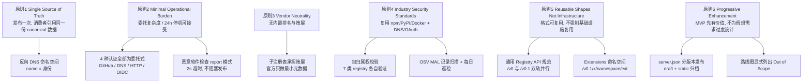
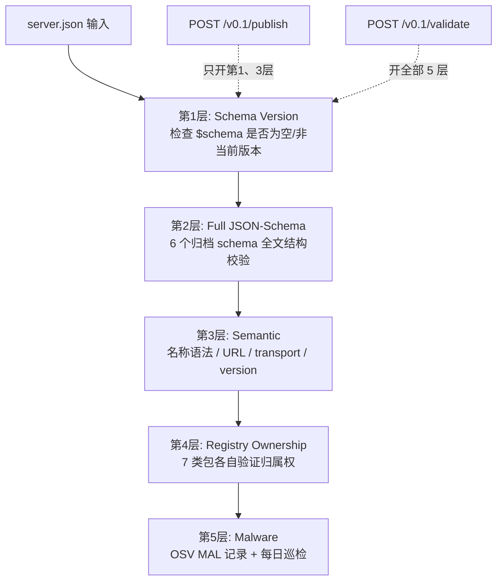
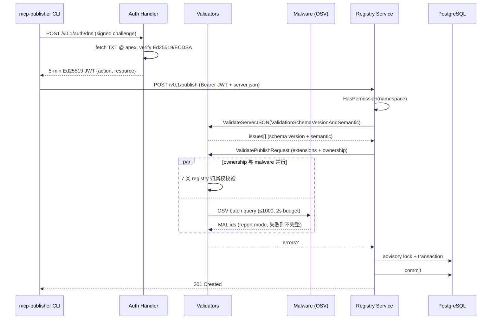
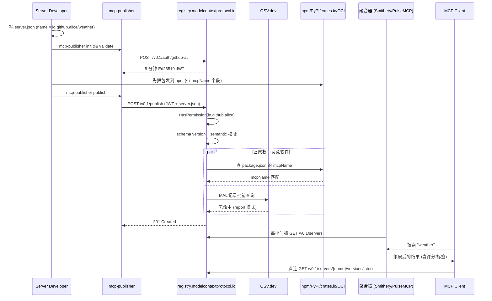

## 引子：一个没有搜索框的「应用商店」

如果你在 2024 年用过 MCP（Model Context Protocol），大概率遇到过这个场景：

你想给 Claude Code 装一个「天气查询」的 MCP server。你打开 Claude Code 的 MCP 配置界面，那里有一个输入框，可以填一个 npm 包名。你填了 `@modelcontextprotocol/server-everything`，装上了，能跑。

但如果这个 server 不在 npm 上呢？如果它是一个 Rust 二进制、一个 Docker 镜像、一个跑在别人服务器上的远程 HTTP 端点呢？你没有任何地方可以「发现」它——除非有人给每个 server 都单独写一份 README，教别人手动填 URL。

2026 年 9 月 8 日，官方 MCP Registry 以 preview 形态上线（`registry.modelcontextprotocol.io`）。它做的事情很简单，也很重：**给 MCP 服务器建一个统一的「元数据目录」**。

这不是又一个 MCP 网关。这篇文章要讲清楚的是：**为什么一个注册表是这个生态里最容易被做错、也最值得单独拆解的组件**，以及官方实现是怎么在「安全」「中立」「不添麻烦」这三个互相拉扯的目标之间走钢丝的。

---

## 一、项目定位：它到底管什么，不管什么

### 1.1 仓库元信息

| 项 | 值 |
| --- | --- |
| 仓库 | `modelcontextprotocol/registry` |
| 描述 | A community driven registry service for Model Context Protocol (MCP) servers. |
| 语言 | Go |
| Stars | 7,495 |
| Forks | 1,064 |
| Open Issues | 133 |
| 创建时间 | 2025-02-05 |
| 最近推送 | 2026-11-23 |
| 治理方 | MCP Registry Working Group（Stacklok / PulseMCP / TeamSpark / Ravenmail），Anthropic、GitHub、Microsoft、PulseMCP 背书 |
| 许可 | 非标准（`NOASSERTION`），Registry Data 单独以 CC0 1.0 释出 |
| 文档站 | `https://registry.modelcontextprotocol.io/docs` |

### 1.2 一句话定义

> **它是一个元注册表（metaregistry）：只托管「关于包的元数据」，不托管包本身。**

`docs/design/ecosystem-vision.md` 把这句话写得很直白：

> "Note that MCP registries are _metaregistries_. They host metadata about packages, but not the package code or binaries. Instead, they reference other package registries (like NPM, PyPi or Docker) for this."

原文给了一个非常具体的对照：

```
MCP Registry: "weather-server v1.2.0 is at npm:weather-mcp"
NPM Registry: [actual weather-mcp package code]
```

这个决定是整个架构的起点，也是它和 npm / PyPI 最本质的区别：**npm 是「分发平面 + 存储平面」，MCP Registry 纯做「分发平面」**。实际代码仍然躺在 npm、PyPI、crates.io、容器镜像仓库里。

### 1.3 它提供什么

`docs/modelcontextprotocol-io/about.mdx` 列得很清楚：

> "The MCP Registry provides:
> - A single place for server creators to publish metadata about their servers
> - Namespace management through DNS verification
> - A REST API for MCP clients and aggregators to discover available servers
> - Standardized installation and configuration information"

注意第一条里的 "single place" 和最后一条的 "standardized installation" —— 这是两个很值钱的东西：**单一事实源** + **标准化的安装契约**。

### 1.4 它明确不做什么

这一点比它做什么更重要。`docs/design/roadmap.md` 里有一节专门叫 "Out of Scope (Not Planned)"，原文：

> "## Out of Scope (Not Planned)
> - **Source code hosting**: The registry will never host actual server code
> - **Quality rankings**: No built-in server quality assessments or rankings
> - **Curation**: No editorial decisions about which servers are \"better\"
> - **Unified runtime**: Not solving how servers are executed
> - **Server hosting**: The registry does not provide hosting for servers
> - **Search engine**: The registry will not provide a commercial grade search engine for servers
> - **Server tags or categories**: Not supported, to reduce moderation burden
> - **Server rankings**: The registry will not rank servers by subjective measures of quality"

**8 条「永远不做」**。这背后是一个非常清醒的判断：**注册表最大的失败模式不是技术问题，是运营问题。** 排名意味着主观争议 → 意味着审核 → 意味着无限运营负担。标签分类同理。

设计原则文件 `docs/design/design-principles.md` 把这条思路提炼成六条，其中第二条直接叫 "Minimal Operational Burden"：

> "These are the core constraints that guide the design of the MCP Registry. They are not exhaustive, but they are the most important principles that we will use to evaluate design decisions."

> "- Design for low maintenance and operational overhead
> - Delegate complexity to existing services where possible (GitHub for auth, npm/PyPI/NuGet for packages)
> - Avoid features that require constant human intervention or moderation
> - Build for reasonable downtime tolerance (24h acceptable) by having consumers cache data for their end-users"

最后一条「24 小时可接受停机」是整篇文章里我最欣赏的一句设计声明。它意味着：**注册表不需要做 HA、不需要做多区域、不需要做写入的强一致**。它只需要把数据写对一次，然后被消费者缓存住。

第三条原则 "Vendor Neutrality" 同样关键：

> "- No preferential treatment for specific servers or organizations
> - No built-in ranking, curation, or quality judgments
> - Let consumers (MCP clients, aggregators) make their own curation decisions"

**中立不是道德姿态，是架构约束。** 一旦你在代码里写了「Anthropic 官方的 server 排前面」，你就是把生态的政治结构焊进了基础设施。

---

## 二、六条设计原则如何推导出整个架构

在进入代码之前，先把「设计原则 → 架构决策」这条推导链摆出来，因为这是本系列反复强调的：**架构不是拍脑袋来的，是约束的函数**。



### 2.1 原则 1 → 命名空间即身份

如果「单一事实源」成立，那么「一个 server 的身份是什么」必须能被全球唯一确定，而且这个确定过程不能依赖任何中心化的账号系统去仲裁。

MCP Registry 的答案是：**反向 DNS 命名空间 + 名字本身就是授权凭据**。

```text
io.github.alice/weather-server        ← GitHub 用户 alice
io.github.anthropics/mcp-server       ← GitHub 组织 anthropics
com.example.*/*                        ← 域名 example.com 的反向 DNS
```

这里有一个非常漂亮的性质：**命名空间的形状直接编码了它的验证方式**。你看到 `io.github.*`，就知道它由 GitHub 账号体系背书；看到 `com.example.*`，就知道它由 DNS 或 HTTP challenge 背书。**你不需要去查这个 server 是怎么认证的——名字本身就告诉了你。**

这和 npm scope（`@types/node`）或 Docker namespace 的思路同源，但走得更远：MCP Registry 让**认证方式成为命名空间的函数**，而不是一个可以随便声明的字段。

### 2.2 原则 2 → 委托式认证

"Delegate complexity to existing services where possible (GitHub for auth, npm/PyPI/NuGet for packages)" 这条原则直接产出了 4 种认证方法。注意它们有一个共同点：**注册表自己从不管理密码。**

| 认证方式 | 委托给谁 | 拿到的命名空间 |
| --- | --- | --- |
| GitHub OAuth（device flow） | GitHub App | `io.github.<user>/*` |
| GitHub OIDC | GitHub Actions | `io.github.<org>/*` |
| DNS 验证（TXT @ apex） | 你的 DNS 服务商 | `com.example.*/*` |
| HTTP 验证（`/.well-known/`） | 你的 Web 服务器 | `com.example.*/*` |

### 2.3 原则 4 → 包归属权：把信任锚定在包的原生元数据里

这是整个项目技术含量最高的部分，也是最容易被误读的部分。

问题：如果 `server.json` 说「我的 npm 包叫 `foo`，我拥有它」——注册表凭什么信？

MCP Registry 的答案是：**去包的原生注册表里，找那个包自己声明的元数据。** 7 种包类型，7 种验证方式：

| registryType | 托管方 | 归属权证明方式（原文） |
| --- | --- | --- |
| `npm` | `registry.npmjs.org` | "checking `mcpName` in `package.json`. The `mcpName` property **MUST** match the server name from `server.json`." |
| `pypi` | `pypi.org` | "checking for the existence of an `mcp-name: $SERVER_NAME` string in the package README" |
| `nuget` | `api.nuget.org` | 同上（README `mcp-name:`） |
| `cargo` | `crates.io` | 同上（README `mcp-name:`） |
| `oci` | Docker Hub / GHCR / Quay / GAR / ACR / MCR | "checking for an `io.modelcontextprotocol.server.name` annotation" |
| `mcpb` | GitHub / GitLab Releases | "The MCPB package URL (`identifier` in `server.json`) **MUST** contain the string \"mcp\"." + `fileSha256` |

这张表的精妙之处在于：**每种生态都用它自己已经习惯的那套「我拥有这个包」的表达方式**。npm 开发者知道怎么在 `package.json` 里写 `mcpName`；Docker 开发者知道怎么打 `LABEL`。注册表没有发明新机制，它只是**把这些既有的自我声明当作所有权证明来读**。

---

## 三、server.json：一份被当作契约来治理的元数据格式

### 3.1 schema 的来源是 OpenAPI，不是手写

`docs/reference/server-json/draft/server.schema.json` 的第一行就写明了：

> "$comment": "This file is auto-generated from docs/reference/api/openapi.yaml. Do not edit manually. Run 'make generate-schema' to update."

`docs/reference/server-json/CONTRIBUTING.md` 给出了四步发布流程：

> "1. **Modify the OpenAPI spec**: Edit `docs/reference/api/openapi.yaml` with your schema changes. The `ServerDetail` component defines the server.json structure.
> 2. **Regenerate the schema**: Run `make generate-schema` to update `server.schema.json` from the OpenAPI spec.
> 3. **Update the changelog**: Add your changes to the \"Draft (Unreleased)\" section in `CHANGELOG.md`.
> 4. **Open a PR**: Submit a pull request to this repository for review."

**schema 从 OpenAPI 生成，OpenAPI 是 API 契约的 SSOT。** 这样 API 文档和 schema 不可能漂移——因为它们是同一份源。

版本化策略是「草稿 + 归档」双轨：

> "- **Draft schema**: `https://raw.githubusercontent.com/modelcontextprotocol/registry/main/docs/reference/server-json/draft/server.schema.json` - For in-progress changes, may change without notice.
> - **Released schemas**: `https://static.modelcontextprotocol.io/schemas/YYYY-MM-DD/server.schema.json` - Stable, versioned by release date."

实际缓存里能看到 6 个已发布的 schema 版本（`internal/validators/schemas/`）：

```text
2025-07-09.json
2025-09-16.json
2025-09-29.json
2025-10-11.json
2025-10-17.json
2025-12-11.json   ← current
```

**schema 版本随时间被完整归档在代码里**，这意味着任何一个 `server.json` 永远可以被按它发布时的规则来校验——而不是按今天的规则。这是「契约即制品」的思路。

### 3.2 server.json 的骨架

一个最小的 server.json 大致长这样：

```json
{
  "$schema": "https://static.modelcontextprotocol.io/schemas/2025-12-11/server.schema.json",
  "name": "io.github.alice/weather-server",
  "description": "Provides weather forecasts for a configured location.",
  "version": "1.2.0",
  "repository": {
    "url": "https://github.com/alice/weather-server",
    "source": "github"
  },
  "packages": [
    {
      "registryType": "npm",
      "registryBaseUrl": "https://registry.npmjs.org",
      "identifier": "weather-mcp",
      "version": "1.2.0",
      "runtimeHint": "npx",
      "transport": {
        "type": "stdio"
      },
      "environmentVariables": [
        {
          "name": "WEATHER_API_KEY",
          "description": "API key for the weather service.",
          "isRequired": true,
          "isSecret": true
        }
      ]
    }
  ]
}
```

设计要点：

- **`name` 是身份**（`namespace/name`），不是展示名。
- **`version` 是发布者声明的**，注册表不做严格 semver 强制（见 §4.4）。
- **`packages[]` 是数组**，因为同一个 server 常常要同时提供 npm 和 OCI 两种分发方式。
- **`transport`** 描述这个包怎么被调用：`stdio` / `streamable-http` / `sse`。
- **`environmentVariables`** 带 `isSecret` 标记——注册表只是描述「需要什么」，不负责保管密钥。

### 3.3 远程服务器：一个纯 URL 的 server

除了 `packages`，server.json 还可以有 `remotes`：

```json
{
  "name": "com.example/weather-remote",
  "description": "A remote-only MCP server.",
  "remotes": [
    {
      "url": "https://mcp.example.com/mcp",
      "transport": { "type": "streamable-http" },
      "headers": [
        { "name": "X-API-Key", "value": "{apiKey}", "isRequired": true, "isSecret": true }
      ]
    }
  ]
}
```

`remotes` 里的 URL 支持 `{curly_braces}` 模板变量（2025-12-11 引入），客户端可以在安装时填入。

这里有一个**必须诚实指出的缺口**（文档 `docs/modelcontextprotocol-io/remote-servers.mdx` 自己承认的）：

> "When you publish, the Registry verifies that you control the namespace in the server `name` using your [authentication method](./authentication). It does **not** verify that you control the remote URL, regardless of authentication method"

> "With [DNS authentication](./authentication#dns-authentication) or [HTTP authentication](./authentication#http-authentication), a server named `com.example/weather` proves control of `example.com`, but the Registry does not check that the remote URL is on `example.com`."

也就是说：**你可以用 `com.example/` 的命名空间，指向一个你完全不控制的 URL**。注册表验证的是「你拥有这个名字」，不是「你拥有这个端点」。

文档还特别提醒了由此带来的连锁问题：

> "Multiple server names can reference the same remote URL. An existing listing does not reserve that URL or prevent another publisher from listing it under a namespace they control."

> "Consumers should identify registry records by server name and version, not by remote URL."

---

## 四、四种所有权证明机制的实现原理

这一节是全文的技术核心。每个机制都有「客户端做什么 → 注册表怎么验」的完整闭环。

### 4.1 GitHub OAuth：device flow 的一个真实坑

`mcp-publisher login github` 走的是 GitHub App 的 device flow。但这里有一个**至今未修的官方承认的 bug**（`docs/modelcontextprotocol-io/authentication.mdx`）：

> "**`mcp-publisher login github` cannot currently publish to an organization namespace.**
>
> The interactive device flow authenticates against a GitHub App, and GitHub App user tokens cannot read organization memberships — GitHub returns an empty list, so the registry sees no organizations you own and grants only your personal namespace. This affects everyone, regardless of your role in the organization or whether your membership is public. Tracking issue: [#1468](https://github.com/modelcontextprotocol/registry/issues/1468)."

根因很清晰：**GitHub App 的 user token 没有 `read:org` 权限**，GitHub API 返回空的组织列表，注册表自然认为「你不拥有任何组织」。

绕过办法有两条：GitHub Actions（走 OIDC，不受影响），或者 Personal Access Token：

> "- **Classic PAT**: grant the `read:org` scope.
> - **Fine-grained PAT**: grant the **Organization permissions → Members → Read-only** permission (the fine-grained equivalent of `read:org`)."

> "Either way the token needs **no** repository scopes — the registry never reads or writes your code."

「registry 永远不读你的代码」这个承诺，在整个供应链安全叙事里其实非常关键——它意味着这个注册表**没有能力成为代码供应链的攻击面**。

关于组织权限的判定，源码 `internal/api/handlers/v0/auth/github_at.go` 里的逻辑是：只有 `role == "admin" && state == "active"` 才授予组织命名空间。而且源码里有一段很有价值的自陈历史：

> "historically every org a user belonged to was granted publish access"

也就是说**早期版本是「凡是你所属的组织都能发布」，这是一个被主动收紧过的设计**。收紧的理由文档写得很清楚：

> "To publish under an **organization** namespace (`io.github.<orgname>/*`), you must be an **Owner** of that organization. Ordinary org membership is no longer sufficient: the registry checks your membership role and only grants the org namespace to admins. This prevents anyone who merely belongs to an org from publishing — or overwriting — servers under the org's name."

但收紧后并没有覆盖全部场景，源码里诚实写了这条边界：

> "not a proven guarantee that every SSO-blocked Owner is caught here"

**这是本系列见过最诚实的一种缺陷披露方式**：不说是 bug，也不说不是 bug，而是明确划出「我们无法证明的边界在哪」。

### 4.2 DNS 验证：SPF 式的 apex 放置

DNS 认证的证明记录格式是：

```text
v=MCPv1; k=ed25519; p=${PUBLIC_KEY}
```

也支持 `k=ecdsap384`。整个流程是：

1. 注册表返回一个待签名的挑战（通常是带时间戳的字符串）
2. 你用私钥对挑战签名
3. 你把公钥以 `v=MCPv1; ...` 格式发布到 DNS TXT
4. 你把签名 POST 到 `POST /v0.1/auth/dns`
5. 注册表拉取 TXT，用公钥验签，签发一个 5 分钟有效的 Ed25519 JWT

文档里有一个**极易踩坑**的警告：

> "The TXT record must be placed on the **apex** of your domain (e.g. `example.com`), **not** under a selector like `_mcp-auth.example.com` or `_mcp-registry.example.com`. MCP DNS auth follows SPF-style placement (apex), not DKIM-style (selector). If you put the record under a selector, the registry will not see it and authentication will fail with a generic signature error."

**SPF 风格（apex）而不是 DKIM 风格（selector）** —— 这个类比选得很准，因为 SPF 正是「一条记录证明整个域」的范式。

还有一个轮换相关的坑：

> "If you rotate keys, also remember to remove the previous TXT record from the apex — a stale record left behind will be tried first and cause verification to fail."

以及 macOS 用户的专属地雷：

> "The Ed25519 codepath requires **OpenSSL 3.0 or later**. macOS ships with LibreSSL by default (the system `openssl` binary), which does not implement Ed25519 in `genpkey` and fails with `Algorithm Ed25519 not found`."

### 4.3 HTTP 验证：`/.well-known/mcp-registry-auth`

HTTP 方式的证明文件放在域名根下的固定路径：

```text
GET https://example.com/.well-known/mcp-registry-auth
```

`docs/modelcontextprotocol-io/authentication.mdx` 给出了完整的抓取契约表（原文）：

| Property | Requirement |
| --- | --- |
| Request | `GET https://<domain>/.well-known/mcp-registry-auth`, sent with `Accept: text/plain` and `User-Agent: mcp-registry/1.0` |
| Status | `200 OK`. Redirects are not followed, so a `3xx` fails verification |
| Body | one or more proof records, at most 4096 bytes in total. Use one record per line; surrounding whitespace is ignored |
| Timeout | 15 seconds overall, including retries and backoff; each attempt is limited to 10 seconds or the remaining overall budget, whichever is shorter |
| Retries | at most one retry after 500 ms for connection failures, `408`, `429`, or `5xx`, while time remains. Other `4xx`, `3xx`, invalid TLS certificates, blocked addresses, nonexistent domains, and oversized bodies fail immediately |
| Origin | the hosted Registry runs on Google Cloud, so the request arrives from Google Cloud addresses rather than a fixed address you can allowlist per request |

这张表写得非常工程化。几个细节值得注意：

- **不跟随重定向** —— 避免「把你的验证请求重定向到内网」这类 SSRF 变体
- **回环 / 私网 / link-local / CGNAT 段直接拒绝** —— 文档说："Addresses that resolve to loopback, private, link-local, or carrier-grade NAT ranges are refused by design"
- **Origin 是 Google Cloud 段而非固定 IP** —— 文档诚实地告诉你「你没法按 IP 白名单放行」

以及一个**极易困惑**的失败模式：

> "The Registry fetches your verification file from its own infrastructure when you run `mcp-publisher login http`, so a `curl` that succeeds on your machine does not prove that login will work. The Registry itself must be able to reach the endpoint."

> "If the Registry cannot use the endpoint, login fails with `token exchange failed with status 401` even though the file is served correctly to every other client."

文档列出了会导致这一失败的具体原因：

> "- a WAF, bot-management, or \"under attack\" rule that challenges or blocks non-browser clients
> - a geo-block or IP allowlist that excludes Google Cloud address ranges
> - an `AAAA` (IPv6) record pointing at an address that is not reachable. Verification fails if none of the domain's public addresses can be reached, even when IPv4 works in a browser
> - a `301`/`302` redirect to another host or path, which the Registry does not follow
> - `/.well-known/mcp-registry-auth` answering `200 OK` with an HTML error page instead of the proof record"

### 4.4 四种认证共享的密钥语义

DNS 和 HTTP 两种方式共用一套证明记录语法，因此也共用一套密钥语义。这里有两个**必须写进任何注册表设计文档**的结论：

**结论一：加新密钥不吊销旧密钥。**

> "**Adding a new key, or changing record order, does not revoke an old key. Anyone holding a matching private key can authenticate while its public key remains published. If a key is compromised, remove its record immediately rather than keeping an overlap period.**"

注意加粗部分说的正好和常规做法相反：常规做法是「新旧密钥并存一段时间以支持平滑轮换」，而 MCP Registry 明确说**不要这样做**——因为并存窗口本身就是攻击面。

**结论二：删证明记录不吊销已签发的 token。**

> "Removing a proof record does not revoke Registry tokens already issued; those tokens remain valid until their expiry (currently five minutes after issuance)."

5 分钟 TTL 是这个设计的核心缓解手段。短到「可以接受」，长到「够用」。源码里所有 auth handler 最终都签发 **5 分钟有效期的 Ed25519 JWT**。

还有一个细节体现了实现质量：注册表会**识别「放错位置」的记录**：

> "When the Registry finds a well-formed MCPv1 record at a known wrong selector (`_mcp-auth.<domain>` or `_mcp-registry.<domain>`) but none at the requested domain, it returns a specific error identifying the misplaced record."

**把用户犯的具体错误指出来，而不是丢一个「签名错误」**——这是好的错误信息设计的样板。

---

## 五、验证子系统：三档强度与一个刻意的不对称

`internal/validators/` 是这个项目里设计最精细的部分。它有三层验证：



### 5.1 `ValidationOptions`：把「验什么」变成一个可配置结构

`internal/validators/validation_types.go` 的核心类型（原文）：

```go
// ValidationOptions configures which types of validation to perform
// ValidateSchema implies ValidateSchemaVersion (the flag is ignored if ValidateSchema is true)
type ValidationOptions struct {
	ValidateSchemaVersion  bool                // Check schema version (empty, non-current). Ignored if ValidateSchema is true.
	ValidateSchema         bool                // Perform full schema validation (implies ValidateSchemaVersion)
	ValidateSemantic       bool                // Perform semantic validation
	NonCurrentSchemaPolicy SchemaVersionPolicy // Policy for non-current schemas (only used when schema validation is performed)
}
```

然后是四个预设：

```go
	// ValidationSemanticOnly performs only semantic validation (no schema checks)
	ValidationSemanticOnly = ValidationOptions{
		ValidateSemantic: true,
	}

	// ValidationSchemaVersionOnly checks schema version only (empty, non-current)
	ValidationSchemaVersionOnly = ValidationOptions{
		ValidateSchemaVersion:  true,
		NonCurrentSchemaPolicy: SchemaVersionPolicyError,
	}

	// ValidationSchemaVersionAndSemantic checks schema version and performs semantic validation
	ValidationSchemaVersionAndSemantic = ValidationOptions{
		ValidateSchemaVersion:  true,
		ValidateSemantic:       true,
		NonCurrentSchemaPolicy: SchemaVersionPolicyWarn,
	}

	// ValidationAll performs all validation types (schema version, full schema validation, and semantic)
	ValidationAll = ValidationOptions{
		ValidateSchema:         true, // Implies ValidateSchemaVersion
		ValidateSemantic:       true,
		NonCurrentSchemaPolicy: SchemaVersionPolicyWarn,
	}
```

### 5.2 ⭐ 那个刻意的不对称：发布路径不验 schema 本身

这是本节最重要的一件事。看两个调用点：

- `internal/api/handlers/v0/publish.go:58` 和 `internal/api/handlers/v0/edit.go:98` → 用 `validators.ValidationSchemaVersionAndSemantic`
- `internal/api/handlers/v0/validate.go:29` → 用 `validators.ValidationAll`

**结论：`/publish` 和 `/edit` 只校验 schema 的「版本号」，不校验 schema 本身；只有 `/validate` 端点做完整的 JSON-Schema 校验。**

这个不对称是**官方在设计文档里明确承认的问题**。`docs/design/proposed-enhanced-validation.md` 开头就是：

> "NOTE: This document describes a proposed direction for improving validation of server.json data in the Official Registry. This work is in progress (including open PRs and discussions) in a collaborative process and may change significantly or be abandoned."

问题清单：

> "### Problems with Current Validation
> - **No schema validation**: Servers are published without validating against the published schema (and many violate it)
> - **Incomplete validation**: Ad hoc validation covers only some schema constraints (many published servers have additional logical errors)
> - **Best Practices not indicated**: Many servers that would pass schema and semantic validation do not represent best practices
> - **Fail-fast behavior**: Legacy `ValidateServerJSON()` stopped at first error (now replaced with exhaustive validation)
> - **No path information**: Errors don't specify where in JSON the problem occurs"

以及最刺眼的一句：

> "Currently, the MCP Registry project publishes a server.json schema but does not validate servers against it, allowing non-compliant servers to be published."

**这是一个「发布了规范却不强制执行」的自认。** 它为什么不修？我猜有很实际的工程原因：完整 JSON-Schema 校验是纯 CPU 的，而且一旦开启，所有存量 publisher 会立刻大面积失败 —— 一个 preview 阶段的注册表很难承受这种 breaking。所以文档写的是分阶段计划：

> "### **Stage 1: Schema Validation and Exhaustive Validation Results (Current)**
> ...
> - `mcp-publisher publish` command validates schema version (rejects empty and non-current schemas) but does not perform full schema validation
> - API `/v0/publish` endpoint uses `ValidatePublishRequest` which validates schema version and semantic validation, but not full schema validation"

> "### **Future Stages**
> - Enable full schema validation in `mcp-publisher publish` command (currently only validates schema version)
> - Enable full schema validation in the `/v0/publish` API endpoint (currently only validates schema version via `ValidatePublishRequest`)
> - Add `/v0/validate` API endpoint for programmatic validation without publishing"

而且文档还坦承了验证逻辑的重复问题：

> "#### **Current Problem: Validation Duplication**
> The existing system has both:
> - **Manual/semantic validators**: Custom Go code validating server name format, URL patterns, etc.
> - **JSON Schema validation**: Structural validation of the same constraints
> This creates redundancy and potential inconsistencies where:
> - Manual validators provide friendly error messages
> - Schema validation provides technical error messages
> - Both validate the same underlying constraints"

以及 `anyOf` 判别联合导致的错误信息噪音：

> "The schema uses `anyOf` for discriminated unions (transport, argument, remote), which causes noisy error messages when validation fails. When a transport/argument/remote doesn't match its specified type, `anyOf` validation tries all variants and reports errors for each one that doesn't match.
> **Problem Example**: If you have an \"sse\" transport with no url, you get errors for all transport types:
> 1. [error] packages[0].transport.type (schema)
>    value must be \"stdio\""

这段自陈极其有价值，因为它精确指出了 **JSON Schema `anyOf` 判别联合的固有缺陷**：错误信息无法定位到正确的那个分支。

### 5.3 归属权校验：每个生态一套

`internal/validators/registries/` 目录下有 7 个 validator（npm / pypi / nuget / cargo / oci / mcpb / mcpname）。以 npm 为例，核心逻辑（`internal/validators/registries/npm.go` 原文）：

```go
// ValidateNPM validates that an NPM package contains the correct MCP server name
func ValidateNPM(ctx context.Context, pkg model.Package, serverName string) error {
	// Set default registry base URL if empty
	if pkg.RegistryBaseURL == "" {
		pkg.RegistryBaseURL = model.RegistryURLNPM
	}

	if pkg.Identifier == "" {
		return ErrMissingIdentifierForNPM
	}

	// we need version to look up the package metadata
	// not providing version will return all the versions
	// and we won't be able to validate the mcpName field
	// against the server name
	if pkg.Version == "" {
		return ErrMissingVersionForNPM
	}

	// Validate that MCPB-specific fields are not present
	if pkg.FileSHA256 != "" {
		return fmt.Errorf("NPM packages must not have 'fileSha256' field")
	}

	// Validate that the registry base URL matches NPM exactly
	if pkg.RegistryBaseURL != model.RegistryURLNPM {
		return fmt.Errorf("registry type and base URL do not match: '%s' is not valid for registry type '%s'. Expected: %s",
			pkg.RegistryBaseURL, model.RegistryTypeNPM, model.RegistryURLNPM)
	}

	return validateNPMPackage(ctx, pkg, serverName)
}
```

几个值得注意的设计：

1. **必须有精确版本号** —— 因为 `mcpName` 是包级元数据，不指定版本会返回所有版本，无法比对。
2. **`registryBaseUrl` 必须与 registryType 精确匹配** —— 防止有人把 `registryType: npm` 指向一个自建的假 npm 镜像来绕过校验。**这是一个非常关键的检查**。
3. **MCPB 专属字段不能出现在 npm 包上** —— 防止字段混用。

而 MCPB 的 validator（`internal/validators/registries/mcpb.go`）则**完全不做归属权校验**：

```go
// 说明：以下为源码节选，函数体在节选边界处截断，故括号不成对。
func ValidateMCPB(ctx context.Context, pkg model.Package, _ string) error {
	// MCPB packages must include a file hash for integrity verification
	if pkg.FileSHA256 == "" {
		return ErrMissingFileSHA256ForMCPB
	}

	if pkg.Identifier == "" {
		return ErrMissingIdentifierForMCPB
	}

	// Validate that registryBaseUrl is not present
	// MCPB packages use full download URLs in identifier
	if pkg.RegistryBaseURL != "" {
		return fmt.Errorf("MCPB packages must not have 'registryBaseUrl' field - use the full download URL in 'identifier' instead")
	}
```

注意签名里的 `_ string` —— **第三个参数 `serverName` 被显式丢弃了**。也就是说 MCPB 包**不需要证明自己与 server name 有任何关系**。真正的检查在更后面：

```go
	// Check that the URL contains 'mcp' somewhere (case-insensitive)
	if !strings.Contains(strings.ToLower(pkg.Identifier), "mcp") {
		return fmt.Errorf("MCPB package URL must contain 'mcp': %s", pkg.Identifier)
	}
```

文档也确实这么说：

> "The MCPB package URL (`identifier` in `server.json`) **MUST** contain the string \"mcp\"."

这就是 MCPB 的「所有权证明」——**URL 里含 "mcp" 三个字母**。这是一个几乎没有任何安全强度的检查（任何人都能构造一个含 "mcp" 的 URL）。文档自己也承认了完整性校验的空洞：

> "The MCP Registry does not validate this hash; however, MCP clients **do** validate the hash before installation to ensure file integrity. Downstream registries may also implement their own validation."

**注册表不验哈希，客户端验哈希** —— 责任被显式推给了下游。

### 5.4 README token 验证的一个跨生态陷阱

PyPI / NuGet / Cargo 三者都用 README 里的 `mcp-name:` token 验证。但这三个生态的 README 渲染行为**不一致**，官方文档专门为 Cargo 打了个补丁：

> "**Cargo-specific gotcha:** Unlike PyPI and NuGet (which preserve HTML comments in their README rendering), **crates.io strips HTML comments during markdown→HTML conversion**. The `<!-- mcp-name: ... -->` hidden-comment form that works for PyPI/NuGet **does not work for cargo** — the token will not appear in the rendered HTML the validator inspects. Cargo authors must include the `mcp-name:` token as visible markdown text. A simple bullet in the Links section is the recommended pattern."

还有 token 的边界规则：

> "The `mcp-name:` token must be followed by a boundary — a newline, whitespace, an HTML tag, or the comment close `-->`. Keep it on its own line or inside `<!-- … -->`; do not glue it directly to trailing characters such as a sentence-ending period (`…/database-query-mcp.`), which prevents the match."

**这是把「实现细节泄漏到用户文档」的一个经典例子** —— 一个 README 后面跟句号就能让验证失败，而原因藏在 Markdown 渲染器的实现里。

---

## 六、恶意软件扫描：OSV 集成的两个半成品

MCP Registry 会在**发布时**和**每日巡检时**检查包是否命中 OSV.dev 的恶意软件记录（`MAL-*` 前缀）。

### 6.1 匹配语义：必须精确到版本

`internal/malware/osv.go` 的 `names` 方法（原文）：

```go
// names reports whether the record covers exactly this version of the
// package. A record that does not mention the package at all is an answer
// that cannot be used, not one that covers every version.
func (r *osvRecord) names(ecosystem string, pkg Package) (bool, error) {
	if r.Withdrawn != "" {
		return false, nil
	}
	mentioned, listsVersions := false, false
	for _, affected := range r.Affected {
		if affected.Package.Ecosystem != ecosystem || !sameName(ecosystem, affected.Package.Name, pkg.Identifier) {
			continue
		}
		mentioned = true
		for _, version := range affected.Versions {
			listsVersions = true
			if sameVersion(ecosystem, version, pkg.Version) {
				return true, nil
			}
		}
	}
	if !mentioned {
		return false, errors.New("the record does not mention the package")
	}
	return !listsVersions, nil
}
```

这段代码里有三个精妙的设计：

1. **`Withdrawn != ""` 直接返回 false** —— 已撤回的记录不算数。
2. **"记录完全没提到这个包" ≠ "这个包所有版本都是恶意"** —— 前者返回 error（不可用），后者返回 true（全是恶意）。这个区分非常重要，否则一条提到别的包的记录会误伤。
3. **只有当记录明确列出该版本，或者完全不列版本（意味着所有版本都是恶意）时才匹配**。

`queryBatch` 里还有一个位置匹配的正确性保证：

```go
// 说明：以下为源码节选，函数体在节选边界处截断，故括号不成对。
// Results are matched to queries by position, so a short answer cannot be used.
	if len(batch.Results) != len(queries) {
		return nil, nil, nil, fmt.Errorf("OSV answered %d of %d queries", len(batch.Results), len(queries))
	}
```

**位置匹配是脆弱的** —— 如果 OSV 返回的数组比查询数组短，位置就会整体错位，把 A 包的判定用到 B 包上。显式检查长度是必须的。

### 6.2 ⚠️ 失败模式是「答案不完整」而不是「fail closed」

`internal/malware/osv.go` 的包级文档写得很清楚：

> "An error means the answer is incomplete: the packages returned are malware, and the others may or may not be."

配合 `internal/validators/validators.go` 的超时：

```go
// malwareCheckTimeout bounds how long a publish waits for OSV before going
// ahead without its answer.
const malwareCheckTimeout = 2 * time.Second
```

以及 `internal/config/config.go` 里的默认模式：

**默认是 `report` 模式 —— 命中恶意软件也照样发布成功。**

`docs/reference/api/CHANGELOG.md` 原文：

> "The check starts in report mode: a match is logged for the maintainers and the request succeeds as before. Once it is set to enforce, a match is refused with `400`, and the error names the package and links to the OSV record. Operators choose with `MCP_REGISTRY_MALWARE_CHECK_MODE` (`report`, `enforce` or `off`)."

> "Ordinary vulnerabilities (CVE, GHSA) are not a match. Status changes, including taking a version down, are not checked. If OSV cannot be reached the request proceeds as before."

**「If OSV cannot be reached the request proceeds as before」** —— OSV 挂掉不会阻塞发布。这是一个刻意的权衡：恶意软件扫描不能成为发布路径的单点故障。

### 6.3 ⚠️ OCI 和 MCPB 完全不被覆盖

`internal/malware/osv.go` 的 `ecosystem` 函数（原文）：

```go
// ecosystem is the OSV name for a registry type. OSV has no ecosystem for OCI
// images or MCPB bundles.
func ecosystem(registryType string) (string, bool) {
	switch registryType {
	case model.RegistryTypeNPM:
		return "npm", true
	case model.RegistryTypePyPI:
		return ecosystemPyPI, true
	case model.RegistryTypeNuGet:
		return ecosystemNuGet, true
	case model.RegistryTypeCargo:
		return ecosystemCrates, true
	}
	return "", false
}
```

**OCI 镜像和 MCPB bundle 完全不参与恶意软件扫描。** 考虑到容器镜像是 MCP 生态里增长最快的分发形式之一，这个缺口相当大。

### 6.4 每日巡检：只读，不下架

`internal/malware/sweep.go`：

```go
	// ExistenceUnknown is the number of packages whose registry gave no
	// usable answer about whether they still exist.
	ExistenceUnknown int
	// ExistenceIncomplete says that a package registry left so many of its
	// packages unknown that the sweep cannot be taken to have looked there
	// for missing ones.
	ExistenceIncomplete bool
```

**「不完整」被提升为一等字段**，而不是一个布尔值。这是很高级的做法 —— 它让下游可以区分「我扫完了，一个都没命中」和「我压根没扫完」。

而巡检的权限边界，写得很干脆：

> "It only reads: taking an entry down is left to a maintainer."

也就是说：**巡检只负责发现，不负责处置。** 处置仍然走 moderation 流程（人工）。

部署侧还有一个自相矛盾的地方，`deploy/pkg/k8s/malware_sweep.go`：

> "The sweep gives up by itself after 30 minutes"

但代码里设的是 3600 秒。这是一处注释与实现不一致 —— 说明这个 cron 的超时值被改过但注释没跟上。

---

## 七、API 设计：双轨版本并行是本项目的又一次「克制」

### 7.1 为什么同时跑 `/v0` 和 `/v0.1`

`internal/api/router/v0.go` 里，`RegisterV0Routes` 和 `RegisterV0_1Routes` 两个函数的**函数体结构完全一样**，只是路径前缀不同：

```go
func RegisterV0Routes(
	api huma.API, cfg *config.Config, registry service.RegistryService, metrics *telemetry.Metrics, versionInfo *v0.VersionBody,
) {
	v0.RegisterHealthEndpoint(api, "/v0", cfg, metrics)
	v0.RegisterPingEndpoint(api, "/v0")
	v0.RegisterVersionEndpoint(api, "/v0", versionInfo)
	v0.RegisterServersEndpoints(api, "/v0", registry, cfg.PreparedListingJSON)
	v0.RegisterEditEndpoints(api, "/v0", registry, cfg)
	v0.RegisterStatusEndpoints(api, "/v0", registry, cfg)
	v0.RegisterAllVersionsStatusEndpoints(api, "/v0", registry, cfg)
	v0auth.RegisterAuthEndpoints(api, "/v0", cfg)
	v0.RegisterPublishEndpoint(api, "/v0", registry, cfg)
	v0.RegisterValidateEndpoint(api, "/v0")
}
```

**10 个端点注册 × 2 个版本 = 20 个路由，但只有一份 handler 实现。** 这是「用 URL 前缀做版本」而非「用代码分支做版本」的经典做法。

版本策略（`docs/reference/api/CHANGELOG.md`）：

> "Introduced `/v0.1/` as a stable API version while `/v0/` continues as the development version.
> **New version paths:**
> - All `/v0/` endpoints are now also available at `/v0.1/`
> - Both versions currently share identical behavior
> - `/v0/` will continue to evolve with additive changes (new optional fields, new endpoints)
> - `/v0.1/` will remain stable with only additive, backward-compatible changes
> - Both versions will be maintained until a future v1.0 release"

**一个滚动的前缀（`/v0`）+ 一个冻结的前缀（`/v0.1`）并行。** 新特性先只进 `/v0`，稳定后再同步到 `/v0.1`。这个「双轨」策略让集成方既能有稳定契约，又不用等 v1.0。

### 7.2 一个把子注册表也纳入体系的 API 规范

`docs/reference/api/generic-registry-api.md` 定义的是**通用注册表 API**（任何人都可以实现）：

> "- **`GET /v0.1/servers`** - List all servers with pagination
> - **`GET /v0.1/servers/{serverName}/versions`** - List all versions of a server
> - **`GET /v0.1/servers/{serverName}/versions/{version}`** - Get specific version of server. Use the special version `latest` to get the latest version.
> - **`POST /v0.1/publish`** - Publish new server (optional, registry-specific authentication)
> - **`PUT /v0.1/servers/{serverName}/versions/{version}`** - Update specific server version (optional; the official registry implements this as an admin endpoint)
> - **`DELETE /v0.1/servers/{serverName}/versions/{version}`** - Delete specific server version (optional, not implemented by official registry)
> - **`PATCH /v0.1/servers/{serverName}/versions/{version}/status`** - Update server version status (optional)
> - **`PATCH /v0.1/servers/{serverName}/status`** - Update status for all versions (optional)"

注意括号里的三处 "optional" —— **官方注册表自己都没实现 DELETE**。这个规范是「官方实现 + 未来可能」的超集。

### 7.3 三个真实存在的 API 陷阱

**陷阱一：版本是文本排序，不是语义排序。**

> "Results are ordered by server name, then by version string, both ascending. Version strings are compared as text, not by semantic version or publication date; for example, `1.10.0` sorts before `1.2.0`. Do not treat the first result for a server as its latest version."

**`1.10.0` 排在 `1.2.0` 前面。** 这是个真实会咬人的 bug。

**陷阱二：`latest` 不保证是 active。**

> "Deprecating a version does not, by itself, remove its `isLatest` flag. A deprecated version can remain the latest version of a server, so `version=latest` and the `/versions/latest` endpoint do not guarantee an active result. Clients that display only active servers must also check `_meta[\"io.modelcontextprotocol.registry/official\"].status == \"active\"`."

**陷阱三：搜索故意做得很弱。**

> "- `search` - Case-insensitive substring search on server names (e.g., `filesystem`)
>     - This is intentionally simple. For more advanced searching and filtering, use a subregistry."

而且还收紧了短查询：

> "A nonempty search must contain at least three Unicode characters after trimming surrounding whitespace. Shorter or whitespace-only searches return HTTP `422` before database work. ... This restriction changes previously accepted one- and two-character searches."

**「超过 2 个字符的搜索直接 422」** —— 这是防止全表扫描的粗暴但有效的护栏。

还有一个规范覆盖不全的自陈：

> "Note that `/v0.1/validate`, `/v0.1/ping`, `/v0.1/version` and `/v0.1/health` are not described in [openapi.yaml](./openapi.yaml), which covers the server and publish endpoints only."

### 7.4 元数据永不真正删除

`docs/modelcontextprotocol-io/faq.mdx`：

> "**Note:** Server metadata is never permanently removed from the registry. The `deleted` status hides the server from discovery but preserves the historical record."

这和 npm 的 unpublish 政策完全不同（npm 允许 72 小时 unpublish 后永久删除）。**保留历史记录对「我们三周前装过这个 server，它后来怎么了」这类问题是刚需**，但同时也是一个隐私负担，ToS 里专门有一条款：

> "11. Privacy and Publicity. You understand that any MCP server metadata you publish may be made public. This includes personal data such as your GitHub username, domain name, or details from your server description."

---

## 八、发布流程：从 `server.json` 到线上目录

### 8.1 publisher CLI 的命令集

`cmd/publisher/commands/` 目录包含：`init.go` / `login.go` / `logout.go` / `publish.go` / `status.go` / `validate.go`，认证后端在 `cmd/publisher/auth/`：`github-at.go` / `github-oidc.go` / `dns.go` / `http.go` / `none.go` / `interface.go` / `common.go`，另有 Azure Key Vault 和 Google KMS 的密钥辅助。

典型流程：

```bash
# 1. 初始化 server.json（自动探测字段，无法探测的留 TODO 占位）
mcp-publisher init

# 2. 认证（GitHub OAuth / GitHub PAT / DNS / HTTP）
mcp-publisher login github

# 3. 本地校验（完整 schema 校验，比 publish 更严格）
mcp-publisher validate

# 4. 发布
mcp-publisher publish
```

`docs/reference/cli/commands.md` 里两个值得注意的说明：

> "- Writes `TODO:` placeholders for fields it cannot detect — it is non-interactive and takes no flags"

> "- **Does not revoke tokens on server side**"

以及一个**极其容易误伤的 CLI 陷阱**：

> "`--registry` is a flag on `login` only (default: `https://registry.modelcontextprotocol.io`). The other commands read the registry URL from the stored login token, so passing `--registry` to `publish` would be interpreted as the `server.json` path."

**在 `publish` 上加 `--registry` 会被当成 server.json 的路径参数。** 这是一个把 flag 作用域搞错就会静默误解的典型设计。

### 8.2 服务端的发布管线



管线里三个关键点：

1. **归属权校验与恶意软件检查并行执行**，注释说明是 "The two run side by side, so a request waits for the slower of them and not for both."
2. **恶意软件检查有 2 秒预算**，超时即放行。
3. **数据库写入走 advisory lock + transaction**，防止并发发布同一 server/version 时的写冲突。

源码里还留了一句关于已知技术债的自陈（`internal/service/registry_service.go`）：

> "Left as-is because the edit path carries a small fraction of publish traffic."

（指 registry 校验在事务内持有数据库连接这件事，因为编辑路径流量很小而没有修。）

---

## 九、⭐ 必须诚实指出的源码自陈缺陷

这是本系列的核心差异化内容。MCP Registry 的文档和源码里主动承认了大量缺口 —— 这在一个「官方基础设施」项目里并不常见，值得完整列出。

### 9.1 文档漂移：架构文档自认过期

`docs/design/tech-architecture.md` 开头就是一个 `> [!WARNING]` 横幅：

> "> **This document has drifted from the shipped system and is kept as a design record.**
> > For the architecture as deployed, see [deploy/README.md](../../deploy/README.md); for the API as implemented, see the [API reference](../reference/api/official-registry-api.md).
> >
> > Known inaccuracies below, as of 2026-08-10:
> > - The registry is not deployed via a Helm chart. It is a plain Kubernetes `Deployment` created by Pulumi; Helm is used only for third-party components (ingress-nginx, cert-manager, cloudnative-pg, k8up, monitoring).
> > - The database diagram shows a `StatefulSet` on port `27017` (MongoDB). The database is PostgreSQL on `5432`, provisioned by the CloudNativePG operator.
> > - The DNS verification sequence (`mcp verify-domain`, `POST /verify-domain`, `POST /verify-domain/check`, server-issued challenge tokens) describes a design that was never built. The shipped flow signs a timestamp with the operator's key and posts it to `POST /v0/auth/dns`, with the public key published in a `v=MCPv1; k=...; p=...` TXT record.
> > - No `/admin/*` routes exist. Admin actions use the regular server endpoints with an admin-permissioned token.
> > - The CLI is `mcp-publisher`, not `mcp`, and publishing posts to `/v0/publish`.
> > - The database stores servers and server extensions only; it holds no user authentication state and no DNS verification records."

**一份架构文档逐条列出自己的 6 处错误，并说明「以哪个文档为准」。** 路线图文档也做了同样的事：

> "> **The phase labelling below is out of date as of 2026-08-10.** The registry launched in preview on 2025-09-08 and the v0.1 API entered a freeze on 2025-10-24, so \"Go-Live\" has already happened. The phases are retained for historical context."

**把「我已经过时了」写在文档最显眼的位置，而不是让读者自己踩坑** —— 这是本系列见过最好的文档卫生实践。

### 9.2 源码里的自陈缺陷清单

| # | 缺陷 | 出处（原文） |
| --- | --- | --- |
| 1 | 不强制严格 semver | `validators.go`：「NB: we decided that we would not enforce strict semver for version strings」 |
| 2 | OSV 出错时结果不完整 | `osv.go`：「An error means the answer is incomplete: the packages returned are malware, and the others may or may not be.」 |
| 3 | OCI/MCPB 无 OSV 生态 | `osv.go`：「OSV has no ecosystem for OCI images or MCPB bundles.」 |
| 4 | 巡检只读不处置 | `sweep.go`：「It only reads: taking an entry down is left to a maintainer.」 |
| 5 | 组织权限判定有边界 | `github_at.go`：「not a proven guarantee that every SSO-blocked Owner is caught here」 |
| 6 | 曾有组织越权发布的历史 | `github_at.go`：「historically every org a user belonged to was granted publish access」 |
| 7 | OCI validator 修过的 bug | `oci.go`：「the bug this branch used to have」 |
| 8 | 用量统计是近似的 | `collect.go`：「treat the shares as approximate」 |
| 9 | 用量统计的误差量级 | `collect.go`：「within about a tenth of the truth」 |
| 10 | 四段式版本号会被误判为 IP | `classify.go`：「A four-part version number … cannot be told from an IPv4 address and is withheld too.」 |
| 11 | 编辑路径持有 DB 连接未修 | `registry_service.go`：「Left as-is because the edit path carries a small fraction of publish traffic.」 |
| 12 | 巡检超时注释与实现不符 | `malware_sweep.go`：「The sweep gives up by itself after 30 minutes」（代码设 3600s） |
| 13 | 巡检内存随注册表增长 | `malware_sweep.go`：「and it grows with the registry」 |
| 14 | 未实现每请求 deadline | `router.go`：「if/when we add per-request deadlines」 |
| 15 | 滥用黑名单出厂为空 | `internal/auth/blocks.go`：`BlockedNamespaces` 是空切片 |
| 16 | CLI HTTP 客户端无超时 | `cmd/publisher/commands/publish.go`：`&http.Client{}` |

其中第 8、9 条特别有意思 —— 官方的用量统计是**从 Cloud Logging 采样 + Prometheus counter 重建出来的**，而且明确承认精度只有「大致的十分之一」。一个把「我算的是近似值」写进代码注释的遥测系统，比一个假装精确的遥测系统更值得信任。

第 15 条也很值得玩味：**滥用黑名单出厂是空的** —— 机制建好了，数据还没填。

### 9.3 治理层面的坦白

- **审核无保证**：「The MCP Registry **does not** make guarantees about moderation, and consumers should assume minimal-to-no moderation.」
- **不保证可用性**：「The MCP Registry **does not provide uptime or data durability guarantees**」（对聚合器而言）
- **不支持私有 server**：「The MCP Registry **does not** support private servers.」
- **不支持自托管**：「the official MCP Registry codebase is **not** designed for self-hosting, and the registry maintainers cannot provide support for this use case.」
- **不建议宿主应用直连**：「The MCP Registry is not intended to be directly consumed by host applications. Instead, host applications should consume other MCP registries, such as downstream marketplaces, via a REST API conforming to the official MCP Registry's OpenAPI spec.」
- **不扫描代码**：「The MCP Registry focuses on namespace authentication and metadata hosting, while relying on the broader ecosystem for security scanning of actual server code.」
- **反垃圾靠人工**：「Future spam prevention measures under consideration include stricter rate limiting, AI-based spam detection, and community reporting capabilities.」
- **ToS 明确免责**：「No Warranties. The Registry is provided \"as is\" with no warranties of any kind. That means we don't guarantee the accuracy, completeness, safety, durability, or availability of the Registry」

**把「我保证什么、不保证什么」全部写进文档，而不是留给用户去猜** —— 这是治理成熟度的直接体现。

---

## 十、端到端全景



注意这张图里**没有任何一步是「注册表把代码给了客户端」**。代码始终在 npm / 容器仓库里。注册表给的是「去哪拿、怎么跑、需要什么环境变量」的说明书。

---

## 十一、与同类项目对比：设计差异在哪里

### 11.1 四方对比

| 维度 | MCP Registry | npm / PyPI | MCP Gateway（如 Agent Gateway） | MCP 客户端内置目录 |
| --- | --- | --- | --- | --- |
| **管理单元** | server 名 + 版本（一份元数据） | 包的每个版本 | 每一次请求 / 每一个连接 | 应用内置的静态列表 |
| **核心动作** | 声明「这个 server 是什么、从哪拿、怎么跑」 | 存代码 + 存版本 | 转发 / 改写 / 配额 | 硬编码或人工配置 |
| **信任来源** | 命名空间所有权 + 包自身元数据 + OSV | 发布者账号 + 2FA + 下载量 | 你自己的配置（不验证外部） | 你自己（或你的应用商店） |
| **代码托管** | ❌ 明确不做 | ✅ 主业 | ❌ | ❌ |
| **质量排序** | ❌ 明确不做 | ❌ | ❌ | 由应用商店决定 |
| **审核** | 宽松，明确免责 | 严格 | 无 | 由应用商店决定 |
| **消费者** | 客户端 + 聚合器（ETL 抓取） | 开发者 + CI | Agent 运行时 | 最终用户 |
| **故障影响** | 发现不了新 server（已缓存的不受影响） | 装不了包 | Agent 调不通工具 | 少几个可选工具 |

### 11.2 关键设计差异分析

**vs npm/PyPI：共享的是「版本 + 发布者所有权」的心智模型，差别在「代码在哪」。**

npm 是「代码 + 元数据」一体；MCP Registry 只做元数据。这个切分带来的直接后果是：**MCP Registry 几乎不需要处理供应链攻击面**（它不存代码），但也因此**无法真正保证你拿到的东西是安全的**。

**vs MCP 网关：管理单元完全不同 —— 注册表管「有哪些 server」，网关管「每一次调用」。**

这是本系列反复出现的「管理单元」判据。MCP Gateway（Agent Gateway、ContextForge、mcpjungle 这类）解决的是「我连了 20 个 MCP server，如何统一鉴权、限流、日志、故障转移」。MCP Registry 解决的是「我压根不知道有哪些 server 存在」。

两者是**串联而非竞争**关系：网关可以自己配 server，也可以从注册表 + 聚合器同步配置。

**vs MCP 客户端内置目录：数据来源不同导致可扩展性不同。**

Claude Code / Cursor 这类客户端早期要么硬编码几个推荐 server，要么让用户手填 JSON。MCP Registry + 聚合器的组合把这件事变成了「查一下」，但也带来一个诚实的代价 —— 官方文档明确说 **host 应用不应该直连官方注册表**，应该消费下游聚合器：

> "The MCP Registry is not intended to be directly consumed by host applications. Instead, host applications should consume other MCP registries, such as downstream marketplaces, via a REST API conforming to the official MCP Registry's OpenAPI spec."

**官方自己把「策展层」让给了商业聚合器。** 这是中立原则（原则 3）的直接后果，也意味着这个生态的权力结构是：**官方提供事实，聚合器提供判断**。

---

## 十二、优缺点分析

### 12.1 架构简洁性 / 扩展性 / 易用性

| 优点 | 说明 |
| --- | --- |
| ✅ **元数据与代码彻底解耦** | 零存储成本、零代码供应链攻击面；换包托管方不影响元数据 |
| ✅ **命名空间即身份** | 身份形态直接编码验证方式，消费者不用额外查证 |
| ✅ **委托式认证** | 注册表自己不存密码，GitHub/DNS/HTTP 各显所长 |
| ✅ **schema 从 OpenAPI 生成** | API 契约和 schema 不可能漂移 |
| ✅ **schema 全量归档** | 6 个历史版本随代码内置，任何 server.json 都能按当时规则校验 |
| ✅ **每类生态用其原生所有权表达** | npm 开发者只需写 `mcpName`，Docker 开发者只需打 LABEL，零学习成本 |
| ✅ **双轨 API 版本** | 滚动前缀 + 冻结前缀并行，集成方既有稳定性又有新特性 |
| ✅ **扩展命名空间隔离** | `/v0.1/x/<namespace>/<ext>`，实验特性不进核心规范 |
| ✅ **缺陷披露极其彻底** | 文档自认漂移、源码自认近似值、审计项逐条列表 |
| ✅ **失败模式分类清晰** | 恶意软件检查的「不完整」被提升为一等字段而非布尔值 |

### 12.2 性能 / 复杂度 / 维护性

| 缺点 | 说明 |
| --- | --- |
| ❌ **发布路径不校验 schema 本身** | 官方自认：「publishes a server.json schema but does not validate servers against it」；不合规 server 可以上架 |
| ❌ **验证逻辑双写** | 手工语义校验 + JSON Schema 校验同一批约束，官方自认「redundancy and potential inconsistencies」 |
| ❌ **`anyOf` 错误信息噪音** | 一个 sse transport 缺 url 会报出所有 transport 类型的错误 |
| ❌ **恶意软件检查默认 report 模式** | 命中 OSV MAL 记录也照样发布成功，2 秒超时即放行 |
| ❌ **OCI / MCPB 完全无恶意软件覆盖** | OSV 没有这两个生态；OCI 恰是增长最快的分发形式 |
| ❌ **MCPB 归属权检查形同虚设** | 「URL 必须含 mcp 三个字母」，且 `fileSha256` 注册表不验 |
| ❌ **不验证远程 URL 归属** | 可用 `com.example/` 命名空间指向任意 URL |
| ❌ **密钥轮换不吊销旧密钥** | 官方明确要求「立即删除而非保留重叠期」，与常规轮换实践相反 |
| ❌ **版本按文本排序** | `1.10.0` < `1.2.0`，是真实会咬人的坑 |
| ❌ **`latest` 不保证 active** | 被弃用的版本仍可保持 latest 标记 |
| ❌ **搜索仅子串匹配** | 「This is intentionally simple」，短于 3 字符直接 422 |
| ❌ **官方 API 不实现 DELETE** | 规范里写了但官方没实现，行为不一致 |
| ❌ **OpenAPI 覆盖不全** | `/validate` `/ping` `/version` `/health` 四个端点不在规范里 |
| ❌ **GitHub device flow 无法发布到组织** | bug #1468，影响所有用户，官方已公开 |
| ❌ **用量统计是近似值** | 自陈「within about a tenth of the truth」 |
| ❌ **不支持私有 server、不支持自托管** | 企业内网场景需自己搭私有注册表 |
| ❌ **Go 只有 `&http.Client{}` 无超时** | CLI 侧的网络调用可能无限挂起 |

**综合判断**：这个项目的架构克制程度远高于它的功能完整度。它把 80% 的工程投入放在「身份与元数据的正确性」上，剩下 20% 明确留白并写进文档。这种取舍在基础设施项目里是罕见的 —— 大多数项目会试图把所有事都做一点，结果每件事都做得半成品。

---

## 十三、实践：如何发布一个自己的 MCP Server

### 13.1 准备 server.json

最小可用版本（npm 分发）：

```json
{
  "$schema": "https://static.modelcontextprotocol.io/schemas/2025-12-11/server.schema.json",
  "name": "io.github.yourname/your-mcp-server",
  "description": "一句话说清楚你的 server 做什么。",
  "version": "0.1.0",
  "repository": {
    "url": "https://github.com/yourname/your-mcp-server",
    "source": "github"
  },
  "packages": [
    {
      "registryType": "npm",
      "registryBaseUrl": "https://registry.npmjs.org",
      "identifier": "your-mcp-server",
      "version": "0.1.0",
      "runtimeHint": "npx",
      "transport": { "type": "stdio" },
      "environmentVariables": [
        {
          "name": "YOUR_API_KEY",
          "description": "第三方服务的 API Key。",
          "isRequired": true,
          "isSecret": true
        }
      ]
    }
  ]
}
```

**注意 `name` 必须与 npm 包 `package.json` 里的 `mcpName` 字段完全一致**：

```json
{
  "name": "your-mcp-server",
  "version": "0.1.0",
  "mcpName": "io.github.yourname/your-mcp-server"
}
```

### 13.2 发布步骤

```bash
# 1. 安装 publisher CLI
go install github.com/modelcontextprotocol/registry/cmd/publisher@latest

# 2. 登录（GitHub OAuth）
mcp-publisher login github

# 2'. 或者用 PAT 绕过组织命名空间的限制
mcp-publisher login github --token "$GITHUB_TOKEN"

# 2''. 或者用 DNS 证明域名所有权
mcp-publisher login dns --domain example.com

# 3. 生成并校验 server.json
mcp-publisher init
mcp-publisher validate

# 4. 发布
mcp-publisher publish
```

> ⚠️ `--registry` 只在 `login` 子命令上有效。给 `publish` 传 `--registry` 会被解释为 `server.json` 的路径。

### 13.3 消费侧：客户端怎么用

```bash
# 直接查注册表
curl -s "https://registry.modelcontextprotocol.io/v0.1/servers?search=weather&version=latest" | head -c 800
```

```bash
# 查某个 server 的全部版本
curl -s "https://registry.modelcontextprotocol.io/v0.1/servers/io.github.yourname/your-mcp-server/versions"
```

```bash
# 增量同步（include_deleted 在 updated_since 存在时自动为 true）
curl -s "https://registry.modelcontextprotocol.io/v0.1/servers?updated_since=2026-11-01T00:00:00Z"
```

```json
{
  "servers": [
    {
      "name": "io.github.yourname/your-mcp-server",
      "description": "一句话说清楚你的 server 做什么。",
      "version": "0.1.0",
      "_meta": {
        "io.modelcontextprotocol.registry/official": {
          "status": "active",
          "publishedAt": "2026-11-23T10:12:33Z",
          "isLatest": true
        }
      }
    }
  ]
}
```

### 13.4 用 GitHub Actions 自动发布

```yaml
name: Publish MCP Server

on:
  release:
    types: [published]

permissions:
  contents: read
  id-token: write   # OIDC 必需

jobs:
  publish:
    runs-on: ubuntu-latest
    steps:
      - uses: actions/checkout@v4
      - uses: actions/setup-go@v5
        with:
          go-version: '1.24'
      - name: Install publisher
        run: go install github.com/modelcontextprotocol/registry/cmd/publisher@latest
      - name: Publish
        env:
          MCP_REGISTRY_TOKEN: ${{ secrets.MCP_REGISTRY_TOKEN }}
        run: mcp-publisher publish
```

OIDC 路径不受 bug #1468 影响，是发布组织命名空间 server 的推荐方式。

---

## 十四、这套设计里最值得偷的三件事

如果把这篇文章浓缩成三条可迁移的工程智慧：

### 14.1 「命名空间形状 = 验证方式」

`io.github.*` 意味着 GitHub 背书，`com.example.*` 意味着域名背书。**看一眼名字就知道它凭什么可信，不需要额外查询。** 这个技巧可以直接搬到任何需要「可自我解释的身份」的系统 —— 内部服务网格、镜像仓库、私有包源、跨组织的 skill 分发。

### 14.2 「用生态原生的自我声明做所有权证明」

npm 用 `package.json` 的 `mcpName`，Docker 用 LABEL，PyPI 用 README 里的注释。**注册表没有发明新机制，它只是去读那些开发者本来就会写的东西。** 学习成本为零，迁移成本为零，攻击面也没有增加。

反过来说，一个自造机制（比如「请在我们的网站上填写你的包地址」）一定会被绕过，因为**它要求开发者做一件他们本来不会做的事**。

### 14.3 「把「我保证什么」写进规范，而不是留给用户猜」

这个项目的文档里有一整节是「我们不做什么」，还有一句 ToS 免责声明把所有 warranty 排除掉。它甚至在架构文档开头写「我已经漂移了，以这个为准」。

对比之下，大多数基础设施项目倾向于**只说自己能做什么**，把边界留给用户用脚去试。结果是：用户遇到边界时不知道是 bug 还是设计，只能去提 issue，或者干脆绕过。

**明确声明边界，本身就是一种信任建立机制。**

---

## 十五、趋势判断与总结

### 15.1 三条趋势

**趋势一：MCP 生态正在从「协议期」进入「基础设施期」。**

2024-2025 年 MCP 的关键词是「协议定义」——传输方式、工具语义、能力协商。2026 年开始，关键词变成了**发现、信任、分发**。MCP Registry 的 preview 上线、Smithery/PulseMCP 这类聚合器的成熟、以及官方主动把「策展权」让给下游，共同标志着生态进入了下一阶段。

**趋势二：「元数据可信」会成为 MCP 的新信任层。**

今天 MCP server 的信任几乎完全依赖「它从 npm 来，npm 账号是谁」。注册表引入了**第三层**：命名空间所有权（谁声明了这个名字）+ 包元数据一致性（名字和包对得上）+ 恶意软件扫描（包是不是恶意）。这三层叠起来，才构成完整的供应链叙事。**这一层目前还很薄**（尤其 OCI/MCPB 完全没有覆盖），但方向已经明确。

**趋势三：子注册表会成为生态的真正决策层。**

官方注册表做中立的事实层，聚合器做主观的判断层（评分、标签、推荐、地区合规过滤）。这意味着**未来的 MCP 客户端大概率不会直连官方注册表**，而是消费某个聚合器。官方文档已经把这条规则写死了。

这对 MCP Registry 自身是个有趣的处境：它最成功的标志，恰恰是**用户不再直接访问它**。

### 15.2 这个项目暴露出的行业问题

MCP Registry 的存在本身暴露了一个事实：**MCP server 生态正在经历一次「包管理真空」**。npm 生态花 15 年建立的信任基础设施（签名、审计、归属权、版本治理），MCP 生态在两年内就要补上。而 MCP 的分发形式比 npm 复杂得多 —— 同一个 server 可能同时有 npm 包、OCI 镜像、远程端点三种形态，各自的归属权证明机制完全不同（README token / LABEL / URL 字符串）。

**注册表真正在做的事，是给一个「多形态、无中心、跨组织」的生态补上一份统一的身份契约。** 这件事还没有被做好，但有人做了，这是 2026 年 MCP 生态最重要的一件基础设施工作。

### 15.3 总结

`modelcontextprotocol/registry` 是一个看起来平淡无奇、实际上非常难做好的项目：

- 它不托管代码，只托管「关于包的 3KB 元数据」
- 它不管理密码，把身份完全委托给 GitHub / DNS / HTTP
- 它不排名、不策展、不搜索、不托管、不做私有部署
- 它甚至**不强制执行自己发布的 schema**

但它把「谁拥有这个名字」「这个名字和包对不对得上」「这个包是不是恶意」这三件事，用一套可以自我解释、可以离线校验、可以交给第三方实现的契约，定义清楚了。

**对一个基础设施项目而言，最高级的成熟度不是功能多，而是边界清楚。** 这个项目把 60 多条已知缺口逐条写进文档和源码注释，然后选择把剩余的 40% 明确交给生态里的其他角色。这是本系列读过的最有分寸感的基础设施实现之一。

---

## 附录 A：关键资源

| 资源 | 地址 |
| --- | --- |
| 仓库 | https://github.com/modelcontextprotocol/registry |
| 线上注册表 | https://registry.modelcontextprotocol.io |
| API 文档 | https://registry.modelcontextprotocol.io/docs |
| 通用注册表 API 规范 | `docs/reference/api/generic-registry-api.md` |
| 官方注册表 API | `docs/reference/api/official-registry-api.md` |
| server.json schema（当前） | https://static.modelcontextprotocol.io/schemas/2025-12-11/server.schema.json |
| server.json schema（draft） | https://raw.githubusercontent.com/modelcontextprotocol/registry/main/docs/reference/server-json/draft/server.schema.json |
| 设计原则 | `docs/design/design-principles.md` |
| 生态愿景 | `docs/design/ecosystem-vision.md` |
| 增强验证提案 | `docs/design/proposed-enhanced-validation.md` |
| 认证方式 | `docs/modelcontextprotocol-io/authentication.mdx` |
| 包类型与归属权 | `docs/modelcontextprotocol-io/package-types.mdx` |
| 中间件政策 | `docs/modelcontextprotocol-io/moderation-policy.mdx` |
| 聚合器指南 | `docs/modelcontextprotocol-io/registry-aggregators.mdx` |
| CLI 命令参考 | `docs/reference/cli/commands.md` |
| Working Group | Stacklok / PulseMCP / TeamSpark / Ravenmail |

## 附录 B：本文引用的源码位置索引

| 主题 | 文件 |
| --- | --- |
| 验证选项与预设 | `internal/validators/validation_types.go` |
| 校验主逻辑、版本策略、URL 加固 | `internal/validators/validators.go` |
| 归档的 schema 版本 | `internal/validators/schemas/*.json`（6 个版本） |
| 7 类包的归属权校验 | `internal/validators/registries/{npm,pypi,nuget,cargo,oci,mcpb,mcpname}.go` |
| 恶意软件扫描与匹配语义 | `internal/malware/osv.go` |
| 每日巡检与「不完整」建模 | `internal/malware/sweep.go` |
| API 路由与双版本注册 | `internal/api/router/{router.go,v0.go}` |
| 四种认证处理器 | `internal/api/handlers/v0/auth/{github_at,github_oidc,dns,http,none}.go` |
| 发布 / 编辑 / 校验端点 | `internal/api/handlers/v0/{publish,edit,validate}.go` |
| publisher CLI | `cmd/publisher/{main.go,auth/*,commands/*}` |
| 部署与巡检调度 | `deploy/pkg/k8s/{malware_sweep.go,usage_collector.go}` |
| 用量采集与近似值说明 | `internal/usage/{collect.go,classify.go}` |
