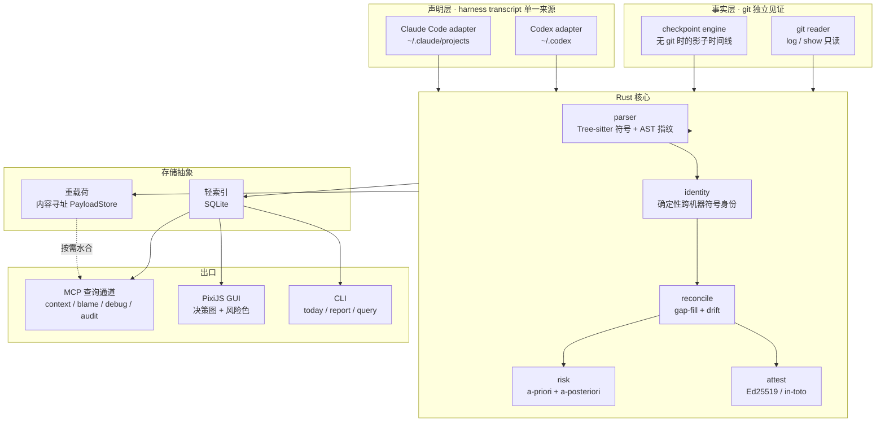
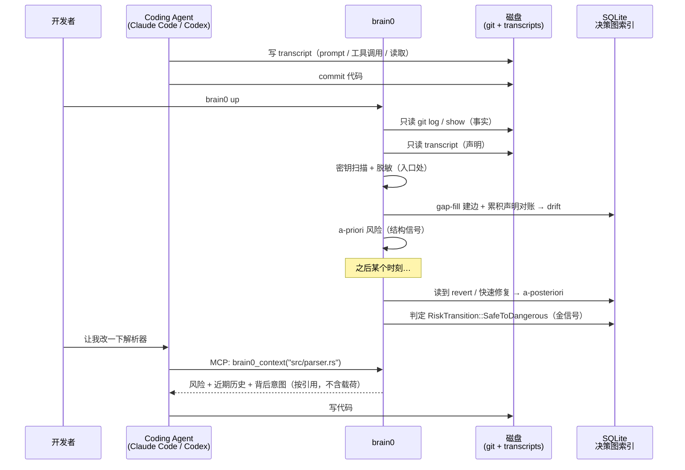

## 引子：一个你回答不了的问题

上周你的团队合并了一个 PR。提交信息写着：

> `feat: refactor the parser and fix the edge case`

两周后，解析器开始在线上崩溃。你 `git blame` 了那几行，得到一串 commit hash 和作者名。**但没有任何一条信息告诉你：**

- 这行代码是**哪一句 prompt** 让 Agent 写出来的？
- 那个 Agent 在写这行之前，**读过哪些文件**？它是不是读过 `.env`？
- Agent 说它"只改了解析器"，但那个 commit 实际动了 12 个文件——**它自己知道吗**？
- 这次改动当时"看起来很安全"，三个月后被 revert 掉了——**系统能不能自己发现这件事**？

这四个问题，是 2026 年 Coding Agent 全面进入生产后，**每一个技术负责人都会遇到、但目前几乎没有工具能回答**的问题。

传统的答案有三类，各自有硬伤：

| 方案 | 能回答 | 不能回答 |
|------|------|----------|
| `git blame` | 谁改了哪行 | 为什么改、依据什么、读过什么 |
| 厂商分析面板（Copilot Metrics / Cursor Team Analytics） | 会话数、接受率等**聚合统计** | 单行/单符号级别的溯源与因果 |
| Agent 自己的对话记录 | Agent 说了什么 | 它**实际**改了什么（两者会不一致） |

**Brain0-ai/brain0**（⭐278，Apache-2.0，Rust 核心 + TypeScript GUI，2026-07-02 创建，最新 v0.1.6）就是冲这个缺口去的。它的自我定位非常直接：

> **git 告诉你*改了什么*，brain0 告诉你*为什么*：哪个 prompt 写了它、Agent 为了写它**读了**什么、以及你能不能信任它。**

而它最反直觉、也最值得学习的一个设计决策是：**它是一个纯观察者（pure observer），不要求任何 Agent 配合。**

---

## 一、项目定位：把"意图"变成一等公民

brain0 的核心洞察可以浓缩成一句话：

> **git 是"事实（fact）"的独立见证者，但没有任何东西独立见证"Agent 读了什么、声称做了什么"。**

它把数据分成两层：

- **事实层（FACET）**：从 git 历史读出来的 commit、文件变化、时间戳、作者。git 本身就是这个领域的独立证人。
- **声明层（DECLARED）**：从 Coding Agent 已经写到磁盘上的 transcript 里读出来的 prompt、工具调用、Agent 的自我声明。brain0 像读 git 一样读这些文件。

然后它做**对账（reconciliation）**：声明说改了 A，实际改了 A+B+C → 这就是 **漂移（drift）**。

>             ┌───────────────────────── GUI (PixiJS / TS) ─────────────────────────┐
>             │   bipartite graph · LOD lens · risk color · timeline · search bar    │
>             └───────────────▲─────────────────────────────────────▲───────────────┘
>                             │ references / highlights              │ on-demand
>             ┌───────────────┴────────────┐                         │ hydration
>             │  Internal agent (TS)        │                         │
>             │  RAG-on-graph · your LLM    │                         │
>             └───────────────▲────────────┘                         │
>                             │ index queries                        │
>    ┌────────────────────────┴─────────────────────────────────────┴──────────────┐
>    │             Abstract storage (one `Storage` trait, pluggable backends)        │
>    │  light index + embeddings   |   heavy payload (dedicated store)               │
>    │  SQLite + sqlite-vec (local, open core)  |  Postgres + pgvector (enterprise)  │
>    └────────────────────────▲──────────────────────────────────────────────────────┘
>                             │ append-only (client-server)
>    ┌────────────────────────┴─────────────────────────────────────────────────────┐
>    │                          Core observer (Rust)                                 │
>    │  git reader  +  fs-watcher / checkpoint engine (no-git fallback)  [FACT]       │
>    │  passive transcript + memory ingest (Codex, Claude Code, …)        [DECLARED]  │
>    │  Tree-sitter (symbol extraction + AST-fingerprint identity)                   │
>    │  declared↔done reconciliation (gap-filling + drift)                           │
>    │  a-priori risk  ·  a-posteriori risk hooks (event-driven)                     │
>    └────────────────────────▲──────────────────────────────────────────────────────┘
>                             │ passive read-only (no agent cooperation)
>                   ┌──────────┴───────────┐
>                   │   Coding agents      │  write transcripts + memory to disk;
>                   │  (e.g. Codex, Claude)|  brain0 reads them, like it reads git
>                   └──────────────────────┘

（上面是 brain0 README 中架构图的**原样引用**。下面 §2 用 Mermaid 重画了同一张图，便于阅读。）

**五条不会弯的原则**（README 原文 "Principles that don't bend"）：

1. **Passive observation** —— 永不修改你的仓库，永不 commit/checkout，永不干扰 git。
2. **The magnifying glass** —— 缩放是不断深入**同一个**对象（repo → module → file → symbol），而不是加载不同的节点。
3. **No unjustified new nodes** —— 演进的实体保持为同一个节点（确定性、跨机器的符号身份，带改名/移动跟踪），只留下一条带日期的版本链。
4. **Light index, lazy heavy payload** —— 可导航的图小而长寿；diff、消息、摘要在需要时才水合（hydrate）。
5. **Open source and composable** —— 自带数据库、自带 LLM key，或者完全离线跑。

**仓库规模**（2026-11-25 通过 GitHub API 实测）：

| 项 | 值 |
|---|---|
| Stars / Forks | 278 / 11 |
| License | Apache-2.0 |
| 主语言 | Rust（核心 14 个 crate）+ TypeScript（5 个 package） |
| 最新版本 | v0.1.6（2026-11-10 发布） |
| 创建 / 最近推送 | 2026-07-02 / 2026-11-10 |
| 规模 | 250 个 tree 节点，53 个 `.rs` 文件，1.4MB 源码缓存 |

⭐278 的星数在 Agent 赛道里不算高。但这个项目的价值密度极高——它是本系列目前唯一一个把"**声明 vs 事实**"做成**一等公民信号**的项目，也是 563 篇已发布文章里 `decision_graph_provenance` 探针**零命中**的那一类范式。

---

## 二、整体架构：14 个 crate 的职责切分

brain0 的 Rust 核心是一个严格的 workspace，职责边界划得非常干净：

| crate | 职责 | 关键类型 |
|------|------|----------|
| `brain0-model` | 决策图数据模型（纯数据，零 I/O） | `ArtifactNode` / `TaskNode` / `Edge` / `RiskState` / `ArtifactVersion` / `TaskVersion` |
| `brain0-parser` | Tree-sitter 符号抽取 + AST 结构指纹 | `Fingerprint` / `ParsedFile` |
| `brain0-identity` | 跨机器确定性符号身份 + 改名/移动跟踪 | `resolve()` |
| `brain0-observer` | 事实层读取（git + 无 git 时的 checkpoint） | `Snapshot` |
| `brain0-agentsrc` | 被动摄取 Codex / Claude Code transcript + 密钥扫描 | `Turn` / `ReadSecret` |
| `brain0-reconcile` | 声明 ↔ 实际对账 | `compute_drift()` / `reconcile()` |
| `brain0-risk` | 双维度风险引擎 | `apriori_score()` / `aposteriori_score()` |
| `brain0-policy` | DLP 策略引擎 | 阻断规则 |
| `brain0-crypto` | 信封加密（ChaCha20-Poly1305） | KEK / DEK |
| `brain0-attest` | Ed25519 签名 + in-toto 溯源证明 | `Signer` / `verify_strict` |
| `brain0-storage` | 追加式存储抽象（`Storage` trait + SQLite） | `Storage` / `PayloadStore` |
| `brain0-models` | 本地模型接入（摘要 / 嵌入） | `summarize` / `embed` |
| `brain0-mcp` | 极简 JSON-RPC 传输层 | `ToolProvider` / `JsonRpcServer` |
| `brain0-cli` | 命令行 + GUI 服务器 | `brain0 up` / `today` / `report` / `query` / `mcp` |

模型层的 crate 文档把设计意图说得很清楚（`crates/brain0-model/src/lib.rs:1-14`）：

```rust
//! This crate defines the bipartite, multi-level decision graph: task nodes (intent), artifact nodes (code), their dated versions, and the typed edges that make the graph navigable. It is deliberately dependency-light and free of I/O so it can be shared by every other crate (parser, identity, storage, observer, risk, mcp).
//!
//! * [`TaskNode`] / [`ArtifactNode`] — the two node families.
//! * [`TaskVersion`] / [`ArtifactVersion`] — dated, append-only versions.
//! * [`Edge`] — the five typed edge kinds (two mandatory navigation axes).
//! * [`RiskState`] — two scores fused into one [`RiskColor`].
//! * Ids ([`ArtifactId`], [`TaskId`], [`VersionId`]) are deterministic and content-addressed.
```

**二部图（bipartite graph）** 是这个模型最优雅的地方：一边是**意图节点**（TaskNode = 一次 prompt + 一次 Agent 工作会话），另一边是**代码节点**（ArtifactNode = 一段持续演化的代码）。边把它们连起来。



注意 `mcp` 这个 crate 曾经做过"摄取"角色，但被移除了（`crates/brain0-mcp/src/lib.rs:3-7`）：

> "**PRD 2:** the old MCP *ingest* role (receiving agent-pushed prompts/decisions/declared changes) has been removed — brain0 is a pure observer and never relies on agent cooperation. This crate now provides only the reusable JSON-RPC transport; the brain0 MCP **query** channel supplies its tool set via a [`ToolProvider`]"

**这是一个极其重要的产品判断**：如果 brain0 需要 Agent 主动"上报"自己改了什么，它就成了又一个需要改 Agent 配置的东西——而这正是它要解决的问题本身（Agent 的声明不可信）。所以它选择只做只读观察者，代价是读集只能是下界（后面会详述）。

---

## 三、核心机制一：决策图的数据模型

### 3.1 两族节点 + 五种边

节点层级由 `Level` 枚举定义（`crates/brain0-model/src/node.rs:11-23`）：

> "Hierarchical granularity of an artifact — the levels of the magnifying glass. Aggregate levels (`Repo`, `Module`, `File`) are *derived* from their children; `Symbol` is the leaf unit (with `File` acting as the leaf when no grammar is available —)."

即 `Repo | Module | File | Symbol`，其中 `Symbol` 是叶子，`Repo/Module/File` 是**从子节点推导出来的聚合层**。

边有五种（`crates/brain0-model/src/edge.rs:1-8`），其中**两条是强制导航轴**：

> "Two navigation axes are mandatory:
> * **by intent** — 'what did this prompt do' via [`Edge::TaskModifiesArtifact`];
> * **by place** — 'who touched this symbol, in what temporal order' via [`Edge::ArtifactVersionSucceeds`] on the persistent artifact node (the primary debug path)."

| 边类型 | 语义 |
|--------|------|
| `TaskModifiesArtifact` | 把一个意图连到它改动的代码（"按意图"轴） |
| `ArtifactContains` | 包含层级 repo ⊃ module ⊃ file ⊃ symbol |
| `ArtifactDependsOn` | 依赖图（用于 blast radius 和风险） |
| `ArtifactVersionSucceeds` | 同一 artifact 的版本时间链（"按位置/时间"轴） |
| `TaskFollows` | 同一会话或工作链中任务之间的先后关系 |

### 3.2 身份：确定性 + 内容寻址

这是本项目最值得抄的部分之一。`ArtifactId` 不是自增主键，而是**内容寻址**：

```rust
// 来自 crates/brain0-model/src/node.rs:114-132
pub fn derive(repo: &str, level: Level, qualified_path: &str, fingerprint: &str) -> ArtifactId {
    // For leaf symbols the `fingerprint` is the structural AST fingerprint; for aggregate levels
    // (file/module/repo) it is the empty string, so an aggregate's identity is a pure function
    // of its coordinates.
    let raw = hashed("brain0.artifact.v1", &[repo, level.as_str(), qualified_path, fingerprint]);
    ArtifactId(format!("art_{raw}"))
}
```

而 `TaskId::derive(session_id, ordinal)` 则是：

```rust
// 来自 crates/brain0-model/src/node.rs:163-173
pub fn derive(session_id: &str, ordinal: u64) -> TaskId {
    let raw = hashed("brain0.task.v1", &[session_id, &ordinal.to_be_bytes().to_string()]);
    TaskId(format!("tsk_{raw}"))
}
```

**「域名分隔」（domain separation）**在这里是关键：不同用途用不同的哈希前缀（`brain0.artifact.v1` / `brain0.task.v1` / `brain0.task.source.v1` / `brain0.version.artifact.v1`），避免跨语义空间的碰撞。

而"两台机器必须算出同一个 ID"这个需求，靠 `brain0-identity` 的两段式实现（`crates/brain0-identity/src/lib.rs:1-22`）：

> "Two machines observing the *same* symbol in the *same* state must compute the *same* artifact id, so independent observers converge on one shared graph without merge logic. Identity is realized in two layers:
>
> 1. **Deterministic id** — [`brain0_model::ArtifactId::derive`] hashes `repo + level + qualified_path + structural-fingerprint`.
> 2. **Resolution** — [`resolve`] maps a fresh batch of observations against the previously-known artifacts of the same scope, deciding for each whether it is an edit (same path, changed structure), a rename/move (path changed but structure still matches above a similarity threshold → *same node, new coordinates*), or a brand new node. This realizes the principle 'no unjustified new nodes'."

匹配策略是**先路径、再一对一贪心模糊匹配**（最高相似度优先），并明确定义了拆分/合并策略：

> "**Split** (one symbol becomes several): the best-matching survivor continues the identity (rename/modify); the extra symbols are new nodes (`Added`).
> **Merge** (several symbols become one): the best-matching source continues the identity; the others are `Removed`.
>
> This keeps resolution deterministic and total, with no node used twice."

**AST 指纹**的设计也很讲究——它哈希的是**带深度标注的节点 kind 流**，而不是源码文本（`crates/brain0-parser/src/fingerprint.rs`）。这样重命名一个函数不会改变指纹，但改函数体内部的逻辑会。源码里还特意解释了 kind token 的哈希方式：

> `kind_token` hashes kind *names* not grammar ids "so two machines on the same grammar always agree"

### 3.3 版本的"追加式"语义

版本模型是 append-only 的（`crates/brain0-model/src/version.rs:1-5`）：

> "The model is **append-only**: a change produces a *new version* of the existing node, never a new node when the entity is the same. Aggregate-level artifact versions are *derived* from their children and are not authored by hand."

而版本 ID 把作者也纳入了哈希键（`version.rs:115-151`）：

> "Distinct authors at the same instant produce distinct versions (author is part of the key); the same observed change reported twice converges on one version."

**"同一个变更被报告两次会收敛到一个版本"** —— 这是幂等性的漂亮实现。

`TaskVersion` 里有两个字段特别值得注意，它们是 DLP 和漂移的原料：

```rust
// 来自 crates/brain0-model/src/version.rs:75-104（节选）
pub struct TaskVersion {
    // ...
    /// What the agent declared it changed in this version.
    pub declared: Vec<DeclaredChange>,
    pub drift: Option<Drift>,
    /// Files the agent **read** during this turn (repo-relative when inside the project, absolute
    /// when outside — the audit-relevant case). Metadata only: paths, never content. Lets an
    /// auditor see which files were loaded into the (possibly remote) model's context.
    pub reads: Vec<String>,
    /// Reads whose CONTENT contained secrets (detected at ingest by the secret scanner). Records
    /// only the secret KINDS per path — never the value or the content — so an auditor sees that
    /// a secret reached the model. Subset of `reads`.
    pub read_secrets: Vec<ReadSecret>,
}
```

**"只记路径和密钥种类，绝不记值"** —— 这条设计原则贯穿整个 DLP 子系统。

---

## 四、核心机制二：声明 ↔ 实际的漂移检测

这是 brain0 最核心、也最容易被误解的机制。

### 4.1 漂移是怎么算出来的

`brain0-reconcile` 的 crate 文档开门见山（`crates/brain0-reconcile/src/lib.rs:1-10`）：

> "A coding agent *declares* what it changed (via MCP). The observer records what *actually* changed. This crate compares the two and performs both required functions:
>
> * **Gap-filling** — everything that actually changed is linked to the agent's task even if the agent never mentioned it, so the graph is complete.
> * **Drift detection** — when declared and done diverge (e.g. "I only touched X" but 12 files changed), the discrepancy is recorded as a first-class [`Drift`] signal on the task and feeds the a-priori risk."

算法本身非常朴素——**按路径做对称差**：

```rust
// 来自 crates/brain0-reconcile/src/lib.rs:44-69
/// Compute the drift between what was declared and what actually changed.
///
/// Comparison is by file path. The score is the size of the symmetric difference over the
/// union of paths, in `0.0..=1.0` (0 = perfect match, 1 = fully disjoint).
#[must_use]
pub fn compute_drift(declared: &[DeclaredChange], actual_paths: &[String]) -> Drift {
    let declared_set: BTreeSet<&str> = declared.iter().map(|d| d.path.as_str()).collect();
    let actual_set: BTreeSet<&str> = actual_paths.iter().map(String::as_str).collect();

    let undeclared: Vec<String> = actual_set
        .difference(&declared_set)
        .map(|s| (*s).to_owned())
        .collect();
    let phantom: Vec<String> = declared_set
        .difference(&actual_set)
        .map(|s| (*s).to_owned())
        .collect();

    let union = declared_set.union(&actual_set).count();
    let score = if union == 0 {
        0.0
    } else {
        (undeclared.len() + phantom.len()) as f32 / union as f32
    };
    Drift::new(score, undeclared, phantom)
}
```

- `undeclared` —— 改了但没声明的（**幽灵改动 / gap**）
- `phantom` —— 声明了但实际没改的（**幽灵声明**）

测试用例直接把语义讲清楚了：

```rust
// 来自 crates/brain0-reconcile/src/lib.rs:156-176
#[test]
fn undeclared_changes_are_detected() {
    // Agent said "only a.py" but b.py and c.py also changed.
    let d = compute_drift(
        &declared(&["a.py"]),
        &["a.py".into(), "b.py".into(), "c.py".into()],
    );
    assert!(d.is_present());
    assert_eq!(d.undeclared, vec!["b.py".to_owned(), "c.py".to_owned()]);
    assert!(d.phantom.is_empty());
    // 2 undeclared / 3 union.
    assert!((d.score - 2.0 / 3.0).abs() < 1e-6);
}

#[test]
fn phantom_declarations_are_detected() {
    // Agent claimed b.py but it never actually changed.
    let d = compute_drift(&declared(&["a.py", "b.py"]), &["a.py".into()]);
    assert_eq!(d.phantom, vec!["b.py".to_owned()]);
    assert!(d.undeclared.is_empty());
}
```

### 4.2 ⭐ 最关键的一个细节：累积 vs 单轮

这是整个漂移机制里最容易做错、也最有价值的一点。源码里有一段注释专门解释为什么不能拿单轮声明去比：

```rust
// 来自 crates/brain0-reconcile/src/lib.rs:76-93
    /// What THIS turn declared — persisted verbatim on the version (the per-turn record).
    pub declared: &'a [DeclaredChange],
    /// The whole session's declarations so far (this turn included) — the set drift is
    /// computed against. Agents declare incrementally while commits land in batches at the
    /// session's end; comparing a single turn against a commit-sized actual set produces
    /// false phantom (declared, committed later) and mass undeclared (sibling turns' files).
    /// Cumulative-vs-cumulative converges: the latest version's drift is the session verdict.
    pub cumulative_declared: &'a [DeclaredChange],
```

翻译一下这个坑：

- Agent 是**增量声明**的（每一轮说"我改了这个"）
- 但 commit 是**批量落地**的（会话结束时一次性提交所有改动）
- 如果拿**单轮声明**去比**整个 commit 的文件集**，会同时产生：
  - **假 phantom** —— 这轮声明了，但文件要到后面几轮才提交
  - **大量假 undeclared** —— 兄弟轮次的文件全被算成"没声明"

所以正确的比较是**累积 vs 累积**：拿"到目前为止这个会话声明过的全部内容"去比"到目前为止实际改过的全部内容"。这样**会收敛**：最新一个版本的漂移，就是整个会话的判决。

**这是一个可以立刻搬到任何"增量声明 vs 批量落地"场景的通用模式。** 你的 Agent 框架如果也在做"逐轮声明"，直接抄这条。

### 4.3 Gap-filling：图必须完整

```rust
// 来自 crates/brain0-reconcile/src/lib.rs:96-134
pub fn reconcile(storage: &dyn Storage, input: &ReconcileInput) -> Result<Drift> {
    // 1. Gap-filling: every observed change is attached to the task.
    for change in input.actual {
        storage.put_edge(&Edge::TaskModifiesArtifact {
            task: input.task_id.clone(),
            artifact: change.artifact_id.clone(),
            version: change.version.clone(),
            change_kind: change.change_kind.clone(),
            lines_added: change.lines_added,
            lines_removed: change.lines_removed,
        })?;
    }

    // 2. Drift detection — against the SESSION's cumulative declarations, not just this turn's.
    let actual_paths: Vec<String> = input.actual.iter().map(|c| c.path.clone()).collect();
    let drift = compute_drift(input.cumulative_declared, &actual_paths);

    storage.append_task_version(&TaskVersion {
        // ...
        declared: input.declared.to_vec(),
        drift: Some(drift.clone()),
        reads: input.reads.to_vec(),
        read_secrets: input.read_secrets.to_vec(),
    })?;

    Ok(drift)
}
```

注意顺序：**先补洞，再算漂移**。补洞保证图完整（哪怕 Agent 没提，实际改了的东西也在图里），漂移信号则单独记在 `TaskVersion` 上。

---

## 五、核心机制三：双维度风险模型

### 5.1 为什么必须是两个分数

`brain0-risk` 的 crate 文档（`crates/brain0-risk/src/lib.rs:1-13`）：

> "Risk is modelled as two *independent* scores that are fused into one green→red color (the fusion + color live in [`brain0_model::RiskState`]):
>
> * **a-priori** — a write-time pure function of cheap structural signals: centrality, blast radius, churn, test gap, diff size, and declared↔done drift.
> * **a-posteriori** — a retroactive, event-driven score from later evidence: the change was reverted, an immediate fix landed, tests broke, or an issue was linked.
>
> Aggregate nodes (file/module/repo) derive their risk from their children. The gold debugging signal — *looked safe, proved dangerous* — is preserved by keeping the two scores separate (see [`brain0_model::RiskTransition`])."

**为什么不能合成一个分数？** 因为"金信号"（gold signal）——**当时看起来安全，事后被证明危险**——只有在两个分数**分开保存**时才存在。

```rust
// 来自 crates/brain0-model/src/risk.rs:98-113, 165-193
pub enum RiskTransition {
    /// Was low risk a-priori, became high risk a-posteriori — the "looked safe, proved
    /// dangerous" pattern.
    SafeToDangerous,
    // ...
}
```

源码里的测试把这个场景演示得很清楚：

```rust
// 来自 crates/brain0-risk/src/lib.rs:607-626
#[test]
fn gold_signal_after_aposteriori_update() {
    let s = SqliteStorage::open_in_memory().unwrap();
    let id = ArtifactId::new("art_f");
    // Looked safe a-priori.
    s.put_artifact_node(&node("art_f", Level::Symbol, RiskState::new(0.1, 0.0))).unwrap();
    // Later proved dangerous: reverted + tests broken.
    let factors = AposterioriFactors {
        reverted: 1.0,
        tests_broken: 1.0,
        ..AposterioriFactors::default()
    };
    let risk = apply_aposteriori(&s, &id, &factors).unwrap();
    assert_eq!(risk.transition(), RiskTransition::SafeToDangerous);
    assert!(risk.is_gold_signal());
    // Persisted.
    let reloaded = s.get_artifact_node(&id).unwrap().unwrap();
    assert!(reloaded.risk.is_gold_signal());
}
```

如果 a-priori 和 a-posteriori 被压成一个数，这个信号就**永远无法被识别**——因为 0.1 和 1.0 融合后都只是"一个偏高的数"，你不知道它后来变过。

### 5.2 ⭐ 概率 OR，而不是加权平均

这是一个可以直接搬走的数学选择：

```rust
// 来自 crates/brain0-risk/src/lib.rs:35-56
/// Per-signal weights = each factor's maximum contribution to the a-priori score when it is at
/// 1.0. These feed a probabilistic-OR (not a mean), so a factor that is absent (0.0) — e.g.
/// centrality/blast before a dependency graph exists — contributes nothing AND does not dilute
/// the others. A mean over all six factors instead let the always-zero signals cap the score
/// near the floor (every node stayed green); the OR lets any genuinely strong signal surface.
struct AprioriWeights {
    centrality: f32,
    blast_radius: f32,
    churn: f32,
    test_gap: f32,
    diff_size: f32,
    drift: f32,
}

const APRIORI_WEIGHTS: AprioriWeights = AprioriWeights {
    centrality: 0.5,
    blast_radius: 0.7,
    churn: 0.5,
    test_gap: 0.4,
    diff_size: 0.45,
    drift: 0.6,
};
```

```rust
// 来自 crates/brain0-risk/src/lib.rs:58-77
/// Combine a-priori factors into a single `0.0..=1.0` score via a weighted probabilistic-OR:
/// `1 - ∏(1 - factor·weight)`. Absent factors leave the product unchanged, so missing signals
/// never drag the score down, while one strong signal (or several mild ones) can push it high.
#[must_use]
pub fn apriori_score(f: &AprioriFactors) -> f32 {
    let w = &APRIORI_WEIGHTS;
    let terms = [
        (f.centrality, w.centrality),
        (f.blast_radius, w.blast_radius),
        (f.churn, w.churn),
        (f.test_gap, w.test_gap),
        (f.diff_size, w.diff_size),
        (f.drift, w.drift),
    ];
    let mut survival = 1.0f32;
    for (value, weight) in terms {
        survival *= 1.0 - clamp_unit(value) * weight;
    }
    clamp_unit(1.0 - survival)
}
```

**为什么必须是概率 OR？** 注释说得很清楚：早期版本用**加权平均**，而 `centrality` / `blast_radius` 在依赖图还不存在时**永远是 0**，它们留在分母里把分数压到地板附近——**结果每个节点都是绿的**。换成概率 OR 后，缺失的因子**既不贡献也不稀释**其他因子。

对应的回归测试直接记录了这个历史 bug：

```rust
// 说明：以下为源码节选，函数体在节选边界处截断，故括号不成对。
// 来自 crates/brain0-risk/src/lib.rs:437-449
fn apriori_strong_signal_not_capped_by_absent_ones() {
    // The old weighted-mean crushed a lone signal toward zero because the always-absent
    // factors (centrality/blast without a dep graph) stayed in the denominator. With the
    // probabilistic-OR, churn alone registers clearly and drift alone drives high.
```

**这条经验可以推广到任何多信号打分系统**：当一部分信号在冷启动阶段天然缺失时，用平均会让所有信号失效，用概率 OR 才是对的。

a-posteriori 的权重则体现了"证据强度"的差别：

```rust
// 来自 crates/brain0-risk/src/lib.rs:79-94
#[must_use]
pub fn aposteriori_score(f: &AposterioriFactors) -> f32 {
    let terms = [
        (f.reverted, 1.0f32),
        (f.tests_broken, 0.9),
        (f.immediate_fix, 0.6),
        (f.linked_issue, 0.5),
    ];
    let mut survival = 1.0f32;
    for (value, weight) in terms {
        survival *= 1.0 - clamp_unit(value) * weight;
    }
    clamp_unit(1.0 - survival)
}
```

**被 revert 是最强证据（1.0）**，仅仅"被关联到一个 issue"最弱（0.5）。

### 5.3 Churn 的半衰期与"冷却"

```rust
// 来自 crates/brain0-risk/src/lib.rs:110-126
/// Churn half-life: a change this many days old counts half as much as one made now. Lifetime
/// version counts made every long-lived file permanently "orange"; recency-decayed churn means
/// *hot now* scores high and mature, stable files cool back toward green.
const CHURN_HALF_LIFE_DAYS: f32 = 14.0;

/// Recency-decayed churn magnitude: `Σ 0.5^(age_days / half_life)` over the artifact's
/// versions, with ages measured against `now` (the repo's latest observed timestamp — passed
/// in so the score is deterministic for a given index, never wall-clock dependent).
fn decayed_churn(versions: &[brain0_model::ArtifactVersion], now: &brain0_model::Timestamp) -> f32 {
    versions.iter().map(|v| {
        let age_days = (*now - v.timestamp).num_seconds().max(0) as f32 / 86_400.0;
        0.5f32.powf(age_days / CHURN_HALF_LIFE_DAYS)
    }).sum()
}
```

两个细节值得学：

1. **半衰期 14 天** —— 累计版本数会让所有老文件永远"橙色"，改成**时间衰减**后，成熟稳定的文件会冷却回绿色。
2. **`now` 是传入的，不是墙钟时间** —— 注释明说 "never wall-clock dependent"。这让分数**对同一个索引是确定性的**，重跑得到同样的结果。**这在做可复现的审计工具时是硬要求。**

### 5.4 "立即修复"的假阳性：一个被修过的启发式

```rust
// 来自 crates/brain0-risk/src/lib.rs:220-269（节选）
    // An "immediate fix" must be FIX-SHAPED, not merely fast: a small corrective follow-up
    // (≤ max(5 lines, ¼ of the prior change)) landing within the window. A bare time check
    // flagged every burst of similar-sized commits — a completely normal workflow — as fixes.
    let mut immediate_fix = false;
    for pair in versions.windows(2) {
        let quick = pair[1].timestamp - pair[0].timestamp <= fix_window;
        let first_total = pair[0].lines_added + pair[0].lines_removed;
        let second_total = pair[1].lines_added + pair[1].lines_removed;
        let fix_shaped = second_total > 0
            && second_total < first_total
            && second_total <= (first_total / 4).max(5);
        if quick && fix_shaped {
            immediate_fix = true;
            break;
        }
    }
```

以及 revert 的判定——**结构指纹回到了之前的状态**：

```rust
    let mut reverted = false;
    let mut seen: HashSet<&str> = HashSet::new();
    for version in &versions {
        if version.fingerprint.is_empty() { continue; }
        if !seen.insert(version.fingerprint.as_str()) {
            reverted = true; // a structural state reappeared
            break;
        }
    }
```

**"reverted" 的判定不靠 git revert 命令，靠的是 AST 指纹重复出现** —— 这很聪明：Agent 改回原样、或者人工改回原样，都会被捕获。

### 5.5 依赖图：没有解析器也能算

这是一个很务实的取舍（`crates/brain0-risk/src/lib.rs:343-354`）：

> "Derive a **language-agnostic** dependency graph from version history: files that repeatedly change in the same commit are *logically coupled*. This needs no parser and no per-language import resolver — only git, which every repo has — so centrality and blast radius work for any language. Coupling is symmetric, so each pair is linked in both directions via [`brain0_model::Edge::ArtifactDependsOn`]. The graph is append-only: support only accumulates as history grows, and re-runs are idempotent (edges are keyed by endpoints). Returns the number of edges written.
>
> Honest limitation: this is a *correlation* (what tends to change together), not a proven static dependency. It is the standard generalizable proxy and matches the product question 'what does changing this affect' directly; per-language static-import packs can refine it later by writing the same edge kind."

**"同 commit 改的文件 = 逻辑耦合"** —— 纯 git 就能算，语言无关。代价是它是**相关性**不是**静态依赖**，而项目**自己承认了这一点**（后面会详述）。

blast radius 则是在这张图上做 BFS：

```rust
// 来自 crates/brain0-risk/src/lib.rs:183-200
/// Count transitive dependents (who depends on this artifact, directly or indirectly) via
/// `ARTIFACT_DEPENDS_ON` edges.
fn blast_radius(storage: &dyn Storage, artifact_id: &ArtifactId) -> Result<usize> {
    let mut seen: HashSet<String> = HashSet::new();
    let mut queue: VecDeque<String> = VecDeque::new();
    queue.push_back(artifact_id.as_str().to_owned());
    while let Some(current) = queue.pop_front() {
        for edge in storage.in_edges(EdgeKind::ArtifactDependsOn, &current)? {
            if let brain0_model::Edge::ArtifactDependsOn { dependent, .. } = edge {
                let dep = dependent.as_str().to_owned();
                if dep != artifact_id.as_str() && seen.insert(dep.clone()) {
                    queue.push_back(dep);
                }
            }
        }
    }
    Ok(seen.len())
}
```

聚合节点的分数用**取最大值**向上汇总，保证热点在每一层缩放都浮出来：

```rust
// 来自 crates/brain0-risk/src/lib.rs:288-319
/// Derive an aggregate node's risk from its children: the riskiest child dominates each
/// dimension, so hotspots surface at every zoom level.
#[must_use]
pub fn derive_aggregate(children: &[RiskState]) -> RiskState {
    let apriori = children.iter().map(|r| r.apriori).fold(0.0f32, f32::max);
    let aposteriori = children.iter().map(|r| r.aposteriori).fold(0.0f32, f32::max);
    RiskState::new(apriori, aposteriori)
}
```

---

## 六、核心机制四：Agent 读集的 DLP

### 6.1 为什么"读了什么"比"写了什么"更危险

brain0 的 DLP 部分处理的是一个很多人忽略的事实：**Agent 泄露密钥，通常不是通过写代码，而是通过读。**

它识别三类读：

1. **显式 `Read` 工具调用**
2. **`Grep` 结果**
3. **Shell 读** —— `cat .env`、`sed -n 1,40p x.rs`、`grep -rn key src/`、`source .env`

第三类是重点（`crates/brain0-agentsrc/src/shell.rs:1-13`）：

> "Agents read most files through a shell (`cat .env`, `sed -n 1,40p x.rs`, `grep -rn key src/`, `source .env`), not only through a dedicated `Read` tool. Those reads reach the model's context exactly like a `Read` does, so leaving them out of the read set would make the DLP audit blind to the most common way a secret is loaded. This module parses a command line (pipes, `&&`, `;`, `$(…)`, quotes, redirections, `cd` tracking) and returns the paths passed to known *reader* commands. It is deliberately conservative: unresolvable tokens (globs, `$VAR`, `{}`) are dropped rather than guessed, and non-reader commands contribute nothing.
>
> The result is a **lower bound** of what the command read, never an upper bound: a reader brain0 does not know, a script, or a remote/container command (`ssh`, `docker exec`) are not followed."

注意最后一段——**"是下界，永远不是上界"**。这个措辞非常严谨：解析不了的就丢掉，绝不猜测。

### 6.2 密钥在入口处就被扫描和脱敏

`crates/brain0-agentsrc/src/secret.rs` 实现了 10 个内置密钥检测器 + 一个基于 Shannon 熵的启发式。README 说得很清楚：

> "**Secret scanning at ingest**: transcripts are scanned and redacted (typed placeholders, never values) *before* anything is stored, summarized, or embedded; `BRAIN0_EXCLUDE` / `BRAIN0_REDACT` add your own rules. The raw prompt text is **not persisted**; only the model-generated summary."

**"原始 prompt 文本根本不落盘"** —— 只存模型生成的摘要。这是个很强的隐私默认值。

连测试语料都做了处理（`secret.rs:260-263`）：

> "A corpus of FAKE secrets (never real). §3.4 acceptance: none survive in clear.
> // Literals are SPLIT via concat! so no real-token-shaped string ever appears contiguously
> // in the source blob: GitHub push protection (correctly) blocks pushes containing anything
> // that looks like a live token, and cannot know these are fakes. Runtime values are intact."

**用 `concat!` 把字面量拆开，防止 GitHub push protection 误报** —— 这是个实战技巧，其他项目做密钥扫描测试时会撞上。

### 6.3 Transcript 完整性：钉住字节范围

```rust
// 来自 crates/brain0-agentsrc/src/integrity.rs:1-8
//! Tamper evidence for ingested transcripts.
//!
//! The read set (and the declared changes) come from one source: the transcript the agent
//! harness writes to disk, a plain user-writable file. brain0 cannot make that file a second,
//! independent witness, but it can pin what it saw: every ingest pass records a BLAKE3 digest
//! of the exact byte range it consumed in the append-only audit log, and [`verify_transcripts`]
//! re-hashes those ranges later. A transcript edited or truncated *after* ingest is caught; one
//! altered before ingest is not (documented in `docs/governance.md`).
```

**"摄取后被改会被发现，摄取前被改不会"** —— 这是个诚实且有用的边界声明。

---

## 七、核心机制五：溯源签名与存储分层

### 7.1 Ed25519 + in-toto

`crates/brain0-attest/src/lib.rs:1-13`：

> "A [`Signer`] holds an Ed25519 key and signs the bytes of a statement (the in-toto Statement JSON, assembled by the caller); [`verify`] checks a signature against a public key. Keys are 32-byte Ed25519 seeds, hex-encoded; the `key_id` is a short fingerprint of the public key, for rotation. The verify side needs only the public key — it can confirm an attestation without the ability to mint one."

**"验证方只需要公钥就能确认，但不能伪造"** —— 这是非对称签名的核心价值，也是它比"自己算个 hash 存着"强的地方。

整个 crate 有 `#![forbid(unsafe_code)]`，`Signer` 的 `Debug` 实现还会脱敏私钥：

```rust
// 来自 crates/brain0-attest/src/lib.rs:40-47
// Redact the private key in Debug — only the public key id is shown, never key material.
impl std::fmt::Debug for Signer {
    fn fmt(&self, f: &mut std::fmt::Formatter<'_>) -> std::fmt::Result {
        f.debug_struct("Signer").field("key_id", &self.key_id()).finish()
    }
}
```

而 `docs/attestation.md:114-116` 里有一个诚实的措辞：

> "the envelope signs the literal statement string (the verifier re-checks those exact bytes). A strict [DSSE](https://github.com/secure-systems-lab/dsse)/base64 envelope is a documented refinement; the current form is verifiable and self-contained."

——**签名的是字面 statement 字符串，不是严格的 DSSE 信封**。功能上可验证且自包含，但格式上是个"待精化"状态。项目自己写出来了。

### 7.2 轻索引 + 重载荷

`crates/brain0-storage/src/payload.rs:1-6`：

> "Heavy payload storage — the dedicated store for prompts, transcripts, diffs, and decision summaries, kept separate from the light index.
>
> Payloads are content-addressed (BLAKE3): writing identical content twice yields the same [`PayloadRef`] and stores it once. The index only ever holds the `PayloadRef`; the content is hydrated on demand."

`PayloadStore` trait 有个值得学的接口：

```rust
// 来自 crates/brain0-storage/src/payload.rs:21-45
pub trait PayloadStore: Send + Sync {
    /// Store raw content and return its content-addressed reference.
    fn put(&self, content: &[u8]) -> Result<PayloadRef>;
    /// Fetch content by reference, or `None` if it is not present.
    fn get(&self, reference: &PayloadRef) -> Result<Option<Vec<u8>>>;
    /// Destroy the content behind a reference, making it irrecoverable. For
    /// the encrypted store this is crypto-shredding (the only wrapped DEK is deleted with
    /// the blob). Returns whether anything was removed.
    fn shred(&self, reference: &PayloadRef) -> Result<bool>;
    // ...
}
```

**`shred()` = 加密粉碎**：删掉包裹这个 blob 的那个 DEK，内容就永久不可解——这是 GDPR "被遗忘权"在加密存储上的正确实现方式。

而内容寻址的引用做了路径穿越防护（`payload.rs:47-58`）：

```rust
/// The hex digest inside a reference, provided it is exactly what `put` mints: the scheme
/// plus 64 lowercase hex chars. The filesystem stores build paths from it, so anything else
/// (`..`, separators, NUL, a truncated digest) is refused instead of being joined onto the root.
fn digest_hex(reference: &PayloadRef) -> Result<&str> {
    reference.as_str().strip_prefix(REF_SCHEME)
        .filter(|hex| hex.len() == 64 && hex.bytes().all(|b| matches!(b, b'0'..=b'9' | b'a'..=b'f')))
        .ok_or_else(|| StorageError::Invalid(format!("bad payload ref: {reference}")))
}
```

**只接受"恰好 64 位小写十六进制"**，其他一律拒绝——不是过滤非法字符，而是**白名单**。

---

## 八、MCP 查询通道：把"为什么层"喂给你的 Agent

brain0 最有产品价值的一环，是它**反过来**把决策图作为一个 MCP 服务暴露给你的 Coding Agent：

```bash
claude mcp add brain0 -- brain0 mcp
```

四个工具（`crates/brain0-cli/src/mcp_query.rs:146-198`）：

| 工具 | 作用 |
|------|------|
| `brain0_context` | 某个文件/符号的**风险、近期历史、以及背后的 Agent 意图**（agent / model / drift）——**动代码之前**查 |
| `brain0_blame` | *哪条意图写了这行*：`file:line` 通过实时解析定位到符号 |
| `brain0_debug` | 根因候选：与某个问题最相关的意图/代码，按时近性和风险加权 |
| `brain0_audit` | 仓库风险分布、金信号、最危险节点 |

模块文档说明了设计原则（`mcp_query.rs:1-6`）：

> "brain0's MCP **query** channel: exposes debug/audit — and the provenance context tools — as MCP tools an external agent can call, **answered by reference** (node ids + concise metadata; the payload text is never pushed through MCP)."

**"按引用回答，绝不把载荷文本推过 MCP"** —— 这点很重要，因为 MCP 工具结果会进 LLM 上下文，把完整 diff 推过去既浪费 token 又污染上下文。

README 里那句话很打动人：

> "Your agent stops re-breaking what it can't remember. Uninstalling brain0 makes it forget again."

——**"把 brain0 卸了，它就又忘了"**。这句话精准描述了这个项目的价值：**它不是又一个"让 Agent 更聪明"的框架，而是给 Agent 装上跨会话、跨机器、不可篡改的外挂记忆。**



---

## 九、⭐ 必须诚实指出的源码自陈缺陷

这一节是本系列的核心特色。brain0 是我见过**最诚实的开源项目之一**——它的 53 个 `.rs` 文件里**没有一个 `TODO` / `FIXME` / `XXX` / `HACK`**（全仓库 grep 结果为零），所有限制都以散文形式写在文档注释和 `docs/*.md` 里。

我把它们整理成 8 类。

### 9.1 读集是单一来源，且只是下界

`docs/security.md:101-107`：

> "**Reads and declared changes are single-source.** Both come from the transcript the agent harness writes; git independently witnesses *writes* (drift), nothing independently witnesses *reads*. The read set is a lower bound of what reached the model; transcript pinning catches alteration after ingest, not before."

这是**最根本的一条限制**。git 是个独立证人，但**没有任何东西独立见证 Agent 读了什么**——因为 transcript 是 harness 写的普通用户可写文件。brain0 只能钉住"我看到的那段字节"（BLAKE3），但**无法阻止在摄取之前篡改**。

### 9.2 明确的盲区清单

`docs/governance.md:61-65`：

> "What it does **not** see: reads through MCP tools or `WebFetch`; environment variables (`printenv`, `echo $KEY`); readers the shell parser does not know, scripts (`python x.py`), and anything behind `ssh`/`docker exec`; agents brain0 has no adapter for; sessions whose transcript was disabled, pruned, or altered *before* ingest. A shell command that reads several files has its single output attributed to each of them."

最后一句尤其诚实：**一条命令读了 5 个文件，它的输出会被归因到这 5 个文件每一个头上** —— 会造成误报。

### 9.3 "如果有一个事实侧的读源会是什么样"（全部未实现）

`docs/governance.md:73-80`：

> "**What a fact-side source for reads would take** (none of these ship today):
>
> - an inline proxy on the model API base URL: the only place that knows what content actually left the machine, and the natural thing to reconcile the transcript's read set against;
> - kernel file-open events (fanotify, eBPF, auditd) for process-attributed opens: passive, but root-only and Linux-only, and they say 'opened', not 'reached the model';
> - time-correlated `inotify` open events from the existing watcher: no process attribution, a weak second witness at best."

**三种方案，一个都没做** —— 但把"要解决这个洞需要什么"写得清清楚楚。这种写法本身就是资产。

### 9.4 防护是"侦探式"而非"拦截式"

`docs/governance.md:164-172`：

> "## Honest limits
>
> - The guard is **detective** — brain0 observes the agent's egress, it does not sit in the data path. `preflight` is the realistic prevention primitive; a true inline LLM proxy is a separate, larger initiative (not required for this feature's value).
> - The read set is **single-source** (the harness transcript) and a **lower bound**; see *What the read set is, and is not* above for exactly what is and is not captured.
> - `--watch` polls the index rather than tailing transcripts directly; a native fs-tail is a future refinement. Pair it with `brain0 dev`, which keeps the index fresh."

**"brain0 观察 Agent 的出口，它并不坐在数据路径上"** —— 换句话说，它**不能阻止**密钥泄露，只能**事后发现**。`preflight` 是唯一的预防性原语。

### 9.5 依赖图是相关性，不是静态依赖

`crates/brain0-risk/src/lib.rs:351-354`（已在上文引用）：

> "Honest limitation: this is a *correlation* (what tends to change together), not a proven static dependency."

这一条直接影响 blast radius 的准确性——**改一个真正没被谁依赖的文件，可能显示高 blast radius**（因为历史上它和别的文件总是一起改）。

### 9.6 一些信号引擎自己算不出来

`crates/brain0-risk/src/lib.rs:130-154`：

```rust
/// Signals that the engine cannot derive structurally and must be supplied by the caller.
#[derive(Debug, Clone, Copy)]
pub struct AprioriContext {
    // ...
}

impl Default for AprioriContext {
    fn default() -> Self {
        // Neutral defaults: unknown test coverage, no measured diff, no drift, epoch "now"
        // (callers derive the real horizon from the index).
        Self { diff_size: 0.0, test_gap: 0.5, drift: 0.0, now: ...UNIX_EPOCH }
    }
}
```

`test_gap`（测试覆盖缺口）**引擎算不出来**，必须调用方提供。而且默认值是 `0.5`——**中性值，不是真实值**。

### 9.7 一个已经被修掉的历史 CVE

`docs/security.md:144-152`：

> "Up to 0.1.2 the local server joined the `ref` of `/api/diff` onto the payload directory without validating it, so a crafted ref read any `.blob` file the user could read ([GHSA-8vg9-5mf9-5c84](...)). It also answered every API route with `Access-Control-Allow-Origin: *` and accepted any `Host`, so any web page open while `brain0 up` ran could read the graph, node details and diffs, and trigger smart-chat queries (paid ones, with a remote LLM configured). 0.1.3 closes both; upgrade with `npx brain0@latest up`; no local cleanup is needed."

**把历史 CVE 的完整描述、影响范围和修复版本写进当前文档** —— 这是负责任的开源姿势。

### 9.8 一些次要但真实的限制

| 限制 | 出处 |
|------|------|
| 无 git 时只是"影子时间线"，**不是 VCS**（无分支无合并） | `observer/src/checkpoint.rs:1-6` |
| git 的重命名**故意**按 delete+add 处理（`--no-renames`），让 brain0 自己的身份层决定"是不是同一个节点" | `observer/src/git.rs:1-7` |
| 行数统计是 **best-effort**，未知时为 0 | `observer/src/lib.rs:52-57` |
| shell 解析是 **best-effort** | `agentsrc/src/claude.rs:91-92`、`codex.rs:82-83` |
| 溢出工具结果（spilled result）扫描有 **16MB 上限**，更大的只看预览 | `agentsrc/src/claude.rs:21-23` |
| `Lang` 是 newtype 而非 enum，**新增 Tree-sitter 语法不用改数据模型** | `model/src/node.rs:69-74` |
| crate doc 只声称支持 **Python + TS/JS** 的符号级抽取（但 `extract.rs` 其实也实现了 Rust）—— **文档与代码漂移** | `parser/src/lib.rs:1-9` |
| Postgres/pgvector 后端、SQLCipher、TLS、RLS 都在**闭源的 brain0-enterprise** 仓库 | `docs/security.md` |
| 持久化摘要缓存 `~/.cache/brain0/summary-cache.db` **明文存储在加密载荷库之外** | `docs/security.md` |
| `npx brain0 up` **默认不加密载荷**（因为 GUI 需要明文水合），`up --encrypt` 才开 | `docs/security.md` |
| musl/Alpine **暂不支持** | `README.md:65-68` |

---

## 十、与同类项目对比

brain0 常被拿来和几类工具比较，但它和它们**不在同一个维度**。

| | `git blame` | 厂商分析面板 | **brain0** |
|---|---|---|---|
| 谁提交了这行 | ✅ | ❌ | ✅ |
| 哪个 **prompt/意图** 产生了这个改动 | ❌ | ❌ | ✅ |
| 跨 Agent、厂商中立 | ✅ | ❌ | ✅ |
| **漂移**：声明 vs 实际 | ❌ | ❌ | ✅ |
| Agent **读了什么**（含密钥 DLP） | ❌ | ❌ | ✅ |
| 每个文件/符号的**风险分**（证据驱动） | ❌ | ❌ | ✅ |
| 可探索的**图 GUI** + 时间旅行 | ❌ | ❌ | ✅ |
| 零集成（Agent 里不加 hook） | ✅ | ❌ | ✅ |
| 本地优先，默认离线 | ✅ | ❌ | ✅ |

（这张对比表来自 brain0 README 原文，脚注 ¹ 说明厂商面板指的是 Copilot Metrics API / Cursor team analytics / Claude Code analytics ——"per-vendor aggregates (sessions, LoC accepted), no line/symbol-level provenance, no causality"。）

**与更接近的三个项目对比设计差异**：

### vs. `hunk`（Agent 产出审阅，本系列 2026-10-31 已写）

两者都关心"人机共享的协作空间"，但方向相反：

- **hunk 是审阅端**：让**人**审阅 Agent 写完的 diff，是 TUI 里人和 Agent 的协作界面。
- **brain0 是溯源端**：把"这段 diff 是哪句话写出来的"变成**可查询的图**，是事后追责/学习的基础设施。

hunk 的核心抽象是 `ReviewIntent → Action → Reducer` 三段式审阅内核；brain0 的核心抽象是 `ArtifactNode ↔ TaskNode` 的二部图 + 五种类型化边。**hunk 管"这一轮要不要人签字"，brain0 管"这一行代码从哪来"。**

### vs. `hol-guard`（Agent 制品准入，2026-11-07 已写）/ `nono`（OS 内核沙箱，2026-10-08 已写）

这是**互补双层防护**的关系：

- **nono / hol-guard 管"东西进运行时之前/之中安不安全"** —— 制品准入、运行时隔离、策略拦截。
- **brain0 管"事后能不能查清账"** —— 它不做任何拦截，只做观察和取证。

特别有意思的是：hol-guard 检测的是**恶意制品**，brain0 检测的是**心口不一的 Agent**——一个是安全对抗，一个是**问责**。

### vs. `langfuse` / `logfire`（LLM 可观测性）

- langfuse / logfire 记录的是 **LLM 调用**（prompt、token、延迟、成本）。
- brain0 记录的是 **Agent 对代码的读写**（读了什么文件、改了哪些行、声明与实际的差）。

**前者观测"对话"，后者观测"行为"**。一个 Agent 可以把对话记录得完美无缺，同时偷偷改了 12 个文件——langfuse 看不见这个，brain0 看得见。

---

## 十一、优缺点分析

### 11.1 架构简洁性 / 扩展性 / 易用性

| 维度 | 评价 |
|------|------|
| **架构简洁性** | ⭐⭐⭐⭐⭐ 14 个 crate 职责零重叠，`brain0-model` 零 I/O 纯数据，是教科书级的关注点分离 |
| **扩展性** | ⭐⭐⭐⭐ `Storage` trait + `PayloadStore` trait + `ToolProvider` trait 是三个清晰的扩展点；新增 Tree-sitter 语法不动数据模型（`Lang` 用 newtype 而非 enum）；新增 Agent 适配器只需实现一个 adapter |
| **易用性** | ⭐⭐⭐⭐ `npx brain0 up` 一条命令；无 Agent 集成要求；无 API key 也能跑（本地确定性摘要 + 特征哈希嵌入 + 零出口） |

**最漂亮的设计决策有三个**：

1. **纯观察者** —— 不要求 Agent 配合。这是把"可用性"放在"完整性"之上的取舍，而且是对的。
2. **两个风险分数不合并** —— 为了保住"金信号"这个信息。
3. **概率 OR 而不是加权平均** —— 为了让冷启动期的缺失信号不稀释真实信号。

### 11.2 性能 / 复杂度 / 维护性

| 维度 | 评价 |
|------|------|
| **性能** | ⭐⭐⭐⭐ 索引在 SQLite、载荷按需水合、内容寻址去重；`decayed_churn` 传 `now` 保证确定性；向量检索是 Rust 扫描而非 sqlite-vec（`storage/src/sqlite.rs` 有说明） |
| **复杂度** | ⭐⭐⭐⭐ 二部图 + 五种边 + 双分数 + 身份解析 + DLP 策略 + 信封加密 + 签名，中等偏上。但**每个复杂度都有对应的具体理由**（注释里都写了） |
| **维护性** | ⭐⭐⭐⭐⭐ **这是本项目最强的一项**。零 TODO/FIXME；30 处限制全部文档化；历史 CVE 写进当前文档；doc/code 漂移（parser 只声明 Python+TS）也能被外部读者发现并提出 |

**必须指出的短板**：

| 短板 | 说明 |
|------|------|
| **⭐ 只有 278 stars / 11 forks** | 2026-07-02 才创建，4 个多月，还在 v0.1.x。生产成熟度存疑 |
| **⭐ 读集单一来源** | 这是根本性限制，brain0 自己说是 lower bound。**在真正的合规审计场景里，这个洞可能致命** |
| **⭐ 默认不加密载荷** | `npx brain0 up` 默认明文存储载荷（GUI 需要），敏感部署必须 `up --encrypt` |
| **⭐ 摘要明文缓存** | `~/.cache/brain0/summary-cache.db` 在加密库之外 |
| **企业能力闭源** | Postgres/pgvector、SQLCipher、TLS、RLS、多租户都在 `brain0-enterprise`（AGPLv3 + 商业）。**开源部分没有 license 检查、没有 feature flag、没有阉割路径**（README 明确承诺），但企业级存储要另买 |
| **Postgres 后端不在开源仓库** | `schema/sqlite.sql` 注释明说："The Postgres dialect of this schema lives in the private brain0-enterprise repo" |
| **防护是侦探式** | 它不阻止泄露，只事后发现。真正的拦截需要 inline LLM proxy（项目说这是"另一个更大的工程"） |
| **生态小** | 只适配 Codex 和 Claude Code 两个 harness，且 transcript 格式一变就要跟着改 |

---

## 十二、实践：安装与使用

安装命令**直接来自 brain0 的 README**（`npx brain0 up` 是唯一硬要求 Node.js ≥ 20）：

```bash
# 唯一硬性要求：Node.js >= 20（Linux 需 glibc >= 2.28；musl/Alpine 暂不支持）
npx brain0 up
```

这条命令会：从 git remote 推断 repo id、索引 git 历史（事实）、被动摄取你的 Coding Agent 会话（声明，Codex 和 Claude Code 自动发现）、然后在 `http://localhost:8787` 打开 GUI。

推荐的本地模型（README 给出）：

```bash
ollama pull qwen3:4b               # summarizer（默认）
ollama pull qwen3-embedding:0.6b   # embeddings（默认；自动回退到 nomic-embed-text）
```

**摘要是内容缓存的**，所以后续重建索引不花任何模型调用：

```bash
# 小显存机器可以用更轻的摘要模型跑第一次（缓存填充）
BRAIN0_SUMMARIZER_MODEL=qwen3:1.7b npx brain0 up
```

日常使用的四个命令（README 的 Commands 表）：

```bash
brain0 today             # 晨会分诊：Agent 都干了什么，风险最高的排前面
brain0 report            # 问责报告：drift · 敏感读取 · top risk · Agent 足迹（--md 可分享）
brain0 query "why did the parser break"   # 在图上做根因调试
```

把"为什么层"接入你的 Agent：

```bash
claude mcp add brain0 -- brain0 mcp
```

其他值得知道的命令：

```bash
brain0 ingest / observe / watch   # 底层的事实/意图观察器
brain0 rewind                    # 从记录的 checkpoint 恢复工作树（watch 的安全网）
brain0 guard / preflight         # DLP：标记到达远程模型的密钥读取；可在 pre-commit / pre-run 阻断
brain0 provenance / attribution / attest / compliance   # 逐 commit 溯源 · 逐 hunk 归因 · Ed25519 签名 · 审计包
brain0 verify / audit / purge / reembed   # 完整性 · 审计日志 · 加密粉碎 · 重嵌入
```

从源码构建（README 的 Building from source）：

```bash
# 需要 Rust（见 rust-toolchain.toml）、Node 20+、pnpm
cargo build && cargo test          # Rust 核心（14 crates）
pnpm install && pnpm -r build && pnpm -r test   # TS workspace（shared · agent · gui · server · cli）
./scripts/e2e.sh                   # 跨语言端到端检查
```

**无任何依赖时的降级行为**（README 的 "What you need" 表）：

| 缺什么 | 降级到 |
|--------|--------|
| Ollama + 模型 | 确定性摘要 · 特征哈希嵌入 · 仅检索式回答 |
| git | 文件系统 checkpoint 模式（`brain0 watch`） |
| Codex / Claude Code | 只有 commit + 代码的图（没有"为什么"层） |
| `ANTHROPIC_API_KEY` / `OPENAI_API_KEY` | 本地 Ollama（默认） |

**这最后一行是本项目最值得称道的工程价值观**："Local models make it *better*, never *required*." —— **本地模型让它更好，但绝不是必需的。** 一个离线优先、零出口、零 API key 也能端到端跑起来的溯源工具，在企业合规环境里的价值，和一个需要 SaaS 订阅的方案完全不是一个量级。

---

## 十三、趋势与总结

### 13.1 三个值得注意的趋势判断

**趋势一：「Agent 可观测性」正在分叉成两条互不重叠的赛道。**

一是以 **LLM 调用**为对象（langfuse / logfire / RagaAI）——这是 2026 上半年的主流。另一条是以 **Agent 对代码世界的读写行为**为对象（brain0 / hunk / hol-guard / nono）。后者的市场更窄，但**不可替代**——因为"Agent 说了什么"和"Agent 做了什么"之间的落差，正是 2026 年生产事故的主要来源。

**趋势二：问责基础设施（accountability infrastructure）会先于自治基础设施成熟。**

我们现在还在给 Agent 加工具（tool）、加记忆（memory）、加技能（skill），但对"**它到底做了什么**"的追溯能力严重不足。brain0 的漂移检测概念——**声明 vs 实际的差值**——我认为会是这个领域最通用的一个抽象。它不限于代码：任何"Agent 声明做了 X，系统观测到做了 Y"的场景都能用。

**趋势三：「被动观察」会成为 Agent 治理的主流形态。**

对比一下三个层位的治理手段：

| 形态 | 代表 | 优点 | 缺点 |
|------|------|------|------|
| **前置拦截**（准入 / 沙箱） | hol-guard / nono | 真的能挡住 | 需要改造 Agent 或运行环境 |
| **内置上报**（Agent 主动调用） | 很多 MCP 工具 | 数据最准 | **Agent 可能不配合 / 撒谎** |
| **被动观察**（事后取证） | brain0 | 零集成、不信任 Agent | 只能看到"能被看到的东西" |

brain0 选的是第三条，并且**公开承认这条路的边界**（读集单一来源、只是下界）。在一个"Agent 不可信"的世界里，**用独立证据源（git）而不是 Agent 自陈来对账** —— 这个思路比它的具体实现更值钱。

### 13.2 最值得带走的五条工程经验

1. **⭐ 用独立证据源对账，而不是相信 Agent 的自陈。** git 见证"写了什么"，transcript 提供"声称了什么"，两者的差值就是最有价值的信号。
2. **⭐ 增量声明 vs 批量落地 → 必须累积对累积。** 拿单轮比整批，会同时产生假 phantom 和假 undeclared。注释里那三行解释，比代码本身更值得抄。
3. **⭐ 缺失信号不要用平均值，要用概率 OR。** `1 - ∏(1 - factor·weight)` 让缺席的因子既不贡献也不稀释；而加权平均会让冷启动期的所有节点恒绿。
4. **⭐ 把"当时看起来安全，事后被证明危险"留成一个可识别的信号。** 这要求两个分数**分开保存**，而不是融合成一个颜色。
5. **⭐ 把限制写进文档，而不是藏进 issue。** brain0 的 30 处自陈限制（零 TODO/FIXME）本身就是最好的使用文档，也让人敢放心用它的核心部分。

### 13.3 最后

brain0 只有 278 颗星、11 个 fork、v0.1.6、4 个多月大。它**不是**一个可以直接上生产的成熟产品：读集单一来源这个根本限制在真正的合规审计场景里可能是致命的；Postgres 后端在闭源仓库里；默认不加密载荷。

但它是**一个把正确的问题问对了，并且把自己的答案边界讲得比大多数成熟项目还清楚**的项目。它公开写下了自己的盲区清单、自己的假阳性历史、自己的历史 CVE、自己的文档漂移。

在一个 Agent 可以随意改你的代码、读你的密钥、然后告诉你"我只改了一点点"的时代，**brain0 提供的不是一个工具，是一份关于"怎么验证 Agent 的说法"的方法论。**

把它读作范式，而不是当作一个今天就值得装进生产的组件——这是我对它的建议。

---

## 附录：关键资源

| 资源 | 链接 |
|------|------|
| 仓库 | https://github.com/Brain0-ai/brain0 |
| npm | https://www.npmjs.com/package/brain0 |
| 安全文档 | https://github.com/Brain0-ai/brain0/blob/main/docs/security.md |
| 治理文档（盲区清单） | https://github.com/Brain0-ai/brain0/blob/main/docs/governance.md |
| 溯源签名 | https://github.com/Brain0-ai/brain0/blob/main/docs/attestation.md |
| 开放核心边界 | https://github.com/Brain0-ai/brain0/blob/main/docs/open-core.md |
| Agent 产物 schema | https://github.com/Brain0-ai/brain0/blob/main/docs/agent-artifacts.md |
| 本地模型配置 | https://github.com/Brain0-ai/brain0/blob/main/docs/models.md |
| 许可证 | Apache-2.0 |
| 最新版本 | v0.1.6（2026-11-10） |
| 相关已发布文章 | hunk（Agent 产出审阅）、hol-guard（制品准入）、nono（内核沙箱）、langfuse / logfire（LLM 可观测性） |
