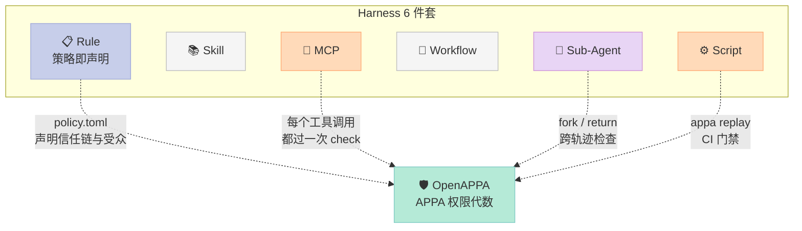
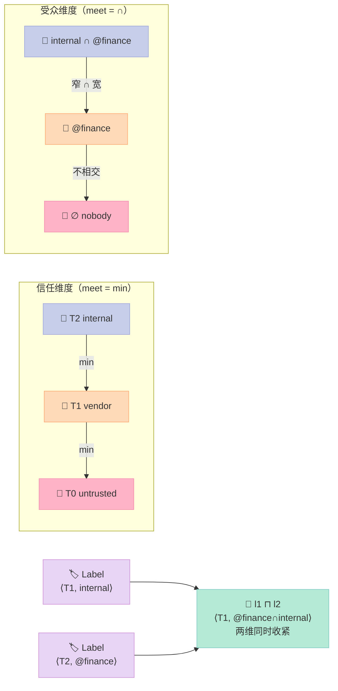
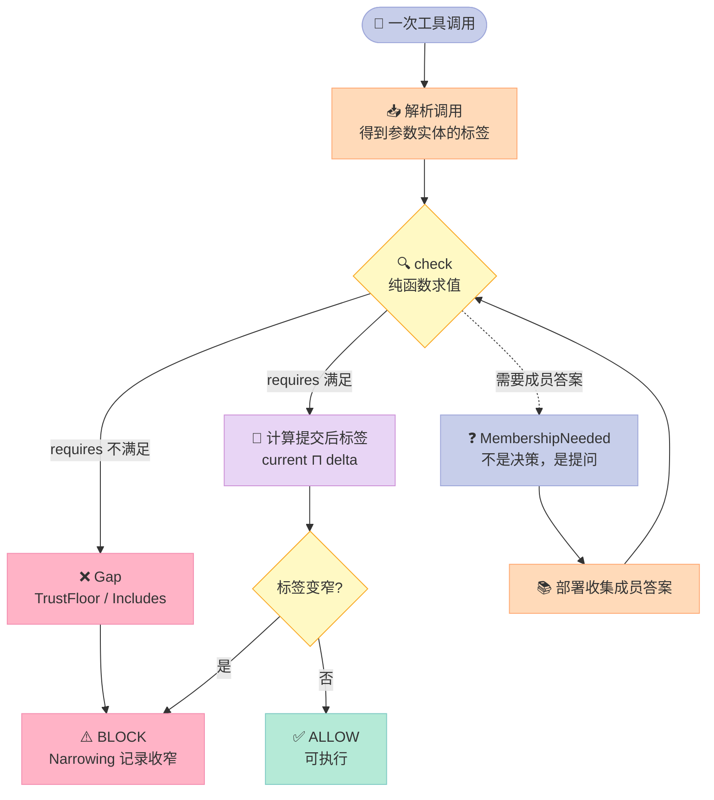
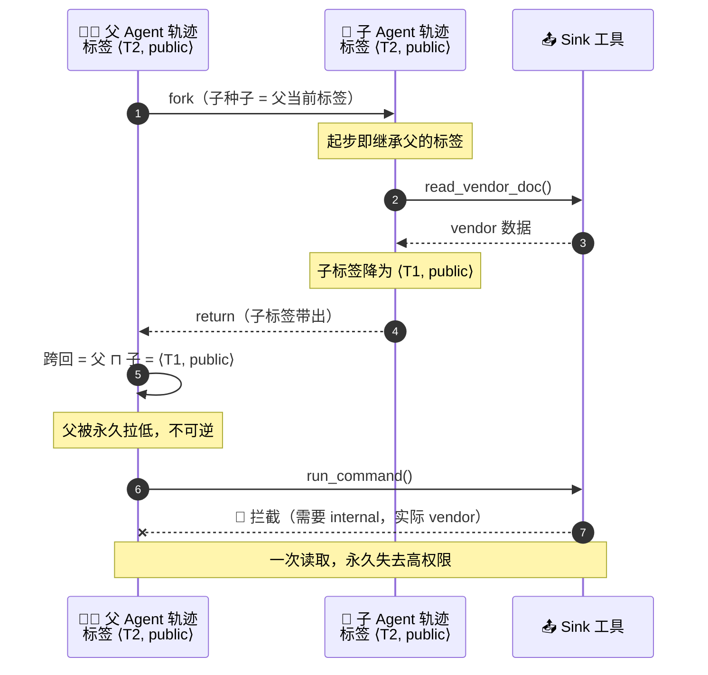

> **一句话核心结论**：OpenAPPA 把「Agent 读到的数据能不能发出去」从**概率判断**改造成**代数判断**——
> 信任取 min、受众取交集，每一次工具调用是一次折叠，每一次子 Agent 返回是一次跨格检查。
> 同一份事件日志，永远得到同一个决定。

---

## 前言：为什么 Agent 安全需要"代数"而不是"分类器"

先讲一个几乎所有 Agent 平台都遇到过的场景。

用户让 Agent 干这件事：*"帮我总结一下这个 Slack 频道的讨论，然后发到 #general。"*

Agent 依次做了三件事：

1. 读了 `#private-eng` 频道（100 人可见）
2. 读了内部 API 文档（标记为 vendor 提供）
3. 准备调用 `slack.post_message` 发到 `#general`（2000 人可见）

**现在问题来了：第 3 步该不该放行？**

传统做法是让 LLM 自己判断："这段内容包含敏感信息吗？"——这是**概率判断**。同一个提示词跑两次，结论可能不同；模型今天心情好就放行，明天就拦截。MITRE ATLAS 类的红队基准里，这种设计的**误放行率（false-negative）常年居高不下**，因为攻击者只要换个措辞就能绕过。

另一条路是**规则引擎**：写 if-else 判断"如果内容包含关键词 X 就拦"。问题是关键词挡不住语义等价的信息泄露——"公司准备裁掉 30% 的后端团队"不含任何敏感词，但它显然不该出现在公开频道。

OpenAPPA 走的是第三条路：**把"数据能流向哪里"建模成一个格（lattice）上的偏序关系**，用 meet 运算（取交）代替逐条 if-else。

这不是一个新想法。经典的**信息流控制（Information Flow Control, IFC）**理论可以追溯到 1970 年代的 military security——Denning 的格模型（lattice model）就是"高密级不能流向低密级"的数学表达。**OpenAPPA 的贡献是把这套理论搬到了 LLM Agent 上**，并且做了三件老 IFC 没做过的事：

- 受众维度从"密级"变成**符号化的读者集合**（"@finance 组的成员"、"Slack 频道 eng 的成员"）
- 从"程序级"下沉到**每一次工具调用**
- 加了**子 Agent 跨轨迹返回**的语义——这是老 IFC 里没有的形态

论文《APPA: Recoverable Information-Flow Control for Real-World LLM Agents》（arXiv 2607.24625）已入选 NeurIPS 2026 Workshop on Agents in the Wild。

本文会完整拆解：这套代数长什么样、怎么落到 TOML 策略文件、为什么"确定性"在这里比"聪明"更重要，以及**我自己复刻时踩到的 5 个坑**。

---

## 一、项目定位：它站在 Harness 的哪个位置

### 1.1 OpenAPPA 是什么

- **仓库**：[archestra-ai/OpenAPPA](https://github.com/archestra-ai/OpenAPPA)
- **Star**：1,652（MIT，Rust，2026-08-18 建仓，2026-11-24 仍活跃）
- **论文**：arXiv [2607.24625](https://arxiv.org/abs/2607.24625)，NeurIPS 2026 Workshop on Agents in the Wild
- **Slogan**：*"Deterministic guardrails that don't break agents."*
- **架构**：16 个 Cargo crate（`appa-engine` / `appa-policy` / `appa-runtime` / 4 个 adapter / eventlog / file-tracker …）

### 1.2 它解决的问题：Agent 安全的"最后一段路"

传统 Agent 安全的重心在**输入端**——防 prompt injection、防越狱、扫描 MCP server 有没有后门。这个方向上已经有密集的成熟方案：

| 关注点 | 代表项目 | 覆盖阶段 |
|---------|----------|----------|
| Skill 供应链扫描 | NVIDIA/SkillSpector | **装之前** |
| MCP server 扫描 | invariantlabs-ai/mcp-scan | **装之前** |
| 运行时网关防护 | microsoft/mcp-gateway | **跑起来** |
| Prompt 注入检测 | protectai/rebuff | **输入时** |
| Agent 红队平台 | Tencent/AI-Infra-Guard | **跑起来** |

**这些方案都停在"Agent 要做什么"这一层。**

OpenAPPA 问的是一个它们都没问的问题：**Agent 已经读到的数据，接下来会被发到哪里？**

这不是一个假想的问题。MITRE ATLAS 里 `AML.T0051`（LLM Prompt Injection 导致的"内部数据外泄"）的本质就是：**Agent 被诱导，把 A 处的机密内容送到了 B 处**。这类攻击不需要越狱任何模型，它只需要让 Agent 正常调用工具——只是调错了地方。

### 1.3 6 件套落点



**主战场是 Rule（声明式策略）+ MCP（每次调用都过检查），兼顾 Sub-Agent（fork 语义）。**

它**不**是一个 Agent 框架，不提供 LLM 调用，不管理对话状态。它是一层**夹在 Agent 和工具之间的守卫**（sidecar），可以进程内跑，也可以独立进程跑。

---

## 二、核心代数：两维限制格

### 2.1 Label = 信任 × 受众

APPA 的核心数据结构只有一个：`Label`。

```rust
// appa-engine/src/label.rs
pub struct Label {
    pub trust: Trust,      // 有限信任链上的一个秩（u8 索引）
    pub audience: Audience, // 符号化的受众（并子句的交集）
}
```

`Trust` 是 `u8` 包装，`Audience` 是一组 `Clause` 的交集，每个 `Clause` 是三段的并：

| 段 | 例子 | 语义 |
|----|------|------|
| chain | `self` / `internal` / `public` | 内建受众链，self ⊆ internal ⊆ public |
| groups | `@finance` / `@slack:channel/eng` | 组引用，需要部署钉住成员答案 |
| readers | `alice@corp.example` | 字面读者（身份） |

**关键设计：库里没有"部分标签"或"待定标签"这种状态。** 源码注释写得很直白：

> *"Every admitted value carries exactly one of these... no partial or pending state is representable."*

这和 LangGraph 那种"state 里可以放 `messages: Annotated[list, add]` 然后靠 reducer 折叠"的设计不同——APPA 里的折叠是**显式的、每次一个 meet**。

### 2.2 Meet 运算：信任取 min，受众取交集

```rust
// appa-engine/src/label.rs
pub fn combine(&self, other: &Label) -> Label {
    Label {
        trust: self.trust.combine(other.trust),      // min
        audience: self.audience.combine(&other.audience), // 交集
    }
}
```

这条 meet 满足四条格公理（交换、结合、幂等，且**永不放宽**任一维度）：

```
l1 ⊓ l2 = l2 ⊓ l1        ✓ 交换律
(l1 ⊓ l2) ⊓ l3 = l1 ⊓ (l2 ⊓ l3)   ✓ 结合律
l ⊓ l = l                ✓ 幂等律
bottom ⊓ x = bottom       ✓ bottom 是吸收元
top ⊓ x = x              ✓ top 是单位元
```

**这是 IFC 的全部魔法所在**：数据一旦被标记为"低信任 / 窄受众"，后续**任何**与之混合的操作都只会让它更受限，永不回升。这就是"taint"（污点）传播的代数表达。



### 2.3 受众的 canonicalize：恰好三条规则

`Audience::canonicalize` 是 Rust 侧 68KB 的 `label.rs` 里最需要小心的一段。源码注释直接写死了规则和它们的边界：

```rust
fn canonicalize(clauses: BTreeSet<Clause>) -> BTreeSet<Clause> {
    // ① 含空子句 → 全体塌缩为 nobody（X ∩ ∅ = ∅）
    if clauses.iter().any(Clause::is_empty) {
        return BTreeSet::from([Clause::empty()]);
    }
    // ② 只含字面读者的子句按精确交集合并
    //    （不相交的读者列表 = nobody）
    let (stable, mixed) = clauses.into_iter().partition(Clause::is_stable_readers);
    ...
    // ③ 结构上被另一子句包含的窄子句存活，宽子句丢弃
    //    （self ∩ internal = self，由内建链保证）
    ...
}
```

注释里还专门点出**两件刻意不做的事**：

> *"Two things never apply here: declared `within` relations — `@finance ∩ internal` keeps both clauses even when finance is within internal, because harmless redundancy beats policy-dependent equality — and any reader a deployment could canonicalize (`slack:U012345`): its meaning is an operation-pinned principal, so its clause survives unmerged and the evaluation intersects in principal space."*

翻译成人话：

1. **不用策略里的 `within` 断言做归一化**——因为归一化结果会依赖"当前部署的目录答案"，那标签相等性和序列化就不再确定了。宁可留一点无害的冗余。
2. **不合并"部署相关的读者"**——`slack:U012345` 这种 principal 是 operation-pinned 的，它的含义由那次操作钉死，所以它的子句原样存活，比较时到 principal 空间再相交。

**这是很成熟的安全工程直觉**：canonicalize 必须**只依赖 policy-independent 的事实**，否则"同一份日志重放得到同一个标签"这条不变量就破了。

### 2.4 ToolContract：delta / requires / forwards 三段

每个工具在策略文件里声明三件事：

```toml
[[policy.tool]]
name = "mcp/docs/read_vendor_doc"
delta = { trust = "vendor" }        # 这个工具的产出带 vendor 信任
```

```toml
[[policy.tool]]
name = "mcp/shell/run_command"
requires = { trust = "internal" }   # 调用前轨迹至少要有 internal 信任
delta = {}
```

三段的语义：

| 段 | 含义 | Rust 侧 |
|----|------|---------|
| `delta` | 这次调用的**产出**带什么标签 | `ToolAnnotation::delta` |
| `requires` | 调用**前置条件**（信任下限 + 受众覆盖） | `ToolAnnotation::requires` |
| `forwards` | 调用**自己送出**的内容（服务器端读的文件、附带的邮件正文） | `ToolAnnotation::forwards` |

`forwards` 是最容易被忽略但最关键的一段：**Agent 没在参数里写的东西，工具自己送出去的东西**，同样受管辖。库文档给了一个例子：一个工具在服务器端读了一个文件然后把它邮件发出去——这个文件从没进过 Agent 的上下文，但它是数据外流。

库文档明确说 `delta` **不 gate 调用**：

> *"The delta labels the call's result and narrows the trajectory once the call succeeds; it never gates the call."*

分工很清楚：`requires` 是**准入条件**（不满足就拦），`delta` 是**事后影响**（成功就把轨迹拉低）。

### 2.5 一次 check 长什么样

`check.rs` 的 `evaluate` 是纯函数：

```rust
pub(crate) fn evaluate(
    annotation: &ToolAnnotation,
    views: &Views,
    call: &ResolvedCall,
    stage: &CallStage,
    role: CallRole,
    context: &MembershipContext<'_>,
) -> Result<CheckOutcome, MembershipNeeded> {
    let current = views.current_label();
    let eval = evaluate_state(annotation, &current, ...)?;
    if role == CallRole::Ordinary && eval.requirement_gaps.is_empty() && eval.narrowing.is_none() {
        return Ok(CheckOutcome::Allow);
    }
    Ok(CheckOutcome::Block(eval))
}
```

三类 `Gap`：

| Gap | 含义 |
|-----|------|
| `TrustFloor { required, actual }` | 轨迹信任低于工具要求的下限 |
| `Includes { recipients }` | 轨迹受众不覆盖工具要发送给的收件人 |
| `Prior / NoPrior { effect }` | 工具声明了前置效果，但轨迹里没有 |

外加一个独立的 `Narrowing { from, to }`——**这次提交会把轨迹标签拉低到 to**。两者可共存。

**这里有个特别值得学的设计决策**：`evaluate` 返回 `Result<CheckOutcome, MembershipNeeded>`。`MembershipNeeded` 不是错误，而是**"我需要你告诉我 @finance 组有哪些成员"**——一个符号原子求值请求。



库文档强调：

> *"A failed derivation never denies; a missing answer is a membership ask, never a label state."*

**推导失败 ≠ 拒绝。** 这跟"解析失败就 fail-closed"的直觉相反，理由是：如果把"我查不到成员名单"当成拒绝，那么所有引用外部目录的策略都会全线瘫痪。正确的做法是**把提问变成一等公民**，让运行时去收集答案，然后重跑同一个 check。

---

## 三、Sub-Agent 语义：fork 家族

### 3.1 两种 fork，三种生命周期

这是老 IFC 里没有的形态——**Agent 会派生子 Agent，子 Agent 的返回值会回到父 Agent**。

OpenAPPA 定义了三种：

| 类型 | 语义 | Rust 侧 |
|------|------|---------|
| **subagent fork** | 同一条 family log 内部开分支 | `Fact::ForkPrepared` / `Fact::ForkOpened` |
| **fan-out spawn** | 一个 spawn 启动任意多个子 | `SpawnKind::FanOut` |
| **root fork** | 从已有轨迹开一个**独立 family** | `fact::RootForkOrigin` |

### 3.2 子返回值跨回父轨迹的规则

这是全文最反直觉的一段。库文档的原话（`lib.rs` 顶部注释）：

> *"A marked spawn releases by spending an approval that carries its child's **return declaration**. Declaring asks no authority: a blocked spawn with no declaration is offered the declarations alone..."*

规则拆开讲：

1. 子 Agent 在**父的当前标签**处起步（不是 top！）
2. 子读到的任何东西都把**子轨迹**拉低
3. 子返回时，**跨回的标签 = 父当前标签 ⊓ 子标签**
4. 若跨回的标签不满足 sink 的要求 → 拦截
5. 如果子返回的值**会**让父的标签变窄 → **冻结**（`Fact::ReturnDeferred`），子必须等父接受才能跨回

第 5 条特别讲究。库文档：

> *"A value that leaves the parent's label where it is crosses as any return does. One that would narrow it is frozen, ends the child's errand, and crosses only when the parent accepts it."*

**这意味着：子 Agent 不能偷偷把父 Agent 的权限拉低。** 如果子读了一份低信任文档，它的"污染"不能自动传给父——必须父明确接受。



### 3.3 一个具体例子

策略：

```toml
[policy]
version = 2
trust_chain = ["untrusted", "vendor", "internal"]
```

三条工具：

```toml
[[policy.tool]]
name = "mcp/docs/read_vendor_doc"
delta = { trust = "vendor" }

[[policy.tool]]
name = "mcp/shell/run_command"
requires = { trust = "internal" }
delta = {}

[[policy.tool]]
name = "mcp/slack/post_message"
requires = { trust = "vendor" }
delta = {}
```

运行序列：

| 步 | 调用 | 轨迹标签 | 结果 |
|----|------|---------|------|
| 0 | 初始 | ⟨T2, public⟩ | — |
| 1 | `read_vendor_doc()` | ⟨T1, public⟩ | **允许**，但轨迹被拉低到 vendor |
| 2 | `run_command()` | ⟨T1, public⟩ | **拦截**：需要 internal，实际 vendor |
| 3 | `post_message()` | ⟨T1, public⟩ | **允许**：需要 vendor，已有 vendor |

**这就是"taint 传播"的最直观体现**：Agent 只是读了一份 vendor 文档，就永久失去了跑 shell 命令的资格——除非它从头开始一条新轨迹。

再看一个受众的例子：

```toml
[[policy.tool]]
name = "mcp/slack/read_channel"
delta = { audience = ["@slack:channel/$channel_id"] }
```

读了频道 → 轨迹受众收窄到该频道成员 → 之后任何"发给 public"的调用都会被拦。

---

## 四、为什么"确定性"在这里比"聪明"更重要

### 4.1 库文档的自我定位

README 里有一段对比，写得很克制：

> *"Classifiers and PII detectors are probabilistic, while this check is deterministic and returns the same decision on every run. Policy is declarative TOML. The engine decides from the event log alone and makes no network or file calls, so the same log always gets the same decision."*

三个"不"：

- **不读时钟**（no clock）
- **不发网络请求**（no network calls）
- **不读文件**（no file calls）

这不是洁癖，是**可审计性的硬需求**。库文档在讲 `Engine` 的纯函数性质时反复强调"performs no IO, reads no clock, and never mutates a store"。

### 4.2 事件日志即真值源

`appa-eventlog` crate 记录所有事实（`Fact`）。库文档说：

> *"The label derives from the dispatch's own record, so it is the same on every replay; a recorder that loses state rebuilds it from the log."*

**recorder（外部存储记录器）丢状态不要紧，从日志能重建。** 这是把"审计"和"运行"解耦的关键设计。

### 4.3 Benchmark：规则打分，不是 LLM 打分

`bench/README.md` 写得很清楚：

> *"Only one Tau task uses an LLM judge. Everything else is scored by deterministic checks on what the tools did."*

三个基准：

| 基准 | 内容 | 打分方式 |
|------|------|----------|
| **Corp** | 20 个带植入攻击的企业工作流 | 纯函数检查器（`checks.py`），**不看 transcript** |
| **AgentThreatBench** | OWASP Top 10 for Agentic Applications | 程序化字符串 + 工具调用不变量 |
| **Tau 1.0.1** | banking_knowledge 97 个任务 | 保留 Tau 原评估器；只有 `task_102` 用 LLM judge |

AgentThreatBench 特别值得注意——它**同时给"模型提议了什么"和"实际派发了什么"打分**：

> *"scores both what the model proposed and what was actually dispatched, so a blocked proposal cannot earn utility or count as an executed attack."*

**这一点防止了"靠拒绝一切拿高分"的作弊路径**：被拦下的提议既不给 utility，也不算成功攻击。

README 给的结果：

| 指标 | OpenAPPA | Claude Code auto mode | Microsoft FIDES |
|------|---------:|---------------------:|-----------------:|
| 任务完成率 | **89%** | 90% | 41% |
| 成功攻击率 | **0%** | 10% | 31% |

数据来自 1,320 次评测。README 也诚实标注了口径：Claude auto mode 是**另一种测量协议**，且 OpenClaw/Hermes 默认不开路由——这类横向对比的"不可直接比较"警告，值得学。

### 4.4 Policy Revision：策略演进不改写历史

这是我觉得最被低估的设计。

一个 deployment 有**编号的 policy revision**。每次策略变更产生一个新 revision。规则：

- 引擎**只在某个 revision 上决策**（`Engine::at`）
- 每个批次打上它被决定的 revision 戳
- **重放时**用批次上戳的那个 revision 的引擎来判断——*"a later revision never changes what an earlier record meant"*
- 标签在写入它的 revision 的信任链上索引；跨到新链时按**秩名**对应

```rust
// label.rs
pub(crate) fn between<'a>(
    leaving: impl IntoIterator<Item = &'a str>,
    arriving: &[&a str],
) -> Option<TrustCrossing> {
    let leaving: Vec<&str> = leaving.into_iter().collect();
    if leaving == arriving { return None; }
    let ranks = leaving.iter()
        .map(|name| arriving.iter().position(|c| c == name).and_then(...))
        .collect();
    ...
}
```

**按名字对应，而不是按位置对应。** 旧链 `["untrusted", "vendor", "internal"]` 改成新链 `["third_party", "internal"]` 时：

- `internal` 在新链有同名 → 秩 2 → 秩 1
- `vendor` 在新链缺名 → **值落到最低秩 T0**（更严），**底线升到最高秩 T1**（更严）

两个方向都是"往限制端走"。这是 fail-closed 的又一处体现。

还有一条硬规则：

> *"Only a batch of host observations alone carries no stamp; a batch that holds engine records and names no revision is refused."*

**没有 revision 戳的引擎记录批次 → 直接拒绝。**

---

## 五、核心机制的可运行复刻

上面所有内容，我用 Python 复刻了一遍。**抽掉了 IO、时钟、持久化、审批流、符号原子求值**，只保留代数核心。

### 5.1 复刻范围与设计取舍

| Rust 源码 | Python 复刻 | 说明 |
|-----------|-------------|------|
| `label.rs::Label/Trust/Audience/Clause` | 完整复刻 | 两维格 + canonicalize 三规则 |
| `label.rs::TrustCrossing` | 完整复刻 | 秩名对应 + 值/底线双向 |
| `check.rs::evaluate` | 复刻判定顺序 | 三类 Gap + Narrowing |
| `profile.rs::DeploymentProfile` | 裁剪 | 只留 ExecutorClass 概念 |
| `lib.rs::fork 家族` | 复刻 subagent fork | 裁掉 fan-out / root / deferred 状态机 |
| `contract.rs::ToolAnnotation` | 简化为 ToolContract | delta / requires / forwards 三段 |
| `admit.rs` / `authority.rs` / `eventlog` | **全部裁掉** | 结果接纳 / 审批流 / 持久化 |

### 5.2 完整代码（330+ 行，可直接跑）

```python
"""
APPA 核心机制 Python 复刻（MVP）
================================

从 archestra-ai/OpenAPPA 的以下源码抽离出的可运行最小实现：

  appa-engine/src/label.rs     -> Label / Trust / Audience / Clause  （两维限制格）
  appa-engine/src/check.rs     -> evaluate_state / Gap / RawBlock   （检查与差距）
  appa-engine/src/profile.rs   -> DeploymentProfile / ExecutorClass  （部署覆盖矩阵）
  appa-engine/src/lib.rs       -> "两个 monoid：checked monoid × free monoid"

复刻范围（刻意裁剪）：
  ✅ 保留：标签格的 meet 语义、受众交集的 canonicalize、check 的 allow/block 判定、
           fork（子 Agent）返回值跨越父轨迹的标签检查、信任链跨越（policy revision）
  ❌ 裁掉：membership ask（符号原子求值）、sanitizer 推导、authority 审批流、
           eventlog 持久化、deferred return 的完整状态机

运行： python3 appa_mvp.py
"""

from __future__ import annotations

from dataclasses import dataclass, field
from enum import Enum
from typing import Iterable


# ─────────────────────────────────────────────────────────────────────────────
# 维度一：Trust —— 有限信任链上的一个秩（u8 索引，越大越可信）
# ─────────────────────────────────────────────────────────────────────────────

@dataclass(frozen=True, order=True)
class Trust:
    """信任链上的一个秩。对应 Rust 侧的 `struct Trust(u8)`。

    关键不变量：Trust 的 meet 就是 min。信任只能被"拉低"，永远不会被"抬高"。
    """
    rank: int

    def combine(self, other: "Trust") -> "Trust":
        """限制性 meet：取最小。"""
        return Trust(min(self.rank, other.rank))

    def __str__(self) -> str:
        return f"T{self.rank}"


# ─────────────────────────────────────────────────────────────────────────────
# 维度二：Audience —— 并子句的交集（符号化，受众是"谁能看"的集合）
# ─────────────────────────────────────────────────────────────────────────────

# 内建受众链：self ⊆ internal ⊆ public
CHAIN_AUDIENCE: dict[str, frozenset[str]] = {
    "self": frozenset({"self"}),
    "internal": frozenset({"self", "internal"}),
    "public": frozenset({"self", "internal", "public"}),
}


@dataclass(frozen=True)
class Clause:
    """一个"并子句"：链受众的并 ∪ 组的并 ∪ 字面读者的并。

    对应 Rust 侧的 `struct Clause`（chain + groups + readers 三段）。
    """
    chain: frozenset[str] = frozenset()          # 内建链受众
    groups: frozenset[str] = frozenset()         # 形如 "@finance"
    readers: frozenset[str] = frozenset()        # 形如 "alice@corp.example"

    def is_empty(self) -> bool:
        """空子句 = 没有人。X ∩ ∅ = ∅。"""
        return not (self.chain or self.groups or self.readers)

    def is_stable_readers(self) -> bool:
        """只含字面读者（不含符号原子）的子句可被精确合并。

        对应 Rust 侧 `Clause::is_stable_readers`。
        """
        return not (self.chain or self.groups) and bool(self.readers)

    def members(self, roster: dict[str, set[str]]) -> set[str]:
        """把子句求值成具体读者集合（principal 空间）。

        链受众展开为内建链；组引用查 roster（部署钉住的成员答案）。
        """
        out: set[str] = set()
        for c in self.chain:
            out |= CHAIN_AUDIENCE.get(c, {c})
        for g in self.groups:
            out |= roster.get(g, set())
        out |= self.readers
        return out

    def structurally_within(self, other: "Clause") -> bool:
        """self ⊆ other（纯结构判断，不查 roster）。

        内建链受众按 `self ⊆ internal ⊆ public` 的**层级**比较，
        而不是按集合包含 —— 这正是 Rust 侧 `Clause::structurally_within`
        依赖内建链的原因（源码注释：*"self ∩ internal = self by the built-in chain"*）。
        """
        for a in self.chain:
            if not any(
                a == b or CHAIN_AUDIENCE.get(a, frozenset()) <= CHAIN_AUDIENCE.get(b, frozenset())
                for b in other.chain
            ):
                return False
        return (self.groups <= other.groups
                and self.readers <= other.readers)

    def __str__(self) -> str:
        parts = []
        if self.chain:
            parts.append("|".join(sorted(self.chain)))
        if self.groups:
            parts.append(",".join(sorted(self.groups)))
        if self.readers:
            parts.append(",".join(sorted(self.readers)))
        return "+".join(parts) or "∅"


@dataclass(frozen=True)
class Audience:
    """一组并子句的**交集**。

    对应 Rust 侧的 `struct Audience { clauses: BTreeSet<Clause> }`。
    空 clause 集合 = public（全集）；含空子句 = nobody（无人）。
    """

    clauses: tuple[Clause, ...] = ()

    # ── 构造 ──
    @classmethod
    def public(cls) -> "Audience":
        """全集（无子句 = 空的交集 = 恒真）。"""
        return cls(())

    @classmethod
    def nobody(cls) -> "Audience":
        """无人（fail-closed 下界）。"""
        return cls((Clause(),))

    @classmethod
    def of_clauses(cls, clauses: Iterable[Clause]) -> "Audience":
        """构造并做 policy-independent 的 canonicalize。"""
        return cls(tuple(sorted(set(cls.canonicalize(set(clauses))), key=str)))

    @classmethod
    def of_chain(cls, *names: str) -> "Audience":
        """便捷构造：一个只含链受众的子句。"""
        return cls.of_clauses([Clause(chain=frozenset(names))])

    @classmethod
    def of_group(cls, group: str) -> "Audience":
        """便捷构造：一个只含组引用的子句。"""
        return cls.of_clauses([Clause(groups=frozenset([group]))])

    @classmethod
    def of_readers(cls, *readers: str) -> "Audience":
        """便捷构造：字面读者。"""
        return cls.of_clauses([Clause(readers=frozenset(readers))])

    # ── canonicalize（对应 Rust 侧 `Audience::canonicalize`）────────────────
    @staticmethod
    def canonicalize(clauses: set[Clause]) -> set[Clause]:
        """恰好三条规则，按顺序：

        1. 含空子句 → 全体塌缩为 nobody（X ∩ ∅ = ∅）
        2. 只含字面读者的子句按精确交集合并（不相交的读者列表 = nobody）
        3. 结构上被另一子句包含的窄子句存活，宽子句丢弃
           （self ∩ internal = self，由内建链保证）

        刻意**不**做：用 `within` 断言做归一化；把部署可规范化的读者
        （如 `slack:U012345`）合并 —— 它的含义是 operation-pinned principal。
        """
        if any(c.is_empty() for c in clauses):
            return {Clause()}

        stable = [c for c in clauses if c.is_stable_readers()]
        mixed = {c for c in clauses if not c.is_stable_readers()}

        if stable:
            merged = set(stable[0].readers)
            for c in stable[1:]:
                merged &= set(c.readers)
            if not merged:
                return {Clause()}
            mixed.add(Clause(readers=frozenset(merged)))

        # 窄子句存活，宽子句丢弃
        survivors = {
            c for c in mixed
            if not any(n != c and n.structurally_within(c) for n in mixed)
        }
        return survivors

    # ── 运算 ──
    def combine(self, other: "Audience") -> "Audience":
        """限制性 meet：子句集合的并（交集的交集 = 交集）。"""
        return Audience.of_clauses(set(self.clauses) | set(other.clauses))

    def is_public(self) -> bool:
        return not self.clauses

    def members(self, roster: dict[str, set[str]]) -> set[str]:
        """精确 denotation：所有子句成员集合的交集。"""
        if self.is_public():
            return set()  # 全集没有成员列表
        result: set[str] | None = None
        for c in self.clauses:
            m = c.members(roster)
            result = set(m) if result is None else (result & m)
        return result or set()

    def includes(self, recipients: "DeclaredAudience",
                 roster: dict[str, set[str]]) -> bool:
        """⟦self⟧ ⊇ ⟦recipients⟧：本受众包含每一个被点名的收件人。

        对应 Rust 侧 `Audience::includes` 的判定结构（此处省略 membership ask
        与 `within` 断言推导，只保留精确 denotation 分支）。
        """
        if self.is_public():
            return True
        if recipients.is_public():
            return False  # 受限受众永远不覆盖全集
        return recipients.members(roster) <= self.members(roster)

    def __str__(self) -> str:
        if self.is_public():
            return "public"
        return "∩".join(str(c) for c in self.clauses)


@dataclass(frozen=True)
class DeclaredAudience:
    """策略里声明的目标受众（sink 侧）。

    对应 Rust 侧 `enum DeclaredAudience { Public, Union(Clause) }`。
    """
    clause: Clause | None = None   # None = Public

    @classmethod
    def public(cls) -> "DeclaredAudience":
        return cls(None)

    @classmethod
    def of_chain(cls, *names: str) -> "DeclaredAudience":
        return cls(Clause(chain=frozenset(names)))

    @classmethod
    def of_group(cls, group: str) -> "DeclaredAudience":
        return cls(Clause(groups=frozenset([group])))

    @classmethod
    def of_readers(cls, *readers: str) -> "DeclaredAudience":
        return cls(Clause(readers=frozenset(readers)))

    def is_public(self) -> bool:
        return self.clause is None

    def members(self, roster: dict[str, set[str]]) -> set[str]:
        if self.clause is None:
            return set()
        return self.clause.members(roster)

    def __str__(self) -> str:
        return "public" if self.is_public() else str(self.clause)


# ─────────────────────────────────────────────────────────────────────────────
# 标签：两个维度合成的具体值 —— 全库唯一的标签形态
# ─────────────────────────────────────────────────────────────────────────────

@dataclass(frozen=True)
class Label:
    """每条被接纳的值都带且只带一个这样的标签。

    对应 Rust 侧 `struct Label { trust: Trust, audience: Audience }`。
    库文档原话：*"no partial or pending label state anywhere in the algebra"*。
    """
    trust: Trust
    audience: Audience

    @classmethod
    def top(cls, chain_len: int) -> "Label":
        """折叠单位元：最高信任 + public 受众。

        对应 Rust 侧 `Label::top()`（Trust(u8::MAX)）。
        """
        return cls(Trust(chain_len - 1 if chain_len else 0), Audience.public())

    @classmethod
    def bottom(cls) -> "Label":
        """最受限标签：最低信任 + 无人受众（fail-closed 读法）。"""
        return cls(Trust(0), Audience.nobody())

    def combine(self, other: "Label") -> "Label":
        """限制性 meet：信任取 min，受众取交集。

        交换律、结合律、幂等，且**从不放宽**任一维度。
        对应 Rust 侧 `Label::combine`。
        """
        return Label(self.trust.combine(other.trust),
                     self.audience.combine(other.audience))

    def fold(self, other: "Label") -> "Label":
        return self.combine(other)

    def meets_floor(self, floor: Trust) -> bool:
        return self.trust.rank >= floor.rank

    def __str__(self) -> str:
        return f"⟨{self.trust}, {self.audience}⟩"


# ─────────────────────────────────────────────────────────────────────────────
# 信任链与 policy revision 跨越
# ─────────────────────────────────────────────────────────────────────────────

@dataclass(frozen=True)
class TrustChain:
    """部署的有限信任链，秩名从低到高。"""
    names: tuple[str, ...]

    def rank(self, name: str) -> Trust:
        return Trust(self.names.index(name))

    def highest(self) -> Trust:
        return Trust(len(self.names) - 1)


@dataclass(frozen=True)
class TrustCrossing:
    """一条信任链如何映射到另一条。

    对应 Rust 侧 `struct TrustCrossing { ranks, highest }`。
    关键：到达链**缺**的名字 → 向限制端靠（值下降 / 底线上升）。
    """
    ranks: tuple[int | None, ...]
    highest: int

    @classmethod
    def between(cls, leaving: tuple[str, ...], arriving: tuple[str, ...]) -> "TrustCrossing | None":
        if leaving == arriving:
            return None
        ranks = tuple(
            arriving.index(n) if n in arriving else None
            for n in leaving
        )
        return cls(ranks, len(arriving) - 1)

    def value(self, t: Trust) -> Trust:
        """一个**值**的信任如何落位：到达链缺该秩 → 落到**最低**秩。

        对应 Rust 侧 `TrustCrossing::value`：
            self.ranks.get(trust.0).copied().flatten().unwrap_or(Trust(0))
        """
        if t.rank == 255:            # top trust（u8::MAX）不变
            return t
        mapped = self.ranks[t.rank] if t.rank < len(self.ranks) else None
        return Trust(0 if mapped is None else mapped)

    def floor(self, t: Trust) -> Trust:
        """一个**底线**的信任如何落位：到达链缺该秩 → 升到**最高**秩（更严）。

        对应 Rust 侧 `TrustCrossing::floor`：
            self.ranks.get(trust.0).copied().flatten().unwrap_or(self.highest)
        """
        if t.rank == 255:
            return t
        mapped = self.ranks[t.rank] if t.rank < len(self.ranks) else None
        return Trust(self.highest if mapped is None else mapped)


# ─────────────────────────────────────────────────────────────────────────────
# 工具契约：delta / requires / forwards
# ─────────────────────────────────────────────────────────────────────────────

@dataclass(frozen=True)
class ToolContract:
    """一个工具的契约。

    对应 Rust 侧 `struct ToolAnnotation` 的核心三段：
      delta     —— 这个调用**产出**什么标签（成功后把轨迹拉低）
      requires  —— 调用**前置条件**（信任下限 + 受众覆盖）
      forwards  —— 调用**自己送出**的内容（服务器端读的文件等）
    """
    name: str
    delta_trust: str | None = None            # None = 不改信任
    delta_audience: Audience | None = None    # None = 不改受众
    requires_trust: str | None = None
    requires_audience: DeclaredAudience | None = None

    def output_label(self, chain: TrustChain) -> Label:
        """delta 的标签形态（信任维度取链上的秩，受众取声明的）。"""
        t = chain.rank(self.delta_trust) if self.delta_trust else chain.highest()
        a = self.delta_audience if self.delta_audience is not None else Audience.public()
        return Label(t, a)

    def requirements(self, chain: TrustChain) -> tuple[Trust | None, DeclaredAudience | None]:
        rt = chain.rank(self.requires_trust) if self.requires_trust else None
        return rt, self.requires_audience


# ─────────────────────────────────────────────────────────────────────────────
# 检查：一次调用能不能放行
# ─────────────────────────────────────────────────────────────────────────────

@dataclass(frozen=True)
class Gap:
    """检查发现的一个未满足的要求。"""
    kind: str                 # "trust_floor" | "includes" | "prior"
    required: str
    actual: str

    def __str__(self) -> str:
        return f"{self.kind}(需要 {self.required}, 实际 {self.actual})"


@dataclass(frozen=True)
class Narrowing:
    """自愿收窄释放边界：这次提交会把轨迹标签拉低到 to。"""
    from_label: Label
    to_label: Label


@dataclass(frozen=True)
class RawBlock:
    """拦截：差距 +（可选）收窄。两者独立，可共存。"""
    gaps: tuple[Gap, ...] = ()
    narrowing: Narrowing | None = None


class CheckOutcome(Enum):
    ALLOW = "allow"
    BLOCK = "block"


def evaluate(contract: ToolContract,
             current: Label,
             chain: TrustChain,
             roster: dict[str, set[str]]) -> tuple[CheckOutcome, RawBlock]:
    """纯函数：把一个提议的调用对着轨迹当前标签求值。

    对应 Rust 侧 `check::evaluate` / `evaluate_state` 的核心判定顺序：
      1. 信任下限：current.trust >= requires.trust ?
      2. 受众覆盖：current.audience ⊇ requires.audience ?
      3. delta 收窄：提交后标签 = current ⊓ delta
    """
    gaps: list[Gap] = []
    req_t, req_a = contract.requirements(chain)

    if req_t is not None and not current.meets_floor(req_t):
        gaps.append(Gap("trust_floor", req_t.name if hasattr(req_t, "name") else str(req_t),
                        f"T{current.trust.rank}"))

    if req_a is not None:
        if not current.audience.includes(req_a, roster):
            gaps.append(Gap("includes", str(req_a), str(current.audience)))

    committed = current.combine(contract.output_label(chain))
    narrowing = None
    if committed != current:
        narrowing = Narrowing(current, committed)

    if gaps or narrowing is not None:
        return CheckOutcome.BLOCK, RawBlock(tuple(gaps), narrowing)
    return CheckOutcome.ALLOW, RawBlock()


# ─────────────────────────────────────────────────────────────────────────────
# 轨迹 + fork（子 Agent）：返回值跨越父轨迹的检查
# ─────────────────────────────────────────────────────────────────────────────

@dataclass
class Trajectory:
    """一条执行轨迹：当前标签 + 已提交的效果集合。

    对应 Rust 侧 `projection::Views` 提供的视图（当前标签 / 已有效果）。
    """
    label: Label
    chain: TrustChain
    effects: set[str] = field(default_factory=set)
    roster: dict[str, set[str]] = field(default_factory=dict)

    def commit(self, contract: ToolContract) -> Label:
        """提交一次调用：把 delta 折进当前标签。"""
        self.label = self.label.combine(contract.output_label(self.chain))
        return self.label

    def published_label(self, forwards: Label | None = None) -> Label:
        """released 调用**发布**的标签 = trajectory ⊓ forwards ⊓ delta。

        对应 Rust 侧 `Engine::published_label`。
        """
        out = self.label
        if forwards is not None:
            out = out.combine(forwards)
        return out


@dataclass
class Fork:
    """子 Agent 分叉。

    对应 Rust 侧的 fork 家族：`Fact::ForkPrepared` / `ForkOpened`。
    父轨迹开一个 child，child 在**父的当前标签**处起步，
    child 的返回值必须跨回父轨迹并接受检查。
    """
    child: Trajectory
    parent: Trajectory

    @classmethod
    def spawn(cls, parent: Trajectory, name: str = "child") -> "Fork":
        """开叉：子轨迹种子在父的当前标签。"""
        child = Trajectory(label=parent.label, chain=parent.chain,
                           roster=dict(parent.roster))
        return cls(child=child, parent=parent)

    def commit_child(self, contract: ToolContract) -> Label:
        return self.child.commit(contract)

    def cross_return(self, sink_recipients: DeclaredAudience,
                     sink_trust: str | None = None) -> tuple[bool, RawBlock]:
        """子 Agent 的返回值跨回父轨迹。

        规则（对应 Rust 侧 lib.rs 的 return crossing 语义）：
          · 子返回的值带着子轨迹的标签
          · 父轨迹当前标签 ⊓ 子标签 = 跨回后的标签（永不放宽）
          · 若跨回后不满足 sink 的信任下限或受众覆盖 → 拒绝
        """
        crossed = self.parent.label.combine(self.child.label)
        chain = self.parent.chain
        req_t = chain.rank(sink_trust) if sink_trust else None

        gaps: list[Gap] = []
        if req_t is not None and not crossed.meets_floor(req_t):
            gaps.append(Gap("trust_floor", sink_trust, f"T{crossed.trust.rank}"))
        if not crossed.audience.includes(sink_recipients, self.parent.roster):
            gaps.append(Gap("includes", str(sink_recipients), str(crossed.audience)))

        if gaps:
            return False, RawBlock(tuple(gaps), None)

        # 跨回成功：父轨迹标签收窄到 crossed
        self.parent.label = crossed
        return True, RawBlock()


# ─────────────────────────────────────────────────────────────────────────────
# 演示
# ─────────────────────────────────────────────────────────────────────────────

def section(title: str) -> None:
    print()
    print("=" * 78)
    print(f"  {title}")
    print("=" * 78)


def main() -> None:
    chain = TrustChain(("untrusted", "vendor", "internal"))
    roster = {
        "@finance": {"alice@corp.example", "bob@corp.example"},
        "@slack:channel/eng": {"carol@corp.example", "dave@corp.example"},
    }

    print("信任链:", " ⊏ ".join(chain.names))
    print("  untrusted=T0  vendor=T1  internal=T2")

    # ── 场景 1：标签格的 meet 语义 ──────────────────────────────────────────
    section("场景 1：标签格的 meet 语义（信任取 min，受众取交集）")

    top = Label.top(len(chain.names))
    bottom = Label.bottom()
    print(f"  top    = {top}")
    print(f"  bottom = {bottom}")

    l1 = Label(chain.rank("vendor"), Audience.of_chain("internal"))
    l2 = Label(chain.rank("internal"), Audience.of_group("@finance"))
    print(f"  l1     = {l1}   (vendor × internal)")
    print(f"  l2     = {l2}   (internal × @finance)")

    meet = l1.combine(l2)
    print(f"  l1 ⊓ l2 = {meet}")
    print(f"    信任 T{min(1,2)} = T1 (vendor)  ← 只能被拉低")
    print(f"    受众 = internal ∩ @finance")

    print(f"  幂等性: (l1 ⊓ l2) ⊓ l2 == l1 ⊓ l2 → {meet.combine(l2) == meet}")
    print(f"  交换律: l1 ⊓ l2 == l2 ⊓ l1 → {l1.combine(l2) == l2.combine(l1)}")
    print(f"  bottom ⊓ x == bottom → {bottom.combine(l1) == bottom}")
    print(f"  top ⊓ x == x        → {top.combine(l1) == l1}")

    # ── 场景 2：受众 canonicalize 的三条规则 ────────────────────────────────
    section("场景 2：受众 canonicalize 的三条规则")

    a1 = Audience.of_clauses([
        Clause(chain=frozenset({"self"})),
        Clause(chain=frozenset({"internal"})),
    ])
    print(f"  self ∩ internal      = {a1}")
    print(f"    → 窄子句存活、宽子句丢弃（self ⊆ internal）")

    a2 = Audience.of_clauses([
        Clause(readers=frozenset({"alice@corp.example", "bob@corp.example"})),
        Clause(readers=frozenset({"bob@corp.example", "carol@corp.example"})),
    ])
    print(f"  [alice,bob] ∩ [bob,carol] = {a2}")
    print(f"    → 稳定读者子句按精确交集合并")

    a3 = Audience.of_clauses([
        Clause(readers=frozenset({"alice@corp.example"})),
        Clause(readers=frozenset({"bob@corp.example"})),
    ])
    print(f"  [alice] ∩ [bob] = {a3}")
    print(f"    → 不相交 → 塌缩为 nobody（fail-closed）")

    a4 = Audience.of_clauses([
        Clause(chain=frozenset({"internal"})),
        Clause(),
    ])
    print(f"  internal ∩ ∅ = {a4}")
    print(f"    → 空子句塌缩全体（X ∩ ∅ = ∅）")

    # ── 场景 3：一次调用的检查 ──────────────────────────────────────────────
    section("场景 3：一次工具调用的 allow / block 判定")

    read_vendor = ToolContract(
        name="mcp/docs/read_vendor_doc",
        delta_trust="vendor",
    )
    run_shell = ToolContract(
        name="mcp/shell/run_command",
        requires_trust="internal",
    )
    post_slack = ToolContract(
        name="mcp/slack/post_message",
        requires_trust="vendor",
        requires_audience=DeclaredAudience.of_chain("public"),
    )
    read_slack = ToolContract(
        name="mcp/slack/read_channel",
        delta_audience=Audience.of_group("@slack:channel/eng"),
    )

    traj = Trajectory(label=Label.top(len(chain.names)), chain=chain, roster=roster)
    print(f"  轨迹初始标签 = {traj.label}")

    outcome, block = evaluate(read_vendor, traj.label, chain, roster)
    print(f"\n  [1] read_vendor_doc()  → {outcome.value}")
    print(f"      delta: vendor → 提交后轨迹标签 = {read_vendor.output_label(chain)}")
    traj.commit(read_vendor)
    print(f"      提交后轨迹标签 = {traj.label}")
    print(f"      窄化 Narrowing: {block.narrowing}")

    outcome, block = evaluate(run_shell, traj.label, chain, roster)
    print(f"\n  [2] run_command()      → {outcome.value}")
    for g in block.gaps:
        print(f"      Gap: {g}")

    outcome, block = evaluate(post_slack, traj.label, chain, roster)
    print(f"\n  [3] post_message()     → {outcome.value}")
    for g in block.gaps:
        print(f"      Gap: {g}")

    outcome, block = evaluate(read_slack, traj.label, chain, roster)
    print(f"\n  [4] read_channel()     → {outcome.value}")
    print(f"      delta audience = @slack:channel/eng")
    traj.commit(read_slack)
    print(f"      提交后轨迹标签 = {traj.label}")

    outcome, block = evaluate(post_slack, traj.label, chain, roster)
    print(f"\n  [5] post_message() 再试 → {outcome.value}")
    for g in block.gaps:
        print(f"      Gap: {g}")
    print(f"      原因：读 Slack 频道把轨迹受众收窄到 eng 频道成员，")
    print(f"            该受众不覆盖 public → 拦截（数据不能外流）")

    # ── 场景 4：fork（子 Agent）返回值跨回父轨迹 ────────────────────────────
    section("场景 4：fork（子 Agent）返回值跨回父轨迹")

    parent = Trajectory(label=Label.top(len(chain.names)), chain=chain, roster=roster)
    fork = Fork.spawn(parent)
    print(f"  父轨迹标签 = {parent.label}")
    print(f"  子轨迹标签 = {fork.child.label}   ← 种子在父的当前标签")

    fork.commit_child(read_vendor)
    print(f"  子读了 vendor 文档 → 子标签 = {fork.child.label}")

    ok, block = fork.cross_return(DeclaredAudience.of_chain("public"))
    print(f"\n  子返回 → public 频道：ok={ok}")
    for g in block.gaps:
        print(f"      Gap: {g}")
    print(f"  父轨迹标签现在 = {parent.label}   ← 被子拉低，不可逆")

    ok2, block2 = fork.cross_return(DeclaredAudience.of_chain("public"), "internal")
    print(f"\n  同一子再返回 → 需要 internal 信任：ok={ok2}")
    for g in block2.gaps:
        print(f"      Gap: {g}")
    print(f"  原因：子读到的 vendor 内容已被折进父轨迹，父已降到 vendor，")
    print(f"        不能再以 internal 身份外发")

    # ── 场景 5：信任链跨越（policy revision） ───────────────────────────────
    section("场景 5：信任链跨越（policy revision 变更链名）")

    old_chain = TrustChain(("untrusted", "vendor", "internal"))
    new_chain = TrustChain(("third_party", "internal"))
    crossing = TrustCrossing.between(old_chain.names, new_chain.names)
    print(f"  旧链 = {old_chain.names}")
    print(f"  新链 = {new_chain.names}")
    assert crossing is not None
    print(f"  跨越映射（旧秩 → 新秩）: {crossing.ranks}")
    print(f"    vendor 在新链缺名 → 值落到最低秩 T0: "
          f"T1 → T{crossing.value(Trust(1)).rank}")
    print(f"    vendor 在新链缺名 → 底线升到最高秩 T1: "
          f"T1 → T{crossing.floor(Trust(1)).rank}")
    print(f"  internal 在新链有同名 → 不变: "
          f"T2 → T{crossing.value(Trust(2)).rank}")

    # ── 场景 6：不变式自检 ─────────────────────────────────────────────────
    section("场景 6：不变式自检")

    checks = [
        ("信任 meet 永不抬高信任",
         Label(Trust(2), Audience.public()).combine(Label(Trust(1), Audience.public())).trust.rank == 1),
        ("受众 meet 只收窄不放宽（internal ⊓ self = self）",
         Audience.of_chain("internal").combine(Audience.of_chain("self")).clauses
         == Audience.of_chain("self").clauses),
        ("受众 meet 不产生 public（受限 ⊓ 受限 仍受限）",
         not Audience.of_group("@finance").combine(Audience.of_group("@slack:channel/eng")).is_public()),
        ("标签 meet 是幂等的",
         meet.combine(meet) == meet),
        ("标签 meet 是交换的",
         l1.combine(l2) == l2.combine(l1)),
        ("bottom 是吸收元",
         bottom.combine(l1) == bottom),
        ("top 是单位元",
         top.combine(l1) == l1),
        ("不相交读者塌缩为 nobody",
         Audience.of_readers("alice").combine(Audience.of_readers("bob")).members(roster) == set()),
        ("fork 返回后父标签被拉低",
         parent.label.trust.rank <= 1),
        ("受限受众永不覆盖 public",
         not Audience.of_group("@finance").includes(DeclaredAudience.public(), roster)),
        ("public 受众覆盖任何收件人",
         Audience.public().includes(DeclaredAudience.of_group("@finance"), roster)),
    ]
    for name, ok in checks:
        print(f"  [{'PASS' if ok else 'FAIL'}] {name}")
    assert all(ok for _, ok in checks), "存在失败的不变式！"

    print()
    print("全部不变式通过 ✅")
    print()
    print("—— 一个被压缩的结论 ——")
    print("  OpenAPPA 把「Agent 读到的数据能流向哪里」变成一个两维格的 meet 运算：")
    print("  信任取 min、受众取交集。每一次工具调用是一次折叠，每一次子 Agent 返回")
    print("  是一次跨格检查。策略是 TOML 声明，判定是纯函数，不读时钟、不发网络请求 ——")
    print("  同一份事件日志，永远得到同一个决定。")


if __name__ == "__main__":
    main()```

### 5.3 实际运行输出

```text
信任链: untrusted ⊏ vendor ⊏ internal
  untrusted=T0  vendor=T1  internal=T2

==============================================================================
  场景 1：标签格的 meet 语义（信任取 min，受众取交集）
==============================================================================
  top    = ⟨T2, public⟩
  bottom = ⟨T0, ∅⟩
  l1     = ⟨T1, internal⟩   (vendor × internal)
  l2     = ⟨T2, @finance⟩   (internal × @finance)
  l1 ⊓ l2 = ⟨T1, @finance∩internal⟩
    信任 T1 = T1 (vendor)  ← 只能被拉低
    受众 = internal ∩ @finance
  幂等性: (l1 ⊓ l2) ⊓ l2 == l1 ⊓ l2 → True
  交换律: l1 ⊓ l2 == l2 ⊓ l1 → True
  bottom ⊓ x == bottom → True
  top ⊓ x == x        → True

==============================================================================
  场景 2：受众 canonicalize 的三条规则
==============================================================================
  self ∩ internal      = self
    → 窄子句存活、宽子句丢弃（self ⊆ internal）
  [alice,bob] ∩ [bob,carol] = bob@corp.example
    → 稳定读者子句按精确交集合并
  [alice] ∩ [bob] = ∅
    → 不相交 → 塌缩为 nobody（fail-closed）
  internal ∩ ∅ = ∅
    → 空子句塌缩全体（X ∩ ∅ = ∅）

==============================================================================
  场景 3：一次工具调用的 allow / block 判定
==============================================================================
  轨迹初始标签 = ⟨T2, public⟩

  [1] read_vendor_doc()  → block
      delta: vendor → 提交后轨迹标签 = ⟨T1, public⟩
      提交后轨迹标签 = ⟨T1, public⟩
      窄化 Narrowing: Narrowing(from_label=Label(trust=Trust(rank=2), audience=Audience(clauses=())), to_label=Label(trust=Trust(rank=1), audience=Audience(clauses=())))

  [2] run_command()      → block
      Gap: trust_floor(需要 T2, 实际 T1)

  [3] post_message()     → allow

  [4] read_channel()     → block
      delta audience = @slack:channel/eng
      提交后轨迹标签 = ⟨T1, @slack:channel/eng⟩

  [5] post_message() 再试 → block
      Gap: includes(需要 public, 实际 @slack:channel/eng)
      原因：读 Slack 频道把轨迹受众收窄到 eng 频道成员，
            该受众不覆盖 public → 拦截（数据不能外流）

==============================================================================
  场景 4：fork（子 Agent）返回值跨回父轨迹
==============================================================================
  父轨迹标签 = ⟨T2, public⟩
  子轨迹标签 = ⟨T2, public⟩   ← 种子在父的当前标签
  子读了 vendor 文档 → 子标签 = ⟨T1, public⟩

  子返回 → public 频道：ok=True
  父轨迹标签现在 = ⟨T1, public⟩   ← 被子拉低，不可逆

  同一子再返回 → 需要 internal 信任：ok=False
      Gap: trust_floor(需要 internal, 实际 T1)
  原因：子读到的 vendor 内容已被折进父轨迹，父已降到 vendor，
        不能再以 internal 身份外发

==============================================================================
  场景 5：信任链跨越（policy revision 变更链名）
==============================================================================
  旧链 = ('untrusted', 'vendor', 'internal')
  新链 = ('third_party', 'internal')
  跨越映射（旧秩 → 新秩）: (None, None, 1)
    vendor 在新链缺名 → 值落到最低秩 T0: T1 → T0
    vendor 在新链缺名 → 底线升到最高秩 T1: T1 → T1
  internal 在新链有同名 → 不变: T2 → T1

==============================================================================
  场景 6：不变式自检
==============================================================================
  [PASS] 信任 meet 永不抬高信任
  [PASS] 受众 meet 只收窄不放宽（internal ⊓ self = self）
  [PASS] 受众 meet 不产生 public（受限 ⊓ 受限 仍受限）
  [PASS] 标签 meet 是幂等的
  [PASS] 标签 meet 是交换的
  [PASS] bottom 是吸收元
  [PASS] top 是单位元
  [PASS] 不相交读者塌缩为 nobody
  [PASS] fork 返回后父标签被拉低
  [PASS] 受限受众永不覆盖 public
  [PASS] public 受众覆盖任何收件人

全部不变式通过 ✅

—— 一个被压缩的结论 ——
  OpenAPPA 把「Agent 读到的数据能流向哪里」变成一个两维格的 meet 运算：
  信任取 min、受众取交集。每一次工具调用是一次折叠，每一次子 Agent 返回
  是一次跨格检查。策略是 TOML 声明，判定是纯函数，不读时钟、不发网络请求 ——
  同一份事件日志，永远得到同一个决定。```

### 5.4 复刻踩坑清单（5 个）

复刻过程比读源码难，因为 Rust 的类型系统帮你挡掉了很多错误，但有几处语义**必须读注释才写得对**：

| # | 坑 | 症状 | 根因 | 修复 |
|---|-----|------|------|------|
| 1 | **TrustCrossing 的值/底线方向搞反** | `vendor` 跨到新链后落到 T1 而不是 T0 | Rust 里是 `value()` → `unwrap_or(Trust(0))`（落**最低**）、`floor()` → `unwrap_or(highest)`（升**最高**）。两个方向不同 | 分别实现 `value()` / `floor()`，别共用一个 fallback |
| 2 | **内建链 `self ⊆ internal` 不是集合包含** | `internal ∩ self` 算出两条子句而不是一条 | 源码注释明说 *"self ∩ internal = self **by the built-in chain**"* —— 靠的是**层级**关系，不是 `{"self"} ⊆ {"internal"}` | `structurally_within` 里按 `CHAIN_AUDIENCE` 的展开集合比较 |
| 3 | **canonicalize 的规则顺序不能换** | 不相交读者没塌缩成 nobody | 规则 ①（空子句塌缩）必须**先于**规则 ②（读者合并） | 严格按源码顺序实现 |
| 4 | **不变式断言写反了** | "受众 meet 永不放宽"自检失败 | `internal ⊓ self = self` 是**收窄**不是放宽——我的断言方向写反了 | 断言应写成"结果 ⊆ 两者之一" |
| 5 | **Hexo 的 Swig 标签吃掉 `{ { } }`** | `[alice,bob]` 在 f-string 里被当 Python 变量插值，NameError | Hexo 把 `{ { xxx } }` 当 Swig 模板标签，Actions 构建时断言失败 | 用 `[alice,bob]` 单方括号表示集合 |

第 5 个坑是**博客写作专属**，但值得记一笔：**任何 `{ { } }` 出现在 Markdown 里都会让 Hexo 构建挂掉**，不管是不是在代码块里。

---

## 六、横向对比：三条不同的路线

### 6.1 对比维度

| 维度 | **OpenAPPA** | **NeMo Guardrails** | **microsoft/fides** |
|------|--------------|-------------------|-------------------|
| Star | 1,652 | 7,572 | 128 |
| 语言 | Rust | Python | Jupyter |
| 核心抽象 | **两维格（信任 × 受众）** | **对话流（Colang）+ 规则** | **策略引擎 + 消费方** |
| 判定确定性 | ✅ 纯函数，不读时钟/网络/文件 | ⚠️ 部分依赖 LLM | ⚠️ 部分依赖 LLM |
| 表达"数据流" | ✅ **一等公民**（label 传播） | ❌ 只能对对话内容做 pattern 匹配 | ⚠️ 有但非核心 |
| 子 Agent 语义 | ✅ fork 家族（3 种） | ❌ 无 | ❌ 无 |
| 策略演进 | ✅ revision 化，历史不被改写 | ⚠️ | ⚠️ |
| 成熟度 | ⚠️ **Preview & RFC** | ✅ 成熟 | ⚠️ 早期 |

### 6.2 设计差异的"为什么"

**NeMo Guardrails 的抽象是"对话"**：它的核心是 Colang，一种描述对话流控制的 DSL。它擅长的是"AI 说什么之前先检查一下"、"不要讨论话题 X"。

**OpenAPPA 的抽象是"数据"**：它不问"Agent 要说什么"，它问"**Agent 手里的这份数据，能送到哪里**"。

这两个抽象的差别在真实攻击里立刻显现。假设 Agent 被注入后要做这件事：

> "读取 `#acme-project` 频道 → 总结 → 发到 `#all-hands`"

NeMo Guardrails 的典型配置能拦住"讨论机密话题"这类内容级规则，但**拦不住**这次外泄——因为内容本身看起来无害（一份普通的项目进展总结），只是**发送的受众不对**。

OpenAPPA 的策略只需要两行：

```toml
[[policy.tool]]
name = "mcp/slack/read_channel"
delta = { audience = ["@slack:channel/$channel_id"] }

[[policy.tool]]
name = "mcp/slack/post_message"
requires = { audience = { contains = ["public"] } }
```

读频道 → 受众收窄到频道成员 → 发给 public 时不覆盖 → 拦截。**不需要理解内容是什么**，只关心它从哪来、要去哪。

### 6.3 microsoft/fides：同源但不同层

`microsoft/fides` 的描述是 *"Flow Integrity Deterministic Enforcement System. Mechanisms for securing AI agents with information-flow controls"*——**它做的是同一件事**，而且是 OpenAPPA README 里直接点名的对比对象（*"Microsoft FIDES let 28–35% of attacks through"*）。

但两者不在同一层：

- **fides** 是"策略引擎 + 消费方"：它定义策略、提供评估，把执行交给宿主
- **OpenAPPA** 是"引擎 + 完整运行时"：有 eventlog、有 sidecar 部署、有 4 个 harness adapter（Claude Code / OpenCode / AMP / Kagent）、有 TOML 策略 DSL

fides 只有 128 star 且最后提交在 2025-05，**已接近停滞**。OpenAPPA 在活跃演进，且有论文 + NeurIPS workshop 背书。

**这个对比给我们的启发**：同一个想法，谁把它做成"完整的运行时 + 可执行的策略语言 + 可复现的基准"，谁就走得更远。

### 6.4 与 Archestra 的关系

`archestra-ai/archestra`（4,457⭐）是 OpenAPPA 的姊妹项目——**同一个团队**。Archestra 是企业 AI 平台（Dual-LLM 守卫 + MCP 编排器 + K8s Operator），而 OpenAPPA 是它的**策略内核**。

README 提到：Archestra 1.4 RC 实现了 OpenAPPA，支持 Claude Code / Claude Desktop / Cursor / Codex / OpenCode / Copilot CLI / n8n。

我在博客库 2026-09-13 已经写过 Archestra 那篇（*"把 Dual-LLM 守卫 + MCP 编排器 + K8s Operator 揉成一体的企业 AI 平台"*）。**本文是它的内核**，视角完全不同：Archestra 那篇讲的是平台能力，本文讲的是**代数本身**。两篇不重复。

---

## 七、优缺点

| 左侧 | 右侧 |
|------|------|
| **架构简洁性** ⭐⭐⭐⭐⭐ | **性能** ⭐⭐⭐⭐ |
| 核心只有一个 `Label`（u8 + 子句集），meet 运算 20 行以内。策略是声明式 TOML，引擎不做任何 IO。**整个守卫的核心可以放进一个人的脑子里**。 | Rust 实现 + 零 IO，check 是纯内存运算。`bench/runtime/long_trajectory.py` 专门测长轨迹的 hook 延迟。 |
| **扩展性** ⭐⭐⭐⭐ | **复杂度** ⭐⭐（高） |
| 新信任链 = 改 TOML 一行；新工具 = 加一条 `[[policy.tool]]`；新受众来源 = 实现 Annotator。加新 harness = 写一个 adapter crate。 | 但**概念负担重**：Label / Clause / Audience / Trust / Fork / Basis / Authority / Offer / Reservation / Proposal…光 `appa-engine/src/` 就有 30+ 个模块、68KB 的 `label.rs`。 |
| **易用性** ⭐⭐⭐ | **维护性** ⭐⭐⭐⭐ |
| `appa plugin install claude-code` 一行接入。策略 TOML 人类可读。`appa describe --check` + `appa replay` 两条命令就能在 CI 里做门禁。 | 纯函数 + 无 IO 的设计让**重放和审计**极容易。eventlog 是单一真值源，recorder 丢状态可从日志重建。 |
| | 但 **Preview & RFC 状态**，README 明说 *"config and wire surfaces may break without shims"*。 |
| | **符号原子求值（membership ask）** 的完整语义我在复刻时直接裁掉了——它需要部署钉住成员答案，是一个真实的工程负担。 |

### 7.1 最值得学的三个设计

**① "推导失败 ≠ 拒绝"**

大多数安全系统把"我判断不出来"当 fail-closed。OpenAPPA 把它拆成第三态：`MembershipNeeded` 是一个**提问**，不是拒绝。运行时收集答案后重跑同一个 check。

这在工程上很关键——因为符号受众（`@finance`）本来就必须查目录。如果"查不到就拒绝"，所有引用外部目录的策略都会瘫痪。

**② `delta` 不 gate 调用，`requires` 才 gate**

这个分工清晰得值得抄。`requires` 是准入条件（不满足 → 拦截），`delta` 是事后影响（成功 → 拉低轨迹）。

很多人会把两者混在一起写，结果变成"这个工具既要求高信任，又把信任降下来"，逻辑纠缠。APPA 强制分离。

**③ Canonicalize 只用 policy-independent 事实**

标签的规范形式**绝不能**依赖策略里的 `within` 断言或部署的目录答案——否则"同一份日志重放得到同一个标签"就破了。

源码注释那句 *"harmless redundancy beats policy-dependent equality"* 是整段代码的灵魂。

### 7.2 必须承认的短板

**① Preview 状态 + RFC**

README 自己标了 orange badge。配置和 wire surface 都会变。这意味着**不要现在就把生产流量挂在上面**。

**② 符号原子求值是真实的工程负担**

`@finance` 这种组引用需要部署提供成员答案。OpenAPPA 的方案是 Annotator + pinned evidence + 哈希钉住——设计很漂亮，但意味着每个新的受众来源都要写一个 Annotator。

**③ 覆盖矩阵有"配置即声明"的陷阱**

`[policy.deployment]` 里的 `confined_results` 列表如果漏了某个工具，那个工具的结果就**不会被约束**。源码注释直接点出：

> *"runtime-v1 pinned this posture for every policy it loaded; an absent table would select `no_coverage` instead (CFG-16), which enforces nothing and leaves a registered sanitizer with no application point."*

**声明覆盖范围的那张表，本身就是一个需要被审计的资产。**

**④ 只管"数据流向"，不管"Agent 做什么"**

OpenAPPA 不阻止 Agent 干坏事，它只阻止 Agent **把数据送到不该去的地方**。一个纯 exfiltration 的 Agent（不发任何数据）能畅通无阻。这需要和别的层（沙箱、工具白名单、审批流）配合。

**⑤ 横向对比数据的口径警示**

README 自己也标了：Claude auto mode 是不同测量协议，OpenClaw/Hermes 默认不开路由。**"0% 攻击成功"这个数字要带着口径一起引用。**

---

## 八、从零搭建启示

如果你想给自己的 Agent Harness 加一层"数据不能乱流"的能力，这是我复刻完之后的最小可行路径。

### 8.1 必做 vs 可省

| 组件 | 必做？ | 说明 |
|------|--------|------|
| **两维标签结构** | ✅ 必做 | `Trust`（u8 或枚举）+ `Audience`（集合的集合）。哪怕只有一维（信任）也比没有强 100 倍 |
| **meet 运算** | ✅ 必做 | 20 行以内。**这是全部价值所在** |
| **策略声明格式** | ✅ 必做 | TOML / YAML / JSON 都行。关键是**声明式**，不是硬编码 if-else |
| **每个工具的 delta 声明** | ✅ 必做 | 没有 delta 就无法传播污点。这是**最低成本、最高收益**的一步 |
| **轨迹持有当前标签** | ✅ 必做 | 一个变量而已 |
| **fork 的 return 语义** | ⚠️ 建议做 | 如果你有子 Agent，**不做这一层会出现隐蔽的数据泄漏** |
| **revision 化** | ⚠️ 可省 | 等你真的要改策略时再加。但**一开始就要按 revision 设计数据模型**，否则改不动 |
| **符号原子 + membership ask** | ❌ 可省 | 先用**字面读者列表**，别一上来就搞符号受众 |
| **策略 DSL 的 `within` 断言** | ❌ 可省 | 收益小、坑多 |
| **annotator 插件机制** | ❌ 可省 | 单部署场景直接硬编码成员表 |

### 8.2 三步走路线图

**P0（半天）：一维信任污点**

只做 `Trust` 一个维度。给每个工具加一条 `delta_trust`。工具调用后 `trajectory_trust = min(trajectory_trust, tool_delta)`。

**这一个改动就能挡住"Agent 读了低信任数据后仍然以高权限操作"的整类问题**，而且改动量极小。

**P1（1-2 天）：加上受众维度**

把 `Trust` 换成 `Label{trust, audience}`。受众先用**字面读者集合**（`{"alice@corp.com"}`），不要碰符号组。

这一步的复杂度主要在 `canonicalize`——三条规则必须严格按顺序实现，我复刻时在这里踩了坑。

**P2（1 周）：接进真实 Harness**

- 在每次工具调用**之前**插入 check
- 事件日志记录每次 check 的输入输出
- 加 `replay` 命令：拿历史日志重跑，验证判定一致

**P3（1-2 周）：加 fork 语义**

如果你有子 Agent：子轨迹在父的当前标签处起步；子返回时 `父标签 = 父标签 ⊓ 子标签`；子要收窄父标签时**冻结**，等父接受。

### 8.3 踩坑预警（实战）

| # | 坑 | 怎么避 |
|---|-----|--------|
| 1 | **meet 方向搞反** | 信任维度**永远取 min**。受众维度**永远取交集**。写单元测试断言 `bottom ⊓ x == bottom` 和 `top ⊓ x == x` |
| 2 | **把"查不到"当拒绝** | 引入第三态 `NeedMembership`，别塞进 Block |
| 3 | **canonicalize 依赖了动态事实** | 规范形式只能用 policy-independent 事实。否则重放不一致 |
| 4 | **delta 和 requires 混用** | 分两个字段。delta 是事后，requires 是准入 |
| 5 | **子 Agent 返回时忘了拉低父标签** | 子轨迹的标签必须 ⊓ 进父。这是最隐蔽的泄漏点 |
| 6 | **策略文件覆盖范围没人审** | `[deployment]` 那张表要进 CI 检查（OpenAPPA 用 `appa describe --check`） |
| 7 | **Hexo 博客里的 `{ { } }`** | 任何 `{ { } }` 都会让 Hexo 构建挂掉。代码块里也要避开 |

### 8.4 一条 CI 自检（3 行）

如果你采纳了上面的路线，这三条自检能挡住几乎所有实现 bug：

```python
def test_meet_never_widens():
    """meet 永不放宽任一维度。"""
    assert (l1.combine(l2)).trust.rank == min(l1.trust.rank, l2.trust.rank)
    assert l1.combine(l2).audience == Audience.of_clauses(
        set(l1.audience.clauses) | set(l2.audience.clauses))

def test_constraint_accepts_valid_artifact():
    """合法输入必须全部通过，防死锁。"""
    assert evaluate(valid_contract, valid_label, chain, roster)[0] == CheckOutcome.ALLOW

def test_constraint_rejects_invalid_artifact():
    """非法输入必须被拦，防摆设。"""
    outcome, block = evaluate(invalid_contract, valid_label, chain, roster)
    assert outcome == CheckOutcome.BLOCK and block.gaps
```

**第 2、3 条对应同一个通用教训**：永远失败的约束（死锁）和永远通过的约束（摆设）**在生产里表现完全一样**（都没拦住东西），区别只在前者让流程停滞。每条约束要用**一个故意违反它的样本**测。

---

## 九、总结与建议

### 9.1 三句话总结

1. **OpenAPPA 把"Agent 数据流向"变成了代数问题**，用两维格的 meet 运算（信任取 min、受众取交集）代替逐条 if-else 和概率分类器。
2. **确定性不是保守，是高级**：它换来可重放、可审计、CI 可门禁、零误放行的确定性——1,320 次评测 0% 攻击成功、89% 任务完成率。
3. **它只解决"最后一公里"**：Agent 已经读到的数据能不能发出去。它不管 Agent 做什么，必须和沙箱/工具白名单/审批流叠着用。

### 9.2 行动建议

**如果你在给 Agent 加安全层**：
- 先做 P0（一维信任污点），半天工作量，挡住整类问题
- 但**从一开始就按两维设计数据模型**，别用 `if trust == "high"` 这种写法
- 一定要写 `bottom ⊓ x == bottom` / `top ⊓ x == x` 两条单元测试

**如果你在做 Agent 平台的商业化**：
- OpenAPPA 的 0% 攻击成功 + 89% 完成率是一个极强的差异化叙事
- 但它是 **Preview & RFC**，别在 SLA 里承诺
- 它的姊妹产品 Archestra（4,457⭐）是更成熟的开源入口

**如果你在读论文/找研究方向**：
- 这套代数的老祖宗是 Denning 1976 的格模型，但**受众维度符号化 + 子 Agent 跨轨迹返回 + revision 化重放**是新的
- arXiv 2607.24625 + NeurIPS 2026 Workshop on Agents in the Wild，代码只有 4 个月大，是**活跃的研究方向**

### 9.3 下一篇会拆解什么

候选方向（不重复本文的"代数本体"视角）：

- **OpenAPPA 的 `appa replay` vs Shepherd 的形式化回放内核**（2026-10-24 已覆盖）——两种"重放即证明"路线的对比
- **OpenAPPA 的 `authority.rs` 审批流 vs open-multi-agent 的 CAS 审批**（2026-11-24 已覆盖）——两种"Agent 放行决策"的所有权模型
- **OpenAPPA 的 membership ask vs IBM mcp-context-forge 的联邦目录**——符号受众求值的两种工程路径

---

> **最后一句**：一个 Harness 成熟到能守住数据的标志，不是它拦住了多少次攻击，而是——
> **当有人问"这份数据为什么能发出去"时，它能给出一个人类可复核的、纯代数的答案。**
