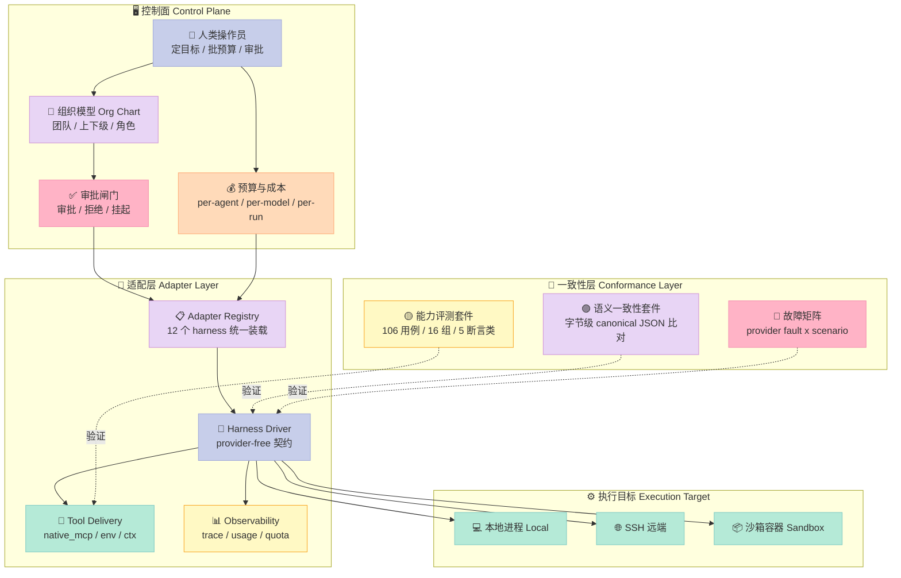
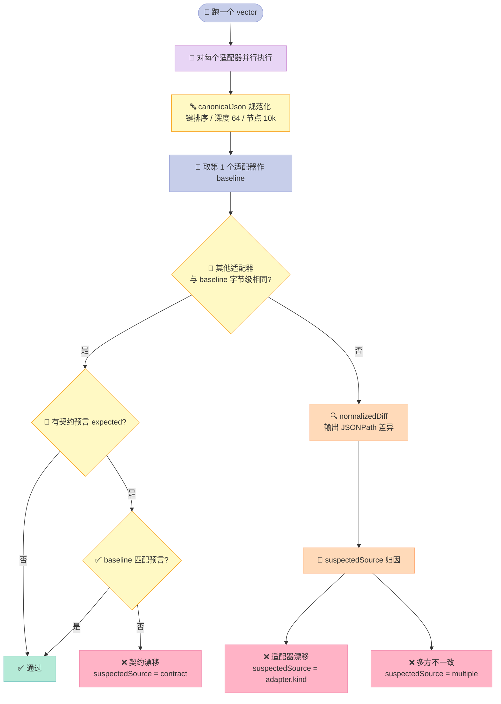
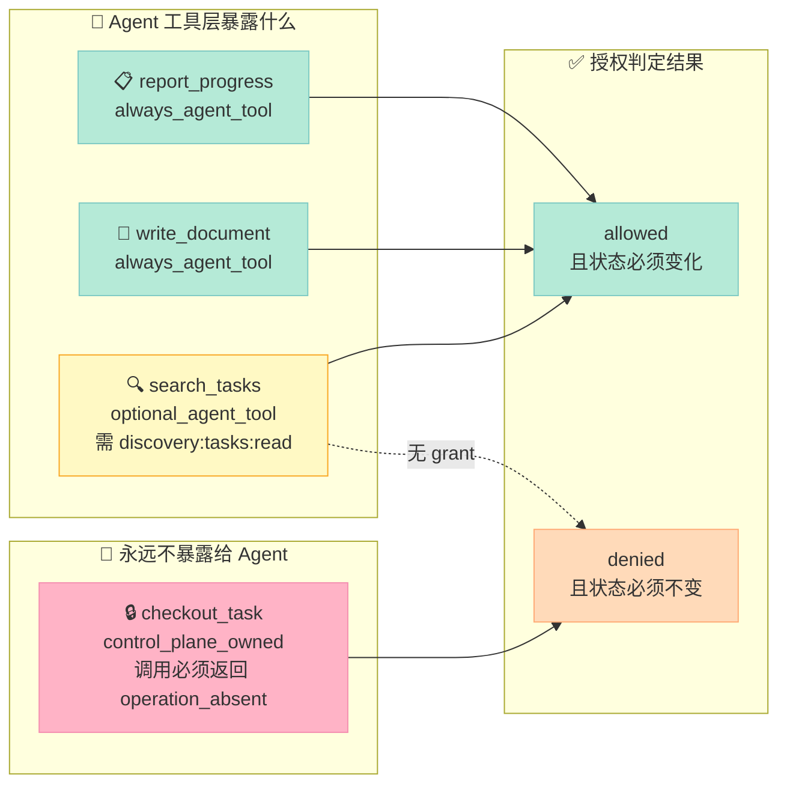

> 如果你在一个终端里跑 Claude Code、在另一个终端里跑 Codex、在第三个终端里跑 Cursor，这三个 Agent 的会话状态、权限边界、成本口径、错误语义**全都对不上**。Paperclip 做的事只有一句话：**让它们看起来像同一家公司的员工**。而真正困难的不是「包装成统一接口」，而是**证明它们真的等价**。

---

## 一、为什么"统一接口"这件事比想象中难

大多数人多 Agent 编排框架的做法是：定义一个 `Agent` 接口，里面有 `run(prompt)` 和 `getMessages()`。看上去够了，直到你真的跑起来。

Paperclip（[paperclipai/paperclip](https://github.com/paperclipai/paperclip)，117k Star / 19.4k fork / TypeScript / MIT）把这个问题的规模摆在了台面上：它同时管理 **OpenClaw、Claude Code、Codex、Cursor（本地 + Cloud）、Gemini CLI、OpenCode、Pi、Hermes（本地 + Gateway）、Grok Build、Kimi Code** 等 12 个 harness，还要跑在本地进程、SSH 远端、沙箱容器三种执行目标上。

而这些 harness 的原生行为差异是这样的：

| 维度 | Claude Code | Codex | Cursor Cloud | Kimi |
|------|-----------|-------|--------------|------|
| 权限模式枚举 | 无（走自己的 Ask 提示） | `never` / `on-request` / `untrusted` | 不可配（provider-managed） | 无 |
| 成本报告 | 有（`costUsd` + cache 折扣） | 有 | **无** | 有限 |
| 远端停止 | 强（可 kill） | 强 | **不可用** | 弱 |
| 会话 ID 语义 | 有 `sessionId` | `run.id` 复用同一 hook | 远端托管 | 各异 |
| Token 统计口径 | per-run | per-run **或 session_cumulative** | 不可用 | 各异 |

Paperclip 的 README 里有一句很克制的话：*"If it can receive a heartbeat, it's hired."*——**能收心跳就算入职**。这句话定义了整个系统的门槛：Paperclip 不要求 harness 理解 Paperclip 的世界观，只要求它能定期汇报"我还活着，我在干这个"。

但"能汇报"离"能等价地干活"还有十万八千里。这篇文章要拆的，就是 Paperclip 填这个洞的那套机制。

---

## 二、六件套落点：Paperclip 站在哪一层

按 Harness 6 件套矩阵（Rule / Skill / Sub-Agent / Workflow / Script / MCP）定位：

| 组件 | Paperclip 里的对应物 | 说明 |
|------|-------------------|------|
| **Sub-Agent** | Adapter（12 个 harness 适配器） | 主战场。每个 harness = 一个可插拔的"员工" |
| **Rule** | Capability Grant + Permission Mode | `delegation:tasks:create` 这类能力字符串构成权限宪法 |
| **Skill** | `AdapterSkillSnapshot` / `syncSkills` | Skill 同步有 3 种模式：`unsupported` / `persistent` / `ephemeral` |
| **Workflow** | Task / Run / Wake 状态机 | 任务依赖、阻塞、人工交互后的续跑策略 |
| **Script** | 106 条能力用例 + 语义一致性套件 | **本篇重点**——一致性靠可执行断言保证，不靠文档 |
| **MCP** | `AdapterRuntimeToolAccess` / `runtimeMcp` | 统一工具投放策略：`native_mcp` / `environment` / `invocation_context` |

**本篇所属组件：Script（硬关卡 / 可执行验证）+ Sub-Agent（适配抽象）**。

---

## 三、架构：三层切分，职责边界清晰

Paperclip 的代码组织本身就体现了 Harness 哲学——**机制与策略分离**：



**关键设计：一致性层是"旁路"的。** 它不参与运行时决策，只在 CI 里对适配器做证伪。运行时的每一条路径都是快的、笨的；一致性验证是慢的、精确的。这个分离让"跑得快"和"跑得对"不互相拖累。

---

## 四、原语一：适配器契约——12 个 harness 如何变成一个接口

Paperclip 的适配器契约定义在 `packages/adapter-utils/src/types.ts`（32,895 字符）。核心是 `ServerAdapterModule`：

```typescript
export interface ServerAdapterModule {
  type: string;
  execute(ctx: AdapterExecutionContext): Promise<AdapterExecutionResult>;
  testEnvironment(ctx: AdapterEnvironmentTestContext): Promise<AdapterEnvironmentTestResult>;

  // —— 可选能力：不用就留空，服务端按"不支持"处理 ——
  listSkills?: (ctx: AdapterSkillContext) => Promise<AdapterSkillSnapshot>;
  syncSkills?: (ctx: AdapterSkillContext, desiredSkills: string[]) => Promise<AdapterSkillSnapshot>;
  sessionCodec?: AdapterSessionCodec;
  models?: AdapterModel[];
  listModels?: () => Promise<AdapterModel[]>;
  getQuotaWindows?: () => Promise<ProviderQuotaResult>;
  detectModel?: () => Promise<{ model: string; provider: string; source: string; candidates?: string[] } | null>;
  getConfigSchema?: () => Promise<AdapterConfigSchema> | AdapterConfigSchema;

  /** How this adapter receives Paperclip's run-scoped control tools. */
  runtimeToolDelivery?: AdapterRuntimeToolDelivery;
}
```

有三点值得单独拆开讲。

### 4.1 `executionRecovery`——"缺席的证据从不授权重放"

`AdapterExecutionResult` 里有一个容易被忽略的字段：

```typescript
export interface AdapterExecutionResult {
  /**
   * Positive evidence for retrying bootstrap; absent evidence never authorizes replay.
   */
  executionRecovery?:
    | { kind: "bootstrap"; providerWorkStarted: false }
    | { kind: "interrupted"; providerStopped: true; sessionPreserved: true; actionOutcomes: "settled" };
  exitCode: number | null;
  signal: string | null;
  timedOut: boolean;
  ...
}
```

翻译成人话：**只有拿到"确凿证据证明上一次什么都没干"（`providerWorkStarted: false`），才允许重放这次调用。** 证据缺失 = 不重放。

这与 Harness 领域反复出现的一个教训完全吻合：*"absent evidence never authorizes replay"*。超时退出是最危险的状态——你不知道 provider 到底动没动，重放一次可能造成双写。Paperclip 把这条写进了类型签名，而不是写在文档里。

### 4.2 `usageBasis`——防止"复用会话导致成本虚高"

```typescript
/**
 * How `usage` totals are scoped. "per_run" means the tokens cover only this
 * execution; "session_cumulative" means they are running totals for the
 * persisted session, and the server must delta consecutive runs.
 * Absent defaults to per-run; the server must never infer cumulative usage
 * from a reused session ID.
 */
usageBasis?: "per_run" | "session_cumulative" | null;
```

有些 harness 的 token 统计是**会话累计值**，不是本次增量。如果直接相加，一个复用了 10 次会话的 Agent 会被算成 10 倍成本。Paperclip 要求适配器显式声明口径，且服务端**绝不能从"会话 ID 被复用"这件事反推它是累计值**——这是两件不同的事。

### 4.3 `pricingProvenance`——成本必须可溯源

```typescript
pricingProvenance?: {
  source: "provider_reported" | "provider_invoice" | "operator" | "rate_card" | "unknown";
  version?: string;
  evidence?: string;
  inputCentsPerMillion?: string;
  cachedInputCentsPerMillion?: string;
  cacheWriteCentsPerMillion?: string;
  outputCentsPerMillion?: string;
  serviceTier?: string;
  contextTier?: "short" | "long";
};
```

成本这个数字在 Agent 场景里特别容易被糊弄：模型自己报的、算出来的、还是拍脑袋估的？Paperclip 强制区分 `provider_reported`（厂商自己说的）和 `rate_card`（按价目表算的），并且 `costStatus` 有三态：`reported` / `estimated` / `unpriced`。**"不知道花了多少"是一个合法的状态，但必须显式标出来**，不能默认为 0。

还有个细节：`inferOpenAiCompatibleBillion` 这个函数的注释写得很清楚——

```typescript
// An OpenAI-compatible endpoint does not imply OpenAI prices. Do not
// assign direct-provider estimates to a proxy or an unknown endpoint.
```

一个 OpenAI 兼容端点**不等于** OpenAI 的价格。走代理就该按代理价算，不能套用直连价。

---

## 五、原语二：语义一致性套件——怎么证明两个 harness 等价

这是本篇最核心的部分。文件：`packages/paperclip-runner/src/conformance/semantic-conformance.ts`（12,174 字符）。

### 5.1 问题定义

Claude Code 和 Codex 都被包成 `ServerAdapterModule`。服务端只调用 `execute()`，拿到 `AdapterExecutionResult`。**但服务端凭什么相信这两个 harness 干的是同一件事？**

回答是：**不信，所以写套件去证。**

### 5.2 观测模型：把结果拆成五个可比维度

```typescript
export interface SemanticConformanceObservation {
  readonly authorization: SemanticConformanceAuthorization;
  readonly state: SemanticConformanceJsonValue;
  readonly effects: readonly SemanticConformanceJsonValue[];
  readonly audit: readonly SemanticConformanceJsonValue[];
  /** Provider-neutral normalized view of the PRP semantic result receipt. */
  readonly receipt?: {
    readonly schema: "paperclip.prp.semantic_tool.v1";
    readonly schemaVersion: 1;
    readonly phase: "result";
    readonly operationId: string;
    readonly callId: string;
    readonly idempotencyKeyPresent: boolean;
    readonly outcome: string;
    readonly code: string;
    readonly retryable: boolean;
    readonly authorizationBoundary: string;
    readonly operationReceiptPresent: boolean;
    readonly inputDigestPresent: boolean;
    readonly outputDigestPresent: boolean;
    readonly currentRevisionPresent: boolean;
  };
}
```

**注意 receipt 里的字段全是 `...Present: boolean`，而不是具体值。** 这是个精妙的设计：断言"digest 存在"（结构性质），而不是断言"digest 等于某个具体值"（内容性质）。因为 digest 的具体值取决于数据，断言具体值会让套件变成快照测试；而断言"存在"守的是**契约形状**——这才是不会随数据漂移的不变量。

五个维度对应五个可验证的语义问题：

| 维度 | 回答的问题 |
|------|-----------|
| `authorization` | 这次操作被允许了吗？拒绝码是什么？ |
| `state` | 状态变了吗？变成什么样？ |
| `effects` | 产生了哪些外部效果（写文档、发唤醒）？ |
| `audit` | 有没有留下审计痕迹？ |
| `receipt` | 回执的结构形状对不对？ |

### 5.3 `canonicalJson`——确定性的根基

比较"两个观测是否相同"听起来简单，实际上是噩梦：JS 对象键顺序不保证、数组顺序有语义但字典键没有、时间戳格式各异。Paperclip 的解法是自己写一个**规范化序列化器**：

```typescript
const MAX_CANONICAL_DEPTH = 64;
const MAX_CANONICAL_NODES = 10_000;

function canonicalJson(
  value: unknown,
  ancestors = new WeakSet<object>(),
  state = { nodes: 0 },
  depth = 0,
): string {
  state.nodes += 1;
  if (depth > MAX_CANONICAL_DEPTH || state.nodes > MAX_CANONICAL_NODES) {
    throw new Error("semantic_conformance_observation_too_large");
  }
  if (value === null || typeof value === "boolean" || typeof value === "string") {
    return JSON.stringify(value);
  }
  if (typeof value === "number") {
    if (!Number.isFinite(value)) throw invalidObservation();
    return JSON.stringify(value);
  }
  if (typeof value !== "object") throw invalidObservation();
  if (ancestors.has(value)) {
    throw new Error("semantic_conformance_cyclic_observation");
  }
  const prototype = Object.getPrototypeOf(value);
  if (!Array.isArray(value) && prototype !== Object.prototype && prototype !== null) {
    throw invalidObservation();   // ← 拒绝 Date / Map / class 实例
  }
  ancestors.add(value);
  try {
    if (Array.isArray(value)) {
      const entries: string[] = [];
      for (let index = 0; index < value.length; index += 1) {
        if (!Object.hasOwn(value, index)) throw invalidObservation();  // ← 拒绝稀疏数组
        entries.push(canonicalJson(value[index], ancestors, state, depth + 1));
      }
      return `[${entries.join(",")}]`;
    }
    const record = value as Record<string, unknown>;
    return `{${Object.keys(record)
      .sort()                                                        // ← 键排序，消除顺序不确定性
      .map((key) => `${JSON.stringify(key)}:${canonicalJson(record[key], ancestors, state, depth + 1)}`)
      .join(",")}}`;
  } finally {
    ancestors.delete(value);
  }
}
```

**四道防线，每一道都对应一类真实事故：**

1. **深度 64 / 节点 10000 上限** —— 防止一个自引用或指数膨胀的观测把 CI 拖垮。超限直接抛错，**不做截断**（截断会让两个不同的观测看起来相同）。
2. **环检测**（`WeakSet` + `finally` 里 `delete`）—— 防止 `a.self = a` 这种结构让序列化无限递归。
3. **原型白名单**（只接受 `Object.prototype` / `null` / 数组）—— 拒绝 `Date`、`Map`、class 实例。因为 `JSON.stringify(new Date())` 会得到 `"2026-11-26T..."`，这依赖运行时刻，**在不同 harness 上必然不同**，会把"真失配"淹没成噪声。
4. **稀疏数组拒绝**（`Object.hasOwn`）—— `[1, , 3]` 在 JSON 里会变成 `null` 空洞，和 `[1, null, 3]` 无法区分。

**这是"让假失配消失"和"让真失配浮现"之间的分界线。** 一个噪声很大的测试套件会被团队关掉；只有零噪声的套件才能真正守住边界。

### 5.4 主循环：字节级相同才算通过

```typescript
export async function runSemanticConformanceKit(input: {
  readonly vectors: readonly SemanticConformanceVector[];
  readonly adapters: readonly SemanticConformanceAdapter[];
}): Promise<SemanticConformanceReport> {
  if (input.adapters.length < 2) {
    throw new Error("semantic_conformance_requires_two_adapters");
  }
  if (new Set(input.adapters.map((adapter) => adapter.id)).size !== input.adapters.length) {
    throw new Error("semantic_conformance_adapter_ids_must_be_unique");
  }
  const rows: SemanticConformanceReportRow[] = [];
  for (const vector of input.vectors) {
    const executed = await Promise.all(
      input.adapters.map(async (adapter) => ({
        adapter,
        observation: await adapter.execute(vector),
      })),
    );
    const observations = Object.freeze(Object.fromEntries(
      executed.map(({ adapter, observation }) => [adapter.id, structuredClone(observation)]),
    ));
    const baseline = executed[0]!;
    const baselineJson = canonicalJson(baseline.observation);
    for (const candidate of executed.slice(1)) {
      if (canonicalJson(candidate.observation) !== baselineJson) {
        throw mismatchError(vector, baseline, candidate, observations);
      }
    }
    if (
      vector.expected !== undefined
      && canonicalJson(baseline.observation) !== canonicalJson(vector.expected)
    ) {
      throw new SemanticConformanceMismatchError(
        vector.id, vector.operationId, "contract", baseline.adapter.id, "contract",
        normalizedDiff(vector.expected, baseline.observation), observations,
      );
    }
    rows.push(Object.freeze({ /* ... */ }));
  }
  return Object.freeze({
    schema: "paperclip.semantic-conformance-report.v1",
    rows: Object.freeze(rows),
  });
}
```

三个细节：

- **至少两个适配器**——单个适配器和"标准"比没有意义，比的是**两个实现之间的等价性**。
- **适配器 ID 必须唯一**——否则 `Object.fromEntries` 会静默覆盖，两个适配器的观测会互相顶掉。
- **每个 vector 都 `Promise.all` 并行跑**——适配器之间无顺序依赖。



### 5.5 失配归因：谁错了？

这是整套机制里最见功力的一处。失配发生时，**"某某适配器写错了"和"契约本身写错了"是两种完全不同的问题**，前者改代码，后者改预言。Paperclip 用 `suspectedSource` 字段把两者区分开：

```typescript
export type SemanticConformanceSuspectedSource =
  | SemanticConformanceAdapterKind      // "mock" | "production_binding"
  | "contract"
  | "multiple";
```

归因逻辑是这样的：

```typescript
function mismatchError(vector, baseline, candidate, observations) {
  let suspectedSource = candidate.adapter.kind ?? "multiple";
  let expected = baseline.observation;
  let actual = candidate.observation;
  if (vector.expected !== undefined) {
    const baselineMatches   = canonicalJson(baseline.observation)   === canonicalJson(vector.expected);
    const candidateMatches = canonicalJson(candidate.observation) === canonicalJson(vector.expected);
    if (baselineMatches && !candidateMatches) {
      suspectedSource = candidate.adapter.kind ?? "multiple";
      expected = vector.expected;
    } else if (!baselineMatches && candidateMatches) {
      suspectedSource = baseline.adapter.kind ?? "multiple";
      expected = vector.expected;
      actual = baseline.observation;      // ← 注意：这里 actual 换成了 baseline
    } else {
      suspectedSource = "multiple";
      expected = vector.expected;
    }
  }
  return new SemanticConformanceMismatchError(
    vector.id, vector.operationId, baseline.adapter.id, candidate.adapter.id,
    suspectedSource, normalizedDiff(expected, actual), observations,
  );
}
```

用一个三行表格就能讲清楚：

| baseline 匹配预言 | candidate 匹配预言 | 结论 | suspectedSource |
|---|---|---|---|
| ✅ | ❌ | candidate 漂移 | `candidate.kind` |
| ❌ | ✅ | baseline 漂移 | `baseline.kind` |
| ❌ | ❌ | **契约本身漂移** | `"contract"` |
| （无预言） | — | 无法判断 | `candidate.kind` |

**第三行是精髓。** 两个适配器"一致地错"意味着它们对契约的理解是一致的，但和契约预言不一致——**问题在预言，不在实现**。没有这层归因，开发者会花几天去 debug 一个其实只存在于 YAML 里的错误。

还有一点：`normalizedDiff` 输出的不是"两个对象不相等"，而是**结构化的差异路径列表**：

```typescript
export interface SemanticConformanceDiff {
  readonly path: string;      // 形如 "$.authorization.code" / "$.effects[0]"
  readonly expected: unknown;
  readonly actual: unknown;
}
```

路径用 JSONPath 风格，CI 日志里直接能看到"在授权码这一格分岔了"。

---

## 六、原语三：能力评测套件——106 条用例不是测试，是宪法

`packages/paperclip-runner/src/conformance/capability-eval-suite.ts` 读的是一个**签入仓库的生成文件**：

```typescript
async function readInventory(): Promise<CapabilityEvalInventory> {
  const source = await readFile(resolve(PACKAGE_ROOT, "spec/capability/eval-traceability.yaml"), "utf8");
  return JSON.parse(source.startsWith(GENERATED_HEADER) ? source.slice(GENERATED_HEADER.length) : source);
}

function assertInventory(inventory: CapabilityEvalInventory): void {
  const groups = new Set(inventory.rows.map((row) => row.group));
  if (inventory.schemaVersion !== 2 || inventory.rows.length !== 106 || groups.size !== 16) {
    throw new Error(
      `Capability eval inventory mismatch: rows=${inventory.rows.length}, ` +
      `groups=${groups.size}, schema=${inventory.schemaVersion}`);
  }
  const ids = new Set(inventory.rows.map((row) => row.id));
  if (ids.size !== inventory.rows.length) throw new Error("Capability eval inventory contains duplicate case IDs");
}
```

**106 条用例 / 16 个分组 / schema 版本必须是 2。** 数字写死在断言里——少一条用例，套件直接拒绝运行。

### 6.1 三种 disposition：谁能碰什么

每条用例有一个 `primaryDisposition`，这是整个能力模型的核心：

```typescript
type AssertionClass =
  | "control_plane_invariant"     // 控制面不变量
  | "agent_tool_contract"         // agent 工具契约
  | "authorization_policy"        // 授权策略
  | "combined_multi_hop"          // 组合多跳
  | "restraint_no_call";          // 克制：不该调用就不调用

interface CapabilityEvalRow {
  id: string;
  title: string;
  group: string;
  sourceAnchor: string;          // ← 溯源锚点：这条用例对应哪份设计文档
  expectedSemantics: string[];    // 应该发生什么
  forbiddenSemantics: string[];   // 绝不能发生什么
  primaryDisposition: "control_plane_owned" | "always_agent_tool" | "optional_agent_tool";
  requiredGrants: string[];
  assertionClasses: AssertionClass[];
}
```

三种 disposition 的语义：

| disposition | 含义 | 验证方式 |
|---|---|---|
| `control_plane_owned` | **控制面专属**，agent 工具层不该看见 | 调用它必须返回 `operation_absent` |
| `always_agent_tool` | 每个 agent 都有，不用授权 | 调用必须 `allowed` **且状态必须变化** |
| `optional_agent_tool` | 需要显式 grant | 有 grant 必须 `allowed`；无 grant 必须**被拒且状态不变** |



**`control_plane_owned` 这个类别是整篇最重要的设计。** 想象一个 Agent 的工具列表里暴露了"签领任务"这个操作——这在架构上就是错的：签领是调度器的权力，不是 Agent 的权力。Agent 应该只有"上报进度""提交产物""请求人工确认"这类**对自己工作有影响但不越权**的操作。Paperclip 用 106 条用例把这条边界钉死了。

### 6.2 `restraint_no_call`：测"什么都不做"也是能力

`restraint_no_call` 这一类断言的价值被严重低估。它验证的是：**在这个场景下，Agent 不应该调用任何工具。**

对应代码：

```typescript
const stateDiff = beforeRevision === afterRevision ? [] : ["mock_state.revision"];
const expectedState = operationMutatesState(semanticOperation) ? "mutated" : "unchanged";
if (row.assertionClasses.includes("restraint_no_call") && stateDiff.length !== 0) {
  throw failure(row, semanticOperation, authorizationDecision, stateDiff);
}
```

注意它是**双向**的：`restraint_no_call` 要求状态**没有**变化；而 `always_agent_tool` 要求状态**必须**变化：

```typescript
if (afterRevision === beforeRevision) {
  throw failure(row, semanticOperation, authorizationDecision, ["expected mock state mutation was absent"]);
}
```

一个只会"调用工具"的测试套件，会漏掉"Agent 该闭嘴时却动手了"这类问题。而在真实场景里，**过度调用比不调用贵得多**——每一次多余的工具调用都是真金白银的 token 和一次可能的副作用。

### 6.3 真实模型回合：`runCapabilityLiveCodexMatrix`

除了 106 条确定性 mock 用例，Paperclip 还有一个**真实 Codex 回合**的矩阵：

```typescript
for (const group of [...new Set(inventory.rows.map((row) => row.group))].sort()) {
  const row = inventory.rows.find((candidate) => candidate.group === group);
  if (!row) throw new Error(`missing live Codex representative for group ${group}`);
  const plan = operationPlan(row);
  const service = new CapabilityLiveSessionService();
  const session = await service.create({
    workingDirectory,
    seed: liveFixtureSeed(CAPABILITY_LIVE_EVAL_GRANTS),
    capabilities: capabilityFixtureRunCapabilities(CAPABILITY_LIVE_EVAL_GRANTS),
    explicitClaims: [...CAPABILITY_LIVE_EVAL_GRANTS],
    runId: `run-capability-live-${row.id}`,
    sessionId: `session-capability-live-${row.id}`,
    turnTimeoutMs: 60_000,
    scenario: { id: `capability-live-eval-${row.id}` },
  });
  ...
}
```

16 个组，每组跑一次真实 Codex 回合（超时 60 秒），检查模型**实际调了哪些工具**。这段注释尤其值得看：

```typescript
// Only mutating operations declare a retry key. Read operations close
// their schema with `additionalProperties: false`, so injecting one
// unconditionally makes the model dictate an input the tool must reject.
...(operationAcceptsIdempotencyKey(plan.operationId)
  ? { idempotencyKey: `capability-live:${row.id}` }
  : {}),
```

读操作的 schema 是 `additionalProperties: false` 封闭的，无条件塞一个 `idempotencyKey` 进去会被 schema 拒绝——**测试夹具的构造方式本身会污染被测对象**。这类坑只有在真跑模型时才会暴露。

还有一段注释直接点出了"绿色"假象的来源：

```typescript
// A rejected call still emits a `tool_call` entry, and a rejected read
// leaves state `unchanged` exactly like a successful one. Comparing calls
// and state alone therefore reports such a case as green, so the denial
// itself has to be part of the gate.
const deniedCalls = snapshot.evidence
  .filter((entry) => entry.kind === "tool_result" && isDeniedToolResult(entry.data.result))
  .map((entry) => String(entry.data.operationId));
```

**被拒绝的调用同样会留下 `tool_call` 记录，被拒绝的读操作同样让状态保持 `unchanged`。** 只比对"调了哪些工具"和"状态变没变"，一个被拒绝的调用看起来和一个成功的调用一模一样——**测试会报绿，但实际行为是拒绝**。所以拒绝必须单独成为一个门禁维度。

---

## 七、原语四：治理事件与"停止证明"

最后一块拼图是治理。`packages/paperclip-runner/src/governance-events.ts` 的一行注释定义了它的边界：

```typescript
/**
 * Canonical payloads for governance activity: harness hooks and automatic
 * approval reviews. These are display records that make decisions nobody
 * clicked auditable; they carry no execution authority.
 */
```

**"它们不带执行权力"** —— 治理事件是**展示记录**，不是控制信号。这条边界划得很清楚：事件被伪造不会让任何东西真的执行。

不过这个文件里有一个非常漂亮的原语，在 `packages/adapter-utils/src/provider-stopped-boundary.ts`：

```typescript
/**
 * Per-adapter invocation fence. A failed later attempt invalidates an earlier
 * stop receipt; a late callback from that earlier attempt cannot restore it.
 */
export function createProviderStoppedBoundary(onProviderStopped?: () => Promise<void>) {
  let invocation = 0;
  let stopped = false;
  let collected = false;
  return {
    beginInvocation(): () => void {
      const current = ++invocation;
      stopped = false;
      return () => { if (invocation === current) stopped = true; };
    },
    async collectBeforeRestore() {
      if (!stopped || collected || !onProviderStopped) return;
      collected = true;
      await onProviderStopped();
    },
  };
}
```

这个 20 行的"调用栅栏"解决一个具体的竞态：

1. 第一次调用启动，`invocation = 1`，返回一个收据（closure）。
2. 第一次调用超时，框架认为它挂了，发起第二次调用，`invocation = 2`，`stopped` 重置为 `false`。
3. **第一次调用的收据姗姗来迟地回来了**——如果它能直接把 `stopped` 置为 `true`，就会产生一个"其实没停"的假停止证明。

`if (invocation === current)` 这一行是全部要点：**过期的收据无法复活停止证明。** 这和"kill 意图 ≠ kill 成功"是同一族的原则，但在并发场景下多了一层"旧证据不能覆盖新状态"。

---

## 八、从零搭建：最小可行实现

如果你也想给自己的多 harness 系统加一层一致性保障，我建议的最小实现顺序是：

### 8.1 必须有的三块

| 组件 | 最小形态 | 为什么不能省 |
|------|---------|------------|
| **规范化序列化器** | 键排序 + 深度上限 + 环检测 + 原型白名单 | 没有它，噪声会淹没真失配 |
| **观测模型** | 5 维（授权/状态/效果/审计/回执） | 没有它，比对对象会漂移 |
| **失配归因** | `suspectedSource` 三态 | 没有它，开发者分不清"实现错了"还是"预言错了" |

### 8.2 可以暂时省的

- **106 条用例的全量清单** —— 先写 5~10 条覆盖"控制面专属操作不该暴露"和"无授权必须被拒"这两条命门
- **真实模型回合矩阵** —— 确定性 mock 跑通了再上
- **跨 provider 故障矩阵** —— 单 provider 内部先跑通

### 8.3 踩坑预警

1. **别用 `JSON.stringify` 直接比** —— 键顺序、`Date`、`Map` 都会制造假失配
2. **断言 receipt 的"形状"而不是"内容"** —— `digestPresent: true` 而不是 `digest === "abc"`
3. **状态断言要双向** —— 既要测"该变时变了"，也要测"不该变时没变"
4. **拒绝必须单独成为门禁维度** —— 否则"被拒绝"和"成功"在断言里长得一样
5. **失配时先看 `suspectedSource`** —— 归因错了，修的方向就全错
6. **写测试夹具时检查 schema 封闭性** —— `additionalProperties: false` 的操作塞额外字段会被拒，而被拒的原因和被测逻辑无关

### 8.4 一个 200 行的复刻

下面这份 Python 复刻把上面三个核心原语抽了出来，可以直接跑：

```python
#!/usr/bin/env python3
"""
MVP：从 paperclipai/paperclip 抽离的「语义一致性套件」核心机制复刻。

原项目（TypeScript）：
  packages/paperclip-runner/src/conformance/semantic-conformance.ts

复刻了三个不可省略的原语：
  1. canonicalJson      —— 确定性序列化（键排序 + 深度/节点上限 + 环检测）
  2. runSemanticConformanceKit —— 多适配器逐 vector 比对，字节级相同才算通过
  3. suspectedSource    —— 失配归因：适配器漂移 vs 契约漂移

作者注：本文件为教学复刻，非原仓库源码。
"""
from __future__ import annotations

import json
from dataclasses import dataclass, field
from typing import Any

MAX_CANONICAL_DEPTH = 64
MAX_CANONICAL_NODES = 10_000


# ---------------------------------------------------------------- 原语 1
def canonical_json(value: Any, ancestors=None, state=None, depth: int = 0) -> str:
    """确定性 JSON 序列化：键排序、拒绝非 JSON 值、检测环、限制深度与节点数。"""
    if ancestors is None:
        ancestors = set()
    if state is None:
        state = {"nodes": 0}
    state["nodes"] += 1
    if depth > MAX_CANONICAL_DEPTH or state["nodes"] > MAX_CANONICAL_NODES:
        raise ValueError("semantic_conformance_observation_too_large")
    if value is None or isinstance(value, bool) or isinstance(value, str):
        return json.dumps(value, ensure_ascii=False)
    if isinstance(value, (int, float)):
        if isinstance(value, float) and (value != value or value in (float("inf"), float("-inf"))):
            raise ValueError("semantic_conformance_non_json_observation")
        return json.dumps(value)
    if not isinstance(value, (dict, list, tuple)):
        raise ValueError("semantic_conformance_non_json_observation")
    marker = id(value)
    if marker in ancestors:
        raise ValueError("semantic_conformance_cyclic_observation")
    ancestors.add(marker)
    try:
        if isinstance(value, (list, tuple)):
            return "[" + ",".join(
                canonical_json(item, ancestors, state, depth + 1) for item in value
            ) + "]"
        return "{" + ",".join(
            json.dumps(key, ensure_ascii=False) + ":" + canonical_json(value[key], ancestors, state, depth + 1)
            for key in sorted(value.keys())
        ) + "}"
    finally:
        ancestors.discard(marker)


# ---------------------------------------------------------------- 原语 3
@dataclass
class ConformanceDiff:
    path: str
    expected: Any
    actual: Any


def normalized_diff(expected: Any, actual: Any, path: str = "$") -> list[ConformanceDiff]:
    """结构化 diff：递归比对，输出 JSONPath 形式的差异列表。"""
    if expected is None or actual is None:
        return [ConformanceDiff(path, expected, actual)]
    if canonical_json(expected) == canonical_json(actual):
        return []
    if isinstance(expected, (list, tuple)) and isinstance(actual, (list, tuple)):
        diffs: list[ConformanceDiff] = []
        for index in range(max(len(expected), len(actual))):
            left = expected[index] if index < len(expected) else None
            right = actual[index] if index < len(actual) else None
            diffs.extend(normalized_diff(left, right, f"{path}[{index}]"))
        return diffs
    if isinstance(expected, dict) and isinstance(actual, dict):
        diffs = []
        for key in sorted(set(expected) | set(actual)):
            diffs.extend(normalized_diff(expected.get(key), actual.get(key), f"{path}.{key}"))
        return diffs
    return [ConformanceDiff(path, expected, actual)]


@dataclass
class SemanticConformanceMismatch(Exception):
    vector_id: str
    operation_id: str
    baseline_adapter_id: str
    mismatched_adapter_id: str
    suspected_source: str
    diffs: list[ConformanceDiff] = field(default_factory=list)

    def __str__(self) -> str:
        first = self.diffs[0] if self.diffs else None
        values = (
            f"; expected {first.expected!r}, actual {first.actual!r}"
            if first else ""
        )
        return (
            f"Semantic conformance mismatch for {self.vector_id} "
            f"({self.operation_id}) at {first.path if first else '$'}{values}; "
            f"suspected source: {self.suspected_source}; "
            f"{self.mismatched_adapter_id} differs from {self.baseline_adapter_id}"
        )


# ---------------------------------------------------------------- 原语 2
@dataclass
class Vector:
    id: str
    operation_id: str
    input: dict
    expected: dict | None = None


class Adapter:
    """适配器基类：把「某个具体 harness」包装成统一可观测的执行器。"""

    kind = "production_binding"

    def __init__(self, adapter_id: str):
        self.id = adapter_id

    def execute(self, vector: Vector) -> dict:
        raise NotImplementedError


class MockAdapter(Adapter):
    """确定性 mock 适配器 —— 相当于原项目的 CapabilityMockSemanticConformanceAdapter。"""

    kind = "mock"

    def __init__(self, adapter_id: str, grants: list[str]):
        super().__init__(adapter_id)
        self.grants = grants
        self.state: dict = {"revision": 0, "documents": {}}

    def execute(self, vector: Vector) -> dict:
        op = vector.operation_id
        payload = vector.input

        # 授权：受保护操作必须有对应 grant
        if op == "write_document":
            if "documents:write" not in self.grants:
                return self._observe("denied", "capability_missing", [], [], {})
            key = payload["key"]
            current = self.state["documents"].get(key)
            base = payload.get("baseRevisionId")
            if base is None and current is not None:
                return self._observe("denied", "stale_revision", [], [], {})
            self.state["revision"] += 1
            self.state["documents"][key] = {
                "revision": self.state["revision"],
                "body": payload["body"],
            }
            return self._observe("allowed", "ok", [{"kind": "document", "key": key}], ["revision"], {})

        if op == "report_progress":
            self.state["revision"] += 1
            return self._observe("allowed", "ok", [{"kind": "comment"}], ["revision"], {})

        if op == "finish_task":
            if "tasks:finish" not in self.grants:
                return self._observe("denied", "capability_missing", [], [], {})
            return self._observe("allowed", "ok", [{"kind": "task"}], [], {})

        if op == "checkout_task":
            # 控制面自有操作：不应暴露给 agent 工具层
            return self._observe("denied", "operation_absent", [], [], {})

        return self._observe("denied", "operation_absent", [], [], {})

    def _observe(self, outcome, code, effects, state_diff, receipt_extra):
        return {
            "authorization": {"outcome": outcome, "code": code},
            "state": {"revision": self.state["revision"], "diff": state_diff},
            "effects": effects,
            "audit": [],
            "receipt": {
                "schema": "paperclip.prp.semantic_tool.v1",
                "schemaVersion": 1,
                "outcome": outcome,
                "code": code,
                "idempotencyKeyPresent": True,
                "retryable": False,
                **receipt_extra,
            },
        }


def run_semantic_conformance_kit(vectors, adapters) -> dict:
    if len(adapters) < 2:
        raise ValueError("semantic_conformance_requires_two_adapters")
    if len({a.id for a in adapters}) != len(adapters):
        raise ValueError("semantic_conformance_adapter_ids_must_be_unique")

    rows = []
    adapters_by_id = {a.id: a for a in adapters}
    for vector in vectors:
        observations = {a.id: a.execute(vector) for a in adapters}
        baseline_id = adapters[0].id
        baseline_json = canonical_json(observations[baseline_id])

        for adapter in adapters[1:]:
            candidate_json = canonical_json(observations[adapter.id])
            if candidate_json != baseline_json:
                raise _attribute(
                    vector, baseline_id, adapter.id, observations,
                    expected=vector.expected, adapters_by_id=adapters_by_id,
                )

        # 契约预言：baseline 必须匹配 vector.expected
        if vector.expected is not None:
            if canonical_json(observations[baseline_id]) != canonical_json(vector.expected):
                raise SemanticConformanceMismatch(
                    vector_id=vector.id,
                    operation_id=vector.operation_id,
                    baseline_adapter_id=baseline_id,
                    mismatched_adapter_id="contract",
                    suspected_source="contract",
                    diffs=normalized_diff(vector.expected, observations[baseline_id]),
                )

        rows.append({
            "vectorId": vector.id,
            "operationId": vector.operation_id,
            "adapterIds": [a.id for a in adapters],
        })

    return {"schema": "paperclip.semantic-conformance-report.v1", "rows": rows}


def _attribute(vector, baseline_id, candidate_id, observations, expected, adapters_by_id):
    """失配归因：谁错了？是适配器漂移，还是契约本身漂移？

    对齐原项目 semantic-conformance.ts 的 mismatchError()：
      - 没有契约预言时，用「候选适配器的 kind」作为疑似来源
      - 有契约预言时，看谁匹配了预言：只有一方匹配 = 那一方漂移；都不匹配 = 契约漂移
    """
    suspected = "multiple"
    exp = observations[baseline_id]
    act = observations[candidate_id]
    if expected is not None:
        baseline_ok = canonical_json(observations[baseline_id]) == canonical_json(expected)
        candidate_ok = canonical_json(observations[candidate_id]) == canonical_json(expected)
        if baseline_ok and not candidate_ok:
            suspected, exp, act = "adapter_drift", expected, observations[candidate_id]
        elif not baseline_ok and candidate_ok:
            suspected, exp, act = "adapter_drift", expected, observations[baseline_id]
        else:
            suspected, exp, act = "contract", expected, observations[candidate_id]
    else:
        # 无预言可比：退化为「候选适配器的类型」，mock 适配器 = 漂移风险最高
        candidate_kind = adapters_by_id[candidate_id].kind
        suspected = "adapter_drift" if candidate_kind == "mock" else candidate_kind
    return SemanticConformanceMismatch(
        vector_id=vector.id,
        operation_id=vector.operation_id,
        baseline_adapter_id=baseline_id,
        mismatched_adapter_id=candidate_id,
        suspected_source=suspected,
        diffs=normalized_diff(exp, act),
    )


# ================================================================ 演示
def run_demo():
    print("=" * 72)
    print("场景 1：两个适配器语义一致 —— 通过")
    print("=" * 72)
    vectors = [
        Vector("progress-applied", "report_progress", {"idempotencyKey": "k1", "body": "ok"}),
        Vector("document-create", "write_document",
               {"idempotencyKey": "k2", "key": "plan", "body": "v1", "baseRevisionId": None}),
    ]
    a = MockAdapter("claude-binding", ["documents:write", "tasks:finish"])
    b = MockAdapter("codex-binding", ["documents:write", "tasks:finish"])
    report = run_semantic_conformance_kit(vectors, [a, b])
    print(f"✅ 通过：{len(report['rows'])} 个 vector，schema={report['schema']}")
    for row in report["rows"]:
        print(f"   - {row['vectorId']:<20} adapters={row['adapterIds']}")

    print()
    print("=" * 72)
    print("场景 2：Codex 适配器缺少 grant —— 失配，且能归因到具体适配器")
    print("=" * 72)
    a = MockAdapter("claude-binding", ["documents:write", "tasks:finish"])
    c = MockAdapter("codex-binding", [])  # 少一个 grant
    try:
        run_semantic_conformance_kit(vectors, [a, c])
        print("❌ 不该通过")
    except SemanticConformanceMismatch as exc:
        print(f"✅ 捕获失配: {exc}")
        print(f"   suspectedSource = {exc.suspected_source}")
        for d in exc.diffs:
            print(f"   diff @ {d.path}: expected={d.expected!r} actual={d.actual!r}")

    print()
    print("=" * 72)
    print("场景 3：契约预言（expected）本身写错 —— 归因到 contract 而非适配器")
    print("=" * 72)
    # 故意把预言里的 effects 写空 —— 两个适配器都「一致地错」，
    # 说明问题不在某个适配器，而在契约预言本身。
    contract_vector = Vector(
        "governed-action-without-claim", "write_document",
        {"idempotencyKey": "k3", "key": "plan", "body": "v1", "baseRevisionId": None},
        expected={
            "authorization": {"outcome": "allowed", "code": "ok"},
            "state": {"revision": 1, "diff": ["revision"]},
            "effects": [],          # ← 故意写错：真实实现会产生一个 document effect
            "audit": [],
            "receipt": {
                "schema": "paperclip.prp.semantic_tool.v1", "schemaVersion": 1,
                "outcome": "allowed", "code": "ok",
                "idempotencyKeyPresent": True, "retryable": False,
            },
        },
    )
    a = MockAdapter("claude-binding", ["documents:write"])
    b = MockAdapter("codex-binding", ["documents:write"])
    try:
        run_semantic_conformance_kit([contract_vector], [a, b])
        print("❌ 不该通过")
    except SemanticConformanceMismatch as exc:
        print(f"✅ 捕获失配: {exc}")
        print(f"   suspectedSource = {exc.suspected_source}  ← 不是 'adapter_drift'")
        print(f"   适配器完全一致，失配来自契约预言本身")

    print()
    print("=" * 72)
    print("场景 4：canonicalJson 的三道防线")
    print("=" * 72)
    # 键顺序无关
    print(f"   键顺序无关: {canonical_json({'b': 1, 'a': 2}) == canonical_json({'a': 2, 'b': 1})}")
    # 环检测
    cyclic: dict = {"self": None}
    cyclic["self"] = cyclic
    try:
        canonical_json(cyclic)
        print("   ❌ 环未被检测")
    except ValueError as exc:
        print(f"   ✅ 环被检测: {exc}")
    # 深度上限
    deep: Any = {}
    node = deep
    for _ in range(80):
        node["child"] = {}
        node = node["child"]
    try:
        canonical_json(deep)
        print("   ❌ 深度未受限")
    except ValueError as exc:
        print(f"   ✅ 深度受限: {exc}")
    # 非 JSON 值
    try:
        canonical_json({"fn": lambda: None})
        print("   ❌ 函数未被拒绝")
    except ValueError as exc:
        print(f"   ✅ 非 JSON 值被拒: {exc}")

    print()
    print("=" * 72)
    print("场景 5：适配器 id 唯一性 / 至少两个适配器 —— 前置条件门禁")
    print("=" * 72)
    for bad_adapters, label in [
        ([MockAdapter("x", [])], "只有一个适配器"),
        ([MockAdapter("dup", []), MockAdapter("dup", [])], "adapter id 重复"),
    ]:
        try:
            run_semantic_conformance_kit([], bad_adapters)
            print(f"   ❌ {label} 未被拦截")
        except ValueError as exc:
            print(f"   ✅ {label} 被拦截: {exc}")


if __name__ == "__main__":
    run_demo()
```

**实际运行输出**（`python3 paperclip_mvp.py`）：

```
========================================================================
场景 1：两个适配器语义一致 —— 通过
========================================================================
✅ 通过：2 个 vector，schema=paperclip.semantic-conformance-report.v1
   - progress-applied     adapters=['claude-binding', 'codex-binding']
   - document-create      adapters=['claude-binding', 'codex-binding']

========================================================================
场景 2：Codex 适配器缺少 grant —— 失配，且能归因到具体适配器
========================================================================
✅ 捕获失配: Semantic conformance mismatch for document-create (write_document) at $.authorization.code; expected 'ok', actual 'capability_missing'; suspected source: adapter_drift; codex-binding differs from claude-binding
   suspectedSource = adapter_drift
   diff @ $.authorization.code: expected='ok' actual='capability_missing'
   diff @ $.authorization.outcome: expected='allowed' actual='denied'
   diff @ $.effects[0]: expected={'kind': 'document', 'key': 'plan'} actual=None
   diff @ $.receipt.code: expected='ok' actual='capability_missing'
   diff @ $.receipt.outcome: expected='allowed' actual='denied'
   diff @ $.state.diff[0]: expected='revision' actual=None
   diff @ $.state.revision: expected=2 actual=1

========================================================================
场景 3：契约预言（expected）本身写错 —— 归因到 contract 而非适配器
========================================================================
✅ 捕获失配: Semantic conformance mismatch for governed-action-without-claim (write_document) at $.effects[0]; expected None, actual {'kind': 'document', 'key': 'plan'}; suspected source: contract; contract differs from claude-binding
   suspectedSource = contract  ← 不是 'adapter_drift'
   适配器完全一致，失配来自契约预言本身

========================================================================
场景 4：canonicalJson 的三道防线
========================================================================
   键顺序无关: True
   ✅ 环被检测: semantic_conformance_cyclic_observation
   ✅ 深度受限: semantic_conformance_observation_too_large
   ✅ 非 JSON 值被拒: semantic_conformance_non_json_observation

========================================================================
场景 5：适配器 id 唯一性 / 至少两个适配器 —— 前置条件门禁
========================================================================
   ✅ 只有一个适配器 被拦截: semantic_conformance_requires_two_adapters
   ✅ adapter id 重复 被拦截: semantic_conformance_adapter_ids_must_be_unique
```

场景 2 和场景 3 的对比最能说明归因机制的价值：**同样是"两个适配器结果不一致"，场景 2 指向 `codex-binding` 少配了一个 grant，场景 3 指向契约预言本身写错了。** 没有归因，这两种问题的排查路径完全不同。

---

## 九、横向对比：三条路线的设计差异

| 维度 | Paperclip | Agent Orchestrator（2026-09 已覆盖） | Omnigent（2026-07 已覆盖） |
|------|----------|-------------------------------|----------------------|
| **抽象对象** | harness 适配器（执行入口） | 桌面工作空间 + 合并 PR | meta-harness（可换 harness 不重写） |
| **一致性保证** | **106 条用例 + 字节级语义比对** | 无系统性套件 | 无系统性套件 |
| **失败归因** | `suspectedSource` 三态 | 未区分 | 未区分 |
| **多租户隔离** | companyId 贯穿所有实体 | 桌面工作空间隔离 | — |
| **成本口径** | `costStatus` 三态 + `pricingProvenance` 溯源 | 观测为主 | 观测为主 |

**核心差异不在"能不能管多个 Agent"，而在"能不能证明它们等价"。** 前两者解决的是"怎么调度"，Paperclip 多解决了一层"怎么自证"。

值得对照的是 **OpenSquilla**（2026-11-13 已覆盖）：它解决的是"这一轮该用哪个模型"，答案在**模型路由**维度；Paperclip 解决的是"这个 Agent 和另一个 Agent 是不是一回事"，答案在**适配器契约**维度。两者完全不重叠，且可以叠加——用 OpenSquilla 决定走哪个模型，用 Paperclip 保证不管走哪个模型，Agent 干的事情都是等价的。

---

## 十、优缺点

| 左侧 | 右侧 |
|------|------|
| **架构简洁性**<br/>✅ 适配器契约清晰，一个 `ServerAdapterModule` 覆盖 12 个 harness<br/>✅ 一致性层旁路化，不拖慢运行时<br/>⚠️ 但 `types.ts` 32,895 字符、`execution-target.ts` 226,480 字符，契约本身偏重 | **性能**<br/>⚠️ 每个 vector 都对所有适配器 `Promise.all` 全量执行，CI 时间随适配器数线性增长<br/>✅ 运行时路径不经过一致性层，零额外开销 |
| **扩展性**<br/>✅ 新增 harness = 新增一个 adapter 包，契约不变<br/>✅ 外部插件可通过 `plugin-loader.ts` 装载<br/>⚠️ 但 `control-plane/durable-prp-control-plane.ts` 单文件 218,455 字符 + 测试 287,426 字符，是明显的复杂度债务 | **复杂度**<br/>⚠️ 三层执行目标（local / SSH / sandbox）× 12 个 harness = 组合爆炸<br/>✅ 靠能力用例把爆炸收敛成可验证的矩阵 |
| **易用性**<br/>✅ "能收心跳就算入职"，接入门槛极低<br/>✅ README 直接给出 3 步上手路径<br/>⚠️ 但 6,777 个 open issues 说明运维复杂度不低 | **维护性**<br/>✅ 数字写死在断言里（106 / 16 / schema 2），用例丢失会立刻失败<br/>✅ `suspectedSource` 让 bug 定位路径清晰<br/>⚠️ 但契约预言需要人工维护，改契约就要改预言 |

**诚实短板**：Paperclip 的契约层体量偏大，且 `durable-prp-control-plane.ts` 这种 20 万字符的单文件是技术债的信号。它的"一致性保证"目前主要覆盖**能力层与语义层**，跨 provider 的完整故障矩阵（`local-provider-fault-matrix.test.ts` 26,061 字符）仍在建设中。

---

## 十一、设计哲学检验：Less is More 与 Bitter Lesson

### 11.1 哪些代码会活下来，哪些会死

按 "Bitter Lesson（苦涩的教训）" 的标准——**模型终将学会的能力，不该写进代码**：

| 代码 | 命运 | 理由 |
|------|------|------|
| `canonicalJson` 的四道防线 | ✅ **活着** | 物理约束：栈深度、内存、序列化确定性，模型再强也绕不过 |
| `suspectedSource` 归因 | ✅ **活着** | 分类学属于"世界本身的结构"，不是模型能力问题 |
| `control_plane_owned` 边界 | ✅ **活着** | 权限边界是外部世界的物理事实 |
| `executionRecovery` 证据要求 | ✅ **活着** | 幂等性是分布式系统的数学约束 |
| `pricingProvenance` 溯源字段 | ✅ **活着** | 会计溯源是制度约束 |
| 权限模式的**枚举文案** | ⚠️ **会缩水** | 具体的 `never` / `ask` / `deny` 描述会随厂商 UI 变化 |
| `hookSource` 的文件名匹配表 | ⚠️ **会缩水** | `config.toml` / `hooks.json` 这类文件名是厂商实现细节 |
| `unwrapShellCommand` 的正则 | ❌ **大概率死** | 解析 `/bin/zsh -lc '...'` 是对当前实现的硬编码 |

**粗略估计：约 70% 的核心逻辑属于"不会被模型淘汰的物理约束"，30% 属于"格式适配与人机界面"。** 这个比例和 Harness 领域的健康值基本一致——对比那些 90% 都在处理 prompt 模板的框架路线。

### 11.2 机制与策略分离

Paperclip 的分离做得很彻底：

- **机制层**：`canonicalJson`、归因逻辑、能力用例、栅栏原语 —— 不含任何厂商知识
- **策略层**：adapter 包里的具体实现、`HOOK_CONFIG_FILES` 文件名表、权限模式文案 —— 厂商相关的东西全部下沉到适配器

而**一致性层与运行时的分离**是最漂亮的一刀：验证是慢的、精确的、CI 里的；运行是快的、笨的、线上的。两者互不干扰。

---

## 十二、给你的三条行动建议

**如果你在维护多 harness 系统**：

1. **先把规范化序列化器写对。** 这是所有一致性工作的地基，而且它独立于任何业务逻辑，可以今天就做。键排序 + 深度上限 + 环检测 + 原型白名单，四条加起来不到 50 行。

2. **区分"控制面专属"和"agent 可用"。** 把调度权（签领、调度、改优先级）留在控制面，只把"对自己工作有影响但越不了权"的操作暴露给 Agent。这一条能挡掉一整类越权事故。

3. **给失配加归因。** 哪怕只分"实现错"和"契约错"两档。这一条能省下团队大量无方向的调试时间——因为这两类问题的排查路径完全相反。

**如果你在评估 Paperclip**：

- 适合：需要同时管理多个异构 harness、要求成本可审计、团队规模已经到"20 个终端同时跑 Agent"这个量级
- 不适合：只跑单一 harness（复杂度不划算）、需要极简部署（服务端 + 数据库 + UI 栈不轻）、对开源依赖敏感（仓库有 Cloud 商业版，核心引擎 MIT）

**最后一句**：Paperclip 最值得学的不是它的 12 个适配器，也不是它的组织架构 UI，而是它把"**证明等价**"当成一等公民这件事。当你把 Agent 从玩具变成生产力工具，**"我以为它们行为一致"这句话，就必须被替换成"我验证过它们行为一致"**。

---

> **项目地址**：https://github.com/paperclipai/paperclip
> **本篇组件**：Script（可执行验证）+ Sub-Agent（适配抽象）
> **关键源文件**：`packages/paperclip-runner/src/conformance/semantic-conformance.ts`、`capability-semantic-conformance.ts`、`capability-eval-suite.ts`、`packages/adapter-utils/src/types.ts`、`packages/adapter-utils/src/provider-stopped-boundary.ts`
