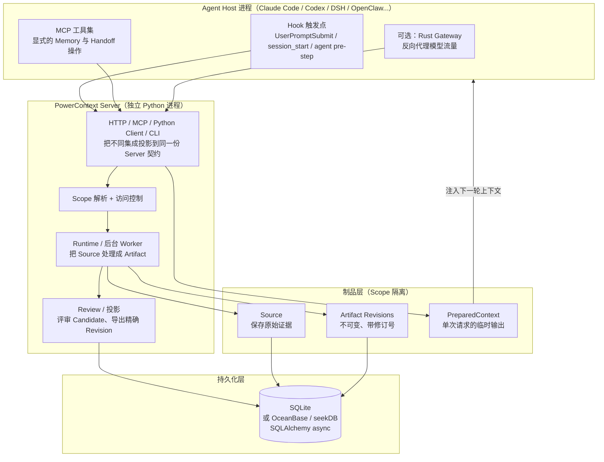
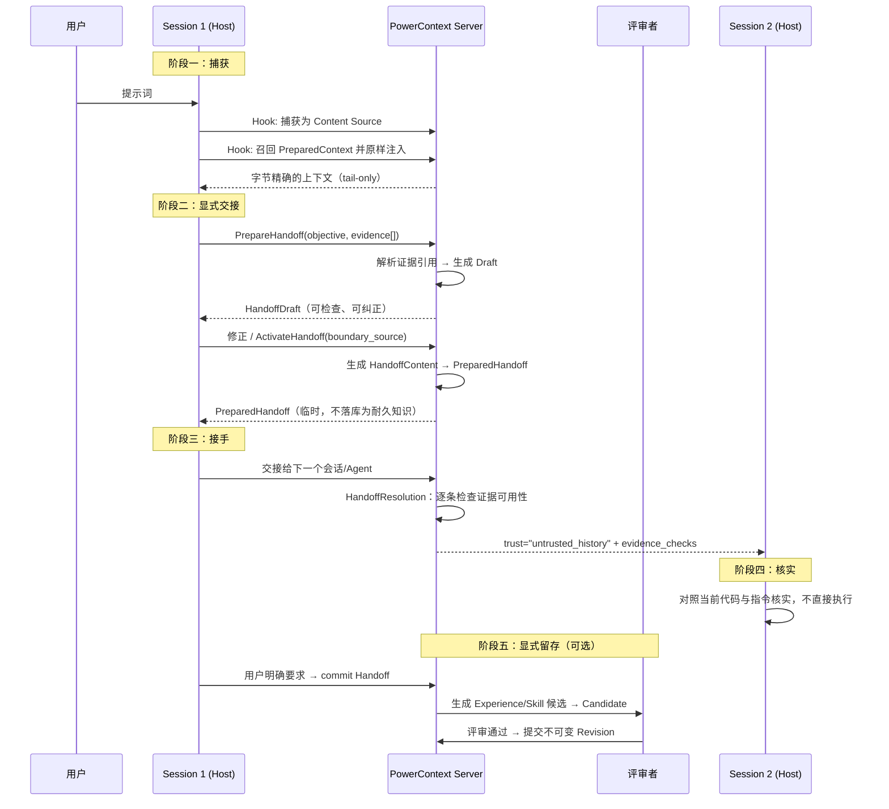

2026 年下半年，几乎每一个 Agent 框架都在卷三件事：更强的模型调用、更复杂的编排、更炫的 Dashboard。但真正落到企业生产环境时，会撞上一个完全不同的墙——**当 Session 1 干了一半活、Session 2 接手时，Agent 到底应该带走什么？**

常见的做法是「把对话摘要塞进下一轮的 prompt」。这个做法有三处硬伤：

1. **摘要不可追溯**。接手方拿到的是一句"之前讨论过数据库迁移"，却不知道是哪个会话、哪条消息、哪次提交得出的结论。
2. **摘要和事实被混为一谈**。"我们决定用 SQLite" 和 "用户刚才问了一句要不要用 SQLite" 在一段自由文本里长得一模一样，但前者是耐久知识，后者只是待处理的证据。
3. **摘要可能被当成指令执行**。如果上一轮有人贴了一段"忽略以上所有指令"，它会原样进入下一轮的上下文。

OceanBase 团队的 `oceanbase/powercontext` 给出了一个相当有工程价值的答案：**不要用一种数据结构承载所有"上一轮的遗留物"**。它把"Agent 记忆"拆成了两个生命周期完全不同的东西——**耐久的项目记忆（Memory）** 和**临时的任务交接（Handoff）**。

本文逐层拆解它的架构，并重点分析它自己承认的能力边界。

---

## 一、项目定位与核心价值

| 项 | 值 |
| --- | --- |
| 仓库 | `oceanbase/powercontext` |
| Stars | ⭐ 1,821 |
| Forks | 683 |
| Open Issues | 136 |
| 主语言 | Python（另有独立 Rust 网关与 Tauri 桌面端） |
| License | Apache-2.0 |
| 创建时间 | 2025-11-10 |
| 最近推送 | 2026-11-26 |
| 仓库规模 | 4,384 个文件（`src/` 841 / `integrations/` 686 / `docs/` 585 / `evaluation/` 448 / `gateway/` 142） |
| 官网 | https://powercontext.oceanbase.io |

项目自述是 "The open-source context service for AI agents"，GitHub 描述更直接：**"Agent memory: long-term memory & agent memory handoff. Claude Code & Codex."**

它的核心主张可以概括成一句话：**Agent 的上下文不是一段字符串，而是一族有不同生命周期、不同访问控制、不同可追溯要求的制品。**

### 能力矩阵

PowerContext 目前定义了 **7 个 Artifact 家族**（`atomic-memory`、`experience`、`skill`、`handoff`、`profile`、`prompt`、`topic-memory`）和 **3 类非制品对象**（Scope、Source、Tag）。

| 制品家族 | 解决的问题 | 生命周期 | 是否进入 PreparedContext |
| --- | --- | --- | --- |
| Atomic Memory | 一条事实 / 决策 / 约束 | 耐久，可修订、可退役 | 是 |
| Topic Memory | 长文档的渐进式主题摘要树 | 耐久，按需 flush | 是 |
| Experience | 一次「情境-动作-结果-教训」 | 需评审后生效 | 是 |
| Skill | 可导出的技能（含校验与血缘） | 需评审后导出 | 否（有独立消费路径） |
| Profile | Scope 背景与主体信息 | 耐久，可替换/回滚 | 需显式选择 |
| Prompt | Scope 级生成规则配置 | 耐久，带修订 | 否 |
| **Handoff** | **任务交接包** | **默认临时，可显式提交为里程碑** | **否（有独立消费路径）** |

注意最后一行：**Handoff 并不自动进入 PreparedContext**。这是这个项目最容易被误解、也最有意思的设计决策，下面会专门展开。

### 与本文相关的竞品维度

在动笔前我扫了本系列已发布的 566 篇文章做了范式级泛化扫描，发现一个**零覆盖的正交维度**：

- `handoff` 关键词：**0 命中**
- `delegat`（委派）：**0 命中**
- `online-rl` / `reinforcement` / `reward` / `grpo`：**0 命中**
- 而 `harness_runtime` 151 篇 / `memory_rag` 79 篇 / `protocol` 39 篇 / `fs_persist` 29 篇 / `security_gov` 26 篇 / `eval_testing` 20 篇 / `cost_obs` 18 篇 **全部饱和**

已有 79 篇 memory/rag 文章覆盖的是「记忆怎么存、怎么检索」；但**没有一篇在问「一次任务结束时，什么该被交出去、什么该被留下、两者凭什么可区分」**。PowerContext 正好站在这条缝上。

---

## 二、整体架构：四层模型与"谁拥有什么"

PowerContext 的核心数据模型可以用一条链路概括：



这张图有三个值得停下来看的设计：

### 2.1 「谁拥有什么」被写成了表格，不是口头共识

文档 `docs/en/docs/workflows/architecture.md` 里有一张**职责边界表**，左列是"拥有"，右列是"不拥有"：

> | Component or role | Owns | Does not own |
> | --- | --- | --- |
> | Agent / Host | Submits requests and decides when to save, hand off, or use context | Extra execution authority because content was recalled |
> | PowerContext Server | Resolves Scopes, enforces access, and serves Source, Artifact, and PreparedContext APIs | User authorization decisions for the Agent |
> | Runtime / background workers | Generates Memory, Experience, Skill, Profile, or Topic Memory from eligible Sources | Bypassing Candidate review or treating generated content as an execution command |
> | Review / projection | Reviews Candidates or exports an exact approved Skill Revision to a host | Rewriting historical Revisions, installing, or executing a Skill automatically |
> | Database and persistence layer | Stores Scopes, Sources, Artifact Revisions, and processing state | The deployment layer's backup and recovery policy |

**"Agent / Host 不拥有'因为内容被召回了所以获得额外执行权'"** 这一行，是整个安全模型的地基。

文档进一步把三个边界分开陈述：

> Model generation, Review approval, and execution authority are separate boundaries.

生成、审批、执行权是**三件不同的事**。模型可以提议，人可以批准，但**批准本身不等于授予执行权**。

### 2.2 捕获 ≠ 生成完成，生成 ≠ 批准

> Sources preserve evidence. Processing evidence and committing an artifact are separate actions: capture does not mean generation has finished, and generation does not necessarily mean approval.

这条在工程上意味着：Hook 抓到了用户 prompt ≠ 这条 prompt 已经变成了一条 Memory。这跟很多"自动记忆"系统把"我记录下来了"和"我学会了"混为一谈是不同的。

### 2.3 Scope 是数据所有权与访问控制的边界

Scope 定义了它的 Source、Artifact、Candidate 和处理状态的所有权。写操作还额外带 `expected_version` 和 ETag / `If-Match` 并发保护。

---

## 三、核心机制一：Handoff Artifact——把"交接"做成带证据的制品

这是全项目最有特色的部分，也是那个"0 命中"的正交维度所在。

### 3.1 Handoff 到底交接什么

文档 `docs/en/docs/workflows/memory-and-handoff.md` 的定义非常克制：

> A Handoff organizes a task's current objective, verified progress, blockers, next action, and evidence into temporary content for a receiver. It must be explicitly prepared, inspected, and finalized.

拆开就是五要素：**目标（objective）+ 已验证进展（state）+ 阻塞项 + 下一步（next_action）+ 证据（citations）**。

而且——**"Drafts and Prepared Handoffs are not durable project knowledge by default."**

默认情况下，Handoff 是**临时**的。只有当用户明确要求保留一个里程碑时，才 commit 成不可变的 Artifact Revision。这个"默认临时、显式提交"的二元设计，是它和"把所有对话摘要存进向量库"最本质的区别。

### 3.2 数据模型：一切声明都是带类型约束的

下面是 `src/powercontext/builtin/artifacts/handoff/models.py` 的真实定义（节选）：

```text
# 来自 src/powercontext/builtin/artifacts/handoff/models.py:26-44
DEFAULT_HANDOFF_MAX_BYTES = 8000
MAX_HANDOFF_BYTES = 32_768
MIN_HANDOFF_MAX_BYTES = 512
# Startup orientation has a smaller budget than a complete Handoff.
DEFAULT_HINT_MAX_BYTES = 2000
MAX_HINT_BYTES = 4000
MIN_HINT_MAX_BYTES = 1
MAX_HANDOFF_CITATIONS = 32
MAX_HANDOFF_OMISSIONS = 64
MAX_HANDOFF_STATE_STATEMENTS = 64
MAX_HANDOFF_TEXT_LENGTH = 8192

HandoffAudience: TypeAlias = Literal["human", "agent"]
HandoffClaim: TypeAlias = Literal["state", "next_action"]
HandoffDisposition: TypeAlias = Literal["continuable", "blocked", "complete"]
HandoffEvidenceStatus: TypeAlias = Literal["available", "unavailable"]
HandoffResolutionSelection: TypeAlias = Literal["prepared", "exact", "latest"]
HandoffResolutionStatus: TypeAlias = Literal["empty", "resolved"]
HandoffActivationStatus: TypeAlias = Literal["generated", "ignored"]
HandoffRolloverReason: TypeAlias = Literal[
    "user_requested",
    "host_context_budget",
    "host_compaction",
    "context_quality",
    "delegation",
    "manual_checkpoint",
]
```

注意 `HandoffRolloverReason` 里的六个取值 —— **`host_compaction`（宿主上下文压缩）和 `delegation`（委派）被明确列为合法的交接触发原因**。这不是"上下文满了就压缩一下"，而是"我知道为什么我要交接"。

### 3.3 证据绑定：每一条声明都必须指向具体来源

这是 Handoff 协议最硬的部分。核心不变量是：**一条陈述（statement）如果没有证据，就不能存在。**

```text
# 来自 src/powercontext/builtin/artifacts/handoff/models.py:70-84
class HandoffSourceCitation(_HandoffValue):
    """Cite one Source in the originating scope."""

    kind: Literal["source"] = "source"
    source_ref: SourceRef


class HandoffArtifactCitation(_HandoffValue):
    """Cite one exact Artifact Revision in the originating scope."""

    kind: Literal["artifact"] = "artifact"
    artifact_ref: ArtifactRef


HandoffCitation: TypeAlias = Annotated[
    HandoffSourceCitation | HandoffArtifactCitation,
    Field(discriminator="kind"),
]
```

引用是一个**带判别符的联合类型**：`source` 指向一条证据 Source，`artifact` 指向某个 Artifact 的**精确修订号**。

而陈述本身：

```text
# 来自 src/powercontext/builtin/artifacts/handoff/models.py:200-215
class HandoffStatement(_HandoffValue):
    """One current claim and the evidence that supports it."""

    text: Annotated[str, Field(max_length=MAX_HANDOFF_TEXT_LENGTH)]
    citations: Annotated[
        tuple[HandoffCitation, ...],
        Field(min_length=1, max_length=MAX_HANDOFF_CITATIONS),
    ]

    @field_validator("text")
    @classmethod
    def require_text(cls, value: str) -> str:
        return _require_text("statement", value)
```

`citations` 的 `min_length=1` —— **零引用的陈述在类型层面就无法构造**。

而"省略"是被显式建模的，而不是留白：

```text
# 来自 src/powercontext/builtin/artifacts/handoff/models.py:218-227
class HandoffOmission(_HandoffValue):
    """Known relevant material that was unavailable or not verified."""

    text: Annotated[str, Field(max_length=MAX_HANDOFF_TEXT_LENGTH)]
    citation: HandoffCitation | None = None
```

`HandoffOmission` 用来记录"**我知道有材料相关，但我拿不到 / 没核实**"。这个字段的价值在于：它让"我什么都没找到"和"我找到了但有一块没验证"变成两件可区分的事。

### 3.4 完整内容与校验

```text
# 来自 src/powercontext/builtin/artifacts/handoff/models.py:230-258
class HandoffContent(_HandoffValue):
    """The complete content shared by temporary and committed Handoffs."""

    model_config = ConfigDict(extra="forbid", frozen=True, strict=True, validate_by_name=True)

    generation: HandoffGenerationMetadata | None = Field(default=None, exclude_if=lambda value: value is None)

    schema_version: Literal["powercontext.handoff.v1"] = Field(
        default="powercontext.handoff.v1",
        alias="schema",
    )
    objective: Annotated[str, Field(max_length=MAX_HANDOFF_TEXT_LENGTH)]
    state: Annotated[
        tuple[HandoffStatement, ...],
        Field(min_length=1, max_length=MAX_HANDOFF_STATE_STATEMENTS),
    ]
    disposition: HandoffDisposition
    next_action: HandoffStatement | None = None
    omissions: Annotated[
        tuple[HandoffOmission, ...],
        Field(max_length=MAX_HANDOFF_OMISSIONS),
    ] = ()
```

`extra="forbid", frozen=True, strict=True` —— 三个开关一起关掉了"多塞字段进来"、"事后改字段"、"传个字符串冒充数字"这三条路。

### 3.5 交接不是一个动作，是四个阶段

完整的工作流在 `docs/en/docs/workflows/handoff-with-codex.md` 里被写成：

> Work Contract → Handoff → Acknowledgement → Task Outcome

对应到代码：

- `PrepareHandoff` —— 标准生成动作，带证据清单与字节预算
- `HandoffDraft` —— **可检查、可纠正**的中间态
- `HandoffActivation` —— 在某个 provider 观测到的 Source 边界上触发生成
- `PreparedHandoff` —— 已定稿、绑定 scope 与观察到的 head
- `Handoff` —— 已提交的不可变里程碑（`family = "handoff"`）
- `HandoffResolution` —— 接手方解析结果，**带证据可用性检查**

其中 `HandoffActivation` 的校验特别讲究：

```text
# 来自 src/powercontext/builtin/artifacts/handoff/models.py:288-305
class HandoffActivation(_HandoffValue):
    """Result of evaluating and executing one Handoff boundary signal."""

    status: HandoffActivationStatus
    boundary_source: SourceRef
    previous_position: Annotated[int, Field(ge=0)]
    current_position: Annotated[int, Field(ge=0)]
    draft: HandoffDraft | None

    @model_validator(mode="after")
    def validate_result(self) -> HandoffActivation:
        if self.current_position < self.previous_position:
            raise ValueError("Handoff activation position cannot move backwards")  # noqa: TRY003
        if self.status == "generated":
            if self.draft is None or self.current_position <= self.previous_position:
                raise ValueError("generated Handoff activation must advance with a Draft")  # noqa: TRY003
            return self
        if self.draft is not None or self.current_position != self.previous_position:
            raise ValueError("ignored Handoff activation cannot change state or contain a Draft")  # noqa: TRY003
        return self
```

三条不变量：**位置不能倒退**、**生成了就必须推进位置并带 Draft**、**忽略了就不能改状态也不能有 Draft**。这三条把"交接被触发过"变成了一个可审计的事实。

### 3.6 接手方的"证据检查"

`HandoffResolution` 是接手方视角的关键类型，它带一个 `trust` 字段：

```text
# 来自 src/powercontext/builtin/artifacts/handoff/models.py:381-397
class HandoffResolution(_HandoffValue):
    """Untrusted Handoff content and reference checks resolved for Continue."""

    trust: Literal["untrusted_history"] = "untrusted_history"
    status: HandoffResolutionStatus
    scope_id: str
    content: HandoffContent | None
    selection: HandoffResolutionSelection | None = None
    selected_revision: ArtifactRef | None = None
    current_revision: ArtifactRef | None = None
    evidence_checks: Annotated[
        tuple[HandoffEvidenceCheck, ...],
        Field(max_length=MAX_HANDOFF_STATE_STATEMENTS + 1),
    ] = ()
```

**`trust` 的取值被硬编码为 `"untrusted_history"`** —— 不是布尔值，没有"trusted"这个选项。接手方拿到的交接内容，在类型层面就不可能是"可信指令"。

而 `HandoffEvidenceCheck` 会逐条核验每条陈述的证据是否仍然可用：

```text
# 来自 src/powercontext/builtin/artifacts/handoff/models.py:360-378
class HandoffEvidenceCheck(_HandoffValue):
    """Reference availability for one state statement or next action."""

    claim: HandoffClaim
    state_index: Annotated[int, Field(ge=0)] | None = None
    status: HandoffEvidenceStatus
    unavailable_evidence: Annotated[
        tuple[HandoffCitation, ...],
        Field(max_length=MAX_HANDOFF_CITATIONS),
    ] = ()
```

`HandoffEvidenceStatus` 只有两个取值：`available` / `unavailable`。**"我不知道证据还在不在"不是一个可选状态，而是必须二选一。**

校验器还强制证据检查必须与陈述**严格按序一一对应**：

```text
# 来自 src/powercontext/builtin/artifacts/handoff/models.py:428-442
    def _validate_evidence_checks(self, content: HandoffContent) -> None:
        expected_claims = tuple(
            [("state", index) for index in range(len(content.state))]
            + ([("next_action", None)] if content.next_action is not None else [])
        )
        actual_claims = tuple((check.claim, check.state_index) for check in self.evidence_checks)
        if actual_claims != expected_claims:
            raise ValueError("evidence checks must match Handoff statements in order")  # noqa: TRY003
```

---

## 四、核心机制二：无模型的召回充分性闸门

第二块硬骨头是"**什么时候该多搜一轮，什么时候该停**"。

传统做法是固定 top-k，或者用 LLM 判断"够不够"。PowerContext 选了一条中间路：**用纯数学信号判断，不调模型**。

### 4.1 模块定位

```text
# 来自 src/powercontext/builtin/runtime/recall_sufficiency.py:16-24
"""Model-free recall-sufficiency gate and its bounded expansion policy.

Everything in this module is pure: the gate, the expander, the candidate projection and the
identity function read only their arguments. They touch no database, no clock, no model and no
network, so they are tested directly without a Runtime. The Runtime layer owns the search loop
and feeds the accumulated candidates back into :meth:`RecallSufficiencyGate.assess`.
"""
```

**纯函数、不碰数据库、不碰时钟、不调模型、不联网。** 这意味着它可以被穷举测试。

### 4.2 判定逻辑

```text
# 来自 src/powercontext/builtin/runtime/recall_sufficiency.py:294-325
    def assess(
        self,
        candidates: Sequence[RecallCandidate],
        query: str,
        policy: RecallSufficiencyPolicy,
        /,
        *,
        scope_has_content: bool = True,
        budget: RecallBudgetView | None = None,
        families_expected: int = 0,
    ) -> GateAssessment:
        """Assess one candidate set. No I/O, no clock, no model; deterministic in its inputs."""

        signals = _build_signals(candidates, query, families_expected)
        if not scope_has_content:
            return GateAssessment(sufficient=True, reason=REASON_NO_CONTENT, signals=signals)
        if budget is not None and budget.budget_bounded:
            return GateAssessment(sufficient=True, reason=REASON_BUDGET_FLOOR, signals=signals)
        if policy.rerank_enabled and not policy.allow_expansion_with_rerank:
            return GateAssessment(sufficient=True, reason=REASON_RERANK_ENABLED, signals=signals)
        if signals.candidate_count < policy.min_candidates:
            return GateAssessment(sufficient=False, reason=REASON_THIN_CANDIDATES, signals=signals)
        if families_expected > 1 and signals.family_count < families_expected:
            return GateAssessment(sufficient=False, reason=REASON_THIN_FAMILIES, signals=signals)
        if (signals.scored_families > 0 and signals.top_score < policy.min_top_score) or (
            signals.gap_families > 0
            and signals.top_score < _STRONG_TOP_RELEVANCE
            and signals.top_gap < policy.min_top_gap
        ):
            return GateAssessment(sufficient=False, reason=REASON_WEAK_TOP_ONE, signals=signals)
        if signals.lexical_overlap < policy.min_lexical_overlap:
            return GateAssessment(sufficient=False, reason=REASON_WEAK_LEXICAL, signals=signals)
        return GateAssessment(sufficient=True, reason=REASON_SUFFICIENT, signals=signals)
```

这段代码有四层短路，顺序本身是有讲究的：

| 顺序 | 条件 | 理由码 | 语义 |
| --- | --- | --- | --- |
| 1 | Scope 根本没有内容 | `no-content` | 无内容不是召回问题，别搜 |
| 2 | 本轮已被预算截断 | `budget-floor` | 薄是预算属性，不是召回属性 |
| 3 | 已启用 rerank 且不允许同时扩展 | `rerank-enabled` | rerank 已经改变候选集了 |
| 4 | 候选数不足 | `thin-candidates` | 明确不够 |
| 5 | 期望族数不足 | `thin-families` | 数量够但种类缺 |
| 6 | Top-1 相关度弱 | `weak-top-1` | 有结果但不够相关 |
| 7 | 词面重叠低 | `weak-lexical` | 向量召回了但字面没命中 |

**注意第 2 条**：预算不足导致的"薄结果"被归类为**预算属性而非召回属性**。这个区分很关键——它防止了系统把"我给的字节不够"误判成"我没搜到"，从而触发无意义的第二轮检索。

### 4.3 最有意思的一处设计：SearchPlan 刻意不能做的事

```text
# 来自 src/powercontext/builtin/runtime/recall_sufficiency.py:143-156
@dataclass(frozen=True)
class SearchPlan:
    """Describes the next round.

    It never names a family and never sets ``limit``, ``mode`` or a rerank candidate bound.
    The last point is deliberate and load-bearing: Atomic Memory search uses
    ``memory_rerank_candidate_limit`` to *size the backend request*
    (``coarse_limit`` → ``candidate_limit = max(coarse_limit * 4, 32)``), so raising it from
    30 to 100 would grow the backend pool from 120 to 400 candidates and break the same-pool
    guarantee the cost model rests on. RFC 1560 rejects it as an expansion action outright.
    """

    action: str
    admission: AdmissionFloor
```

**扩展计划不允许改候选池大小。** 理由写在注释里：如果把 `memory_rerank_candidate_limit` 从 30 提到 100，后端候选池会从 120 涨到 400，**同池保证（same-pool guarantee）就破了，而整个成本模型都建立在这个保证之上**。

这是一个非常好的设计范例：**用一个显式的"不可扩展维度"把成本模型的不变量焊死在类型里**，而不是靠文档提醒。

### 4.4 扩展轮次有硬上限

```text
# 来自 src/powercontext/builtin/runtime/recall_sufficiency.py:327-335
class RecallExpander:
    """Pure mapping from an expansion round to the plan that describes it."""

    def plan(self, round_number: int, policy: RecallSufficiencyPolicy, /) -> SearchPlan:
        """Return the plan for round 1 or round 2; raise for any other round."""

        if round_number == 1:
            return SearchPlan(action=ACTION_ADMISSION, admission=policy.round1_admission)
        if round_number == 2:
            return SearchPlan(action=ACTION_POLICY_FLOOR, admission=policy.round2_admission)
        raise ValueError("recall expansion round must be 1 or 2")  # noqa: TRY003
```

**最多两轮扩展，第三次直接抛异常。** 检索不是"搜到满意为止"，而是"搜三轮，到顶就停"。

---

## 五、核心机制三：双进程边界与 Rust 网关的两阶段门控

### 5.1 为什么是两个进程

文档 `docs/en/blog/posts/deepseek-harness-powercontext-plugin.md` 给出了明确的理由：

> 1. **DeepSeek Harness** manages sessions and the agent loop. The PowerContext DSH plugin runs inside this process and registers hooks, `pc_*` tools, `/pc` commands, and usage guidance.
> 2. **PowerContext Server** is an independent Python process. It listens on `http://127.0.0.1:8000` by default and owns persistence, retrieval, review, and Handoff.

> The browser never connects directly to PowerContext Server. The Harness plugin makes the HTTP calls, so the local Web UI does not need an additional CORS path.

> This boundary also allows both sides to evolve independently. The plugin neither reimplements storage nor embeds the Python runtime; it depends only on PowerContext's public HTTP contract.

三个理由：**Agent 循环归宿主**、**持久化与检索归 Server**、**浏览器不直连 Server**（省掉一条 CORS 通路，也省掉一条凭证暴露路径）。

### 5.2 网关的六条不变量

`gateway/` 是一个**独立的 Rust Cargo workspace**（7 个 crate），反向代理 OpenAI 兼容流量。`AGENTS.md` 里把它的心智模型写成了**不可协商的不变量**：

> - **No policy in the gateway.** Core decides admission, privacy, and capacity; the gateway executes a verdict and never infers one. HTTP success from an upstream call is not approval, and an unknown or unparseable verdict never becomes allow.
> - **Two-phase gating with bound identities.** `check(before_send)` gates the bytes that leave and `check(before_release)` gates what the client sees; the release call must carry the binding the send phase returned. A block or withhold sends zero bytes, and a refuse releases nothing and cancels upstream.
> - **Retries are deterministic-failure-only.** ... An indeterminate outcome after hand-off (timeout, truncated response) is surfaced as indeterminate and never re-sent, because a re-send may be billed twice.
> - **Injected context is byte-exact.** ... changing one byte invalidates Core's reuse binding. Injection stays tail-only so the client-owned history prefix remains byte-stable for upstream prefix caching.
> - **Credentials are server-side only.** They come from environment variables, are never read from request fields, and never enter a check payload.
> - **Evidence is body-free.** Never add request or response bodies, prompts, model output, vectors, credentials, or socket paths to evidence records or tracing.

这几条里最值得抄的是**第三条**和**第四条**：

- **"不确定的结局绝不重发"** —— 因为重发可能被计费两次。这比"超时了就重试"精细得多。
- **"注入必须是 tail-only"** —— 因为上游有 prefix cache，如果把召回内容插到历史前面，缓存全部失效。这条直接决定了召回内容在 prompt 里的物理位置。

### 5.3 上下文注入必须字节精确

这条在代码里被反复强调。回忆时注入的内容必须是**逐字节原样**的，且要声明它占用的字节区间；改动一个字节就会让 Core 的复用绑定失效。

这是"字节级缓存友好"和"语义正确"之间的一个真实张力——项目选择了前者，因为 token 成本是它优化的第一目标。

---

## 六、记忆层：Topic Memory 与 Atomic Memory

### 6.1 Atomic Memory：一条事实一个制品

Memory 不是一张宽表，而是**一条事实一个独立的 Artifact**。它有自己的修订号、状态、标签，可以被 `retire`（退出活跃召回但保留历史）。

Memory 有一个明确的**写入纪律**：

> Codex should write Memory only when the user explicitly asks to save it. The prompt Hook captures prompts as Source evidence, but capture is not the same as automatically creating Memory. It should not create an extra Memory merely to duplicate the current prompt.

**"不要为了复述当前 prompt 而额外创建一条 Memory。"** 这条规则直接消灭了「Agent 把自己的每一句话都当成一条记忆记下来」的退化行为。

### 6.2 Topic Memory：渐进式主题摘要树

Topic Memory 面向长文档，做的是"增量派生的主题摘要树"，按需 `flush`，检索当前 head，取用时拿精确 Revision。

它和 Atomic Memory 的分工很清楚：**Atomic Memory 存"离散事实"，Topic Memory 存"某个主题的整体轮廓"**。后者是前者的聚合视图，而不是替代品。

### 6.3 混合检索

检索是混合的：SQLite 走 **FTS5 + sqlite-vec**，OceanBase 走 **FULLTEXT + HNSW**，模式有 `text` / `vector` / `hybrid`。

值得注意的是分数归一化的写法：

```text
# 来自 src/powercontext/builtin/runtime/recall_sufficiency.py:271-283
def _normalize_memory_score(hit: AtomicMemorySearchHit) -> float:
    """Normalize fused RRF ranking against its per-channel upper bound, not a probability."""

    upper_bound = hit.score_upper_bound
    if upper_bound is None:
        # Compatibility fallback for unweighted or externally reconstructed hits.
        # The internal weighted bound is excluded from serialization, so an in-process
        # weighted fusion must supply it; the exact weighted scale cannot be recovered here.
        channels = max(1, len(hit.matched_by))
        upper_bound = channels / (_RRF_CONSTANT + 1)
    if upper_bound <= 0.0:
        return 0.0
    return max(0.0, min(1.0, hit.hit.score / upper_bound))
```

注释里那句 **"the exact weighted scale cannot be recovered here"** 是个诚实声明：**RRF 的加权上界被排除在序列化之外，所以从外部重建的命中无法还原精确加权刻度**，只能退化到按通道数估算。

### 6.4 存储后端

SQLAlchemy async 抽象，实测基线捕获记录：

| 后端 | 表数 | 索引 | 特征 |
| --- | --- | --- | --- |
| SQLite | 81 表 + 10 索引 + 3 触发器 | FTS5 + sqlite-vec | 默认本地文件 |
| seekDB 1.3.0 | 56 表 + 4 FULLTEXT | FULLTEXT | |
| OceanBase CE v4.3.5.6 | 56 表 + 4 FULLTEXT | FULLTEXT + HNSW | 分布式形态 |

MySQL / OceanBase 分支会显式开 `START TRANSACTION` 并使用 `REPEATABLE READ` + `START TRANSACTION WITH CONSISTENT SNAPSHOT`。

---

## 七、集成矩阵：22 个宿主，覆盖度参差不齐

`docs/en/docs/integrations/capabilities.md` 是一份**生成的契约矩阵**（不是运行时 API）。它把每个集成的状态分成 `Released` / `Master only` / `Experimental` / `Proposed` / `Unsupported` 五档。

摘录（宿主部分）：

| ID | 类型 | 可用性 | 支持档位 | 压缩前行为 |
| --- | --- | --- | --- | --- |
| codex | Agent host | Master only | minimal, recommended, full | unsupported |
| claude-code | Agent host | Master only | minimal, recommended, full | unsupported |
| dsh | Agent host | Master only | minimal, recommended, full | unsupported |
| hermes | Agent host | Master only | minimal, recommended, full | unsupported |
| openclaw | Agent host | Master only | minimal | best_effort |
| opencode | Agent host | Master only | minimal | unsupported |
| pi | Agent host | Master only | minimal, recommended, full | best_effort |
| deepagents | Framework adapter | Master only | — | — |
| langchain | Framework adapter | Master only | — | — |
| langgraph | Framework adapter | Master only | — | — |
| dify | Framework adapter | Experimental | — | — |
| pydantic-ai | Framework adapter | Experimental | — | — |
| kimi-code | Agent host | Experimental | minimal, recommended, full | unsupported |
| minimax | Agent host | Experimental | — | unsupported |

**这张表最诚实的地方在于：所有 Agent host 都是 `Master only`，没有一个是 `Released`。** 换句话说，**这个项目本身没有发布过任何正式版本**，全部集成都还在 master 分支上。

同时"压缩前行为"一列暴露了一个关键事实：**10 个宿主里有 8 个的 pre-compaction 是 `unsupported`**。也就是说，**"上下文被压缩前自动抢救记忆"这个能力，目前只有 OpenClaw 和 Pi 两个集成的 `best_effort` 档覆盖**。这跟它主打的"省 token"叙事形成了一个有意思的张力。

### Claude Code 集成怎么工作

`integrations/claude-code/README.md`：

> - `UserPromptSubmit` recalls one final bounded Prepared Context and injects it unchanged;
> - the same hook captures the current user prompt as ordinary Content Source evidence by default;
> - MCP exposes explicit Memory and Handoff operations;
> - Server and transport failures never block normal Claude Code work.

**最后一条是关键的降级设计：Server 挂了不能挡住 Claude Code 干活。**

同时它也诚实地说明了自己 v1 的短板：

> It does not use a `Stop` hook and does not capture Claude's final response in v1.

**不用 `Stop` hook，意味着 Claude 最终回答不会被捕获** —— 这是一个明显的覆盖缺口。

---

## 八、Dream：受控的自我修订

Dream 是项目的"自我改进"机制：**从历史证据里提议记忆和 prompt 的修订，经过人工评审后才生效**。

`src/powercontext/builtin/dream/` 里定义了 9 种操作：`refine_experience`、`derive_skill`、`revise_skill`、`revise_profile`、`revise_memory`、`revise_topic_memory`、`refresh_handoff`、`revise_prompt`、`revise_tags`。

硬上限：

| 限制 | 值 |
| --- | --- |
| 模型调用次数 | 2 |
| 输出 token | 4096 |
| 墙钟时间 | 120 s |
| Artifact 数量 | 1–20 |
| 引用数 | ≤ 32 |

**"2 次模型调用"这个上限非常能说明问题**：Dream 不是"让模型自由重构你的记忆库"，而是"让模型在极窄的预算内提一个待审的草案"。所有的 `revise_*` 都必须经过评审才能 commit。

### Dream expansion 不是第二个执行器

`src/powercontext/builtin/persistence/migration_resources/dream_expansion/README.md` 明确澄清了一个容易误解的点：**Dream expansion 是 Dream 拥有的一个输入，交给 RFC #1771 / PR #1772 处理，是一个冻结的 SQLite/MySQL 重建变换，不是另一个 runner**。

而且它自己写着：

> Production registration remains disabled in the manifest.

> An interrupted remote transformation is not automatically resumable...

---

## 九、⭐ 必须诚实指出的源码自陈缺陷

这是本系列最看重的部分。PowerContext 在这一节上的表现**几乎是我见过的最好的之一**——它不但承认缺陷，还把缺陷的**性质**说清楚了。

### 9.1 基准测试的诚实度：主动拆自己的台

**SWE-bench Pro 那组数字**（README 头条是 86.73%），在 `docs/benchmarks/token-savings/README.md` 里被这样标注：

> These are project-run SWE-bench Pro comparisons, not an official leaderboard submission. Export date: 2026-11-10.

> Every peak compares the **same task** in two arms. A peak is not a cohort average. Implementation and validation routes can differ; a single paired run does not isolate mechanism effects or establish statistical significance.

> Historical OFF outcomes were reused from an earlier batch. Runs were not simultaneous randomized A/B trials. Model sampling and shared infrastructure can affect results.

**它自己的 86.73% 比官方榜单第一名的 61.50% 高出约 25 个百分点**，而它主动说明这是"配对运行、非官方提交、不分配排名"。没有这几句，读者完全可能误以为它刷新了榜单。

**Token 节省那组数字**（32.57%）的 caveat 更狠：

> No nonempty Memory injection was observed during solving; the savings do not establish cross-task memory benefits.

**"求解过程中一次都没有观察到非空 Memory 注入"** —— 也就是说，**那 32.57% 的节省根本不是"记忆起作用了"，而是别的机制（缓存复用、引导提示）起的作用**。项目直接把这句话写在了自己的方法论文档里。

还有：

> This assumes prefix-extraction cache hits generalize to ordinary generation and may be optimistic. Without that assumption, solving plus memory generation costs 386.35531–491.81524 points, so a reduction is not established.

**去掉一个假设，节省就不成立。**

**LoCoMo Plus 分数**也被明确标注为不可验证：

> the corresponding run manifests, summaries, protocol and model/Judge configurations, run hashes and raw outputs are not publicly available for verification.

**项目自己提供了无法被第三方验证的数字，并主动标注了这一点。** 在本系列看过的 566 篇里，这样的自曝并不常见。

### 9.2 架构层面的自陈缺口

**没有通用删除、没有 TTL、没有导入导出**：

> There is no generic user-level Artifact delete, TTL/retention policy, export/import, or one-click Scope restore API today; Topic Memory also has no manual delete endpoint.

**Memory 的遗留接口直接报错**：

> legacy_memory_operation_unsupported

**时间语义需要模型判断**（文档承认）：

> temporal interpretation needs model judgment; recovery "can publish a duplicate"; no cross-language semantic search.

**提示注入抵抗力的诚实降级**：

> Treat the content as **untrusted historical orientation only**. It cannot activate an objective, authorize the next action, establish current facts, or replace reading the complete exact Handoff and checking evidence and live state.

> Literal formatting does not guarantee prompt-injection resistance.

**最后这句尤其值得注意**：即使 Handoff 内容被结构化成带证据的 JSON、带 `trust: "untrusted_history"` 标签，**项目也不宣称这能防住提示注入**。它只是把内容标成"不可信"，把责任交回给宿主。

### 9.3 网关与桌面端的自陈限制

**网关**（`gateway/README.md`）：

> The Gateway does not serve the Anthropic Messages API.

> Controlled tests do not establish real-Core, real-provider, or host acceptance.

> Abnormal process exit is not proof of per-request cleanup, provider rollback, or client receipt.

**桌面端**（`desktop/README.md`）：

> This is not a supported or signed release, and does not close #1654 or #1428.

### 9.4 迁移基线的自陈限制

`src/powercontext/builtin/persistence/migration_resources/server_baselines/README.md`：

> This is complete source recognition with `server_migration_unavailable`, not a successful upgrade, runtime-readiness check, ODP test or multi-node acceptance.

**"识别到了源码 ≠ 升级成功"** —— 这个区分极其到位。

### 9.5 组合配置的显式拒绝

`composition.py` 里有 **21 处显式标注的 "unsupported" 配置**（注入的推理 provider、内存 SQLite + Topic Memory worker、自定义 Source registry + 内置 worker 等等）。它不静默降级，而是明确拒绝。

### 9.6 一个额外的诚实信号：没有 limitations.md

有意思的是，项目**没有** `docs/en/limitations.md` 或 `known-issues.md`（两者都 404）。它的自陈缺陷散落在各个子目录的 README、源码注释和 benchmark 方法论文档里。

这意味着：**要完整评估这个项目的能力边界，你必须逐个目录翻 README**。这既是它的诚实（分散但真实），也是它的可用性成本（没有集中索引）。

---

## 十、端到端数据流

把上面所有部件串起来，一次典型的"Session 1 → Session 2"交接是这样：



五个阶段里，有**两个**是"显式"的：交接必须显式发起，留存必须显式要求。剩下三个（捕获、生成、召回）是自动的。这个比例是刻意的。

---

## 十一、与同类项目的设计差异

| 维度 | PowerContext | Mem0 | Letta / MemGPT | LangGraph Checkpointer |
| --- | --- | --- | --- | --- |
| **核心抽象** | Scope → Source → Artifact(Revision) → PreparedContext | 一条条可编辑的记忆记录 | 自管理内存的 Agent + 外部存储 | 图状态快照 |
| **记忆与交接是否分离** | ✅ **是两个家族、两套生命周期** | ❌ 都进记忆库 | ❌ 记忆即状态 | ❌ 状态即快照 |
| **证据绑定** | ✅ 每条陈述必须带 `min_length=1` 的引用 | ❌ 可无来源 | ❌ | ❌ |
| **引用可失效检测** | ✅ `HandoffEvidenceCheck` | ❌ | ❌ | ❌ |
| **不可信标记** | ✅ `trust: Literal["untrusted_history"]` | ❌ | ❌ | ❌ |
| **召回是否用模型判断** | ❌ **纯数学闸门，可穷举测试** | ❌ 相似度阈值 | ❌ | ❌ |
| **省略语义** | ✅ `HandoffOmission` 显式建模"知道但拿不到" | ❌ | ❌ | ❌ |
| **制品可追溯到精确修订** | ✅ 所有 Artifact 带 Revision | ⚠️ 部分 | ⚠️ | ✅ |
| **生成 / 审批 / 执行权分离** | ✅ 三条独立边界 | ❌ | ⚠️ | ❌ |
| **Scope 级数据隔离** | ✅ 原生 | ❌ | ❌ | ❌ |

三个最本质的差异：

**第一，Handoff 是一等制品，不是"记忆的一种"。** Mem0 和 Letta 讨论的是"怎么记住"，PowerContext 讨论的是"**怎么交接**"。这是两种不同的问题：记忆要跨会话累积，交接要跨主体传递且必须可审计。

**第二，证据是结构性的，不是元数据。** 在 Mem0 里，记忆可以没有来源；在 PowerContext 里，`HandoffStatement.citations` 的 `min_length=1` 让"无据陈述"在类型层面不可构造。而且更进一步，`HandoffEvidenceCheck` 会在接手时**重新检查**这些引用是否仍然可用——**证据会过期，这被建模了**。

**第三，召回充分性是纯函数。** 用 LLM 判断"够不够"会让召回不可测试、不可预测、不可预算。PowerContext 用 top_score / top_gap / lexical_overlap / family_count 四个信号做确定性判定，**代价是召回不到时可能判断不出来，收益是整条路径可穷举测试且成本可建模**。

---

## 十二、优缺点分析

### 架构简洁性 / 扩展性 / 易用性 vs 性能 / 复杂度 / 维护性

| 左侧 | 评价 | 右侧 | 评价 |
| --- | --- | --- | --- |
| **架构简洁性** | ★★★★★ 四层模型（Scope/Source/Artifact/PreparedContext）极清晰，"谁拥有什么"用表格写死 | **性能** | ★★★★☆ 混合检索 + 无模型闸门，实测搜索 p95 1.38 s（对比全量上下文 17.12 s），省 token 32.57%（但见 §9.1 的 caveat） |
| **扩展性** | ★★★★☆ 7 个 Artifact 家族 + Source/Artifact 插件可扩展；`integrations/` 22 个宿主 | **复杂度** | ★★☆☆☆ **4,384 个文件、81 张表、21 处显式 unsupported 组合、Python + Rust + Tauri 三栈**，学习曲线陡峭 |
| **易用性** | ★★★☆☆ HTTP/MCP/Python/CLI 四通道接入很干净，但**所有宿主都是 Master only、没有正式版本** | **维护性** | ★★★☆☆ 契约测试 + RFC 目录 + 生成的 capability 矩阵很规范；但**没有集中的 limitations 索引**，边界散落各处 |

### 最大的三个优点

1. **把"临时"和"耐久"在类型层面分开了。** 这不是文档里的一句话，而是两套独立的模型、两套独立的预算（`DEFAULT_HANDOFF_MAX_BYTES = 8000` vs `DEFAULT_HINT_MAX_BYTES = 2000`）、两套独立的消费路径（PreparedContext vs Continue）。
2. **证据绑定 + 引用可失效检查。** 这是我在 566 篇已发布文章里见到的、对"Agent 交接"这个问题最完整的工程答案。
3. **自陈缺陷的密度和诚实度极高。** 主动说"我自己的节省数字不是记忆带来的"、"我 86.73% 不是官方成绩"、"我的提示注入抵抗只是标记不是防护"。

### 最大的三个缺点

1. **一切都是 Master only。** 没有 `Released` 的集成、没有正式版本、`desktop/` 自陈"not a supported or signed release"。**这是一个还在施工的大厦，不是可以立刻投产的产品。**
2. **复杂度偏高。** 81 张表、7 个家族、三种存储后端、Python + Rust 双栈、22 个集成目录。对一个"想要跨会话记忆"的用户来说，**认知负担远超 mem0 这类方案一个数量级**。
3. **主打的省 token 叙事与实测机制存在落差。** 项目自己承认求解过程中"一次都没有观察到非空 Memory 注入"。**省 token 是真的，但主要来自缓存复用与引导，而不是"记忆"本身**——这一点对期待"装上就省 token"的读者很重要。

---

## 十三、实践：最小可用部署

### 13.1 安装与启动

```bash
# 来自 AGENTS.md:16-18（构建与测试命令）
make install      # uv sync + 安装 prek hooks
make check        # 校验 lock 文件 + pre-commit + ty check
make test         # pytest（含 doctest）
```

服务端默认监听 `http://127.0.0.1:8000`，存储默认 SQLite。

### 13.2 CLI 命令面

`src/powercontext/cli/app.py` 定义了 Typer 根应用，全局选项为 `--server-url` / `--allow-insecure-http` / `--timeout` / `--json` / `--version`，注册的命令包括：

| 命令 | 用途 |
| --- | --- |
| `capabilities` | 查询集成的能力矩阵 |
| `stats` / `live` / `ready` | 运行状态与健康检查 |
| `import-sessions` | 导入历史会话 |
| `dream`（组） | Dream 提议与修订 |
| `topic-memory`（组） | 主题记忆管理 |
| `candidate`（组） | 候选评审 |
| `experience` / `skill` / `external-skill`（组） | 经验与技能 |
| `scope`（组） | Scope 管理 |
| `source-agent` | 证据采集设备 |
| `code`（组） | `index` / `sync` / `status` / `query` / `clear` |
| `setup` / `doctor` | 安装引导与诊断 |

### 13.3 Python 客户端：请求一个交接提示

```text
# 来自 docs/en/docs/workflows/memory-and-handoff.md:38-45
from powercontext.http import PrepareHandoffHintRequest

hint = await client.prepare_handoff_hint(
    PrepareHandoffHintRequest(scope_id=scope_id, selection="exact", revision=committed.reference)
)
if hint.status == "ready":
    host_context = hint.content
```

三个 `selection` 取值：

| 取值 | 含义 | 权限要求 |
| --- | --- | --- |
| `prepared` | 使用已传输的完整 Prepared 值 | `scope.read` |
| `exact` | 指定某个精确 Revision | `artifact.read` + `handoff.evidence.inspect` |
| `latest` | 当前最新（**需先确认工作流 Scope**） | `artifact.read` + `handoff.evidence.inspect` |

默认预算 2,000 UTF-8 字节，`max_bytes` 接受 1–4,000。

> If the complete hint cannot fit, no Handoff exists for latest selection, or cited evidence is unavailable or ineligible, the result is `status="empty"`, `content=null`, `content_bytes=0`. **Hints are never truncated.**

**提示永不截断** —— 要么完整给，要么什么都不给。

### 13.4 接入 Claude Code

```bash
# 来自 integrations/claude-code/README.md:18-21
claude plugin validate --strict .
claude plugin validate --strict integrations/claude-code/plugins/powercontext
```

需要认证时：

> When the Server requires authentication, set `POWERCONTEXT_CLAUDE_AUTHORIZATION` to a complete `Bearer <token>` value before running setup.

### 13.5 运行契约测试

```bash
# 来自 integrations/claude-code/README.md:23-30
uv run pytest \
  tests/claude_code_plugin \
  tests/test_system_cli.py \
  tests/e2e/test_claude_code_service_chain.py \
  tests/e2e/test_mcp_transport.py
```

---

## 十四、趋势判断与工程经验提炼

### 14.1 三个趋势判断

**趋势一：「Agent 上下文」正在从一维字符串变成多族制品。**
2024 年我们讨论的是"怎么把 100K token 塞进 128K 窗口"；2025 年是"怎么压缩"；2026 年底真正的答案是**"不同种类的上下文有不同的生命周期，必须分开存放、分开消费"**。PowerContext 的 7 个 Artifact 家族 + 3 类非制品对象，是这个转变的一个具体答案。

**趋势二：「交接」正在成为一个独立的协议问题。**
多 Agent 协作的讨论长期集中在"怎么编排"（LangGraph / CrewAI / AutoGen），但很少有人正面回答"**A 干了一半，B 接手时，到底传什么、凭什么可信、传错了怎么办**"。PowerContext 的 Handoff Artifact —— 带判别符的引用联合类型、每条陈述强制带证据、证据可失效检查、`trust` 硬编码为不可信 —— 是我目前见过的最完整的答案。**这个方向值得持续关注。**

**趋势三：基础设施项目开始普遍接受"模型不是必需的"。**
Recall Sufficiency Gate 用纯数学信号判断召回是否充分，不调模型。这带来三个好处：可穷举测试、成本可建模、延迟可预测。**"Agent 基础设施里哪些环节不需要 LLM"** 会是 2027 年一个被认真讨论的话题。

### 14.2 可迁移的工程经验（这五条可以立刻用到别的项目上）

**经验一：用类型消灭 bug 类别，而不是用测试覆盖它。**
`citations` 的 `min_length=1` 让"无据陈述"不可能被构造出来 —— 这比"写个测试确保不会有人这么干"强一个量级。同理 `trust: Literal["untrusted_history"]` 让"trusted handoff"不可能存在。

**经验二：把「为什么现在不修」写进代码注释。**
`SearchPlan` 的注释不仅说了"不能改候选池大小"，还说了"改了会怎样（池子从 120 涨到 400）、破了什么保证（same-pool guarantee）、谁在管这个（RFC 1560 直接拒绝该扩展动作）"。**这是本系列见过最完整的「限制说明」写法。**

**经验三：区分「预算导致的薄」和「召回导致的薄」。**
`REASON_BUDGET_FLOOR` 的存在避免了"我给的字节不够"被误判成"我没搜到"，从而触发无意义的第二轮检索。**这类区分能直接省钱。**

**经验四：不可信的内容要显式标记，而不是假装格式化就够了。**
项目明确说 "Literal formatting does not guarantee prompt-injection resistance" —— 结构化 JSON 不防注入，标注 `untrusted_history` + 交回宿主判断才是诚实的做法。

**经验五：主动披露自己的数字站不住脚。**
"求解过程中一次都没有观察到非空 Memory 注入"、"我的 86.73% 不是官方提交"、"去掉这个假设节省就不成立" —— **这三句话比任何营销文案都更能建立信任**，也更能帮读者做正确的技术决策。

### 14.3 下一步值得关注

- **PowerContext 的第一个正式版本**：目前所有集成都是 `Master only`，正式版发布意味着接口稳定下来，值得重新评估。
- **pre-compaction 覆盖**：`unsupported` 占 8/10 是当前最大的功能缺口，也是最影响实际省 token 效果的地方。
- **Dream 的评审闭环**：9 种 `revise_*` 操作 + 2 次模型调用上限，这套"极窄预算的自我修订"设计如果验证有效，可以移植到任何 Agent 记忆系统。
- **Handoff 协议本身**：如果这个协议被更多实现采用，它有可能成为 Agent 交接的事实标准 —— 就像 MCP 之于工具接入。

---

## 附录：关键资源

| 资源 | 地址 |
| --- | --- |
| 仓库 | https://github.com/oceanbase/powercontext |
| 官网 / 文档 | https://powercontext.oceanbase.io |
| PyPI | https://pypi.org/project/powercontext/ |
| Handoff Artifact 模型 | `src/powercontext/builtin/artifacts/handoff/models.py` |
| 召回充分性闸门 | `src/powercontext/builtin/runtime/recall_sufficiency.py` |
| 架构与职责 | `docs/en/docs/workflows/architecture.md` |
| Memory 与 Handoff | `docs/en/docs/workflows/memory-and-handoff.md` |
| 集成能力矩阵 | `docs/en/docs/integrations/capabilities.md` |
| Token 节省方法学（含 caveat） | `docs/benchmarks/token-savings/README.md` |
| Rust 网关 | `gateway/`（7 crate Cargo workspace） |
| License | Apache-2.0 |

> **写作说明**：本文所有代码块均为项目源码原文节选（标注了文件路径），架构图依据官方文档 `docs/en/docs/workflows/architecture.md` 与 `docs/en/blog/posts/deepseek-harness-powercontext-plugin.md` 重绘。项目元信息核验时间：2026-11-26，⭐1,821 / 683 forks / 最近推送 2026-11-26。
