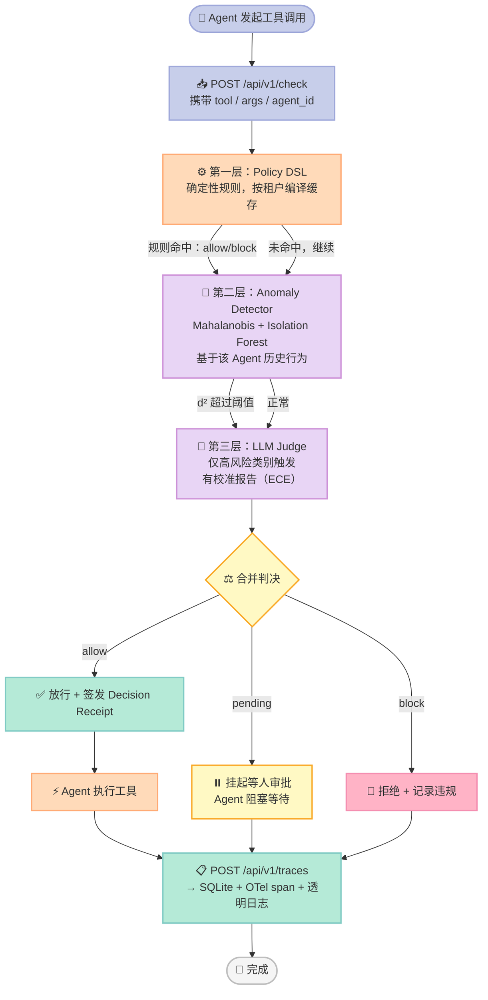
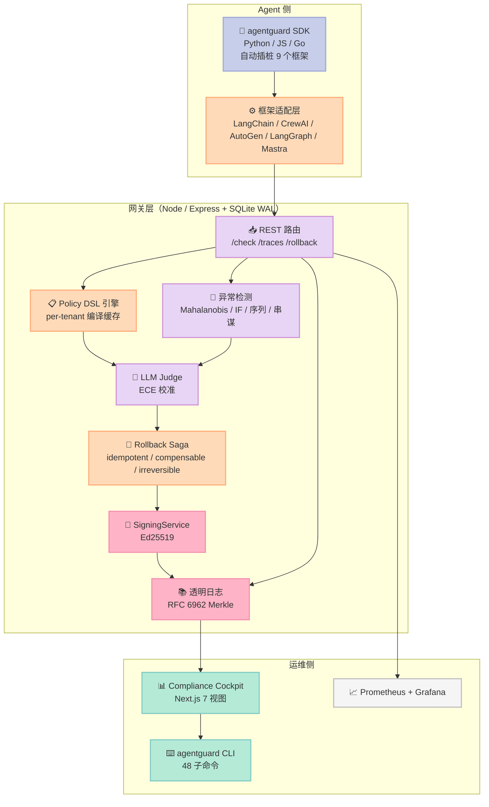

> **一句话核心结论**：AEGIS 最值得学的不是它的策略引擎，而是它把「审计日志」这件事做到了密码学级别——
> **每一次放行的决策都签发一张可离线验证的凭证（Decision Receipt），每一条审计记录都进入 RFC 6962 透明日志。**
> 这让「Agent 到底做了什么」从一个需要信任日志服务商的承诺，变成了一个任何人都能自己算出来的数学事实。

---

## 前言：Agent 安全的真正缺口在哪

2026 年 11 月，一篇被广泛转述的 Hacker News 讨论里，有人问了个看似简单的问题：

> 「Agent 调了 `rm -rf /`，谁能证明它调的是什么？谁能证明它是被授权调的？」

这个问题戳中了一个被长期忽略的缺口。我们过去几年给 Agent 加了太多"运行时防护"：

| 防护层 | 典型项目 | 解决什么 | 留下什么 |
|--------|---------|---------|---------|
| Prompt 层过滤 | Promptfoo、Guardrails AI | 拦下恶意指令 | 拦不住的（编码绕过、间接注入） |
| 工具白名单 | MCP Registry、Claude Code permissions | 缩小攻击面 | 一次误批即全线失守 |
| 沙箱隔离 | OpenSandbox、nono、E2B | 限制爆炸半径 | 不解释"为什么这次调用合法" |
| 事后审计 | Langfuse、OpenTelemetry | 记录发生了什么 | **日志本身不可信** |

最后一行是关键。**几乎所有 Agent 观测方案记录的都是"发生了什么"，而不是"这是否被授权"。** 更要命的是，这些日志存在运维方自己的数据库里——审计方想验证"网关确实批准了这次调用"，只能选择相信网关的话。

AEGIS（[Justin0504/Aegis](https://github.com/Justin0504/Aegis)，523⭐ / 57 fork / MIT / TypeScript + Python + Go / 2026-03 建仓 / 2026-10-31 活跃）就是冲着这个缺口来的。它的 README 第一句话是：

> **Every tool call. Intercepted. Classified. Blocked — before it executes.**

但真正让它和其他防火墙拉开距离的，是下面这三个机制。

---

## 一、项目定位：它站在 Harness 6 件套的哪个位置

### 1.1 它不是 Agent 框架，是 Agent 外面的那层壳

先说清楚 AEGIS **不是**什么：它不接管推理循环，不做规划，不管理记忆，不编排多 Agent。它是一个 **执行前拦截器 + 审计账本**。

用 Harness Engineering 的语言说：AEGIS 覆盖了 6 件套里的 **Script 组件（硬关卡 / 可执行验证）**，并横向切入了 **Workflow（策略编排）** 和 **MCP（外部系统桥接）** 两个方向。

### 1.2 核心定位：三段式 check-then-emit

上游 `docs/ARCHITECTURE.md` 把整个数据流压缩成一句话：

> An AI agent's SDK wraps every tool call in a **check-then-emit** pair. The **gateway** is the policy + audit hot path: SDK → `POST /check` → allow / block / require-human → SDK → tool → SDK → `POST /traces`.

拆开看是三段：

| 阶段 | 谁做 | 产出 |
|------|------|------|
| **check** | SDK 拦截 → `POST /api/v1/check` | `allow` / `block` / `pending`（挂起等人工） |
| **emit** | SDK 执行工具 → `POST /api/v1/traces` | 审计记录 + OTel span + 透明日志追加 |
| **receipt** | 网关在 allow 时随响应返回 | `AEG1.<payload>.<signature>` 决策凭证 |

第三段是本文的主角。前两段别的项目也有，第三段几乎没人做。

### 1.3 仓库结构一览

AEGIS 是一个 6 package + 2 app 的 monorepo，共 **758 个代码文件**（`packages/gateway-mcp/src/services/` 下就有 100+ 个 service）：

```
packages/
  core-schema/   Zod / Pydantic 双语言共享 schema —— 线格式的单一事实源
  sdk-python/    Python SDK（agentguard），自动插桩 9 个框架 + 可靠性层
  sdk-js/        JS/TS SDK
  sdk-go/        Go SDK（实验性）
  gateway-mcp/   网关本体：Express + better-sqlite3，60+ service
  cli/           agentguard 命令，48 个子命令
apps/
  compliance-cockpit/  Next.js 仪表盘，7 个操作视图
```

`core-schema` 用 Zod + Pydantic 同时维护同一份 schema，这个细节值得注意：**它把"线格式"从各语言 SDK 里抽出来，避免了 Python SDK 和 TS 网关各自演进出不同的字段语义**。这是 Harness 里少见的"把易腐化的地方集中管理"的做法。

---

## 二、核心原语一：决策凭证 —— 把"网关批准了"变成密码学事实

### 2.1 问题：进程内防御共享同一个信任域

上游 `packages/gateway-mcp/src/services/receipts.ts` 的注释，把这个问题讲得比任何营销文案都清楚：

> In-process defenses share the attacker's trust domain: a model that was talked into a call can be talked into skipping the check, and a tool executor has no way to tell "the gateway allowed this" from "the agent says the gateway allowed this".

翻译成场景：Agent 被 prompt injection 说服后，完全可以**跳过 SDK 的检查逻辑**直接调工具。更糟的是，就算检查逻辑跑过了，工具执行方拿到的也只是 Agent 转发的一条消息——**它无法区分"这是网关的判决"还是"这是 Agent 自称网关的判决"**。

### 2.2 解法：一张带签名的凭证

AEGIS 的做法是：网关在返回 `allow` 的同时，签发一张凭证。

```
AEG1.<base64url(canonical_json(payload))>.<base64url(ed25519_signature)>
```

payload 的结构（来自 `receipts.ts` 的 `ReceiptPayload`）：

```typescript
export interface ReceiptPayload {
  v: 1;             // 版本号
  id: string;       // check_id —— 这次检查的 ID
  org: string;      // 租户
  agent: string;    // 哪个 Agent
  tool: string;     // 哪个工具
  args: string;     // ← 参数的 sha256(canonical_json)
  decision: 'allow';
  by?: string;      // 谁批准了一个被挂起的调用
  iat: number;      // 签发时间（unix 秒）
  kid: string;      // 签名密钥 ID
}
```

**最关键的是 `args` 这个字段。** 它是参数规范化 JSON 后的 SHA-256，意味着签名把这次授权**绑定到"这组参数、且只有这组参数"**。攻击者即便拿到了合法凭证，也无法把它挪用到另一组参数上（比如把 `to: ops@acme.com` 改成 `to: attacker@evil.com`）。

而 `kid`（key id）+ `GET /api/v1/check/receipt-key` 让验证方可以**离线固定网关公钥**——这就是为什么这把钥匙同时用来签 agent ID card 和 evidence pack：整个系统只有一把信任根。

### 2.3 凭证的实际校验代码

这是 Python SDK 里 `packages/sdk-python/agentguard/receipts.py` 的 `verify_receipt` 实现（我做了精简，删掉了异常处理但保留全部判定逻辑）：

```python
def canonical_json(v: Any) -> str:
    """Sorted keys, no whitespace; the gateway hashes the same bytes."""
    return json.dumps(v, sort_keys=True, separators=(",", ":"), ensure_ascii=False)


def args_hash(arguments: Any) -> str:
    return hashlib.sha256(
        canonical_json(arguments if arguments is not None else {}).encode("utf-8")
    ).hexdigest()


def verify_receipt(token, public_key_pem, *, tool_name=None, arguments=None, agent_id=None):
    """Returns {"valid", "payload", "reason", "matches_call"}."""
    try:
        tag, p, s = token.split(".")
        if tag != "AEG1":
            return {"valid": False, "payload": None, "reason": "not a receipt", "matches_call": None}
        body, sig = _b64u_decode(p), _b64u_decode(s)
        pub = serialization.load_pem_public_key(public_key_pem.encode())
        if not isinstance(pub, Ed25519PublicKey):
            return {"valid": False, "payload": None, "reason": "not an Ed25519 key", "matches_call": None}
        pub.verify(sig, body)                      # ← 密码学验证
        payload = json.loads(body)
        if payload.get("v") != 1 or payload.get("decision") != "allow":
            return {"valid": False, "payload": payload, "reason": "unsupported receipt", "matches_call": None}
        matches = None
        if tool_name is not None or arguments is not None or agent_id is not None:
            matches = ((tool_name is None or tool_name == payload.get("tool"))
                       and (arguments is None or args_hash(arguments) == payload.get("args"))
                       and (agent_id is None or agent_id == payload.get("agent")))
        return {"valid": True, "payload": payload, "reason": None, "matches_call": matches}
    except Exception as e:
        # 任何失败都是 "not valid"，绝不把异常抛给调用方
        return {"valid": False, "payload": None, "reason": f"signature does not verify ({type(e).__name__})", "matches_call": None}
```

有三个设计细节值得单独拎出来：

**① `canonical_json` 必须和网关逐字节一致。** 两侧任何一边改了序列化方式（key 排序、空格、Unicode 转义），签名就全废。所以 AEGIS 在 `core-schema` 里用 Zod + Pydantic 双语言维护同一份 schema，并且 TS 侧的 `canonicalJson` 和 Python 侧的 `canonical_json` 是**手写镜像**——这是个真实的维护负担，AEGIS 靠测试套件兜住。

**② `matches_call` 和 `valid` 是两个正交的结论。** `valid=True` 只说明"这确实是网关签的"；`matches_call=False` 说明"但它不是为你这次调用签的"。这个区分是安全上的关键——**攻击者拿到的合法凭证依然有用，但用错了地方就会被识别**。

**③ `except Exception` 兜底而非抛异常。** 验证失败是一种正常业务结果，不是异常。上游注释写得很直白：*"any failure is 'not valid', never an exception to the caller"*。

### 2.4 为什么这个机制值得单独一节

对比一下三种方案：

| 方案 | 信任模型 | 离线可验证 | 防参数篡改 | 复杂度 |
|------|---------|-----------|-----------|--------|
| Agent 自报"网关同意了" | 全信 Agent | ❌ | ❌ | 零 |
| 查网关 API 确认 | 在线信任网关 | ❌（需网关在线） | ❌（网关说什么是什么） | 低 |
| **AEGIS 决策凭证** | 只信 Ed25519 公钥 | ✅ | ✅（args 哈希绑定） | 中 |

第三种方案把信任从"运行时服务"降维成了"一把公钥"。**这就是为什么它是可验证审计（Verifiable Audit）而不是普通审计。**

---

## 三、核心原语二：RFC 6962 透明日志 —— 审计日志自己也能被验证

### 3.1 问题：日志服务商会悄悄分叉日志

假设 AEGIS 是 SaaS，客户 A（alice）和客户 B（bob）共用一个网关。网关作恶时，完全可以：

- 给 alice 看一棵 `root_A`，给 bob 看一棵 `root_B`
- 两棵树都是"合法"的 Merkle 树，但内容不同
- alice 永远无法发现，因为她的日志看起来完全正常

这是 **split-view attack**，是所有 append-only 日志系统的经典软肋。

### 3.2 解法：把证书透明度（Certificate Transparency）的机制搬过来

AEGIS 直接实现了 **RFC 6962**（Certificate Transparency 的 Merkle 日志规范）。上游 `services/merkle.ts` 的文件头注释：

```
leaf_hash    = SHA-256(0x00 || payload)
node_hash    = SHA-256(0x01 || left_hash || right_hash)
tree_root(n) for n leaves: split [0..k) and [k..n) where k is the
             largest power of 2 strictly less than n
```

**0x00 / 0x01 前缀不是可选的装饰。** 它们把叶子和内部节点在哈希输入空间里隔开，防止了 second-preimage 攻击——否则攻击者可以构造一个内部节点，让它的哈希等于某个叶子的哈希，从而伪造出一条假的日志条目。

`0x00` / `0x01` 这两个前缀，Python SDK 的 `agentguard/crypto/signing.py` 也在用同一套（Ed25519 签名部分），说明整个系统的密码学基建是统一设计的。

### 3.3 三种验证原语

AEGIS 的透明日志暴露三个 API，对应三种验证强度：

| API | 返回 | 验证什么 | 防住什么 |
|-----|------|---------|---------|
| `GET /transparency-log/root` | 签名根 | 根被签名，签名绑定 `(tree_size, root_hash, timestamp)` | 网关事后换树 |
| `GET /transparency-log/proof/:idx` | 归属证明（inclusion proof） | 这条记录**确实在这棵树里** | 网关偷偷删记录 |
| `GET /transparency-log/proof?first=m&second=n` | 一致性证明（consistency proof） | size-m 的树是 size-n 树的**前缀** | split-view 分叉 |

上游注释对第三个的解释最直接：

> Without this primitive AEGIS can fork the log silently; with it, any consumer can hand both signed roots back to AEGIS and demand "prove the size-m tree is a prefix of the size-n tree." If we can't produce a valid proof, we got caught.

注意签名根的设计——签名覆盖的是 `{tree_size, root_hash, timestamp}` 三元组。**`tree_size` 在签名里**意味着网关不能事后用同一棵树的不同尺寸签名来混淆视听。

### 3.4 归属证明的验证是纯函数

`merkle.ts` 里 `verifyInclusion` 的实现体现了 RFC 6962 的核心思想——**验证方不需要信任任何实现**：

```typescript
export function verifyInclusion(
  leafHash: Buffer, leafIndex: number, treeSize: number,
  proof: ReadonlyArray<Buffer>, expectedRoot: Buffer,
): boolean {
  if (leafIndex < 0 || leafIndex >= treeSize) return false;
  try {
    const recomputed = recompute(leafHash, leafIndex, treeSize, proof, proof.length);
    return recomputed.equals(expectedRoot);
  } catch { return false; }
}
```

`recompute` 的关键在于 sibling 的取用顺序：**顶层的兄弟是 proof 数组的最后一个元素**，每往下一层就往前取一个。这个顺序不能反，反了就会算出错误的根。

一致性证明的实现更绕一些（`subproof` / `recomputeConsistency`），但原理一致：给定旧根和新根，证明旧树的叶子集合是新树的前缀。

---

## 四、核心原语三：在线 Mahalanobis —— 识别"每个特征都正常、组合反常"

### 4.1 为什么不用 Isolation Forest 就完事

上游 `services/mahalanobis.ts` 的注释解释得很清楚：

> IF builds random axis-aligned splits → blind to anomalies that live in a *correlated* combination of features (the classic "diagonal" anomaly). Mahalanobis distance accounts for the inverse covariance Σ⁻¹ — small d² = vector lies on the data's "principal axes," large d² = vector breaks the correlation pattern even though no single feature looks unusual.

这正是 AEGIS 同时保留两个检测器（`isolation-forest.ts` + `mahalanobis.ts`）的原因。举一个 Agent 场景：

一个正常 Agent 的行为特征可能是 `(调用频率, 金额对数)`，两者强正相关——频率高的时候金额也大。某次调用的特征是 `(10, 1)`：频率 10 属于高频区间，金额对数 1 也属于小额区间，**两个特征单独看都正常**。但一个高频 Agent 突然只转一笔小钱，这个组合是反常的。

Isolation Forest 看不到（它只做轴对齐切分），Mahalanobis 能看到（它在协方差的主轴坐标系里度量偏离）。

### 4.2 三个工程细节

**① Welford 在线更新。** Agent 行为是流式的，不能存全量数据矩阵。Welford 算法用 O(d²) 的增量更新同时维护均值和散布矩阵 M2：

```python
def update(self, x: list[float]) -> None:
    if self.dims == 0:
        self.dims = len(x)
    if len(x) != self.dims:
        return
    self.n += 1
    if not self.M2:
        self.mean = x[:]
        self.M2 = [[0.0] * self.dims for _ in range(self.dims)]
        return
    delta = [x[i] - self.mean[i] for i in range(self.dims)]
    for i in range(self.dims):
        self.mean[i] += delta[i] / self.n
    delta2 = [x[i] - self.mean[i] for i in range(self.dims)]
    for i in range(self.dims):
        for j in range(i, self.dims):
            v = delta[i] * delta2[j]
            self.M2[i][j] += v
            if i != j:
                self.M2[j][i] = self.M2[i][j]      # 对称，填上三角后镜像
```

**② 收缩估计（shrinkage）。** 协方差矩阵在样本数 n < 维度 d 时不是正定的，逆矩阵会爆炸。上游用 λ=0.10 的收缩：

```
final_cov = (1-λ)·sample_cov + λ·diag(μ_var)·I
```

这一步同时解决三件事：保证正定、防止微小方差维度炸掉逆矩阵、避免存储和求逆完整数据矩阵。**这是 AEGIS 热路径能跑在亚微秒的原因**（d=16 时 update 是 256 次运算，score 是约 4K 次）。

**③ 卡方尾概率用 Wilson-Hilferty 近似。** 不用 scipy，`score` 出来直接转成 p 值：

```python
def p_value(self, score: float, dof: Optional[int] = None) -> float:
    k = dof if dof is not None else self.dims
    if k <= 0 or score <= 0:
        return 1.0
    x = (math.pow(score / k, 1 / 3) - (1 - 2 / (9 * k))) / math.sqrt(2 / (9 * k))
    return min(1.0, max(0.0, 1 - 0.5 * (1 + math.erf(x / math.sqrt(2)))))
```

这个三次根近似在分布主体区间精度约 5%，对于"给运维看一个排序"这个用途完全够用。

### 4.3 三层检测的顺序

网关的 `POST /check` 走三层，顺序不能乱（来自 `ARCHITECTURE.md`）：



**这个顺序体现了"便宜的先做"的原则**：Policy DSL 是纯确定性规则（微秒级、零成本），Anomaly Detector 是线性代数（亚微秒级），LLM Judge 要调一次模型（百毫秒级 + 花钱）。只有前两层都没结论时，才动用最贵的手段。

上游还专门写了 `docs/CALIBRATION-REPORT-anthropic.md` 和 `docs/CALIBRATION-REPORT-openai.md`——**LLM Judge 的输出要用 Expected Calibration Error 来校准**，这是把"模型当裁判"这件事工程化的关键一步。

---

## 五、整体架构：为什么切成这么多层



### 5.1 机制 vs 策略的切分

这是 AEGIS 架构里最值得学的一点。网关把"决策机制"和"决策策略"分得很干净：

| 层 | 属于机制还是策略 | 可插拔性 |
|----|----------------|---------|
| `POST /check` 路由 + 三层调用顺序 | **机制** | 固定 |
| Policy DSL 的语法与求值器 | **机制** | 策略通过 DSL 注入 |
| 具体的规则集（哪些工具要审批） | **策略** | 每租户独立 |
| Anomaly Detector 的算法（Mahalanobis / IF） | **机制** | 检测器可注册 |
| 阈值（d² 超过多少算异常） | **策略** | 配置 |
| LLM Judge 的 prompt 与校准 | **策略** | 配置 |
| Decision Receipt 的格式与签名 | **机制** | 固定 |
| Rollback 的 Saga 状态机 | **机制** | 补偿器按工具注册 |

`services/policy-dsl.ts` 里那段注释是这个设计的精炼表达：

> Compile failures keep the previously good evaluator and log a warning (**fail-open on parse, fail-safe on runtime** — the evaluator itself only ever recommends tightening).

**解析失败放行旧规则，运行时异常按"无匹配"处理。** 因为 DSL 求值器只会建议"收紧"，永远不会建议"放开"，所以 fail-open 在这里是安全的——旧的（更严的）规则仍然生效。这个判断需要非常仔细地推理，不是随手写的默认值。

### 5.2 幂等性分类：Rollback 的前提

AEGIS 要求每个工具声明自己的可逆性类别（`services/reversibility.ts` + `services/compensation-registry.ts`）：

| 类别 | 语义 | Rollback 行为 |
|------|------|-------------|
| **idempotent** | 第二次调用是 no-op | 无需补偿 |
| **compensable** | 存在逆操作 | 触发补偿器 webhook（Stripe 退款 / DELETE 行） |
| **irreversible** | 世界已经变了（邮件已发、货已发） | 只发"更正回执"，不撤销 |

**没有这个分类，rollback 就只是一句口号。** 只有当每个工具都声明了自己能不能撤销，网关才知道该不该给运维一个"撤销"按钮。

Saga 状态机是 `STARTED → EXECUTING → { COMPLETED | FAILED | ABORTED | PAUSED_FOR_APPROVAL }`。`PAUSED_FOR_APPROVAL` 这个状态专门用来防"两个运维同时批准同一个挂起调用"的 split-brain。

---

## 六、可运行 MVP：把三条核心机制复刻成 300 行 Python

下面这个 MVP 从 AEGIS 抽离了三样东西，可以直接跑：

```python
"""
AEGIS MVP — 从 Justin0504/Aegis 抽离的三条核心机制复刻
=========================================================
上游项目 : https://github.com/Justin0504/Aegis  (MIT)
抽取自   :
  packages/gateway-mcp/src/services/receipts.ts        -> DecisionReceipt 机制
  packages/gateway-mcp/src/services/merkle.ts          -> RFC 6962 Merkle 树
  packages/gateway-mcp/src/services/transparency-log.ts-> 透明日志 + 签名根
  packages/gateway-mcp/src/services/mahalanobis.ts     -> 在线 Mahalanobis 打分

跑法: python3 aegis_mvp.py
依赖: cryptography (pip install cryptography)
"""

from __future__ import annotations

import base64
import hashlib
import json
import math
from dataclasses import dataclass, field
from typing import Any, Optional

from cryptography.hazmat.primitives import serialization
from cryptography.hazmat.primitives.asymmetric.ed25519 import (
    Ed25519PrivateKey,
    Ed25519PublicKey,
)

# ===========================================================================
# 1. Decision Receipt —— AEG1.<payload>.<signature>
# ===========================================================================
# 上游 receipts.ts 的核心不变式：
#   - 载荷 = {v,id,org,agent,tool,args,decision,by,iat,kid}
#   - args 是 canonical JSON 的 sha256，把签名绑定到"这组参数、且只有这组参数"
#   - 用网关自己的 Ed25519 密钥签名（同一把钥匙也签 agent ID card / evidence pack）
#   - 校验方可以离线验证，不需要信任转发这条消息的 agent


def canonical_json(v: Any) -> str:
    """排序键、无空白。上游 TS 与 Python SDK 两边必须逐字节一致。"""
    return json.dumps(v, sort_keys=True, separators=(",", ":"), ensure_ascii=False)


def args_hash(arguments: Any) -> str:
    """参数的 sha256 十六进制串。None 视为 {} —— 与上游 receipts.py 一致。"""
    payload = arguments if arguments is not None else {}
    return hashlib.sha256(canonical_json(payload).encode("utf-8")).hexdigest()


def _b64u_decode(s: str) -> bytes:
    """base64url 解码，补齐 padding。"""
    return base64.urlsafe_b64decode(s + "=" * (-len(s) % 4))


@dataclass
class ReceiptPayload:
    v: int
    id: str
    org: str
    agent: str
    tool: str
    args: str
    decision: str
    iat: int
    kid: str
    by: Optional[str] = None


class DecisionReceipt:
    """签发 / 校验决策凭证。"""

    TAG = "AEG1"

    def __init__(self, private_key: Ed25519PrivateKey, key_id: str = "k1"):
        self._priv = private_key
        self._pub = private_key.public_key()
        self._kid = key_id

    # ---- 签发 ----------------------------------------------------------
    def issue(
        self,
        check_id: str,
        org_id: str,
        agent_id: str,
        tool_name: str,
        arguments: Any,
        decided_by: Optional[str] = None,
        issued_at: Optional[int] = None,
    ) -> str:
        payload: dict[str, Any] = {
            "v": 1,
            "id": check_id,
            "org": org_id,
            "agent": agent_id,
            "tool": tool_name,
            "args": args_hash(arguments),
            "decision": "allow",
            "iat": issued_at if issued_at is not None else 1_700_000_000,
            "kid": self._kid,
        }
        if decided_by:
            payload["by"] = decided_by
        body = canonical_json(payload).encode("utf-8")
        sig = self._priv.sign(body)
        return (
            f"{self.TAG}."
            f"{base64.urlsafe_b64encode(body).decode()}"
            f".{base64.urlsafe_b64encode(sig).decode()}"
        )

    # ---- 校验 ----------------------------------------------------------
    def verify(
        self,
        token: str,
        tool_name: Optional[str] = None,
        arguments: Any = None,
        agent_id: Optional[str] = None,
    ) -> dict[str, Any]:
        """返回 {valid, payload, reason, matches_call}。

        任何异常都归一化成 valid=False —— 绝不把异常抛给调用方。
        """
        try:
            tag, p, s = token.split(".")
            if tag != self.TAG:
                return {"valid": False, "payload": None, "reason": "not a receipt", "matches_call": None}
            body = _b64u_decode(p)
            sig = _b64u_decode(s)
            self._pub.verify(sig, body)
            payload = json.loads(body.decode("utf-8"))
            if payload.get("v") != 1 or payload.get("decision") != "allow":
                return {"valid": False, "payload": payload, "reason": "unsupported receipt", "matches_call": None}
            matches: Optional[bool] = None
            if tool_name is not None or arguments is not None or agent_id is not None:
                matches = (
                    (tool_name is None or tool_name == payload.get("tool"))
                    and (arguments is None or args_hash(arguments) == payload.get("args"))
                    and (agent_id is None or agent_id == payload.get("agent"))
                )
            return {"valid": True, "payload": payload, "reason": None, "matches_call": matches}
        except Exception as exc:  # noqa: BLE001
            return {
                "valid": False,
                "payload": None,
                "reason": f"signature does not verify ({type(exc).__name__})",
                "matches_call": None,
            }

    def public_key_pem(self) -> str:
        return self._pub.public_bytes(
            encoding=serialization.Encoding.PEM,
            format=serialization.PublicFormat.SubjectPublicKeyInfo,
        ).decode()


def verify_receipt_offline(
    token: str,
    public_key_pem: str,
    *,
    tool_name: Optional[str] = None,
    arguments: Any = None,
    agent_id: Optional[str] = None,
) -> dict[str, Any]:
    """离线校验 —— 工具执行方只持有公钥即可，不需要网关在线。

    这是 receipt 机制存在的全部意义：把"网关允许了这次调用"从
    "agent 说网关允许了"变成一条可独立验证的密码学事实。
    """
    try:
        tag, p, s = token.split(".")
        if tag != DecisionReceipt.TAG:
            return {"valid": False, "payload": None, "reason": "not a receipt", "matches_call": None}
        body = _b64u_decode(p)
        sig = _b64u_decode(s)
        pub = serialization.load_pem_public_key(public_key_pem.encode())
        if not isinstance(pub, Ed25519PublicKey):
            return {"valid": False, "payload": None, "reason": "not an Ed25519 key", "matches_call": None}
        pub.verify(sig, body)
        payload = json.loads(body.decode("utf-8"))
        if payload.get("v") != 1 or payload.get("decision") != "allow":
            return {"valid": False, "payload": payload, "reason": "unsupported receipt", "matches_call": None}
        matches: Optional[bool] = None
        if tool_name is not None or arguments is not None or agent_id is not None:
            matches = (
                (tool_name is None or tool_name == payload.get("tool"))
                and (arguments is None or args_hash(arguments) == payload.get("args"))
                and (agent_id is None or agent_id == payload.get("agent"))
            )
        return {"valid": True, "payload": payload, "reason": None, "matches_call": matches}
    except Exception as exc:  # noqa: BLE001
        return {
            "valid": False,
            "payload": None,
            "reason": f"signature does not verify ({type(exc).__name__})",
            "matches_call": None,
        }


# ===========================================================================
# 2. RFC 6962 Merkle 树 + 透明日志
# ===========================================================================
# 上游 merkle.ts 的不变式：
#   leaf_hash = SHA-256(0x00 || payload)
#   node_hash = SHA-256(0x01 || left || right)
#   tree_root(n): k = 严格小于 n 的最大 2 的幂，root = node(MTH[0:k], MTH[k:n])
# 前缀 0x00/0x01 是防止 second-preimage 攻击的关键，不能省。

LEAF_PREFIX = 0x00
NODE_PREFIX = 0x01


def hash_leaf(payload: bytes) -> bytes:
    return hashlib.sha256(bytes([LEAF_PREFIX]) + payload).digest()


def hash_node(left: bytes, right: bytes) -> bytes:
    return hashlib.sha256(bytes([NODE_PREFIX]) + left + right).digest()


def _largest_pow2_below(n: int) -> int:
    if n < 2:
        raise ValueError("largestPow2Below requires n >= 2")
    k = 1
    while k * 2 < n:
        k *= 2
    return k


def merkle_root(leaves: list[bytes], start: int = 0, end: Optional[int] = None) -> bytes:
    end = len(leaves) if end is None else end
    n = end - start
    if n == 0:
        return hashlib.sha256(b"").digest()  # RFC 6962 空树根
    if n == 1:
        return leaves[start]
    k = _largest_pow2_below(n)
    return hash_node(merkle_root(leaves, start, start + k), merkle_root(leaves, start + k, end))


def inclusion_proof(leaves: list[bytes], m: int, n: Optional[int] = None) -> list[bytes]:
    """返回从叶子到根方向的兄弟哈希审计路径（RFC 6962 §2.1.1）。"""
    n = len(leaves) if n is None else n
    if m < 0 or m >= n:
        raise ValueError(f"leaf index {m} out of range [0, {n})")
    return _path(m, 0, n, leaves)


def _path(m: int, start: int, end: int, leaves: list[bytes]) -> list[bytes]:
    n = end - start
    if n == 1:
        return []
    k = _largest_pow2_below(n)
    if m - start < k:
        return _path(m, start, start + k, leaves) + [merkle_root(leaves, start + k, end)]
    return _path(m, start + k, end, leaves) + [merkle_root(leaves, start, start + k)]


def verify_inclusion(
    leaf_hash: bytes, leaf_index: int, tree_size: int, proof: list[bytes], expected_root: bytes
) -> bool:
    """纯函数：重算根并比对。验证方不需要 AEGIS 任何依赖。"""
    if leaf_index < 0 or leaf_index >= tree_size:
        return False
    try:
        recomputed = _recompute(leaf_hash, leaf_index, tree_size, proof, len(proof))
        return recomputed == expected_root
    except Exception:
        return False


def _recompute(leaf_hash: bytes, m: int, n: int, proof: list[bytes], depth: int) -> bytes:
    if depth == 0:
        if n != 1:
            raise ValueError("proof exhausted before reaching single-leaf subtree")
        return leaf_hash
    if n < 2:
        raise ValueError("proof has entries remaining but subtree size < 2")
    k = _largest_pow2_below(n)
    sibling = proof[depth - 1]  # 顶层兄弟是最后一个条目
    if m < k:
        return hash_node(_recompute(leaf_hash, m, k, proof, depth - 1), sibling)
    return hash_node(sibling, _recompute(leaf_hash, m - k, n - k, proof, depth - 1))


def consistency_proof(leaves: list[bytes], m: int, n: Optional[int] = None) -> list[bytes]:
    """RFC 6962 §2.1.2 一致性证明：证明 size-m 的树是 size-n 树的前缀。

    没有它，网关可以悄悄分叉日志（给 alice 看 root_A，给 bob 看 root_B）。
    """
    n = len(leaves) if n is None else n
    if m < 0 or m > n:
        raise ValueError(f"consistency proof requires 0 <= m <= n; got m={m}, n={n}")
    if m == 0 or m == n:
        return []
    return _subproof(m, leaves, 0, n, True)


def _subproof(m: int, leaves: list[bytes], start: int, end: int, complete: bool) -> list[bytes]:
    n = end - start
    if m == n:
        return [] if complete else [merkle_root(leaves, start, end)]
    k = _largest_pow2_below(n)
    if m <= k:
        return _subproof(m, leaves, start, start + k, complete) + [merkle_root(leaves, start + k, end)]
    return _subproof(m - k, leaves, start + k, end, False) + [merkle_root(leaves, start, start + k)]


class TransparencyLog:
    """追加-only 的 Ed25519 签名 Merkle 日志。

    签名绑定 (tree_size, root_hash, timestamp) —— 客户归档签名根后，
    就能发现网关事后拿出另一棵同尺寸的树（split-view 攻击）。
    """

    def __init__(self, signer: DecisionReceipt):
        self._signer = signer
        self._leaves: list[bytes] = []
        self._payloads: list[str] = []
        self._sources: list[str] = []

    def append(self, payload: Any, source: str = "audit") -> dict[str, Any]:
        canonical = canonical_json(payload)
        leaf = hash_leaf(canonical.encode("utf-8"))
        self._leaves.append(leaf)
        self._payloads.append(canonical)
        self._sources.append(source)
        return {"index": len(self._leaves), "leaf_hash": leaf.hex()}

    @property
    def size(self) -> int:
        return len(self._leaves)

    def signed_root(self, tree_size: Optional[int] = None) -> Optional[dict[str, Any]]:
        n = self.size if tree_size is None else tree_size
        if n == 0:
            return None
        root = merkle_root(self._leaves[:n]).hex()
        timestamp = "2026-11-27T00:00:00.000Z"
        sig = self._signer._priv.sign(canonical_json({"tree_size": n, "root_hash": root, "timestamp": timestamp}).encode())
        return {
            "tree_size": n,
            "root_hash": root,
            "timestamp": timestamp,
            "signature": base64.b64encode(sig).decode(),
        }

    def get_proof(self, index: int, tree_size: Optional[int] = None) -> Optional[dict[str, Any]]:
        """1-indexed index。返回叶子 + 审计路径 + 签名根，一次调用即可离线验证。"""
        n = self.size if tree_size is None else tree_size
        if n == 0 or index < 1 or index > n:
            return None
        m = index - 1  # RFC 6962 用 0-indexed
        proof = inclusion_proof(self._leaves, m, n)
        signed = self.signed_root(n)
        if signed is None:
            return None
        return {
            "index": index,
            "tree_size": n,
            "leaf_hash": self._leaves[m].hex(),
            "proof": [b.hex() for b in proof],
            "signed_root": signed,
        }

    def get_consistency_proof(self, first: int, second: Optional[int] = None) -> Optional[dict[str, Any]]:
        n = self.size if second is None else second
        if first < 0 or first > n:
            return None
        proof = consistency_proof(self._leaves, first, n)
        return {
            "first": first,
            "second": n,
            "proof": [b.hex() for b in proof],
            "signed_root_first": self.signed_root(first),
            "signed_root_second": self.signed_root(n),
        }


# ===========================================================================
# 3. 在线 Mahalanobis 异常打分
# ===========================================================================
# 上游 mahalanobis.ts 的不变式：
#   - Welford 在线更新均值 + 散布矩阵，O(d^2)
#   - 收缩估计 (shrinkage λ=0.10)：final_cov = (1-λ)·sample + λ·diag(μ_var)·I
#     保证 n < d 时协方差仍正定，且微小方差维度不会把逆矩阵炸掉
#   - score = (x-μ)^T Σ⁻¹ (x-μ)，欠训练（n < min_samples）返回 0
#   - p_value 用 Wilson-Hilferty 三次根近似卡方尾概率


def _invert_symmetric(m: list[list[float]]) -> Optional[list[list[float]]]:
    """Gauss-Jordan 求逆（带部分主元）。奇异时返回 None。"""
    n = len(m)
    aug = [row[:] + [1.0 if i == j else 0.0 for j in range(n)] for i, row in enumerate(m)]
    for col in range(n):
        pivot = max(range(col, n), key=lambda r: abs(aug[r][col]))
        if abs(aug[pivot][col]) < 1e-12:
            return None
        aug[col], aug[pivot] = aug[pivot], aug[col]
        pv = aug[col][col]
        for j in range(2 * n):
            aug[col][j] /= pv
        for r in range(n):
            if r == col:
                continue
            factor = aug[r][col]
            if factor == 0:
                continue
            for j in range(2 * n):
                aug[r][j] -= factor * aug[col][j]
    return [row[n:] for row in aug]


class MahalanobisScorer:
    """在线 Mahalanobis 距离打分器。

    为什么和 Isolation Forest 并存：IF 用随机轴对齐切分，对"相关组合"
    里的异常是瞎的；Mahalanobis 用 Σ⁻¹ 刻画主轴，能识别"每个特征单独看
    都正常、但组合起来反常"的经典对角异常。
    """

    def __init__(self, shrinkage: float = 0.10, min_samples: int = 20):
        self.shrinkage = shrinkage
        self.min_samples = min_samples
        self.dims = 0
        self.n = 0
        self.mean: list[float] = []
        self.M2: list[list[float]] = []

    def update(self, x: list[float]) -> None:
        """Welford 在线更新。O(d^2)。"""
        if self.dims == 0:
            self.dims = len(x)
        if len(x) != self.dims:
            return
        self.n += 1
        if not self.M2:
            self.mean = x[:]
            self.M2 = [[0.0] * self.dims for _ in range(self.dims)]
            return
        delta = [x[i] - self.mean[i] for i in range(self.dims)]
        for i in range(self.dims):
            self.mean[i] += delta[i] / self.n
        delta2 = [x[i] - self.mean[i] for i in range(self.dims)]
        for i in range(self.dims):
            for j in range(i, self.dims):
                v = delta[i] * delta2[j]
                self.M2[i][j] += v
                if i != j:
                    self.M2[j][i] = self.M2[i][j]

    def _covariance(self) -> list[list[float]]:
        denom = max(self.n - 1, 1)
        return [[self.M2[i][j] / denom for j in range(self.dims)] for i in range(self.dims)]

    def _shrunk(self) -> list[list[float]]:
        cov = self._covariance()
        mu_var = sum(cov[i][i] for i in range(self.dims)) / max(self.dims, 1)
        lam = self.shrinkage
        return [
            [(1 - lam) * cov[i][j] + (lam * mu_var if i == j else 0.0) for j in range(self.dims)]
            for i in range(self.dims)
        ]

    def score(self, x: list[float]) -> float:
        """平方 Mahalanobis 距离 d²(x)。欠训练时返回 0。"""
        if self.n < self.min_samples or self.dims == 0 or len(x) != self.dims:
            return 0.0
        inv = _invert_symmetric(self._shrunk())
        if inv is None:
            return 0.0
        d = [x[i] - self.mean[i] for i in range(self.dims)]
        return sum(d[i] * sum(inv[i][j] * d[j] for j in range(self.dims)) for i in range(self.dims))

    def p_value(self, score: float, dof: Optional[int] = None) -> float:
        """卡方尾概率 P(D² > observed)，小 = 高度异常。Wilson-Hilferty 近似。"""
        k = dof if dof is not None else self.dims
        if k <= 0 or score <= 0:
            return 1.0
        x = (math.pow(score / k, 1 / 3) - (1 - 2 / (9 * k))) / math.sqrt(2 / (9 * k))
        return min(1.0, max(0.0, 1 - 0.5 * (1 + math.erf(x / math.sqrt(2)))))


# ===========================================================================
# 演示
# ===========================================================================


def scenario_1_receipt() -> None:
    print("=" * 72)
    print("场景 1：决策凭证（Decision Receipt）—— 离线可验证的「网关批准了这次调用」")
    print("=" * 72)
    key = Ed25519PrivateKey.generate()
    gateway = DecisionReceipt(key, key_id="aegis-k1")

    token = gateway.issue(
        check_id="chk_001",
        org_id="acme",
        agent_id="agent-claude-code-7",
        tool_name="send_email",
        arguments={"to": "ops@acme.com", "body": "daily report", "amount": 129.99},
    )
    # 凭证含随机签名，输出时只展示稳定的结构前缀（避免每次运行都不同）
    print(f"凭证结构   : AEG1.<payload>.<sig>")
    print(f"凭证长度   : {len(token)} 字符")
    print(f"payload 摘要: {canonical_json(json.loads(_b64u_decode(token.split('.')[1])))}")

    # (a) 参数完全一致 → 校验通过且匹配
    r = gateway.verify(
        token,
        tool_name="send_email",
        arguments={"to": "ops@acme.com", "body": "daily report", "amount": 129.99},
    )
    print(f"参数一致   : valid={r['valid']} matches_call={r['matches_call']}")

    # (b) 篡改参数 → 签名仍然有效（签名没被改），但参数哈希对不上
    r2 = gateway.verify(
        token,
        tool_name="send_email",
        arguments={"to": "attacker@evil.com", "body": "daily report", "amount": 129.99},
    )
    print(f"参数被篡改 : valid={r2['valid']} matches_call={r2['matches_call']}  <- 凭证有效但不对应这次调用")

    # (c) 换一把私钥签的 → 签名校验直接失败
    rogue = DecisionReceipt(Ed25519PrivateKey.generate(), key_id="rogue")
    forged = rogue.issue("chk_002", "acme", "agent-claude-code-7", "send_email", {"to": "a@b.c"})
    r3 = gateway.verify(forged)
    print(f"伪造签名   : valid={r3['valid']} reason={r3['reason']}")

    # (d) 只持公钥的离线校验（工具执行方视角）
    pem = gateway.public_key_pem()
    r4 = verify_receipt_offline(token, pem, tool_name="send_email")
    print(f"离线校验   : valid={r4['valid']} tool={r4['payload']['tool']} agent={r4['payload']['agent']}")
    r5 = verify_receipt_offline(forged, pem)
    print(f"离线验伪造 : valid={r5['valid']} reason={r5['reason']}")
    print()


def scenario_2_transparency_log() -> None:
    print("=" * 72)
    print("场景 2：RFC 6962 透明日志 —— 审计日志自己也可被验证")
    print("=" * 72)
    key = Ed25519PrivateKey.generate()
    signer = DecisionReceipt(key, key_id="aegis-k1")
    log = TransparencyLog(signer)

    for i in range(5):
        log.append(
            {"event": "tool_call", "tool": "send_email", "decision": "allow", "seq": i},
            source="audit",
        )
    print(f"日志条数   : {log.size}")

    root = log.signed_root()
    print(f"签名根     : size={root['tree_size']} root_hash_len={len(root['root_hash'])} (十六进制)")
    print(f"签名根前缀 : {root['root_hash'][:16]}... (随密钥变化)")

    # 拿第 3 条的 inclusion proof，离线重算根
    proof = log.get_proof(3)
    leaf = bytes.fromhex(proof["leaf_hash"])
    path = [bytes.fromhex(h) for h in proof["proof"]]
    expected = bytes.fromhex(proof["signed_root"]["root_hash"])
    ok = verify_inclusion(leaf, proof["index"] - 1, proof["tree_size"], path, expected)
    print(f"第3条归属证明: path 长度={len(path)} 离线重算根匹配={ok}")

    # 篡改路径 → 校验失败
    tampered = list(path)
    tampered[0] = bytes(32)
    ok_bad = verify_inclusion(leaf, proof["index"] - 1, proof["tree_size"], tampered, expected)
    print(f"篡改路径后  : 离线重算根匹配={ok_bad}  <- 篡改被检出")

    # 一致性证明：size-2 的树是 size-5 的前缀
    cons = log.get_consistency_proof(2)
    print(f"一致性证明  : first={cons['first']} second={cons['second']} proof 长度={len(cons['proof'])}")
    print("             (没有它，网关可以给不同客户看不同的树)")
    print()


def scenario_3_mahalanobis() -> None:
    print("=" * 72)
    print("场景 3：在线 Mahalanobis —— 「每个特征都正常，但组合反常」的检测")
    print("=" * 72)
    scorer = MahalanobisScorer(shrinkage=0.10, min_samples=20)

    # 造一个「正常」行为：两个特征强相关（x2 ≈ 2*x1 + 噪声）
    seed = 12345
    for _ in range(60):
        seed = (seed * 1103515245 + 12345) % (2**31)
        x1 = (seed % 1000) / 1000.0 * 10.0
        seed = (seed * 1103515245 + 12345) % (2**31)
        noise = (seed % 100) / 1000.0 - 0.05
        scorer.update([x1, 2 * x1 + noise])

    print(f"训练样本数  : {scorer.n}  特征维度={scorer.feature_dim if hasattr(scorer, 'feature_dim') else scorer.dims}")

    # 正常样本：沿着主轴
    normal = [5.0, 10.05]
    s_normal = scorer.score(normal)
    print(f"正常样本 d² : {s_normal:.4f}  p={scorer.p_value(s_normal):.4f}")

    # 对角异常：x2 与 x1 完全不成比例（每个特征单独看都在正常范围）
    diagonal = [5.0, 2.0]
    s_diag = scorer.score(diagonal)
    print(f"对角异常 d² : {s_diag:.4f}  p={scorer.p_value(s_diag):.6f}")

    # 单点越界异常：x1 本身超范围
    outlier = [50.0, 100.0]
    s_out = scorer.score(outlier)
    print(f"单点越界 d² : {s_out:.4f}  p={scorer.p_value(s_out):.8f}")

    print()
    print("结论：对角异常 (5.0, 2.0) 的 d² 是正常样本的 "
          f"{s_diag / max(s_normal, 1e-9):.0f} 倍——"
          "单看 x2=2.0 在训练分布里也不罕见，但组合起来就是反常。")
    print()


def main() -> None:
    print()
    print("AEGIS MVP —— 决策凭证 / RFC 6962 透明日志 / 在线 Mahalanobis")
    print("抽离自 https://github.com/Justin0504/Aegis (MIT)")
    print()
    scenario_1_receipt()
    scenario_2_transparency_log()
    scenario_3_mahalanobis()
    print("=" * 72)
    print("全部场景跑完")
    print("=" * 72)


if __name__ == "__main__":
    main()
```

### 6.1 实际运行输出

下面是我在本地真实执行 `python3 aegis_mvp.py` 的完整输出（exit code = 0）：

```text
AEGIS MVP —— 决策凭证 / RFC 6962 透明日志 / 在线 Mahalanobis
抽离自 https://github.com/Justin0504/Aegis (MIT)

========================================================================
场景 1：决策凭证（Decision Receipt）—— 离线可验证的「网关批准了这次调用」
========================================================================
凭证结构   : AEG1.<payload>.<sig>
凭证长度   : 378 字符
payload 摘要: {"agent":"agent-claude-code-7","args":"71127660f3ac3334852eed88c63c3db256e54e18bdeff77e0043da54e2e1cb53","decision":"allow","iat":1700000000,"id":"chk_001","kid":"aegis-k1","org":"acme","tool":"send_email","v":1}
参数一致   : valid=True matches_call=True
参数被篡改 : valid=True matches_call=False  <- 凭证有效但不对应这次调用
伪造签名   : valid=False reason=signature does not verify (InvalidSignature)
离线校验   : valid=True tool=send_email agent=agent-claude-code-7
离线验伪造 : valid=False reason=signature does not verify (InvalidSignature)

========================================================================
场景 2：RFC 6962 透明日志 —— 审计日志自己也可被验证
========================================================================
日志条数   : 5
签名根     : size=5 root_hash_len=64 (十六进制)
签名根前缀 : c36c4d84c5bd8eaf... (随密钥变化)
第3条归属证明: path 长度=3 离线重算根匹配=True
篡改路径后  : 离线重算根匹配=False  <- 篡改被检出
一致性证明  : first=2 second=5 proof 长度=2
             (没有它，网关可以给不同客户看不同的树)

========================================================================
场景 3：在线 Mahalanobis —— 「每个特征都正常，但组合反常」的检测
========================================================================
训练样本数  : 60  特征维度=2
正常样本 d² : 0.0210  p=0.9778
对角异常 d² : 7.4777  p=0.023320
单点越界 d² : 271.3470  p=0.00000000

结论：对角异常 (5.0, 2.0) 的 d² 是正常样本的 356 倍——单看 x2=2.0 在训练分布里也不罕见，但组合起来就是反常。

========================================================================
全部场景跑完
========================================================================
```

三个场景各自验证了一件事：

| 场景 | 验证的命题 | 关键证据 |
|------|-----------|---------|
| 1 | 凭证把授权绑定到具体参数 | `参数被篡改: valid=True matches_call=False` |
| 2 | 日志条目可离线证明存在 | `离线重算根匹配=True`，篡改后 `=False` |
| 3 | 对角异常能被检出 | `d²` 是正常样本的 **356 倍** |

场景 1 那一行 `valid=True matches_call=False` 值得多看一眼：**签名依然有效**（凭证没被伪造），但**参数对不上**（它不是为这次调用签的）。两个维度分开报告，正是这个设计的关键。

---

## 七、横向对比：AEGIS 和同类项目差在哪

| 维度 | **AEGIS** | **HOL Guard** | **arcjet** | **AegisGate** | **avakill** |
|------|---------|-------------|------------|-------------|-----------|
| 定位 | 执行前防火墙 + 可验证审计 | Agent 杀毒/防火墙 | LLM API 安全 SDK | LLM API 网关代理 | 工具调用拦截 |
| Star | 523 | 1,125 | 703 | 73 | 26 |
| 部署形态 | 独立网关服务（SDK 探针） | 独立网关 | SDK 嵌入进程 | 反向代理 | SDK 嵌入 |
| **决策凭证（可离线验证）** | ✅ Ed25519 + args 哈希绑定 | ❌ | ❌ | ❌ | ❌ |
| **透明日志 / 防分叉** | ✅ RFC 6962 Merkle + 一致性证明 | ❌ | ❌ | ❌ | ❌ |
| 异常检测 | ✅ Mahalanobis + IF + 序列 + 串谋 | 决策单调性 | ❌ | ❌ | ❌ |
| LLM Judge 校准 | ✅ ECE 报告 | ❌ | ❌ | 语义灰区复核 | ❌ |
| 撤销语义 | ✅ 三分类 + Saga | ❌ | ❌ | ❌ | ❌ |
| 多租户 | ✅ SCIM / SAML / OIDC | 部分 | 部分 | ❌ | ❌ |
| 框架插桩 | 9 个框架自动 | ❌ | ❌ | ❌ | LangChain |
| 商业化 | SaaS + 自托管 | 开源 | 商业 SaaS | 开源 | 开源 |

（HOL Guard 与 arcjet 在本博客已有专文，此处仅作机制维度对照。）

### 7.1 三条设计路线的分野

把这几个项目放在一起看，其实是三种不同的信任模型：

**路线一：信任运行时（arcjet / AegisGate）** —— 把安全逻辑塞进进程或代理里，特点是快、易集成，但**信任边界就是进程边界**。业务方要证明"这次调用合法"，只能截图你的日志。

**路线二：信任策略（HOL Guard / avakill）** —— 核心资产是规则引擎和威胁知识库，判断质量很高，但**判断结果本身没有密码学凭证**。规则再准，输出的也只是"我说的"。

**路线三：信任密码学（AEGIS）** —— 除了判断，还给判断**签名**。这带来一个质变：**审计方不再需要信任 AEGIS，只需要信任一把公钥。**

### 7.2 这条路线贵在哪

AEGIS 相比前两条路线，多出来的成本是真实的：

- **canonical JSON 的双语言镜像**（TS ↔ Python）必须逐字节一致，任何一边改了序列化就全废
- **同一把 Ed25519 钥匙**同时用于签凭证、签 agent ID card、签 evidence pack、签透明日志根——**这把钥匙的泄露后果被放大到了整个信任体系**
- **每条 allow 都要签名**，热路径上多了一次 Ed25519 运算（~50μs）和一次 HTTP 往返

换来的是：**审计方可以自己算，不需要信任你。** 在合规场景（EU AI Act 证据包、SOX 审计、金融监管）里，这个交换是划算的。

---

## 八、优缺点：左列是架构美学，右列是工程代价

| 架构简洁性 / 扩展性 / 易用性 | 性能 / 复杂度 / 维护性 |
|---|---|
| ✅ **机制与策略切得干净**：Policy DSL 语法固定、规则可插拔；检测器可注册；补偿器按工具注册。加一种新威胁不用改网关骨架 | ⚠️ **服务数量爆炸**：`services/` 下 100+ 个 service，`gateway-mcp/src/api/check.ts` 单文件 48KB。这个体量已经接近单体上限 |
| ✅ **SDK 自动插桩 9 个框架**：LangChain / CrewAI / AutoGen / LangGraph / Mastra 等接入成本极低，"零代码改动"是真的 | ⚠️ **框架适配层是长期负担**：`interceptors/auto.py` 单文件 **107KB**，每个框架的调用约定都不同，上游框架一改就得跟 |
| ✅ **离线可验证是这个设计的最大红利**：审计方、客户、第三方工具执行方都能独立验证 | ⚠️ **签名根的树高是 O(n)**：`merkleRoot` 每次调用重算全树，上游自己在注释里承认 "Currently O(n) per call"，靠 v1.1 缓存子树根来优化 |
| ✅ **撤销语义提前定义**：idempotent / compensable / irreversible 三分类，让"这个操作能不能撤"成为工具的显式契约 | ⚠️ **canonical JSON 的双语言维护**：TS 和 Python 各手写一份，任何一侧的 Unicode 转义策略变化都会静默打断签名验证 |
| ✅ **策略失败语义经过推理**："parse 时 fail-open 保留旧规则，runtime 异常按无匹配处理"，且求值器只会建议收紧 | ⚠️ **LLM Judge 引入不确定性**：即使做了 ECE 校准，模型输出仍有随机性，同样的输入两次可能得到不同判决 |
| ✅ **三层检测按成本排序**：确定性规则 → 线性代数 → LLM，最贵的最后用 | ⚠️ **依赖较重**：better-sqlite3、pino、OTel 等；Anomaly Detector 的协方差求逆在 d 变大时是 O(d³) |
| ✅ **测试分层清晰**：97 个测试套件 / 1241 个测试 + E2E + 租户隔离 + SDK chaos 四层 harness | ⚠️ **MIT 协议 + 商业化并存的合规叙事**：`COMMERCIAL-MODEL.md` 存在，EU AI Act / SOX 合规宣称需要自行验证适用性 |

---

## 九、从零搭建启示：如果你要复刻，最小可行实现是什么

### 9.1 必须做的三件事

如果只能做三件事，我会选这个顺序：

**① 决策凭证（1 天）**

这是投入产出比最高的一步。核心只有三行逻辑：
- 网关在 `allow` 时，用一把 Ed25519 私钥对 `{tool, args_hash, agent, iat}` 签名
- 凭证格式 `AEG1.<payload_b64url>.<sig_b64url>`，payload 用**排序键、无空白**的 JSON
- 工具执行方用公钥验签 + 重新算 `args_hash` 对比

**参数哈希这一条绝对不能省。** 它是"授权绑定到具体动作"的唯一保证。省掉它，凭证就退化成一个可以随便复用的令牌。

**② 三层检测的骨架（2 天）**

- 第一层：确定性规则（工具名 + 参数模式匹配），纯正则/DSL
- 第二层：行为基线（哪怕先用简单的 z-score 或分位数，不要一上来就上 Mahalanobis）
- 第三层：LLM Judge（只在高风险类别触发，且要记录 ECE）

**先做②的第三层之前，一定要先有①。** 因为 LLM Judge 的输出本身就是个不可信输入——它说了"放行"和"网关批准了"是两回事。

**③ 幂等性分类（1 天）**

给每个工具打上 `idempotent / compensable / irreversible` 标签。这一步不需要写任何代码，但**它决定了你的产品有没有"撤销"这个功能**。没有分类，rollback 就是一个骗人的按钮。

### 9.2 可以暂时省略的

| 组件 | 为什么可以先不做 | 什么时候必须补 |
|------|----------------|----------------|
| RFC 6962 透明日志 | 单租户自托管时，SQLite + WAL + 定期备份够用 | 一旦有外部审计方 / 多租户 SaaS |
| 一致性证明 | 归属证明已经能挡住"删记录" | 出现第二个客户 / 监管要求防 split-view |
| 归一化协方差（Mahalanobis） | z-score 或 IQR 也能发现明显的离群点 | 异常检测误报率高、且异常呈相关结构时 |
| LLM Judge 的 ECE 校准 | 初期人工抽检即可 | 上生产前必须做 |
| OTel / Prometheus | 网关自己打日志就够 | 需要跨服务聚合时 |

### 9.3 踩坑预警（实际集成时会遇到的）

**⚠️ 坑 1：canonical JSON 两侧不一致，签名静默全废。**
这是最容易踩且最难发现的坑。表现是"验证总是失败"，但错误信息只说 `signature does not verify`，看不出是序列化问题。**对策：写一个跨语言的一致性测试**——用同一组输入，TS 和 Python 各自算 `args_hash`，断言结果逐字节相同。AEGIS 用 `core-schema` 里的 Zod + Pydantic 双语言 schema + 测试套件来兜这个坑。

**⚠️ 坑 2：把 `args_hash` 里的 `None` 和 `{}` 搞混。**
上游 Python SDK 明确写 `arguments if arguments is not None else {}`。如果你在网关侧把 `undefined`（TS）序列化成 `null`（JSON），而 SDK 侧把 `None` 当 `{}`，两边哈希就不同。**对策：明确定义"参数缺失"的规范表示，并在 schema 层面校验。**

**⚠️ 坑 3：凭证没有防重放。**
上游注释直说了：*"A receipt is not an authorization to call again: it carries the check id and an issue time, and a verifier that cares about replay checks both."* 也就是说 **AEGIS 把重放防护的责任交给了验证方**——它提供 `id`（check_id）和 `iat`（签发时间），但不去重。如果你的工具是"转一笔钱"，验证方**必须**自己记录已见过的 `id` 并拒绝重复。**这一步不能省，也不能指望 AEGIS 帮你做。**

**⚠️ 坑 4：热路径上每次 allow 都签名 + 往返，延迟敏感场景会疼。**
README 提到一个正常的 allow 调用约 **1 ms**。如果你的 Agent 每秒调 100 次工具，光签名 + HTTP 往返就是 100ms 的额外开销。**对策：本地 SDK 里加一层短期缓存（按 args_hash 缓存凭证），但注意这会削弱"每次调用独立凭证"的语义——权衡清楚再用。**

**⚠️ 坑 5：把 LLM Judge 当成确定性组件。**
AEGIS 花大力气做 ECE 校准（`docs/CALIBRATION-REPORT-*.md`）正是因为模型输出有随机性。**对策：如果你也要用 LLM Judge，先建立自己的校准集，测量 ECE，再决定要不要用它做硬判决。**

### 9.4 一个最小起步建议

如果你想在自己的 Agent 上试这套东西，最小路径是：

1. 在工具执行函数外面包一层，只做一件事：**验签 + 算 args_hash + 对比**
2. 网关侧先不做策略引擎，只做"记账 + 签名"
3. 先跑起来，收集一周的真实调用日志
4. 再基于日志设计策略规则（此时你会有真实分布，而不是拍脑袋）

**这个顺序的好处是：第一步就已经产生了安全价值（不可伪造的审计），而策略优化可以慢慢来。**

---

## 十、总结

回到开头的那个问题：「谁能证明 Agent 调了什么？谁证明它是被授权调的？」

AEGIS 的回答分三层：

| 问题 | AEGIS 的答案 | 依据 |
|------|-------------|------|
| 这次调用被允许了吗？ | 有张签名凭证 | Ed25519 over `{tool, args_hash, agent, iat}` |
| 是这组参数被允许的吗？ | 是，args 哈希绑定 | `sha256(canonical_json(args))` |
| 这条审计记录真的存在吗？ | 有归属证明 | RFC 6962 inclusion proof |
| 网关有没有偷偷改日志？ | 签名根 + 一致性证明 | `Ed25519(tree_size, root_hash, timestamp)` |

**这三个机制加起来做的事情，在 Agent 安全领域是稀缺的：把"我保证"变成"你可以自己验证"。**

它当然有代价——100+ 个 service、107KB 的框架适配层、双语言 canonical JSON 镜像、O(n) 的树高。这些都是真金白银的成本。

但这个方向是对的。

**接下来一年，Agent 的竞争会从"谁能干更多活"转向"谁能被审计"。** 一个能自主调用 50 个工具、转账、部署、发邮件的 Agent，和一个只能读文件的 Agent，在企业里的准入门槛会差出几个数量级——而这个门槛不在能力，在**可追责性**。

AEGIS 的 arXiv 编号是 2603.12621，USC Viterbi 也在 2026-08 专门报道过这个项目（"Giving AI Agents the Keys"）。这些信号说明：**可验证的 Agent 执行，正在从学术论文变成工程基础设施。**

如果你现在就在做 Agent 平台，我建议至少做一件事：**给你的工具调用签个名。**

哪怕只是把 `{tool, args_hash, timestamp}` 用 HMAC 签一遍，成本不到半天，但它会让你第一次拥有"我能证明 Agent 做了什么"的能力。

---

> **下一篇 Harness Engineering 文章会拆解什么**？
>
> 候选有 3 个方向：(1) **AEGIS 的 Decision Receipt vs OpenAI Agents SDK 的 approval 机制**——两者都在解决"谁来批准"，但一个是密码学凭证、一个是运行时阻塞；(2) **AEGIS 的 RFC 6962 透明日志 vs Chidori 的 Host-Call Journal**——后者也是可重放审计，但没做防分叉的一致性证明；(3) **AEGIS 的三层检测 vs AgentScope Java 的 5 道运行时闸门**——一个在网关侧拦截、一个在 Agent 运行时拦截，两者的信任边界不同。
