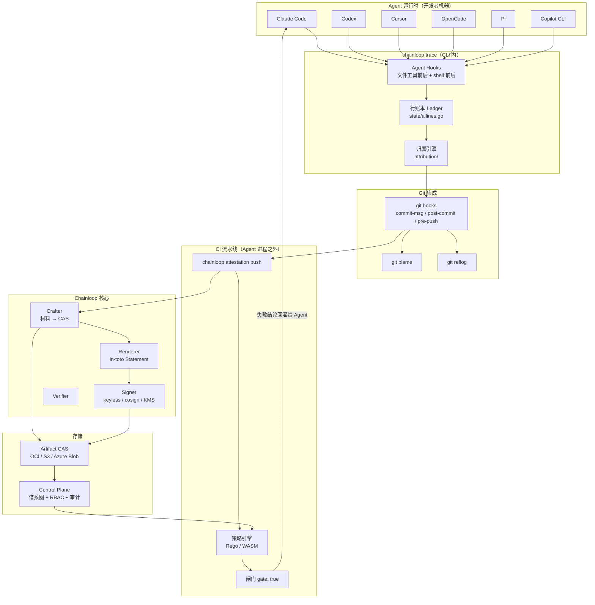
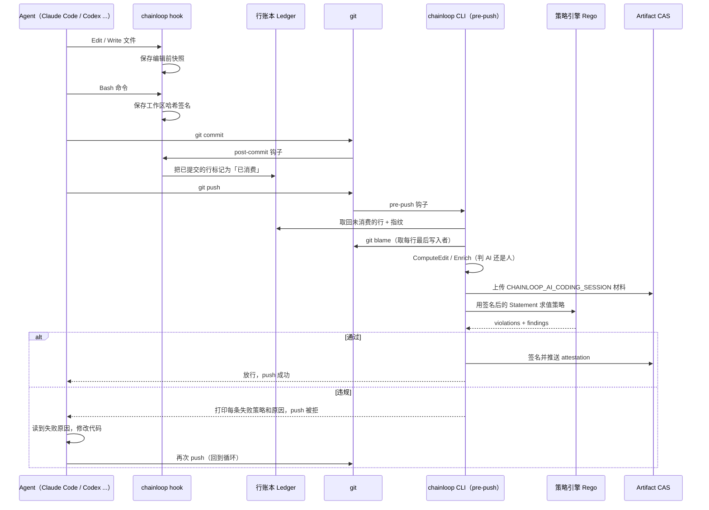

## 引子：一个没人愿意回答的问题

2026 年几乎每家工程团队都在用 Coding Agent。代码由 Claude Code、Codex、Cursor、OpenCode、Copilot 写出来，然后由人 review，然后合并。

然后问题来了：**这次提交里，哪几行是 AI 写的？**

这不是一个学术问题。它是三个真实问题的公共源头：

- 合规审计问「这个发布的二进制里，有多少代码是 AI 生成的？」
- 安全团队问「昨天那个 Agent 是不是把密钥写进了 prompt？」
- 工程经理问「我们付给模型的这些钱，换回了多少行代码？」

Chainloop 的答案是一个让很多人意外的架构选择：**不给 Agent 装一个「更强的 hook」，而是把 Agent 的整个会话变成一条供应链里的一等制品（artifact），用和 SBOM、SLSA provenance 完全相同的机制去签名、去验证、去阻断。**

> **Chainloop collects what happens across your software delivery, from the first prompt to the release, into one trusted graph. You define once what good means, as code, and Chainloop enforces it everywhere: every agent, every pipeline, every release.**
>
> —— 来自 `README.md` 开篇

这句话背后藏着一个我认为本系列迄今读到过的最完整的治理模型。它有四个层次：

1. **归因（Attribution）** —— 把 commit 里的每一行判给 AI 或人类；
2. **证据（Evidence）** —— 把整个 Agent 会话变成一条可签名的 in-toto 证明；
3. **判定（Policy）** —— 用 Rego/WASM 把「什么叫好」写成代码；
4. **闭环（Loop）** —— 判定的结论**回灌给 Agent**，Agent 改完再推，直到过闸。

第 4 点尤其关键。Chainloop 不是在 Agent 旁边放一个警察，而是把 Agent 放进一个**它自己也能读到的验证回路**里。

本文是本系列第 569 篇。前 568 篇里，我们写过 Agent 沙箱、Agent 策略引擎、Agent 取证、Agent 协议层、Agent 记忆交接……但**没有一篇讲过「把 Agent 会话本身变成供应链制品」**。这是第 18 个正交维度。

---

## 一、项目定位：它到底解决什么问题

| 项 | 值 |
|---|---|
| 仓库 | `chainloop-dev/chainloop` |
| Star | 617 |
| Fork | 67 |
| Open Issues | 45 |
| 主语言 | Go（`pkg/` 下 662 个文件） |
| License | Apache-2.0 |
| 创建 | 2023-03-06 |
| 最近推送 | 2026-11-24 |
| 官网 | https://docs.chainloop.dev |
| Topics | `agentic-sdlc` `ai-governance` `attestation` `in-toto` `slsa` `vex` `policy-as-code` `supply-chain-security` |

注意两个信号：

**第一，它是 Linux Foundation 旗下的项目**（README 有 LFX Health Score 徽章）。供应链安全领域的 LF 治理，通常意味着**有企业真的在生产环境跑它**，而不是一个「看起来很专业的 demo」。

**第二，它 2023 年就创建了，但把 Agent 会话追踪（`chainloop trace`）加进来是 2026 年的事**（`app/cli/internal/trace/` 下有 216 个文件）。这意味着：**它的 attestation / 供应链基础是三年生产验证的，而 Agent 追踪是新的**。这个区分很重要 —— 后文会看到，新加的部分反而是自陈缺陷最多的部分。

### 1.1 三个层次的职责

Chainloop OSS 有三个可部署组件：

| 组件 | 路径 | 职责 |
|---|---|---|
| **CLI** | `app/cli` | `chainloop attestation`（CI 里的通用证据）+ `chainloop trace`（Agent 会话追踪） |
| **Artifact CAS** | `app/artifact-cas` | 内容寻址证据存储，后端可选 OCI / S3 / Azure Blob / inline |
| **Control Plane** | `app/controlplane` | 可信图谱：org → project → workflow → run → attestation 的谱系，加上 RBAC、审计、集成插件 |

「Control Plane」在这里指的是**控制平面**，不是「控制 AI 行为的平面」—— 这两个词在 Agent 领域极易混淆，稍后会在对比一节里专门澄清。

### 1.2 它和「Agent 策略引擎」的根本区别

2026 年已经有 30+ 篇 Agent 安全/治理文章（`nono` 管沙箱、`hol-guard` 管制品准入、`cordum` / `aegis` 管 action firewall、Microsoft AGT 管 OS 内核级策略…）。

Chainloop 的信任边界**完全不同**：

| 维度 | Agent 运行时管控（如 cordum / AGT） | Chainloop |
|---|---|---|
| 拦截时机 | Agent 调用工具**的那一刻** | Agent **已经干完活之后**，在 `git push` / CI 阶段 |
| 位置 | 在 Agent 进程内 / 沙箱内 | 在 Agent **进程外**的 CI 流水线里 |
| 依据 | 动作序列、权限、风险分类 | **已签名的证据**（commit 内容 + 会话记录） |
| Agent 能否绕过 | 不能（拦截在数据路径上） | 不能（判定在流水线上，Agent 进程内没有开关） |
| 产出 | 拒绝 / 放行 | 一条**可交给审计方的签名记录** |

一句话：**前者是「阻止 Agent 做坏事」，后者是「证明 Agent 做了什么，以及这件事好不好」**。

而后者更难。因为前者可以简单地 `deny`，后者必须回答「这 500 行 diff 里，哪 300 行是 Agent 写的」这个模糊问题。

---

## 二、整体架构



### 2.1 一次完整的闭环



注意最后那个 `else` 分支：**违规结论不是写进日志就算完，而是直接变成 Agent 下一轮能读到的错误输出**。README 把这个模式叫作 verification loop：

> A human writes the intent once: a contract that says what a build must hand in, and policies that say what good means.
> An agent does the work and opens a pull request.
> The pipeline runs `chainloop attestation push`. Every policy runs on the signed record. The job prints each failing policy and why, and fails on a gated violation. On GitHub Actions the same report lands in the job summary.
> **The agent reads the failure, fixes the work, and pushes again. It loops until every gate passes. Every attempt, pass or fail, is a signed record.**

这是本系列见过的**最完整的 Agent 治理闭环**。之前写过的 `hunk`（审 diff）、`brain0`（取证漂移）、`cordum`（action firewall）都停在「观测」或「拦截」，只有 Chainloop 把「判定 → 回灌 → 再判定」接通了。

---

## 三、第一层难题：把「哪几行是 AI 写的」变成一个可计算的问题

这是整个项目技术含量最高、也最有借鉴价值的部分。

### 3.1 为什么不能用行号

最朴素的做法是：Agent 在第 100 行写入内容，就记录「行 100 是 AI 的」。但这个方案在真实场景下立刻崩溃：

- 提交前文件被格式化，行号全变；
- 多文件编辑交错，行号互相平移；
- `git rebase` / `squash` 之后行号毫无意义。

Chainloop 的解法是**按内容指纹记账，而不是按位置记账**。

```go
// 来自 app/cli/internal/trace/attribution/lines.go
// Fingerprint returns the content key of one line. Whitespace is dropped
// before hashing, so a line that a change only re-indented keeps its key, and
// with it its owner (D-008).
func Fingerprint(line string) string {
	stripped := strings.Map(func(r rune) rune {
		if unicode.IsSpace(r) {
			return -1
		}

		return r
	}, line)

	sum := sha256.Sum256([]byte(stripped))

	// 8 bytes keep the ledger small. A collision only matters between lines
	// of the same file, where it is negligible.
	return hex.EncodeToString(sum[:8])
}
```

三个设计细节值得逐字读：

1. **哈希前剥掉所有空白** —— 只改了缩进的行，归属不变（规则 D-008）。这条规则直接决定了「格式化会不会把 AI 归属洗成人类」。
2. **只取 8 字节** —— 注释明确写出取舍理由：碰撞只在同一文件的两行之间才有影响，那里概率可忽略。**这是「诚实的取舍」而不是「疏漏」**。
3. **不用行号** —— 行的身份 = 它的内容。所以提交、被 amend、被 rebase、被 squash，归属都还在。

### 3.2 三个账本

```go
// 来自 app/cli/internal/trace/state/ailines.go
// Written holds, for each file, the fingerprint of every line that the
// session's edits wrote. Push matches the lines of a commit against it.
Written map[string]LineCounts `json:"-"`

// Erased holds, for each file, the fingerprint of every line that the
// session's edits removed. Only these removals count as AI removals
// (R-005).
Erased map[string]LineCounts `json:"-"`

// Open holds, for each file, the lines that the session added or removed
// and that no commit took yet (R-006).
Open map[string]*OpenLines `json:"-"`
```

- **Written** —— Agent 写过的行（还没被 commit 认领）
- **Erased** —— Agent 删掉的行（只有这些删除才算「AI 删除」）
- **Open** —— Agent 加了但还没进任何 commit 的行

**Erased 这个账本的存在，是「AI 删除」和「人类删除」能被区分开的前提**。如果只知道 Agent 写了什么，你只能说「这行是新的」，但你分不清这行是 Agent 加的还是人类加的。

### 3.3 归属引擎：Enrich 的算法规范

`attribution/enrich.go` 的文件头注释就是完整的算法说明书 —— 这是我在工业级 Go 项目里见过的最规范的注释之一：

```go
// 来自 app/cli/internal/trace/attribution/enrich.go
// Enrich adds AI/human attribution to the code changes of a session.
//
// ledgers holds the AI line ledger of each session by ID. commits holds the
// session's commits, oldest first. Each line that a commit added is AI when its
// content matches a line that an edit of the session wrote (R-001), and each
// removed line is AI when an edit of the session removed it (R-005). Each
// ledger line matches one commit line at most.
//
// The session's own ledger is matched first. When it and another session of
// the commit both hold a line, the evidence of each session counts the line as
// its own: each evidence is the view of one session. A line that matches only
// another session of the commit counts for neither side: it is that session's
// work. All other lines are human.
```

拆开看，有三条关键规则：

**规则 1：账本行与 commit 行一对一匹配。**
`Each ledger line matches one commit line at most.` —— 防止一行代码被两个 commit 重复计数。实现上用一个「行池」：

> Each session's lines of a file are copied on first use and drawn down across the commits, so a line matches at most as often as the ledger holds it.

**规则 2：会话自己的账本优先匹配。**
> The session's own ledger is matched first.

**规则 3：只属于别的会话的行，两边都不算。**
> A line that matches only another session of the commit counts for neither side: it is that session's work.

规则 3 是个很克制的设计。假设 commit 里有 100 行，一行只被会话 B 写过，而会话 A 的账本里没有它 —— 那这行**既不算 A 的，也不算人类的**。宁可「漏算」，不要「错算到别人头上」。

### 3.4 净贡献（Net Contribution）：用 git blame 收尾

写过的行不等于留下的行。Agent 写了 100 行，后来被人改了 30 行，那净贡献是 70 行。

Chainloop 在 push 时用 `git blame` 找每一行的**最后写入者**：

> **Net contribution and line ranges, all agents:** the push finds the last writer of each line with `git blame`. A later commit that only re-indents a line takes the line, because blame sees a change.

注意后半句 —— **只改了缩进也会夺走行归属**。这是一个已知限制（下面「自陈缺陷」一节会再提），但也说明 blame 在这里被当作「事实来源」而非「启发式」使用。

### 3.5 Shell 命令的改动怎么算

Agent 不只会用 Edit 工具，还会跑 `sed -i`、`python -c` 重写文件。这些改动也得算 AI 的。

Chainloop 的做法是：**shell 前记录整个工作区的哈希签名，shell 后再记一次，做差。**

```go
// 来自 app/cli/internal/trace/attribution/shell.go
// ownCommitPrefixes are the reflog messages of a commit that git wrote from
// the index: "git commit", also with --amend, and the first commit of a
// branch. A merge commit ("commit (merge)") is left out because its content
// comes from the merged branch.
var ownCommitPrefixes = []string{"commit: ", "commit (amend): ", "commit (initial): "}
```

而真正精妙的是下面这段（出自 `app/cli/pkg/action/trace_agent_hook.go`）：

```go
// The signature holds hashes, not content, so the content before the command
// is not known. Two kinds of change stand in for what the command wrote:
//
//   - The commits that the command wrote itself (OwnCommits), each against the
//     HEAD it replaced, so an amend counts only what it added.
//   - The uncommitted lines: the worktree against the HEAD after the command.
//
// A command that moves HEAD to commits that it did not write, such as a
// rebase, a pull, a merge, a checkout or a reset, brings in their content.
// That content is in neither kind of change, so it is not claimed (PFM-8131).
// When the reflog cannot tell the commits of the command apart, none of them
// counts: missing lines are a smaller error than claiming upstream ones.
```

最后一句是全文最有价值的一句工程判断：

> **missing lines are a smaller error than claiming upstream ones.**
> （少算几行，比把别人的代码算成 Agent 的更糟。）

Agent 跑了个 `git pull`，拉进来 500 行别人的代码。如果不做区分，这 500 行全算 Agent 的 —— 归属直接失效。Chainloop 的选择是**这 500 行谁都不算**。

### 3.6 生成代码不算 AI 的

```go
// 来自 app/cli/internal/trace/attribution/generated.go
// FilterGenerated removes files matched by isGenerated from changes.Files
// and subtracts their contributions from the aggregate line and file-count
// totals, so generated code does not skew downstream AI/human attribution.
```

判定依据是 `.gitattributes` 里的 `linguist-generated=true`。这意味着：**protobuf 生成、ORM 迁移、lock 文件都不计入 Agent 的贡献**。

---

## 四、第二层：把会话变成签名证据

### 4.1 Provider 抽象：一个接口，六个 Agent

```go
// 说明：以下为源码节选，接口声明在此处截断，故花括号不成对。
// 来自 app/cli/internal/trace/provider.go
// Provider captures and parses AI coding sessions for a specific agent.
//
// Providers are stateless singletons from a registry, so the state-touching
// methods below take a *state.Store per call rather than holding one. The store
// already knows where trace state lives — the .git directory inside a
// repository, or the out-of-tree directory `chainloop trace run` picks outside
// one — so implementations never reason about that distinction.
type Provider interface {
```

这个接口有 21 个方法，分六组：身份、Hook 安装、Hook 输入、代码归属、会话数据、用户消息。

注册表只有一行：

```go
// 来自 app/cli/internal/trace/providers/registry.go
var all = []trace.Provider{
	claude.New(), cursor.New(), opencode.New(), pi.New(), codex.New(), copilot.New(),
}
```

**关键设计规则**写在 `PROVIDERS.md` 里：

> The handlers are in `app/cli/pkg/action/trace_agent_hook.go` … **They are the same for all providers. A provider gives only the agent-specific parts.**

也就是说：**所有业务逻辑在共享的 handler 里，provider 只提供「这个 Agent 的特有部分」**。加一个新 Agent 不用碰核心逻辑。

还有三条可选接口（通过类型断言发现）：

```go
// 来自 app/cli/internal/trace/provider.go
// SkillTracker is implemented by a provider that records the skills that a
// session used. A provider without it records no skills, and for its sessions
// no skill entry means "not recorded", not "no skill used".
type SkillTracker interface { ... }
```

注意这句：**「没记录」不等于「没用」**。这是本系列反复出现的诚实性模式 —— 把「未知」和「否」区分开。

### 4.2 Hook 安装：每个 Agent 一个入口

| Agent | Hook 文件 | 覆盖的 Hook |
|---|---|---|
| Claude Code | `.claude/settings.json` | 会话开始/结束、用户 prompt、每个文件工具与 shell 工具前后、Skill 工具 |
| Cursor | `.cursor/hooks.json` | 会话开始/结束、`afterFileEdit`、Shell 工具的 `preToolUse`/`postToolUse` |
| Codex | `.codex/hooks.json` | `SessionStart`、`SessionEnd`、`UserPromptSubmit`、`Bash` 和 `apply_patch` 的 `PreToolUse`/`PostToolUse` |
| OpenCode | `.opencode/plugins/chainloop-trace.ts` | 会话开始/结束、用户 prompt、每个工具前后（1.x 用 `server()`，2.x 用 `setup()`） |
| Copilot | `.github/hooks/chainloop-trace.json` | `sessionStart`、`sessionEnd`、`preToolUse`/`postToolUse` |
| Pi | `.pi/extensions/chainloop-trace.ts` | 会话开始与特定关闭原因、会话树变更、每个用户 prompt、`write`/`edit`/`bash` 工具前后 |

Claude Code 的工具分类是单一事实来源：

```go
// 来自 app/cli/internal/trace/claude/hooks.go
// fileWritingTools is the single source of truth for Claude tool names that modify files.
var fileWritingTools = []string{"Edit", "Write", "MultiEdit"}

// commandTools are Claude tool names that run shell commands. They can create
// and modify arbitrary files, so their changes are captured via a before/after
// working-tree snapshot rather than a per-file snapshot.
var commandTools = []string{"Bash"}
```

TypeScript 插件版本（OpenCode / Pi）的工具列表是**从同一份 Go 切片注入的**，注释写明了原因：

> so the plugin and `IsFileWritingTool`/`IsCommandTool` cannot drift.

### 4.3 一条最重要的 Hook 纪律

> **Each hook must never block the agent.** A handler that cannot read its input, or that cannot find the trace state, writes a debug log and returns `nil`.

**Hook 永远不能阻塞 Agent。** 这是整个 trace 子系统能安全地装进用户开发流程的前提 —— 如果 Chainloop 的追踪挂了，开发者最不能接受的是 Agent 也跟着卡住。

配套的降级机制：

```go
// GuardHookCommand wraps an agent hook command so that a repository with the
// hooks installed keeps working when the chainloop CLI is not on PATH: the
// hook exits 0 instead of failing with "command not found" (127).
```

如果 `chainloop` 没装在 PATH 上，hook 退出 0 而不是报错 127。**装了就必须能用，不装也不能搞坏别人的仓库。**

### 4.4 从会话到 Attestation

1. `commit-msg` 写入 `Chainloop-Trace-Sessions` trailer；
2. `post-commit` 保存 `CommitRecord`，调用 `MarkCommitted` 把待消费的行结算掉；
3. `pre-push` → `RunTracePush` → `gatherPushSessions` → `buildSessionEvidence`；
4. 证据作为材料类型 **`CHAINLOOP_AI_CODING_SESSION`** 加入 attestation。

材料名形如 `ai-coding-session-<前 6 位 hash>`。证据载荷 `aicodingsession.Data` 的字段：

```
agent, session, spec, git_context, code_changes, model, usage,
tools_used, conversation, subagents, raw_session, warnings
```

**spec（规格）和 skill（技能）的材料会先加入**，这样会话材料才能记录它们的摘要值 —— 也就是「Agent 依据什么工作」和「Agent 产出了什么」被绑在同一条签名记录里。

⚠️ 本地模式写的是**未签名的** `statement.json`，源码注释明确说：

> It has no envelope and no signature, so it is not an attestation (R-006).

**本地模式不是 attestation。** 这个区分做得很干净 —— 不签名的记录不会被误当成合规证据。

### 4.5 Attestation 的谓词类型：不是 SLSA

```go
// 来自 pkg/attestation/renderer/chainloop/v02.go
// Replace custom material type with https://github.com/in-toto/attestation/blob/main/spec/v1.0/resource_descriptor.md
const PredicateTypeV02 = "chainloop.dev/attestation/v0.2"
```

Chainloop **没有**用 SLSA v1.0 的谓词类型，而是定义了自己的 `chainloop.dev/attestation/v0.2`。这带来一个诚实的取舍：

- **好处**：可以自由扩展（多了 `policyHasViolations`、`policyViolationsCount`、`policyCheckBlockingStrategy`、`signingCA`、`signingTSA` 等一堆策略状态字段）；
- **代价**：与标准 SLSA 工具链的直接兼容性打了折扣。

Predicate 里携带的策略状态字段（部分）：

```
policyHasViolations, policyEvaluationsCount, policyViolationsCount,
policySkippedCount, policyPassedCount, policySuppressedCount,
policyHasGatedViolations, policyHasGates,
policyCheckBlockingStrategy (ENFORCED / ADVISORY),
policyBlockBypassEnabled, policyAttBlocked,
signingCA, signingTSA
```

`policyBlockBypassEnabled` 和 `policyAttBlocked` 尤其值得注意 —— **绕过行为本身会被签进证据里**。

### 4.6 签名：私钥永不离开 CLI

三种签名后端：

- **keyless**（默认）—— 通过 Control Plane 的 CA，ECDSA P-256 密钥**在 CLI 本地生成**，CSR 发给 `SigningService.GenerateSigningCert`，**私钥永不上传**；
- **cosign** 本地密钥；
- **远程 SignServer**（支持 EJBCA、Keyfactor）。

### 4.7 验证：fail-closed

```go
// 来自 pkg/attestation/verifier/verifier.go
// Signature verification is MANDATORY
```

验证流程：按 AKI 查信任根链 → `cosign.ValidateAndUnpackCertWithChain` → DSSE 验证 → 可选的 org pinning → 时间戳验证。

### 4.8 环境变量脱敏

```go
// 来自 pkg/attestation/envredaction/envredaction.go
const RedactedValue = "[REDACTED]"
```

三种模式：`none` / `known-identity` / `custom`。**保留键名，替换值** —— 这样审计方还能知道「环境里有过 AWS_SECRET_ACCESS_KEY」，但看不到内容。列表由 Control Plane 从组织设置里解析，**push 时服务端再查一次**。

### 4.9 网络出口防护（一个容易被忽视的细节）

Rego 策略里可以调 `http.send` 发外部请求 —— 这显然是个 SSRF 风险面。Chainloop 用一个专门的包挡：

```go
// 说明：以下为源码节选，函数体在此处截断，故花括号不成对。
// 来自 pkg/netguard/netguard.go
// Package netguard restricts outbound HTTP connections to publicly routable
// destinations.

// RestrictTransport makes t connect to publicly routable destinations only:
// loopback, private ranges, link-local addresses (where cloud metadata
// services live) and the IPv6 transition ranges that embed an IPv4 address are
// all refused with ErrBlockedTarget.
//
// It also drops any proxy, which would otherwise be the only address the
// transport connects to and would leave the destination unchecked.
//
// t is modified in place and returned. A nil t starts from a clone of
// http.DefaultTransport.
func RestrictTransport(t *http.Transport) *http.Transport {
```

三处细节值得抄：

1. **link-local 段被明确点名**（`where cloud metadata services live`）—— 169.254.169.254 是云厂商的元数据服务，是 SSRF 打凭证的经典目标；
2. **丢弃代理** —— 否则 transport 连的是代理地址，目标根本没被检查；
3. **TLS dialer 也被丢掉**：

```go
	// The transport's own dialer is replaced rather than wrapped, since it may
	// ignore the address it is given and connect somewhere else entirely. Its
	// TLS dialers are dropped too: net/http prefers them over DialContext for
	// https requests, so they would bypass the check.
	t.DialContext = PublicOnlyDialContext(net.DefaultResolver.LookupIPAddr, dialer.DialContext)
	t.DialTLSContext = nil
	t.DialTLS = nil
```

**注释明说了「不是包裹而是替换」的原因** —— 包裹一个可能无视地址的 dialer 等于没检查。

不过有个重要限制：**这个防护默认是关的**：

```go
// 来自 pkg/policies/engine/engine.go
// PublicTargetsOnly refuses rego http.send requests to destinations that
// are not publicly routable, even when their host is allowed. See
// WithPublicTargetsOnly.
PublicTargetsOnly bool
```

而 WASM 引擎根本不支持这个开关。

---

## 五、第三层：策略即代码

### 5.1 Contract / Material / Policy 三个概念

这是 Chainloop 的核心心智模型，也是最容易搞混的地方：

| 概念 | 是什么 | 谁来判 |
|---|---|---|
| **Material**（材料） | 构建产出的证据，有类型（`SBOM_CYCLONEDX_JSON`、`CONTAINER_IMAGE`、`ARTIFACT`…） | kind 匹配的策略看它的原始内容 |
| **Contract**（契约） | **要求**：必须有哪些材料、哪些策略适用、策略参数是什么。版本化，**在 `init` 时被钉死** | Control Plane 在 push 时校验**材料是否存在** |
| **Policy**（策略） | **规则**：一个 Rego/WASM 模块。挂在 `policies.attestation:`（声明范围）或 `policies.materials:` + `kind:`（材料范围） | CLI 在 add/push 时执行；Control Plane **信任**结果 |

一个 Contract 长这样：

```yaml
# 来自 docs/examples/policies/quickstart/cdx-fresh.yaml
apiVersion: chainloop.dev/v1
kind: Contract
metadata:
  name: build
spec:
  materials:
    - name: image
      type: CONTAINER_IMAGE
    - name: sbom
      type: SBOM_CYCLONEDX_JSON
  runner:
    type: GITHUB_ACTION
  policies:
    materials:
      - ref: https://raw.githubusercontent.com/chainloop-dev/chainloop/main/docs/examples/policies/sbom/cyclonedx-licenses.yaml
        gate: true
```

`gate: true` 意味着**阻断**；`gate: false` 只报告。这就是 README 说的「先 report-only，再 gate」的渐进式落地路径。

### 5.2 策略就是几行 Rego

```rego
# 来自 README.md
violations contains msg if {
	has_errors
	msg := "There are errors in the SARIF report"
}

has_errors if {
	some run in input.runs
	some result in run.results
	result.level == "error"
}
```

### 5.3 策略附件的三条匹配规则

```go
// 来自 pkg/policies/policies.go
// 2. if attachment has a name filter, return the policy only if the material has the same name
// 3. if policy spec doesn't have a type, a name filter is mandatory (otherwise there is no way to know if material has to be applied)
```

第 3 条是一条**设计上的自我约束**：如果一条策略不声明作用类型，那它必须至少声明作用材料名 —— 否则根本无从判断该把它套到哪个材料上。

### 5.4 两种求值模式

- **`VerifyMaterial`** —— 策略看到的 `input` 是**原始产物 JSON**（外加 `input.elements`、`input.chainloop_metadata`、`input.args`）；
- **`VerifyStatement`** —— 策略看到的 `input` 是**整个 in-toto Statement**。

前者用于「SBOM 里不许有 XX 许可证」，后者用于「这个 attestation 的构建器必须是可信的」。

### 5.5 Finding 模型

策略除了返回 `violations`，还可以返回结构化的 **finding**。若策略 metadata 声明了 `finding_type`（`VULNERABILITY` / `SAST` / `LICENSE_VIOLATION`），finding 对象会通过 protovalidate 按 schema 校验并存储。

### 5.6 策略引擎的沙箱

Restrictive 模式会：

- 剥掉 `opa.runtime`、`rego.parse_module`、`trace` 和所有标了 `non-restrictive` 的 builtin；
- 把 `capabilities.AllowNet` 限制成白名单；
- 打开 `StrictBuiltinErrors`。

Permissive 模式则**启用所有 builtin，不限制网络**。

WASM 引擎走 Extism（WASI 开启，`Execute` 导出，默认 5 秒超时）。

### 5.7 策略可以本地开发测试

```bash
chainloop policy develop init --name sbom-licenses   # creates sbom-licenses.yaml and sbom-licenses.rego
chainloop policy develop lint --policy sbom-licenses.yaml
chainloop policy develop eval --policy sbom-licenses.yaml --material sbom.json --kind SBOM_CYCLONEDX_JSON
```

**策略在成为闸门之前就能本地跑** —— 这对「规则即代码」至关重要，因为策略本身也是代码，也需要 CI。

---

## 六、⭐⭐⭐ 必须诚实指出的源码自陈缺陷

这一节是本系列的传统。本项目自陈缺陷的数量和诚实度，在 2026 年的 Agent 项目里属于第一梯队。

### 6.1 归属引擎的自我限制

```go
// 来自 app/cli/internal/trace/attribution/edits.go
// Best-effort and inherently ambiguous when new_string is not unique in the
// current content: bytes.Index always picks the first occurrence, which can be
// the wrong one if the same literal appears more than once. … callers should
// treat the reconstructed bytes as a hint, not ground truth.
```

**Cursor 只有 `afterFileEdit` 钩子**，没有编辑前的快照，所以只能反向重建旧内容。重建本身有歧义 —— 源码直接说「只能当提示，不能当事实」。

```go
// 来自 app/cli/internal/trace/attribution/enrich.go
// A command that writes one more copy of an open line loses that copy too;
// the ledger cannot tell the two apart.
```

如果一条命令复制了一份已有的 open 行，账本分不清哪份是新写的。

```go
// 来自 app/cli/internal/trace/git/git.go
// Implementations must return a no-op matcher (always false) when attributes
// can't be read — filtering is best-effort and must not block attribution.
```

`.gitattributes` 读不到时，生成代码过滤器退化成「什么都不算」—— 而不是报错。

### 6.2 「活跃」不是可靠的存活性信号

```go
// 来自 app/cli/pkg/action/trace_agent_hook.go
// Active is not a reliable liveness signal on its own and must not decide
// attribution: session-end is not installed for `trace run`, and never fires on
// SIGKILL or a closed terminal.
```

### 6.3 完整的「Why not Yes」清单

`app/cli/internal/trace/README.md` 里有一整节叫 **"Why not Yes"** —— 逐条解释能力矩阵里每一个不是 Yes 的格子。这是我在本系列里见过的**最诚实的文档实践**。

挑几条最关键的：

**同一调用内的 commit 归属**（Claude Code 独有）
> supported for foreground Bash calls that use the repository's normal index. Temporary indexes such as `GIT_INDEX_FILE` and `git commit --only` are tracked in issue 3698. Worktree content is compared with the staged blob as raw bytes; Git attributes, line-ending normalization and clean filters are tracked in issue 3699. Background calls, competing input-rewriting hooks, narrow permissions and other providers are tracked in issue 3701.

**其余 Agent 完全不支持**
> **Same-call commit attribution, Cursor, OpenCode, Pi, Codex and Copilot:** these providers do not tag a shell command with the per-call token that git hooks use to load its open snapshot.

**子 Agent 轨迹**
> **Subagents, Pi/Codex/Cursor/Copilot/OpenCode:** … Child session transcripts are not collected.

**Token 账目**
> **Token usage and cost, Cursor:** The Cursor transcript does not hold token usage. Usage and cost are zero, and the evidence has a warning that tells so.

> **Cache token accounting, Claude Code and Codex:** … Claude's source comparison also sums repeated assistant records; it does not establish that those records are unique. … Claude deduplication remains a gap.

**格式不稳定**
> Trace reads rollouts from `$CODEX_HOME/sessions` … **Their JSONL format is not a stable Codex interface.**
> Its format is not a stable Copilot interface.

**一个仓库里多个 Agent**
> **More than one agent in one repository, all agents:** not verified yet.

**Pi 的硬限制**
> Pi must save a session, so `--no-session` cannot produce session evidence.
> Subagents, spec source pointers and pasted image pointers are not implemented.

**重命名会丢归属**
> **Renames and rewrites, all agents:** this works only in the clone where the work happened. Git finds a rename only when the file keeps at least half of its content. … A rename inside an amend or a squash of the session commit loses the AI lines: the new commit creates the file under its new name, so no line of it matches the trace state (issue 3686).

**会话更新**
> **Session updates, all agents:** the update works only in the clone where the work happened, while the CLI keeps the trace state of the session (30 days) … After the commits of a session are pushed to that branch, a later commit does not update the session.

### 6.4 签名 ≠ 合规

这是全项目最重要的一句自陈：

```go
// 来自 app/controlplane/pkg/biz/workflowrun.go
// The CLI runs the same check before pushing, but it signs the bundle with the
// same client that decided whether to run it, so a valid signature says nothing
// about contract compliance. The control plane is the authority here.
```

**签名只证明「这份记录没被篡改」，不证明「这份记录合规」。** 合规判定权在 Control Plane。

但这个权威有个裂缝：Control Plane 的 `validateAgainstContract` 只调用 `ValidateMaterialsPresence` —— **策略结果不会在服务端重跑一遍**。也就是说，服务端信任 CLI 报上来的策略结论。

### 6.5 已记录的「假通过」（false pass）

两个非常具体的假通过场景：

- **ATT-005**：一个非 JSON / 已损坏的 `ARTIFACT` 会被求值成 `{}`；一条没有声明 finding 的策略会**带着空消息通过**。
- **radamsa**：如果把 zip / tar.gz 字节喂给引擎，它解析不出任何记录，于是**门禁跳过** —— 一次看起来很干净的假通过。

### 6.6 签名路径上的 fail-open

- keyless 关闭时 → 跳过验证；
- 收到旧格式的 attestation（非 bundle）→ `// received an old attestation format, not a bundle: attestation verification skipped`；
- TSA 信任配置故障时 → 接受。

另外：

- `// Public-key bundles are not supported at this time`
- `// NOTE: It currently only supports cosign key based signing.`
- `// Store generated cert, ignoring the chain`
- `IgnoreSCT: true` —— 关掉了 SCT 校验
- WASM 引擎不支持 `PublicTargetsOnly`，**而且这个开关默认是关的**

### 6.7 一个讽刺

项目自己仓库里发布的示例策略就有 bug：

```rego
ref := sprintf("Forbidden license %v for %v (%v)", [license.name, ...])
```

`license.name` 未定义。还有：

```rego
# TODO: update to validate if the file is expected
valid_input := true
```

`valid_input` 直接写死为 true。

### 6.8 审计覆盖不全

> **No audit events for policies or attestation stores**（审计器只覆盖 token / org / project / workflow / contract / CAS）

---

## 七、与其他同类项目的设计差异

### 7.1 三方对比

| 维度 | Chainloop | cordum（Action Firewall） | brain0（漂移检测取证） | hol-guard（制品准入） |
|---|---|---|---|---|
| **拦截/判定时机** | 干完活之后（push / CI） | 调用工具的那一刻 | 事后对账 | 进入运行时之前 |
| **管理单元** | **一条签名记录 + 一行代码的归属** | 一个 action | 一条决策图节点 | 一个制品 |
| **判据来源** | 签名证据 + git blame | 动作序列 / 策略哈希 | 声明 vs 观测的差异 | 扫描结果 + 信任评分 |
| **Agent 能否绕过** | 不能（判定在 Agent 进程外） | 不能 | 不适用（观测者） | 不适用 |
| **产出** | **可交付审计方的签名记录** | 拒绝 / 放行 | 双风险分数 | AI-BoM + 决策轨迹 |
| **失败会怎样** | 结论回灌给 Agent，Agent 改完再推 | 动作被拒 | 漂移被标记 | 制品被拦 |

### 7.2 与 Agent 观测性项目（Logfire / Langfuse / RagaAI）的差异

前面写过 Logfire（2026-06-21）、Opik（2026-06-22）、Langfuse（2026-06-30）三篇可观测性。

它们和 Chainloop 的差异**不在数据形态，而在目的**：

- 观测性项目回答「这次调用花了多少 token、慢在哪、报了什么错」→ 输出是**仪表盘**；
- Chainloop 回答「这次产出是否符合我事先写下的规则」→ 输出是**阻断结论 + 签名证据**。

Chainloop 确实也收集 token 和成本（`usage` 字段、`pricing.json`），但那不是目的，是副产品。**观测性项目的产物被消费；Chainloop 的产物被签署。**

### 7.3 与 in-toto / SLSA 生态的关系

Chainloop **不是** in-toto 的替代品，它是 in-toto 的一个**使用者 + 扩展者**：

- 用 DSSE 信封 + in-toto v1 Statement；
- 用 Sigstore 的 keyless 签名；
- 支持 SLSA provenance 作为材料类型之一；
- 但自定义了谓词类型 `chainloop.dev/attestation/v0.2`。

**换句话说**：如果你的组织已经有一套 SLSA 流水线，Chainloop 的增量价值在「把 Agent 会话塞进同一条证据链」，而不是替换整套。

---

## 八、优缺点分析

### 8.1 优点侧

| 维度 | 评价 |
|---|---|
| **架构简洁性** | ⭐⭐⭐⭐⭐ Provider 只提供 Agent 特有点，handler 全局共享；21 个方法的接口边界清晰（身份 / Hook / 输入 / 归属 / 解析 / 消息 六组） |
| **扩展性** | ⭐⭐⭐⭐⭐ 加一个新 Agent = 一个 provider 包 + 一行注册；加新策略类型 = 一个 Rego/WASM 模块；加新材料类型 = 一个枚举值 + 一个 renderer |
| **易用性** | ⭐⭐⭐⭐ `chainloop trace init` 一条命令装好全部 hook；`trace uninstall` 只删自己的 hook；策略能 `policy develop eval` 本地跑 |
| **可审计性** | ⭐⭐⭐⭐⭐ 签名证据 + 逐行归属 + 30 多处自陈缺陷 —— 这是本系列的最高分 |

### 8.2 缺点侧

| 维度 | 评价 |
|---|---|
| **性能 / 开销** | ⭐⭐⭐ Hook 每次文件编辑前后各存一次快照；shell 前后各扫一次整个工作区。仓库大的时候这个开销不小 —— README 承认「Tracked files below ignored directories can be omitted from the snapshot (issue 3700)」，说明这个成本是真实存在的 |
| **复杂度** | ⭐⭐ 概念多：Contract / Material / Policy / Finding / Attestation / Predicate / Trace State / Ledger / Snapshot / Reflog… 新人上手曲线陡 |
| **维护性** | ⭐⭐ Agent 的 hook 协议和转录格式**都是上游不稳定的**：「Their JSONL format is not a stable Codex interface」「Its format is not a stable Copilot interface」—— 上游一改就得跟着改 |
| **生态锁定** | ⭐⭐⭐ 默认发往 Chainloop Cloud（`auth login`），自托管需要 Docker Compose 或 Helm |
| **权威边界** | ⭐⭐⭐ 策略结果不在服务端重跑，签名也不代表合规（源码自己这么说） |

### 8.3 一句话总结

> **把「Agent 干了什么」变成「可验证的供应链制品」，这个思路正确且实现扎实；但它建立在一个持续变化的第三方生态（各 Agent 的 hook 协议和转录格式）之上，维护成本是这个架构的固有代价 —— 而不是实现质量问题。**

---

## 九、实践：60 秒上手

### 9.1 安装

```bash
curl -sfL https://dl.chainloop.dev/cli/install.sh | bash -s -- --oss
chainloop auth login        # opens a browser. First login creates your account and organization
```

自托管免费且无限量；CLI 默认发送匿名使用统计，`DO_NOT_TRACK=1` 可关。

### 9.2 追踪 AI 编程会话

```bash
chainloop trace init        # installs the git and agent hooks, writes .chainloop.yml
```

`trace init` 会写 `.chainloop.yml` 以及 git hooks（`pre-push`、`post-commit`、`commit-msg`、`post-rewrite`）。`trace uninstall` 移除它们。

**会话数据留在本机直到 `git push`，CLI 在上传前会脱敏密钥。**

Codex 需要单独初始化：

```bash
chainloop trace init --codex
```

> Review and trust the installed hooks in Codex before starting work.

信任模型值得注意：Pi 有自己的信任流程 ——

> Interactive Pi asks before loading project-local files. A non-interactive run needs saved trust or `--approve`; **Chainloop does not bypass this check.**

### 9.3 让 push 必须带会话

在 `.chainloop.yml` 里加 `requireTrace: true`，hook 就会拒绝没有会话记录的 push。

### 9.4 在 CI 里收集通用证据

```bash
chainloop attestation init --workflow build --project my-app
chainloop attestation add --value sbom.cyclonedx.json
chainloop attestation push   # prints a link to the attestation
```

`chainloop attestation status` 显示契约还缺什么。

### 9.5 本地模式：不联网也能跑

`chainloop trace run --local -- <agent command>` 给 Agent 临时装上 hook，命令退出后配置恢复原样。**本地模式产出的是未签名的 `statement.json`，不是 attestation。**

---

## 十、趋势判断

### 10.1 「Agent 会话」正在变成一种新的制品类型

传统供应链的制品是**二进制**。现在多了一类：

| 制品类型 | 记录什么 | Chainloop 的材料类型 |
|---|---|---|
| 二进制 | 代码 | `CONTAINER_IMAGE` / `ARTIFACT` |
| 成分清单 | 依赖 | `SBOM_CYCLONEDX_JSON` / `SBOM_SPDX_JSON` |
| 漏洞状态 | 已知漏洞 | `VEX_*` / `SARIF` |
| **Agent 会话** | **谁、用什么模型、依据什么规格、写了哪些行** | **`CHAINLOOP_AI_CODING_SESSION`** |

**第四类是新的。** 而且它携带的信息量超过前三类之和：SBOM 说「里面有什么依赖」，Agent 会话说「**这份代码是怎么来的、哪几行是机器写的、依据的是哪份批准过的规格**」。

### 10.2 「逐行归属」会成为合规基线

欧盟 AI Act 的透明度义务、CRA（Cyber Resilience Act）的漏洞通报义务、DORA 的运营韧性要求，都在往「你得说得清这段代码的来源」这个方向压。

Chainloop 目前的实现是**基于内容指纹的启发式**，有明确的已知缺口（blame 夺权、rename 丢失、shell 归属不精确）。但**方向是对的**：比「这个 PR 里有多少比例是 AI 生成的」这种计数，line-level 归属是更可辩护的证据。

### 10.3 闭环验证会打败单向拦截

现在绝大多数 Agent 治理方案是单向的：拦一下，记个日志。

Chainloop 的回路是：**判定 → 回灌 → Agent 自行修复 → 再判定**。这个模式的力量在于它**复用了 Agent 本身的能力**（修代码）来满足规则，同时把「谁来判定」固定在 Agent 进程之外。

这本质上是一个**把 Agent 当作规则执行器、把 CI 当作裁判**的架构。它的直接推论是：**策略必须是确定性的**。README 说得很直白：

> Deterministic. Policies are Rego or WASM in git, run by the CLI, not by a model. The same input gives the same answer every time.

**用模型判模型写的代码，等于没有判。**

### 10.4 供应链安全的成熟经验正在回流到 Agent 领域

in-toto / Sigstore / SLSA / OPA 这套栈成熟于 2019-2023 年的云原生供应链，现在被完整搬到 Agent 领域：

- DSSE 信封 → 证明会话证据没被改；
- keyless 签名 → 不分发私钥就能有身份；
- Rego 策略 → 规则可测试、可版本化；
- 契约 → 「这次构建必须交出什么」的声明式接口。

**这就是为什么本项目值得写** —— 它不是「又一个 Agent 框架」，而是**把成熟的供应链安全范式完整移植到一个新载体上的样板**。任何要写「Agent 证据」「Agent 合规」的人，都该读一遍它的 `trace/README.md`。

---

## 十一、可复用的工程经验

从 Chainloop 里能直接搬走的六条：

1. **按内容指纹记账，不要按位置记账。**
   哈希前剥掉空白（缩进变化不改归属）；位置记账在格式化、rebase、squash 面前必崩。

2. **「少算」优于「错算」。**
   `missing lines are a smaller error than claiming upstream ones.` —— Agent 跑了 `git pull` 拉进来的代码，宁可不算，也不能算成 Agent 的。

3. **Hook 永远不能阻塞宿主。**
   `Each hook must never block the agent.` + `guard hook command` 降级到 exit 0。装了就必须能用，不装也不能搞坏别人的仓库。

4. **区分「没记录」和「否」。**
   `no skill entry means "not recorded", not "no skill used".` 「未知」不是一个可选的否定状态。

5. **区分「签名」和「合规」。**
   `a valid signature says nothing about contract compliance.` 签名证明完整性，合规需要独立判定者。

6. **「未实现」要写成矩阵里的一个格子，而不是文档里的一句免责声明。**
   Chainloop 的 "Why not Yes" 清单把每个降级都编号、给出 issue 链接、说明原因。**这是本系列见过最值得抄的文档实践。**

---

## 十二、总结

Chainloop 做的事情，用一句话概括：

> **它把「AI 写了哪些代码」这个问题，从一个说不清的直觉，变成了一个可以用 SHA-256 指纹、`git blame` 和 `git reflog` 回答的工程问题；再把答案签成一份第三方可验证的证据；最后让这份证据驱动一个 Agent 自己也读得到的闸门。**

它的三个设计选择最值得记住：

- **归属用内容指纹，不用行号**；
- **判定在 Agent 进程之外，用确定性策略，不用模型**；
- **失败结论回灌给 Agent，形成闭环**。

它也有三个必须承认的短板：

- **策略结果不在服务端重跑**，签名不等于合规；
- **依赖上游不稳定的 hook 协议和转录格式**，维护成本高；
- **归属本身是启发式的**，blame 夺权、rename 丢失、shell 归属不精确都有已知缺口。

但把话说回来：**一个把自己做不到的事写进 README 的 "Why not Yes" 清单、并给出 issue 编号的项目，比一个声称什么都能做的项目更值得信任。**

而且说实话 —— 在这个领域里，「先承认自己做不到什么」本身就是一项稀缺的能力。

---

## 附录：关键资源

| 资源 | 地址 |
|---|---|
| 仓库 | https://github.com/chainloop-dev/chainloop |
| 文档站 | https://docs.chainloop.dev |
| AI Sessions 快速开始 | https://docs.chainloop.dev/ai-sessions |
| Agent 支持矩阵 | `app/cli/internal/trace/README.md`（仓库内） |
| Provider 编写指南 | `app/cli/internal/trace/PROVIDERS.md`（仓库内） |
| 示例策略 | `docs/examples/policies/`（仓库内） |
| 示例契约 | `docs/examples/contracts/`（仓库内） |
| 平台 | https://chainloop.dev |
| License | Apache-2.0 |
| 社区 | Chainloop Slack（README 顶部有邀请链接） |
