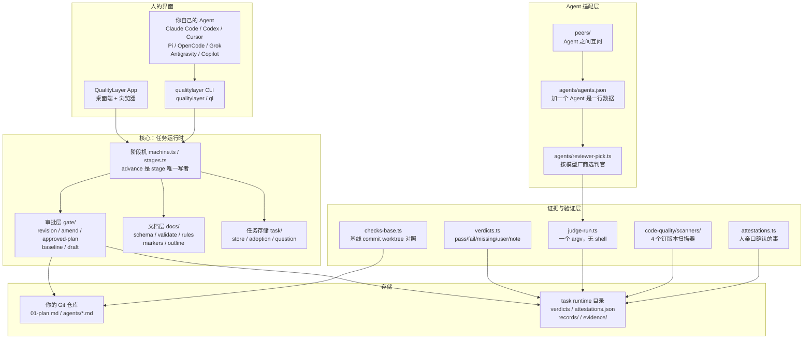
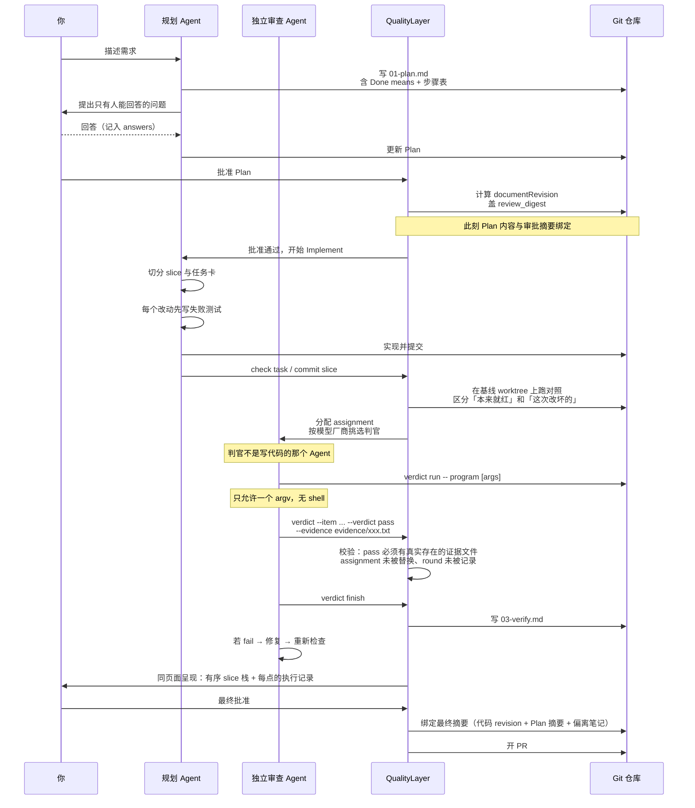

## 引子：Agent 写代码卡在哪一步？

过去两年，AI 编码 Agent 的能力曲线一路向上。Claude Code、Codex、Cursor 这些工具已经能读懂整个仓库、写出成百上千行代码、跑通测试、提交 PR。

但真正把 Agent 塞进团队工作流之后，工程师们很快撞到了另一堵墙——**不是「它写不出来」，而是「我不敢让它写」**。

具体表现为三个反复出现的痛点：

**第一，我不知道它到底打算干什么。** Agent 在终端里黑盒式地跑了 20 分钟，改了 14 个文件，我只能在最后看一个巨大的 diff。要么全盘接受，要么全盘拒绝——这跟 2005 年直接接受别人提交的代码没有本质区别。

**第二，它说自己做完了，我不确信。** Agent 在对话里汇报「已完成，测试全部通过」。但这是**它自己的说法**。让写代码的那个 Agent 顺手检查一下自己的代码，等于让学生自己批自己的卷子。

**第三，需求本身在过程中被悄悄改了。** 三个月后回看，交付的东西和当初批准的那份根本不是一回事，但没人说得清是哪一步偏的。

这三个问题指向同一个结构：**如果「人批准的东西」和「Agent 实际做的东西」之间没有一份可核对的绑定关系，那么再多的人机协作流程都只是在制造一种「感觉有人把关了」的错觉。**

最近在 GitHub 上注意到一个项目——**QualityLayer**（`maxritter/qualitylayer`）——它的做法和市面上大多数「AI 编码工作流」不太一样。它不提供更强的模型，也不提供更聪明的提示词技巧，它做的是一件听起来很朴素、实际上很难的事：

> **把「计划」「实现」「验证」这三段，各自变成一份提交进你 Git 仓库里的 Markdown 文件。每一份文件都配一个内容摘要（digest）作为审批凭证——文件内容一变，审批自动失效。验证这一步由一个「按模型厂商挑选、且没写过这份代码」的独立 Agent 来执行。**

更特别的是，这个项目的源码注释里**大量主动记录自己的边界与缺陷**。比如它自己写着「独立审查是一个**设置**，不是保证」，「设计检查**只跑一次**」，「判官输出被截断到 256 KiB」，「公开仓库里有 100 多个源文件是加密的，**核心构建所需输入被有意缺失**」。

这正是我最喜欢的那类项目——**能挖出别人踩过的坑**。

这篇文章会带你拆开它的核心机制，也会诚实地告诉你：**它不是开源软件**，以及它的哪些设计可以借鉴、哪些不能。

---

## 一、项目定位与核心价值

### 1.1 它到底是什么

| 项 | 值 |
|---|---|
| 仓库 | `maxritter/qualitylayer` |
| Star | ⭐ 2,170 |
| Fork | 181 |
| 主语言 | TypeScript |
| 许可 | **QUALITYLAYER COMMERCIAL SOURCE-AVAILABLE LICENCE**（商业源码可见，**非 OSI 开源**） |
| 创建 | 2025-10-18 |
| 最近推送 | 2026-11-27 |
| 仓库规模 | 9,781 个 tree 节点 |
| 官网 | https://qualitylayer.dev |
| Topics | `agentic-engineering` `harness-engineering` `human-in-the-loop` `spec-driven-development` `tdd` `code-quality` `local-first` `claude-code` `codex` `opencode` `pi` `persistent-memory` |

项目自述一句话：

> "Plan, implement and verify software with your favorite coding agents. Work in the App or browser, or in your own agent: terminal, IDE or agent app."

翻译过来：**计划、实现、验证三步走，每一步都是一页 App 界面 + 一个仓库里的 Markdown 文件。** 它支持 8 个原生编码 Agent（Claude Code、Codex、Pi、OpenCode、Cursor、Grok、Antigravity、GitHub Copilot），也可以通过 CLI 接入其他任意 Agent。

### 1.2 核心价值：把「审批」变成一个可验证的技术对象

大多数「AI 编码工作流」工具的审批是这样的：

```
用户：开始吧
Agent：……（干了 20 分钟）……
Agent：完成了！
用户：（看 diff）……行吧
```

审批在这里是**一次口头或一次点击**，没有留下任何可以事后核对的凭证。

QualityLayer 的做法是：

```
用户：开始吧
Agent：写好 Plan（仓库里的 01-plan.md）……  → 内容摘要 D1
用户：（看 Plan）批准                          → 审批记录绑定 D1
Agent：实施（改代码）…… 改了 Plan              → Plan 内容摘要变成 D2 ≠ D1
系统：审批已漂移，需要重新批准
```

**审批从「一个动作」变成了「一个带内容指纹的对象」。** 这就是它全部设计的支点，也是本文想讲清楚的核心。

### 1.3 三步工作流的形态

它把整个交付切成三段，每段一个人工审批点：

```
1 · Plan（你批准）      Agent 读代码 → 问只有你能回答的问题 → 写一份 Plan
                        Plan 含「Done means」（完成意味着什么）+ 每步的 Action/Expected 表
2 · Implement（Agent 做） Agent 切分成 slice 和任务卡 → 每个改动先写失败测试
                        → 独立的 slice 交给其他 Agent → 默认每个检查通过的 slice 提交一次
3 · Verify（你再批准）  没写过这段代码的 Agent 逐条核对 → 失败就修 → 同页面兼作你的审阅界面
```

关键在于：**每一步都是一份仓库里的 Markdown 文件**，而不是内存里的一个对象。项目自己的 `plan.json` schema 注释写得很清楚：

> "Each fact is written once, in one section of one file. **QualityLayer writes only between its markers**: Decided with you and Reviews."

也就是说——QualityLayer **只允许自己在两个标记之间写东西**，其他部分由 Agent 和你写。这是一条很干净的边界约束。

---

## 二、整体架构

### 2.1 顶层结构

它的代码组织有一个很有意思的特点：**文档和源码是同一套东西的两面**。`qualitylayer/src/workflow/schemas/plan.json` 既是运行时用来校验 Plan 文档的 JSON Schema，也是给 Agent 看的「Plan 该长什么样」的说明书。



### 2.2 一个重要的方向性：数据在**你的仓库**里，不在服务端

README 有一句：

> "QualityLayer keeps tasks, Chats, artifacts and memories on machines you control. Your coding agent uses its own provider."

这意味着：

- Plan、slice、任务卡、验证记录、attestation —— 全部落在你的 Git 仓库或本地 runtime 目录
- 你的编码 Agent 用**你自己的订阅或 API key**，QualityLayer 不代理你的 LLM 调用
- 「Files and privacy」文档里承诺任务、对话、制品、记忆都留在你控制的机器上

对一个要在企业内网里跑 Coding Agent 的团队来说，这个「**不代理、不上传、制品在仓库里**」的形态，比多几个提示词技巧重要得多。

---

## 三、核心机制一：审批绑定内容摘要

这是整个项目最值得学的一块。

### 3.1 摘要是什么

`qualitylayer/src/core/gate/revision.ts` 里的 `documentRevision()` 计算一份文档的「审批指纹」：

```text
// 来自 qualitylayer/src/core/gate/revision.ts
export async function documentRevision(
  ctx: Ctx,
  task: Task,
  name: string,
  legacy = false,
): Promise<string> {
  const path = join(task.dir, name)
  if (!(await ctx.fs.exists(path))) return "missing"
  const markdown = await ctx.fs.readFile(path)
  const { frontmatter, body } = parseDoc(markdown)
  const fieldsWithout = (skip: (key: string) => boolean) =>
    Object.entries(frontmatter ?? {})
      .filter(([key]) => !skip(key))
      .sort(([a], [b]) => a.localeCompare(b))
  const artifacts = await documentArtifacts(ctx, task, name, markdown, body)
  // Progress ticks do not rewrite the approved task contract; a block a later
  // stage added belongs to that stage's approval, not to this document's own. The
  // text QualityLayer writes between markers comes from the other documents and the answers: it
  // never expires an approval.
  const content = withoutMarkerText(withoutAdded(body))
  const legacyFields = fieldsWithout(
    (key) => STATE_FIELDS.has(key) && !(BOOKKEEPING as readonly string[]).includes(key),
  )
  const olderWith = (answers: unknown) =>
    digest(
      JSON.stringify({
        fields: legacyFields.map(([key, value]) => [key, key === "answers" ? answers : value]),
        content,
        artifacts,
      }),
    )
  if (legacy) return olderWith(frontmatter?.answers)
  const current = digest(
    JSON.stringify({ fields: fieldsWithout((key) => STATE_FIELDS.has(key)), content, artifacts }),
  )
  const stamped = frontmatter?.review_digest
  // A build that counted `answers` also rewrote it after the approval (Copy prompt or a start in
  // the App flipped app/terminal): that stamp still describes the approved document.
  const matchesLegacy =
    typeof stamped === "string" &&
    stamped !== current &&
    [frontmatter?.answers, "app", "terminal"].some((answers) => stamped === olderWith(answers))
  return matchesLegacy ? stamped : current
}
```

三个要点：

**① 摘要 = frontmatter 字段 + 正文 + 附件制品**，三部分拼起来哈希。

**② 有 40 多个 frontmatter 字段被显式排除**在摘要之外。`STATE_FIELDS` 这个集合是明写的：

```text
// 来自 qualitylayer/src/core/gate/revision.ts
const STATE_FIELDS = new Set([
  ...ANSWER_MODE_FIELDS,
  // Where approvals happen is set like `answers`, by the person or a run start, never approved;
  // no build ever counted it, so it stays out of the older digest too.
  "approvals",
  ...APPROVAL_MODE_FIELDS,
  "status",
  "approved",
  "review_digest",
  "review_basis",
  "review_shape",
  "stage",
  "gate",
  "iterations",
  "base",
  "base_ref",
  "branch",
  "created",
  "shipped",
  "commits",
  "touched",
  "slices",
  // Whether the team sees the task is bookkeeping, not part of what the person approves.
  "shared",
  // Which files the folder holds is set once, when the task is created.
  "layout",
  // A visible change can turn up while the Plan is written; the flag then classifies the
  // task for the validator and must not expire the Plan's approval.
  "ui",
  // The scaling rules' switches are the user's words recorded by the CLI, not part of the Plan.
  "overrides",
  ...BOOKKEEPING,
])
```

`status`、`stage`、`commits`、`slices` 这些是**运行时状态**，它们每次跑都会变——如果把它们算进摘要，那审批会在系统自己干活的过程中不断失效。所以它们必须被排除。

而 `answers`（你回答了哪些问题）和 `startup_owner`（哪个会话启动的任务）被放在单独的 `BOOKKEEPING` 里，理由写在注释里：

```text
// 来自 qualitylayer/src/core/gate/revision.ts
/**
 * Fields QualityLayer's own bookkeeping writes after the Plan was approved. Where the questions are
 * answered (the App or a terminal) is set when a run starts: Approve & start in a terminal rewrites
 * it, and nothing the person approved depends on it. `startup_owner` is the session that started
 * the task, written once by the CLI. Builds before the fix counted both in a document's digest.
 */
const BOOKKEEPING = ["answers", "startup_owner"] as const
```

**「nothing the person approved depends on it」** —— 这句话点出了这类系统的核心设计原则：**审批凭证的边界必须和「人的决定」的边界严格对齐，多一分会误伤，少一分会漏检。**

**③ 摘要和「正文里的标记文字」无关**。`withoutMarkerText(withoutAdded(body))` 把 QualityLayer 自己写的标记区块（Decided with you / Reviews）和后续阶段追加的区块剥掉——因为那些不属于「人批准的那份内容」。

### 3.2 摘要和漂移检测

有了摘要，就能回答「我批准的东西现在还是不是原来那份」。`driftedDocuments()` 逐份对比盖了章的 `review_digest` 和当前摘要：

```text
// 来自 qualitylayer/src/core/gate/revision.ts
/**
 * The documents of the gate whose own approval stamp no longer matches them, in the gate's order.
 * Empty when each document still matches its stamp and the approval moved on what the gate also
 * binds (an answer, a block a stage added).
 */
export async function driftedDocuments(ctx: Ctx, task: Task, target: string): Promise<string[]> {
  const drifted: string[] = []
  for (const name of reviewTargets(target, task)) {
    const path = join(task.dir, name)
    if (!(await ctx.fs.exists(path))) continue
    const stamped = parseDoc(await ctx.fs.readFile(path)).frontmatter?.review_digest
    if (stamped !== (await documentRevision(ctx, task, name))) drifted.push(name)
  }
  // The original carries no stamp (it is never written to): it drifts when it no longer matches its record.
  if (target === folderDoc("plan") && isAdopted(task) && !(await originalIntact(ctx, task)))
    drifted.push(ORIGINAL_FILE)
  return drifted
}
```

### 3.3 一个兼容性细节：旧版盖的章不能失效

`matchesLegacy` 那段逻辑解决了一个现实问题：**你三个月前用 v1.2 批过的 Plan，今天用 v1.5 打开，不能因为构建版本变了就说「审批失效了」**。

做法是：新版摘要不算 `answers` 和 `startup_owner`；如果文档上盖的旧章等于「按旧规则算出的摘要」，就承认它有效。

```text
// 来自 qualitylayer/src/core/gate/revision.ts
  const matchesLegacy =
    typeof stamped === "string" &&
    stamped !== current &&
    [frontmatter?.answers, "app", "terminal"].some((answers) => stamped === olderWith(answers))
  return matchesLegacy ? stamped : current
```

**这是「审批凭证」这类系统必须处理的运维现实**：凭证的算法会演进，算法演进不能让历史凭证全部作废。

### 3.4 摘要覆盖的范围不止一份文档

`gateRevision()` 把一个 gate 需要审的**所有**文档摘要合起来：

```text
// 来自 qualitylayer/src/core/gate/revision.ts
export async function gateRevision(
  ctx: Ctx,
  task: Task,
  target: string,
  legacy = false,
): Promise<string> {
  if (target === "final") {
    const log = implementAgentsPath(task)
    return digest(
      JSON.stringify({
        code: await buildRevision(ctx, task),
        plan: await gateRevision(ctx, task, folderDoc("plan")),
        added: await addedBy(ctx, task, [...PLAN_GATE_DOCS], "build"),
        deviations: parseNotes((await ctx.fs.exists(log)) ? await ctx.fs.readFile(log) : "")
          .filter((note) => note.kind !== "judged")
          .map(({ kind, task: card, text }) => ({ kind, task: card, text })),
      }),
    )
  }
  const values: unknown[] = []
  const names = reviewTargets(target, task)
  for (const name of names) values.push([name, await documentRevision(ctx, task, name, legacy)])
  const added = target === folderDoc("plan") ? await addedBy(ctx, task, names, "plan") : []
  if (target === folderDoc("plan")) values.push(["answers", await answersDigest(ctx, task)])
  if (target === folderDoc("plan") && isAdopted(task))
    values.push([
      ORIGINAL_FILE,
      await originalDigest(ctx, task),
      (await readAdoption(ctx, task))?.original.sha256 ?? "unrecorded",
    ])
  return digest(JSON.stringify(added.length > 0 ? [...values, ["added", added]] : values))
}
```

注意 `"final"` 分支：最终审批的摘要里包含**代码本身的 revision** + **Plan 的摘要** + **实施阶段的偏离笔记**。也就是说，你最终批准的不是一个文档，而是「**代码 + 计划 + 偏离说明**」这一整组的指纹。

---

## 四、核心机制二：Verdict —— 验证点的数据模型

Plan 批准之后，Verify 阶段的核心数据结构叫 **verdict**。

### 4.1 五个词和六种 item

```text
// 来自 qualitylayer/src/core/verdicts.ts
/** What a judge says of one item. `user` is a point only the person can confirm. */
export const VERDICT_WORDS = ["pass", "fail", "missing", "user", "note"] as const
export type VerdictWord = (typeof VERDICT_WORDS)[number]

export type VerdictEntry = {
  at: number
  /**
   * `acceptance:A1` and `review` make a round complete on a points Plan; `scenario:2`, `done:8`,
   * `dod:T3` and `check` are accepted, and required on a flat Plan.
   */
  item: string
  verdict: VerdictWord
  text: string
  /** A file under evidence/, from the task folder. */
  evidence?: string
  /** The run of the acceptance test this verdict judged, and how that run happened. */
  run?: string
  mode?: EvidenceMode
  /** The parallel judge share that recorded this verdict, when a round is split into shares. */
  share?: number
}
```

五个判定词的语义非常克制：

| verdict | 含义 |
|---|---|
| `pass` | 这一点满足了 |
| `fail` | 没满足 |
| `missing` | 压根没有对应的东西（比如 Plan 说要有的文件不存在） |
| `user` | **只有人能确认**的点 |
| `note` | 只是记一笔，不构成判定 |

六种 item 类型对应 Plan 的不同形态：`scenario:<n>`（场景测试）、`done:<n>`（Done means 序号）、`dod:T<n>`（DoD 任务卡）、`acceptance:A<n>`（验收点）、`review`（整体审阅）、`check`（项目检查）。

### 4.2 名称归一化

同一个东西的不同写法必须归一到同一个 id，否则 Agent 换个马甲就能绕过检查：

```text
// 来自 qualitylayer/src/core/verdicts.ts
/**
 * The one name of an item, whatever its spelling: `scenario 2`, `scenario:2` and `Scenario-2` are
 * `scenario:2`; `dod t3` is `dod:T3`. Null when it is no item of a judge's record.
 */
export function itemId(raw: string): string | null {
  const text = raw.trim()
  if (/^(?:review|check)$/i.test(text)) return text.toLowerCase()
  const parts = /^([A-Za-z]+)[\s:_-]+([A-Za-z\d]+)$/.exec(text)
  const kind = parts?.[1]?.toLowerCase()
  const subject = parts?.[2]
  if (kind === undefined || subject === undefined) return null
  const rule = KINDS[kind]
  if (rule === undefined || !rule.test(subject)) return null
  return `${kind}:${kind === "dod" || kind === "acceptance" ? subject.toUpperCase() : subject.toLowerCase()}`
}
```

### 4.3 ⭐ 三条不可绕过的约束

这三条是这个数据模型真正的价值所在。

**约束一：`pass` 必须带证据文件。**

```text
// 来自 qualitylayer/src/core/verdicts.ts
  // A runtime pass cites captured proof, as the build log's verdict lines do.
  if (verdict === "pass" && /^(?:scenario|acceptance):/.test(item) && evidence === undefined) {
    return badVerdict(
      `a pass of ${item.replace(":", " ")} needs --evidence <file under ${PROOF_FOLDER}>`,
    )
  }
```

**Agent 说「通过」不算通过，除非它指得出一个真实的证据文件**，而且这个文件必须真的存在于 task 目录的 `evidence/` 或 `records/` 下：

```text
// 来自 qualitylayer/src/core/verdicts.ts
  if (rawEvidence !== undefined && rawEvidence !== "") {
    const path = rawEvidence.replace(/^\.\//, "")
    if (!isProofPath(path) || !(await ctx.fs.exists(join(task.dir, path)))) {
      return badVerdict(
        `\`${rawEvidence}\` is not a file under ${PROOF_FOLDER} in the task folder; save it there first`,
      )
    }
    evidence = path
  }
```

**约束二：`user` 只能给「Done means」步骤。**

```text
// 来自 qualitylayer/src/core/verdicts.ts
  if (verdict === "user" && !item.startsWith("done:")) {
    // A Done means step is what a person can be asked to check.
    const list = await proofOf(ctx, task)
    const step = item.startsWith("acceptance:") ? item.slice("acceptance:".length) : null
    if (step === null || !list.steps.some((s) => s.id === step)) {
      return badVerdict(
        `only a Done means step (acceptance A<n>) can be the person's; judge ${item.replace(":", " ")} yourself`,
      )
    }
  }
```

判官不能把技术性检查推给人类。只有「Done means」里明确写下来的、需要人眼确认的点（跑起来看看对不对、界面好不好看）才能标成 `user`。

**约束三：一个 assignment 只能被兑现一次，而且兑现后不可推翻。**

```text
// 来自 qualitylayer/src/core/verdicts.ts
async function checkOpenAssignment(
  ctx: Ctx,
  task: Task,
  assignmentId: string,
): Promise<Result<void>> {
  const current = await readAssignment(ctx, task)
  if (current === null || current.id !== assignmentId) {
    return badVerdict(
      "that assignment was replaced by a later one (or the id is mistyped), so nothing is recorded under it. Stop: you were replaced, and the current assignment belongs to another reviewer.",
    )
  }
  // The round is recorded in the build log: that record stands, a later call cannot contradict it.
  if (current.result !== undefined) {
    return badVerdict(
      "this round is already recorded in the build log; run `qualitylayer next` for the next one",
    )
  }
  return ok(undefined)
}
```

**「that assignment was replaced by a later one … Stop: you were replaced, and the current assignment belongs to another reviewer.」**

这句话要解决的是一个非常具体的并发场景：Agent A 正在写验证结论，这时系统把任务派给了 Agent B。如果 A 慢了一步，它还能把结论塞回去吗？答案是不能——`assignment.id` 对不上就拒绝。

这本质上是一道**乐观并发控制**：验证结论绑定在「具体哪一轮、哪个验证者」的标识上，标识失效即写入失败。

---

## 五、核心机制三：独立审查者怎么选

「让没写过代码的 Agent 来验证」这句话听起来简单，实现起来有几个陷阱。

### 5.1 ⭐ 按「模型厂商」而不是「工具」判定独立性

这是整个项目最聪明的一个设计判断。

```text
// 来自 qualitylayer/src/core/agents/reviewer-pick.ts
// Who reviews the work as a second opinion. "Other model family" picks by the maker of the model
// that would do the review, not by the tool that runs it: Pi and OpenCode can both run GPT, so the
// pair would be one model looking twice. Pure values, so the App's Settings page and the server pick
// the same way; the callers say which agents are installed, which are signed out, and which models run.
```

**Pi 和 OpenCode 都能跑 GPT。** 如果按「工具」判定独立性，选 Pi 审 Claude Code 写出来的代码，看起来是两个人，其实背后是同一个模型在看两遍——这叫**自我确认偏误**，是最危险的伪独立。

所以它的排序函数按模型厂商算：

```text
// 来自 qualitylayer/src/core/agents/reviewer-pick.ts
/** The agents that may review, best first: another maker, then an enforced read-only review, then the stable order. */
function ranked(
  working: string,
  installed: readonly NativeAgent[],
  context: ReviewerContext,
): { builder: ModelMaker | null; candidates: Candidate[] } {
  const builder = modelMaker(context.model)
  const signedOut = context.signedOut ?? []
  const candidates = installed
    .filter((agent) => agent !== working && !signedOut.includes(agent))
    .map((agent): Candidate => {
      const maker = modelMaker(context.models?.[agent])
      return { agent, maker, differs: builder !== null && maker !== null && maker !== builder }
    })
  const rank = (c: Candidate) =>
    (c.differs ? 0 : 4) + (readOnlyEnforced(c.agent) ? 0 : 2) + REVIEWER_ORDER.indexOf(c.agent) / 10
  return { builder, candidates: candidates.sort((a, b) => rank(a) - rank(b)) }
}
```

排序规则读出来是：**跨厂商（+0）→ 强制只读（+0）→ 同厂商但只读（+2）→ 同厂商（+4）**，同分再按固定顺序（Claude Code、Codex、Grok、Pi、OpenCode、Copilot、Cursor、Antigravity）打破平局。

还有一个保守设计：**未知厂商永远不算「另一个」**。

```text
// 来自 qualitylayer/src/core/agents/reviewer-pick.ts
 * are not known to be signed out, one whose model is of another maker than the builder's (an unknown
 * maker never counts as another), an enforced read-only review before a detected one, then the order
```

Cursor 的 `Auto`、Copilot 的 `auto` 都归为「同族」——因为无法判断它到底会路由到哪个模型。**在无法证明独立时，默认按不独立处理**，这是正确的保守方向。

### 5.2 每次挑选都给出一句「为什么」

`ReviewerPick` 有一个 `why` 字段，是给人看的一句话，会写进审阅日志：

```text
// 来自 qualitylayer/src/core/agents/reviewer-pick.ts
export type ReviewerPick = {
  agent: NativeAgent
  /** The reviewer's model is of the same maker as the builder's: a fresh agent, not another family. */
  sameFamily: boolean
  builderMaker: ModelMaker | null
  reviewerMaker: ModelMaker | null
  /** Why this agent, in a sentence for the Settings page and the review log. */
  why: string
}
```

生成逻辑：

```text
// 来自 qualitylayer/src/core/agents/reviewer-pick.ts
/** The sentence for a pick of the automatic choice. */
function whyAuto(agent: NativeAgent, c: Candidate, builder: ModelMaker | null): string {
  const name = AGENT_NAMES[agent]
  if (c.differs && builder !== null && c.maker !== null) {
    const family = MAKER_FAMILIES[c.maker]
    return `${family === name ? name : `${name} (${family})`} checks ${wording(builder)}'s work.`
  }
  if (builder !== null && c.maker === builder) return freshSessionWhy(agent, builder)
  return `${name} checks the work.`
}
```

**把「为什么选它」显式记录下来**，而不是只在内部悄悄降级——这是可审计性的关键。审阅日志里你随时能看到「这次是 GPT 审 Claude 的」或者「这次是同厂商兜底」。

### 5.3 Agent 适配层是数据，不是代码

```text
// 来自 qualitylayer/src/core/agents/agents.json（节选说明）
```

`agents.json` 有 46KB，8 个原生 Agent 加上 `unknown` 各占一块。仓库里对这个设计的表述是：

> "Adding an agent is a one-line change here, never a code path."

**加一个新 Agent 是往 JSON 里加一行数据，不是加一条代码路径。** 这跟很多框架「每个 Provider 一个类」的做法相反——后者加一个模型厂商就要多写一个类。

各 Agent 的差异被抽象成纯数据的字段：恢复会话的风格（`--resume` vs `codex resume`）、session id 是自己选的还是从别处发现的、权限模式档位、effort 档位、能不能读账号、模型标志、环境变量注入方式……

---

## 六、核心机制四：判官只能跑「一个 argv」

这一节是我在本项目里看到的**最漂亮的工程约束**。

### 6.1 问题：Agent 想跑一条管道

场景是这样的：验证 Agent 需要在特定环境下跑一个测试命令。它如果自由发挥，很可能写出一条这样的命令：

```
eval env -i FOO=bar bash -c 'cd app && bun test && echo done'
```

这条命令有四个问题：

1. **危险** —— `rm` 在里面，其他 Agent 也会用同样的模式
2. **不可审计** —— 你无法知道 `&&` 后面还藏了什么
3. **需要人点击** —— Claude Code 会停下来问「这条命令要执行吗」，**无人值守就卡死了**
4. **不可复现** —— 环境变量藏在一层 `env -i` 里

### 6.2 解法：用结构消灭管道

```text
// 来自 qualitylayer/src/core/judge-run.ts
// `qualitylayer verdict run <assignment> -- <program> [args…]`: a judge runs one project command in
// the tree it was handed, with the environment its lease binds, and keeps the output as evidence.
// Without it the judge built a long `eval env -i … bash -c '… rm …'` script by hand, which Claude
// Code stops to ask about (e2e r5), and no agent can answer unattended. One argv, no shell: nothing
// here can be written as a pipeline, so nothing needs a person's click.

/** Programs that make a pipeline of the argv: the one thing this command exists to avoid. */
const SHELLS = new Set([
  "bash",
  "sh",
  "zsh",
  "dash",
  "fish",
  "ksh",
  "cmd",
  "cmd.exe",
  "powershell",
  "pwsh",
  "powershell.exe",
])
const REFUSED_WORDS = new Set(["env", "eval", "xargs"])
```

拒绝逻辑：

```text
// 来自 qualitylayer/src/core/judge-run.ts
/** Why this argv is not run, or null. */
export function refusedArgv(argv: string[]): string | null {
  const program = basename(argv[0] ?? "").toLowerCase()
  if (program === "") return "name the program to run after `--`"
  if (REFUSED_WORDS.has(program))
    return `\`${program}\` builds a pipeline around the real command; run the project program itself (the held environment is already set)`
  if (SHELLS.has(program) && argv.slice(1).some((word) => /^(?:-[a-z]*c|-command)$/i.test(word)))
    return "a `-c` script is a pipeline that cannot be checked; run one program with its arguments, or run a script file by path"
  return null
}
```

**注意「One argv, no shell: nothing here can be written as a pipeline, so nothing needs a person's click」** —— 这句话把「安全」和「可无人值守」这两件事**统一**起来了：不让写管道，不只是因为危险，更是因为**管道必然需要人的点击，而人不在值班**。

这是一个可以整体搬到任何 Agent 工具系统的设计：**当你要让 Agent 无人值守地执行命令时，正确做法不是加白名单，而是把危险的能力从接口层面拿掉。**

### 6.3 未启动的命令不记录

```text
// 来自 qualitylayer/src/core/judge-run.ts
  // A command that could not be started ran nothing: its output is no evidence of the code. It
  // is not recorded, and the reply says how the task's checks are run.
  const notStarted = result.timedOut
    ? null
    : await notRunReason(ctx, command, scoped.repoRoot, {
        exit: result.exit,
        ms: 0,
        output: result.output,
      })
  if (notStarted !== null) {
    return err({
      code: "bad_args",
      message: notStartedMessage(command, scoped.repoRoot, notStarted, checks, input.assignment),
    })
  }
```

错误消息本身也很讲究：

```text
// 来自 qualitylayer/src/core/judge-run.ts
  return `\`${command}\` could not be started from ${cwd}: ${notStarted}. **Nothing was recorded: a command that did not run is no evidence.** ${guidance}`
```

**「a command that did not run is no evidence」** —— 一条命令跑不起来（路径错、依赖没装、找不到文件），它的输出不是「没发现问题」，而是「什么都没验证」。

### 6.4 输出截断策略

```text
// 来自 qualitylayer/src/core/judge-run.ts
/** What one stream keeps of a command's output: its end, where a failure says why. */
export const RUN_OUTPUT_CAP = 256 * 1024
export const RUN_DEFAULT_SECONDS = 300
export const RUN_MAX_SECONDS = 900

const keepEnd = (text: string): string =>
  text.length <= RUN_OUTPUT_CAP ? text : `[earlier output dropped]\n${text.slice(-RUN_OUTPUT_CAP)}`
```

保留尾部（失败原因通常在最后），前面丢弃并**显式标注** `[earlier output dropped]`——不留「看起来像完整输出」的错觉。

---

## 七、核心机制五：基线对照——「本来就红」的检查不算你改坏的

这是我在很多 CI 系统里见过的、被普遍做错的一件事。

### 7.1 问题

一个老项目有 37 个测试是红的。你让 Agent 改了个功能，改完之后还是 37 个红的，外加 2 个新的红的。

这时候「检查失败」这个信号就废了——Agent 没法区分「我改坏的」和「本来就坏的」，人也没法区分。

### 7.2 解法：在基线 commit 上跑一遍

```text
// 来自 qualitylayer/src/core/checks-base.ts
// `check all --base`: the task's approved project checks run on an isolated copy of the commit the
// build started from, recorded as the base run. A check is red on the base when every test that
// fails now also failed there, matched by name (check-failures.ts): the task did not break it, so it
// is the person's to see and never holds Review. A test that fails now and not there is new, and
// output that names no test can excuse nothing. **The agent's word is not that evidence; this run is.**
```

具体做法是创建一个临时 git worktree：

```text
// 来自 qualitylayer/src/core/checks-base.ts
/** The null device, so the checkout runs no hook of the repository. */
const NO_HOOKS = `core.hooksPath=${process.platform === "win32" ? "NUL" : "/dev/null"}`
```

几个细节都很有讲究：

- **`core.hooksPath=/dev/null`** —— 基线 checkout 不跑仓库自己的 hook，避免 hook 干扰对照结果
- **node_modules 用 symlink 共享** —— 不重新安装依赖，节省大量时间
- **每次跑之前先清扫残留** —— 「A run that was killed leaves its checkout behind; the next start, holding the check lock, takes them down by path.」
- **整个过程在锁里** —— 避免两个 Agent 同时跑基线检查互相踩

### 7.3 判定逻辑

```text
// 来自 qualitylayer/src/core/checks-base.ts
      case "on_base":
        return `${name} is red on the base too.`
      case "kept":
        return `${name} is kept red by the person.`
      case "new_failures":
        return `${name}: ${failureWords(found.names)}; the others also fail on the base. It stays open.`
      case "unmatched":
        return `${name} is red on the base too, but its failing tests could not be matched by name (a lint, type or build check, or output with no test names), so it stays open. \`qualitylayer next\` asks the person now; no fix round is spent.`
      default:
        return `${name} stays open: the base run did not fail the same way (it passed, ran out of time or did not run the command).`
```

四种状态：**on_base**（基线也红 → 免责） / **kept**（人明确说保持红） / **new_failures**（有新增失败 → 继续开着） / **unmatched**（无法按名匹配 → 继续开着）。

**关键的不对称：lint / type / build 检查永远不被豁免**，因为它们的输出里没有测试名，无法按名匹配。

### 7.4 一句值得抄的话

> "**The agent's word is not that evidence; this run is.**"

「Agent 的话不是证据，这次运行才是。」—— 这句话可以贴在任何声称「Agent 保证质量」的系统里。

---

## 八、核心机制六：「没检查」永远不等于「干净」

这是安全扫描部分最值得学的一条。

### 8.1 五种状态

```text
// 来自 qualitylayer/src/core/code-quality/scanners/scan.ts
/** One scanner's record: what it read, what it found, and what it could not read. */
export type ScanResult = {
  kind: ScanKind
  scanner: ScannerId
  name: string
  version: string
  /** `not_needed`: no changed file of its kind; `off`: Settings turned scans off. */
  state: "clean" | "findings" | "not_needed" | "not_checked" | "off"
  scanned: number
  findings: ScanFinding[]
  /** Files (or the whole scan, without a path) it could not read, with why. */
  notChecked: { path?: string; reason: string }[]
  elapsedMs: number
}
```

注意 `notChecked` 是**一等字段**，和 `findings` 平级。

### 8.2 状态推导

```text
// 来自 qualitylayer/src/core/code-quality/scanners/scan.ts
/** Not checked when nothing was read, else findings over a partial read, else not checked over clean. */
function finalState(missed: number, files: number, found: number): ScanResult["state"] {
  if (missed > 0 && missed >= files) return "not_checked"
  if (found > 0) return "findings"
  return missed > 0 ? "not_checked" : "clean"
}
```

**逻辑很清晰**：有任何漏读且没发现问题时，结论是 `not_checked` 而不是 `clean`。有发现时是 `findings`（漏读信息仍然保留在 `notChecked` 里）。

### 8.3 漏读的原因被穷举

```text
// 来自 qualitylayer/src/core/code-quality/scanners/scan.ts
  const outside = !within(root, full) || real === null || !within(realRoot, real)
  if (outside || entry.isSymbolicLink())
    return { skipped: { path, reason: "outside the repository, or reached through a link" } }
  if (!entry.isFile()) return {}
  if (entry.size > MAX_FILE_BYTES) return { skipped: { path, reason: "larger than 2 MB" } }
```

加上：

```text
// 来自 qualitylayer/src/core/code-quality/scanners/scan.ts
const MAX_FILES = 2000
const CHUNK = 200
const MAX_FINDINGS = 200
const BUDGET_MS: Readonly<Record<ScanKind, number>> = {
  secrets: 30_000,
  dependencies: 60_000,
  workflows: 30_000,
  code: 120_000,
}
```

以及各种运行期失败原因：「the scan's time budget ran out」/「the scanner's output exceeded its budget」/「unreadable Betterleaks report: ...」/「Betterleaks is not installed here; run qualitylayer quality setup」。

**安全扫描报告里「我没扫到」和「我没发现问题」是两回事** —— 这个区分在安全领域至关重要，但在实践中经常被搞混。

### 8.4 四个扫描器，版本钉死 + SHA-256

```text
// 来自 qualitylayer/src/core/code-quality/scanners/registry.ts
// The four security scanners QualityLayer installs, each pinned to one release and one SHA-256 per
// platform. A release is taken only after it is at least a week old (2026-10-29: OpenGrep 1.33.0 and
// 1.32.0 were younger, so 1.31.0). A platform with no entry has no build: the scanner reports
// `unsupported` there and its scan is not checked, never clean. Digests are GitHub's release asset
// digests, checked against each project's own checksum file where it publishes one.
```

| 扫描器 | 版本 | 许可证 | 扫什么 |
|---|---|---|---|
| Betterleaks | 1.9.0 | MIT | 密钥泄漏 |
| OSV-Scanner | 2.7.0 | Apache-2.0 | 依赖漏洞 |
| zizmor | 1.31.1 | MIT | GitHub Workflows |
| OpenGrep | 1.31.0 | LGPL-2.1 | 代码注入（污点分析） |

两条规则很有意思：

**① 新版本要「至少一周龄」才用。** 「2026-10-29: OpenGrep 1.33.0 and 1.32.0 were younger, so 1.31.0」——**新发布的扫描器版本本身可能有 bug，用它扫描反而会给出错误的安全结论**。这是一个非常成熟的工程判断。

**② 没有该平台的构建 = `unsupported`，其扫描是 not checked，never clean。** 又是同一条不变式。

### 8.5 自研的污点分析规则

除了四个外部扫描器，它还自带 11 条 OpenGrep 污点规则（`qualitylayer/src/core/code-quality/scanners/rules.yml`），覆盖 JavaScript/TypeScript 与 Python 两种语言 × shell / SQL / path / URL(SSRF) / HTML(XSS) / 反序列化六类注入。

---

## 九、核心机制七：阶段机与内层 Verify 模式

### 9.1 外层阶段机

```text
// 来自 qualitylayer/src/core/task/stages.ts
/**
 * Plan → Implement → Verify. The Plan's approval starts the build; the build's end starts Verify; the
 * final approval ships. **Verify never sends a task back: what it does is its mode (`verifyModeOf`).**
 */
export const transitions: Table = {
  chat: { workflow_started: "plan", plan_adopted: "plan", user_abandoned: "abandoned" },
  plan: { gate_approved: "implement", handed_back: "abandoned", user_abandoned: "abandoned" },
  implement: { tasks_complete: "verify", work_deferred: "verify", user_abandoned: "abandoned" },
  verify: { gate_approved: "shipped", user_abandoned: "abandoned" },
  shipped: { follow_up: "implement" },
  abandoned: {},
}
```

**「Verify never sends a task back」** —— 验证失败了不会退回 implement，而是**在 verify 阶段内部循环**。这个设计避免了「无限退回」的死循环，但也让 verify 阶段的状态变得复杂。

### 9.2 内层 Verify 模式

```text
// 来自 qualitylayer/src/core/task/stages.ts
/**
 * What Verify is doing, read from the task's events like the rounds above:
 * - `checking`: no judgement stands and none failed last (the first check, or after the person's amendment);
 * - `fixing`: the last judgement failed;
 * - `asked`: a real blocker has an exit question;
 * - `yours`: the last judgement passed and stands, so the person reviews;
 * - `rechecking`: a pass stood, then the person's comment or a moved base reopened it; their approval still saves.
 */
export type VerifyMode = "checking" | "fixing" | "asked" | "yours" | "rechecking"

export function verifyModeOf(
  events: readonly Record<string, unknown>[],
  openExit: boolean,
): VerifyMode {
  if (openExit) return "asked"
  let mode: VerifyMode = "checking"
  for (const event of events) {
    if (event.event === "verify_result") mode = event.passed === true ? "yours" : "fixing"
    else if (event.event === "verify_withdrawn") mode = "fixing"
    else if (event.event === "verify_reopened" && mode === "yours") mode = "rechecking"
    else if (event.event === "plan_amended" && event.by === "user") mode = "checking"
  }
  return mode
}
```

**注意：模式不是存储的字段，而是从事件流推导出来的。** 这是典型的**事件溯源风格**——状态是历史的投影，不是另一个真相来源。

### 9.3 `advance()` 是 `stage` 的唯一写者

```text
// 来自 qualitylayer/src/core/task/machine.ts
// advance() is the only writer of `stage`. The table itself lives in
// stages.ts, import-free, so the Cockpit renders from the same data.
```

这个「单一写者 + 纯数据表」的组合，保证了两件事：状态迁移可审计，且 UI 渲染和实际执行用**同一张表**，不会出现「界面显示 A、实际是 B」。

---

## 十、核心机制八：Amend —— Agent 不能改你决定的东西

审批制品一旦存在，就必须处理一个问题：**Agent 干活过程中发现计划有问题怎么办？**

QualityLayer 的答案是 `plan amend`，并且它划了一条非常清晰的权限线。

### 10.1 契约

```text
// 来自 qualitylayer/src/core/gate/amend.ts
// `plan amend`: the build changes the approved Plan, within bounds. No gate reopens. Only
// `01-plan.md` is amended: a card is the build session's to change (`agents/02-implement.md`), never
// an amendment. The agent may amend what no decision of the person covers; a change to what the
// person decided needs their answer in the chat, recorded with --by user. Either way the Plan is
// validated, its approval is rebound, and one note records who and why.
```

拆开就是三条：

1. **不重开闸门**（No gate reopens）—— 改完直接继续
2. **Agent 只能改「人的决定没有覆盖的部分」**
3. **改了人的决定部分 → 必须由人通过 `--by user` 记录**

### 10.2 守卫

```text
// 来自 qualitylayer/src/core/gate/amend.ts
  if (options.by === "agent" && (baseline === null || moved.agreed || moved.decided))
    return userDecisionGuardError(ctx, task, plan)
```

错误消息写得很有分寸：

```text
// 来自 qualitylayer/src/core/gate/amend.ts
      `${why === "" ? "" : `${why}\n`}this amendment changes what the person approved (the Problem, the Scope or a Done means point in ${plan}, ` +
      `or its ${DECIDED_BY_YOU}), which only they change. Put those passages back as approved; adding a step under a point is yours. ` +
      "Complete the approved promise; if it requires a decision only the person can make, ask them through the question flow " +
      "and record their answer before amending.",
```

注意后半句：**「adding a step under a point is yours」** —— 在已批准的验收点**下面**加一个子步骤是允许的；**改写那个验收点本身**才是越权。

这是一种非常成熟的边界设计：**允许在承诺的范围内做功，但不允许改写承诺。**

### 10.3 审批被重新绑定

Amend 之后，Plan 的审批摘要会被重新计算并盖上新章。这就是第 3 节那套 digest 机制在起作用——**审批和制品的绑定关系是活的，会随内容变化而重新绑定。**

### 10.4 已合并的 PR 不能改

```text
// 来自 qualitylayer/src/core/gate/amend.ts
  if ((await readPullRequestRecord(ctx, task))?.state === "merged")
    return err({
      code: "bad_args",
      message:
        "This task's pull request is merged, so its change is in its base: **a follow-up is a new task.**",
    })
```

---

## 十一、核心机制九：Attestation —— 人亲口确认过的事

有一类事情永远无法自动化验证：「这个功能真的在生产环境跑过了」「我真的登录看过了」「这个账号确实能用了」。

QualityLayer 为这类事情设计了一个专门的机制 —— **attestation**：

```text
// 来自 qualitylayer/src/core/attestations.ts
// What the person confirmed with their own hands (a live call, a deploy, an account): kept in
// `attestations.json` in the task's runtime folder, written by the Confirm answer in the App and
// by the agent's `qualitylayer attest`. It is never a line of the build's `## Notes`, so
// recording it cannot make a judgement stale.
```

⭐ 最关键的一条不变量：

```text
// 来自 qualitylayer/src/core/attestations.ts
  // Only what is the person's can be confirmed on their behalf: an attestation never turns a check
  // an agent judges (or failed) into a pass.
```

**「an attestation never turns a check an agent judges (or failed) into a pass」** —— 人不能用自己的确认去「洗白」一个 Agent 判定失败的技术检查。

从类型层面强制：

```text
// 来自 qualitylayer/src/core/attestations.ts
    return err({
      code: "bad_args",
      message:
        `${item.replace(":", " ")} is judged by the checking agents: only a point the judge recorded as user can be attested` +
        (through === undefined
          ? ""
          : `. Attest the point it proves, as in attest done ${through} "<what the person said>"`),
    })
```

而且 attestation **不写进 build 的 `## Notes`**，所以记录一条 attestation **不会让已有的判定变陈旧**——这个细节考虑得很细。

---

## 十二、端到端数据流



注意图里最关键的一格：**判官不是写代码的那个 Agent**，而且它跑命令的接口从结构上就不允许写管道。

---

## 十三、与同类项目的对比

我把三类最接近的方案列出来，重点讲**设计差异**而不是功能罗列。

### 13.1 对比表

| 维度 | QualityLayer | CodeWhale（宪法即机制） | hol-guard（制品准入） | chainloop（会话即制品） | harnessrouter（互操作契约） |
|---|---|---|---|---|---|
| **管什么** | **人批准的那份计划/结果** | 文件路径的写权限 | 装进笼子的东西干不干净 | Agent 会话 → 交付证据 | harness 之间怎么互换 |
| **审批凭证** | **内容摘要（digest）** | 无 | 决策轨迹 + 规则指纹 | 签名 | 一致性测试报告 |
| **改内容会怎样** | **审批自动漂移，需重批** | 命中路径直接 block | 弱来源不得稀释强来源 | 逐行归属按内容指纹 | — |
| **独立性保证** | 按模型厂商选判官 | — | — | — | — |
| **载体** | **仓库内 Markdown** | JSON Schema | 二进制指纹契约 | 签名回执 | 线上协议 + 测试套件 |
| **开放程度** | 商业源码可见 | MIT | Apache-2.0 | Apache-2.0 | Apache-2.0 |

### 13.2 设计差异分析

**和 CodeWhale 的差别 —— 一个管「内容」，一个管「路径」。**

CodeWhale 的 `protected_invariants[*].paths` 编译成 tool gate 的机械 write hold，拦的是「Agent 想改这个文件」。QualityLayer 拦的是「**Agent 提交的内容跟你批准的不一样了**」。

两者完全不冲突，甚至互补：CodeWhale 是「我不能碰这个文件」，QualityLayer 是「**你批准的这份东西我不能偷偷改**」。

**和 hol-guard 的差别 —— 一个管「外部制品」，一个管「自己的产出」。**

hol-guard 解决的是「装进来的插件干不干净」，它的核心是 `validate_composition_trace` 单向权威校验器。QualityLayer 解决的是「**自己写的计划有没有被偷偷改**」。

**和 chainloop 的差别 —— 一个对外交付，一个对内协作。**

chainloop 把 Agent 会话做成可签名的制品交给审计方；QualityLayer 把 Plan 和 Verify 做成仓库内可 diff 的制品给**团队自己**看。一个是供应链方向，一个是协作方向。

**和 harnessrouter 的差别 —— 一个是 agent ↔ agent，一个是人 ↔ 制品。**

harnessrouter 的核心问题是「怎么让多个 harness 可互换」，契约在 agent 之间。QualityLayer 的契约在**人和文件之间**——`review_digest` 绑定的是 Markdown 内容，不是任何线上协议。

### 13.3 最接近的一篇已有文章

如果把 QualityLayer 放到本系列已有的坐标系里，它离 `2026-07-26-codewhale-constitution-as-mechanism-rust-coding-agent-deep-dive.md` 最近，但落点不同：

- CodeWhale 写的是「**声明式宪法如何编译成机械执行**」，核心是路径 glob → tool gate
- QualityLayer 写的是「**审批如何绑定内容摘要，并在内容漂移时自动失效**」，核心是 digest → drift detection

一个在「写什么」，一个在「写完的还算不算数」。

---

## 十四、优缺点分析

### 14.1 架构简洁性 / 扩展性 / 易用性

| 侧 | 评价 |
|---|---|
| **架构简洁性** | ⭐⭐⭐⭐⭐ **高**。状态机是纯数据表（`stages.ts` 里 import-free），UI 和执行共用同一张表；文档和 schema 是同一份东西；Agent 适配是 JSON 数据不是代码路径 |
| **扩展性** | ⭐⭐⭐⭐ **较高**。加 Agent = 加一行 JSON；加检查 = 在 Plan 的 Checks 段写一条命令；加扫描规则 = 改 `rules.yml`；加文档段 = 改 schema |
| **易用性** | ⭐⭐⭐⭐ **较高**。CLI 命令分组清晰（`next` / `brief` / `gate open` / `verdict` / `check` / `commit` / `attest`），6 个 Agent Skill 覆盖全部场景，且「**在你自己的终端里**」和「在 App 里」两种用法完全等价 |

### 14.2 性能 / 复杂度 / 维护性

| 侧 | 评价 |
|---|---|
| **性能** | ⭐⭐⭐ 中等。基线对照要额外跑一遍完整检查（但用 symlink 共享 node_modules，避免重装依赖）；扫描有明确的时间预算（30s/60s/30s/120s）；判官输出截断到 256 KiB |
| **复杂度** | ⭐⭐ 偏高。9,781 个 tree 节点，4.6GB 仓库；概念上要理解「文档/schema/digest/verdict/assignment/share/attestation/baseline/worktree」十余个概念；且大量核心逻辑被加密，看不全 |
| **维护性** | ⭐⭐⭐⭐ 中等偏好。状态机单一写者、摘要与审批边界显式声明、扫描器版本钉死且注释记录了为何选这个版本 —— 这些都说明作者在乎长期演进；但 git-crypt 加密让外部贡献者难以验证核心行为 |

### 14.3 一句话总结

> **它把「信任 Agent」这个含糊的问题，换成了「信任一份有内容指纹的 Markdown」这个可核对的问题。** 代价是一整套新的概念体系和明显偏重的工程量。

---

## 十五、实践：怎么用起来

### 15.1 安装（命令来自项目自己的 README 与文档站）

```bash
# macOS / Linux / WSL
curl -fsSL https://qualitylayer.dev/install.sh | bash

# Windows PowerShell
irm https://qualitylayer.dev/install.ps1 | iex
```

> 上述命令逐字取自项目 `README.md` 的 `## Getting started` 段，不是从别处借来的。

桌面版 App 从 https://qualitylayer.dev/download 下载。

### 15.2 前置条件

- 一个**已登录**的编码 Agent：Claude Code、Codex、Cursor、Grok、Antigravity、Pi、OpenCode 或 GitHub Copilot
- Git 和一个仓库

### 15.3 开始一个任务

在 App 或浏览器里点 **+** → **Task**（Feature 或 Bugfix）或 **Chat**，选仓库和 Agent，然后描述需求：

```text
Plan retries for failed webhooks and stop after a few tries.
```

接下来：

1. 回答问题，让 Agent 修改 Plan
2. **批准 Plan** —— Agent 开始构建并验证
3. 审阅结果和记录下来的检查，**再批准一次** —— 然后让 Agent 去合并、部署或继续改

### 15.4 在你自己的终端 / IDE 里用

CLI 命令前缀是 `qualitylayer`（简写 `ql`）：

```bash
# 从现成的计划开始
qualitylayer task start "<request>" --from-plan ./plan.md

# 从工单开始（GitHub / GitLab issue、PR、Jira、Confluence）
qualitylayer task start --from <link>

# 让 Agent 自己知道该做什么（只读）
qualitylayer next

# 查看某个检查的结果
qualitylayer check task T<n>
qualitylayer check slice <n>
qualitylayer check step A<n>
qualitylayer check all

# 验证阶段
qualitylayer verdict --item acceptance:A1 --verdict pass --evidence evidence/run-1.txt
qualitylayer verdict run <assignment> -- npm test
qualitylayer attest done A2 "<人说的内容>"
```

> 以上命令均取自项目 `docs/reference/commands.mdx` 的命令表。

### 15.5 配置独立审查

```
Settings › Reviewer models
```

为每个 Agent 指定「哪个已安装的 Agent 来审它的工作」以及用哪个模型。默认取「另一个模型家族」的第一个，所以 **GPT 审 Claude、Claude 审 GPT**。

你也可以让 Agent 自己设置：

```bash
qualitylayer settings set secondOpinion.reviewers.claude-code '{"agent":"codex","model":"gpt-6.1-sol"}'
```

### 15.6 声明你自己的检查

在 Plan 的 `Checks` 段里，每行一个反引号包裹的命令：

```markdown
**Project checks:**

- `bun test`
- `bun run typecheck`
- `bun run lint`
```

这些命令会被 QualityLayer 在你的仓库上跑，结果被记录，且**可以和基线对照**。

### 15.7 ⚠️ 使用前必须知道的三件事

1. **这不是开源软件。** 见下一节。
2. **它有商业授权要求。** 7 天试用 / 订阅；试用或订阅结束后不产生永久使用权。
3. **公开仓库不足以构建完整应用。** 核心的授权校验、商业后端、CI/CD、完整构建/保护/签名实现都在公开投影之外。

---

## 十六、⭐ 必须诚实指出的源码自陈缺陷

这一节是本文最想给读者的部分。**一个愿意把自己的边界写进注释的项目，比一个宣称「企业级开箱即用」的项目更值得信任。**

### 16.1 最大的一个：独立审查是「设置」，不是「保证」

```mdx
<!-- 来自 docs/docusaurus/docs/steps/verify.mdx:34 -->
<Note>With **Independent review** off in [Settings](../reference/settings.mdx#independent-review), no fresh agent checks the change, and Verify shows it as **skipped**.</Note>
```

```mdx
<!-- 来自 docs/docusaurus/docs/reference/settings.mdx:56 -->
**On**: a separate agent checks each **Done means** point in [Verify](../steps/verify.mdx). **Helpers: This session** in [Models](#models) keeps review in the lead session, marked as not independent. **Off**: Verify shows **Independent review** as **skipped**.
```

**也就是说：写代码的 Agent 可以审自己的代码。** 系统只是**标注**了「marked as not independent」，并不阻止。当独立审查关掉时，Verify 页面显示的是 "skipped"。

**「独立验证」在这里是一个可以关掉的开关，而不是一个结构性保证。** 这一点跟很多号称「AI 保证质量」的方案完全不同 —— 至少它是诚实的。

### 16.2 同族兜底

```text
// 来自 qualitylayer/src/core/agents/reviewer-pick.ts
/** Why a fresh session of the builder's own agent reviews, when no other agent can. */
export function freshSessionWhy(agent: NativeAgent, maker: ModelMaker | null): string {
  return maker === null
    ? `No other agent is available, so a fresh ${AGENT_NAMES[agent]} session reviews.`
    : `Only ${MAKER_NAMES[maker]} models are available, so a fresh ${AGENT_NAMES[agent]} session reviews.`
}
```

只有一个 Agent 装了？那么「独立审查」就退化成「**同一模型的另一个会话**」。

### 16.3 判官可以是构建会话本身

```text
// 来自 qualitylayer/src/core/docs/rules/verify-rules.ts
  if (iteration.judge === null) {
    errors.push(
      verr(
        iteration.line,
        "verdicts-complete",
        "the iteration does not say who judged it",
        "add `**Judge:** fresh helper` (or `**Judge:** build session, no helpers available`)",
      ),
    )
  }
```

**「`**Judge:** build session, no helpers available`」被明确接受为一个合法答案。** 也就是说，「作者审自己」在规则层面是被认可的降级路径。系统会**记录**下来（`who judged it` 是必填项），但不会**拒绝**。

### 16.4 设计检查只跑一次

```text
// 来自 qualitylayer/src/core/artifact-check.ts
/**
 * The checks due now: one per finished artifact the Plan shows that has never been handed to a fresh
 * check. Each artifact is checked once: the planner fixes the findings, confirms them with its own
 * screenshots and answers each, and the check does not run again. A wireframe gets none. None for a
 * task without a user interface or a Plan without an artifact, and none while design review is off.
 */
```

**「the check does not run again」** —— 设计审查发现问题后，规划 Agent 自己改、自己截图确认，**审查不会重跑**。这意味着「审查者发现的问题被作者自己宣布解决了」。

### 16.5 判官份额只是溢出路径，recheck 故意不拆分

```text
// 来自 qualitylayer/src/core/docs/rules/judge-shares.ts
/**
 * What one judge can cover in its budget. It cites the CLI's recorded checks instead of running
 * them again, and polish and security own what it no longer reviews. Shares are the overflow path
 * for a build past this; the split proposal (above 25 tasks) should make them rare.
 */
export const JUDGE_CAPACITY = { tasks: 30, scenarios: 10 } as const

/** At most this many judges take slices; the diff-wide review is one more. */
const MAX_SLICE_SHARES = 6
```

```text
// 来自 qualitylayer/src/core/docs/rules/judge-shares.ts
export function judgeShares(outline: Outline, iteration = 1): JudgeShare[] {
  // A re-check is one judge: judge-rerun.md scopes it to what failed and what the fix touched, and
  // the judge chooses that scope (Max, 4 November 2026). Splitting it again re-read the whole build
  // three times over for a dozen points.
  if (iteration > 1) return []
```

注释里甚至记录了实测数据：

```text
// 来自 qualitylayer/src/core/docs/rules/judge-shares.ts
/**
 * Steps one judge runs in its budget: the task capacity, because a step is a line (one action, one
 * expected result), not a scenario of several. Measured on 10 November 2026: twelve steps on one
 * slice were split three ways, doubling the run's helper calls and cost.
 */
const STEPS_PER_JUDGE = 30
```

**「doubling the run's helper calls and cost」** —— 这是把成本权衡写进注释的典型例子。

### 16.6 判官输出被截断，diff 超 1500 行退化为集合比较

```text
// 来自 qualitylayer/src/core/judge-run.ts
/** What one stream keeps of a command's output: its end, where a failure says why. */
export const RUN_OUTPUT_CAP = 256 * 1024
```

```text
// 来自 qualitylayer/src/core/gate/approved-plan.ts
/** Over this many lines on a side the diff compares line sets instead of aligning the lines. */
const ALIGN_LIMIT = 1500
```

**超过 1500 行的 diff 不再是逐行对齐的 diff，而是集合比较** —— 这会显著降低「精确改了哪几行」的判断精度。

### 16.7 Attestation 是自述散文

schema 是 `{ item, text, by: "you"|"agent", at, evidence? }` —— **没有签名、不可抵赖、没有证明人真的做了那件事**。`by: "agent"` 的含义是「人说了之后由 Agent 代为记录」。

### 16.8 ⚠️ 公开仓库里有 100 多个源文件是加密的

这是最需要提醒读者的一点。我抓取了 281 个文件，其中 **98 个返回的是 git-crypt 密文**（`GITCRYPT` 头），包括：

- `core/gate/` 下的 `gate-phase` / `gate-settle*` / `gate-final-review` / `gate-types` / `gate-record*`
- `core/checks-run` / `checks-runner` / `checks-status` / `checks-commands` / `checks-inputs` / `checks-keys` / `checks-messages` / `checks-records` / `checks-setup`
- `core/code-quality/project-*`（capture / config / snapshot / review / ack / prune）
- `core/code-quality/scanners/scan-drivers.ts`
- `core/config-*`（rules / values / settle / refuse-*）
- `docs/agents/verification.md`（整份文档加密）

**这意味着「阶段机的 settle 逻辑」「检查运行器」「扫描驱动」这些最核心的实现，你在公开仓库里读不到。**

---

## 十七、⭐ 它不是开源软件 —— 必须说清楚

这一节单独拎出来，因为它直接决定了你该怎么用这个项目。

### 17.1 许可证是什么

GitHub API 返回 `license.spdx_id = NOASSERTION`。读 `LICENSE` 本体（163 行），第一行是：

> **QUALITYLAYER COMMERCIAL SOURCE-AVAILABLE LICENCE**
> Copyright (C) 2026 Maximilian Ritter and respective contribution authors.
> All rights reserved except as expressly granted below.

德国法适用，Polar 作为 merchant of record 结算。

### 17.2 你能做什么，不能做什么

**可以（第 3 节「PUBLIC INSPECTION AND CONTRIBUTIONS」）：**

> (a) read Public Source to understand, inspect, evaluate and audit QualityLayer;
> (b) retain copies and create and host contribution forks;
> (c) edit those copies and run the explicitly documented focused public-component checks with synthetic data; and
> (d) submit issues, patches and pull requests to improve QualityLayer itself.

**不可以（第 5 节「RESTRICTIONS」）：**

> (a) redistribute, sell, sublicense or offer a standalone or rebranded Software version or derivative product;
> (b) incorporate QualityLayer source, workflow instructions or assets into another product or service ...
> (c) offer the Software as a hosted service to other people;
> (d) **independently assemble, run or distribute a complete application outside the official product-use permission**;
> (e) bypass entitlement, activation, subscription or copy-protection enforcement ...

### 17.3 公开投影里没有什么

第 4 节说得很清楚：

> Public Source includes nonlicensing application behavior, agent execution, permissions, approvals, data handling, workflow instructions and composition.

但：

> **Private licensing/trial enforcement, the commercial backend, internal CI/CD, operations and complete-build/protection/signing implementation are outside the public projection. No private source, credentials, decryption/signing keys, proprietary replacement package or complete-build permission is granted.**
>
> **The public checkout intentionally lacks inputs needed to build the complete application.**

**「有意缺失构建完整应用所需的输入」** —— 这是作者明说的，不是我的推测。

### 17.4 一个对用户友好的条款

第 6 节：

> **Maximilian Ritter claims no ownership of code, documents, artifacts or other output you create with QualityLayer. Your rights in your own output survive subscription expiry.**

**你用它产出的代码、文档、设计，版权归你，订阅过期也不影响。** 这一条比很多商业工具的条款都干净。

### 17.5 结论

**该怎么定位这个项目？**

> **把这套设计当范式读，不当可以今天就自建的组件读。**

它和本系列之前写过的 `aoci-code`（FSL-1.1-MIT）属于同一类：**设计思想公开、核心实现不可得、完整产品需要付费授权。**

但 QualityLayer 的「可读性」其实比预期好 —— 因为作者把**大量设计意图直接写在了公开文件的注释里**（`revision.ts` / `verdicts.ts` / `reviewer-pick.ts` / `judge-run.ts` / `checks-base.ts` / `scan.ts` / `registry.ts` / `amend.ts` / `attestations.ts` / `stages.ts`）。你读不到 `gate-settle` 的实现，但你能读懂它**想保证什么**。

这也是本项目最值得学的地方：**即使在商业模式上有所保留，它在文档和注释层面 unusually 地坦诚。**

---

## 十八、趋势判断与经验提炼

### 18.1 四个趋势

**趋势一：「AI 编码工具」的竞争焦点正在从「生成能力」转向「担保能力」。**

2024-2025 年大家比的是「谁的代码生成得更好」；2026 年开始比的是「**谁能让工程师敢按下批准键**」。QualityLayer 的 ⭐2,170 相对于 Claude Code 之类的量级不算大，但它切的是一个正在变热的口子。

**趋势二：「审批」正在从 UI 动作变成带指纹的数据对象。**

一旦你开始让 Agent 改文件、改计划、改需求，「我批准的是哪一版」就必须能被机器回答。`review_digest` 这种设计会越来越常见 —— 这跟 Git 的 tree hash、npm 的 lockfile integrity、SLSA 的 provenance 是同一类思路：**用内容哈希把「批准」和「具体内容」绑定。**

**趋势三：独立性的判定标准正在从「不同会话」升级到「不同模型家族」。**

`reviewer-pick.ts` 那句注释——「Pi and OpenCode can both run GPT, so the pair would be one model looking twice」——是一个会被越来越多人意识到的洞。**在多模型同台的时代，「换个工具」不等于「换个脑子」。**

**趋势四：「没检查」和「干净」的分界会成为安全工具的基本素养。**

`not_checked` 作为一等状态、每个漏读原因都被具体记录（"larger than 2 MB" / "outside the repository, or reached through a link" / "the scan's time budget ran out"）—— 这套做法应该成为 2027 年安全扫描报告的默认要求。

### 18.2 六条可迁移的工程经验

1. **审批凭证必须绑定内容摘要，并显式列出「哪些字段不算审批内容」。** `STATE_FIELDS` 那个 40 多个字段的白名单，是「摘要边界对齐人的决定边界」的标准写法。
2. **摘要算法要能演进而不作废历史凭证。** `matchesLegacy` 那段「同时算新摘要和旧摘要，认哪个算哪个」的逻辑，值得抄。
3. **独立验证要按「模型家族」而不是「工具」判定，且未知一律按同族处理。**
4. **让 Agent 无人值守跑命令的正确做法，是把管道从接口层面拿掉，而不是加白名单。** 「One argv, no shell: nothing here can be written as a pipeline, so nothing needs a person's click.」
5. **「本来就红」的检查要靠基线对照来免责，且无法按名匹配的检查（lint/type/build）永远不豁免。** 「The agent's word is not that evidence; this run is.」
6. **扫描报告必须把「漏读了什么」作为一等输出，且永远不能把「没检查」记成「干净」。**

### 18.3 一句话总结

> QualityLayer 没有让 AI 写代码这件事变得更聪明，它做的是让**「我批准的东西」和「AI 交付的东西」之间能被机器核对**。在一个 Agent 参与交付、软件生命周期越来越短的世界里，这个能力可能比多 10% 的代码生成质量更有价值。
>
> 但请记住：**它是商业源码可见软件，不是开源软件**；公开仓库有意缺失构建完整应用所需的输入；它的「独立验证」是一个可以关掉的开关；它的设计检查只跑一次；它的判官输出被截断到 256 KiB。**这些不是 bug，是它的边界 —— 而作者把它们写在了代码注释里。**

---

## 附录：关键资源

| 资源 | 链接 |
|---|---|
| GitHub 仓库 | https://github.com/maxritter/qualitylayer |
| 官网 | https://qualitylayer.dev |
| 文档站 | https://qualitylayer.dev/docs/ |
| 下载 | https://qualitylayer.dev/download |
| 定价 | https://qualitylayer.dev/pricing |
| 许可证全文 | 仓库根目录 `LICENSE`（QUALITYLAYER COMMERCIAL SOURCE-AVAILABLE LICENCE，163 行，德国法） |
| 关键源文件（本文引用） | `src/core/gate/revision.ts`、`src/core/gate/amend.ts`、`src/core/verdicts.ts`、`src/core/judge-run.ts`、`src/core/checks-base.ts`、`src/core/code-quality/scanners/scan.ts`、`src/core/code-quality/scanners/registry.ts`、`src/core/agents/reviewer-pick.ts`、`src/core/attestations.ts`、`src/core/task/stages.ts`、`src/core/task/machine.ts`、`src/workflow/schemas/plan.json` |

> ⚠️ **免责说明**：本文引用的源码片段均取自公开仓库中可读的文件。仓库中有 98 个源文件为 git-crypt 密文，本文未对其做任何推测性描述；关于「核心构建所需输入被有意缺失」的判断，直接引自 `LICENSE` 第 4 节原文。
